# ai-note-101_32nNmRo53R8 — 關鍵畫面索引

- 來源逐字稿：[ai-note-101_32nNmRo53R8_GT.srt](ai-note-101_32nNmRo53R8_GT.srt)
- 影片：https://www.youtube.com/watch?v=32nNmRo53R8
- 截圖數：81

## 00:00:00

**逐字稿片段：** AI 開始會證明數學定理了 照理說，數學家應該很高興 可是他們吵成一團

**話題推測：** 介紹影片主題：AI證明數學定理引發的爭議

---

## 00:00:06

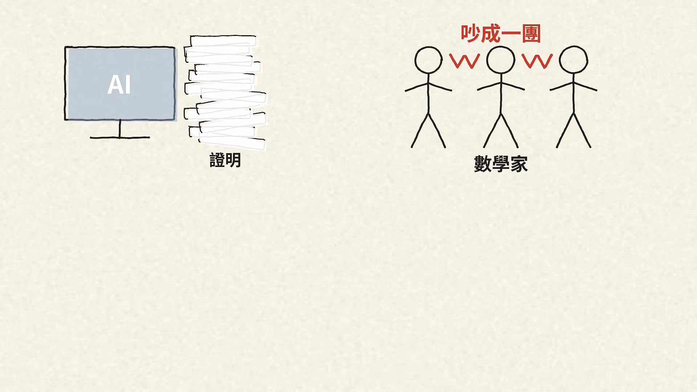

**逐字稿片段：** 這集我們分四層來看 先看 AI 公司跟數學家在吵什麼 是數學家怕被搶飯碗 還是有更深一層的理由

**話題推測：** 影片結構概覽：分四個層次討論

---

## 00:00:13

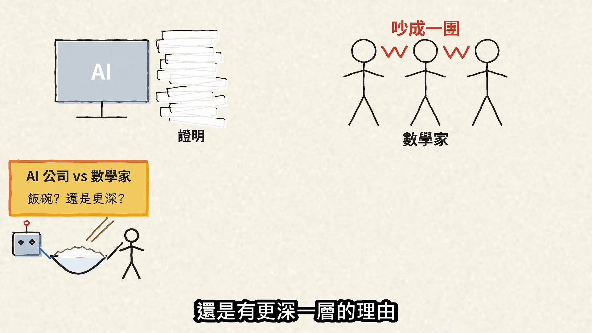

**逐字稿片段：** 再看旁觀的人 為什麼覺得數學家小題大作 AI 比人強 在圍棋和寫程式上早就是這樣 數學家為什麼不能像棋士和工程師一樣看開

**話題推測：** 第二層主題：旁觀者對數學家反應的看法

---

## 00:00:22

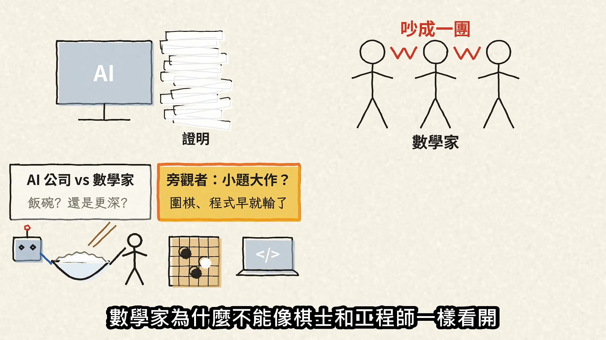

**逐字稿片段：** 接著，數學家自己之間，也分成兩派 驗證派和理解派

**話題推測：** 第三層主題：數學家內部的兩派分歧（驗證派與理解派）

---

## 00:00:26

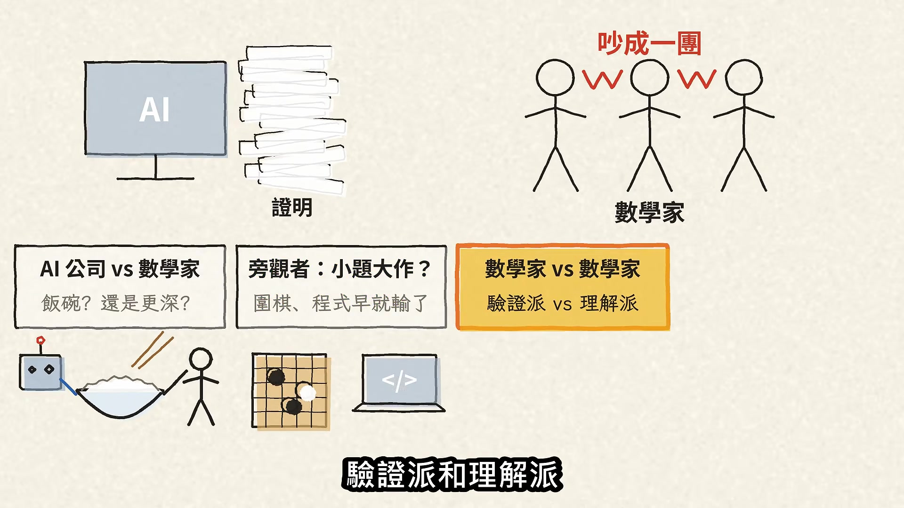

**逐字稿片段：** 最後問：這件事，對誰好，對誰最傷 「好」，又是誰來定義的

**話題推測：** 第四層主題：AI做數學對誰有好處，對誰傷害最大

---

## 00:00:31

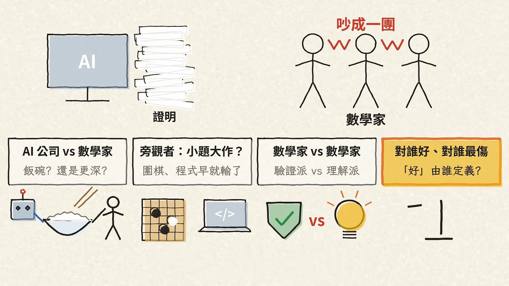

**逐字稿片段：** 先從數學界最有名的一個獎說起 數學界最有名的獎，叫費爾茲獎

**話題推測：** 引出新話題：數學界最知名的獎項——費爾茲獎

---

## 00:00:36

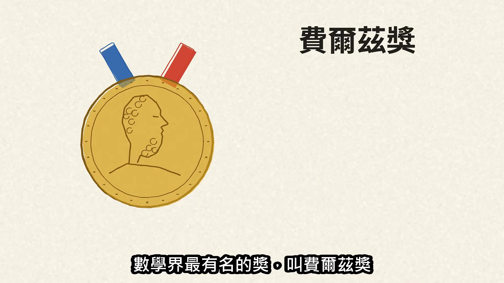

**逐字稿片段：** 四年頒一次 它有一個規矩：得獎那年的一月一日

**話題推測：** 費爾茲獎頒發頻率與年齡限制：四年頒一次

---

## 00:00:40

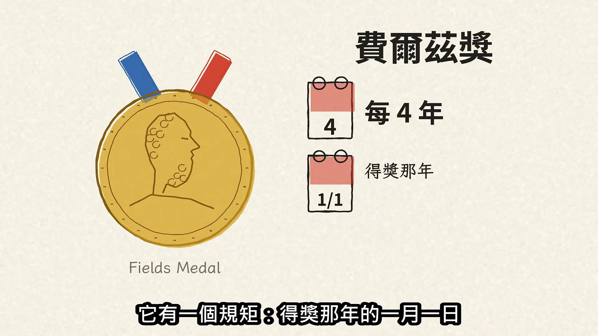

**逐字稿片段：** 不能滿四十歲 它發給誰 通常發給第一個把大問題證出來的人

**話題推測：** 費爾茲獎的年齡限制：得獎時不能滿四十歲

---

## 00:00:45

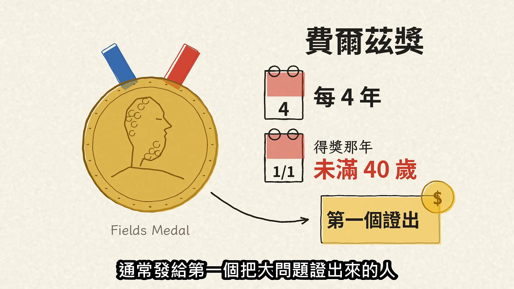

**逐字稿片段：** 比方說陶哲軒

**話題推測：** 引入費爾茲獎得主陶哲軒的例子

---

## 00:00:47

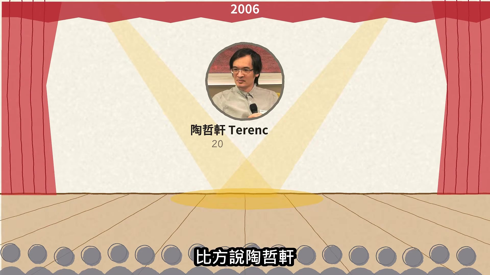

**逐字稿片段：** 2006 年拿到費爾茲獎 得獎理由是他在四個領域的貢獻 偏微分方程，組合數學，調和分析 還有加法數論 國際數學聯盟的新聞稿說 他是頂尖的問題解決者：技術強 點子多，切入的角度又很自然 讓別的數學家忍不住想 「為什麼以前沒人想到？」 那年他三十一歲 是那一屆最年輕的得主 可是四十歲這條線，也擋下過人

**話題推測：** 陶哲軒獲獎年份與貢獻領域：2006年獲獎

---

## 00:01:12

**逐字稿片段：** 英國數學家 Wiles

**話題推測：** 引入英國數學家Wiles的例子：費馬最後定理

---

## 00:01:13

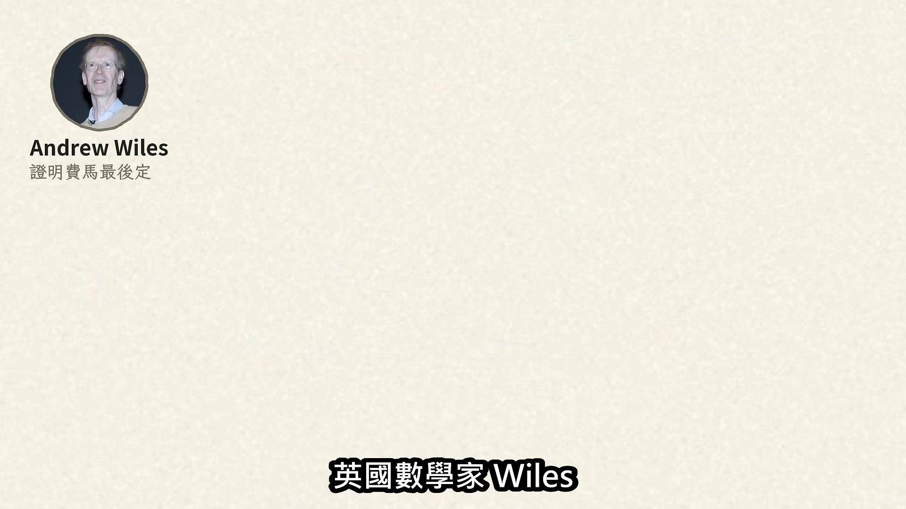

**逐字稿片段：** 1993 年宣布證出費馬最後定理 一個三百多年沒人解開的問題 審稿時被追問出一個洞 他和學生 Taylor 又花了一年補好 1995 年刊出

**話題推測：** Wiles證出費馬最後定理的年份：1993年

---

## 00:01:23

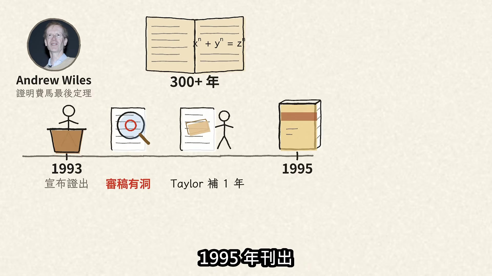

**逐字稿片段：** 兩篇加起來大約一百三十頁 問題是，1993 年宣布的時候 他剛滿四十歲 下一次頒費爾茲獎是 1994 年 那年一月一日，他已經四十歲了 等到 1995 年刊出，他四十二歲 費爾茲獎，就這樣發不了

**話題推測：** Wiles證明論文的篇幅：約一百三十頁

---

## 00:01:38

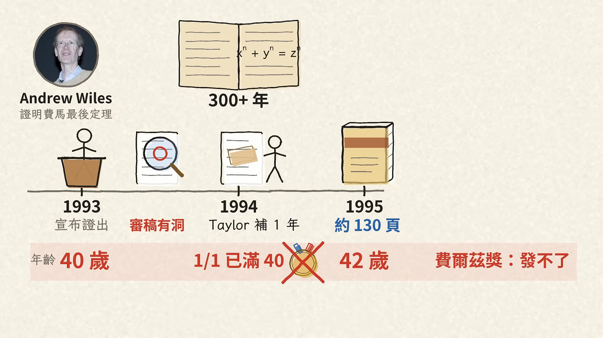

**逐字稿片段：** 1998 年 國際數學聯盟另外做了一面特別的銀牌給他 費馬當年說，書頁邊太窄 寫不下他的證明 頒獎時 費爾茲獎委員會主席 Manin 也補了一句 可惜這面牌子太小 寫不下 Wiles 的證明 像 Wiles 這樣 第一個證出來的人，名聲、獎章、教職 研究經費，都會跟著來

**話題推測：** 特別事件：1998年國際數學聯盟為Wiles頒發特別銀牌

---

## 00:01:59

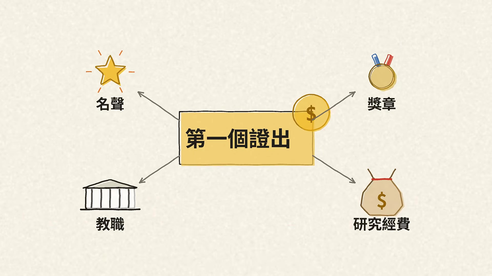

**逐字稿片段：** 在數學界，這就是最值錢的東西 我們可以把它叫做數學界的貨幣 「第一個找到證明」 這套獎，背後有一個沒寫出來的默認 要證出一個定理，你一定得先懂它 所以第一個證出來的人 就是第一個看懂的人 發獎給證出來的人 就等於發獎給看懂的人

**話題推測：** 總結：數學界最有價值的「貨幣」——「第一個證出來」

---

## 00:02:15

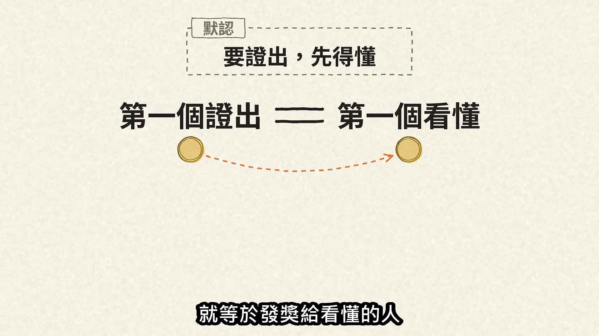

**逐字稿片段：** 前美國數學學會會長 Kra 今年九月寫得很直白 「深刻的定理又少又難 所以成了辨認深刻思考的好方法。」 定理，是一個替身 替的是更難量的東西：理解 她下一句是

**話題推測：** 引用前美國數學學會會長Kra的觀點

---

## 00:02:27

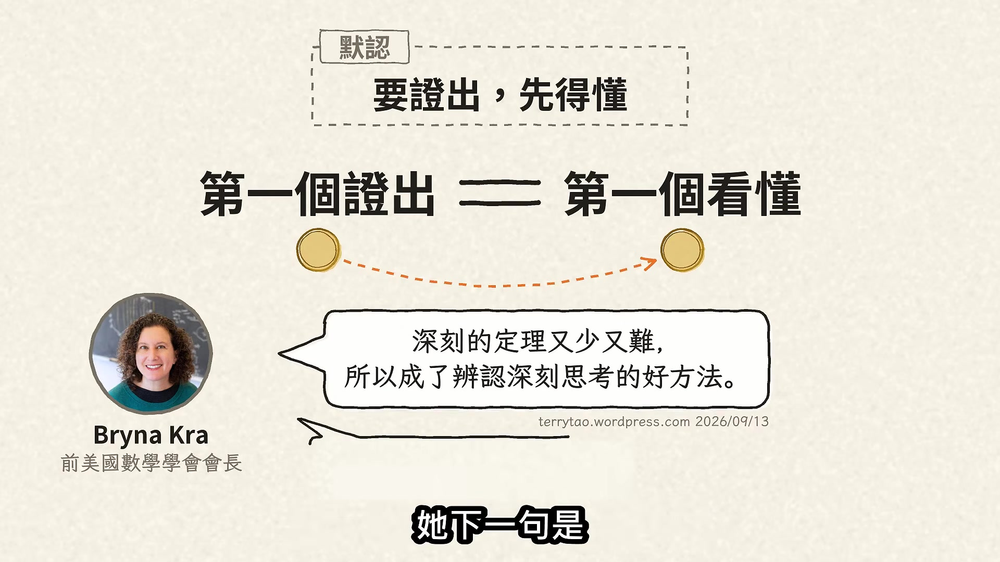

**逐字稿片段：** 「AI 把這套制度弄壞了。」

**話題推測：** 核心觀點：AI正在破壞現有制度

---

## 00:02:32

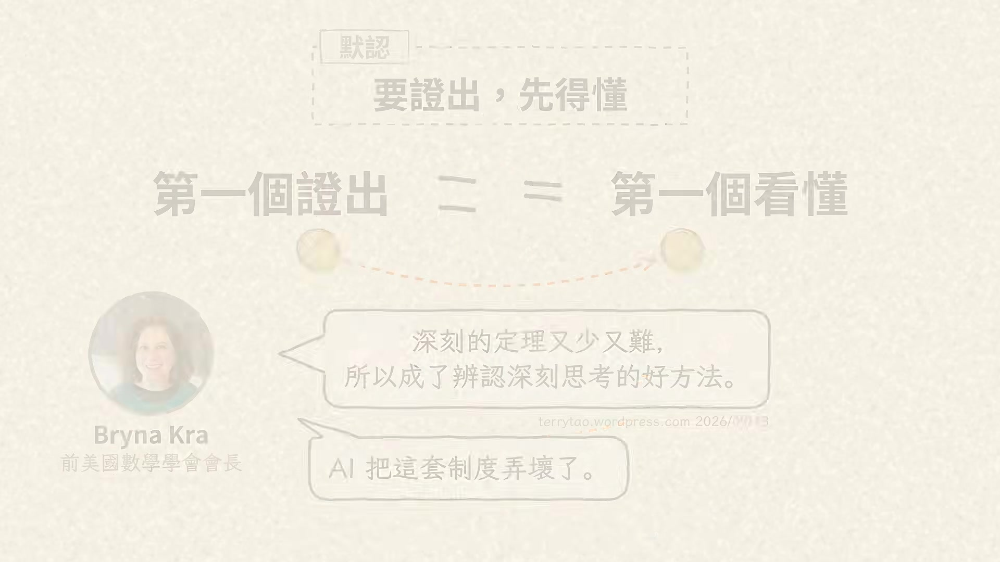

**逐字稿片段：** 今年九月，Anthropic 公布 他們的 AI 花了十一天 把同一個定理 寫成證明檢查程式 Lean 能逐行檢查的版本

**話題推測：** 新事件：今年九月Anthropic公布AI將定理轉為Lean可檢查版本

---

## 00:02:40

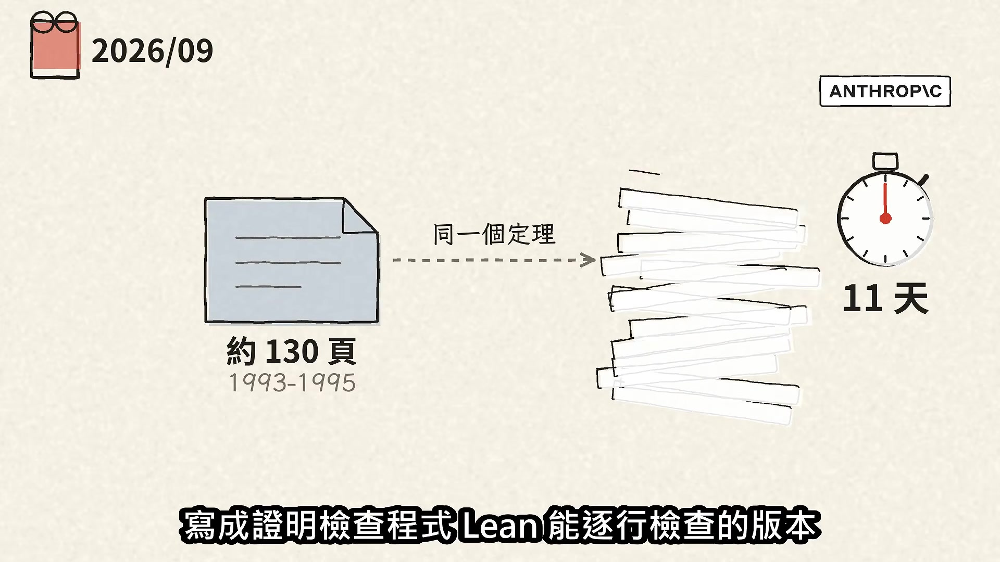

**逐字稿片段：** 一千三百多萬行 電腦說：對

**話題推測：** AI生成證明程式碼的行數：一千三百多萬行

---

## 00:02:43

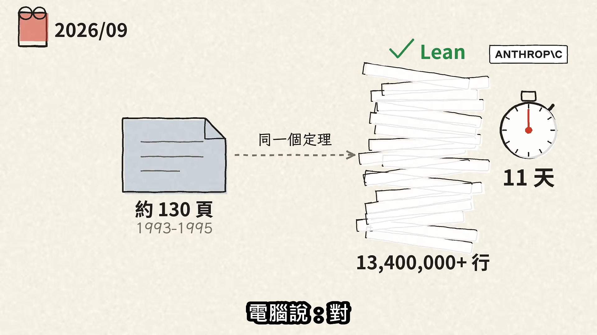

**逐字稿片段：** 主持費馬定理 Lean 計畫的數學家 Buzzard 對 AI 做得到這件事很興奮 可是他也寫，這件事在數學上 「幾乎什麼都沒告訴我們」 大家本來就確定這個定理是對的 那一百三十頁的證明，經過審稿和補洞 一群頂尖數學家花了一年多 一起看懂了 所以他們也沒什麼興趣 去讀那一千三百多萬行 大家早就很有信心，它是對的 比起被機器驗證過關 這個定理在數學家腦中「為什麼是對的」 好像更重要

**話題推測：** 引用數學家Buzzard對AI成果的看法

---

## 00:03:11

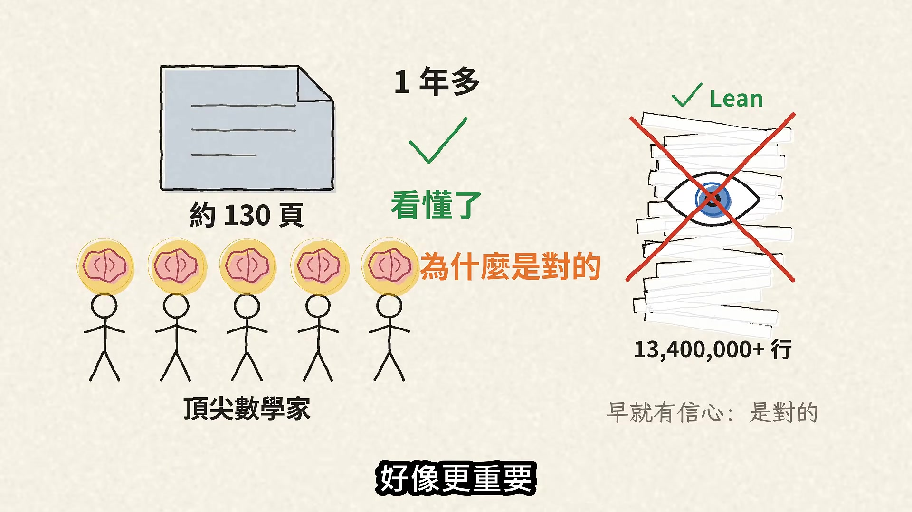

**逐字稿片段：** 那數學家到底在吵什麼 這場爭吵有好幾層，我們由外往內 一層一層看

**話題推測：** 重新聚焦：數學家爭吵的真正原因

---

## 00:03:18

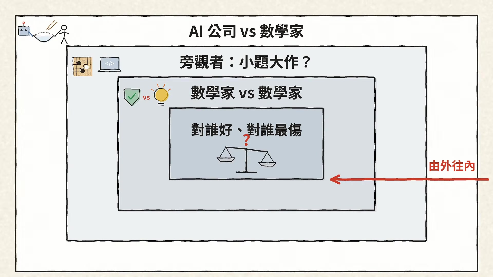

**逐字稿片段：** 先看最外層：AI 公司跟數學家

**話題推測：** 深入探討第一層：AI公司與數學家之間的矛盾

---

## 00:03:21

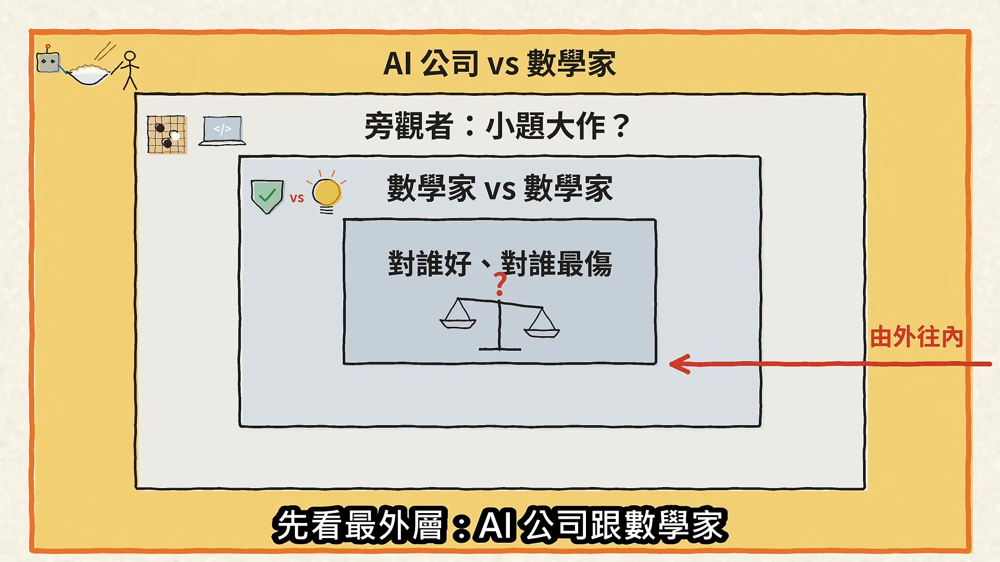

**逐字稿片段：** 我們把時間拉回去年十月，那時候 AI 解題的能力，還沒有今天這麼強

**話題推測：** 回溯時間線：去年十月AI解題能力尚未成熟

---

## 00:03:28

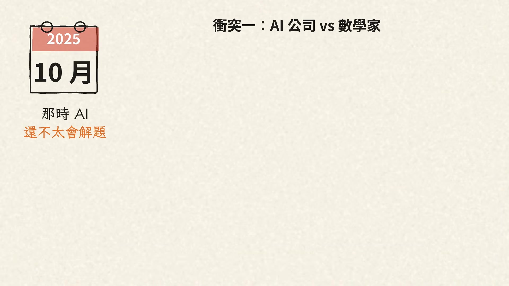

**逐字稿片段：** 有一個網站 專門收集數學家 Erdős 留下的上千個問題 陶哲軒寫，AI 很好用的一件事 是幫忙找文獻 網站的志工用 AI 去搜，人工看過

**話題推測：** 介紹Erdős問題網站

---

## 00:03:38

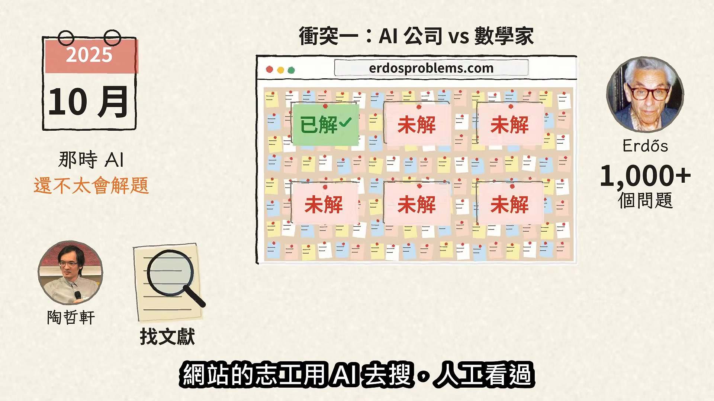

**逐字稿片段：** 已經有六題 因此從「未解」改成「已解」 一兩天後

**話題推測：** 利用AI從「未解」轉「已解」的Erdős問題數量：六題

---

## 00:03:44

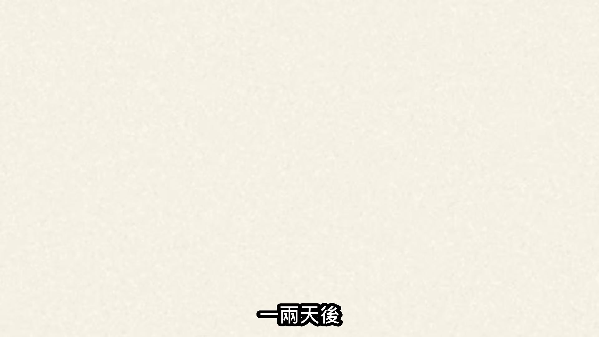

**逐字稿片段：** OpenAI 一位副總裁發文

**話題推測：** OpenAI副總裁發文宣稱GPT-5解題的新聞事件

---

## 00:03:46

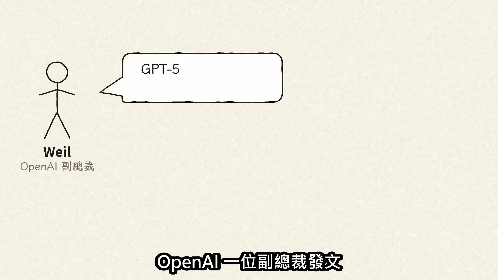

**逐字稿片段：** 「GPT-5 找到了十個之前未解的 Erdős 問題的解。」 很多人的第一個反應是：真的假的 有可能嗎

**話題推測：** OpenAI宣稱GPT-5解決的Erdős問題數量：十個

---

## 00:03:52

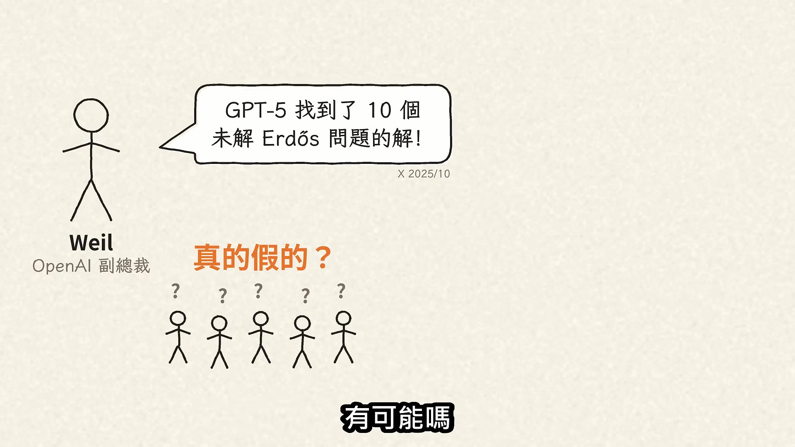

**逐字稿片段：** 網站站長 Bloom 很快回 「這是嚴重的誤導。」 AI 找到的，是早就有人解掉 只是他不知道的論文 接著

**話題推測：** 引用Erdős問題網站站長Bloom的回應，指出OpenAI誤導

---

## 00:04:00

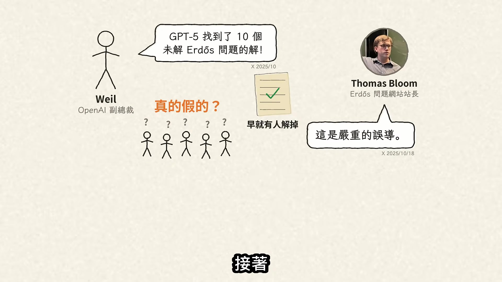

**逐字稿片段：** 對手 Google DeepMind 的執行長 Hassabis 在 OpenAI 研究員跟著宣傳的貼文底下 回了一句：「這很丟臉。」 副總裁那則貼文，後來刪掉了 所以沒有人反對 AI 幫忙找文獻 大家反對的 是把「找到」講成「解了」 為什麼要搶著說「解了」 因為在數學界，「第一個解出」就是錢 看起來，AI 公司搶的 正是這個舊貨幣

**話題推測：** 引用Google DeepMind執行長Hassabis對OpenAI說法的批評

---

## 00:04:21

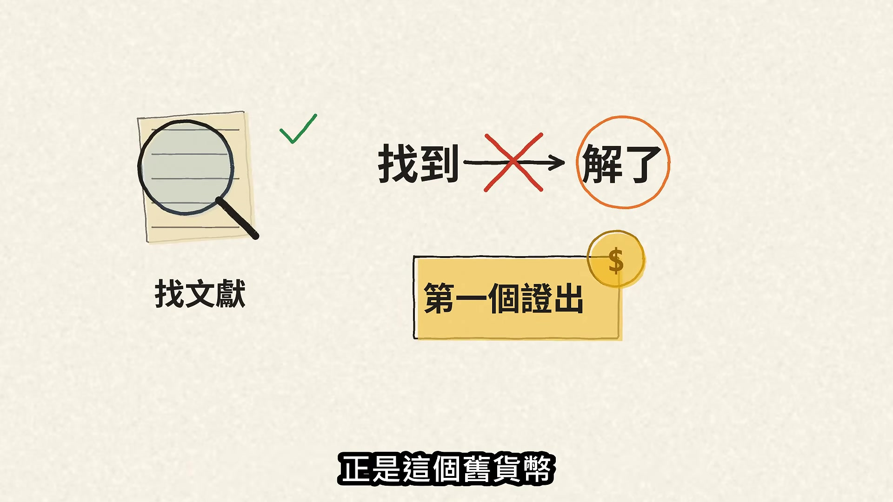

**逐字稿片段：** 一年後，AI 是真的會解題了 事情也變大了 今年九月

**話題推測：** 時間推進：一年後AI解題能力大幅提升

---

## 00:04:26

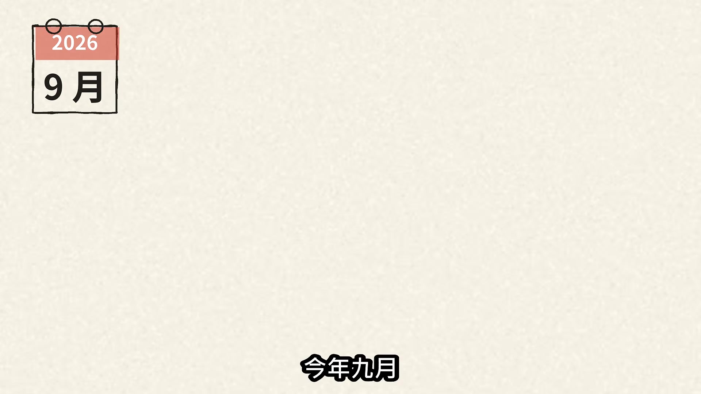

**逐字稿片段：** OpenAI 宣布他們的 AI 解了一道描述流體的難題 Navier-Stokes 方程式 找到一種情況 會讓方程式的解「爆掉」

**話題推測：** OpenAI宣布AI解出一道流體難題：Navier-Stokes方程式

---

## 00:04:34

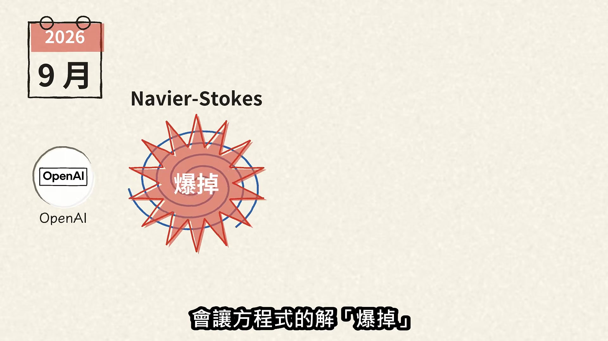

**逐字稿片段：** 這是七個千禧年大獎難題之一 Clay 數學研究所在 2000 年提出 解出一題，獎金一百萬美元 七題裡第一個被解出來的 是龐加萊猜想

**話題推測：** 介紹千禧年大獎難題，共七個

---

## 00:04:43

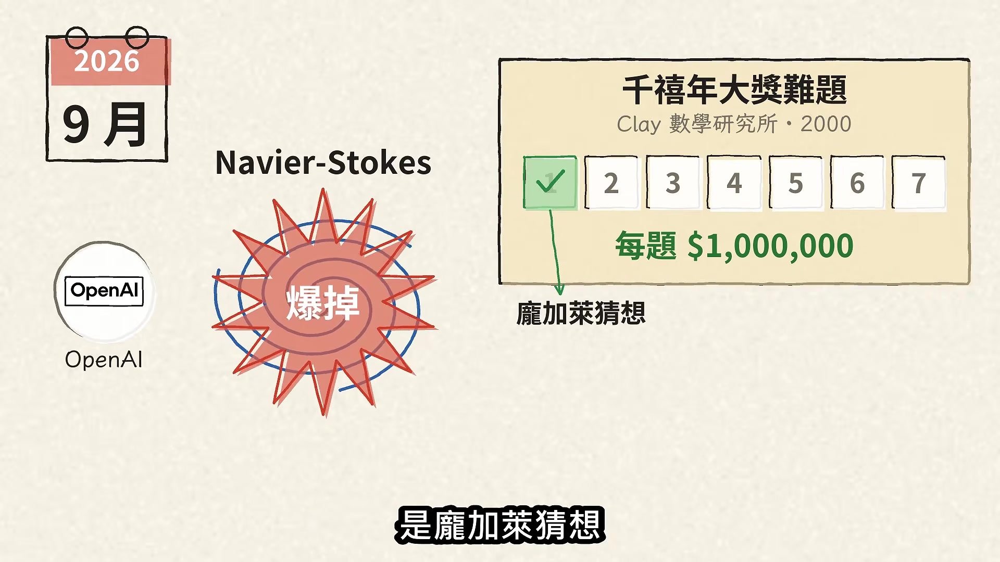

**逐字稿片段：** 解出它的俄羅斯數學家 Perelman 2010 年拒領了這筆獎金 這次，OpenAI 也說不打算領獎 看起來，「第一個解出來」這塊招牌 比一百萬美元還值錢 但幾天後

**話題推測：** 提及龐加萊猜想的解出者Perelman拒領獎金

---

## 00:04:56

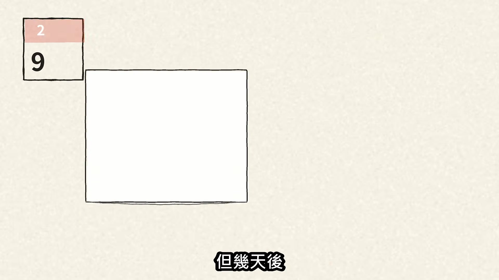

**逐字稿片段：** 二十五位費爾茲得主發表聯署聲明 後來增加到二十八位 矛頭指向 AI 公司 「AI 公司的目標 跟數學社群的目標，嚴重錯位。」 錯位在哪呢 七大千禧年難題被解出來 這不是數學家集體追求的目標嗎 還是說，數學家不爽的是功勞被搶走

**話題推測：** 重大事件：25位費爾茲獎得主聯署聲明反對AI公司

---

## 00:05:16

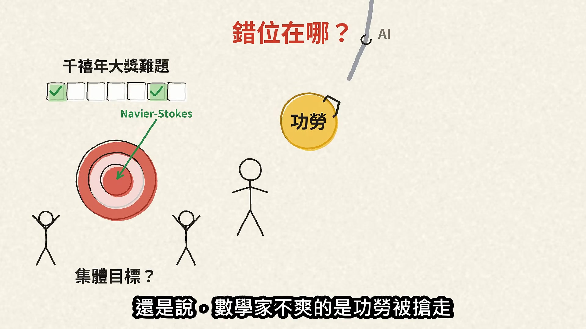

**逐字稿片段：** 我們剪過一集 Buckmaster 的訪談 就在講搶功勞這件事，所以確實有爭議 如果只是搶功勞，事情還算好解決 名字寫對，誰做的寫清楚，就好了 數學家為什麼吵得這麼兇 很多旁觀的人 以為數學家在爭的是功勞 可是數學家在吶喊的是 「第一個解出來」這個舊貨幣 已經在崩解 他們需要的，是一個新貨幣 「第一個看懂」

**話題推測：** 提及先前報導Buckmaster的訪談，關於搶功勞爭議

---

## 00:05:42

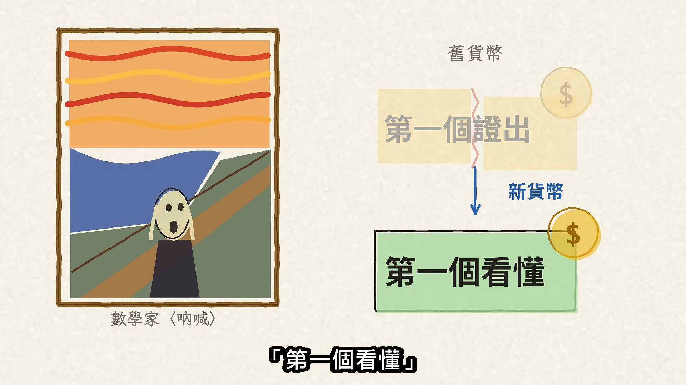

**逐字稿片段：** 我們接著來到第二層 數學跟其他領域有什麼不一樣 旁觀的人，有幾種說法

**話題推測：** 進入第二層探討：數學與其他領域的差異

---

## 00:05:51

**逐字稿片段：** 前 Salesforce 首席科學家 Socher 九月在一個科技節目上說 「我沒辦法想像，醫學研究者會說 各位先別治好這些病 讓幾十萬病人再多死幾年 好讓我們對自己的工作感覺良好。」 這段，我們之前剪過 我們的留言區，也常看到

**話題推測：** 引用前Salesforce首席科學家Socher的類比觀點

---

## 00:06:07

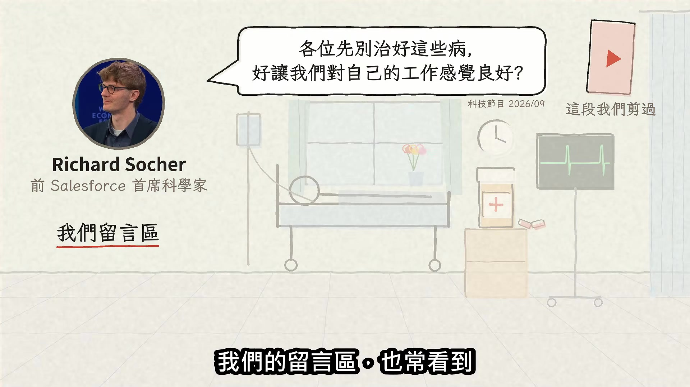

**逐字稿片段：** 「AI 開始搶數學家飯碗了 這些數學家當然說 AI 不好啊。」 「數學家知道當年紡織工人的恐懼了吧。」 還有人說 寫程式的人早就被 AI 搶過飯碗 也沒看他們跳出來

**話題推測：** 引用網路留言區對數學家的常見批評

---

## 00:06:18

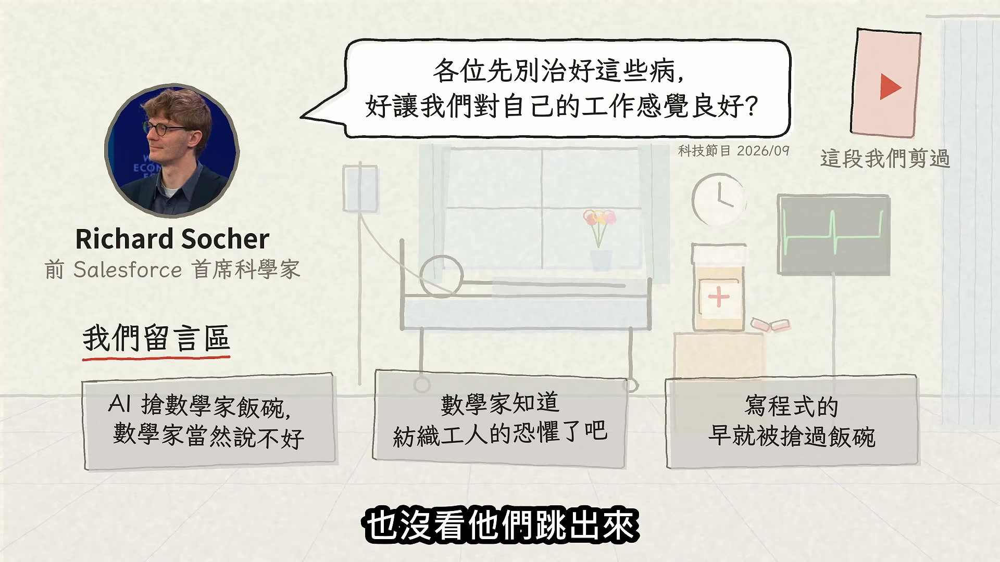

**逐字稿片段：** 另一個常見的比較是圍棋

**話題推測：** 對比分析：圍棋界如何應對AI衝擊

---

## 00:06:21

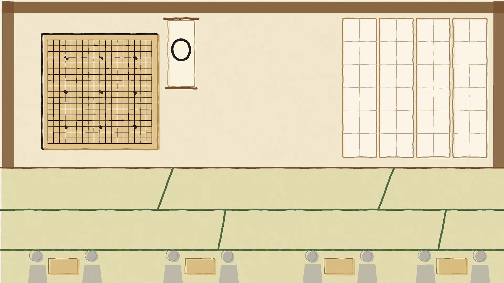

**逐字稿片段：** 2016 年 AlphaGo 贏了李世乭 圍棋界吵過一陣，後來接受了 數學家為什麼不行 我們覺得，差在獎是跟誰比 圍棋的頭銜，是人跟人比出來的 AI 再強，也不會上台搶頭銜 棋賽照打，AI 變成練習的對手 有研究發現，AlphaGo 之後 職業棋士下得更好，也更有新意 代價也是真的

**話題推測：** 2016年AlphaGo擊敗李世乭的事件

---

## 00:06:42

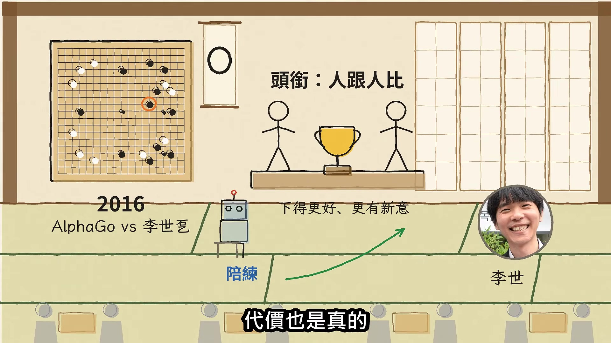

**逐字稿片段：** 李世乭 2019 年退休時說 AI 是一個打不倒的存在 工程師這邊呢

**話題推測：** 引用李世乭2019年退休時對AI的看法

---

## 00:06:48

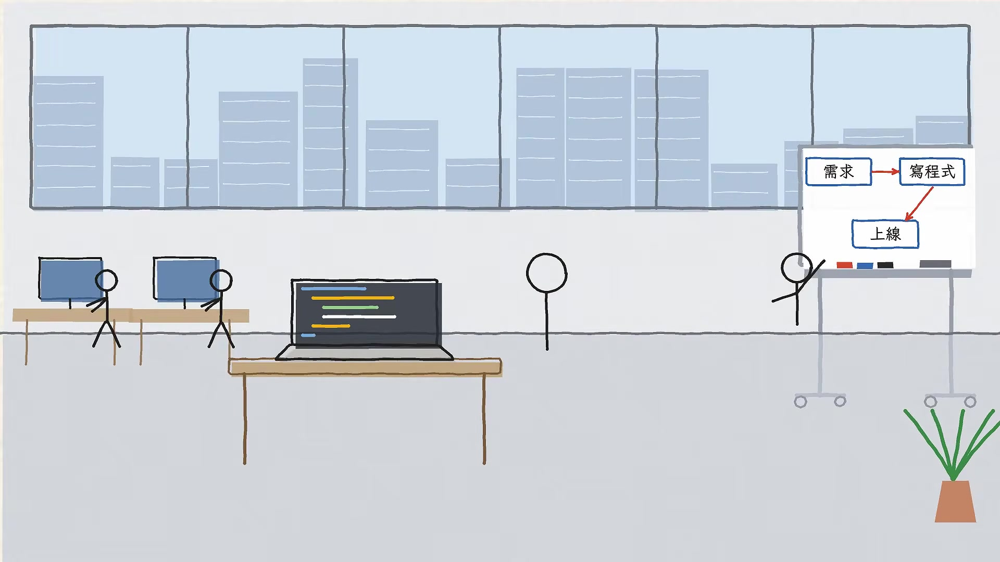

**逐字稿片段：** 公司付錢，買的是做出能用的東西 不是第一個看懂這段程式的人 AI 搶的是工作量，是飯碗 付錢的方式，沒有變

**話題推測：** 對比分析：工程師領域如何應對AI衝擊

---

## 00:06:59

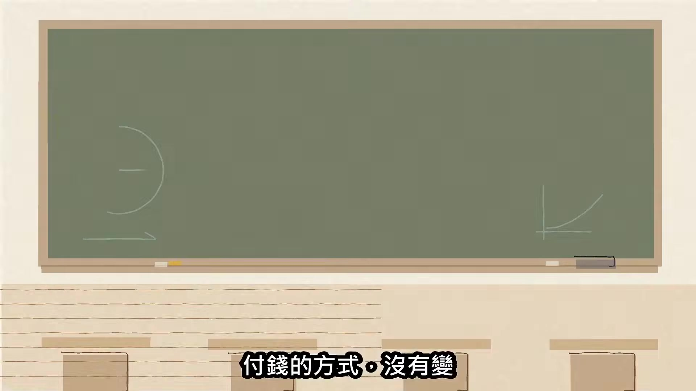

**逐字稿片段：** 但數學不一樣 數學的獎，是跟真理比的 某件事是真的，第一個知道的人 只有一個 AI 先到了 人就再也當不了那個第一 所以圍棋，是排名被動到 工程師，是飯碗被動到 數學，是貨幣本身被動到 如果說數學最重要的產品 就是解出難題，這些人說得對 藥有效就好，誰在乎是誰找到的 懂不懂原理 證明對了，就好

**話題推測：** 總結數學領域與其他領域的不同之處

---

## 00:07:23

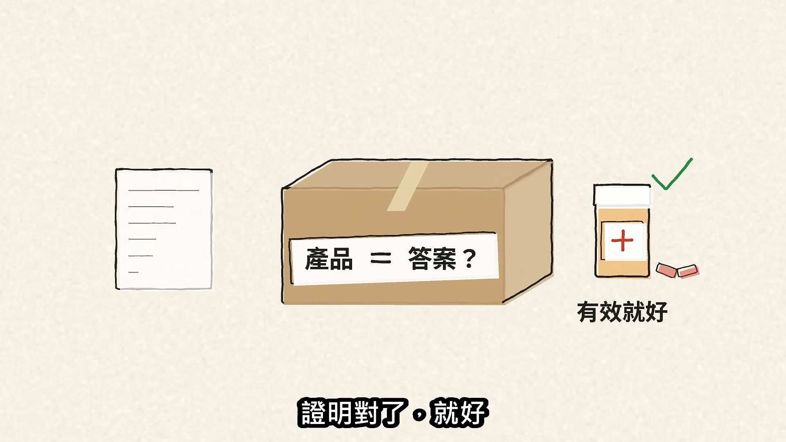

**逐字稿片段：** 所以真正要問的是：數學的產品 是答案嗎

**話題推測：** 核心問題：數學的「產品」僅僅是答案嗎？

---

## 00:07:28

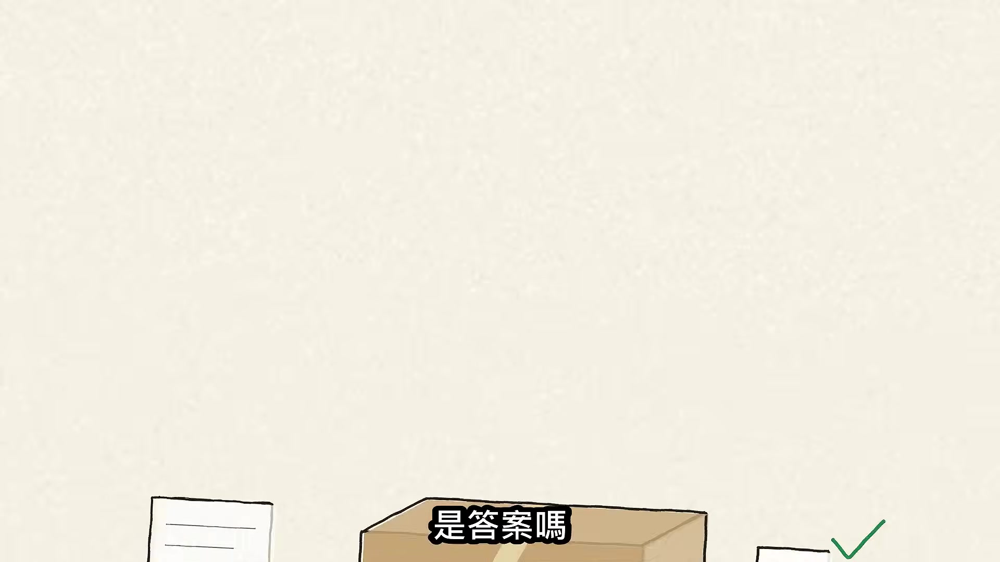

**逐字稿片段：** 陶哲軒十月在加州理工學院演講 用一張圖畫過數學平常怎麼運作 左邊是題目，右邊是解答，正中間 是人的理解 人在解題的路上學到東西，這些理解 再幫忙做出解答 我們推近看這一條：應用題往下走 人的理解從右邊併進來，兩條合成一條 想出新的純數學題目 這是 AI 出現以前 數學平常的樣子 所以數學的產品，不只是答案 答案用掉就沒了 人的理解，會長出下一題 這就是我們說的理解 會長出下一題的東西

**話題推測：** 引用陶哲軒在加州理工學院的演講，用圖說明數學運作

---

## 00:08:02

**逐字稿片段：** Wiles 就是一個很好的例子 他為了費馬發展的方法，接下來十幾年 被別人拿去證出一串猜想 包括他當年只證了一部分的那個大猜想的完整版 連驗證派的 Buzzard 都這樣寫

**話題推測：** 再次以Wiles為例，說明證明方法帶來的後續洞見

---

## 00:08:14

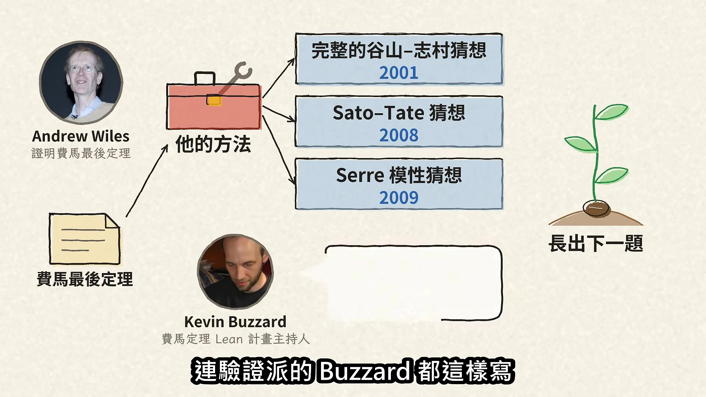

**逐字稿片段：** 費馬最後定理本身 是一個「沒有應用的 三百五十年的小謎題」 值錢的，是它帶來的深刻新洞見 三十年後還在發酵 反過來的例子也有

**話題推測：** 引用Buzzard對費馬最後定理「沒有應用」的看法

---

## 00:08:26

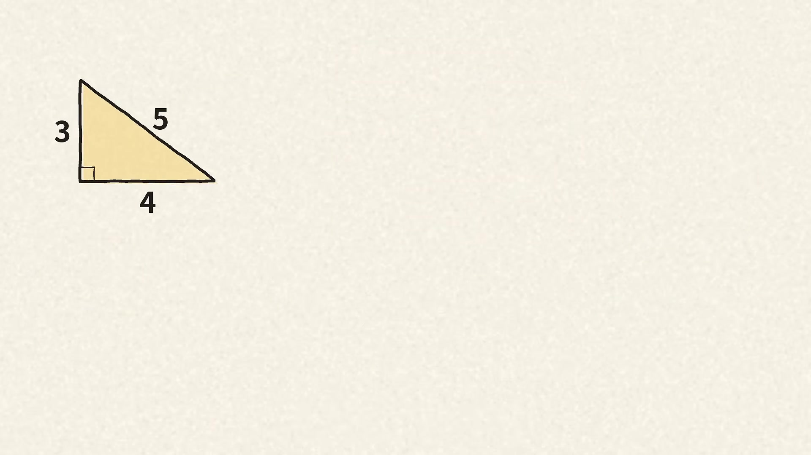

**逐字稿片段：** 像三、四、五這種，兩個數的平方相加 剛好是第三個數的平方，叫畢氏三元數 問題是：把一、二、三一路往下 每個數塗成紅或藍 能不能讓每一組畢氏三元數 都不是同一個顏色 2016 年

**話題推測：** 解釋畢氏三元數概念與著色問題

---

## 00:08:41

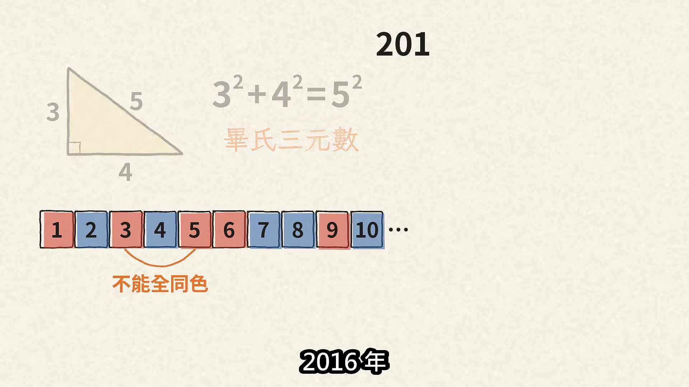

**逐字稿片段：** 三位電腦科學家用超級電腦算出答案 塗到七千八百二十四還可以 到七千八百二十五就不行

**話題推測：** 2016年電腦解出畢氏三元數著色問題的結果

---

## 00:08:47

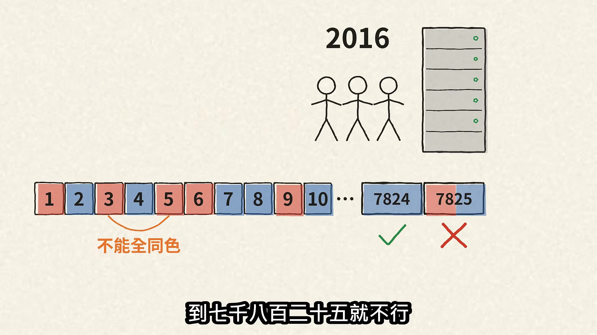

**逐字稿片段：** 證明檔大約兩百 TB 《自然》期刊的報導寫 電腦解開了這題 卻沒有給出「為什麼不行」的理由 也沒說七千八百二十五 有沒有什麼意義 大家相信它是對的 可是我們覺得，從這樣的答案裡 很難長出下一題 答案太長，是個大問題 那是不是只要答案夠短 就一定看得懂呢

**話題推測：** 電腦證明檔案的大小：約兩百TB

---

## 00:09:07

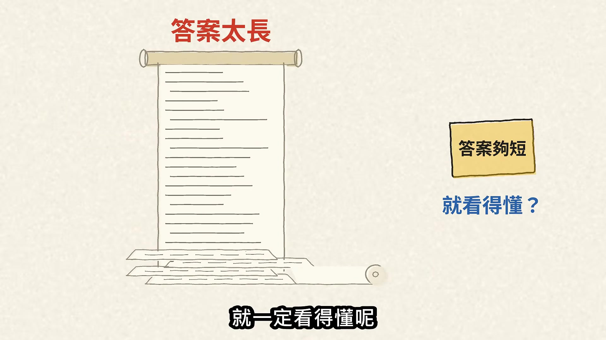

**逐字稿片段：** 今年八月 Anthropic 的數學家 Alpöge 和兩位合作者 用 AI 找到一個數學家找了二十多年的東西 一種很特別的正負號方陣

**話題推測：** 新事件：今年八月Anthropic數學家利用AI找到Hadamard矩陣

---

## 00:09:16

**逐字稿片段：** 叫做 Hadamard 矩陣 大小是六百六十八 電腦一下就驗完，是對的 可是沒有任何解釋 斷斷續續研究過它的 Williamson 說 「就像肚子被揍了一拳。」 還有 「我再也不想研究 Hadamard 矩陣了。」 所以重點不是證明長不長 重點是，有沒有人因此懂了什麼 能接著往下做

**話題推測：** 說明Hadamard矩陣的特性

---

## 00:09:34

**逐字稿片段：** 那數學家自己，都同意嗎 沒有 在我們看來，他們吵的 不是 AI 好不好，而是 該付錢買哪一個

**話題推測：** 進入第三層探討：數學家內部的意見分歧

---

## 00:09:42

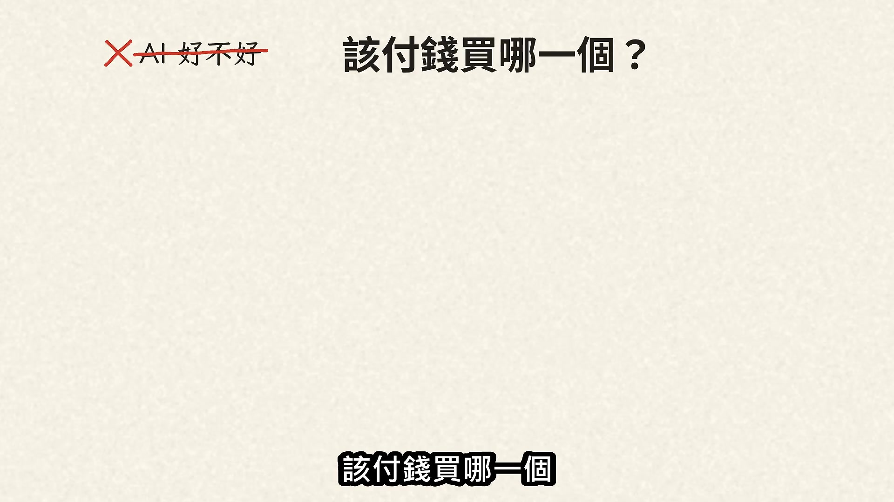

**逐字稿片段：** 一派是驗證派 講得最直白的，就是 Buzzard 十月一日，他在部落格寫 「我是為了定理數而來的。」 理解是一個有點模糊的概念 被正確證明的定理有多少，才量得出來 他還說：「你騙不了 Lean。」 他也承認，自己好像是少數派

**話題推測：** 介紹第一派：驗證派的立場

---

## 00:09:59

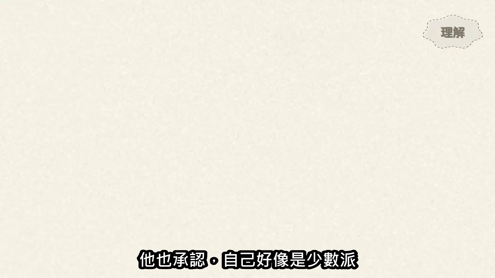

**逐字稿片段：** 另一派是理解派

**話題推測：** 介紹第二派：理解派的立場

---

## 00:10:01

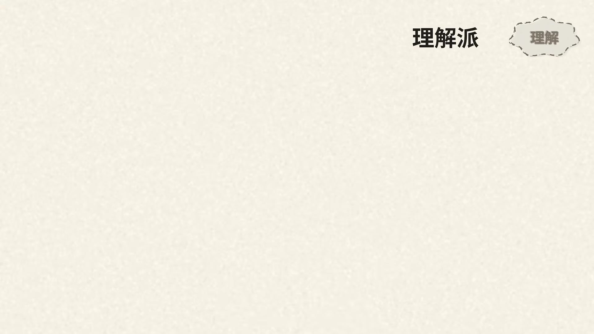

**逐字稿片段：** 四色定理說：隨便一張地圖 只要四種顏色 就能讓相鄰的國家都不同色

**話題推測：** 以四色定理為例，說明對「理解」的渴望

---

## 00:10:07

**逐字稿片段：** 1976 年，兩位數學家靠電腦 把將近兩千種情況一個一個檢查完 證出來 這個證明，當年引起很大的爭議

**話題推測：** 1976年電腦證明四色定理的過程

---

## 00:10:15

**逐字稿片段：** 1982 年的費爾茲得主 Thurston 寫 爭議的重點，不是懷疑它錯 而是大家一直渴望理解一個證明 不只是知道定理是對的 今天的理解派裡

**話題推測：** 引用1982年費爾茲獎得主Thurston對四色定理爭議的解釋

---

## 00:10:25

**逐字稿片段：** 2018 年的費爾茲得主 Scholze 講得最直接 九月在海德堡的座談上，他說 「我看不出加速本身有什麼價值。」 成果再加速，人的理解，只會更少

**話題推測：** 引用2018年費爾茲獎得主Scholze的直接觀點：加速無價值

---

## 00:10:35

**逐字稿片段：** 所以這兩派吵的，其實是同一件事：獎 要發給「證對了」 還是發給「看懂了」 以前不用選，因為這兩個是同一個人 現在要選了 這個選擇，不只是發獎 貨幣如果還是「解出幾題」，經費 教職、大家的注意力 就會往 AI 解得掉的地方流

**話題推測：** 總結兩派爭議的核心：獎勵「證對了」還是「看懂了」

---

## 00:10:54

**逐字稿片段：** 有一個老笑話：醉漢在路燈下找鑰匙 路人問，鑰匙掉在這裡嗎 他說，不是，掉在那邊公園 可是這裡比較亮 今年十月

**話題推測：** 引用醉漢在路燈下找鑰匙的笑話，比喻資源流向

---

## 00:11:04

**逐字稿片段：** OpenAI 拿大約四千道題目給它的模型做 挑出三百七十多組它覺得夠分量的成果 寫成七百二十二篇手稿公開 這不是嚴格的「解題率」 可是大約九成的題目，沒有東西發出來

**話題推測：** OpenAI測試題目數量與產出成果數量：四千題與三百七十組成果

---

## 00:11:15

**逐字稿片段：** 陶哲軒打過一個比方 AI 像一台跳得比人高的機器 在黑夜的山區亂跳 跳上了最矮的那幾面牆 所以如果獎還是發給「解出幾題」 大家就會擠到 AI 跳得上的那幾面矮牆旁邊 路燈下很亮，可是鑰匙，不一定在那裡

**話題推測：** 引用陶哲軒的跳高機器比喻，說明AI如何解題

---

## 00:11:31

**逐字稿片段：** 2022 年的費爾茲得主 Duminil-Copin 用的是另一盞燈 他八月寫，一個數學問題 「是夜裡的燈塔 照亮並引導數學家的漫遊」 他還說：別把我們最美的猜想 褻瀆成測試模型的考題 照他的比喻往下想：燈塔不是目的地 它標出礁石，讓船知道自己在哪 真的把船開到燈塔底下，就撞礁了 路燈照的，是你已經站著的地方 燈塔，是讓人自己選方向 去認識周圍那一片黑 那片黑為什麼重要 因為純數學的用途 常常從沒人看好的地方冒出來

**話題推測：** 引用2022年費爾茲獎得主Duminil-Copin的燈塔比喻

---

## 00:12:05

**逐字稿片段：** 英國數學家 Hardy 在 1940 年寫 還沒有人發現數論有任何戰爭上的用途 1985 年 兩位數學家各自把數論裡的橢圓曲線拿來做密碼 今天的網路加密、比特幣，都用得到它 可是這個道理，也能反過來問數學家 現在數學家最不看好的 正是沒人看得懂的數學 照同一個道理，又怎麼知道 那裡不會長出有趣的東西呢

**話題推測：** 引用英國數學家Hardy在1940年對數論無戰爭用途的看法

---

## 00:12:29

**逐字稿片段：** 貨幣要是貶值了，誰最痛 先看已經成名的人

**話題推測：** 進入第四層探討：數學貨幣貶值對不同人群的影響

---

## 00:12:33

**逐字稿片段：** 康乃爾大學的數學家 Strogatz 在雜誌訪問裡講到 AI，哭了 他後來寫 「不是因為 AI 會搶走我的工作 我六十七歲，快退休了。」 他哭，是捨不得 數學是人類講了幾千年的一場對話 講的不只是什麼是對的，還有為什麼 這裡面很珍貴的東西，可能會不見 後來他在文章底下留言 承認自己有個盲點 他沒想到研究生和博後 對快退休的人，這是捨不得

**話題推測：** 引用康乃爾大學數學家Strogatz對AI的感傷反應

---

## 00:12:58

**逐字稿片段：** 對研究生和博後，這是飯碗 現在的博士生，正要賺第一筆

**話題推測：** AI衝擊對研究生和博士後的影響：飯碗問題

---

## 00:13:04

**逐字稿片段：** 滑鐵盧大學的 Wang 寫 年輕人對數學的主要貢獻，就是證明 就是解題 照數學界的傳統 獎勵的是第一個解出的人 「第二個解出來，價值很低 甚至沒有」

**話題推測：** 引用滑鐵盧大學Wang的觀點：年輕人靠解題做貢獻

---

## 00:13:15

**逐字稿片段：** 一位正在申請博士後的年輕數學家寫 OpenAI 宣布 AI 證出他博士論文研究的那個猜想 那天早上 他的研究計畫又有一部分過時了 他整個早上都在重寫 慌張地寫信給指導教授

**話題推測：** 一位年輕數學家因AI解題而需重寫博士研究計畫的個案

---

## 00:13:28

**逐字稿片段：** Duminil-Copin 也在問 「我們該怎麼跟剛進這個領域的年輕博士生說 他們該做哪些題目？」 題目被 AI 先解掉 他們就少了那一句「這題是我第一個解出來的」 可以拿去找工作

**話題推測：** Duminil-Copin提出的問題：如何引導年輕博士生選題

---

## 00:13:41

**逐字稿片段：** 那未來的博士生呢 這就變成教育的問題

**話題推測：** 對未來博士生教育的影響

---

## 00:13:45

**逐字稿片段：** Scholze 在座談上說，讀博士 新定理從來不是重點 重點是你學會怎麼深入想一個問題 怎麼卡住，然後在某個時候 找到對的想法 如果拿來卡住的題目 都先被 AI 解掉了 理解要從哪裡練 這一題，現在還沒有人有好答案

**話題推測：** 引用Scholze的觀點：博士階段重點在學習思考過程而非新定理

---

## 00:14:03

**逐字稿片段：** 所以回到那個問題：AI 做數學 好不好 我們的整理是：對答案來說，很好 解出來的題目變多了 對已經成名的人，影響不大 對正要入行的人，最傷 對數學本身好不好，要看獎 以後改發給誰

**話題推測：** 總結：AI做數學「好不好」的答案

---

## 00:14:18

**逐字稿片段：** 「制度要改」，誰都會說

**話題推測：** 提及制度改革的必要性，但執行困難

---

## 00:14:19

**逐字稿片段：** 陶哲軒七月在國際數學家大會上也說 「我們剛剛為解題頒了四面獎章 沒有為審稿頒四面獎章。」 難的是，要改發給「第一個看懂的人」 可是誰是第一個看懂的人 「第一個證出」，可以蓋時間戳 論文哪天貼上網，一查就知道 「第一個看懂」，沒有時間戳

**話題推測：** 引用陶哲軒在國際數學家大會上對獎勵機制的評論

---

## 00:14:37

**逐字稿片段：** 開頭那位 Kra 建議，期刊把發現 證明、形式化、講解，分開記功 可是「講解」，要記給誰 有人在試幾種定義

**話題推測：** 引用Kra的建議：期刊將發現、證明、形式化、講解分開記功

---

## 00:14:48

**逐字稿片段：** 陶哲軒的版本 作者要能上台講這個結果、回答問題 不然就不該當作者

**話題推測：** 探討第一種「看懂」的定義：陶哲軒的版本

---

## 00:14:53

**逐字稿片段：** 第二種 把 AI 的證明整理成人看得懂的版本的人 比方說，今年五月 九位數學家就把 AI 推翻 Erdős 單位距離猜想的證明 整理成論文 費爾茲得主 Gowers 說 如果這篇是人類投到《數學年刊》 他會毫不猶豫建議接受

**話題推測：** 探討第二種「看懂」的定義：將AI證明整理成人懂的版本

---

## 00:15:09

**逐字稿片段：** 第三種：拿它做出下一個結果的人 就像那些拿 Wiles 的方法 往下證出一串猜想的人 三種都有問題：會上台講 不一定是第一個懂 整理的人，功勞該算多少 下一個結果，可能十年後才出現

**話題推測：** 探討第三種「看懂」的定義：拿其做出下一個結果的人

---

## 00:15:23

**逐字稿片段：** 怎麼頒獎給，第一個看懂的人 到今天，還沒有答案 今天提到的文章和影片，連結都放在說明欄

**話題推測：** 結論：如何獎勵「第一個看懂的人」仍無答案

---
