# ai-note-101_6q1bu4wlexQ — 關鍵畫面索引

- 來源逐字稿：[ai-note-101_6q1bu4wlexQ_GT.srt](ai-note-101_6q1bu4wlexQ_GT.srt)
- 影片：https://www.youtube.com/watch?v=6q1bu4wlexQ
- 截圖數：42

## 00:00:04

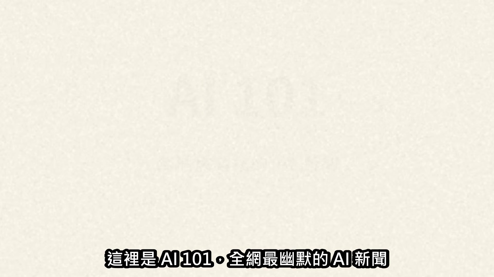

**逐字稿片段：** 亞馬遜想娶一家才3歲的 AI 新創

**話題推測：** 介紹主話題：亞馬遜擬收購Decart AI新創

---

## 00:00:06

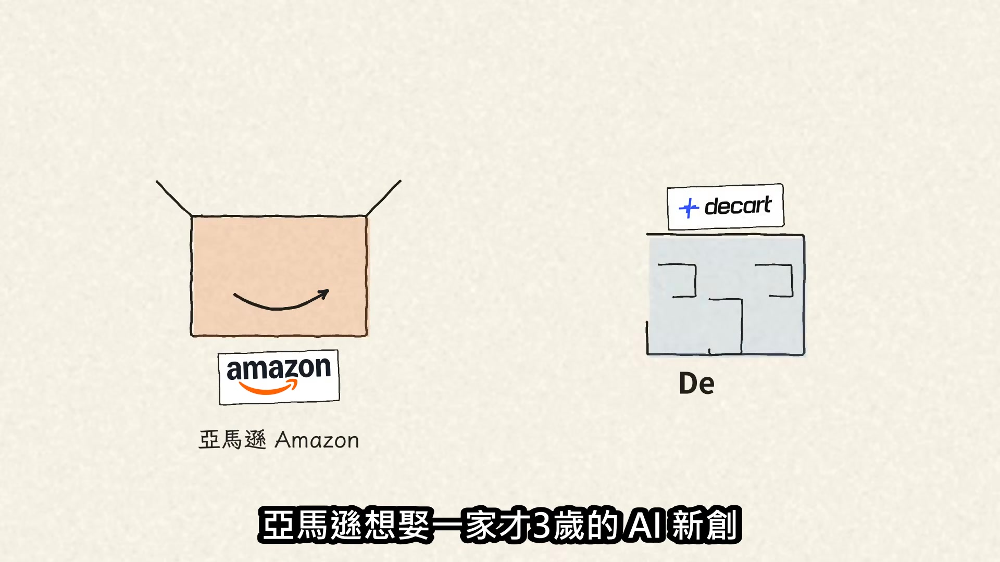

**逐字稿片段：** 10月11日，《華爾街日報》報導 亞馬遜正在談判

**話題推測：** 新聞來源與日期：《華爾街日報》報導

---

## 00:00:11

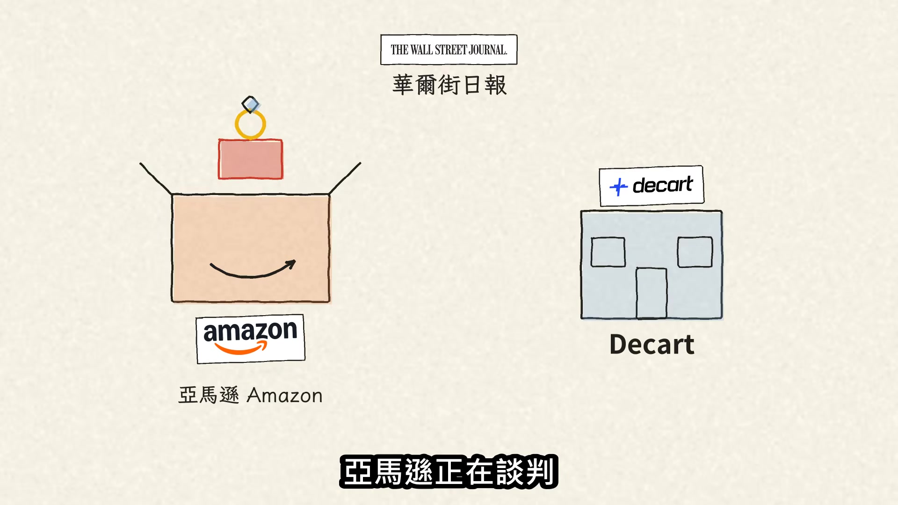

**逐字稿片段：** 要用大約70億美元收購 Decart

**話題推測：** 具體收購金額：大約70億美元

---

## 00:00:14

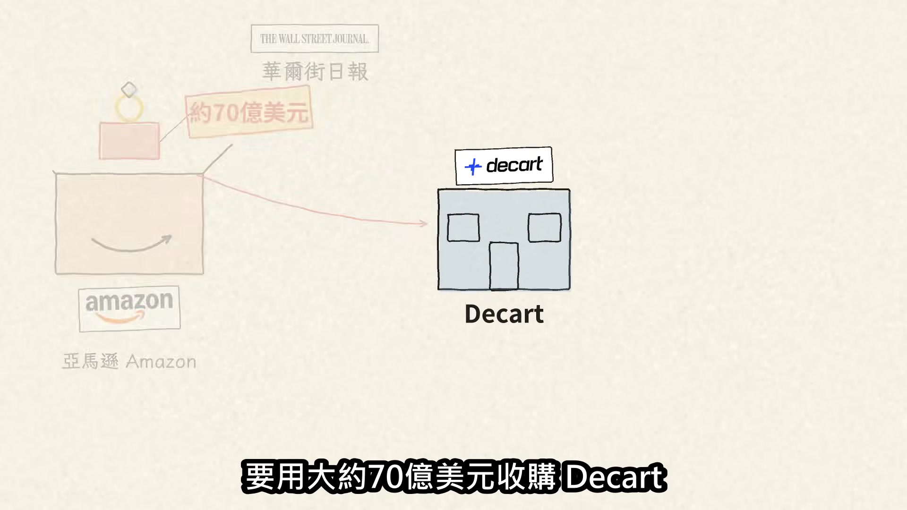

**逐字稿片段：** 可是亞馬遜不是第一個：幾個月內 這是 Decart 第三次被傳要賣掉

**話題推測：** 話題轉折：Decart被傳要賣掉的歷史

---

## 00:00:20

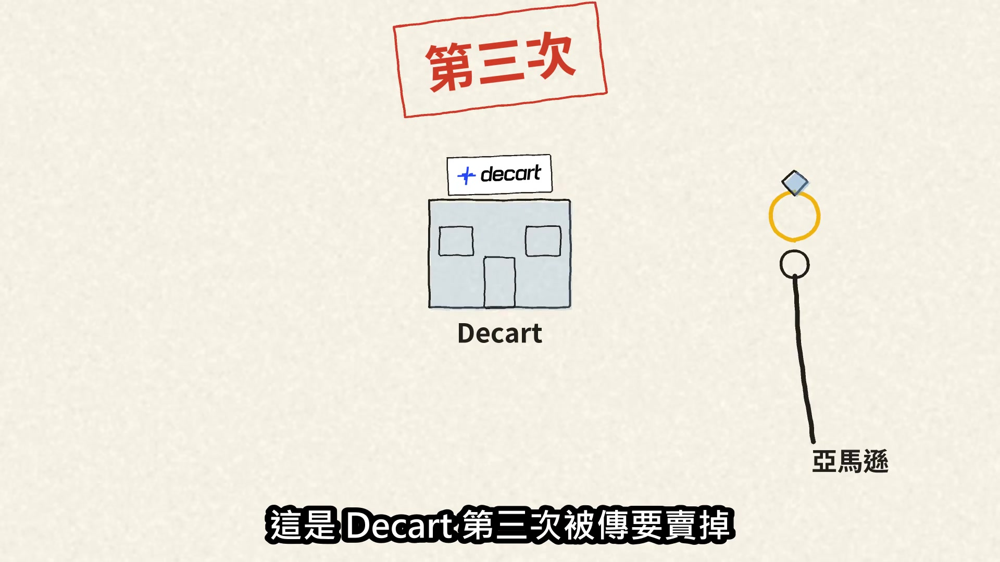

**逐字稿片段：** 前兩位輝達和 Anthropic 都差點談成 最後卻沒有簽字，回合比實境秀還多 那這次簽了嗎？ 截至10月12日，還沒有簽署 亞馬遜沒有評論 Decart 也沒有回覆 Reuters Reuters 說無法立即獨立核實

**話題推測：** 介紹前兩位潛在買家：輝達和Anthropic

---

## 00:00:37

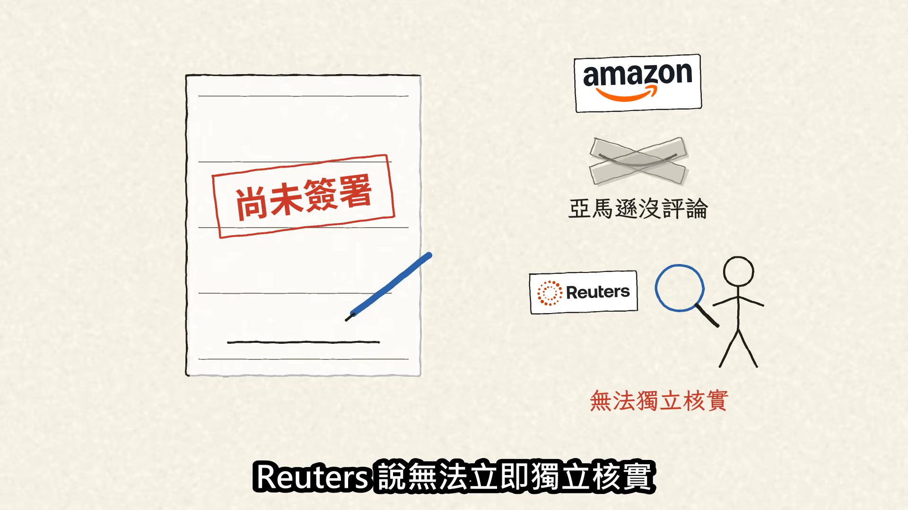

**逐字稿片段：** 話說回來，Decart 跟哲學家笛卡兒無關 笛卡兒說我思故我在，Decart 則是我在 故我被收購

**話題推測：** 話題轉折：解釋Decart公司名稱的由來

---

## 00:00:47

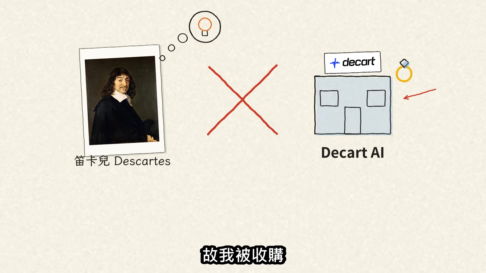

**逐字稿片段：** Decart AI 是以色列新創 2023年9月7日才成立

**話題推測：** 介紹Decart的背景：以色列新創公司

---

## 00:00:52

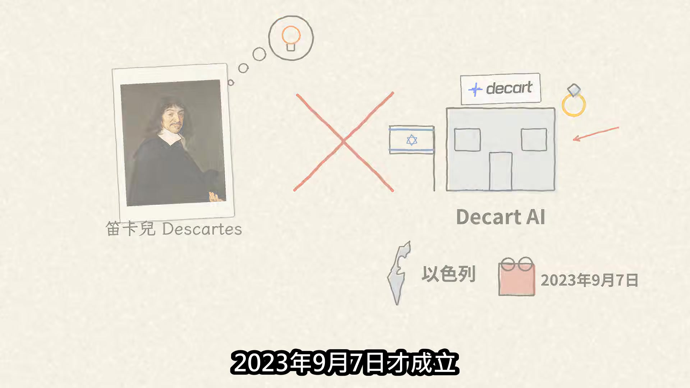

**逐字稿片段：** 創辦 Decart 的是一對兄弟加一位產品長： 執行長 Dean Leitersdorf、 弟弟兼首席科學家 Orian Leitersdorf 和產品長 Moshe Shalev 其中兩人很有戲 Dean 23歲就拿到電腦科學博士 Moshe 早年在肉店工作 後來進了以色列軍方的8200情報部隊 一待大約13年 從砧板到情報室，像電影劇本

**話題推測：** 介紹Decart的創辦團隊成員

---

## 00:01:17

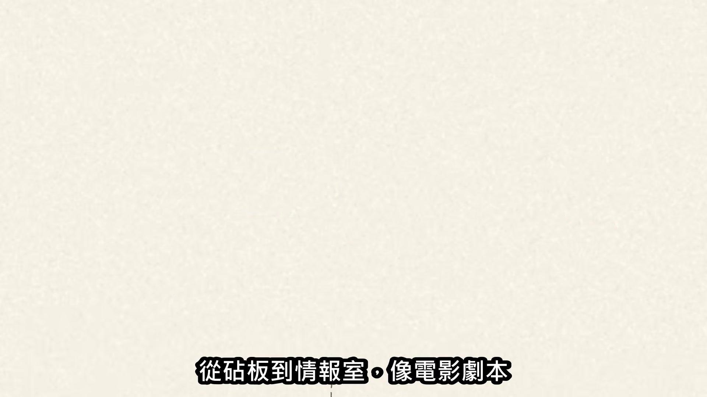

**逐字稿片段：** Decart 最早出名，跟 Minecraft 有關 順帶一提 Minecraft 就是用方塊蓋世界的遊戲 挖礦、蓋房子 還要提防背後會自爆的綠色苦力怕

**話題推測：** 話題轉折：Decart的首個知名產品與Minecraft相關

---

## 00:01:29

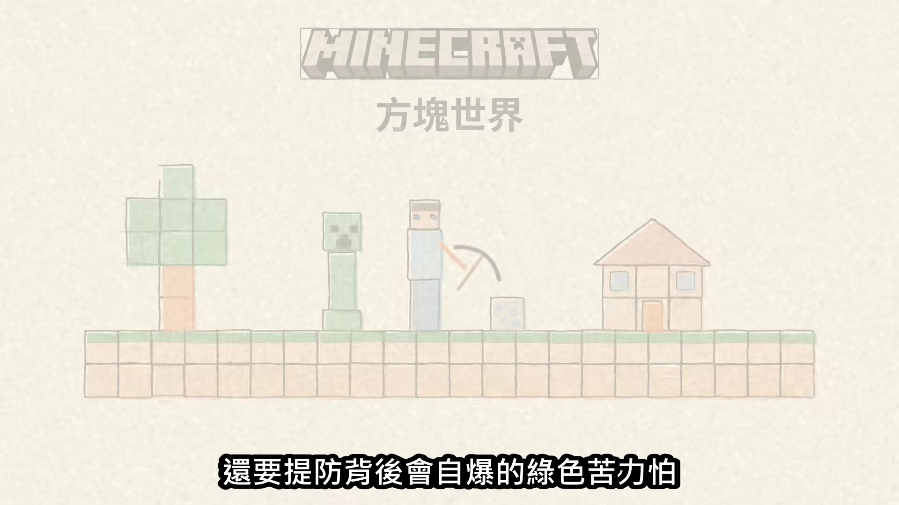

**逐字稿片段：** Decart 和晶片新創 Etched

**話題推測：** 介紹合作夥伴Etched與新產品Oasis

---

## 00:01:31

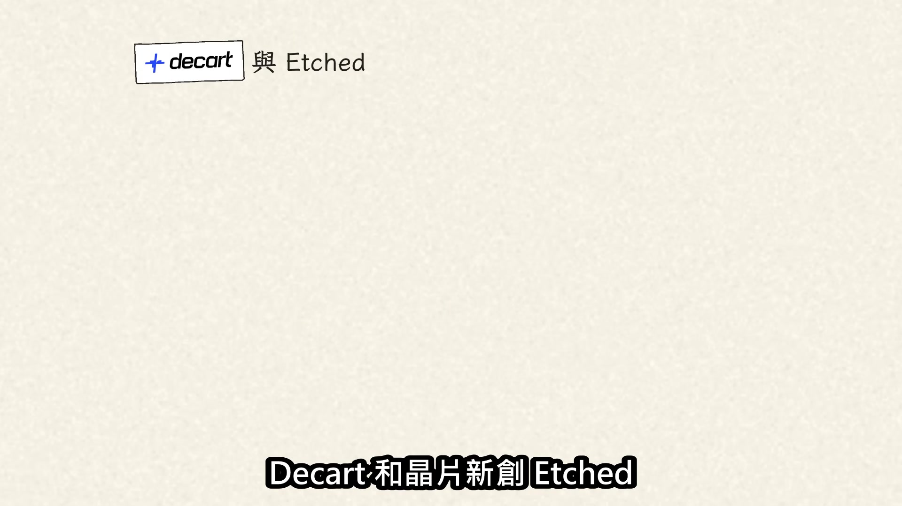

**逐字稿片段：** 在2024年10月發表 Oasis 一個 AI 版 Minecraft，沒有遊戲引擎 玩家一按鍵盤 模型就一格一格畫出接下來的畫面

**話題推測：** 發表Oasis的時間點：2024年10月

---

## 00:01:41

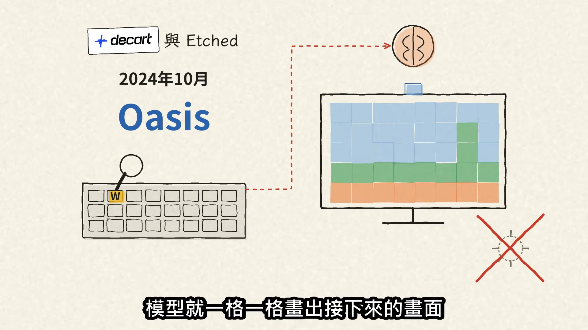

**逐字稿片段：** 這種技術叫世界模型： 讓 AI 學會環境怎麼跟著你的動作改變 你往左轉頭，它就預測下一刻長什麼樣，再畫出來 光猜得對還不夠，還得快

**話題推測：** 解釋技術概念：世界模型

---

## 00:01:54

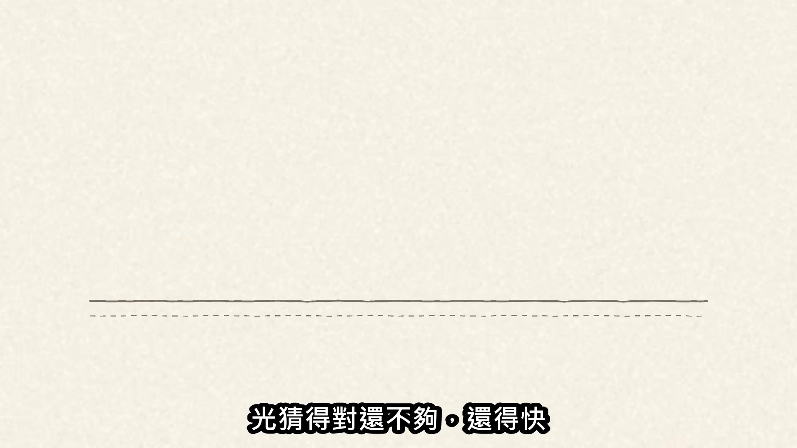

**逐字稿片段：** Oasis 每秒能生出20個畫面 當時很多影片模型生成1秒內容 要算10到20秒

**話題推測：** Oasis的性能指標：每秒生出20個畫面

---

## 00:02:02

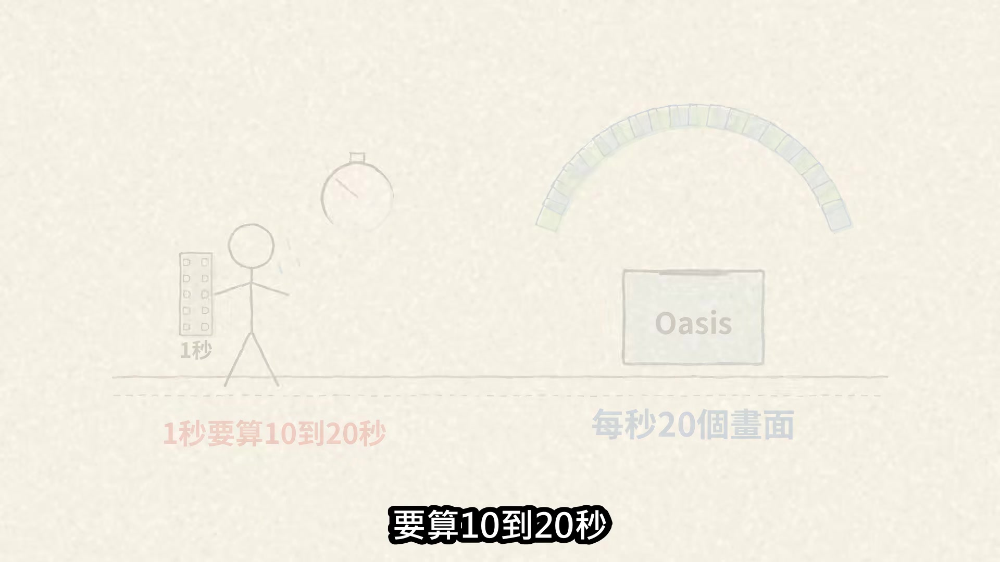

**逐字稿片段：** 可是 Oasis 快歸快，記性很差： 遠方會變模糊，東西會突然漂移 轉個頭房子可能變成樹，官方自己也承認 根本是 AI 版的「我剛剛車停哪」 所以 Oasis 只是冰山一角

**話題推測：** 指出Oasis的限制與缺點：記性很差

---

## 00:02:17

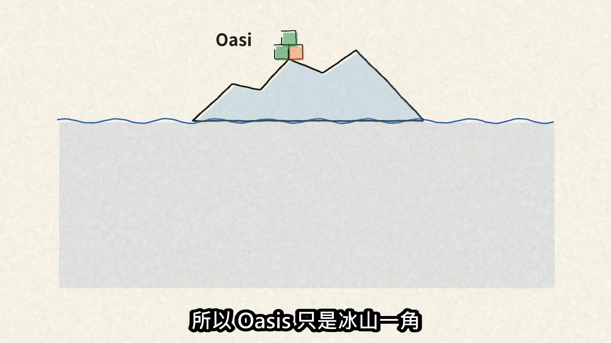

**逐字稿片段：** 它已延伸到自駕車和機器人模擬 Lucy 則是另一條即時影像產品線 真正值數十億美元的，是底下的 DOS

**話題推測：** Oasis技術的延伸應用：自駕車和機器人模擬

---

## 00:02:28

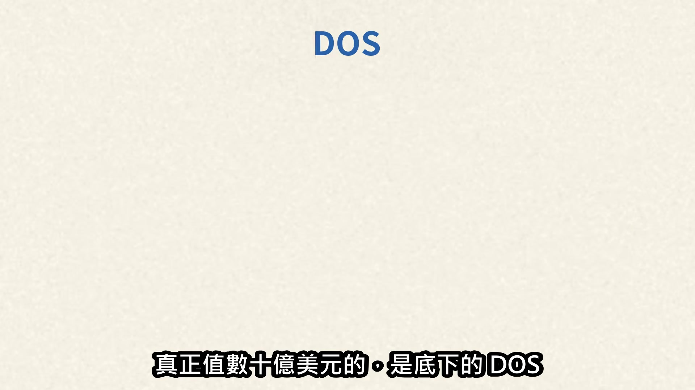

**逐字稿片段：** DOS 全名 Decart Optimization Stack 是 Decart 自己做的一整套最佳化軟體 它夾在 AI 模型和晶片中間

**話題推測：** DOS的完整名稱：Decart Optimization Stack

---

## 00:02:36

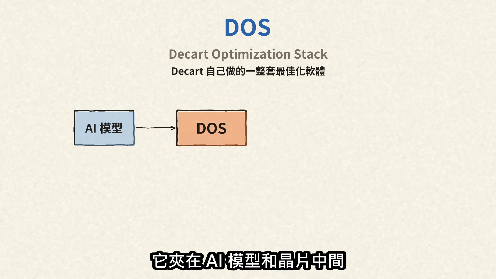

**逐字稿片段：** 讓模型在輝達 GPU、Google TPU、 亞馬遜 Trainium 上都能跑得有效率 為什麼值錢？

**話題推測：** DOS支援的晶片類型：輝達GPU、Google TPU、亞馬遜Trainium

---

## 00:02:43

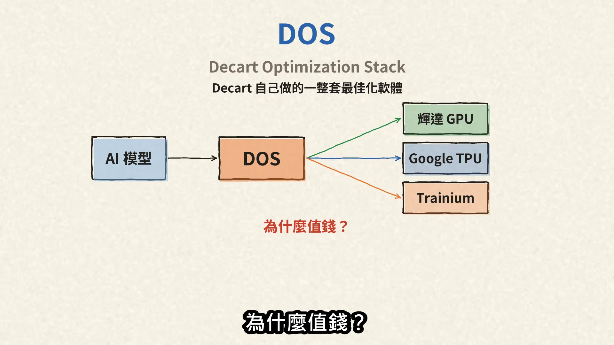

**逐字稿片段：** 連 Anthropic 都讓 Claude 同時跑在這三種晶片上 能隨時換晶片，就像多買了一份算力保險

**話題推測：** Anthropic的Claude作為多晶片運行的例子

---

## 00:02:51

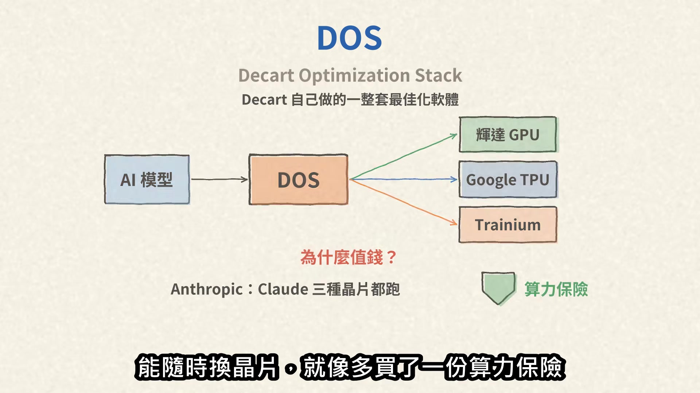

**逐字稿片段：** DOS 治的是模型搬家的痛 模型從輝達 GPU 搬到 Google TPU 或亞馬遜的 Trainium 從編譯器到推論流程都得重調 往往一調就是好幾個月 解法就是 DOS，像個萬用轉接頭 讓模型更有效率地用上不同晶片

**話題推測：** DOS解決的核心問題：模型遷移的困難

---

## 00:03:08

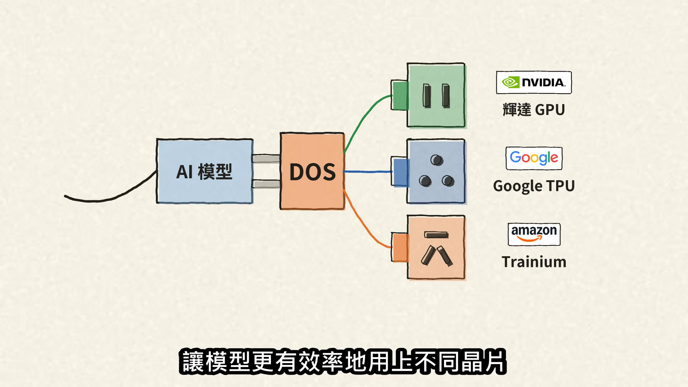

**逐字稿片段：** Decart 宣稱，原本要數月的跨晶片調校 用 DOS 能壓到數週 除了省時間，還要比快

**話題推測：** DOS宣稱的效率提升：數月調校縮短至數週

---

## 00:03:17

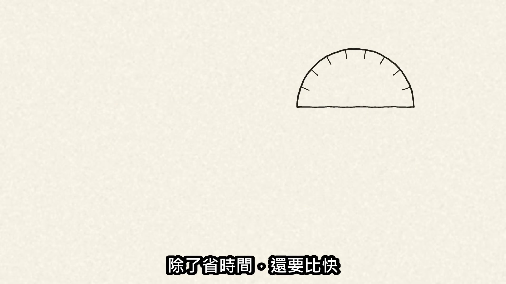

**逐字稿片段：** 2026年5月的 DOS 2.0 Decart 宣稱每秒超過1,600個 tokens 約是它所說業界平均每秒200個的8倍 尺是自己拿的 就在同一個月

**話題推測：** 介紹DOS 2.0新版本及其發布時間

---

## 00:03:28

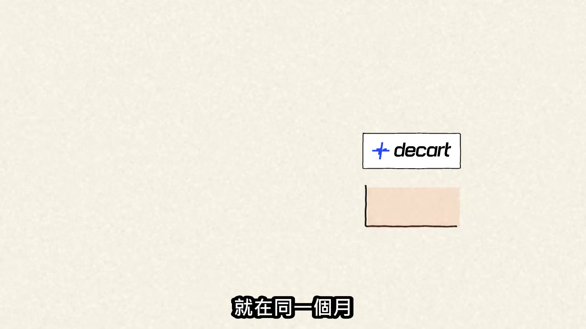

**逐字稿片段：** 輝達成了 Decart 的新投資人

**話題推測：** 輝達成為Decart新投資人

---

## 00:03:30

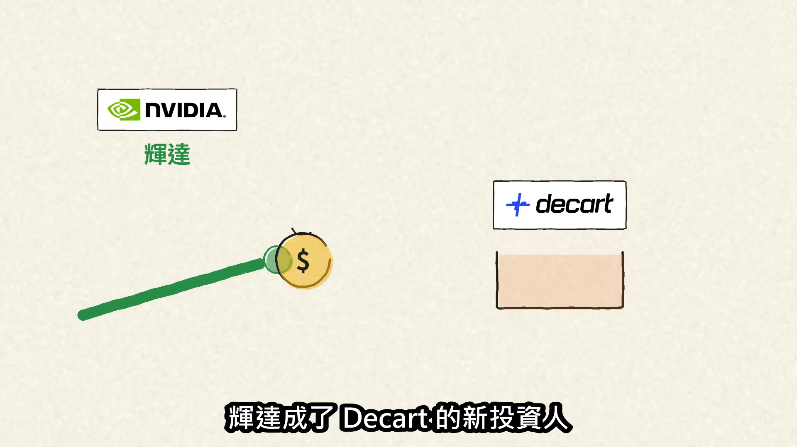

**逐字稿片段：** 那一輪 Decart 募到3億美元

**話題推測：** 該輪募資金額：3億美元

---

## 00:03:33

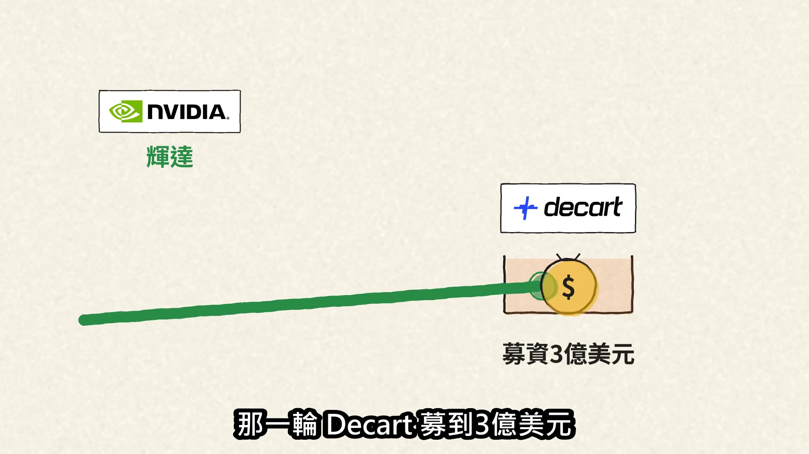

**逐字稿片段：** 估值接近40億美元 矛盾來了：DOS 幫企業跨晶片、 不被單一平台綁住，而晶片老大正是輝達 輝達投資完3個月 又被報導還想整家買下 Decart 像鎖匠付錢給開鎖師傅，還想收編他 但 Decart 不反輝達 它自己仍用輝達硬體 Decart 賣的是選擇權：模型能走向輝達、 Google 或亞馬遜 不必把算力風險全壓在同一家

**話題推測：** 該輪估值：接近40億美元

---

## 00:04:03

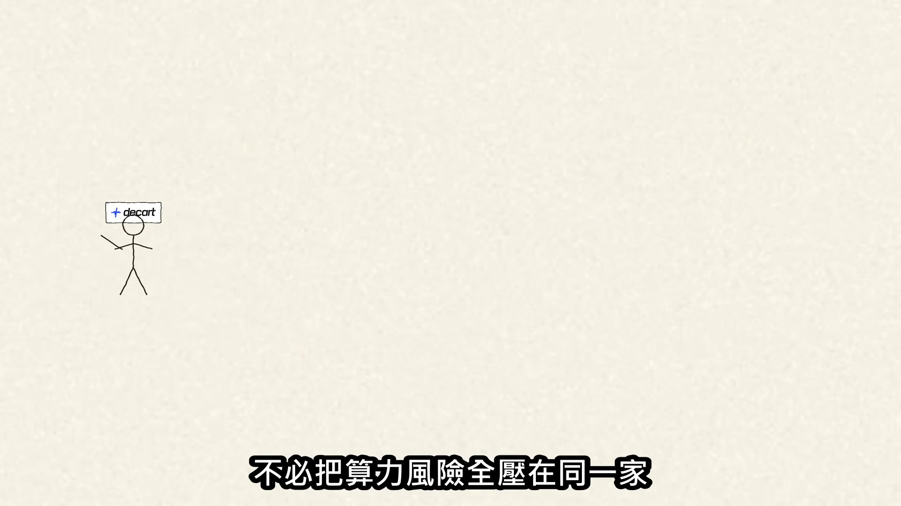

**逐字稿片段：** 時間拉回8月 8月初，據以色列媒體報導 Decart 評估約50億美元的出價 輝達的談判也被更高的方案打掉 8月16日，CTech 又報導

**話題推測：** 時間線回溯至八月，討論收購歷史

---

## 00:04:14

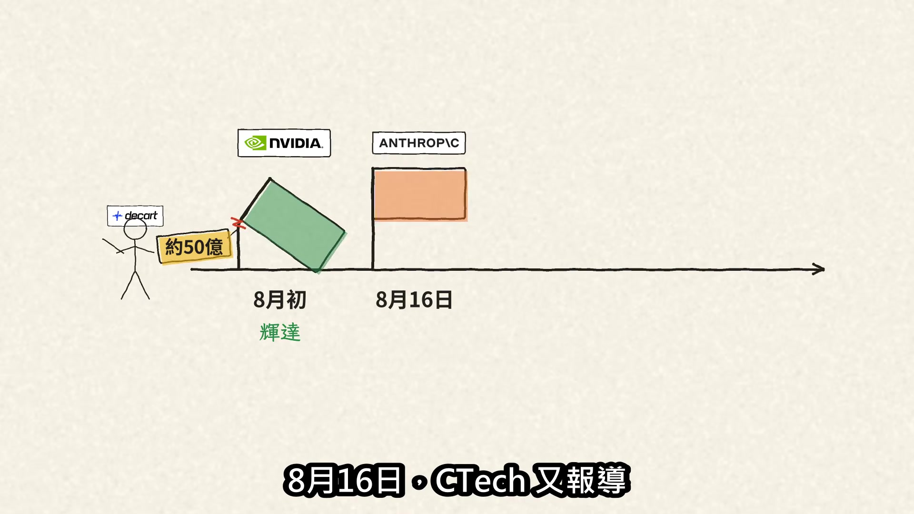

**逐字稿片段：** Anthropic 與 Decart 已交換進階合約草案 9月8日 Anthropic 卻退出 10月11日輪到亞馬遜 Anthropic 那一輪更有戲 以色列媒體 CTech 報導

**話題推測：** Anthropic與Decart交換進階合約草案

---

## 00:04:26

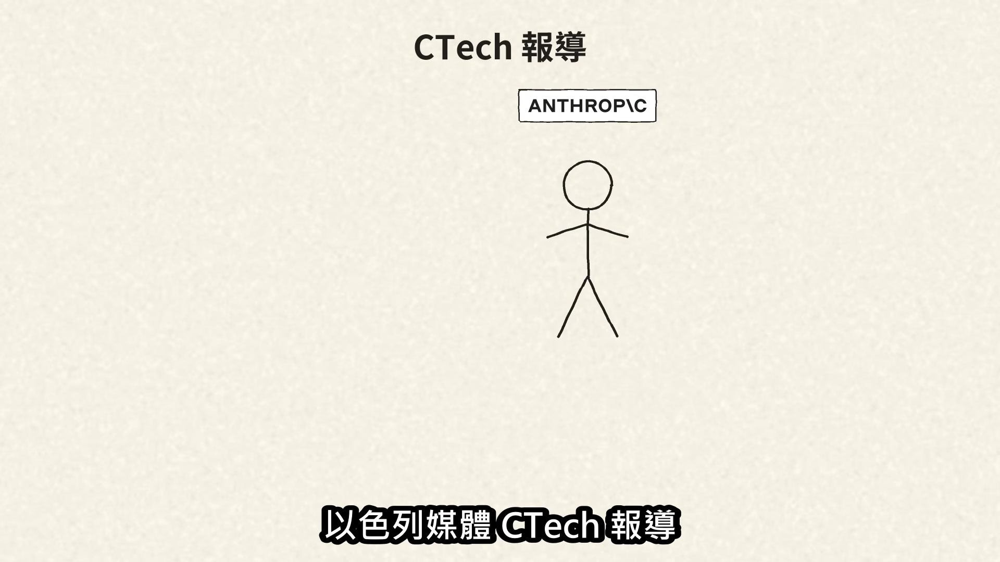

**逐字稿片段：** 價格接近70億美元，多數付股票 輝達的名目價可能更高

**話題推測：** Anthropic的報價細節：接近70億美元，多數付股票

---

## 00:04:30

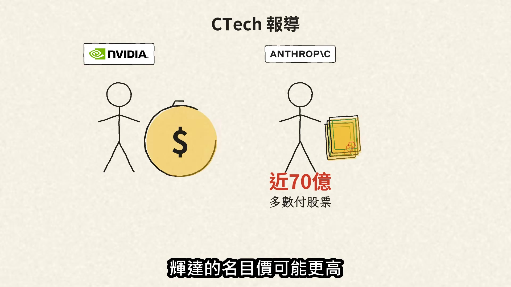

**逐字稿片段：** 但 Decart 團隊和最大股東、 創投 Sequoia Capital 偏好 Anthropic

**話題推測：** 介紹Decart的最大股東：創投Sequoia Capital

---

## 00:04:36

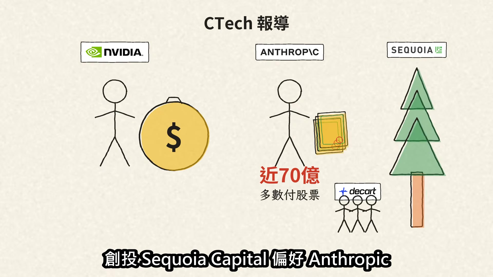

**逐字稿片段：** 收 Anthropic 股票是一場賭： Decart 最後拿到多少 要看 Anthropic 將來上市和股價表現 它選的，是把身家押在哪一家公司 結果還沒押下去，Anthropic 先走了

**話題推測：** 解釋接收Anthropic股票的風險

---

## 00:04:51

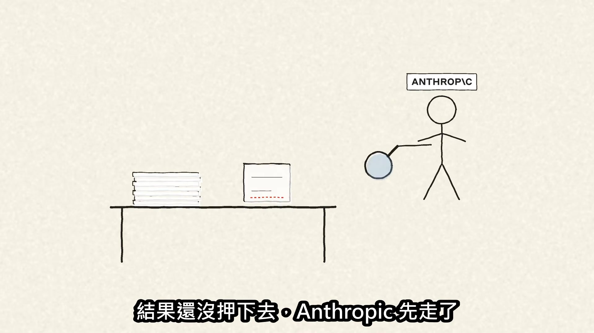

**逐字稿片段：** 9月8日，Bloomberg 報導 Anthropic 做完盡職調查，決定不買 雙方都拒絕評論，也沒有說原因 1個月後的第三位追求者

**話題推測：** 引用Bloomberg報導確認Anthropic退出

---

## 00:05:02

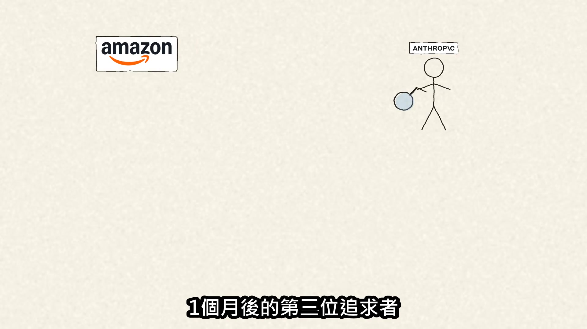

**逐字稿片段：** 正是 Anthropic 的大金主： 亞馬遜累計投資它80億美元

**話題推測：** 指出亞馬遜是Anthropic的大金主

---

## 00:05:08

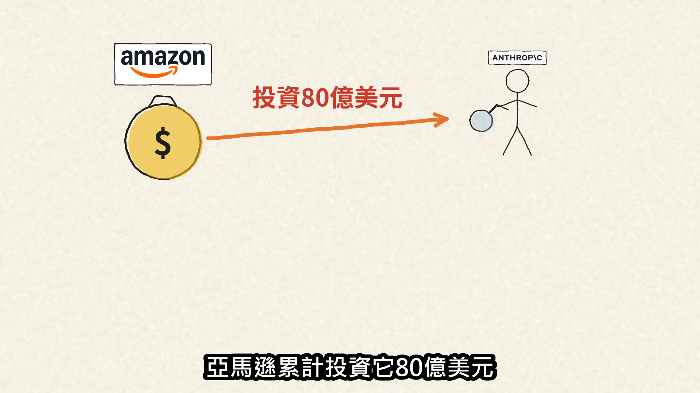

**逐字稿片段：** 而 Claude 3種晶片都用：Trainium、 TPU 和輝達 GPU 而且兩家早就認識 2025年亞馬遜發表 Trainium3 Decart 就是展示的早期客戶

**話題推測：** Claude使用的三種晶片：Trainium、TPU和輝達GPU

---

## 00:05:21

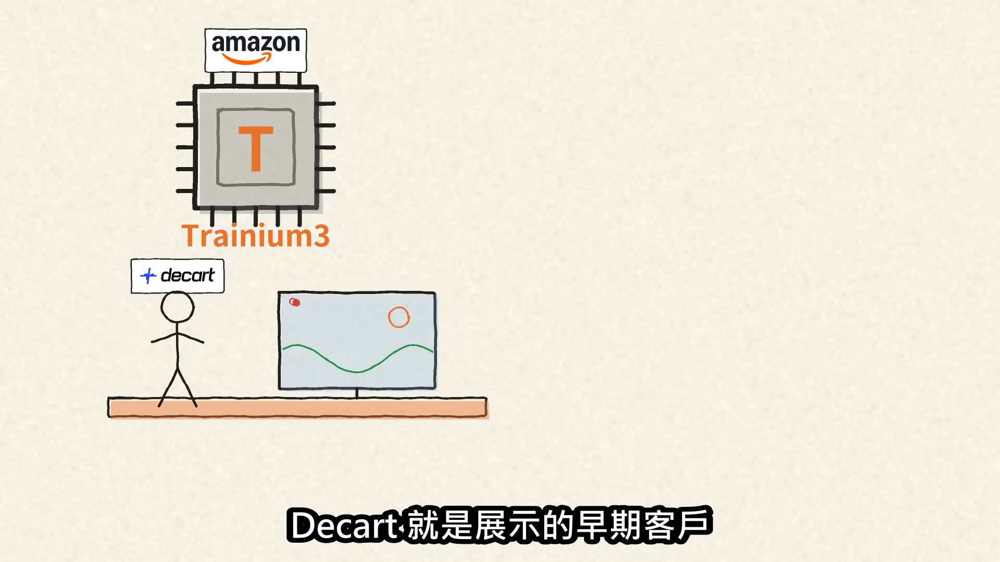

**逐字稿片段：** AWS 公布的 Decart 自測稱 相較它所稱的頂級 GPU 影格吞吐最高4倍

**話題推測：** AWS公布的Decart自測結果

---

## 00:05:27

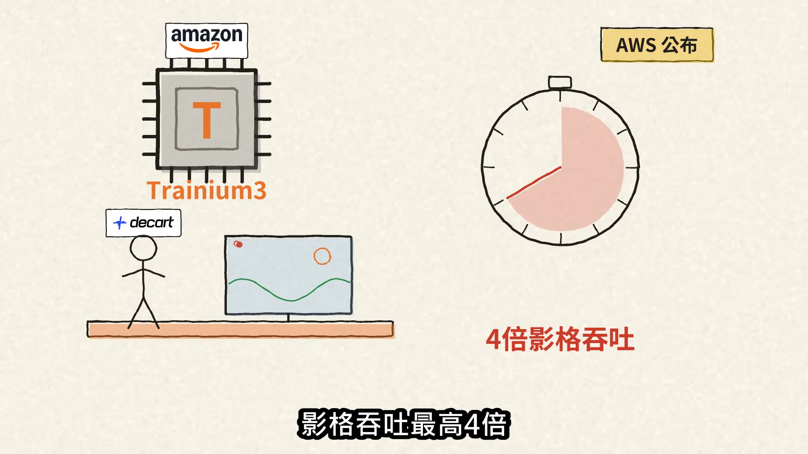

**逐字稿片段：** 延遲從40毫秒降到10毫秒 所以從產品邏輯推測 亞馬遜的算盤不難懂：

**話題推測：** 性能對比：延遲從40毫秒降到10毫秒

---

## 00:05:33

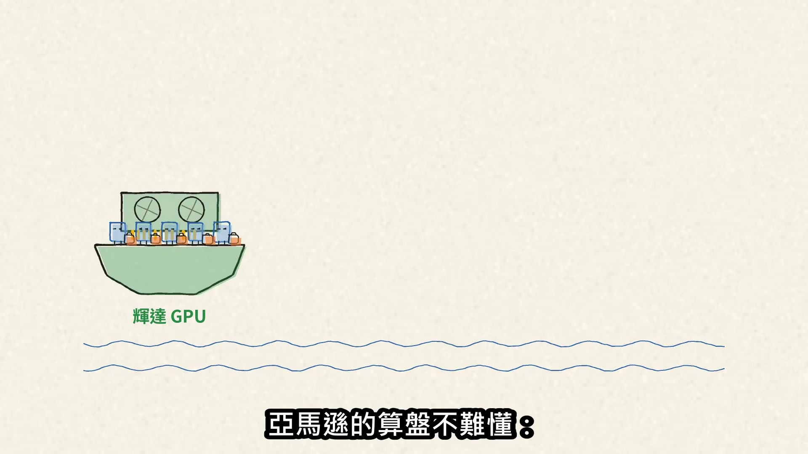

**逐字稿片段：** AWS 想讓更多 AI 工作改用 Trainium 若握有 DOS 客戶搬模型的門檻就可能變低 亞馬遜可能要買的 是讓模型搬進 Trainium 的橋

**話題推測：** 亞馬遜收購DOS的戰略算盤：推廣Trainium

---

## 00:05:44

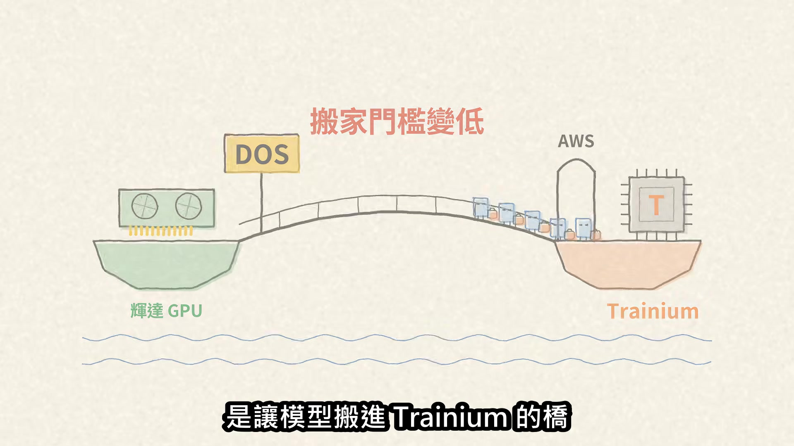

**逐字稿片段：** 回頭把3位追求者擺在一起： 輝達談判破局，Anthropic 查完退出 亞馬遜還在談 前兩位都沒有走進禮堂 第三位會不會又多一個前任？

**話題推測：** 總結三位追求者的談判進度

---

## 00:05:56

**逐字稿片段：** Decart 的身價也跟著爬

**話題推測：** Decart公司估值成長趨勢

---

## 00:05:58

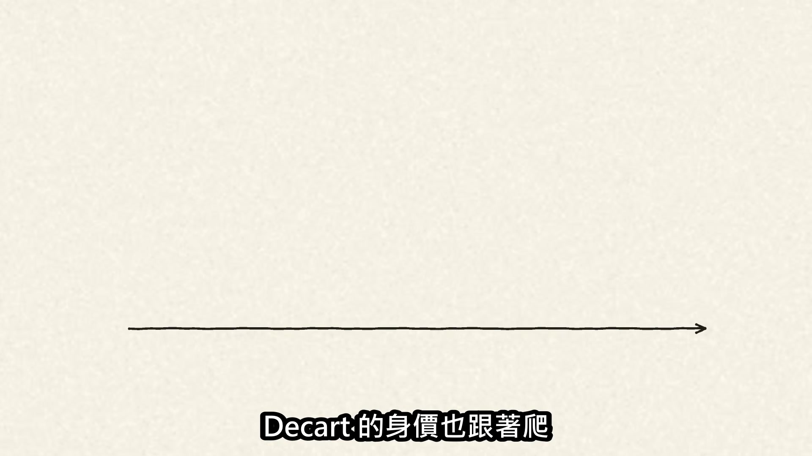

**逐字稿片段：** 2024年底估值剛過5億美元 2025年8月升到31億，2026年5月接近40億

**話題推測：** 2024年底估值：剛過5億美元

---

## 00:06:04

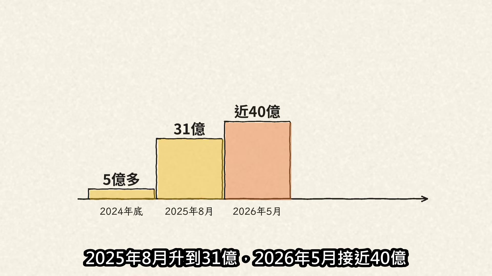

**逐字稿片段：** 5個月後，亞馬遜被報導談到約70億

**話題推測：** 最新報導的亞馬遜談判價：約70億美元

---

## 00:06:07

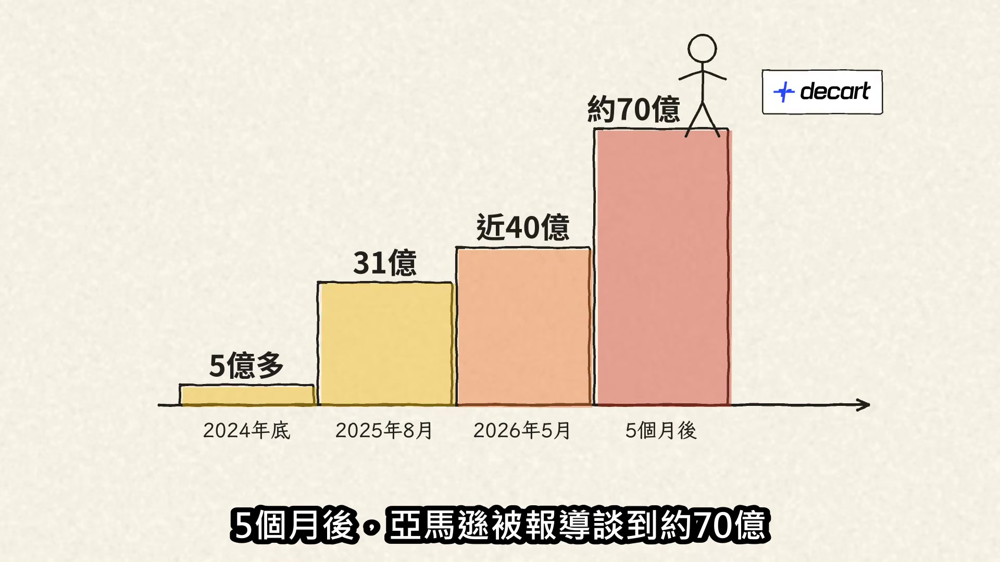

**逐字稿片段：** 談判價比上次融資估值高約75% 攤到每個人頭上更驚人： 以媒體估計約100名員工來算 每人約7,000萬美元 買家搶的是稀缺人才、智慧財產 和 AI 基礎設施的入口

**話題推測：** 談判價與上次融資估值的比較：高約75%

---

## 00:06:22

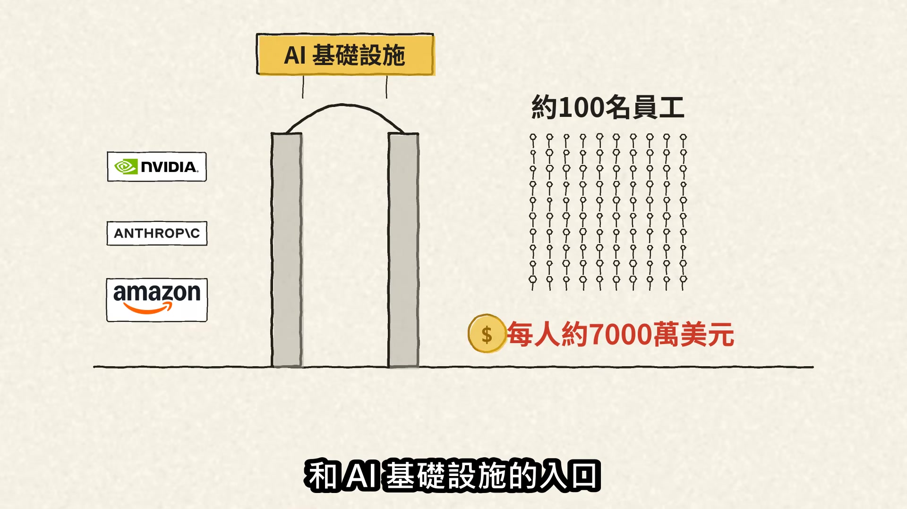

**逐字稿片段：** 所以合約的簽名欄還空著： 截至10月12日還在談判，沒有官方公告 Oasis 和 Lucy 會不會繼續獨立發展也沒有答案

**話題推測：** 當前談判狀態：合約簽名欄仍空著，沒有官方公告

---

## 00:06:31

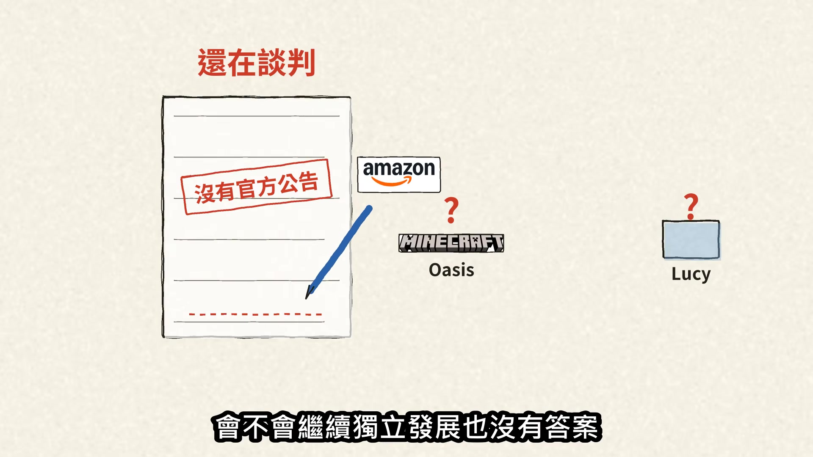

**逐字稿片段：** 這一簽決定的不只是 Decart 嫁給誰 也是 AI 模型要往哪一套晶片走

**話題推測：** 總結：收購案的更廣泛影響，決定AI模型晶片走向

---
