# ai-note-101_7YtdYnoZM28 — 關鍵畫面索引

- 來源逐字稿：[ai-note-101_7YtdYnoZM28_GT.srt](ai-note-101_7YtdYnoZM28_GT.srt)
- 影片：https://www.youtube.com/watch?v=7YtdYnoZM28
- 截圖數：13

## 00:00:00

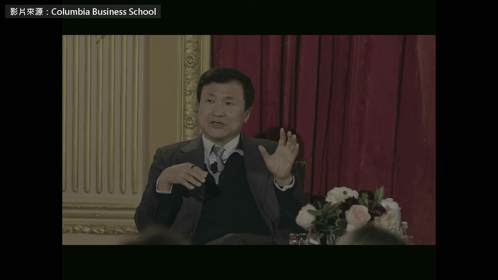

**逐字稿片段：** 巴菲特的波克夏 2008 年買進比亞迪 抱了 17 年 價值翻了將近 40 倍 當初把比亞迪介紹給蒙格的 就是台上這個人，李錄 蒙格生前說過 李錄是他唯一投資過的外部基金經理人 1989 年天安門學運 李錄是學生領袖之一，後來到了美國 1997 年創辦喜馬拉雅資本 用價值投資的方法挑公司 這場在他的母校 哥倫比亞商學院一年一度的價值投資活動 今年第 36 屆 影片 10 月 15 號才公開 他整場的看法是 AI 是很有用的工具，但不是神 所以估值再大 最後還是得回到財務紀律 一直到現在之前，大多數時候 我們面對的技術變革，都是提升生產力的工具 這項技術卻帶進了不一樣的東西

**話題推測：** 介紹巴菲特投資比亞迪的時間點與背景

---

## 00:00:53

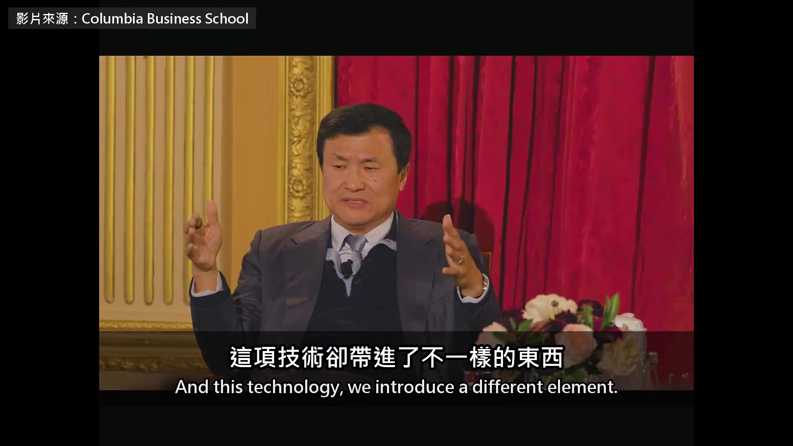

**逐字稿片段：** 現在有一道光譜，一端是工具，一端是生物 我們開始在工具和生物這道光譜上移動

**話題推測：** 視覺化呈現AI「工具-生物」光譜的圖示

---

## 00:01:05

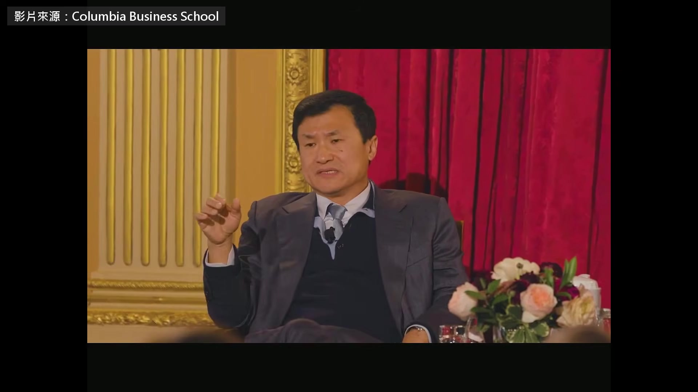

**逐字稿片段：** 它差不多四年前第一次問世（補充：指 2022 年 11 月上線的 ChatGPT）

**話題推測：** AI技術首次問世的關鍵日期或事件標示

---

## 00:01:08

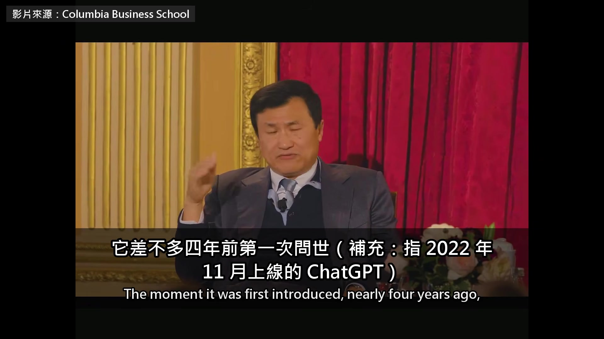

**逐字稿片段：** 那一刻就是圖靈測試的時刻 到了那時候，光看語言 已經分不出對面是機器還是人 他接著數下去，AI 學會推理 學會寫程式 變成能自己做事的 agent 矽谷的說法更進一步 AI 會自己改進自己

**話題推測：** 圖靈測試的定義或相關示意圖

---

## 00:01:28

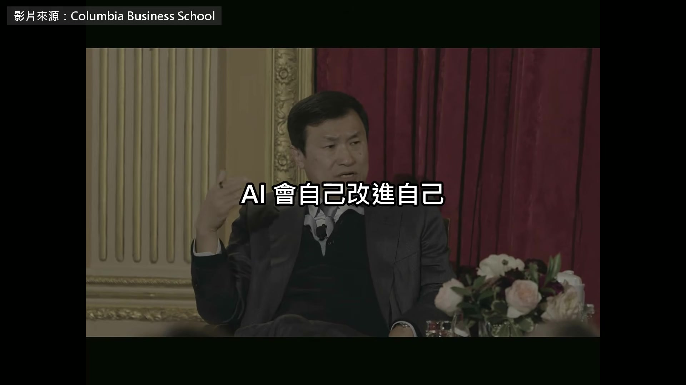

**逐字稿片段：** 一路到 AGI、ASI 比全人類加起來還聰明 走到那一步，你真的可以說 我們在創造某種半神 只不過是人造出來的 因為它這麼強大、無所不包

**話題推測：** AI發展路徑圖，標示AGI、ASI等階段

---

## 00:01:45

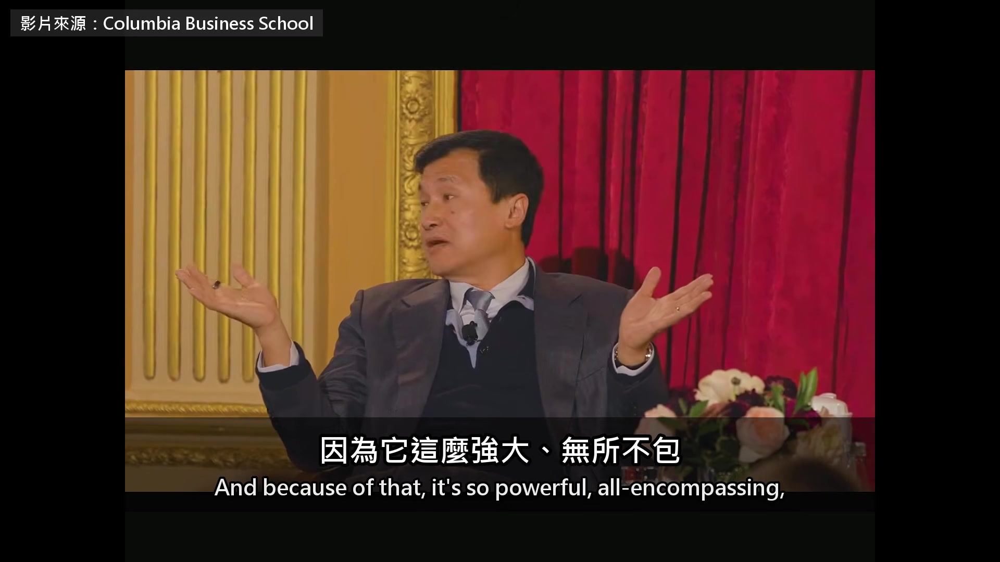

**逐字稿片段：** 所以它的經濟影響，照定義就一定很大 也就說得通各種投資成本 所以大家都會受邀，等到兆美元的 IPO 出現 你差不多是受邀，去認購一尊神的 IPO 對，這就是那套說法 也是這一波真正不一樣的地方 可是你退一步想想 如果真是這樣，人類會變成什麼樣子 活在一個由人造的神統治的社會 只有極少數人用得到，沒有人看得懂 甚至沒有人管得住 連管都談不上，因為那時候沒人懂它 人類有誰真的想活在那種社會裡 答案大概是斬釘截鐵的不想 我想沒有人會想過那種日子 所以結果只會是兩種之一 第一，這項技術根本不會往那個方向走 為什麼不會，我們可以再討論 第二，如果它真的往那個方向走 我們總有一天會團結起來阻止它 所以不管哪一種，都不會出現一尊人造的神 活在人類社會裡、統治我們 既然不會有神，AI 就是一項工具 他說這項工具很有用

**話題推測：** AI經濟影響的潛在市場規模圖表

---

## 00:03:31

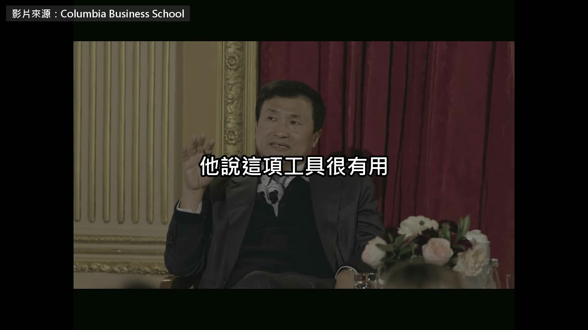

**逐字稿片段：** 可是也危險到必須畫一條紅線 AI 改進自己的每一步 都得有人把關 至於成本 這項技術永遠都有每用一次就要再付的成本

**話題推測：** 強調AI監管和紅線的重要性的圖示

---

## 00:03:47

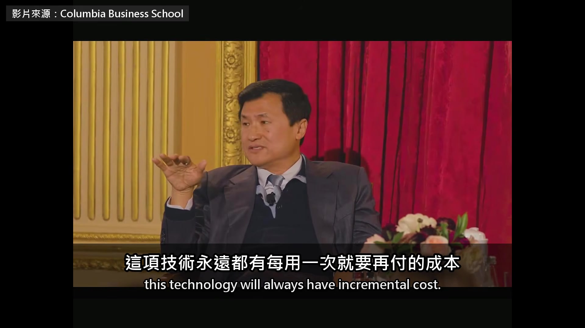

**逐字稿片段：** 這跟網路根本不一樣 也跟以前很多技術不一樣，那些是一次投資 然後可以攤提很久 AI 不是這樣 所以用它永遠都會有額外的成本 所以成本、營收、獲利也都很重要 資本需求跟財務紀律 也永遠都在 主持人接著問股市 以前美國市值最大的公司 大約是 GDP 的 2% 到 4% 現在光輝達一家就有 15% 九月底 Anthropic 才公開招股書 要用 2 兆美元的估值上市 所以現在你看看 我最近讀的一份招股書 這家公司自稱是研究實驗室 卻已經燒掉幾百億美元 還承諾要繼續燒幾千億美元 承諾帶來一項改變世界的技術 同時卻有 10% 的機率把所有人殺死 他們還把這寫進招股書 邀大家用 2 兆美元的估值，投至少 1000 億 要說哪裡矛盾、哪裡諷刺，就是這裡 這是一個很極端的例子 看得出市場可以多不理性 這兩件事不可能同時成立 可是他們現在就是這樣 這也告訴你，事情並不理性 也撐不下去，終究不會一直這樣 如果它真的一直停在工具這一邊 就跟其他工具一樣，有成本也有好處 所以財務紀律、資本市場的紀律 終究會回來管它 過程中會經過好幾次大起大落 這也沒關係 被問到中國，他先講北京這十年的盤算 2015 年訂下中國製造 2025 要把製造業從中低階推到中高階 川普打貿易戰、拜登加上科技管制之後 2021 年北京再加碼，半導體 大飛機引擎、作業系統這些瓶頸 都要自己做出來 過去這五年 解決瓶頸這件事也有很大的進展 拿半導體來說 結果美國帶頭的科技制裁 對中國半導體產業是天賜良機 因為它有了市場經濟裡最珍貴的東西 需求 你去問任何一個創業家，最重要的是什麼 他們會說是訂單 有了營收，整個輪子就轉起來了 營收多了就有獲利、有研發 就能做得更好，帶來更多營收 這真的發生了，到現在，中國在成熟製程上 不管是設備還是晶圓製造 都已經幾乎完全自給自足 在更尖端的先進製程上 也快要自給自足了，只差幾個關鍵環節 照這樣走下去，自然就會做到 這還只是其中一面 當然，生成式 AI 的關鍵能力之一 是隨叫隨到、大規模地產出智慧 其中最大的應用之一，就是寫程式 這就解決了那些瓶頸裡最大的問題 主要是缺了作業系統、底層程式這一層 從個人電腦、伺服器，到輝達的 CUDA 一個接一個，都在 AI 的幫忙下被換掉 所以 AI 成了拉近差距的利器 問答一開始

**話題推測：** 比較AI與網路技術成本結構的圖表

---

## 00:08:36

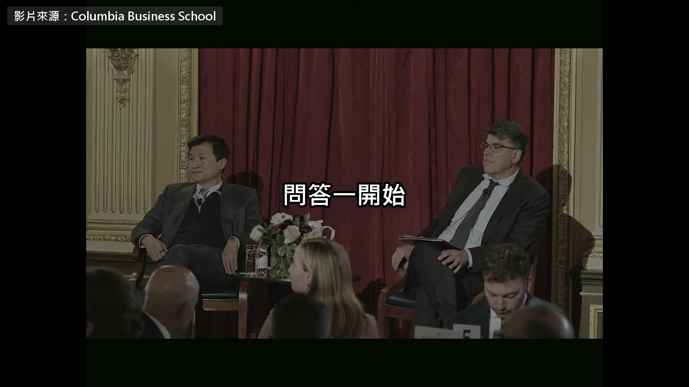

**逐字稿片段：** 台下有人請他比一比中國跟美國的 AI 如果要描述矽谷做 AI 的方式 根本的問題是，這項技術還能做什麼 這是最優先的 所以到現在還叫實驗室，研究實驗室 我想看看它還能做什麼 我們能把邊界推到多遠 所以也叫做前沿

**話題推測：** 比較中美AI發展模式的圖表或對照

---

## 00:09:01

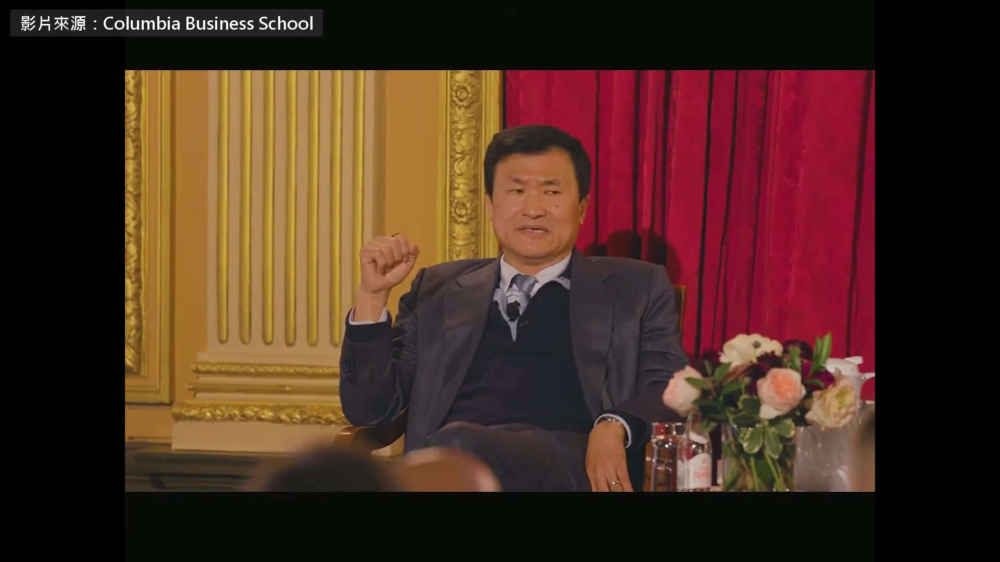

**逐字稿片段：** 至於中國的 AI 公司，我會說 他們骨子裡也對這些問題很好奇 但除此之外，更重要的是，他們會問 這項技術能替我的客戶做什麼 不管是一般消費者還是企業客戶 這就是很不一樣的做法 從各種指標都看得到，結果會很不一樣 問答開始之前，他替整場對談收尾 又回到那尊神 而技術，包括 AI 都會一直是工具，不會取代人 如果它有任何取代人類的跡象，就像我說的 我們都會團結起來，反對造出人造的神 所以我的看法是

**話題推測：** 中國AI公司發展思維的重點摘要

---

## 00:09:52

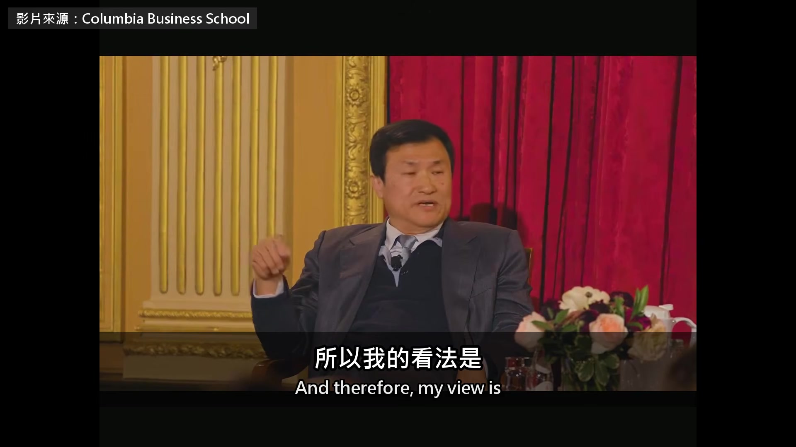

**逐字稿片段：** 你不必去認購那份招股書，那是一尊半神的 IPO 在李錄看來，AI 變不成神 因為人類不會允許 它只要還是工具，就得跟所有工具一樣 用成本跟營收來算帳 原影片一個半小時

**話題推測：** 對於「半神IPO」的最終投資建議與警示

---

## 00:10:11

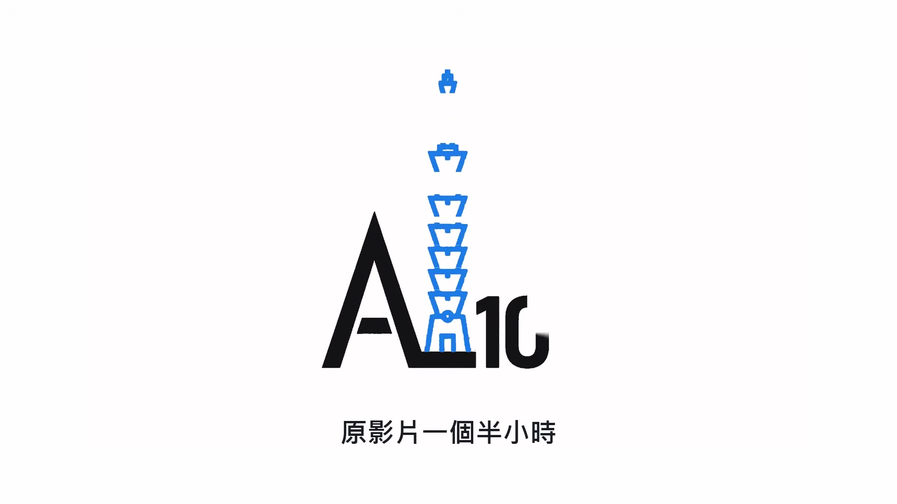

**逐字稿片段：** 他還講了中國中產階級這五年付出的代價

**話題推測：** 關於中國中產階級資產縮水的統計圖表

---

## 00:10:14

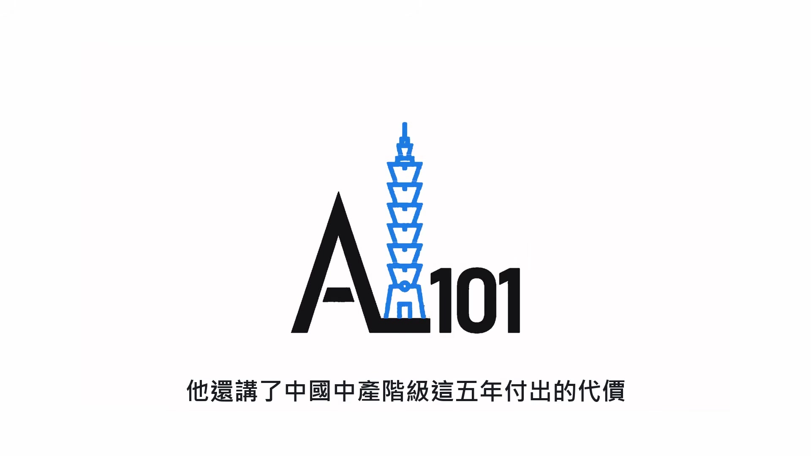

**逐字稿片段：** 房價平均跌了四成 一家人的身家少掉六到七成 問答時被問到加密貨幣 他說那根本是假的，最後會自己消失 原影片連結在說明欄，有興趣可以去聽更多。

**話題推測：** 中國房價下跌四成的數據顯示

---
