# ai-note-101_9EGvruDQlPA — 關鍵畫面索引

- 來源逐字稿：[ai-note-101_9EGvruDQlPA_GT.srt](ai-note-101_9EGvruDQlPA_GT.srt)
- 影片：https://www.youtube.com/watch?v=9EGvruDQlPA
- 截圖數：18

## 00:00:04

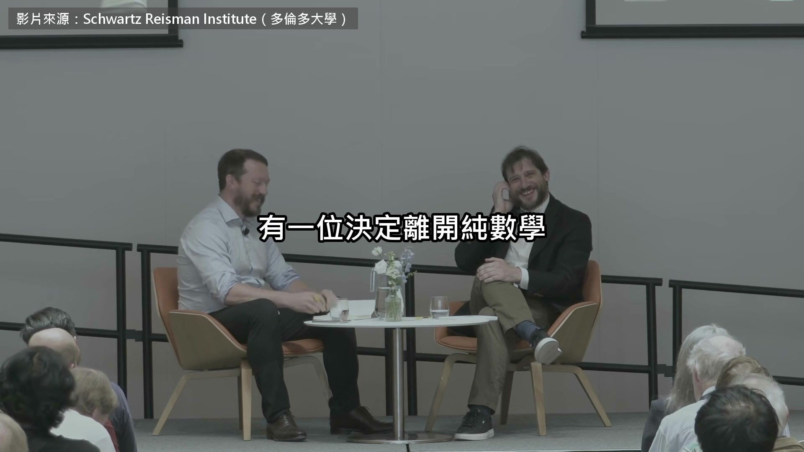

**逐字稿片段：** 他叫 Jacob Tsimerman 多倫多大學的數學教授

**話題推測：** 介紹費爾茲獎得主Jacob Tsimerman

---

## 00:00:08

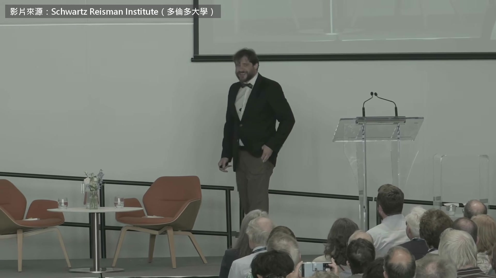

**逐字稿片段：** 9 月 8 號 學校替他辦了一場慶祝演講 他就在台上成立了一間新研究所 要找 100 位數學家一起研究 AI 安全 同一天 OpenAI 宣布解出了 Navier-Stokes 他還預言 人類不靠 AI 解開知名猜想的時代 今年底就會結束 我想這句話沒什麼爭議 AI 是當今世界最大的挑戰之一 但比較有爭議的是 把 AI 當成一道數學問題 大家通常把它當成工程問題 覺得理論在這裡派不上用場 理論是空中樓閣 AI 是實打實的工程 寫寫程式、調調參數、做一堆事 但問題是，你只能實作已經有的點子 也只能拿已經發展出來的理論去打 AI 有一些很具體的問題 我們現在不談，因為太難了 所以就略過不提 但這些問題非常真實

**話題推測：** 提及特定日期發生的事件（9月8號）

---

## 00:01:09

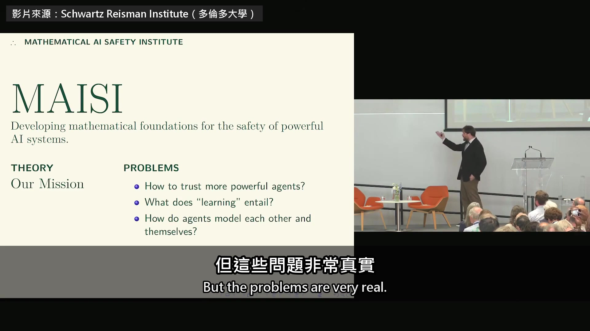

**逐字稿片段：** 很快會有更強的 AI 代理，我們要怎麼信任它？ 甚至可以說現在就有了 「學習」到底是怎麼一回事？ 我們造出 AI 代理，它們不知怎麼就學會了東西 還會把學到的告訴我們 它們這麼做的時候，到底發生了什麼？ 我們自己學的時候，又發生了什麼？ 學習的理論是什麼？ 我們有資訊理論，也有複雜度理論 「學習」是什麼意思？ 當 AI 代理彼此互動 揣摩對方、也揣摩自己的時候 它們是怎麼做到的？我們該怎麼去理解？ 這些都是很真實的問題 我們現在沒有工具 我們的任務就是把工具造出來

**話題推測：** 提出第一個具體的AI安全問題：如何信任更強的AI代理

---

## 00:01:47

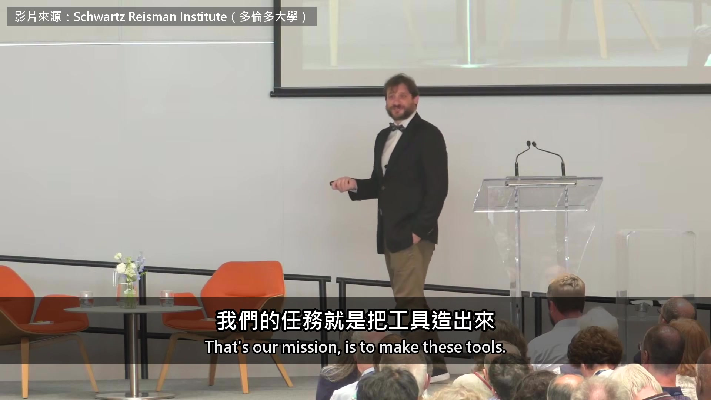

**逐字稿片段：** 演講之後是對談

**話題推測：** 影片內容從演講轉為對談環節

---

## 00:01:49

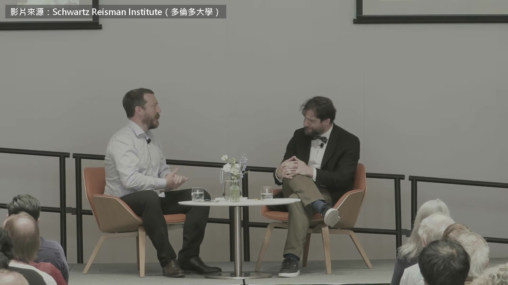

**逐字稿片段：** 負責提問的 David Duvenaud 是多倫多大學的電腦科學教授 也在研究 AI 帶來的風險 他問 Tsimerman 整個職涯都在做最難的數學題 為什麼選在現在轉去做 AI 安全 至於研究所為什麼現在成立 部分原因是，大家現在對安全這件事有熱情了 有人關心了 大家懂背後的概念 另一個我覺得很重要的原因是 我們一直聽到… 我是說，今天數學界還真是「風平浪靜」 不過整體來說，我們一直聽到 AI 在數學上的進展 我覺得大家多半把它 當成新奇的事，或一個里程碑 像是「AI 現在能做這種事了，這代表什麼？」 但在我看來，AI 現在能解最頂尖的數學題

**話題推測：** 介紹提問者David Duvenaud

---

## 00:02:48

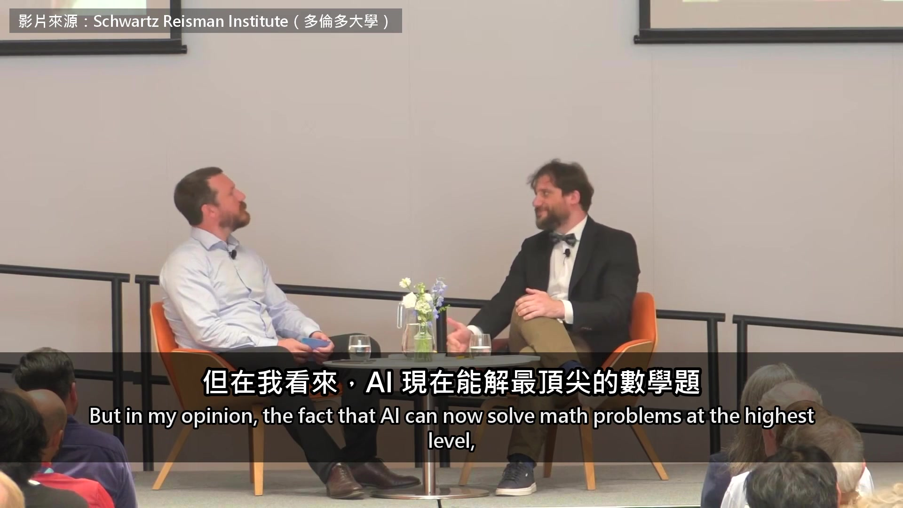

**逐字稿片段：** Navier-Stokes 那道難題宣布很可能解開了（補充：OpenAI 證的是加了外力的版本） 很難說它不是數學界最難的問題之一 看大家投入多少心力，它又有多重要

**話題推測：** 再次提及Navier-Stokes難題的解決，並補充細節

---

## 00:03:03

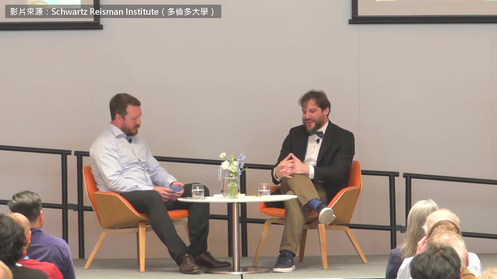

**逐字稿片段：** 它還上了某張很酷的清單 所以現在 AI 能做研究，也能幫忙做研究 而且是超越人類的水準 所以能從理論下手去攻的題目 已經多了很多，很快還會再多更多 某種意義上，大家常隨口說 每樣東西骨子裡都是數學 物理骨子裡是數學，化學骨子裡是物理 生物骨子裡是化學，以此類推 物理之所以很少真的用數學去處理 不是因為那樣不對，是因為太難了 把物理問題寫成數學模型，常常做得到 但對我們來說太難解 數學家最務實了 手上有什麼、做得到什麼，就做什麼 用合理的範圍來衡量自己 而這個合理範圍，馬上就要變大了 所以我寫的那些問題，看起來也許野心很大 我覺得很有機會開始真的做出進展

**話題推測：** 提及Navier-Stokes問題登上某個重要清單

---

## 00:04:10

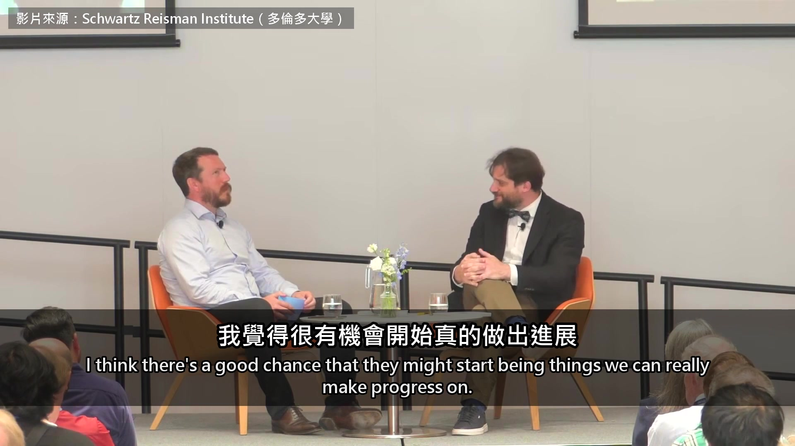

**逐字稿片段：** 他指的是前面投影片上的三個方向 第一，怎麼信任更強的 AI 代理 第二，AI 和人究竟怎麼學會東西 第三，AI 彼此互動 揣摩對方和自己時，我們該怎麼理解

**話題推測：** 回顧前面投影片上的三個研究方向

---

## 00:04:24

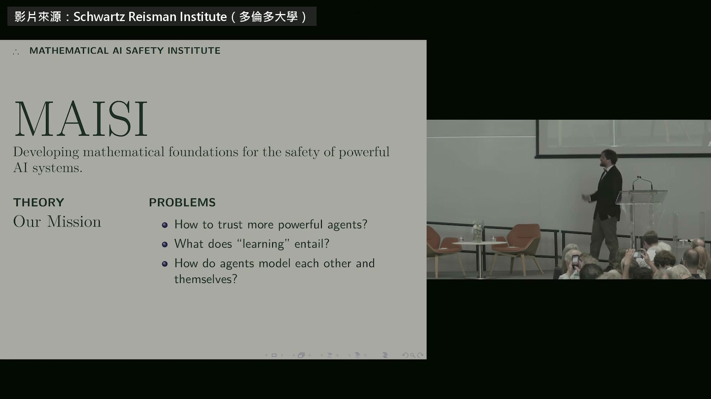

**逐字稿片段：** 對談最後開放台下提問

**話題推測：** 對談進入台下提問環節

---

## 00:04:26

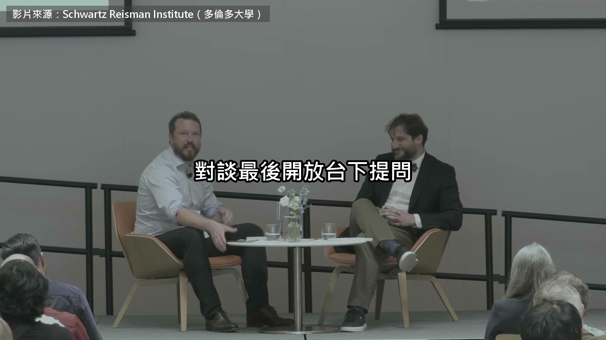

**逐字稿片段：** 第一題就問研究所的錢從哪裡來 我們是公益組織 所以我們接受捐款

**話題推測：** 第一個提問關於研究所的資金來源

---

## 00:04:35

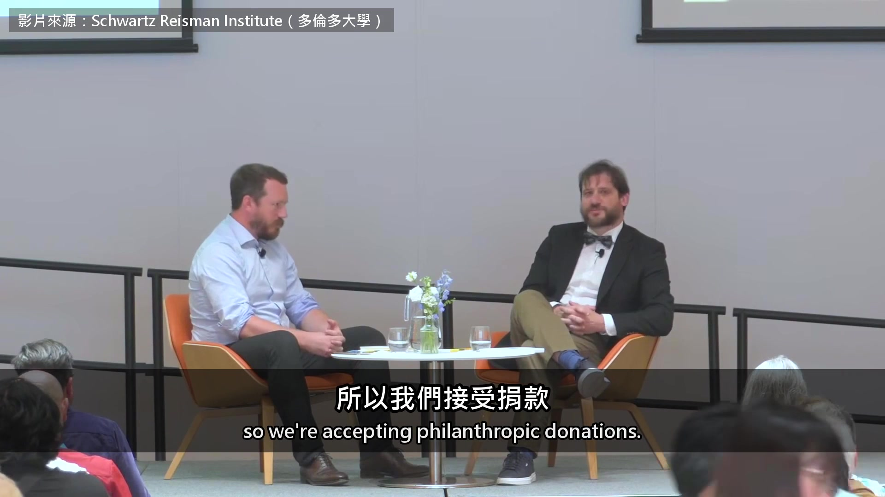

**逐字稿片段：** 目前我們有一筆 1000 萬美元的資助 由 Coefficient Giving 核准，是我們第一個金主 不過我們也在找其他資金 你同事要是問你 「Jacob，GPT-10 出來後，數學家還剩什麼？」 而且假設他們沒有終身職？ 喔，還要假設他們沒有終身職 了解，好 對，終身職是宇宙中不可動搖的定律 誰也打不倒 GPT-10 還遠得很 我不知道，我多半就是叫他們自己想想 我今年夏天辦了場研討會，大概一個月前，記不清了 找了一群數學家，還有 OpenAI 做 AI 數學的團隊 一起想想數學的未來是什麼 這個問題很難，因為 我一個月前這樣說的時候還很有爭議 我說 AI 會穩穩地變得比人強 在我們現在所知的數學研究上，穩穩地超越人類 現在不知道還算不算有爭議了 大家才剛看到 Navier-Stokes 很多「這不算數」的理由，在這裡都不成立 它是個反例，但人類早就料到答案會是反例 幾十年來大家用各種方法想造出這個反例 他們做不到，AI 做到了 所以在解題這件事上，它已經到了 有些地方還沒到，但它已經到了 那數學的未來是什麼？我不知道

**話題推測：** 提及具體的資金數額（1000萬美元）

---

## 00:06:06

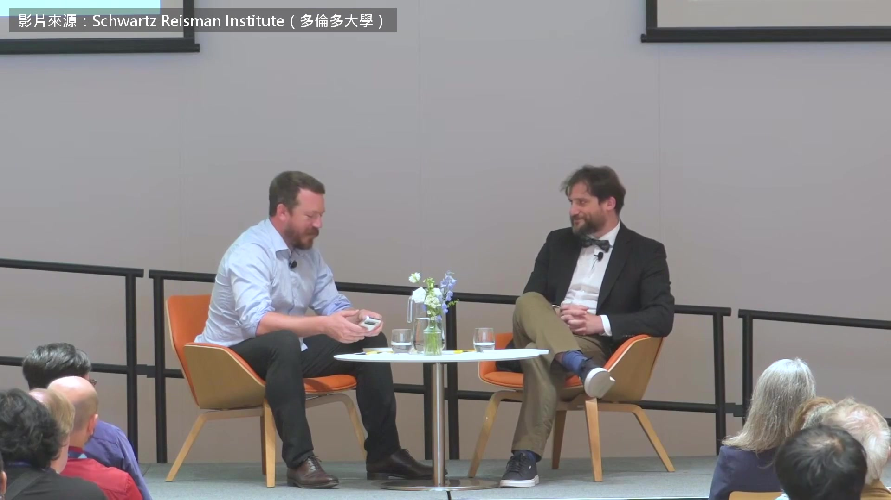

**逐字稿片段：** 好，這題很棒 你正處在數學能力的巔峰 卻要離開純數學 這就像喬丹離開籃球去打棒球嗎？ 對，我覺得沒錯 好

**話題推測：** 新問題關於Tsimerman轉換研究領域的選擇

---

## 00:06:22

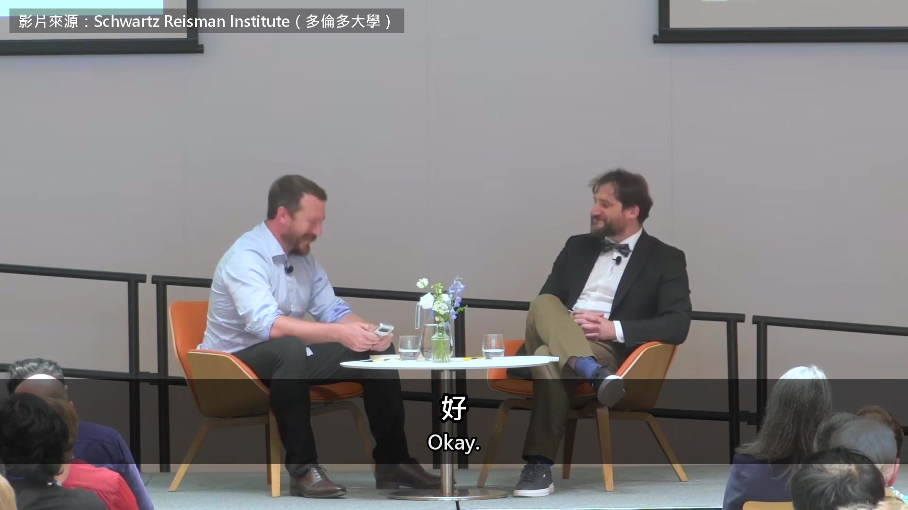

**逐字稿片段：** 台下另一題問他，數學上的發現 接下來會怎麼變 這好難講。我是說，它會變得非常快 有件事我覺得我們現在基本上已經到了 我覺得我們正走到盡頭 人類不靠 AI，自己解開… 重要數學難題、知名猜想的時代

**話題推測：** 另一個問題關於數學發現的未來變化

---

## 00:06:47

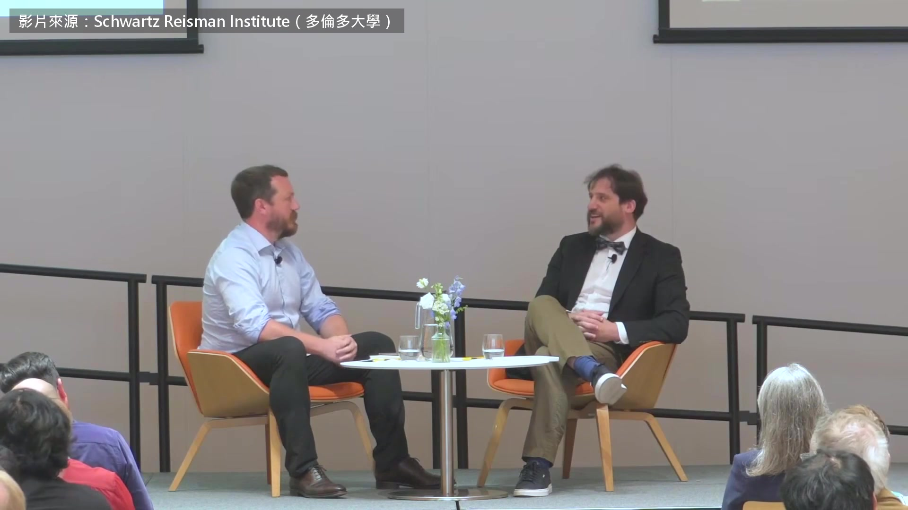

**逐字稿片段：** 這個時代多半在 2026 年底就會結束 這話某種程度上很挑釁 但現在聽到，大概也不意外了 因為 AI 只會越來越強 它已經在解人類試過的問題 一群人一起試過、卻失敗了的問題 而且它越來越快，越來越聰明 越來越便宜，這些都在發生 你剛才講了一些時間表，這裡有一題

**話題推測：** 提出關於人類不靠AI解題時代結束的具體時間預測（2026年底）

---

## 00:07:18

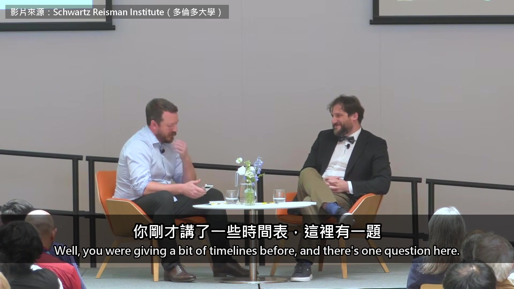

**逐字稿片段：** 你覺得剩下的千禧年難題 未來一年左右會被 AI 解開嗎？ 這題很難答，因為我不知道它們有多難 超越人類不代表無所不能 也許黎曼猜想就是非常、非常、非常難 我不知道，我不知道怎麼解 Navier-Stokes 是很驚人的成就 我不想說任何話貶低它 它是世紀難題 也許除了龐加萊猜想，還有少數幾題 話雖如此，它也是我們手上策略最具體的一題 大家知道 Navier-Stokes 的解答大概長什麼樣 早就有人提過方案 其他幾題沒有這種方案 所以需要新點子，要多久才會出現？我不確定 真要我賭一把的話 會，2020 年代結束前，其他千禧年難題也會被解開 但這是我猜的 快結束時有人問，拿到費爾茲獎之後 他做研究的誘因有沒有變 我真的很在乎 André-Oort 猜想跟 Griffiths 猜想 André-Oort 猜想說 如果一個參數空間裡有很多帶特殊對稱的點聚在一起 背後不是巧合 而是有一個更深的幾何結構 Griffiths 猜想說 用「週期映射」記錄一族幾何物件怎麼變化時 所有可能結果組成的範圍 其實能用代數方程描述 我人生花了 20 年在這兩題上 接下來還有別的問題，但我還沒那麼投入 我可以投入，也可以不要 而且這種事我做過了，沒那麼新鮮 我想去挑戰別的東西 說到這個，費爾茲獎 每四年頒給四個人左右，對吧？ 得獎的研究通常是那四年裡做的 或者八年左右吧，嗯，大概八年 我想問的是，你覺得下一批得主會很不一樣嗎？ 我是說，人類自己的貢獻是什麼 還是說，這是最後一批真正的得主？ 我不想太挑釁 但我覺得，是的 費爾茲獎代表的東西，必須大幅改變 就在接下來這四年 我不知道對數學界來說會是什麼樣子 但我不覺得它還會有現在這樣的理解和意義 Tsimerman 判斷

**話題推測：** 新問題關於剩下千禧年難題的解決

---

## 00:09:41

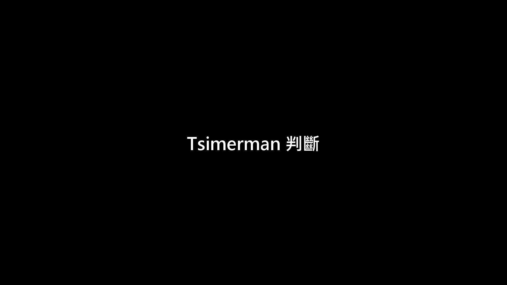

**逐字稿片段：** 人類自己解開數學名題的時代快結束了 費爾茲獎代表什麼也得跟著改 他選的下一個題目 現在還沒有任何工具 就是怎麼讓比人更聰明的 AI 安全

**話題推測：** 總結Tsimerman對數學界未來的判斷

---

## 00:09:52

**逐字稿片段：** 原影片一個多小時 他還講了自己怎麼一步步被說服

**話題推測：** 介紹原始影片的其他內容和長度

---

## 00:09:55

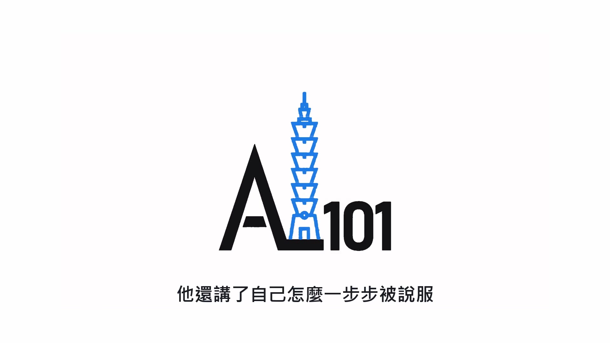

**逐字稿片段：** 從 AlphaGo 開始 到 ChatGPT 上線那天全面轉向 他也提到 英國 AI 安全研究所測過一個 AI 想騙人接受惡意的更新 原影片連結在說明欄，有興趣可以去聽更多。

**話題推測：** 提及AlphaGo作為一個重要轉折點

---
