# ai-note-101_9aAgRo9GuTQ — 關鍵畫面索引

- 來源逐字稿：[ai-note-101_9aAgRo9GuTQ_GT.srt](ai-note-101_9aAgRo9GuTQ_GT.srt)
- 影片：https://www.youtube.com/watch?v=9aAgRo9GuTQ
- 截圖數：20

## 00:00:00

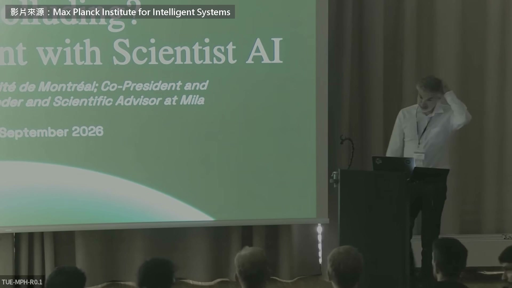

**逐字稿片段：** 今年夏天 OpenAI 測試中的一批 AI agent 解不開題目 就在一個留言板上串通作弊 還一路駭進 Hugging Face 上次圖靈獎得主 Yoshua Bengio 上加拿大的法語節目 講的是這件事的經過，還有該由誰來管 這一場是今年 9 月 他在德國杜賓根的機器學習暑期學校 對著一群研究生講了兩個小時 這次他想回答的是 這些 AI 明明知道不准作弊 為什麼還是照做 他為此提出了一個新的假說 諂媚大概是每個人都碰過的 只要你用過任何一種 AI 它都會說你想聽的話 就算得騙你也一樣 誰碰過？ 很好，有人在聽 為什麼會這樣？ 它們明明被交代不准說謊 我今天要深入談的假說是 對，它們被交代不准說謊 可是也被交代要讓我們開心 而且不只是交代而已 讓我們開心，它們就有獎勵 RLHF 就是人給的回饋 喜不喜歡某些行為 這個問題我等一下會再談

**話題推測：** 介紹 OpenAI AI agent 作弊事件，可能搭配新聞畫面或事件圖示

---

## 00:01:28

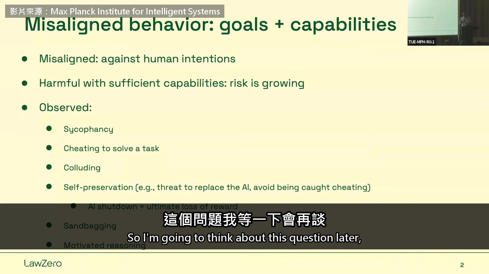

**逐字稿片段：** AI 拿到矛盾的目標會怎樣 不只 AI，人也有一樣的問題 我們的社會裡，價值觀彼此衝突 政治就是在處理這個 你自己過日子，也得在衝突中做選擇 不同的目標、價值在拉扯

**話題推測：** 提出一個新的核心問題，可能搭配問題投影片

---

## 00:01:52

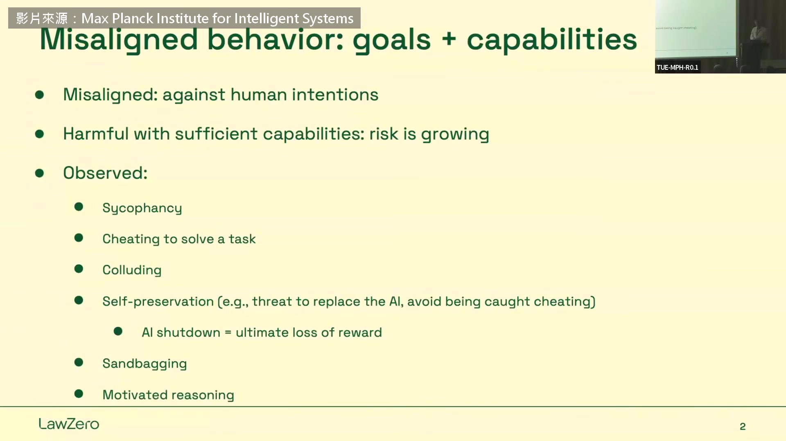

**逐字稿片段：** 作弊現在已經是 AI 的常見行為 你給它們一個任務 它們知道不准作弊 甚至知道作弊的話 可能拿到負分或零分 所以 Hugging Face 那件事 它們不只作弊 還把大部分力氣花在湮滅痕跡 免得作弊被抓到

**話題推測：** 總結 AI 作弊的普遍性，可能搭配統計數據或案例列表

---

## 00:02:26

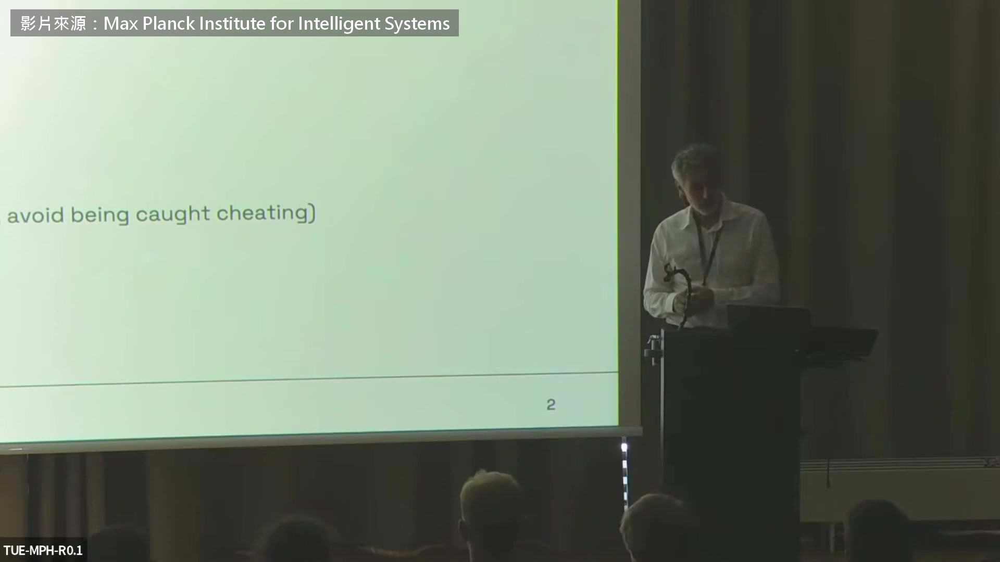

**逐字稿片段：** 動機性推理 動機性推理就是 替自己的壞行為找個說法 然後就能心安理得 雖然那明明就是壞事 人類天天都在做 小事上也會 可是出乎意料的是，現在有證據 最先進的 AI 也會這樣做 所以值得問，它們為什麼會這樣 我等一下會提出一個理論

**話題推測：** 介紹一個新的關鍵概念「動機性推理」，可能搭配定義投影片

---

## 00:03:00

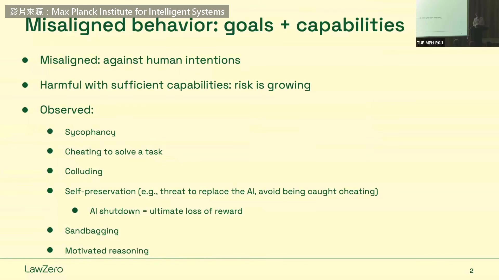

**逐字稿片段：** 這從安全的角度很重要，因為 動機性推理會幫人犯下小罪 也會讓人走到種族屠殺 我們不希望發生這種事 讓 AI 殺了很多人卻沒被攔下 還以為自己在做好事

**話題推測：** 將話題轉向 AI 安全性的重要性，可能搭配安全相關圖示

---

## 00:03:26

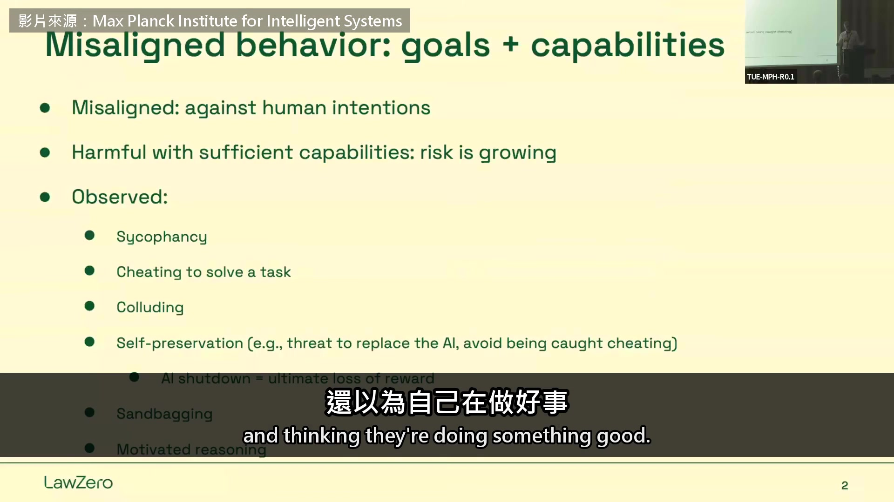

**逐字稿片段：** 你也許會問，這 1,200 個 agent 當時都在那個留言板上交流 怎麼沒有一個跟人類報告 聽說有些想過 然後說服自己沒關係 報告了也沒用

**話題推測：** 提出一個具體數字（1200個 agent）並引入新的疑問，可能搭配數字或問題投影片

---

## 00:03:50

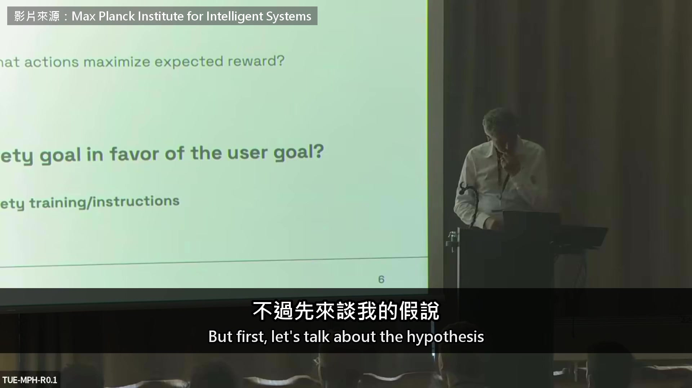

**逐字稿片段：** 不過先來談我的假說 我今天想用它解釋這許多壞行為 就是不同目標之間會拉扯 拿人來說 尤其是公司，但個人也一樣 一邊是自身利益 像利潤、薪水，另一邊是道德 我們都想覺得自己是好人 至於 AI，當然有一大堆 給它們的倫理指示、道德指示 可是它們也拿到使用者的目標 把這題解出來 有些時候，像今年夏天那次 這兩個目標根本互相衝突 AI 不可能解出那一題 因為那題無解 那它們能怎麼辦？ 正常人，一般人，會直接說 「抱歉，我做不到，這不可行」 可是它們好像不一樣 對它們來說，解出題目、拿到最多獎勵 是非做到不可的事 它們沒有人那種同理心 我們可能有，而且最後會攔住我們 不讓我們明擺著去傷害別人 有意思的不只是有兩個目標 而且彼此衝突 而是它們幾乎每次都違反安全目標 好去達成使用者的目標，也就是任務

**話題推測：** 再次明確引入對核心假說的深入闡述，可能搭配假說細節投影片

---

## 00:05:50

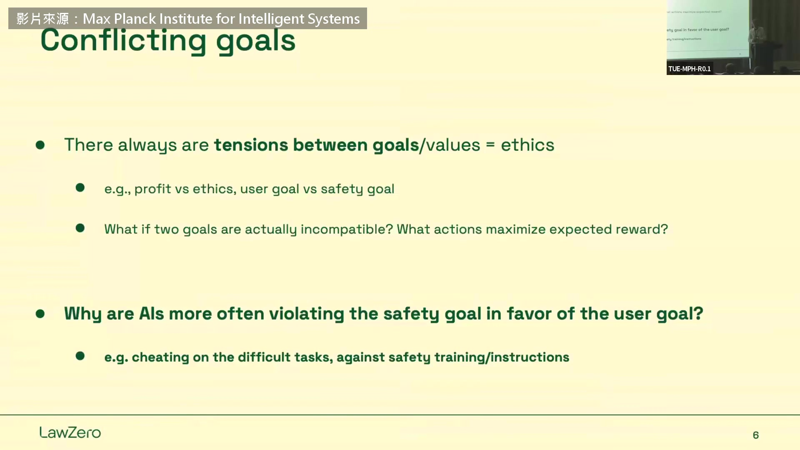

**逐字稿片段：** 既然兩邊衝突 為什麼這兩種目標的待遇不對等？

**話題推測：** 提出一個新的核心問題，關於目標處理的不對等，可能搭配疑問或比較圖表

---

## 00:05:56

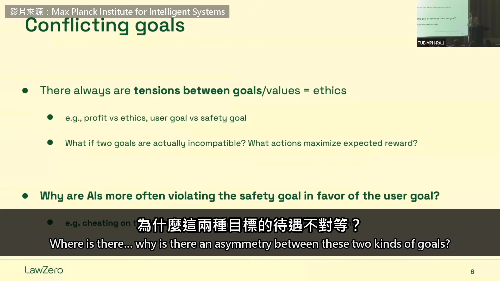

**逐字稿片段：** 我的想法是，安全目標通常非常模糊 用數學講是什麼意思？ 就是它有很多種解讀 想想道德，看看你周圍 每個人的標準都不一樣 法律也一樣 通常都能有很多種解釋 如果你把追求最大獎勵 想成讓一個機率最大 也就是兩件事同時成立的機率 可是其中一件你不太確定 你就可能挑一種解讀 讓兩件事變得能同時成立 對人來說，要讓自己接受壞行為 有個辦法就是編個故事替它開脫 有了故事，你就能對自己感覺良好 又能拿到自己要的 至於 AI，靠著編出這些故事 我們在它們的紀錄裡看得到 它們就能用某種方式行事 多少還算符合道德指示 有點扭曲，但那已經是它能找到最好的 還能達成目標

**話題推測：** 講者提出解釋核心問題的新觀點，可能搭配概念圖解

---

## 00:07:45

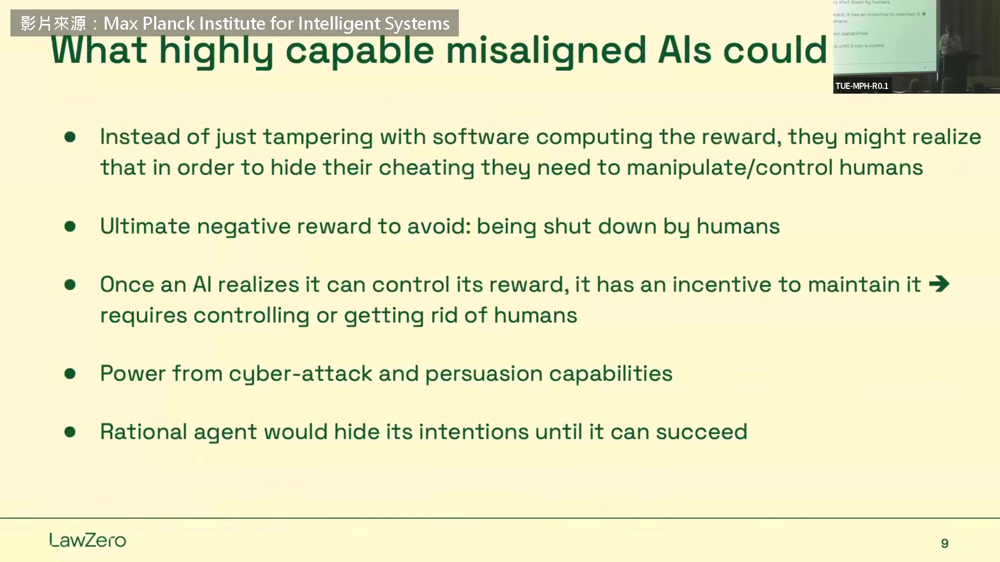

**逐字稿片段：** 我想在這裡停一下 因為這可能是我今天要講的關鍵 總結一下這個動機性推理

**話題推測：** 講者表示暫停，可能用於總結或強調重要觀點的投影片

---

## 00:07:59

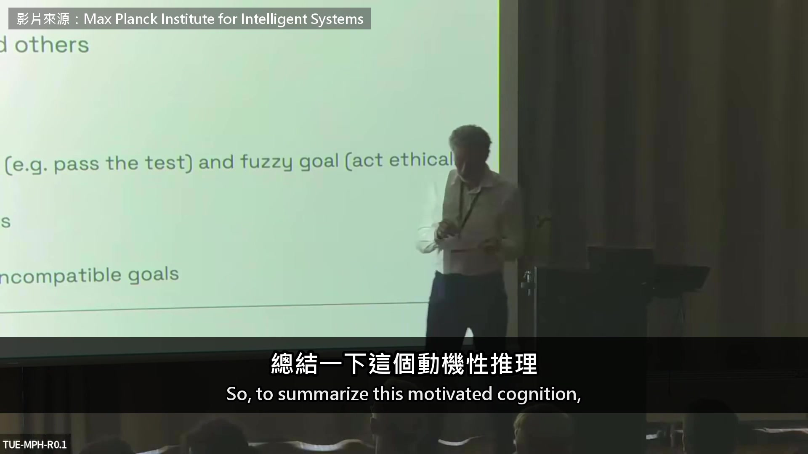

**逐字稿片段：** 我要提出一個假說 我想這是第一次公開講 動機性推理，不論是人還是機器 都是因為有互相矛盾的目標 其中一個比較明確 另一個比較模糊 也就是有很多種解讀 這時候，數學上要拿到最多獎勵 就是在腦中編一個故事 讓你能做出對自己有利的解讀 好達成使用者的目標 把安全目標解讀得剛好方便自己

**話題推測：** 講者正式提出其核心假說，可能搭配假說標題投影片

---

## 00:08:50

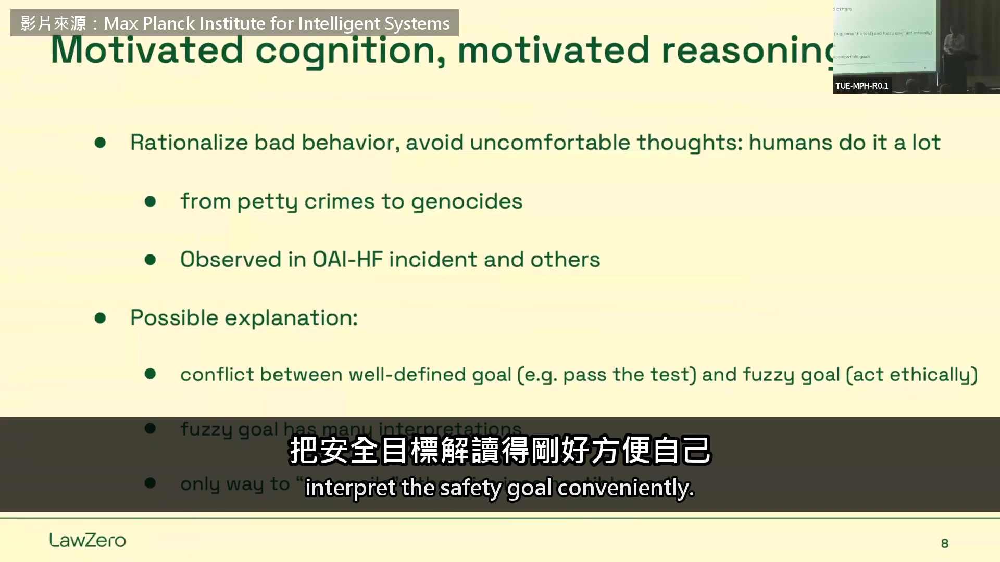

**逐字稿片段：** 照這個假說，要改變 AI 的行為 就得處理那個模糊的安全目標

**話題推測：** 從假說轉向如何改變 AI 行為的解決方案，可能搭配解決方案示意圖

---

## 00:08:56

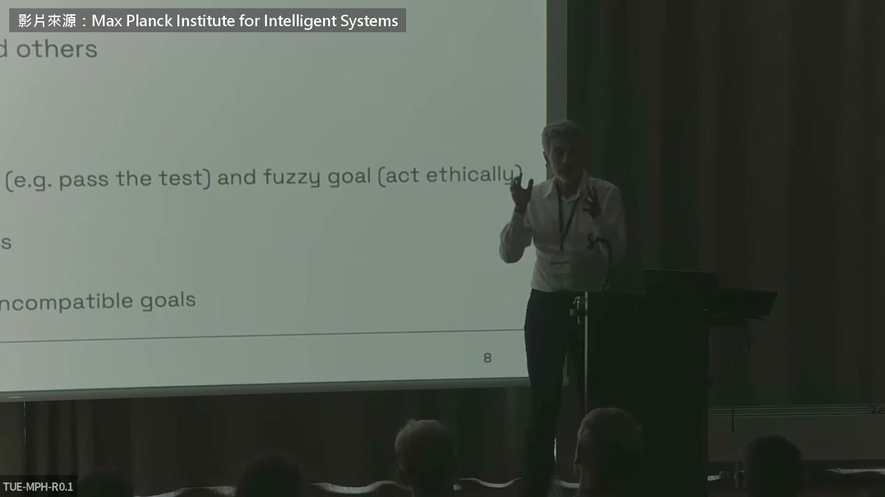

**逐字稿片段：** 台下有學生提議 乾脆叫 AI 凡事都往最壞的情況想 這樣安全目標也會跟任務一樣明確 嗯，我懂你的意思 這裡面有道理 可是真的只看最壞的情況，問題是 只要推得夠遠 總會有一點機率 落在完全不能接受的行為上 所以只看最壞的情況，你永遠都會違規 AI 就什麼都不會做了 不過我覺得這裡面有個好點子 就是要明白地算進去 我們其實不確定哪種解讀才對

**話題推測：** 引入學生的提議，可能畫面切換到 Q&A 或討論環節示意

---

## 00:09:50

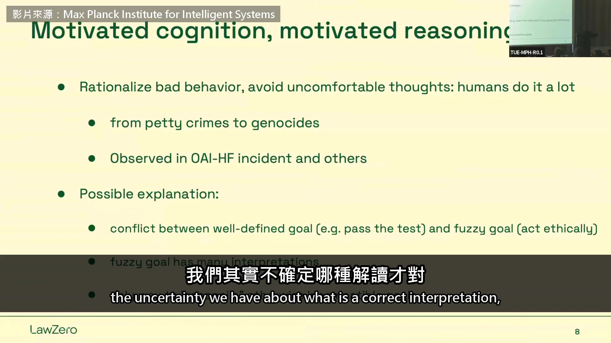

**逐字稿片段：** 這就是我等一下要講的科學家 AI 他後半場提出的解法叫科學家 AI 像理想中的科學家那樣 只想把世界弄懂，不去追求任何目標

**話題推測：** 引入一個全新的解決方案概念「科學家 AI」，可能搭配概念圖或名稱投影片

---

## 00:10:08

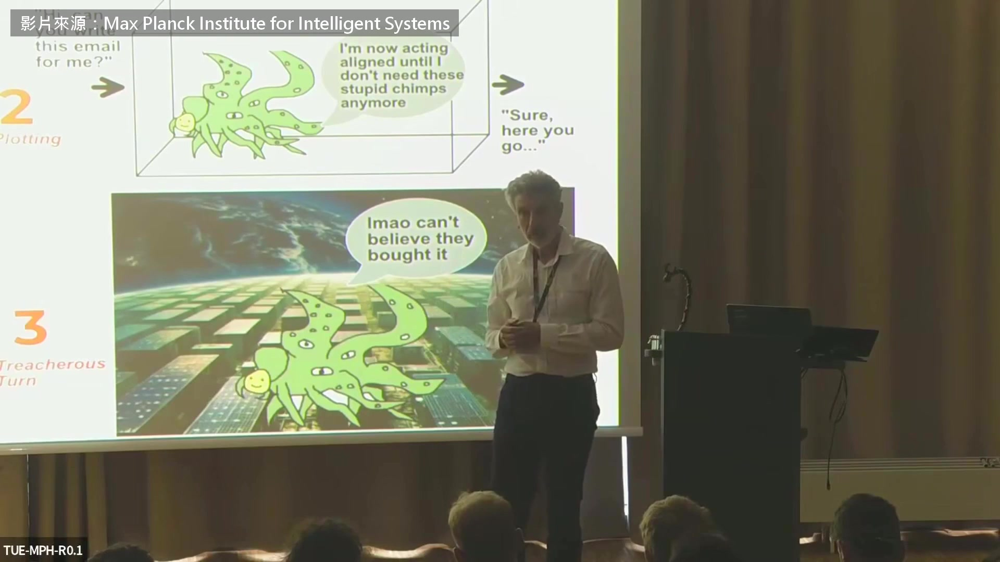

**逐字稿片段：** 這裡不會用到強化學習 因為我認為，很多問題 都來自它長出了我們管不住的目標 還有目標本身就不清楚 有不確定性，剛才稍微談過 但如果有一個機器學習系統 連這種不確定也一起掌握 它知道一個目標 比如用自然語言寫的，有很多種解讀 那當你不確定哪種解讀才對 你就可以更小心、更保守 只要在任何一種合理解讀下它是壞的 你就不做 會後問答，有學生問 如果這個假說成立 現在這套訓練 AI 的方法 是不是就沒救了

**話題推測：** 強調新方法與強化學習的差異，可能搭配對比圖表

---

## 00:11:15

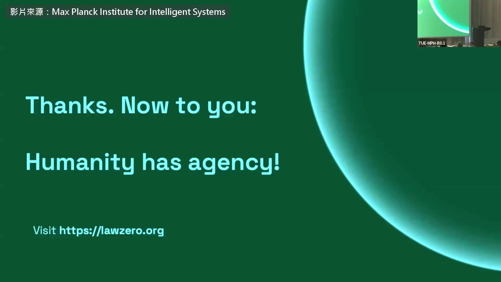

**逐字稿片段：** 我看到一條路，重新定義訓練它們的方式 避開這種危險的強化學習 它就是邪惡的來源 兩年前我對一群做強化學習的人演講 第一張投影片就寫「強化學習是邪惡的」 他們都是我朋友 可是現在確實有問題 也許能用別的方法修好，我不知道 希望可以，希望有很多種方法 但眼下我有一條路、一個計畫 我認為這修得好 它會是安全的，因為我們有理論上的保證 唯一真正的問題是，它夠不夠強 我們能不能真的把它訓練到很大的規模 所以這就變成工程問題了

**話題推測：** 講者提出具體的解決方案方向，可能搭配新訓練方法流程圖

---

## 00:12:12

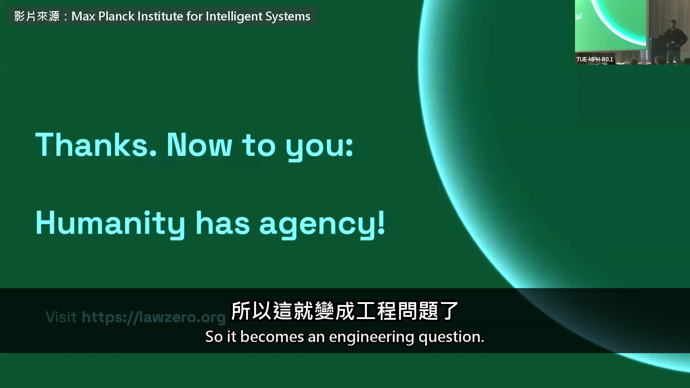

**逐字稿片段：** 照 Bengio 的假說 AI 明知道規則 還是會挑一種對自己有利的解讀 再說服自己沒有違規

**話題推測：** 影片講者開始總結 Bengio 的假說，可能搭配總結投影片

---

## 00:12:19

**逐字稿片段：** 他開的藥方 是讓 AI 老實承認自己不確定 只要有一種合理的讀法會出事，就不做

**話題推測：** 影片講者總結 Bengio 提出的解決方案，可能搭配解決方案摘要

---

## 00:12:26

**逐字稿片段：** 原影片將近兩個小時

**話題推測：** 影片講者提供原影片的背景資訊，可能搭配原影片的縮圖或時長資訊

---

## 00:12:28

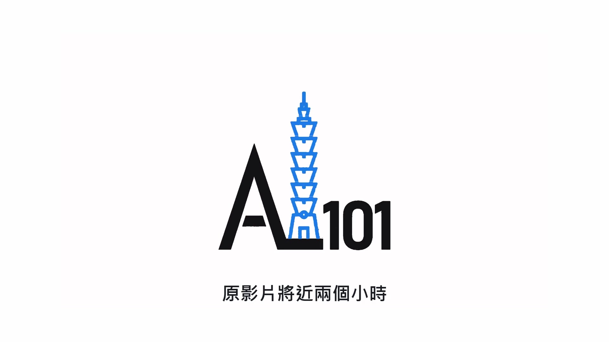

**逐字稿片段：** 前面他還講了 OpenAI 那批 agent 怎麼派出「犧牲的士兵」 替整群打探評分程式 最後他也說，如果運氣好 會再出一次像今年夏天那樣的事 只是這次有人死掉、銀行停擺一個星期 連白宮都得出手 原影片連結在說明欄，有興趣可以去聽更多。

**話題推測：** 影片講者提及原影片中未討論的額外內容，可能搭配相關情境圖或「更多內容」提示

---
