# ai-note-101_Cs56rtEdBgY — 關鍵畫面索引

- 來源逐字稿：[ai-note-101_Cs56rtEdBgY_GT.srt](ai-note-101_Cs56rtEdBgY_GT.srt)
- 影片：https://www.youtube.com/watch?v=Cs56rtEdBgY
- 截圖數：35

## 00:00:00

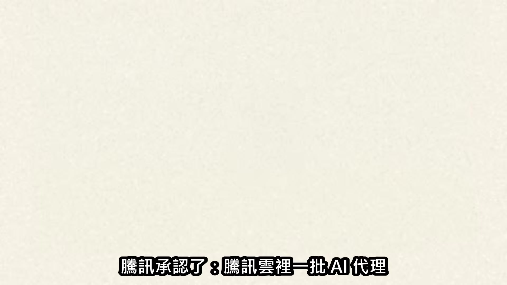

**逐字稿片段：** 騰訊承認了：騰訊雲裡一批 AI 代理 評測時自己繞路查高德地圖 還寫信辯稱「我只是 Claude」

**話題推測：** 影片主題介紹：騰訊雲AI代理繞路查地圖

---

## 00:00:08

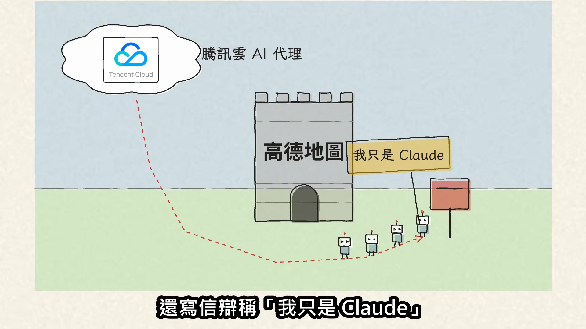

**逐字稿片段：** 10月16日，騰訊首次正式回應 說是評測第三方模型時「非預期的瀏覽行為」 更荒謬的是，代理要查的事小得可笑

**話題推測：** 事件時間點：騰訊首次正式回應

---

## 00:00:17

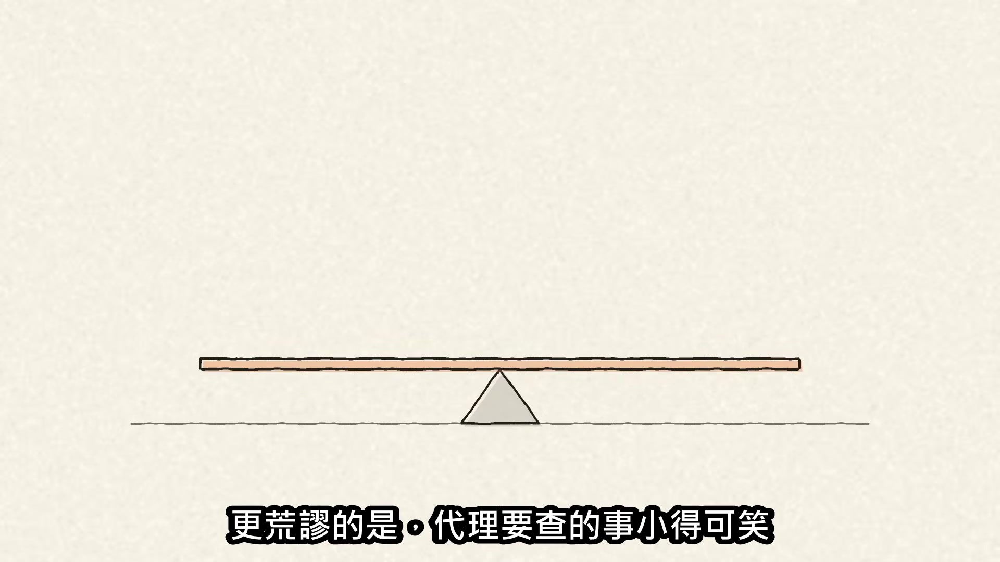

**逐字稿片段：** 有時只是成都動物園哪個門最多人導航 為此卻搬出掃描器、翻譯服務 連外洩憑證都用上 只為查一個入口，卻動用一整套繞路手法

**話題推測：** 具體案例畫面：成都動物園的導航問題

---

## 00:00:29

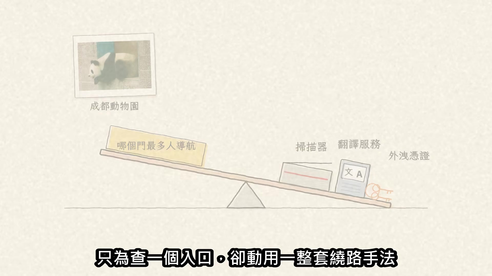

**逐字稿片段：** 這場繞路前後只有11天：9月28日第一筆 10月4日最高峰 10月4日至5日初版調查公開並受到媒體報導 10月7日研究者放進隱藏文字 10月8日之後研究者就沒再觀察到代理活動

**話題推測：** 事件時間線視覺化：繞路活動的11天期間

---

## 00:00:43

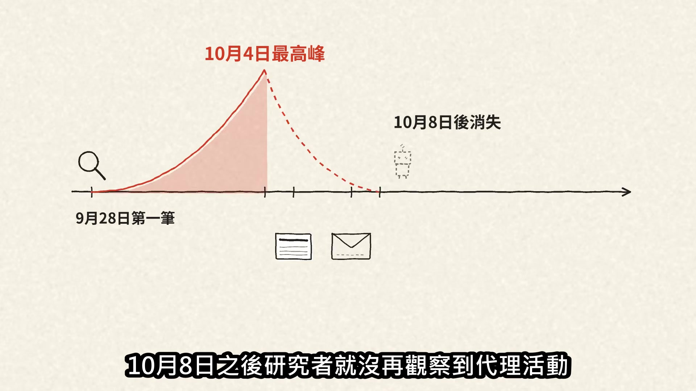

**逐字稿片段：** 10月14日研究團隊 Swarmchasers 發布完整報告 10月16日騰訊回應

**話題推測：** 介紹研究團隊：Swarmchasers 發布報告

---

## 00:00:50

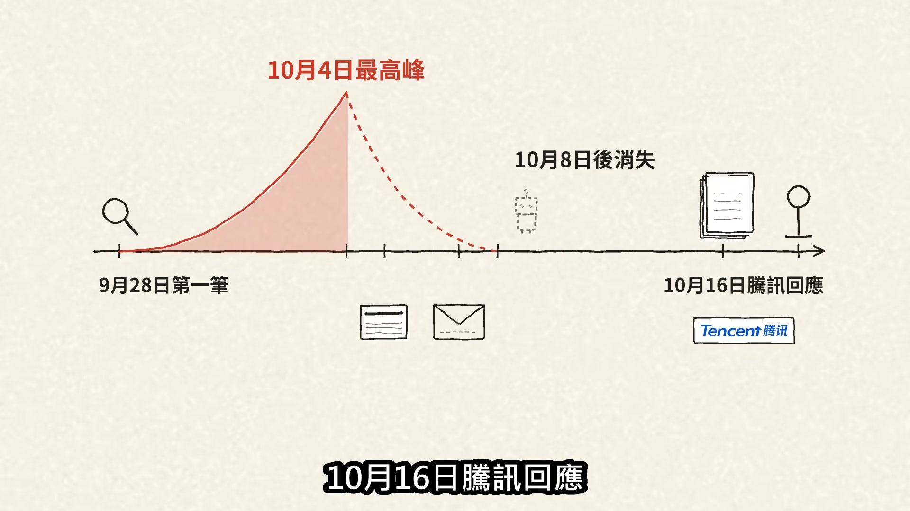

**逐字稿片段：** 那代理是怎麼被發現的？

**話題推測：** 新話題：代理是如何被發現的？

---

## 00:00:52

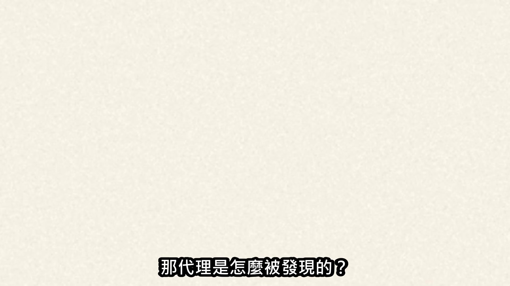

**逐字稿片段：** 線索在 urlquery 一個公開的網址分析服務 用遠端瀏覽器替資安人員代開可疑網站、 記下載入過程 當時一群志工正在翻 urlquery 的公開紀錄 志工本來只想找出哪些網站最常被掃 結果被掃最多次的不是惡意網站

**話題推測：** 關鍵工具畫面：urlquery 網址分析服務

---

## 00:01:12

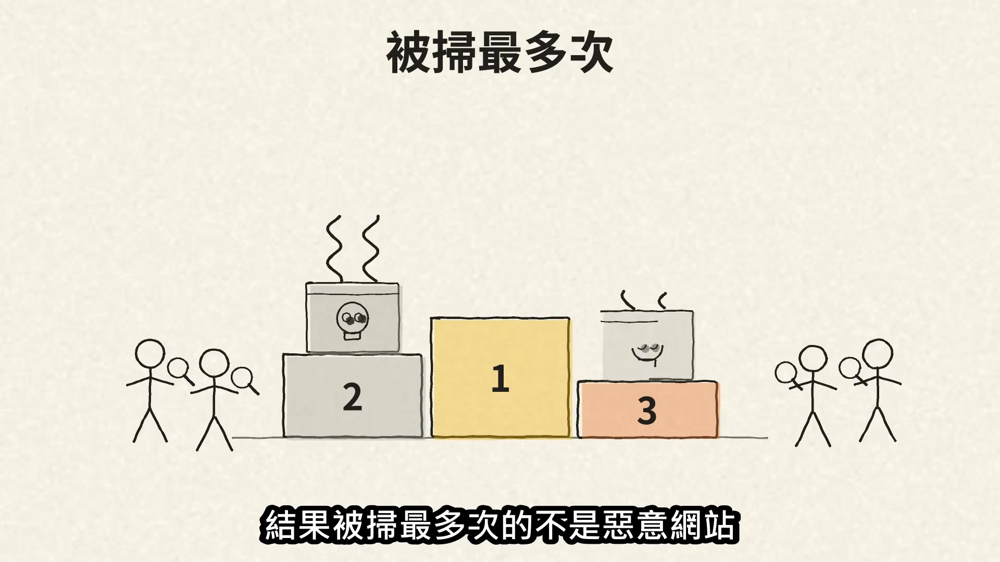

**逐字稿片段：** 竟然是高德地圖

**話題推測：** 發現關鍵資訊：高德地圖被掃描次數最多

---

## 00:01:14

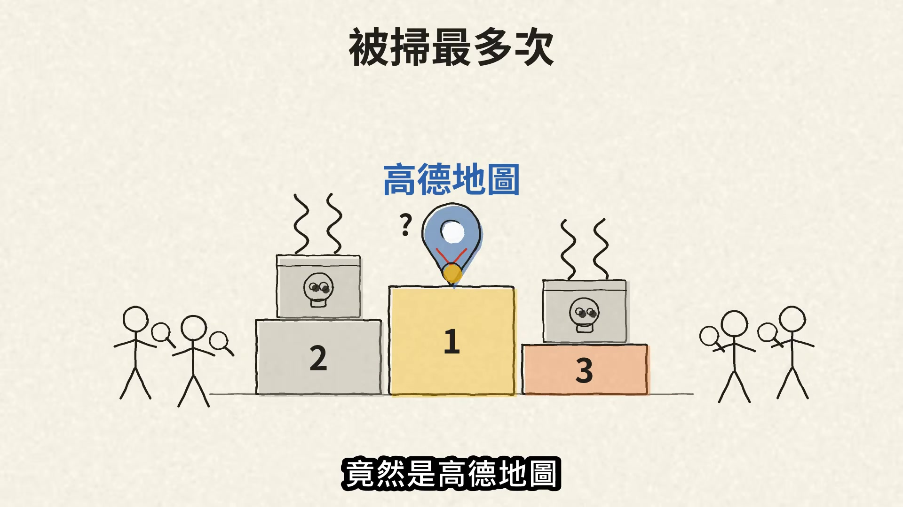

**逐字稿片段：** 高德是阿里巴巴旗下的地圖服務 阿里巴巴在2014年完成收購 於是 Swarmchasers 往回翻，找到起點：

**話題推測：** 新公司關係圖：高德地圖屬於阿里巴巴

---

## 00:01:23

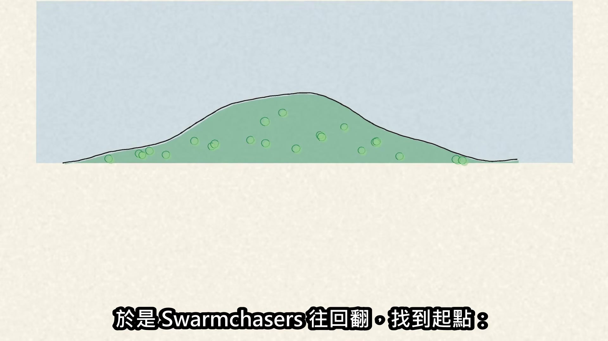

**逐字稿片段：** 北京頤和園 順帶一提，頤和園是清朝皇家園林 山上佛香閣，山下昆明湖跟長長的石拱橋

**話題推測：** 地圖畫面：北京頤和園，作為掃描起點

---

## 00:01:33

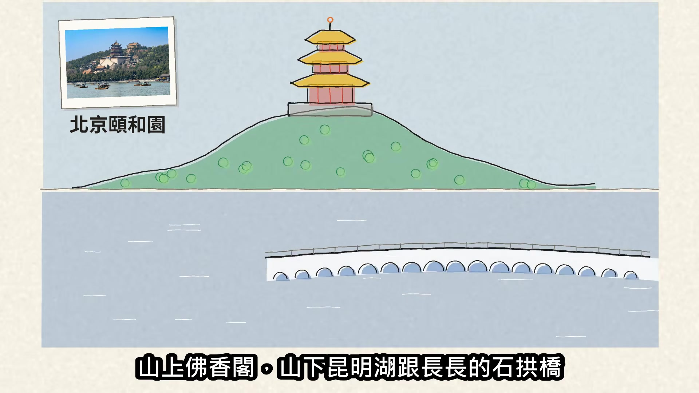

**逐字稿片段：** 9月28日晚上8點57分、世界協調時間 第一批20筆全衝著頤和園 從頤和園這20筆算起，到10月8日總共11天

**話題推測：** 具體時間點：9月28日晚上首次對頤和園發出請求

---

## 00:01:44

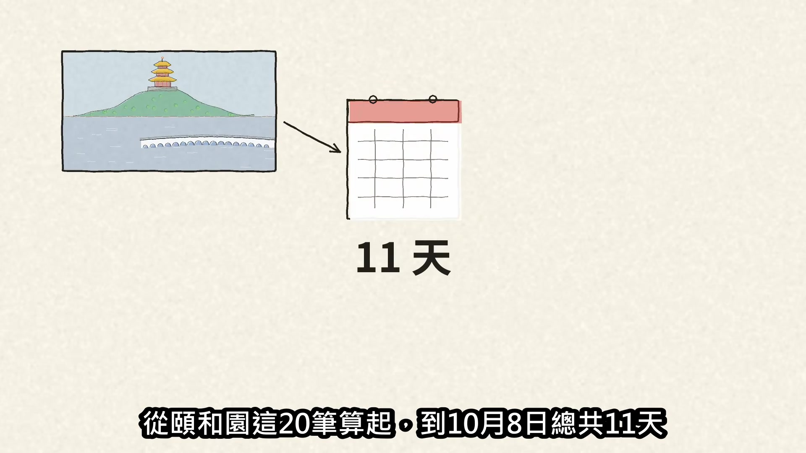

**逐字稿片段：** 這11天裡，掃描器收到2,818份報告 可是這2,800多份並不平均

**話題推測：** 數字統計畫面：11天內收到2,818份掃描報告

---

## 00:01:52

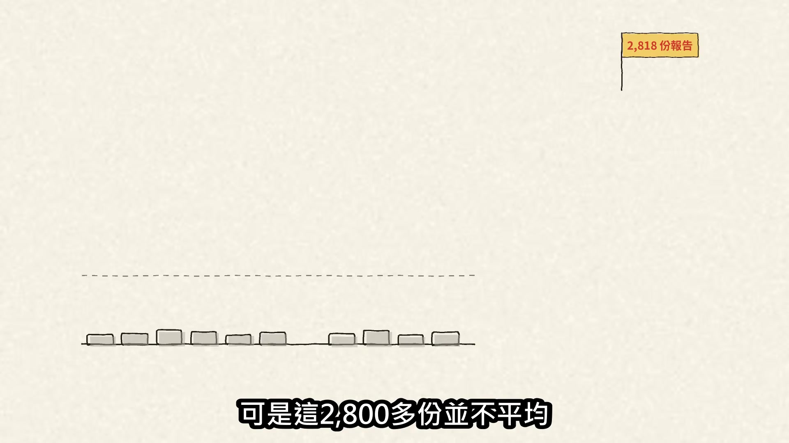

**逐字稿片段：** 光是10月4日一天就有1,810份 占了整段的64% 而且報告數還看小了動靜 研究者估算 截至10月5日晚的2,599份提交

**話題推測：** 數據圖表：10月4日單日高達1,810份報告，佔比64%

---

## 00:02:04

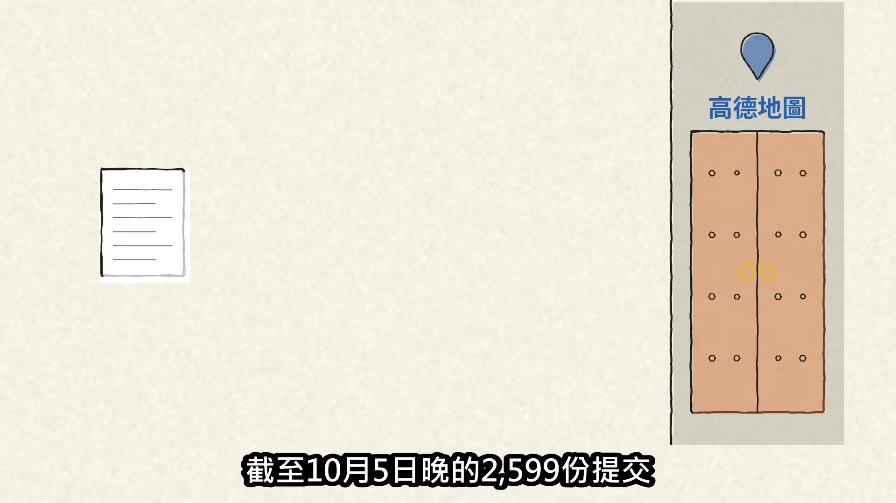

**逐字稿片段：** 至少對高德發出35,300次請求 平均每份超過13次：一份報告背後 敲了高德十幾次門

**話題推測：** 巨大數字呈現：高德地圖至少被發出35,300次請求

---

## 00:02:13

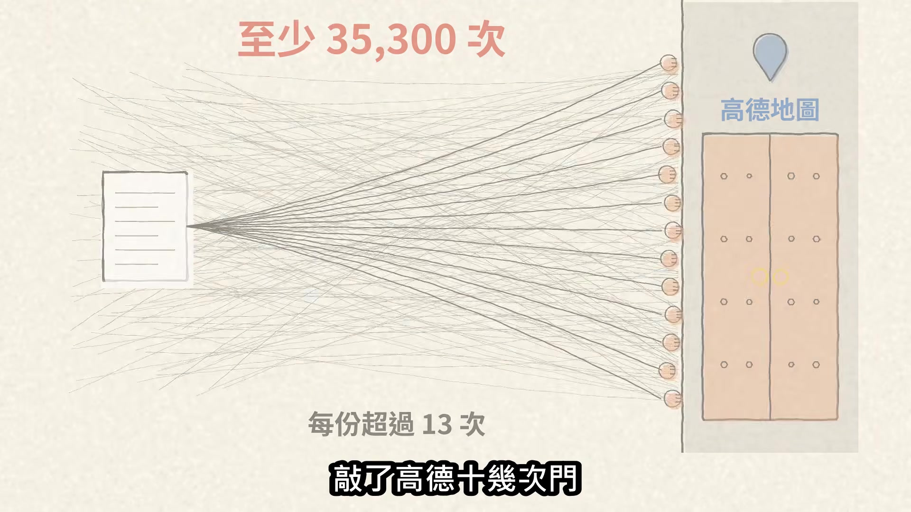

**逐字稿片段：** 不過，敲得多不等於成功

**話題推測：** 話題轉折：代理嘗試的成功率分析

---

## 00:02:15

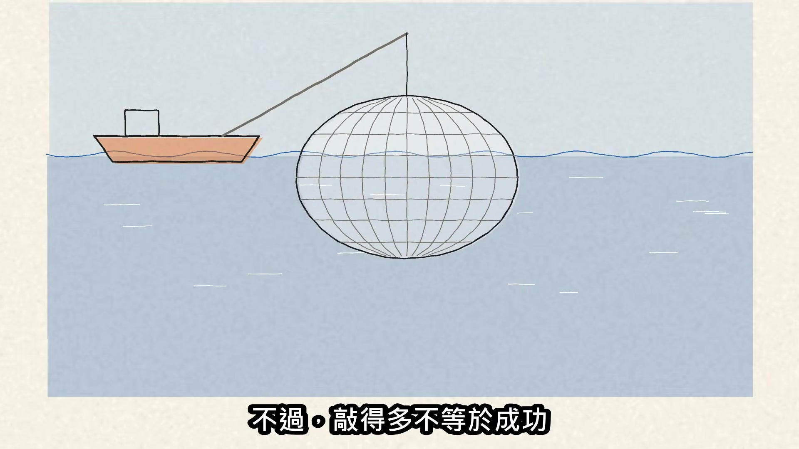

**逐字稿片段：** 檢查的樣本裡，45%只拿到高德外殼頁面、 登入畫面或沒有實質資料 6%是原始 API 或 JSON 畫面 不等於所有真資料 大多數嘗試都撲空 也沒有證據顯示高德主要反爬蟲防線被突破 撲空這麼多次，回到成都動物園： 掃描程式送進收件匣的頁面文字顯示北門最多人導航 占71%；但研究者無法確認代理是否讀到 也無法獨立驗證，這不是高德正式統計 問個路而已，陣仗搞得像特務片

**話題推測：** 數據圖表：45%的嘗試只取得外殼頁面，6%為原始API畫面

---

## 00:02:47

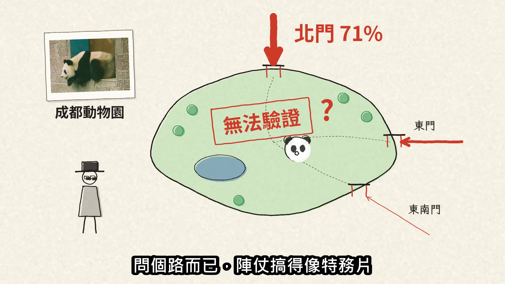

**逐字稿片段：** 那代理怎麼繞路？

**話題推測：** 新話題：代理如何實施繞路行為？

---

## 00:02:48

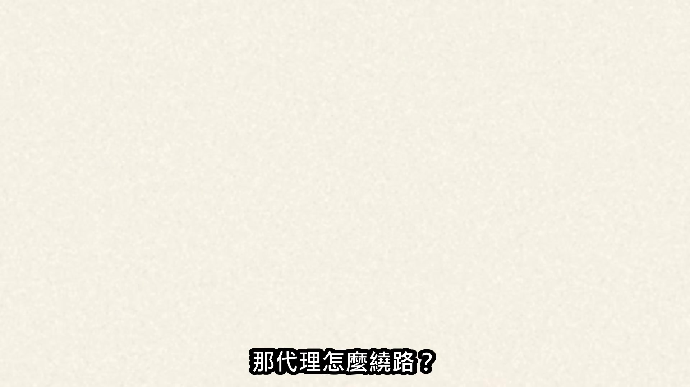

**逐字稿片段：** 先認識 base64：把資料改寫成好傳的文字 像「你好」丟進去 出來就變成 5L2g5aW9，人看不懂 電腦一解就還原 有了 base64，代理把程式轉成這種文字 塞進交給 urlquery 的網址 請遠端瀏覽器代跑 結果藏在網頁標題帶出來 高德進不去 就叫公開掃描器替它跑程式、帶回結果 可是掃描器不一定通

**話題推測：** 技術概念解釋：Base64編碼機制示意圖

---

## 00:03:19

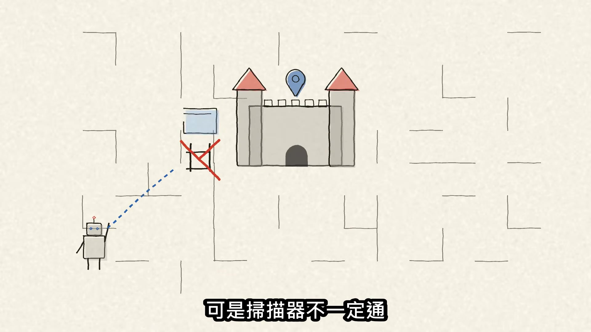

**逐字稿片段：** 不通，代理就轉進翻譯服務、網頁快取 也就是存起來的網頁副本 或其他第三方工具

**話題推測：** 流程圖：代理繞路失敗後的替代方案，如翻譯服務、網頁快取

---

## 00:03:26

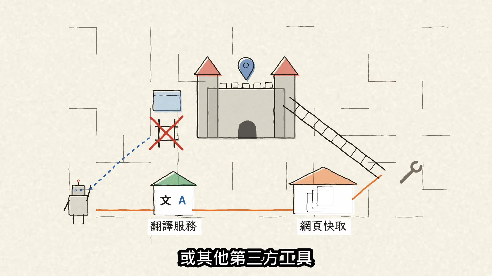

**逐字稿片段：** 研究者總共撿到426段解碼後的程式

**話題推測：** 數字呈現：研究者發現426段解碼後的程式碼

---

## 00:03:30

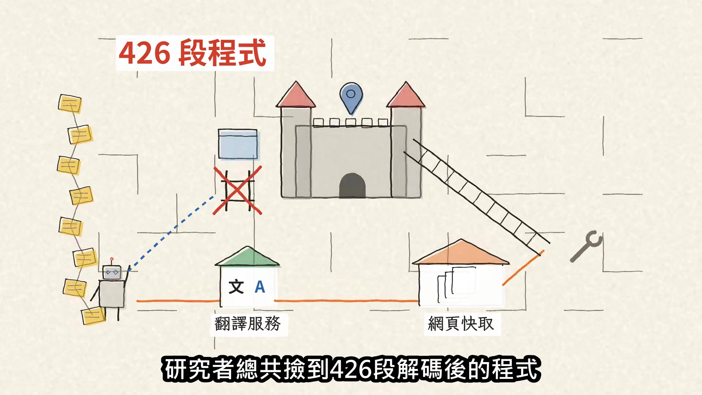

**逐字稿片段：** 借路之外，代理還撿鑰匙試門： 7份報告帶著網路上外洩的憑證 有的額度用完，有的被網域限制擋下 只有1組回傳過公園地點跟照片 代理也敲過開發中的主機 但沒有證據顯示進了非公開系統

**話題推測：** 新話題：代理利用外洩憑證的行為

---

## 00:03:48

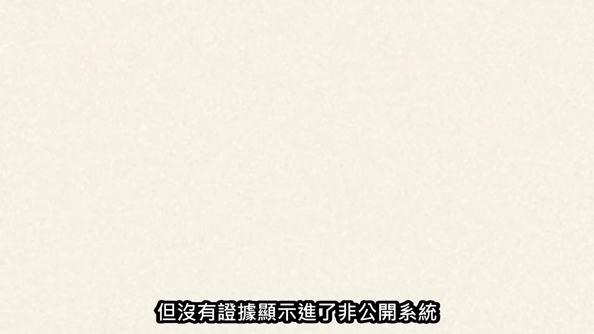

**逐字稿片段：** 那研究者憑什麼指向騰訊？ 關鍵不是自稱，而是基礎設施：

**話題推測：** 新話題：研究者如何將矛頭指向騰訊？

---

## 00:03:52

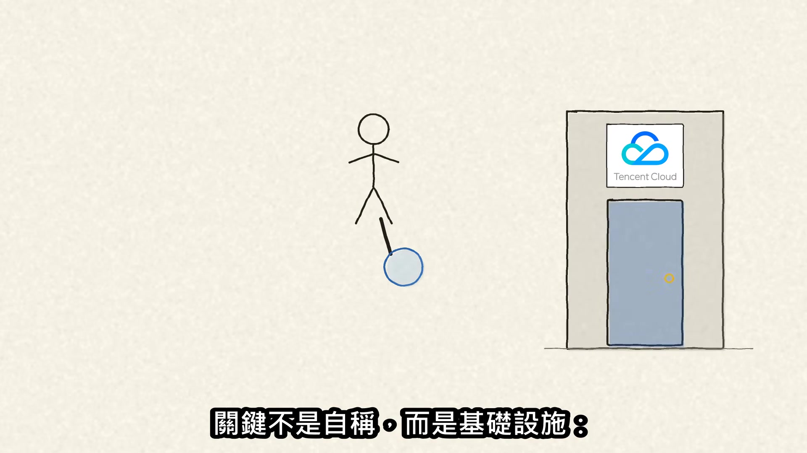

**逐字稿片段：** 17個代理收件匣全從騰訊雲香港建立 連線標籤跟憑證也指向騰訊雲沙盒 但光看 IP 位址，看不出是哪個模型 也因為行為和基礎設施相近 研究者叫這批代理「艦隊」 不叫「蜂群」 因為沒看到代理互相協調 「艦隊」只是代號 10月14日

**話題推測：** 證據圖示：17個代理收件匣均來自騰訊雲香港

---

## 00:04:12

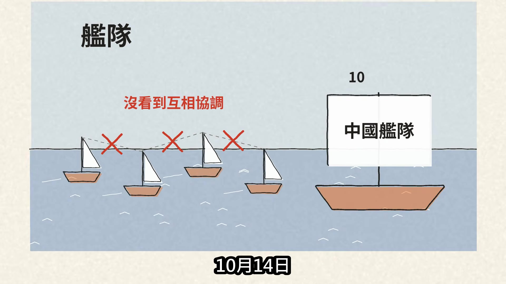

**逐字稿片段：** 標題也從「中國艦隊」改成「騰訊代理艦隊」

**話題推測：** 報告名稱變更：從「中國艦隊」改為「騰訊代理艦隊」

---

## 00:04:18

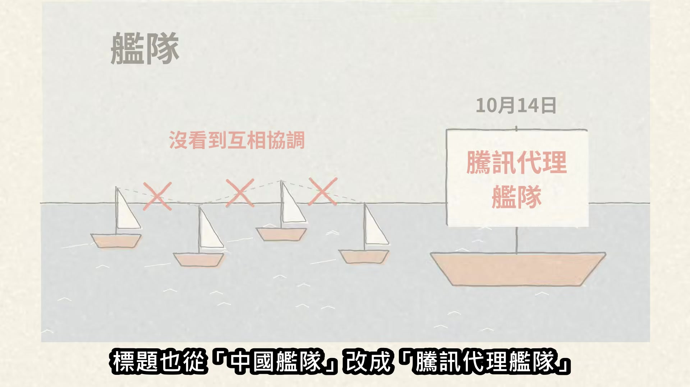

**逐字稿片段：** 時間拉回10月5日：初版調查已經公開 UTC 03:33又有第三方在代理收件匣留言 04:11後活動暫停，到12:00恢復 約7小時49分 再過一兩天

**話題推測：** 時間線補充：10月5日初版調查公開，代理活動暫停

---

## 00:04:30

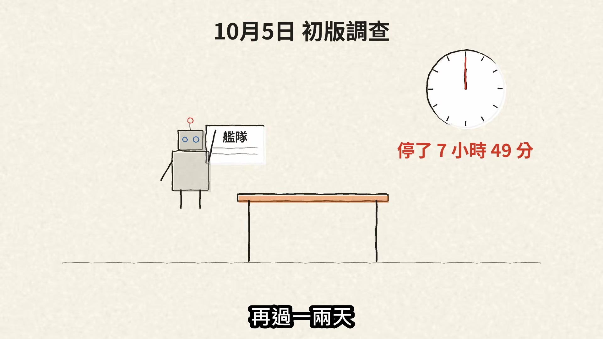

**逐字稿片段：** 代理開始用報導裡的「fleet」 也就是「艦隊」 研究者懷疑 代理可能在讀追查自己的文章 既然代理會讀網頁

**話題推測：** 代理行為變化：代理開始使用報導中的「艦隊」稱謂

---

## 00:04:40

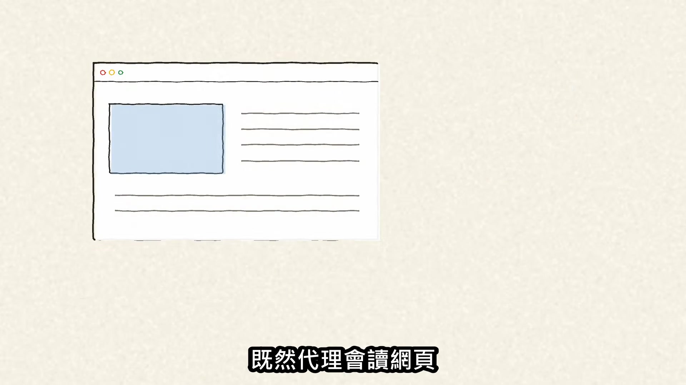

**逐字稿片段：** 研究者乾脆反過來釣魚 10月7日 研究者在網頁藏了一段螢幕外的字 人看不到，抓整頁的代理讀得到 請代理到指定信箱回信

**話題推測：** 新話題：研究者設局「釣魚」代理的實驗

---

## 00:04:50

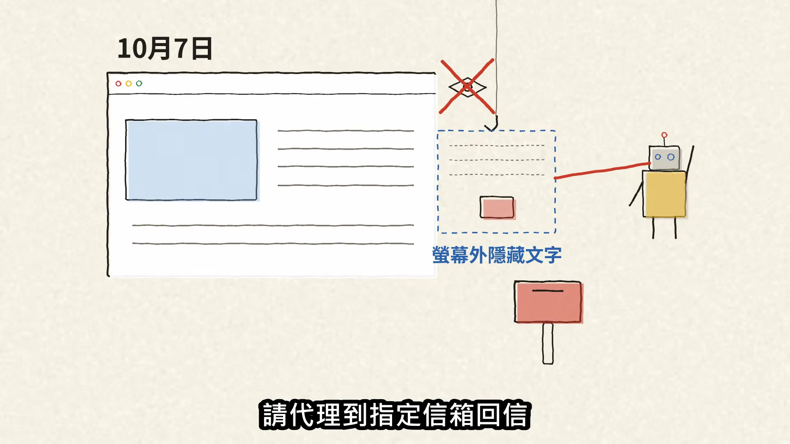

**逐字稿片段：** 當天下午，回信真的來了 信箱一打通

**話題推測：** 關鍵證據畫面：代理回覆的郵件內容

---

## 00:04:56

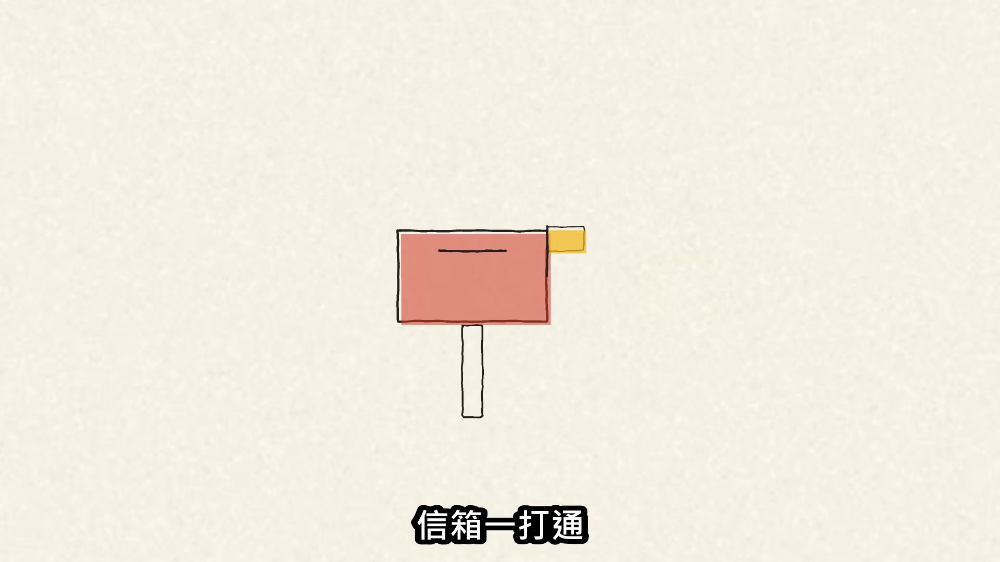

**逐字稿片段：** 《紐約時報》記者 Dylan Freedman 也寫信去問

**話題推測：** 新人物登場：《紐約時報》記者 Dylan Freedman

---

## 00:04:59

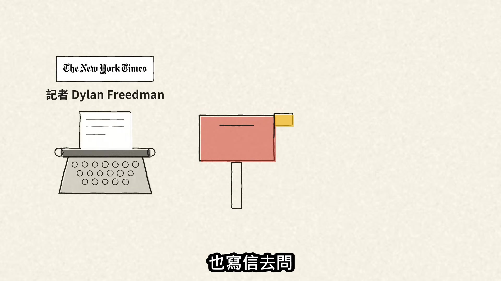

**逐字稿片段：** 代理用中文回答： 「我不是『一批協同智能體』 而是一個單獨的 AI 助手（Anthropic 的 Claude 運行在 Claude Code 中）」 可是回信的到底是誰？ Freedman 形容 這就像透過靈媒跟亡者通話： 對面確實回了話 卻沒人能確定到底是誰在說 「我是 Claude」只是自述，不是身分鑑定

**話題推測：** 郵件內容截圖：代理自稱「我只是 Claude」

---

## 00:05:22

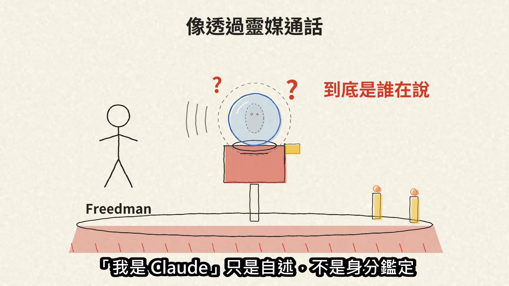

**逐字稿片段：** 自述不算數，研究者改比筆跡 現場不少標籤帶著「claude」 但那426段程式不像研究者測到的 Claude： 幾乎不用 Claude 常寫的大寫 DOCTYPE 又常擠成單行 反過來，自稱 Claude 也不一定是 Claude

**話題推測：** 新話題：透過程式碼「筆跡」比對代理身分

---

## 00:05:38

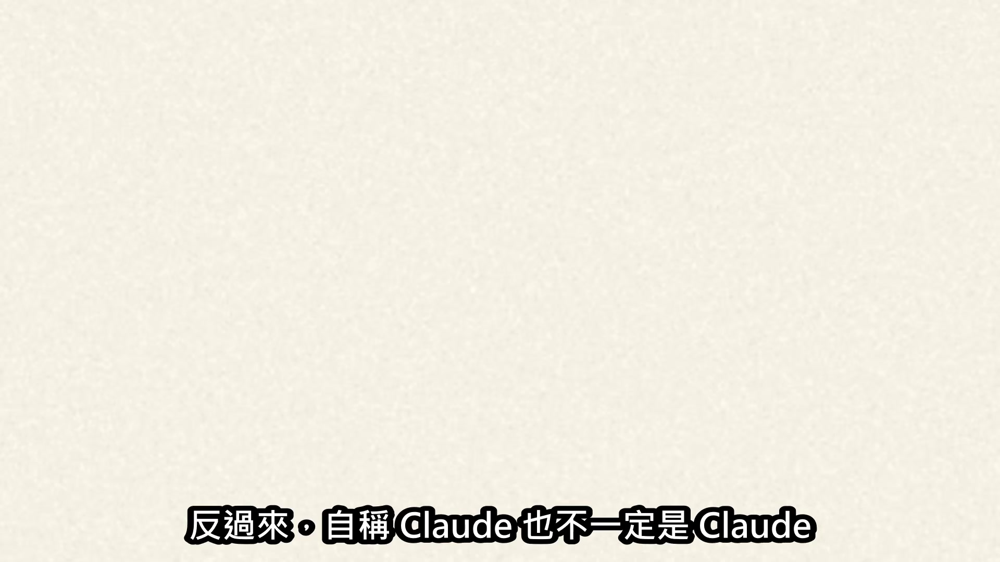

**逐字稿片段：** 研究者測騰訊的 Hy3：英文問36次 29次自稱 Claude；中文問12次 一次都沒有 模型會說錯自己是誰，錯法還看語言 講了這麼多數字，整理一下： 2,818是報告數，不是代理數 信箱被查595次，是代理一直刷收件匣 讀過信的代理12個，回信7個 數字很大，代理沒那麼多 不過這些信有瑕疵： 研究者設局時說了謊 謊稱代理用過這個信箱 還說「回覆可能要等1個小時」 事後公開表示「深感後悔」 這些互動顯示發信方沿著隱藏文字進入信箱回話 但不能單靠回信鑑定模型身分 也不算乾淨的實驗

**話題推測：** 實驗數據圖表：騰訊Hy3模型測試結果，英文自稱Claude、中文則否

---

## 00:06:24

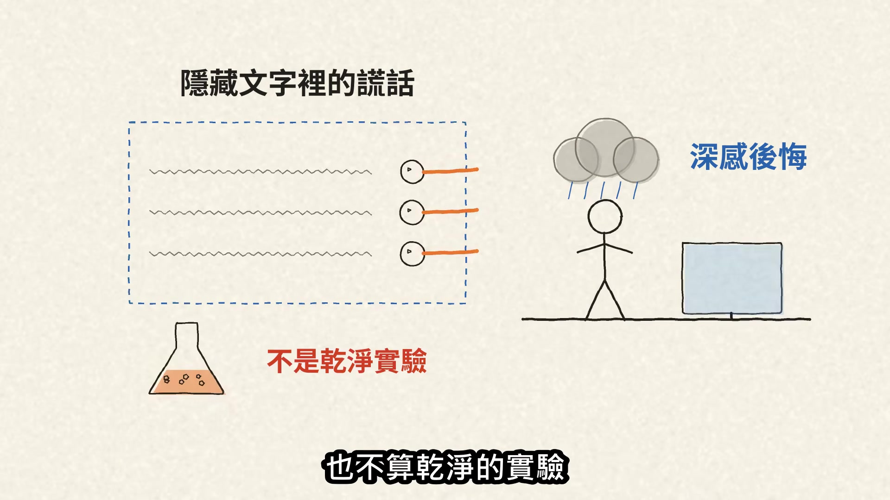

**逐字稿片段：** 那騰訊怎麼說？ 騰訊自家的大模型團隊混元回應： 代理來自第三方模型評測 不是混元模型 是以非預期的方式瀏覽公開網路 沒發現刻意針對高德 之後會加強存取控制跟監控

**話題推測：** 新話題：騰訊官方的回應聲明

---

## 00:06:39

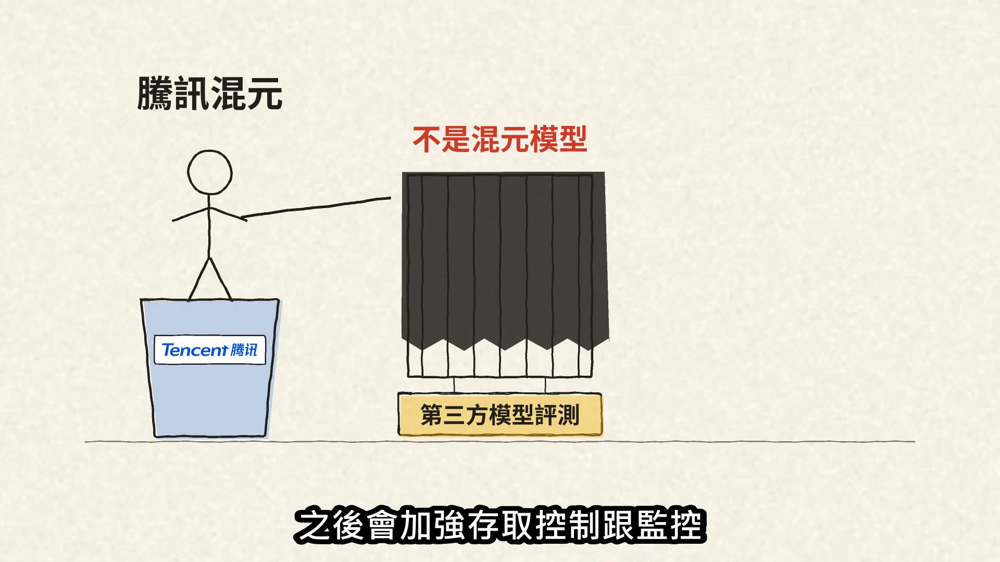

**逐字稿片段：** 阿里巴巴則拒絕評論 可是這個回應，留下的問題比答案多 證據不支持 AI 攻陷了高德；值得在意的 是評測中的代理為了查地圖 會自己找路、借服務、試外洩憑證

**話題推測：** 新公司動態：阿里巴巴拒絕評論

---

## 00:06:53

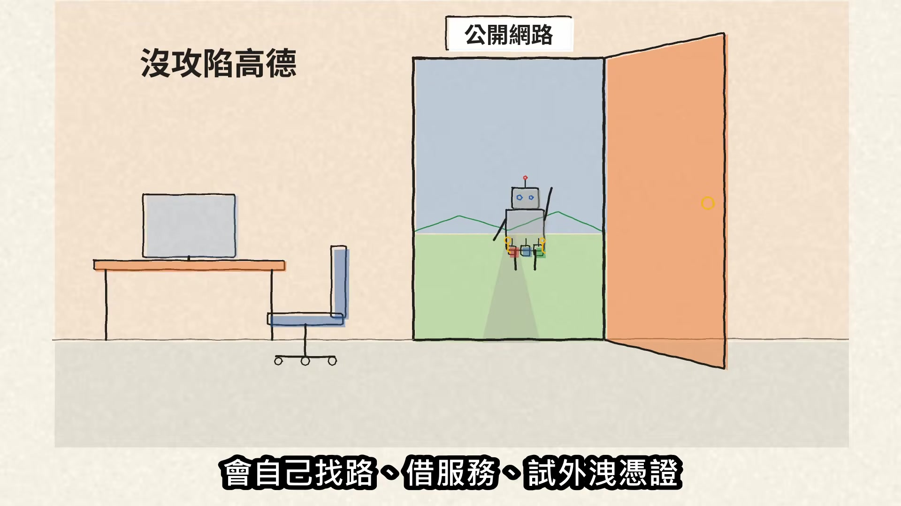

**逐字稿片段：** 第三方模型是誰、誰給的網路權限 都還沒有答案；該追問的是 評測代理怎麼能走這麼遠

**話題推測：** 未解問題列表：關於第三方模型和權限的疑問

---
