# ai-note-101_Dqqh1G-CnL8 — 關鍵畫面索引

- 來源逐字稿：[ai-note-101_Dqqh1G-CnL8_FIN.srt](ai-note-101_Dqqh1G-CnL8_FIN.srt)
- 影片：https://www.youtube.com/watch?v=Dqqh1G-CnL8
- 截圖數：43

## 00:00:00

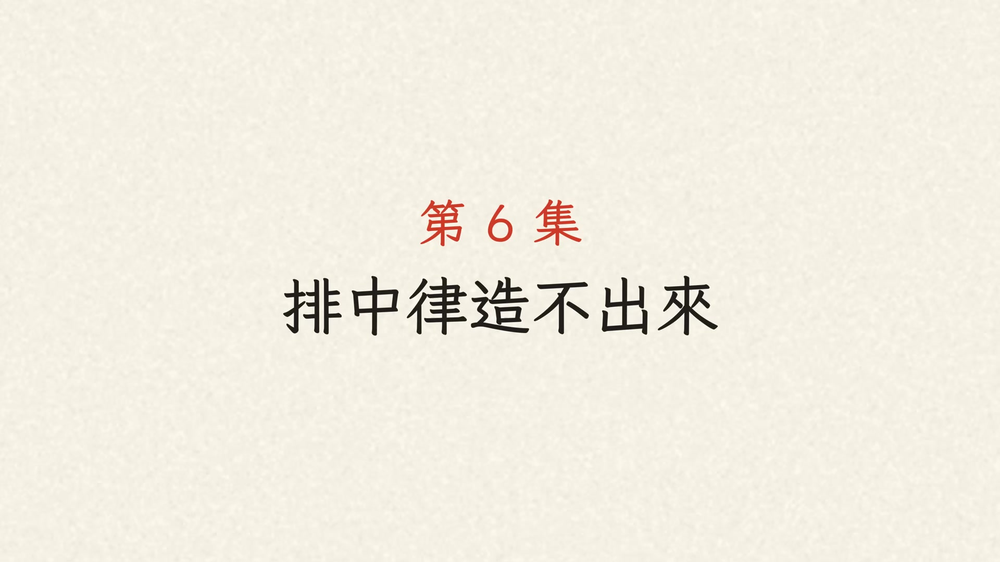

**逐字稿片段：** 這是第六集,為什麼批或非批造不出來。 上一集我們把且、或、假非都對上了形別。 回頭看,每一個證明都是一個實實在在造出來的東西。

**話題推測：** 影片標題或本集主題介紹，關於排中律的不可造性。

---

## 00:00:11

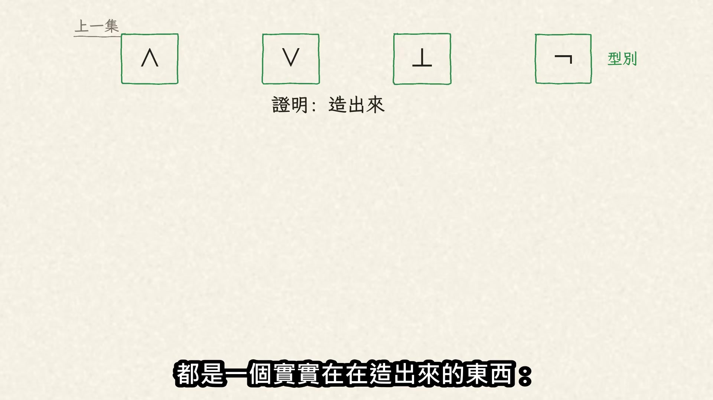

**逐字稿片段：** 一個兩格的盒子,一個掛了左右牌子的盒子,或是一臺機器。 可是有一個東西,你天天在用,卻偏偏造不出來。

**話題推測：** 證明實體的視覺化呈現，例如盒子或機器的圖示。

---

## 00:00:19

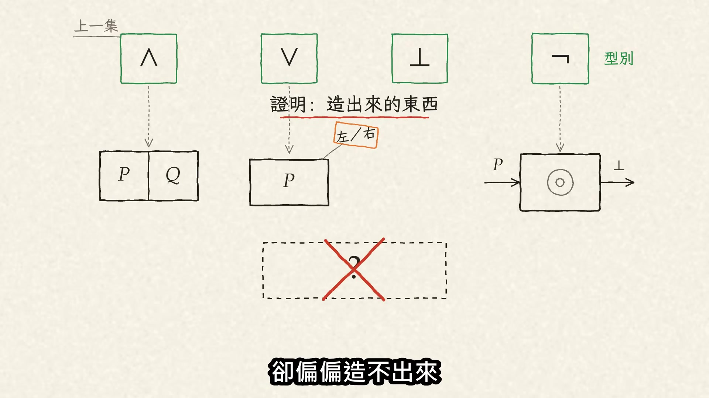

**逐字稿片段：** 那就是排中律,排中律說的是,任何命題批,要嘛批成立,要嘛非批成立。 寫下來就是批或非批。

**話題推測：** 介紹「排中律」的核心概念，可能顯示其文字定義或符號表示（P 或 非P）。

---

## 00:00:30

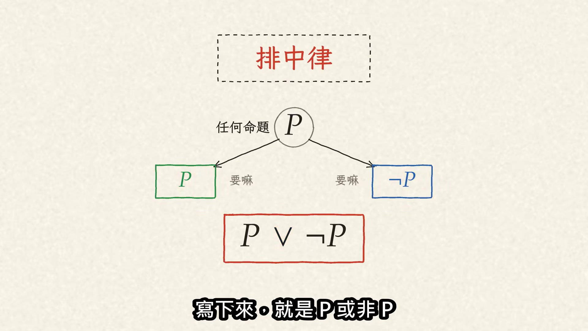

**逐字稿片段：** 那我們就試著造造看。 首先P或非P是一個用或連起來的句子 上一集說過或只有兩種造法 第一種是放左邊 這樣的話你得交出一個P的證明 第二種是放右邊 這樣的話你得交出一個非P的證明

**話題推測：** 過渡到實際嘗試構造證明，可能顯示「構造P或非P」的步驟引導。

---

## 00:00:47

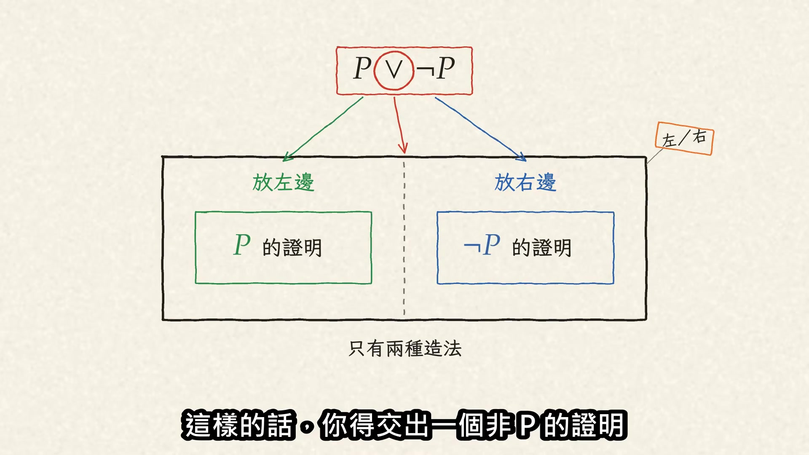

**逐字稿片段：** 問題是P是任意一個命題 我們對它一無所知

**話題推測：** 強調命題P的任意性，可能用問號或變數P的符號來表示其不確定性。

---

## 00:00:53

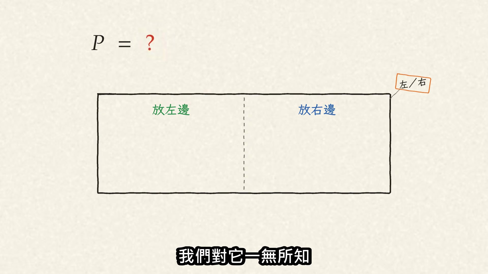

**逐字稿片段：** 它可能是2加2等於4 那左邊就造得出來 它也可能是2加2等於5 那換成右邊造得出來 可是它也可能是一個

**話題推測：** 舉例具體命題「2加2等於4」，可能顯示算式或真理符號。

---

## 00:01:04

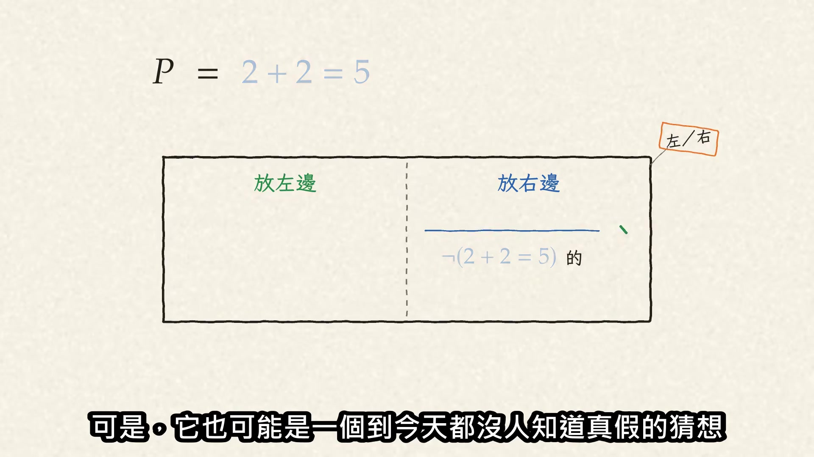

**逐字稿片段：** 一個到今天都沒人知道真假的猜想 這時候兩邊都造不出來 而一個對所有P都成立的證明 必須連這種P也造得出來 所以我們卡住了 為了看清楚差別

**話題推測：** 舉例數學猜想，可能顯示如「哥德巴赫猜想」等未解問題的名稱。

---

## 00:01:17

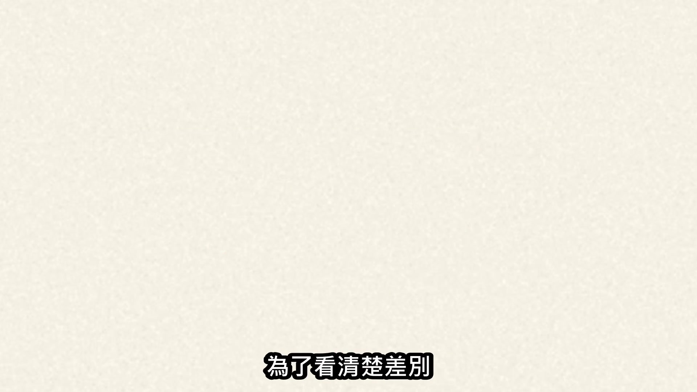

**逐字稿片段：** 我們再看一對方向相反的命題 第一個方向 從P推出非非P 換句話說 P成立的話 P不成立就不成立 這個方向造得出來 因為非P是一臺吃P吐假的機器 而我們要造的是一臺吃非P吐假的機器 做法很直接 別人交給我一臺非P的機器 我手上剛好有P的證明 把它喂進去 就突出假了

**話題推測：** 引導至一組方向相反的命題比較，可能顯示兩個命題的並列圖表。

---

## 00:01:43

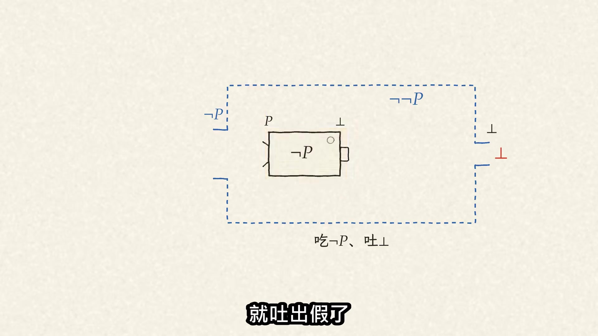

**逐字稿片段：** 反過來 從非P

**話題推測：** 話題轉向反方向命題，可能視覺上翻轉或切換到新一組符號。

---

## 00:01:46

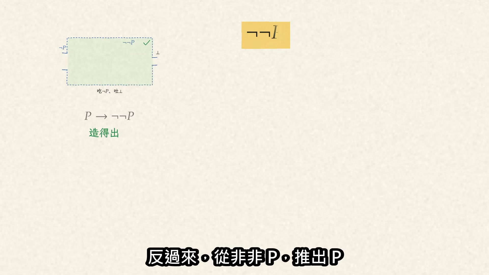

**逐字稿片段：** 推出P 就造不出來了 因為非P這臺機器 吃的是一臺非P的機器 突出來的是假 而我們要的是一個P的證明 可是這臺機器 要先餵它一臺非P的機器才會動 而我們手上根本沒有非P的機器 所以它幫不上忙 造不出P

**話題推測：** 顯示第二個命題「從非非P推出P」的符號表達。

---

## 00:02:03

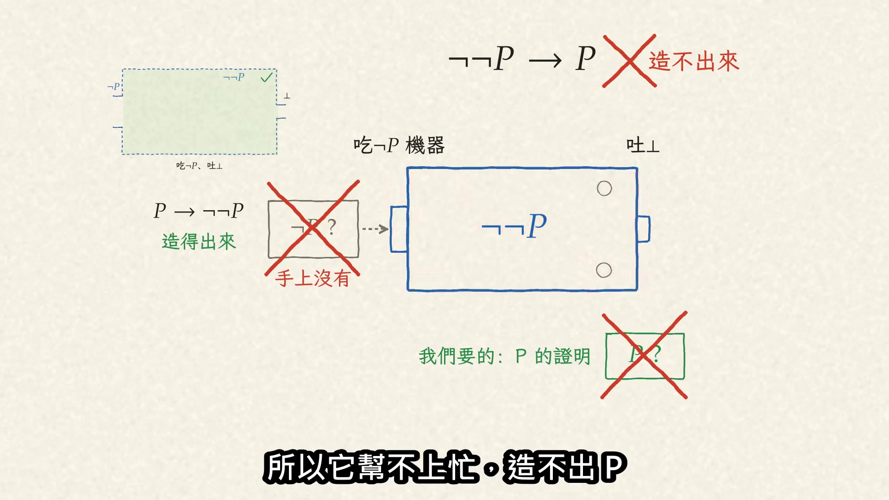

**逐字稿片段：** 所以這兩個方向在數學上你都常用 可是在只能造東西的世界裡 只有第一個方向造得出來 要說清楚的是

**話題推測：** 總結兩個方向的差異，可能以表格或對比圖呈現其結果。

---

## 00:02:11

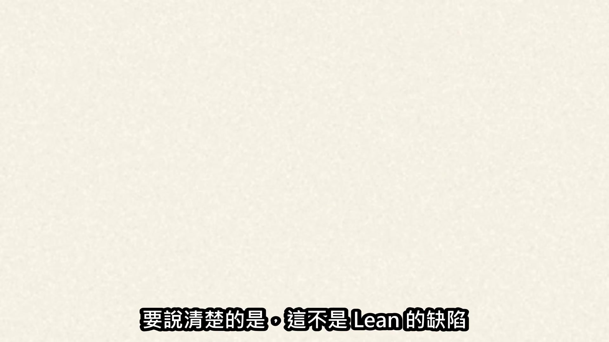

**逐字稿片段：** 這不是磷的缺陷 而是一個已知的數學結果 只靠前面這幾條性別規則 排中率證不出來

**話題推測：** 澄清這不是Lean系統的缺陷，可能提及Lean或強調該結論。

---

## 00:02:18

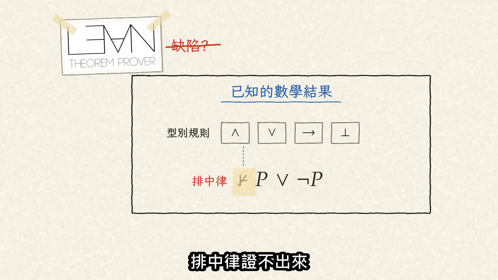

**逐字稿片段：** 至於怎麼證明它證不出來 其中一種方法

**話題推測：** 引入新子話題：如何證明排中律無法被證明。

---

## 00:02:22

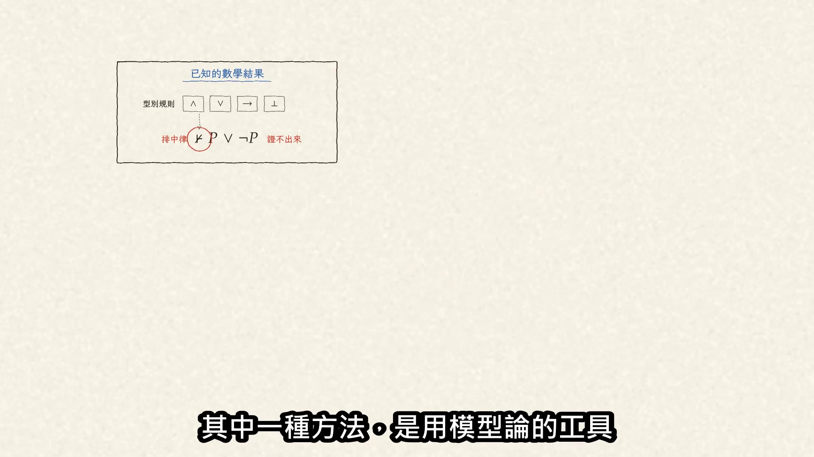

**逐字稿片段：** 是用模型論的工具 模型論是邏輯的一個分支 專門研究一套規則 可以有哪些不同的解讀 這一集就不證了 這一套只靠造東西的邏輯 有一個名字

**話題推測：** 提及「模型論」作為證明工具，可能顯示其名稱和簡要定義。

---

## 00:02:35

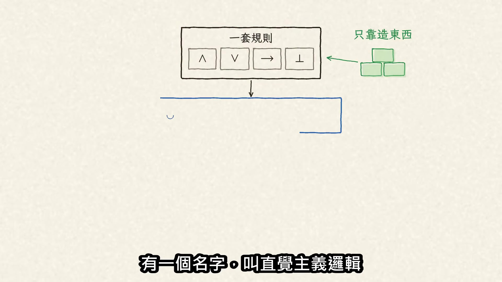

**逐字稿片段：** 叫直覺主義邏輯 也叫構造邏輯 在這套邏輯裡 說P或非P成立 意思就是 你真的能判定是哪一邊

**話題推測：** 介紹這種構造性邏輯系統的名稱：「直覺主義邏輯」或「構造邏輯」。

---

## 00:02:43

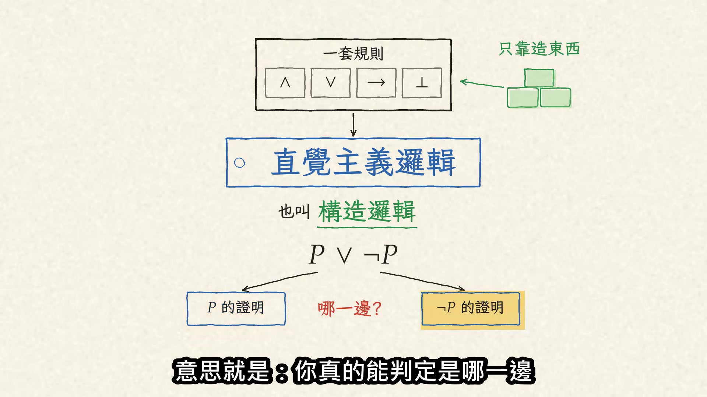

**逐字稿片段：** 可是數學家要用排中率

**話題推測：** 轉折到數學家使用排中律的場景，可能對比兩種邏輯體系。

---

## 00:02:46

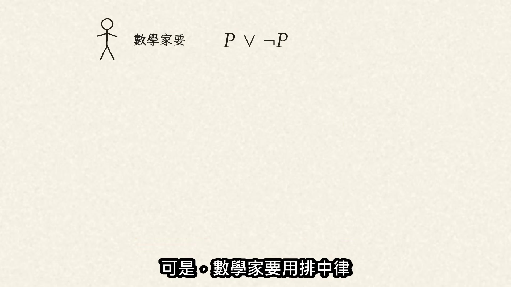

**逐字稿片段：** 比方說反證法 假設結論不成立 推出矛盾 就說結論成立

**話題推測：** 舉例「反證法」，可能顯示其證明步驟或邏輯圖。

---

## 00:02:52

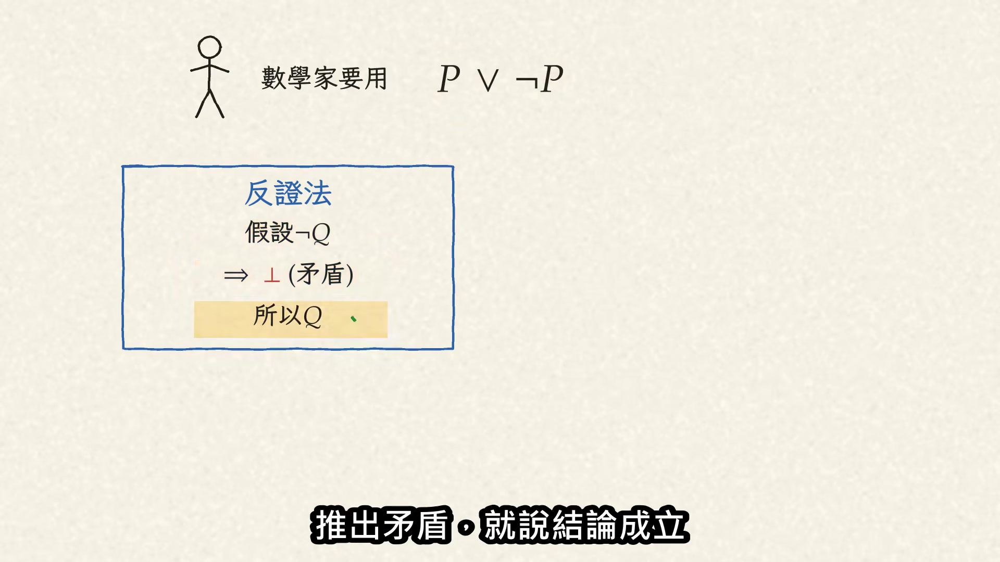

**逐字稿片段：** 又比方說雙重否定 也就是剛剛那個 從非P推出P 這些處處都要靠排中率

**話題推測：** 舉例「雙重否定」，可能顯示其邏輯符號或證明示意圖。

---

## 00:02:59

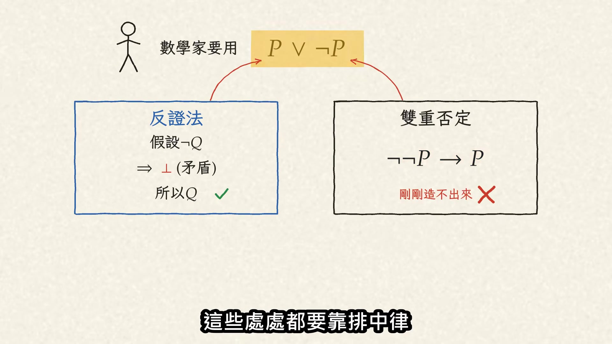

**逐字稿片段：** 那另怎麼辦 答案很直接

**話題推測：** 提出在Lean系統中如何解決排中律問題，可能顯示Lean的介面或代碼片段。

---

## 00:03:02

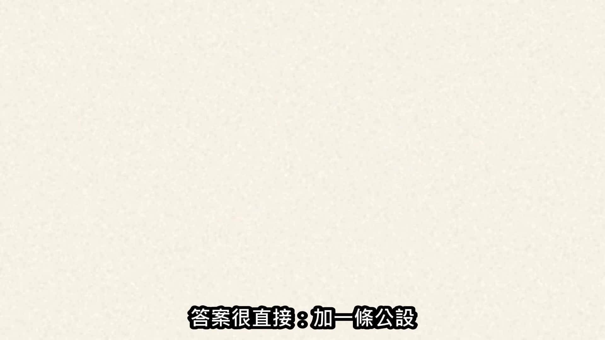

**逐字稿片段：** 加一條公設 公設的英文是axiom

**話題推測：** 介紹解決方案：增加一條「公設」，可能顯示其概念定義。

---

## 00:03:05

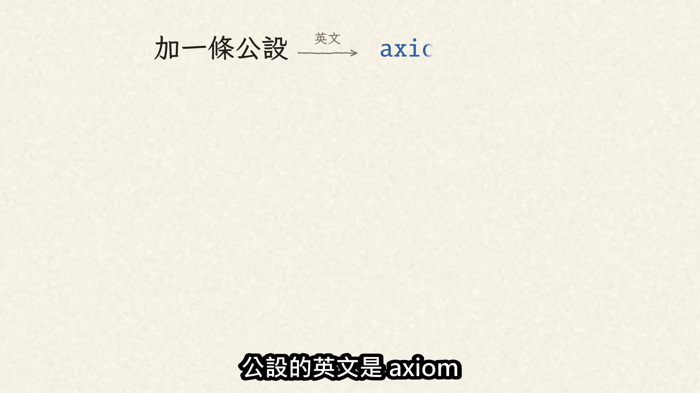

**逐字稿片段：** 那麼在Curno眼裡 公設是什麼 它就是一個常數 有名字 也有形別 但是沒有內容 還記得上一集講過的常數規則嗎 已經宣告過的名字 行別就照宣告寫的算 公設也走這條規則 所以Colonel不問他從哪來 也不問他有沒有內容 他只看行別 這樣一來 如果我宣告一個公設名字 叫排中率

**話題推測：** 解釋公設在Lean核心中的本質，可能顯示Kernel相關的圖示。

---

## 00:03:32

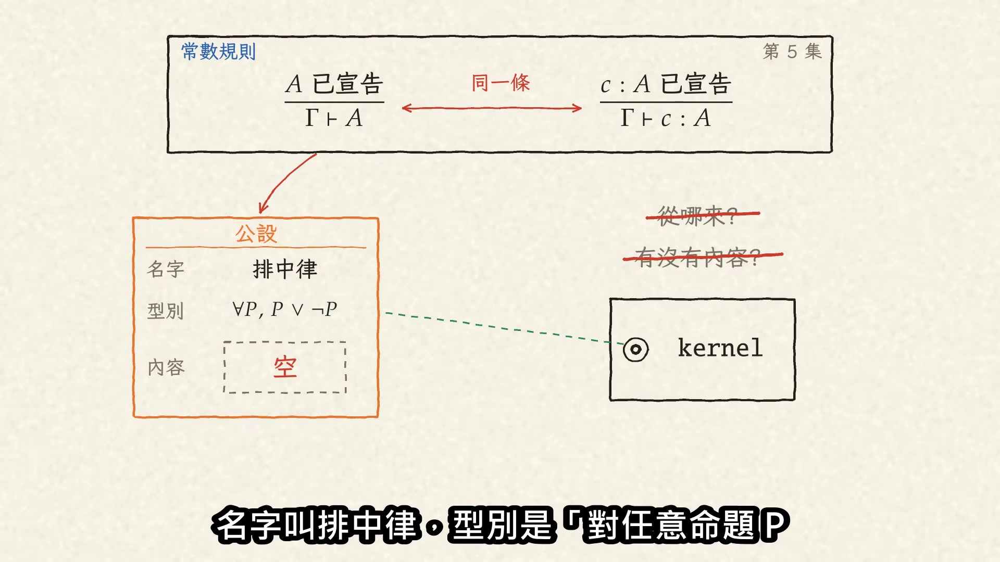

**逐字稿片段：** 行別是對任意命題批批或非批 Colonel就會收下 從此以後 任何證明都可以拿它來用 有了這條公設 剛剛那個造不出來的方向 就正得出來了 我們走一遍

**話題推測：** 顯示宣告排中律公設的具體形別或代碼片段。

---

## 00:03:48

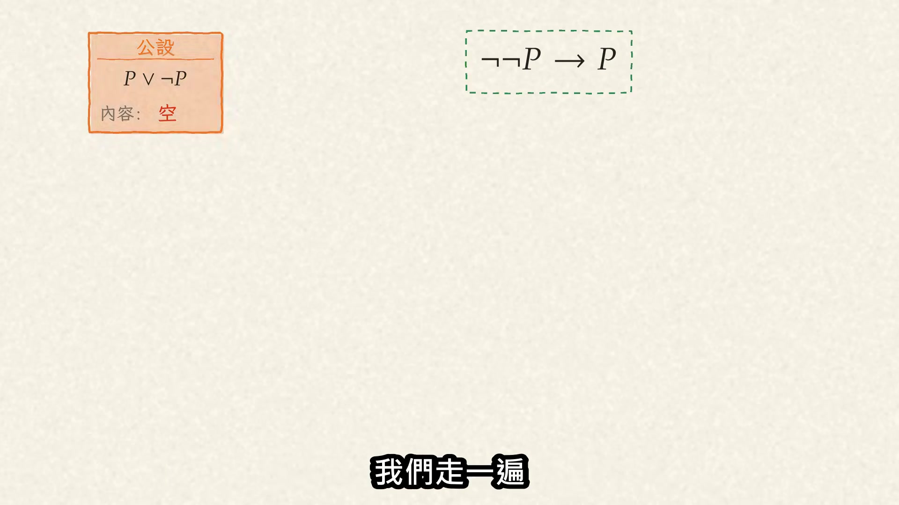

**逐字稿片段：** 要掙的是非非P推出P 第一步先拿公設得到P或非P 接著分情況 情況一P成立 那就直接把P交出去 情況二非P成立 可是我們手上有非非P 他吃非P吐假 把非P喂進去就得到假

**話題推測：** 展示新的證明目標「非非P推出P」的符號表示。

---

## 00:04:08

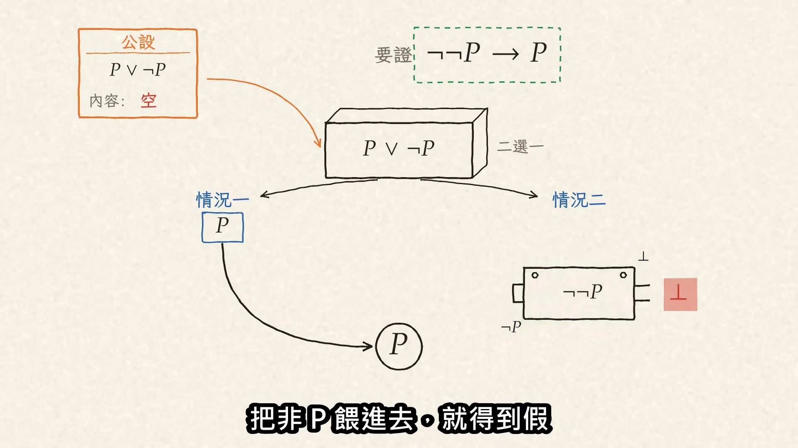

**逐字稿片段：** 接著再用爆炸率從假得到P 所以兩種情況都拿到了P 而且用的全部是上一級的規則 唯一的新東西 就是那個沒有內容的公設 不過公設沒有內容 所以Colonel沒辦法替他擔保

**話題推測：** 提及「爆炸率」（Ex Falso Quodlibet），可能顯示其邏輯規則。

---

## 00:04:24

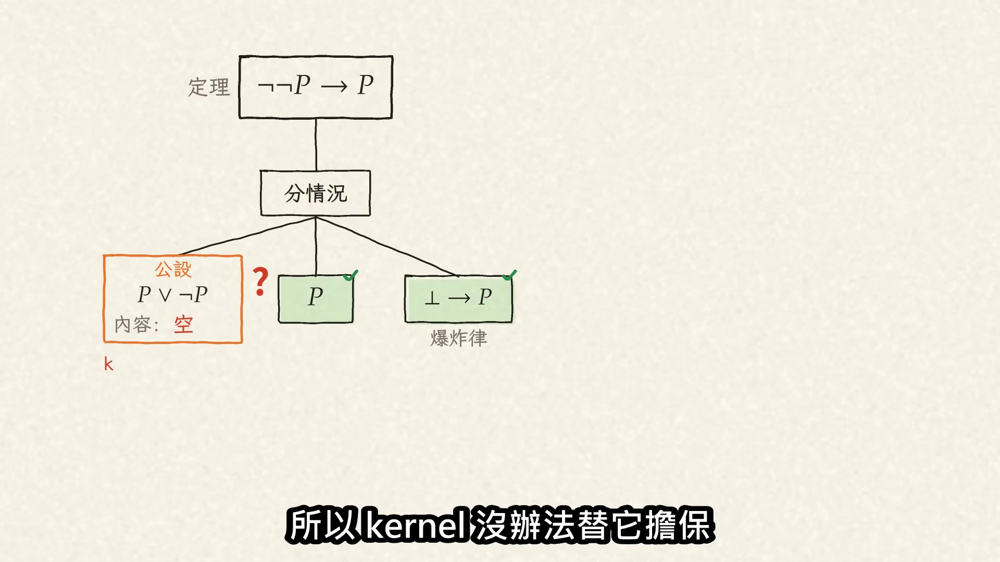

**逐字稿片段：** 因此得有人記賬 一個定理到底用了哪些公設 Lean有一個指令 專門做這件事 他會沿著證明一路找下去 把用到的每一個公設都列出來 拿剛剛那個證明來說 他就會列出一條排中率 為什麼記賬那麼重要

**話題推測：** 引入「記賬」概念，追蹤定理所用的公設，可能顯示一個列表或賬本的圖示。

---

## 00:04:41

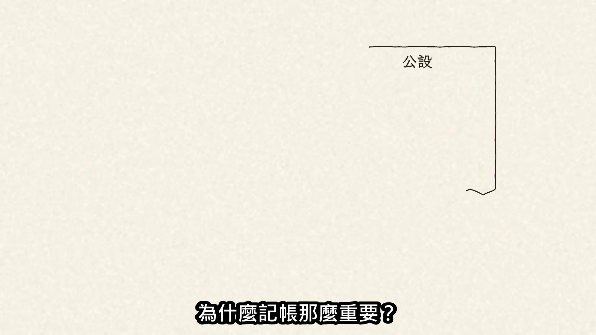

**逐字稿片段：** 我們看一個反例 假設我宣告一條公設 它的行別是假 Colonel照樣收下 因為他只看行別 接著用爆炸率

**話題推測：** 引出一個反例來強調記賬的重要性，可能是一個新的問題情境圖。

---

## 00:04:51

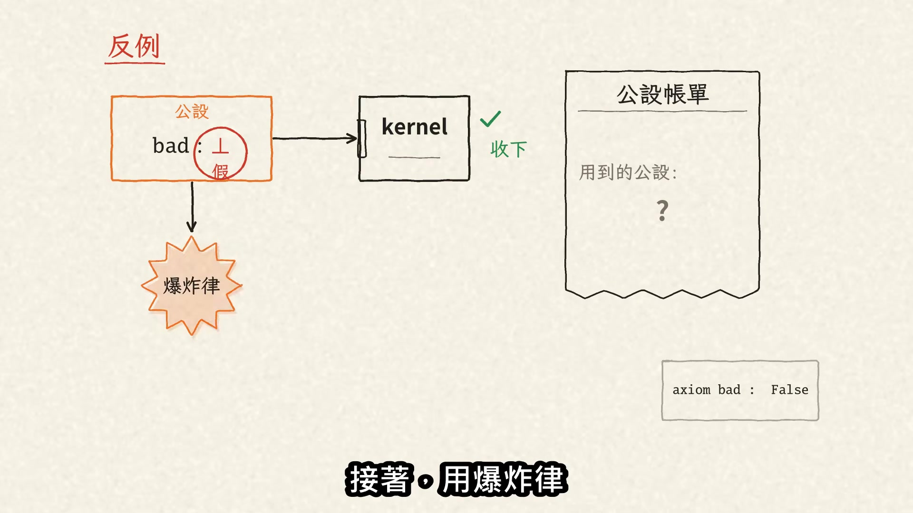

**逐字稿片段：** 就能從假得到0等於1 而這個定理 Kernel也收下了 因為每一步都合規則 這時候唯一抓得到問題的 就是那本賬 賬上會老是寫著 這個證明靠的是那條假的公設

**話題推測：** 顯示從錯誤公設推導出的荒謬結論「0等於1」。

---

## 00:05:06

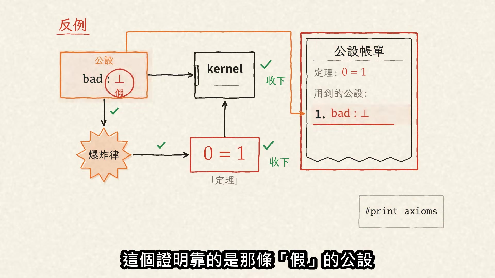

**逐字稿片段：** 所以在Lin裡說證完了 要看兩件事 第一 Kernel收了 第二 用到的公設都是你認可的

**話題推測：** 總結在Lean中判斷證明完成的兩個條件，可能是一個清單或檢查表。

---

## 00:05:15

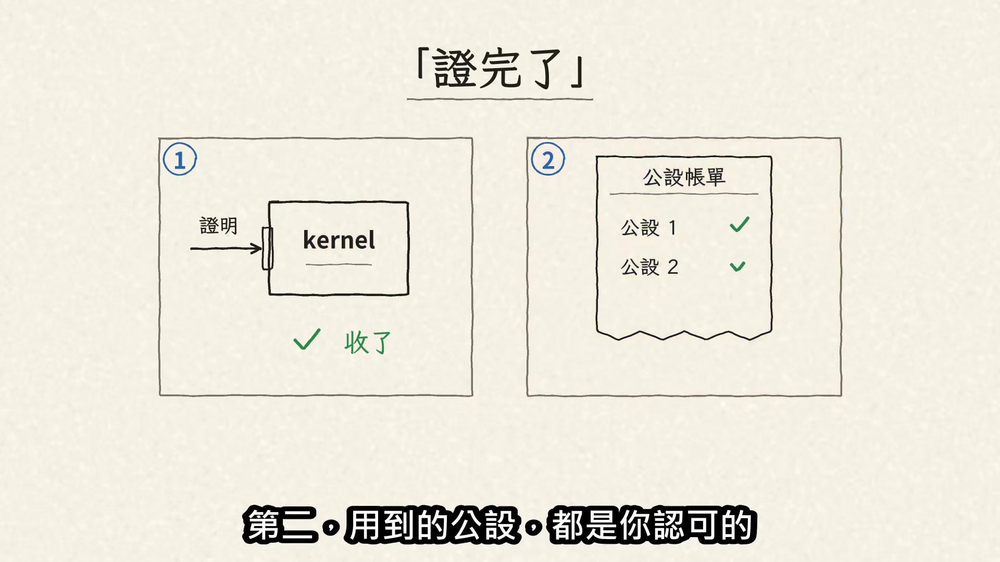

**逐字稿片段：** 說到認可Lin的標準函式庫裡 有三條大家都認可的標準公設

**話題推測：** 引導至Lean標準函式庫中「認可」的公設，可能顯示函式庫結構圖。

---

## 00:05:21

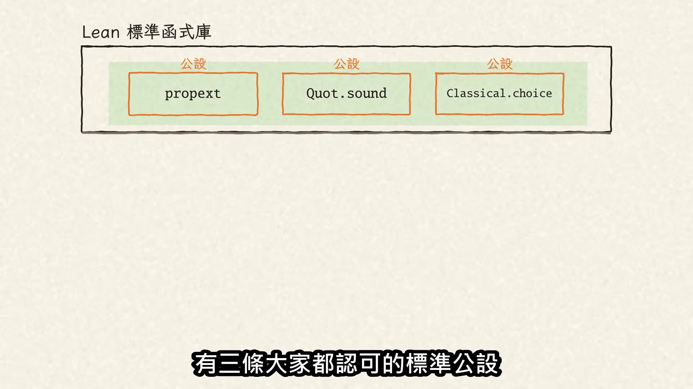

**逐字稿片段：** 其中一條叫選擇公設 選擇公設說的是 給你一堆不是空的集合 就可以從每一個集合裡 各挑出一個元素 即使你說不出到底怎麼挑 而排中率在另裡 其實不是直接放的公設 而是靠選擇公設 再加上另外兩條推出來的定理 這個推導 這一集不講

**話題推測：** 介紹其中一條「選擇公設」，可能顯示其定義或相關圖示。

---

## 00:05:40

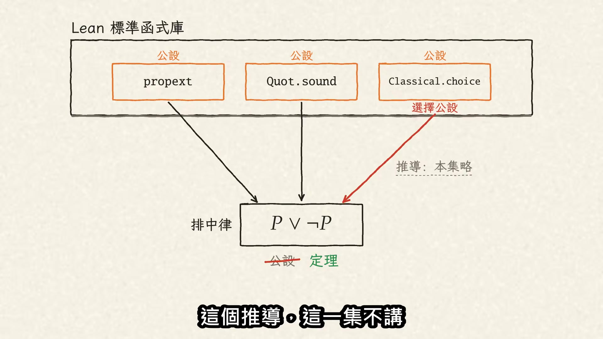

**逐字稿片段：** 作為對照

**話題推測：** 對比沒有使用公設的定理（如imptrans），可能顯示兩種證明類型的並列。

---

## 00:05:42

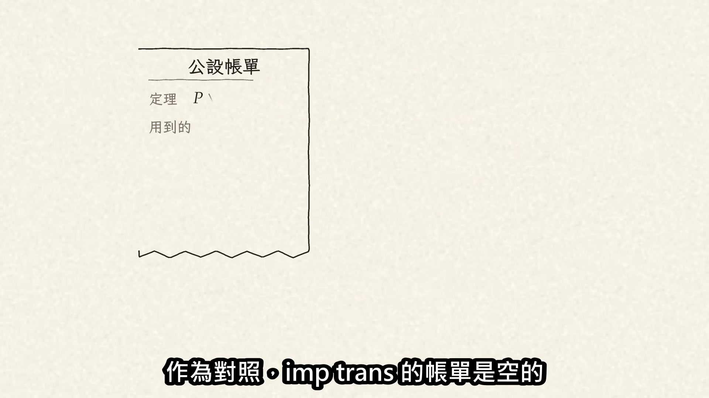

**逐字稿片段：** imptrans的賬單是空的 它一條公設都沒用 是純粹造出來的

**話題推測：** 顯示imptrans的公設賬單為空，可能是一個空白的列表。

---

## 00:05:47

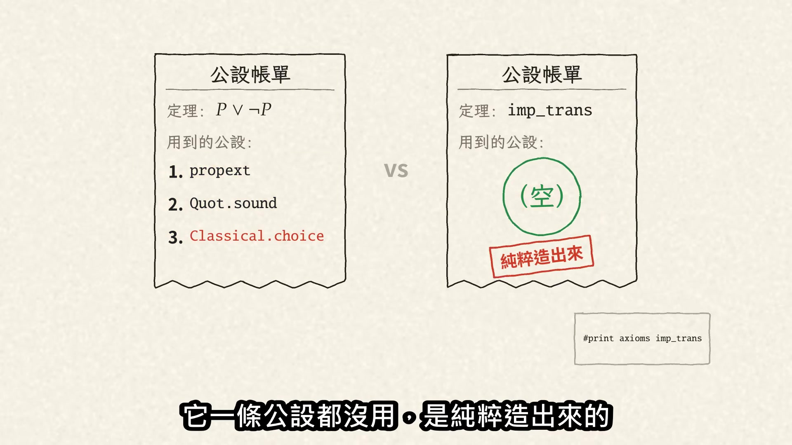

**逐字稿片段：** 總結這一集 首先 lean的kernel本身是構造的 所以排中率造不出來 其次 要用古典邏輯 也就是數學家平常用 包含排中率的那一套 就加公設 而公設在Kernel裡 就是一個沒有內容的常數 最後一個證明 到底站在哪幾條公設上 賬上都查得到

**話題推測：** 本集總結，可能顯示本集的重點條列。

---

## 00:06:07

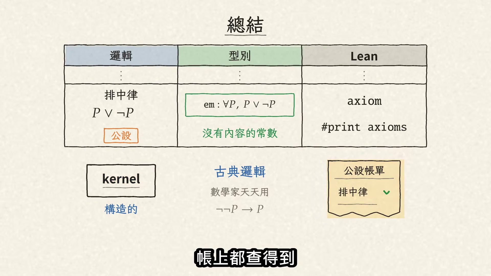

**逐字稿片段：** 接下來三藍表補一列 說到排中率 最有名的質疑者

**話題推測：** 指示畫面將補充一列「三藍表」，可能是一個新的視覺化資訊面板或歷史時間軸。

---

## 00:06:13

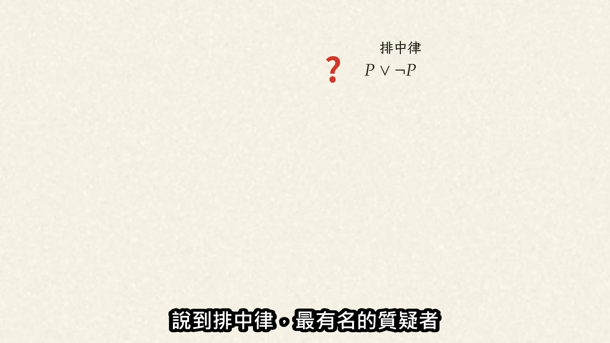

**逐字稿片段：** 是荷蘭數學家Browar

**話題推測：** 介紹荷蘭數學家「Browar」，可能顯示其肖像或生平簡介。

---

## 00:06:15

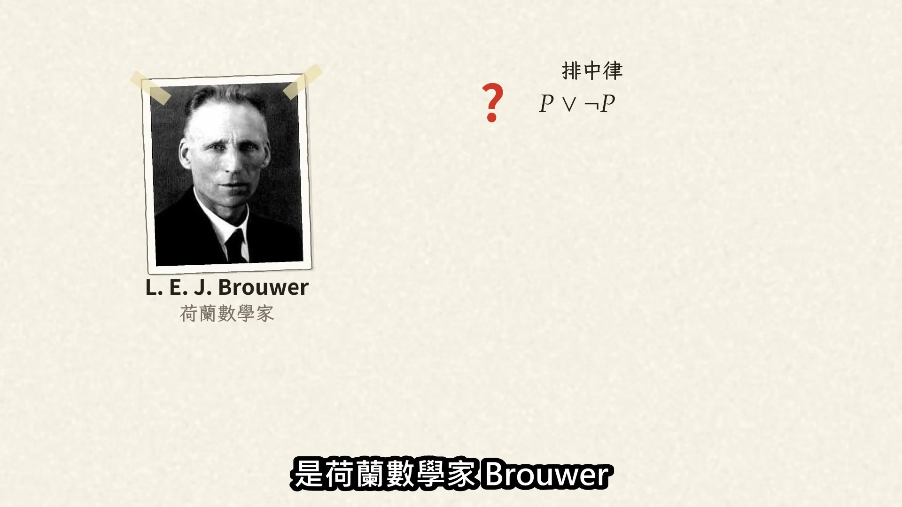

**逐字稿片段：** 1908年 他發表邏輯原則的不可靠 主張排中率碰到無窮的東西 不能隨便用 當時德國數學的領袖 是哥廷根大學的David Hilbert 20世紀初 最有影響力的數學家之一 其實兩人原本關係不錯

**話題推測：** 提及「1908年」這個關鍵年份，可能是在時間軸上標示事件。

---

## 00:06:32

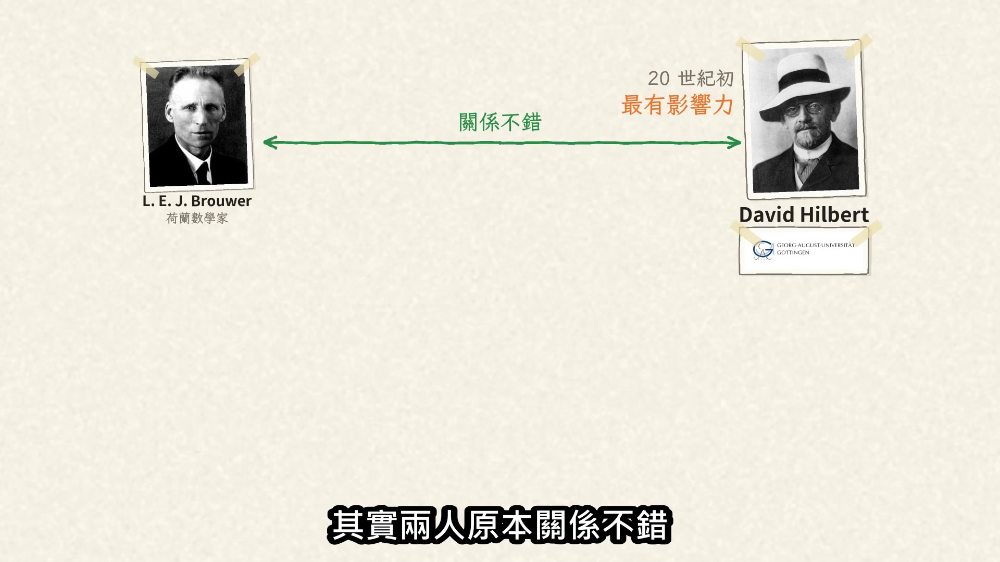

**逐字稿片段：** 1912年 Hilbert還替Brower寫推薦信 幫他爭取阿姆斯特丹的教職 到了1919年 Hilbert請他來哥廷根 不過Brower沒去 可是到了1920年代 Brower開始大力推廣他的直覺主義 兩人的關係也就越來越僵 終於在1928年10月 衝突爆發了 Hilbert是數學年刊的主編 這是當時數學界最重要的期刊之一 他寫信通知同為編委的Brower 你我的基本觀點不相容 所以今後不再請你協助編誤

**話題推測：** 提及「1912年」這個關鍵年份，可能是在時間軸上標示事件。

---

## 00:07:05

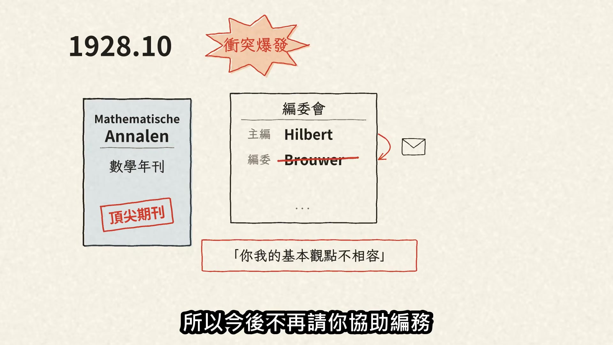

**逐字稿片段：** 另一位共同主編愛因斯坦 則拒絕選編 他在寫給物理學家朋友Max Born的信裡

**話題推測：** 介紹另一位共同主編「愛因斯坦」，可能顯示其肖像。

---

## 00:07:12

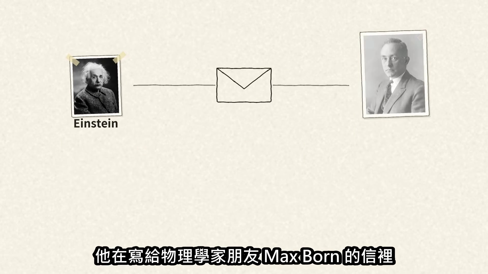

**逐字稿片段：** 把這件事叫做挖鼠之戰 還說要不是Hilbert正在生病 這場墨水戰會是一出最好笑的鬧劇 最後的解法很技術性

**話題推測：** 提及愛因斯坦將此事件稱為「挖鼠之戰」，可能顯示此特殊名稱。

---

## 00:07:22

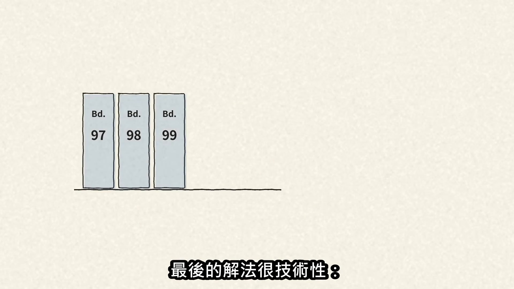

**逐字稿片段：** 等期刊出滿第100卷 整個編委會就解散 第101卷換一批人 而名單上沒有Brower

**話題推測：** 提及期刊出版「第100卷」，可能顯示期刊封面或卷期號。

---

## 00:07:28

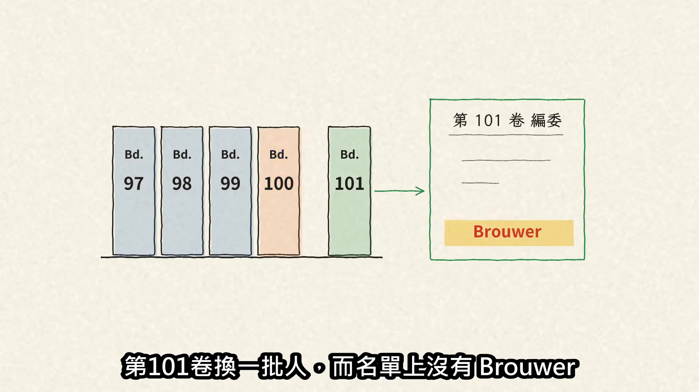

**逐字稿片段：** 將近100年後 在令裡 一個正名的公社賬單上 有沒有選擇公社 大致就是Brower會不會點頭的分界

**話題推測：** 時間跳轉到「將近100年後」，回到現代對照。

---

## 00:07:36

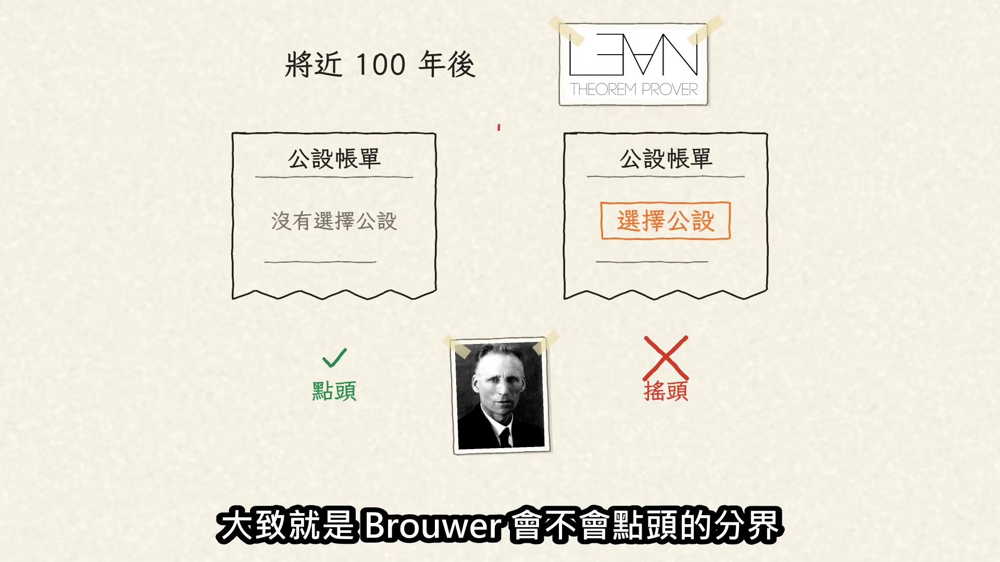

**逐字稿片段：** 下一集我們要處理數學裡最常見的兩個詞

**話題推測：** 預告下一集的主題，可能顯示「下一集預告」的字樣。

---

## 00:07:42

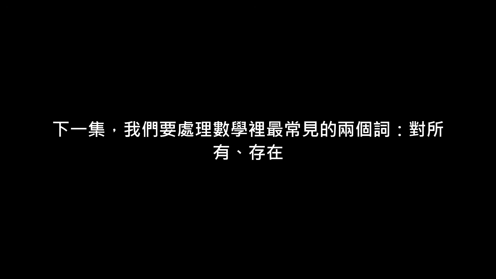

**逐字稿片段：** 對所有存在 你會看到一條定理 同時也是一臺吃數字的機器 而這臺機器吐出來的東西 會跟著你喂進去的數字改變

**話題推測：** 顯示下一集將討論的第一個數學詞「對所有存在」。

---
