# ai-note-101_H7KaiMwzyJQ — 關鍵畫面索引

- 來源逐字稿：[ai-note-101_H7KaiMwzyJQ_FIN.srt](ai-note-101_H7KaiMwzyJQ_FIN.srt)
- 影片：https://www.youtube.com/watch?v=H7KaiMwzyJQ
- 截圖數：34

## 00:00:00

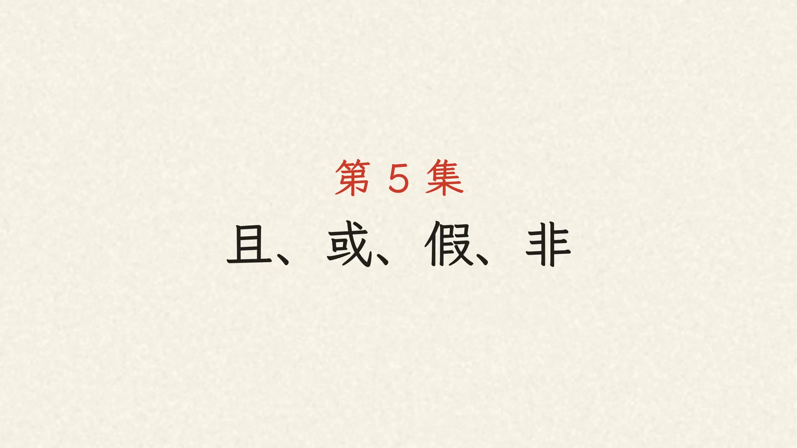

**逐字稿片段：** 這是第五集,且或非都是形別。 上一集我們看到,推出就是函數,引入它,寫放,使用它就是套用。

**話題推測：** 影片開場與主題介紹：第五集標題及本集將討論的連接詞。

---

## 00:00:10

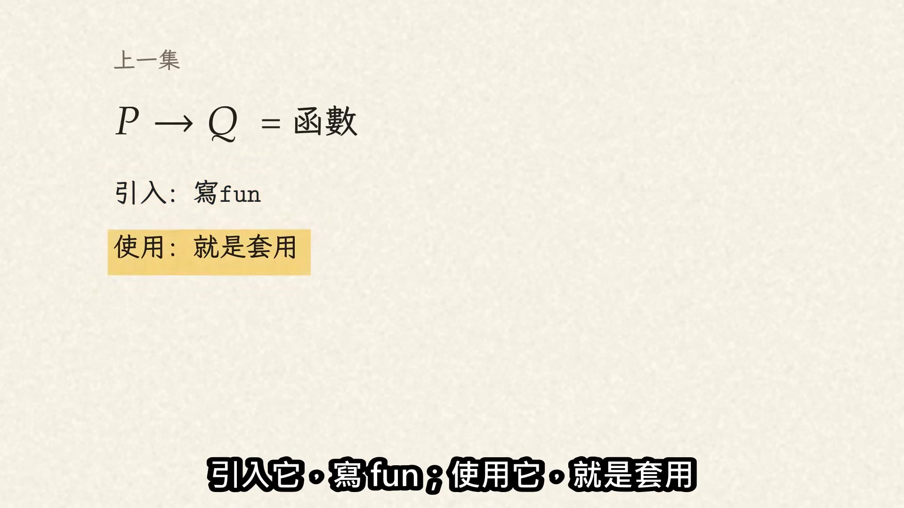

**逐字稿片段：** 這一集,我們把同一招用在另外四個連接詞上,且或假非。 所謂連接詞,就是把命題接起來,組成新命題的那些詞。 而且每一個連接詞,我們都問同樣的三個問題。 第一,它在形別這邊是什麼形別? 第二,怎麼造出一個它的證明?這叫引入規則。 第三 反過來 手上有一個它的證明 要怎麼用 這叫消去規則 同一組問題 我們會問四次 不過在開始之前

**話題推測：** 介紹本集主題：將處理「且、或、假、非」四個連接詞，畫面可能列出這些詞。

---

## 00:00:41

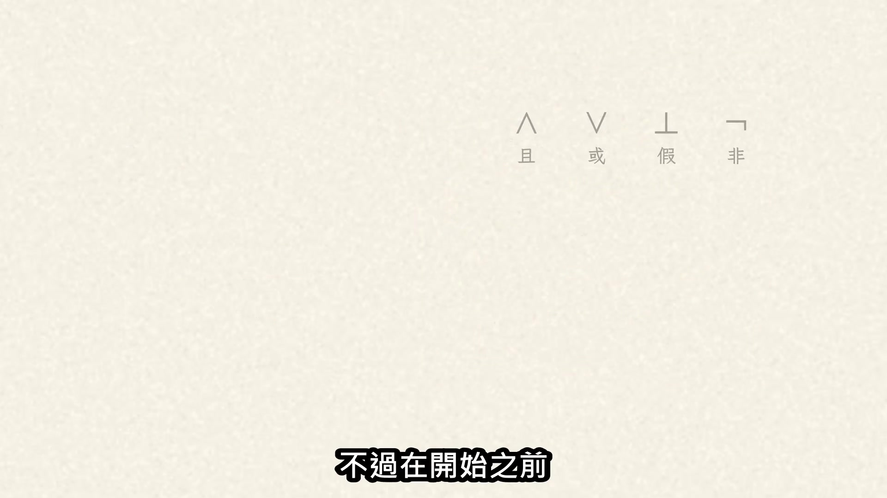

**逐字稿片段：** 先講一件會讓人意外的事 推出是Kernel內建的 因為函數型別是Kernel本身就懂的東西 可是且或假非Kernel一個都不認識 它們其實是在Lean的標準函式庫裡寫出來的 標準函式庫 就是Lean一安裝就附上的那一大批現成定義 而且它們是用一般的宣告寫的 宣告就是在令裡寫下有這麼一個新東西 它長這樣 跟你自己宣告一個新型別 用的是同一種寫法 那宣告一個型別在說什麼 主要就是一件事 這個型別的值有哪幾種造法 我們從第一個開始 且英文是&符號 像一個倒過來的V 那麼P且Q的證明應該是什麼東西 想想看 你要證N是偶數且N大於2 就得交出兩樣東西 一個N是偶數的證明 和一個n大於2的證明 所以且的證明

**話題推測：** 引入一個意外的事實：說明Kernel對這些連接詞的處理方式。

---

## 00:01:39

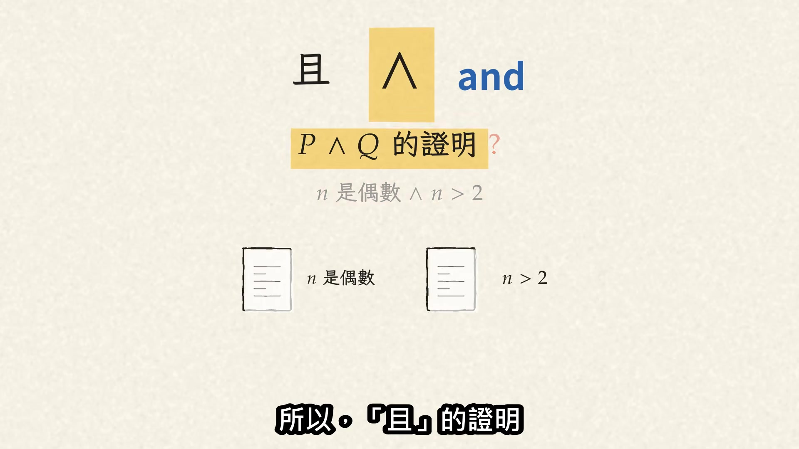

**逐字稿片段：** 就是一個兩格的盒子 左格放p的證明 右格放q的證明 在城市裡

**話題推測：** 比喻「且」的證明結構：畫面顯示一個兩格的盒子圖示。

---

## 00:01:45

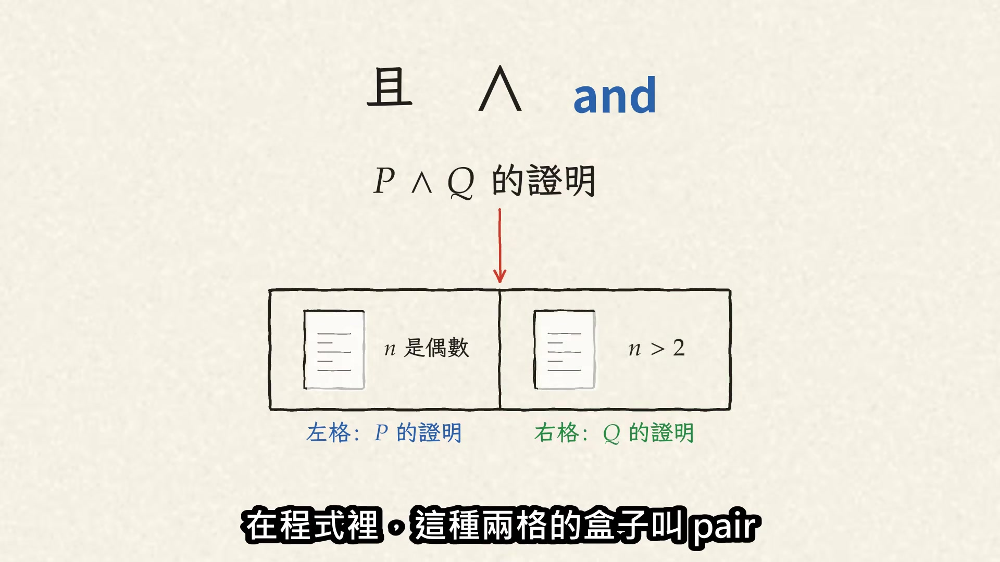

**逐字稿片段：** 這種兩格的盒子叫pair 也就是一對 而且的宣告 只寫了一種造法名字叫 and.intro intro是英文introduction的縮寫 也就是引入 它持一個p的證明 再持一個q的證明 然後給你一個p且q的證明

**話題推測：** 介紹程式中的對應概念：畫面可能顯示`pair`這個術語或程式碼。

---

## 00:02:02

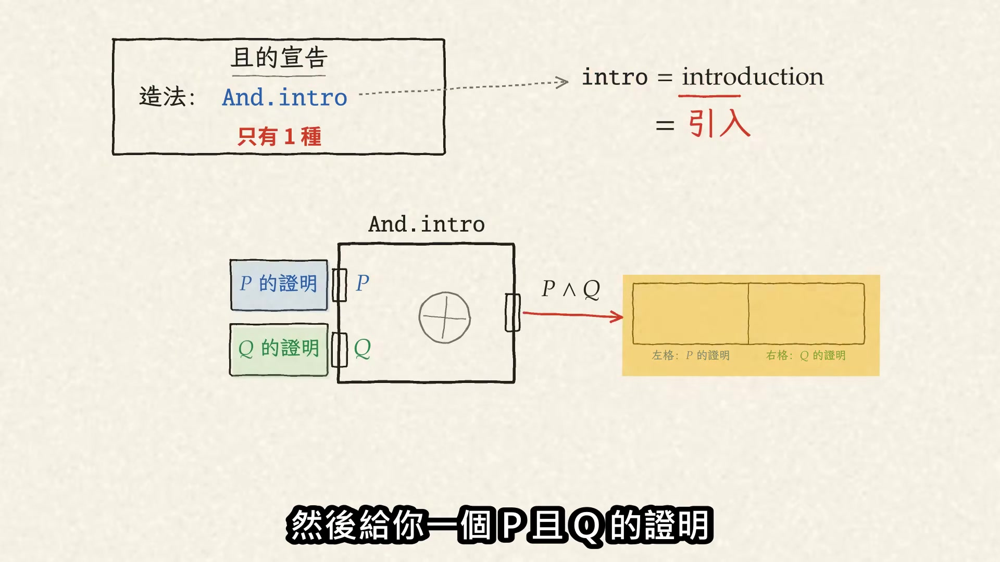

**逐字稿片段：** 這就是且的引入規則 我們一樣兩邊並排 左邊是邏輯 gamma推的p Gamma推的Q 所以Gamma推的P且Q 放在紙上 就是P成立 Q也成立 所以P且Q 右邊是形別 A的形別是P B的形別是Q 那麼end.intro A B的形別 就是P且Q 不過這裡要停一下

**話題推測：** 展示「且」的引入規則：邏輯與形別的並排解釋。

---

## 00:02:30

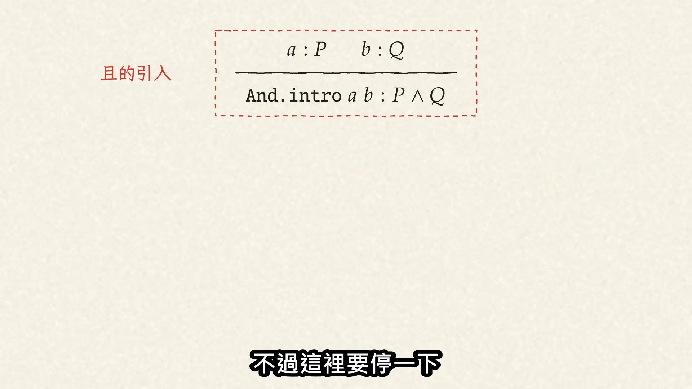

**逐字稿片段：** 因為Kernel並沒有一條叫 且的引入的規則 那它是怎麼檢查的 答案是end.intro 是宣告且的時候 生出來的一個名字 也就是一個常數 而Kernel有一條很樸素的規則 叫常數規則 已經宣告過的名字 形別就照宣告寫的算 它跟變數規則很像 只是查的不是清單 而是已經宣告過的東西 and.intro的形別是 p推出 q推出p 且q總共兩個箭頭 第二 極講過 兩個箭頭 就是一次吃一個 總共吃兩次 所以Kernel檢查and.introab 就是先用常數規則查到它的形別 再用兩次套用規則 據話說 右邊那條且的引入 並不是新的規則 它是常數規則 加上兩次套用 推導出來的 等一下的或假 也都一樣

**話題推測：** 深入解釋Kernel如何檢查「且」的引入：畫面切換到細部說明或程式碼。

---

## 00:03:26

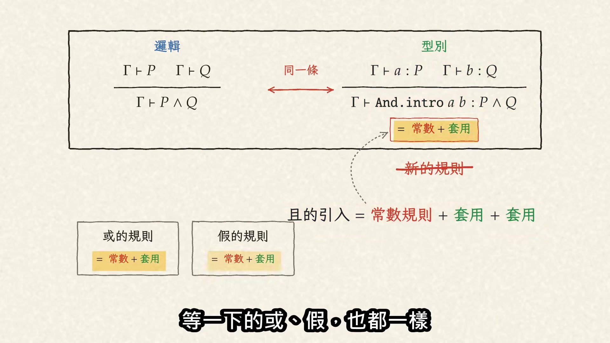

**逐字稿片段：** 接下來是且的消去規則 它有兩條 左邊是邏輯 γ推的p且q 所以γ推的p 另一條是 所以γ推的q 放在紙上 就是已知p且q 特別地p成立 右邊是形別 h的形別是p且q 那麼H的左格 形別是P H的右格 形別是Q 用盒子來說 就是把盒子打開 拿左格或拿右格

**話題推測：** 開始討論「且」的消去規則：畫面顯示兩條消去規則的邏輯與形別。

---

## 00:03:56

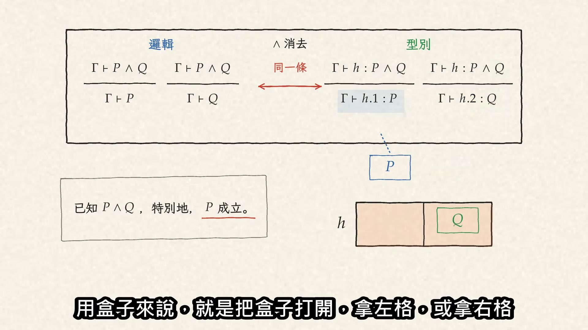

**逐字稿片段：** 我們用一個例子走一遍 證明P且Q 推出Q且P 首先手上有一個盒子H 左格是P的證明 右格是Q的證明 接著打開它 拿出右格 放進新盒子的左格 再拿出左格 放進新盒子的右格 這樣新盒子的左格是Q 右格是P 也就是Q且P的證明 所以用到的規則是 一次寫的消去拿右格 一次寫的消去拿左格 再一次寫的引入裝進新盒子

**話題推測：** 透過例子演示「且」的應用：畫面可能顯示證明「P且Q推出Q且P」的步驟或程式碼。

---

## 00:04:27

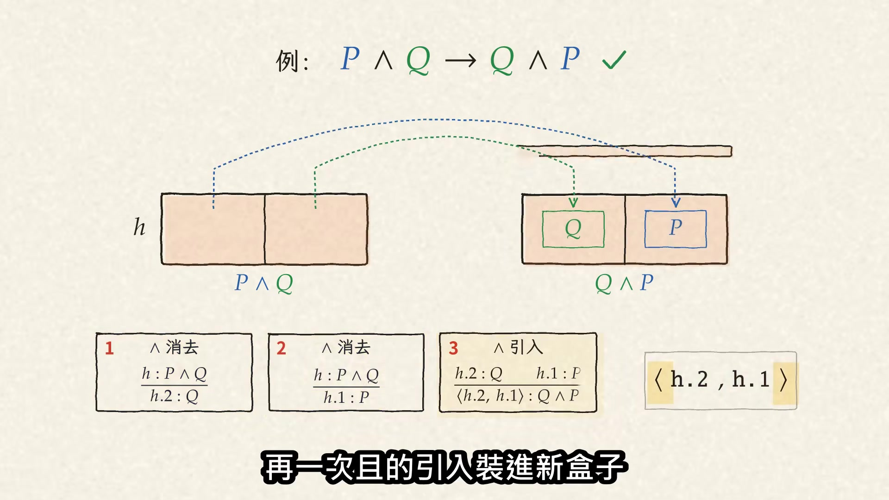

**逐字稿片段：** 在講下一個連接詞之前 先停一下 因為剛剛這個例子 同時用到了寫的兩種規則 第一種是引入 就是把東西造出來 把兩個證明裝進盒子 組成一個寫的證明 第二種是消去 就是把東西拆開來用 打開盒子 拿出裡面的證明 所以這兩個動作 方向剛好相反 一個是裝進去 一個是拿出來 而且兩個都少不了 只會造 盒子造好了卻打不開 拿它沒用 只會拆 又根本沒有盒子可以拆 在邏輯那邊 這是同一個符號底下的兩條規則 到了lean 它們卻是兩個不同的東西 造用 end.intro 拆用h.1和h.2 也就是拿左格拿右格 等一下的或假非 我們也都分成造和用 這兩個方向來看

**話題推測：** 總結引入與消去規則的方向性：強調兩種操作的方向相反。

---

## 00:05:18

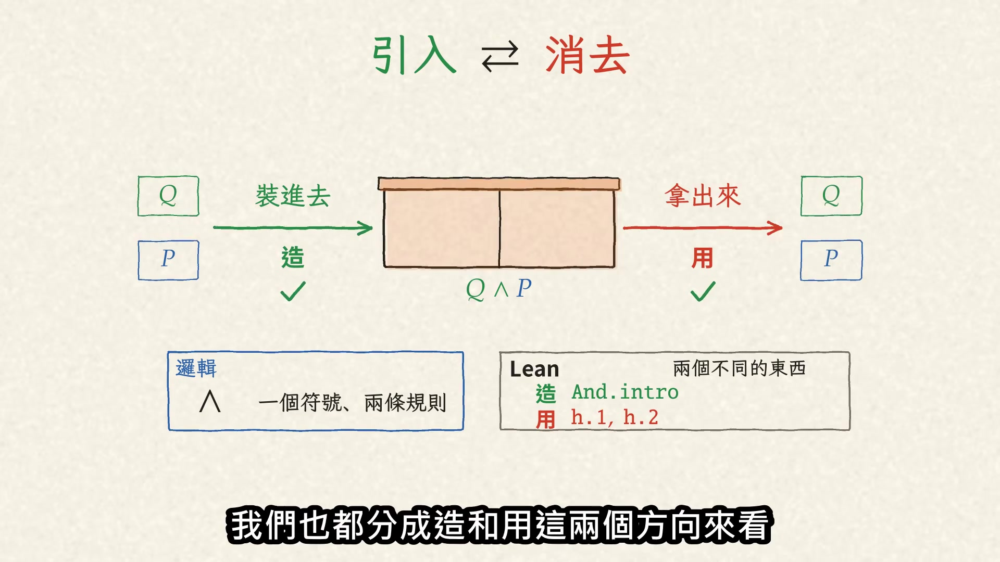

**逐字稿片段：** 第二個連接詞是或 英文是or 符號像一個v 同樣的問題 P或Q的證明應該是什麼 你要證N是偶數 或N是奇數 只要交出其中一邊的證明就好 不過你得說清楚 交的是哪一邊 所以或的證明

**話題推測：** 開始討論第二個連接詞「或」：畫面顯示「或」的符號及相關定義。

---

## 00:05:37

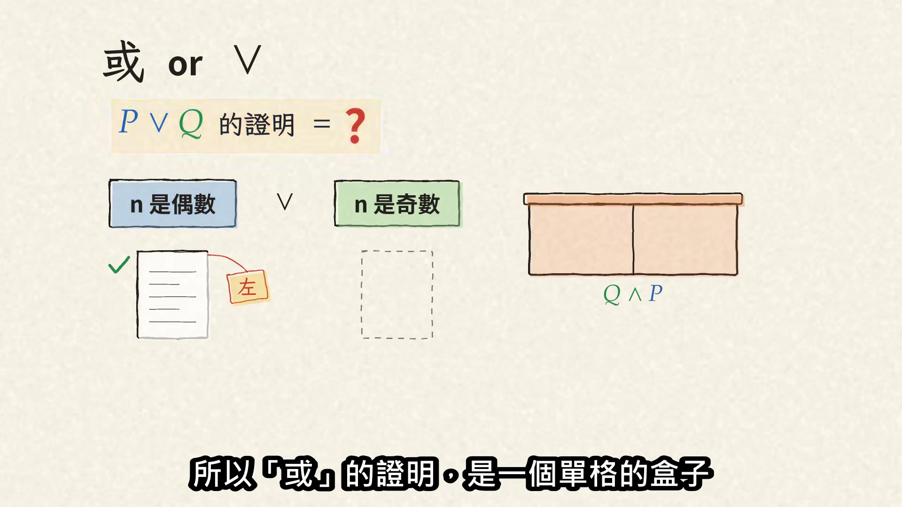

**逐字稿片段：** 是一個單格的盒子 盒子上掛一張牌子 寫著左或右 格子裡只放一個證明 也因此 或的宣告寫了兩種造法 一種叫英偶 放左邊 另一種叫英偶 放右邊 名字裡的L和R 就是英文的left和right

**話題推測：** 比喻「或」的證明結構：畫面顯示一個單格盒子加上牌子的圖示。

---

## 00:05:56

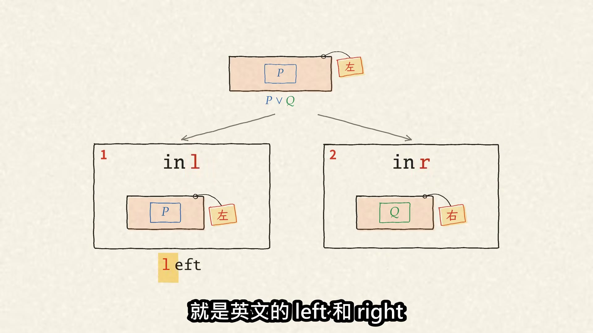

**逐字稿片段：** 所以貨的引入規則也有兩條 左邊是邏輯 γ推的P 所以γ推的P或Q 另一條是γ推的Q 所以γ推的P或Q 右邊是形別 A的形別是P 那麼把A放左邊 形別就是P或Q B的形別是Q 那麼把B放右邊形別也是P或Q 而且跟前一樣 這兩條都只是常數加上套用

**話題推測：** 展示「或」的引入規則：邏輯與形別的並排解釋。

---

## 00:06:26

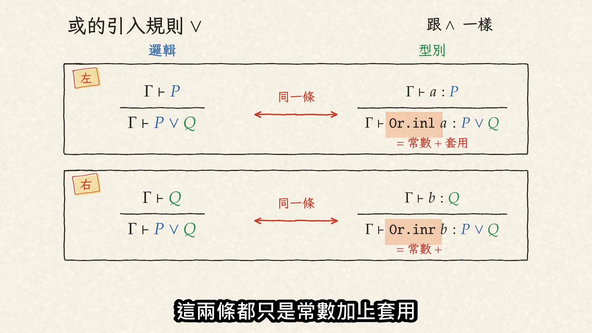

**逐字稿片段：** 再來是貨的消去 這是這一集最重要的一條 因為它就是分情況討論

**話題推測：** 開始討論「或」的消去規則：畫面顯示分情況討論的概念及對應邏輯。

---

## 00:06:33

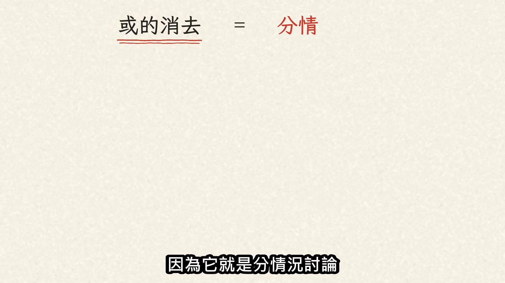

**逐字稿片段：** 舉一個你一定證過的例子 n乘以n加1一定是偶數 在紙上你會這樣寫 n是偶數或n是奇數 情況一 設n是偶數 那麼n乘n加1是偶數 情況二 設n是奇數 那麼n加1是偶數 所以乘起來還是偶數 既然不管哪一種情況 結論都成立 那結論就成立 請注意 這個證明裡出現了兩次 設 情況一設了 N是偶數 情況二設了N是奇數 而這兩次假設 都在證明結束時收回了 所以最後的結論 既不依賴N是偶數 也不依賴N是奇數 還記得上一集學過的嗎 收回假設就是放 所以每一種情況 其實都是一臺機器 情況一是一臺 外它N是偶數的證明 它就吐出結論的證明 情況二則是另一臺

**話題推測：** 舉例說明「或」的消去（分情況討論）：畫面可能顯示證明「n乘以n加1一定是偶數」的數學式或證明步驟。

---

## 00:07:31

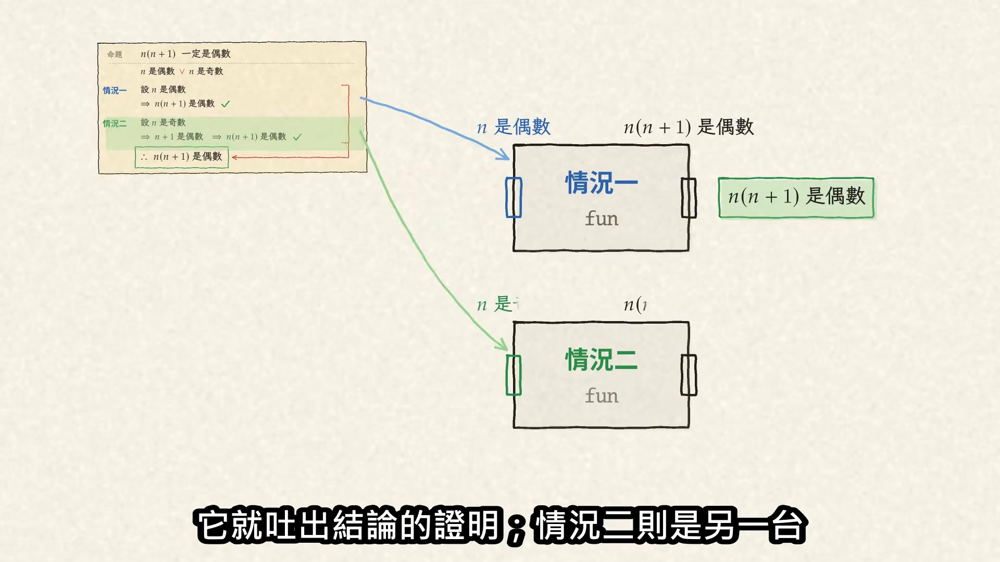

**逐字稿片段：** 所以兩邊並排起來 是這樣 左邊是邏輯 有三個前提 γ推的P或Q Gamma 加上 P 推的 R Gamma 加上 Q 推的 R 結論是 Gamma 推的 R 右邊是形別 也有三個前提 H 的形別是 P 或 Q F 的形別是 P 推出 R G 的形別是 Q 推出 R 結論是用 H, F, G 分情況得到的東西形別是 R 換句話說 左邊那兩個加上一個假設 到了右邊就變成了兩個函數 F 和 G 那這條規則實際用起來是怎麼運作的呢 他看的是盒子上的牌子 牌子寫左 就把格子裡的證明交給F 牌子寫右 就交給G 又因為F和G都突出R的證明 所以不管牌子寫什麼 最後都拿得到R 回到剛剛的例子 牌子寫N是偶數 就交給情況1那臺機器 牌子寫N是奇數 就交給情況2那臺機器

**話題推測：** 展示「或」的消去規則的邏輯與形別：並排說明三個前提與結論。

---

## 00:08:35

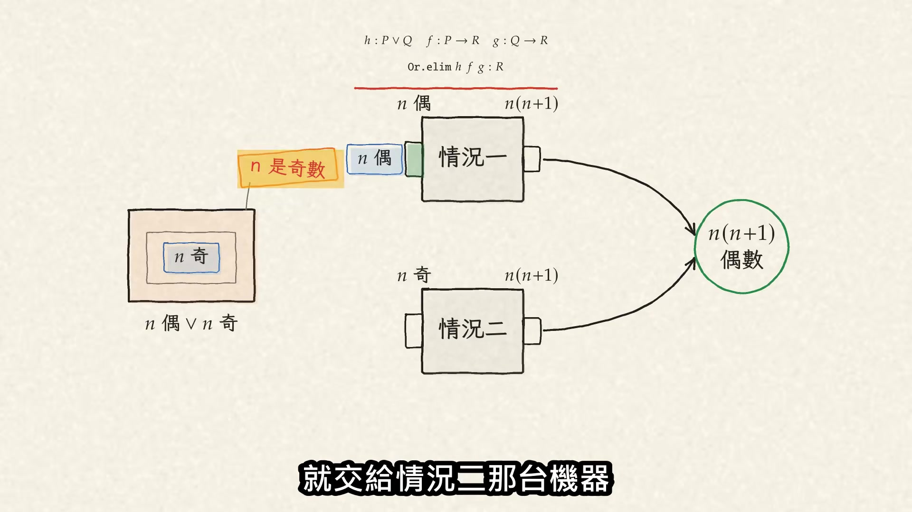

**逐字稿片段：** 第三個連接詞是假 英文是false 邏輯課本常把它寫成一個倒過來的T 那假的宣告寫了幾種造法

**話題推測：** 開始討論第三個連接詞「假」：畫面顯示「假」的符號及相關定義。

---

## 00:08:47

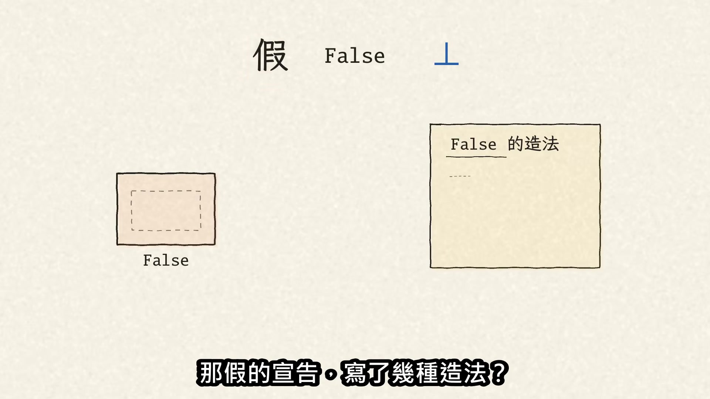

**逐字稿片段：** 答案是零種 零種造法 意思就是 這個形別的值 一個都造不出來 所以它是一個空形別 也因此 假的引入規則並不存在 而這很合理 如果能隨便造出假的證明 整個系統就沒有意義了

**話題推測：** 強調「假」沒有任何造法：可能以文字或圖示突出「零種造法」。

---

## 00:09:03

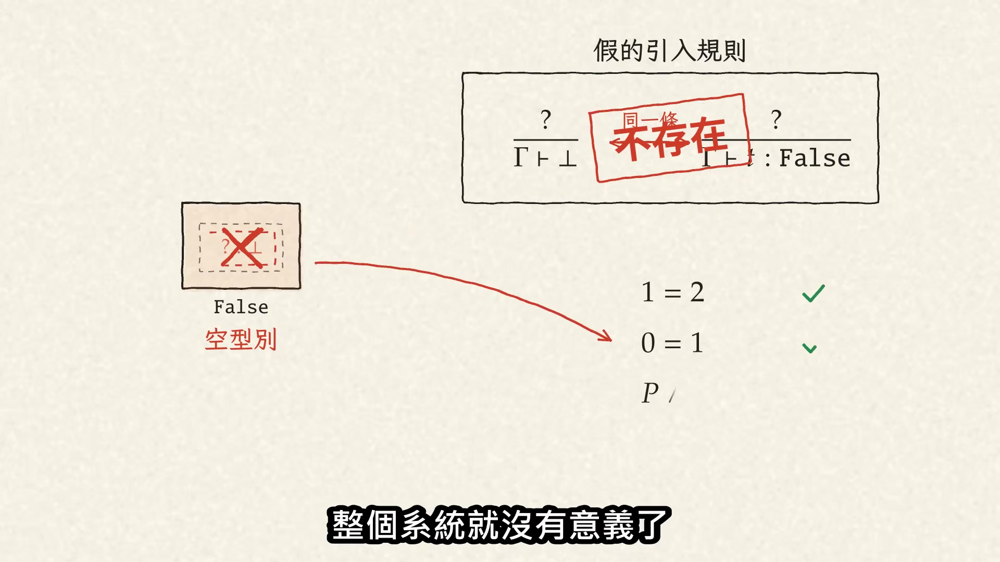

**逐字稿片段：** 不過假的消去規則倒是有一條 而且很強 左邊是邏輯 gamma推的假 所以gamma推的任何命題 C 這叫爆炸率 從矛盾可以推出一切 右邊是形別 H的形別是false 那麼就可以得到任何形別C的值 如果用盒子來說 這其實是分情況討論的特例 或有兩種造法 所以分兩種情況 要給兩臺機器 假有零種造法 所以分零種情況 一臺機器都不用給就得到結論

**話題推測：** 開始討論「假」的消去規則：畫面顯示爆炸率（從矛盾推導一切）的邏輯與形別。

---

## 00:09:39

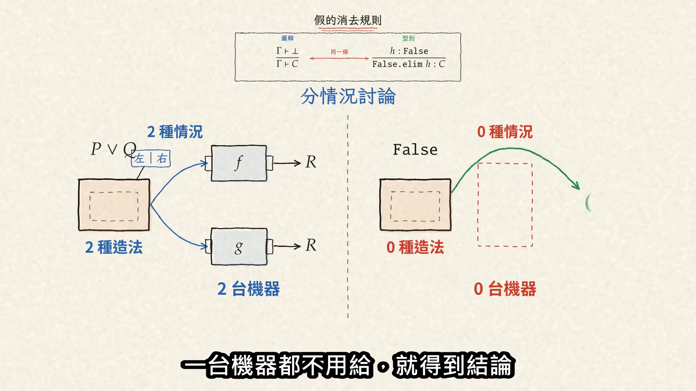

**逐字稿片段：** 最後一個是非 英文是not 符號是一條橫線 右端往下勾 非P的定義只有一行

**話題推測：** 開始討論最後一個連接詞「非」：畫面顯示「非」的符號及相關定義。

---

## 00:09:47

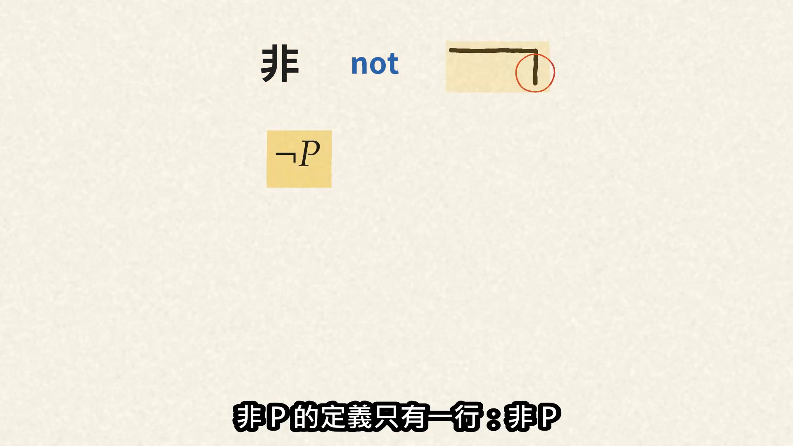

**逐字稿片段：** 非P就是P推出假 所以它不是一個新的性別 只是一個縮寫 這一行雖然很短 卻是這一級最重要的一行 因為它代表 非沒有自己的規則 它的規則全部是推出的規則

**話題推測：** 展示「非P」的定義為「P推出假」：這是本集最重要的一行，應有特殊顯示。

---

## 00:10:02

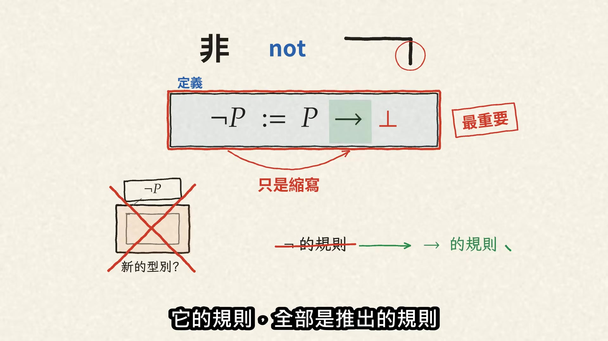

**逐字稿片段：** 所以非的引入是 假設P推出矛盾 所以非P 換句話說 這就是推出的引入 只是把Q換成假 紙上你常這樣寫 要正P不成立 就假設P推出矛盾 放到行別這邊 就是寫一個fun 持P的證明 吐出假的證明

**話題推測：** 展示「非」的引入規則：說明其與「推出」引入規則的關係。

---

## 00:10:23

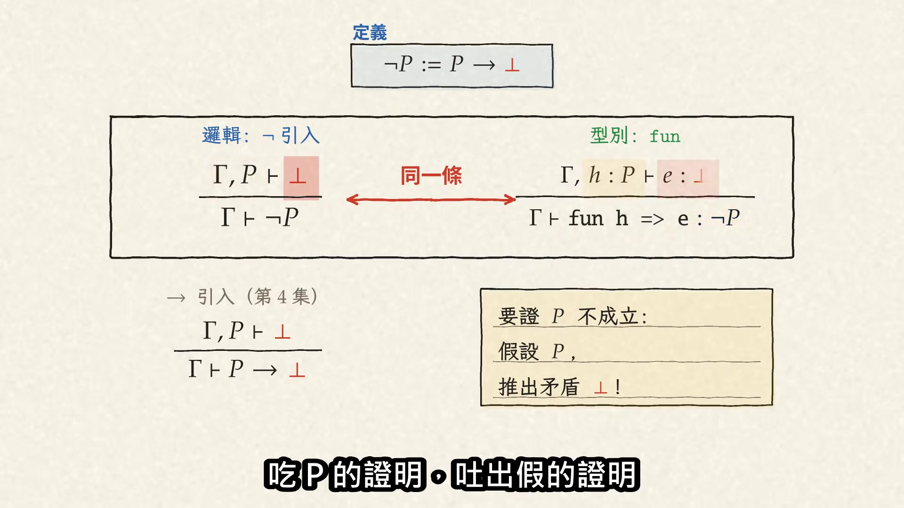

**逐字稿片段：** 反過來 非的消去 是已知非P 又已知P 所以矛盾 這也就是推出的消去 在形別這邊 非P的證明 本來就是一臺吃P吐假的機器 所以把P的證明餵給它 它就吐出假 講到這裡

**話題推測：** 展示「非」的消去規則：說明其與「推出」消去規則的關係。

---

## 00:10:43

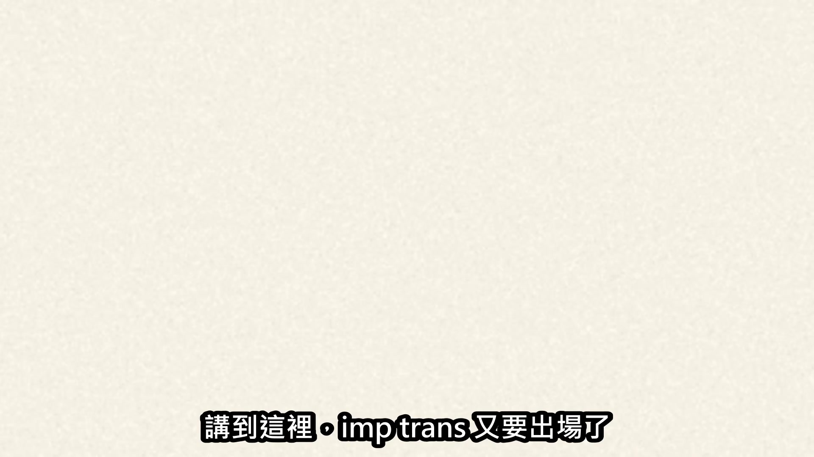

**逐字稿片段：** IMPTRANS又要出場了 不過這次換一個角度看 IMPTRANS說 P推出Q Q推出R 那麼P推出R

**話題推測：** 重新討論推出傳遞性（IMPTRANS）：畫面再次顯示IMPTRANS規則。

---

## 00:10:52

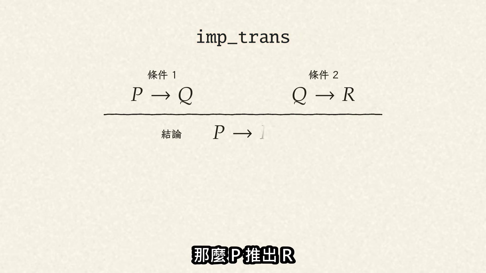

**逐字稿片段：** 現在把R換成假 那第二個條件就變成 Q推出假 也就是非Q 而結論就變成 P推出假 也就是非P 所以P推出Q 加上非Q就得到非P 這就是你證明題常用的逆否論證 英文叫country positive 而重點是逆否論證不用重新證明 因為imptrans那個證明原封不動 只要把R填成假 就是逆否論證的證明 這件事放在行別那邊看非常自然 imptrans是一臺機器 而逆否論證只是把它用在一個特別的命題上 至於把R填成假這個動作本身 在行別裡到底是什麼

**話題推測：** 演示如何從IMPTRANS推導逆否論證：畫面突出將R替換為「假」的步驟。

---

## 00:11:33

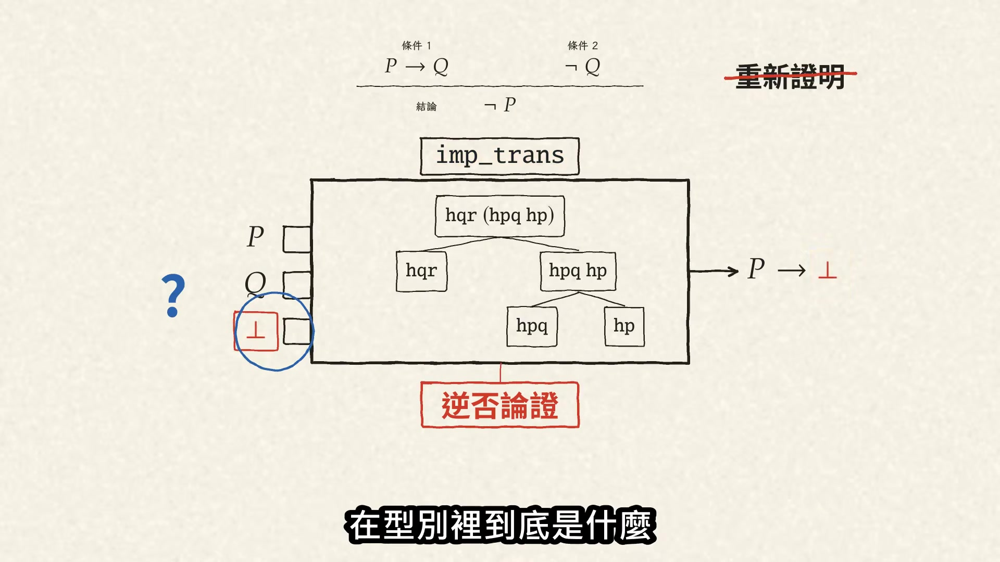

**逐字稿片段：** 那就是第七集的主題了 不過等一下 非Q和Q推出假 寫起來明明不一樣

**話題推測：** 預告下一集主題：關於形別中R被填入「假」的意義。

---

## 00:11:40

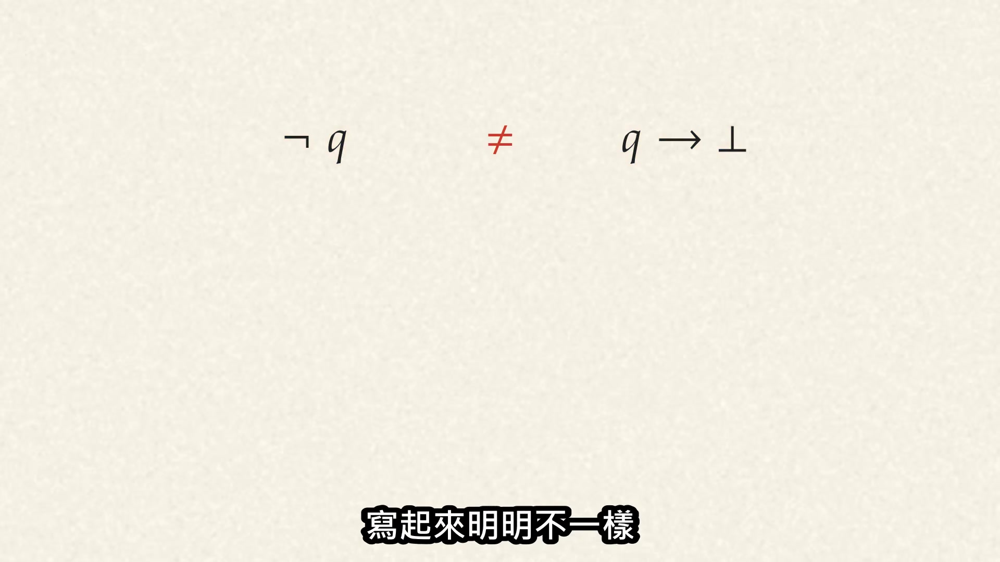

**逐字稿片段：** Colonel為什麼當他們是同一個型別 原因是Colonel會把非Q照定義展開 展開之後就是Q推出甲 既然展開以後一樣 那就算一樣 這是Colonel唯一會兒動手算的地方 也是第八集的主角 所以現在只要先記得非P和P推出甲 在Colonel眼裡是同一個型別

**話題推測：** 解釋Kernel如何將「非Q」與「Q推出假」視為同一個型別：畫面可能顯示定義展開的過程。

---

## 00:12:01

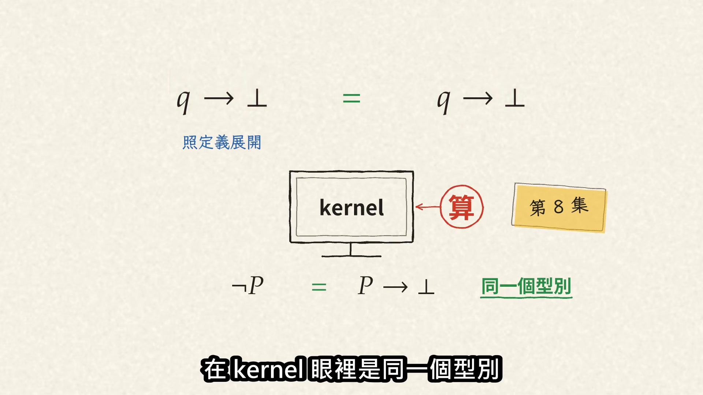

**逐字稿片段：** 這一集我們把同一個劇情重複了四次 整理一下 且是Pair 造它兩格都要填 用它就拿左格或右格 或是二選一 造它 選一邊填 用它就分情況 每種情況給一臺機器 假是空性別 它造不出來 可是用它 因為是零種情況 所以什麼都推得出 至於非P 就是P推出假 規則全部借推出的 而且這四個都不是Kernel的新規則 Kernel主要還是用那四條 查清單 查常數 放套用 再加上剛剛非P照定義 就是P推出假那一步 照定義假開 這個之後會再細講

**話題推測：** 總結本集所有連接詞的特性：可能顯示一個總結性圖表。

---

## 00:12:45

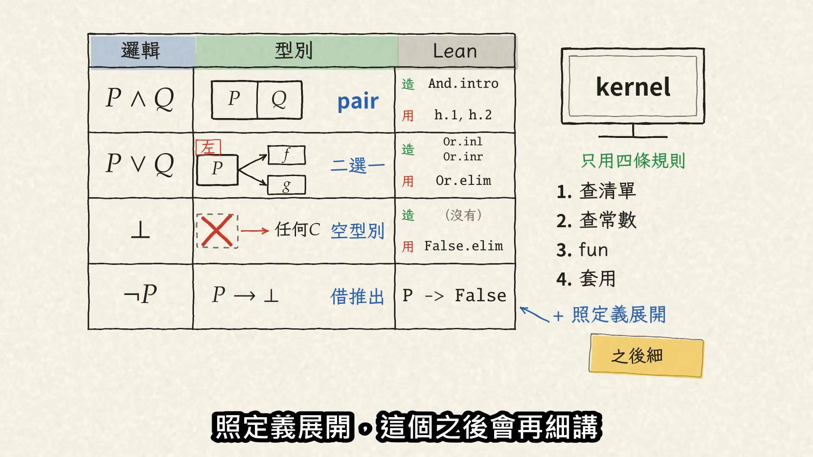

**逐字稿片段：** 所以三欄表這次一口氣補四列 再看lean那一欄 就是剛剛那張圖 一個符號配兩條規則 到了lean造和用方向相反 一個負責造一個負責用 所以且和或那一格都寫了兩個以上 假只有用的那一個 因為它根本造不出來 說到這兩集一直在寫的fun 這個寫法其實有一個祖先

**話題推測：** 更新三欄表：展示包含新討論四個連接詞的完整表格。

---

## 00:13:09

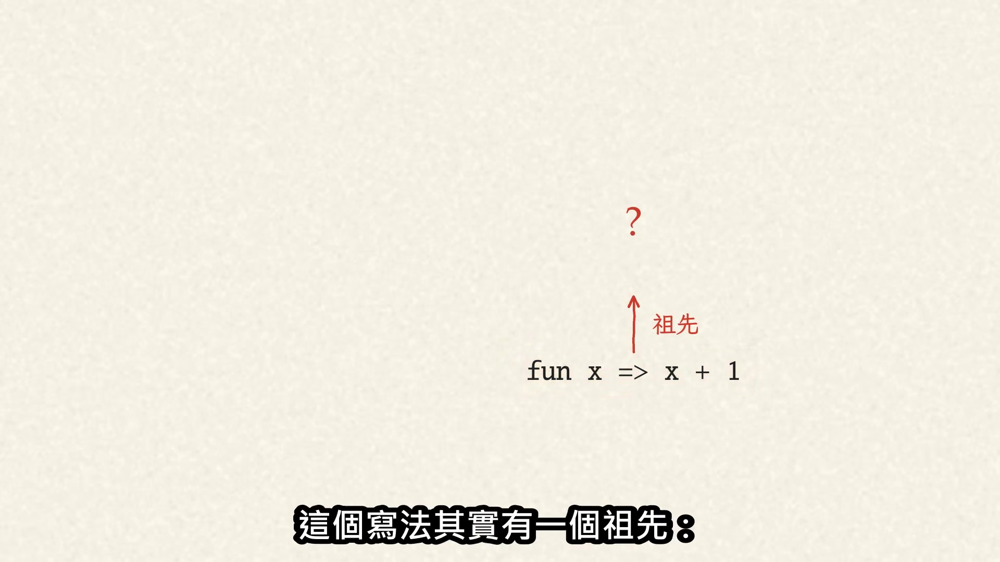

**逐字稿片段：** 美國邏輯學家Alonzo Church 在1930年代發明的符號系統

**話題推測：** 介紹美國邏輯學家Alonzo Church：可能顯示人物照片及其重要貢獻「Lambda演算」。

---

## 00:13:13

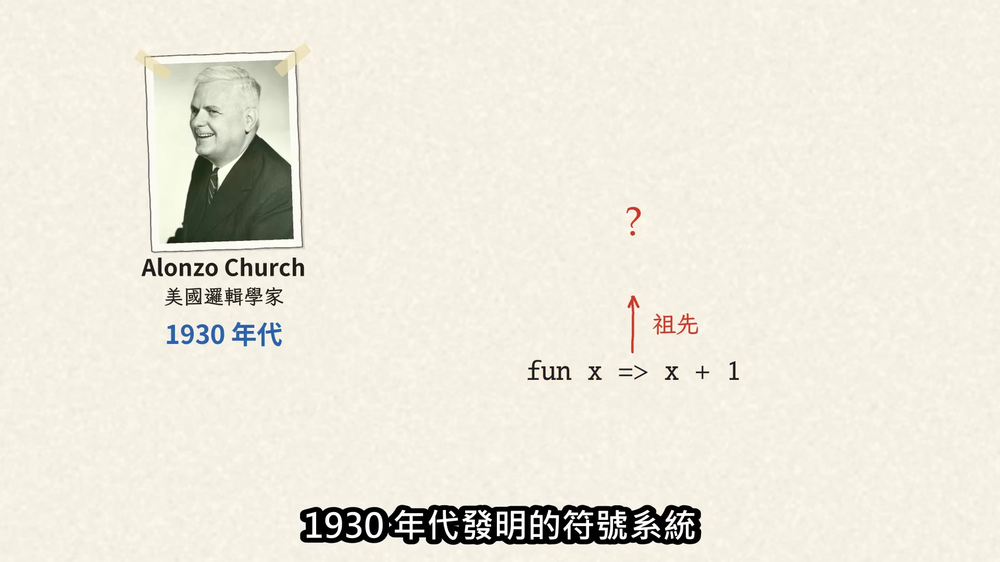

**逐字稿片段：** 叫做Lambda演算 他只做一件事 用一個希臘字母Lambda 寫下吃一個X 吐出某個東西的函數 然後研究把參數帶進去 會發生什麼事 後來到了1940年 他發表了一篇論文

**話題推測：** 介紹Lambda演算：畫面顯示這個重要概念的名稱或符號。

---

## 00:13:29

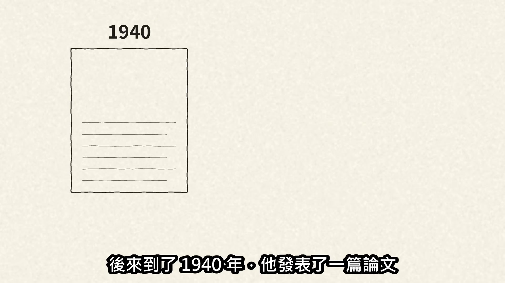

**逐字稿片段：** 叫簡單形別論的一種表述 在這篇論文裡 他把Russell的形別標籤 貼到Lambda演算的每一個函數上 所以第二集那條函數要A 你給A 結果是B的規則 就是從這裡長出來的 另外Church一生指導了31個博士生 名單裡有後來的大邏輯學家 Clean,Rosser 也有一個1936年 從英國來到普林斯頓的年輕人

**話題推測：** 提及Church的論文《簡單形別論的一種表述》：畫面顯示論文標題。

---

## 00:13:54

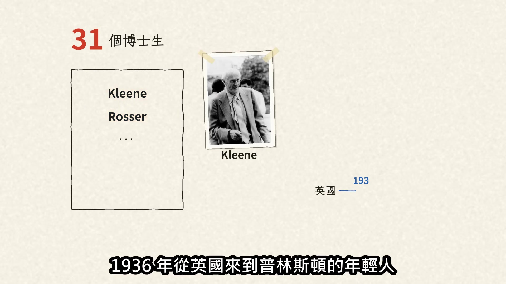

**逐字稿片段：** 名字叫Alan Turing Turing後來被稱為電腦科學之父 電影 模仿遊戲 講的就是他的故事

**話題推測：** 介紹Alan Turing：可能顯示人物照片及其對電腦科學的貢獻。

---

## 00:14:02

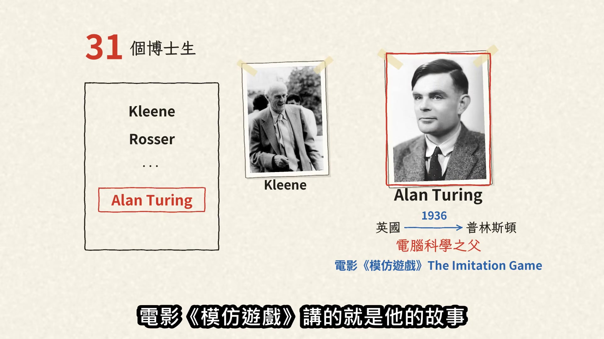

**逐字稿片段：** 下一集 我們要證明一句 看起來理所當然的話 P或非P 結果你會發現 手上的規則怎麼組 都造不出來 這件事 曾經讓兩位大數學家鬧到決裂

**話題推測：** 預告下一集內容：畫面可能顯示「下一集」標題，以及將要討論的「P或非P」命題。

---
