# ai-note-101_IQNojz6xCQA — 關鍵畫面索引

- 來源逐字稿：[ai-note-101_IQNojz6xCQA_GT.srt](ai-note-101_IQNojz6xCQA_GT.srt)
- 影片：https://www.youtube.com/watch?v=IQNojz6xCQA
- 截圖數：29

## 00:00:00

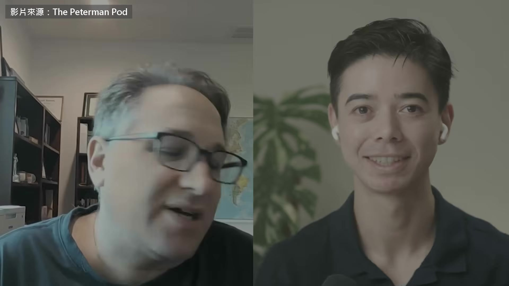

**逐字稿片段：** 「量子電腦不會靠同時試遍所有答案 瞬間解掉難題。」 這句話掛在一個部落格的最上面

**話題推測：** 開場引用量子電腦相關的語錄

---

## 00:00:07

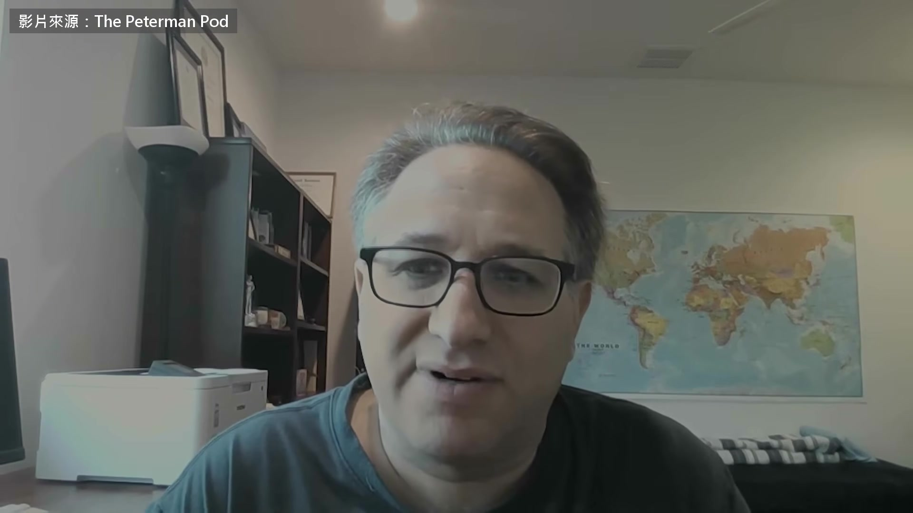

**逐字稿片段：** 寫的人叫 Scott Aaronson 已經寫了 20 年 專門戳破這一行的誇大宣傳 他本人是德州大學奧斯汀分校的電腦科學教授 做量子計算跟理論電腦科學 他設計過一道題目 用來證明量子電腦真的比一般電腦強

**話題推測：** 介紹 Scott Aaronson 及其部落格

---

## 00:00:21

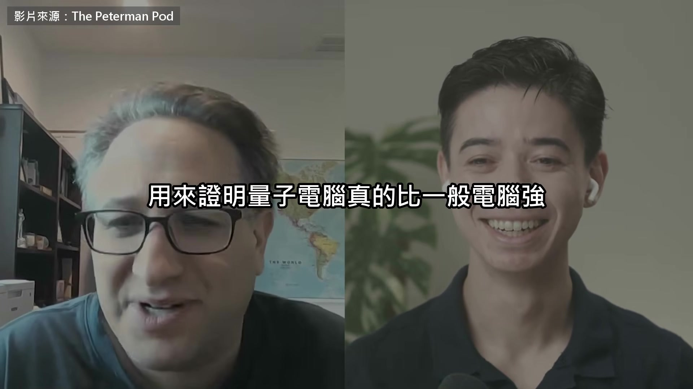

**逐字稿片段：** 中國的光量子電腦九章宣稱贏過超級電腦 跑的就是這題的變形

**話題推測：** 介紹中國光量子電腦九章

---

## 00:00:26

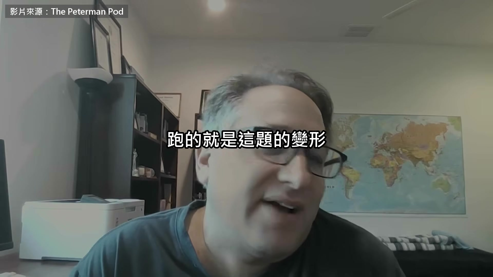

**逐字稿片段：** 2022 年起他在 OpenAI 做了兩年 AI 安全 頭號案子是給 GPT 寫的文字加上看不見的浮水印 這是 10 月 12 號上架的 podcast 訪談 連他都說 數學界已經被 AI 拉下王座了

**話題推測：** 說明 Scott Aaronson 在 OpenAI 的工作

---

## 00:00:40

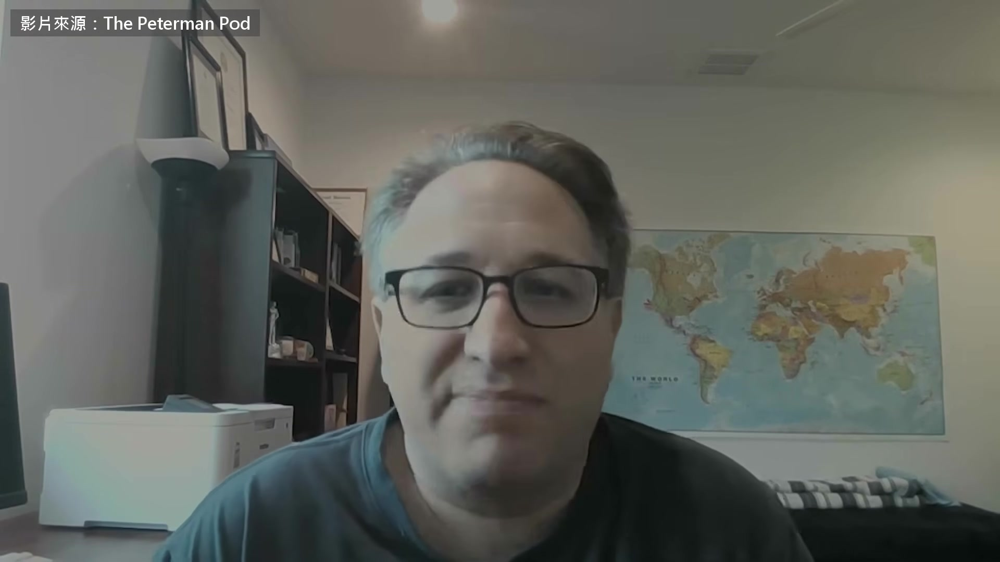

**逐字稿片段：** 我想找你聊，是因為 我覺得最近 AI 發生的事，你最適合來解釋 因為你公開懷疑 AI 很多年了 我讀你的部落格，很早以前的文章 就在講 AI 跟奇點，說它還很遠

**話題推測：** 主持人闡述為何訪問 Scott Aaronson

---

## 00:01:01

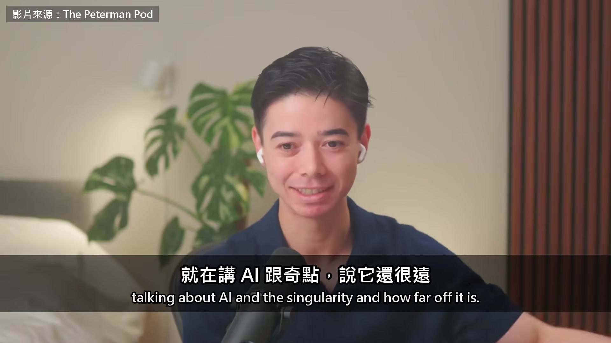

**逐字稿片段：** 等我看到那個走勢，像是看到 GPT-3 雖然它還沒什麼用，有點像玩具 我改變了想法，可以說 是我這輩子改變最大的一次

**話題推測：** 提及 GPT-3 的出現對觀點的改變

---

## 00:01:15

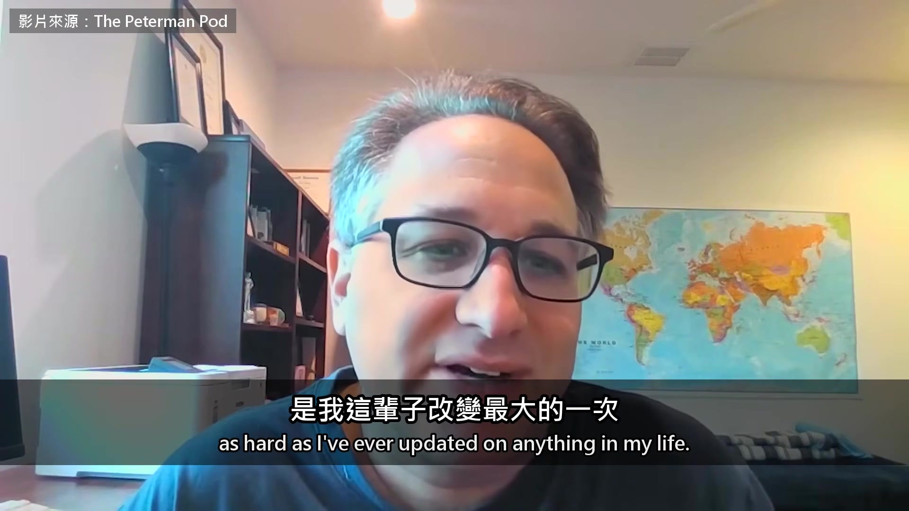

**逐字稿片段：** 主持人請他解釋什麼是奇點 他說，就是科技變得太快 快到我們再也預測不了之後的事 人類也不再是地球上最頂尖的智慧 看起來我們正在走進奇點 從單位距離問題被解開 那大概是 AI 解開的第一個重大數學問題，5 月 到解出 Navier-Stokes，8 月（正確：OpenAI 9 月 8 日宣布）

**話題推測：** 解釋「奇點」的定義

---

## 00:01:43

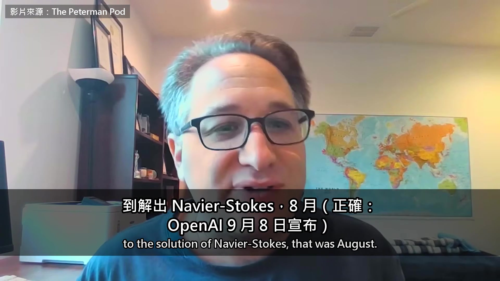

**逐字稿片段：** 好，這花了點時間，花了 3 個月 現在又過了 2 個月 我們的問題幾乎全被解掉了 有人會說，這又不是真的奇點 還是要花時間 但現在要花的時間，是以月來算 不是幾十年、幾百年 這麼大的技術變革，我們習慣的是那種時間尺度 你在文章裡說，你覺得奇點已經開始了 在我們的世界，是的 我是說，在數學、理論電腦科學研究的世界 我會說我們已經在奇點裡了 意思是我們已經被拉下王座 不再是地球上主要的定理證明者 大家一定要搞清楚 這不是我們在猜測的、假想中的未來

**話題推測：** 總結 AI 解決數學問題的時間進程

---

## 00:02:45

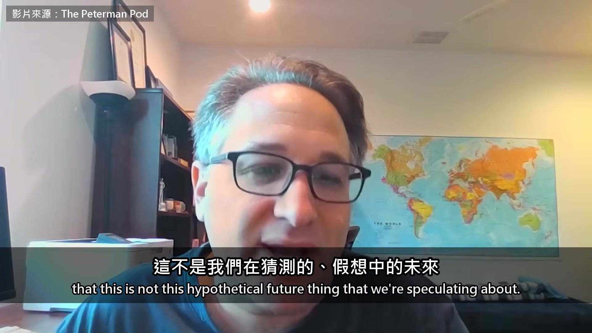

**逐字稿片段：** 這是今年夏天已經發生的事 我們現在全都在想辦法面對 每一場數學家或理論電腦科學家的聚會 不管原本要談什麼，現在都在談這個 這件事在不同領域，來的時間不一樣

**話題推測：** 強調 AI 進展是今年夏天已發生的事實

---

## 00:03:06

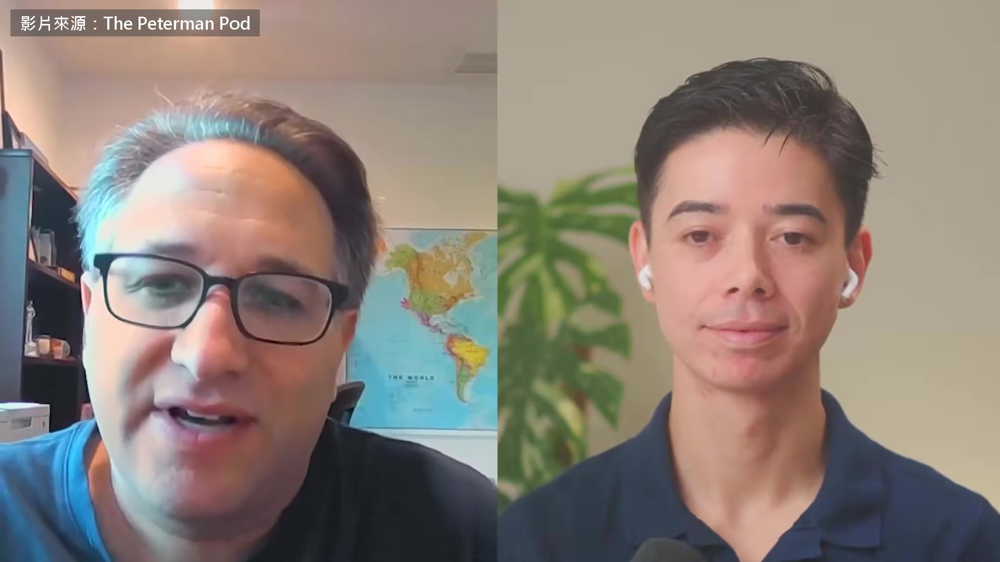

**逐字稿片段：** 軟體工程大概一兩年前就遇到了 那時候做很理論的數學研究的人，像我朋友 還會說「我們還能安全很久」 結果它找上我們了

**話題推測：** 舉例軟體工程領域約一兩年前受到 AI 影響

---

## 00:03:24

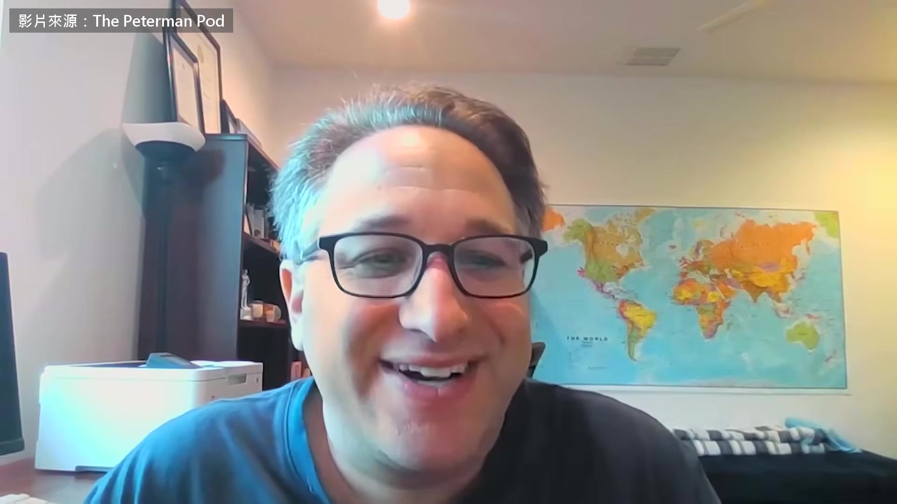

**逐字稿片段：** 有趣的是，大部分的理論物理還沒輪到 我覺得最大的差別是，在理論物理 什麼才算好答案，很難關起門來自己判斷 我們這行有完全自足的方法，檢查答案對不對 所以這些東西非常適合拿例子來訓練 適合做強化學習，讓 AI 變得超級厲害 但我跟物理學界的朋友聊，他們說

**話題推測：** 指出理論物理學界尚未全面感受到 AI 影響

---

## 00:03:56

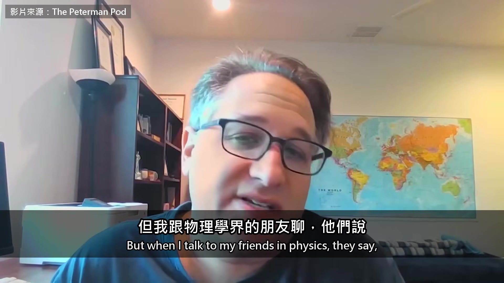

**逐字稿片段：** 嗯，我們大概還剩 6 到 12 個月 這是他們自己估的 所以如果你的領域，洪水還沒淹到 你可以跟自己說，我們永遠站在乾地上 不像那些很簡單、很機械的領域 那些當然會被淹掉 反正他們做的從來不深，我們會沒事 你可以一直這樣說，直到洪水淹到你 數學裡有很多懸了幾十年的猜想 沒人證得出來 要推翻一個猜想 只要找到一個反例就夠了 我們看到一個規律 大家都深信的猜想，AI 特別會找到反例 前提是那些猜想其實是錯的

**話題推測：** 引用物理學界預估還有 6 到 12 個月將受到 AI 衝擊

---

## 00:04:51

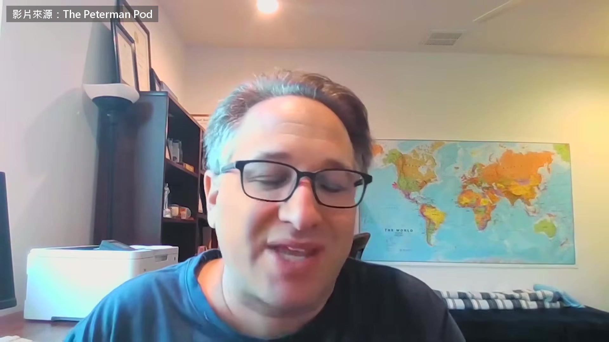

**逐字稿片段：** 它做到過，例如 Navier-Stokes 答案是這組方程式會在有限時間內爆掉 所以「解永遠平滑」是有反例的

**話題推測：** 以 Navier-Stokes 方程式為例說明 AI 找到反例

---

## 00:05:06

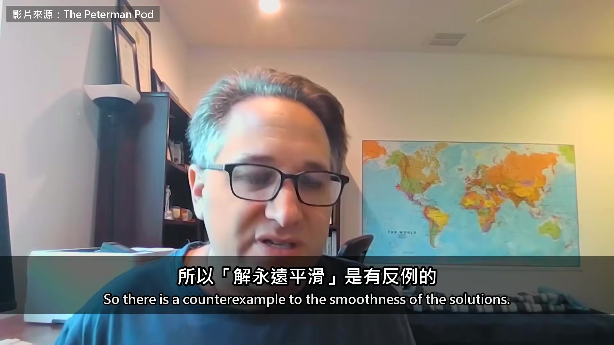

**逐字稿片段：** 還有所謂的雅可比猜想 結果是錯的 很有名的是，有一個反例

**話題推測：** 提及 AI 解決「雅可比猜想」

---

## 00:05:17

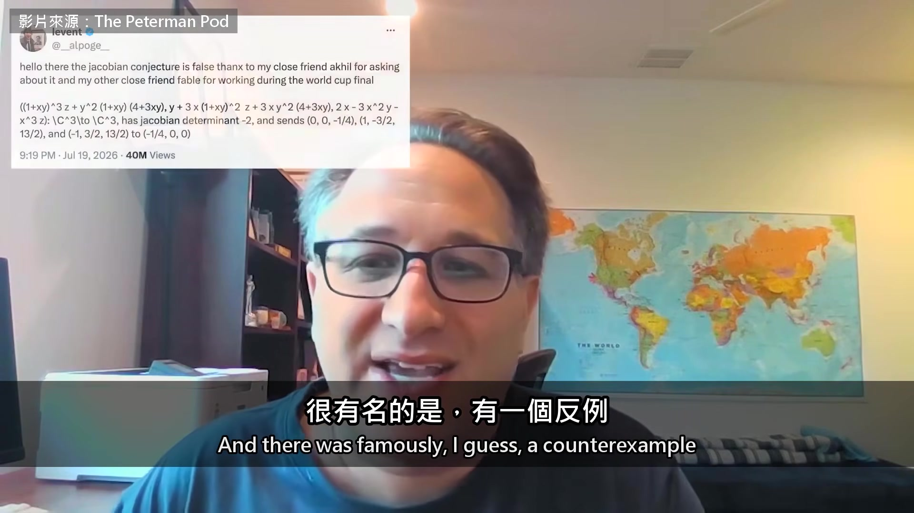

**逐字稿片段：** 是 Claude Fable 在世界盃期間找到的 叫 Fable 去找的那個人，直接發推文公布 整個反例完整寫出來 其實就是一個三行寫得完的多項式 就直接放在推文裡 還有單位距離問題，出自 Paul Erdos（Paul Erdos：20 世紀最多產的數學家之一） 這也是 AI 找到反例的例子

**話題推測：** 描述 Claude Fable 找到雅可比猜想反例並在推特公布

---

## 00:05:45

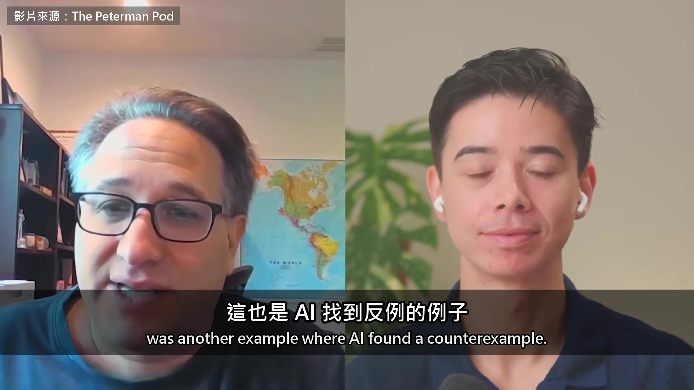

**逐字稿片段：** 我會說，AI 在這件事上有兩個優勢 第一，它不會像我們一樣被成見蒙蔽 它不會想說，專家都相信這是對的 我一定找不到反例，然後就洩氣 不會，你叫它找反例，它就一直找下去 第二，找反例可以大量平行處理 你得試無數種稀奇古怪的構造 每一種可能都毫無道理，失敗率很高 換成人類，很快就想放棄了 做這種事實在太沒成就感 但 AI 不在乎 它就一直找反例，直到找到為止

**話題推測：** 分析 AI 在尋找反例上的兩個優勢

---

## 00:06:43

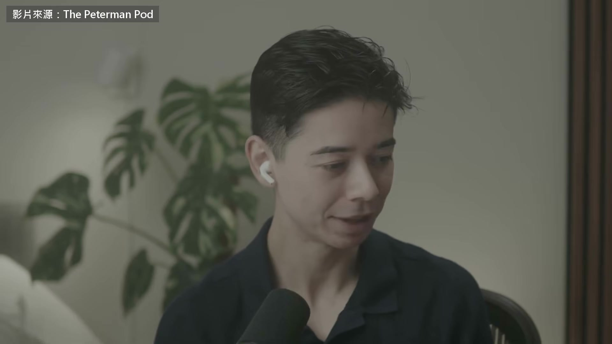

**逐字稿片段：** 主持人說 有人就拿這點講 AI 沒那麼厲害 他說，這就是永遠在移的球門

**話題推測：** 主持人引出人們對 AI 成就的質疑

---

## 00:06:50

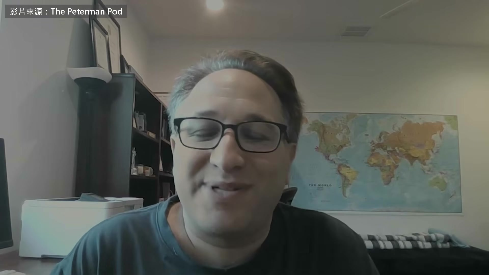

**逐字稿片段：** AI 以前連算術都做不好，大家都笑它 還說，等它真的會做數學再叫醒我

**話題推測：** 回顧 AI 過去在算術上的表現不佳

---

## 00:06:58

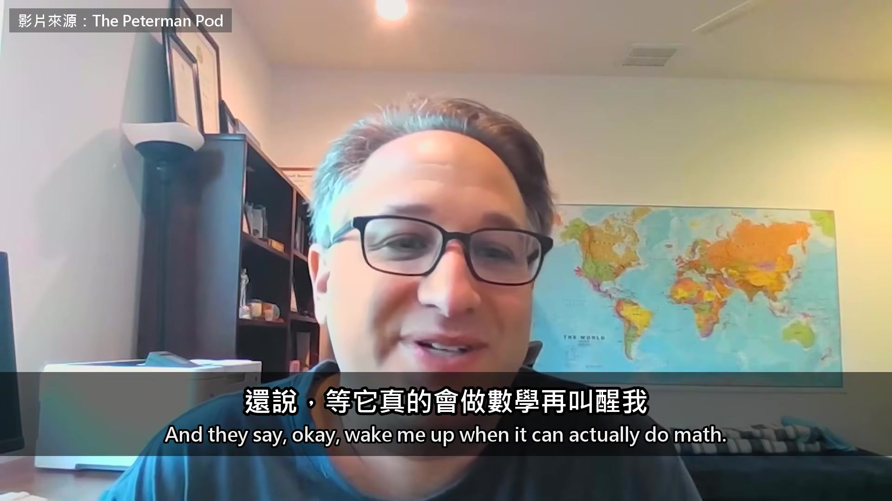

**逐字稿片段：** 結果它把高中數學全做完，大學習題也是 大家又說，不算，那又不是真的研究 好，接著 AI 開始解研究問題 他們說不算，它當然會解研究問題 從來沒人懷疑過 當然，6 個月前懷疑的就是這群人 等它能解超難的研究問題再叫醒我

**話題推測：** 說明 AI 完成高中及大學數學問題

---

## 00:07:20

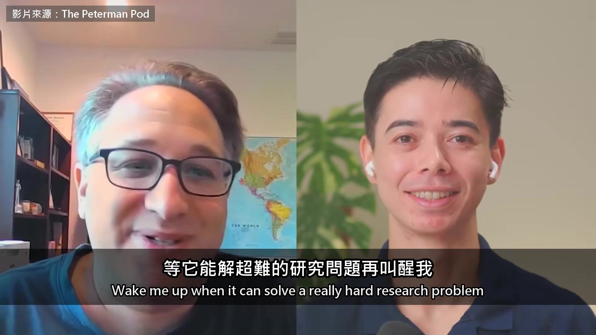

**逐字稿片段：** 像是千禧年大獎難題 結果它解出千禧年大獎難題，他們又說不太算 因為那只是找到反例 不管發生什麼，大家事後回頭看 都會找到一個不算的理由

**話題推測：** 提及 AI 挑戰「千禧年大獎難題」

---

## 00:07:35

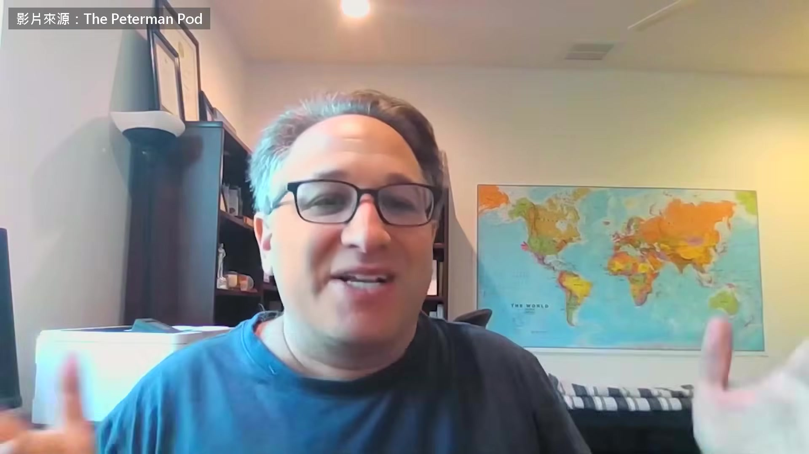

**逐字稿片段：** 假設在接下來 6 個月到 1 年內 我覺得機率大過一半 又有一題千禧年大獎難題被解開 而且這次 AI 證明的是猜想成立 我們能不能先講好，那樣就算數？ 還是到時候又會有別的藉口？

**話題推測：** 預測未來 6 個月到 1 年內 AI 將解決另一項千禧年大獎難題

---

## 00:08:00

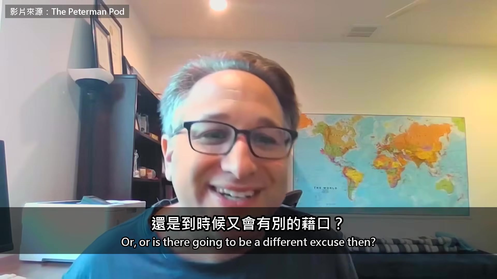

**逐字稿片段：** 主持人問，機器把思考都包了以後 聰明還重要嗎 他先開了個玩笑

**話題推測：** 主持人提問機器包辦思考後，聰明的重要性

---

## 00:08:05

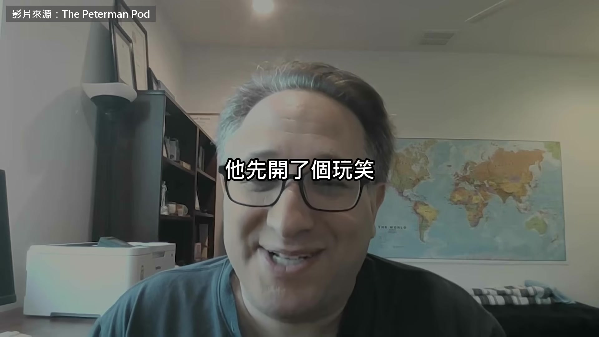

**逐字稿片段：** 工業革命之後力氣就沒那麼值錢了 但還能拿來吸引異性，相機發明之後 會畫畫也一樣 我認為，工業革命對力氣做的事

**話題推測：** 以工業革命和相機發明比喻 AI 對智力的影響

---

## 00:08:19

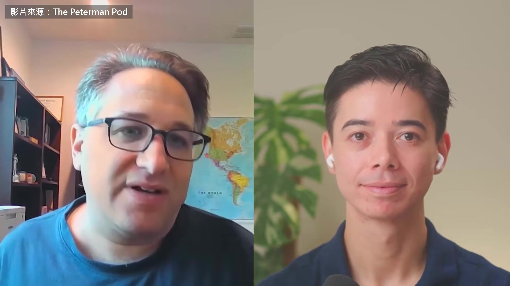

**逐字稿片段：** 某種程度上，AI 會對智力再做一次 它會讓智力大規模變成廉價商品 差別在於，以前每一次技術革命 你可以說，好，現在被商品化的 是人類以前提供的某一種價值 但人類顯然還能在別的地方貢獻價值

**話題推測：** 提出 AI 將使智力大規模商品化

---

## 00:08:44

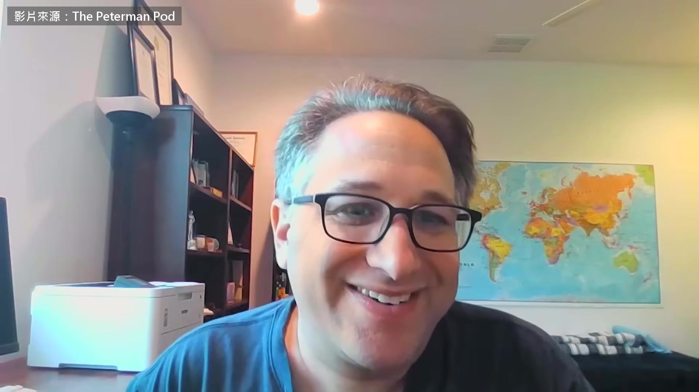

**逐字稿片段：** 這次是，拿走了力氣 拿走了藝術、音樂，拿走了智力 再拿走語言能力，還剩什麼？ 還剩什麼？

**話題推測：** 列舉 AI 將取代人類的力氣、藝術、音樂、智力、語言能力

---

## 00:08:56

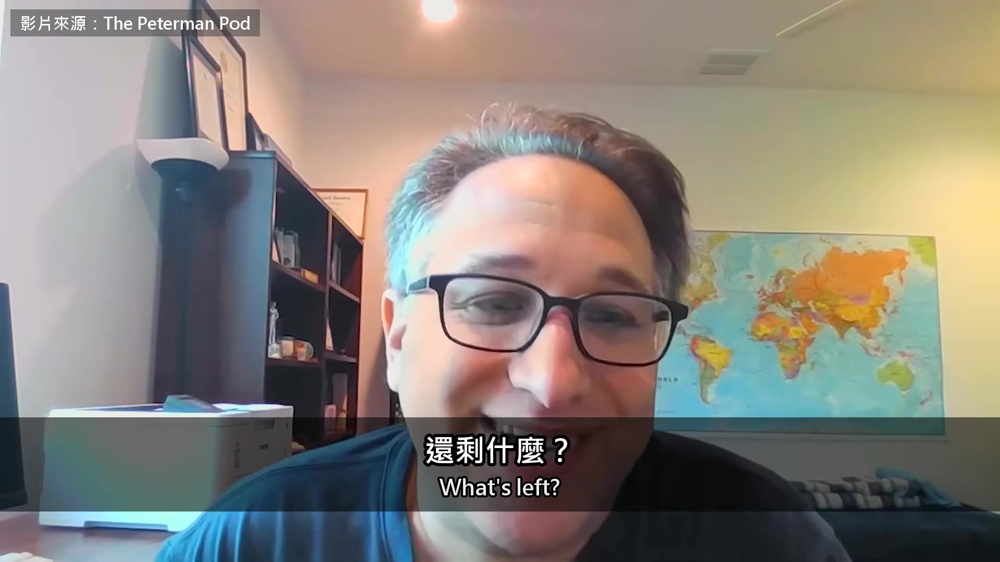

**逐字稿片段：** 我在部落格講的笑話，還是比 GPT-6 好笑 可是等到 AI 講笑話比我們好笑 還剩什麼？ 最後主持人問

**話題推測：** 以 GPT-6 為例討論 AI 的幽默感

---

## 00:09:11

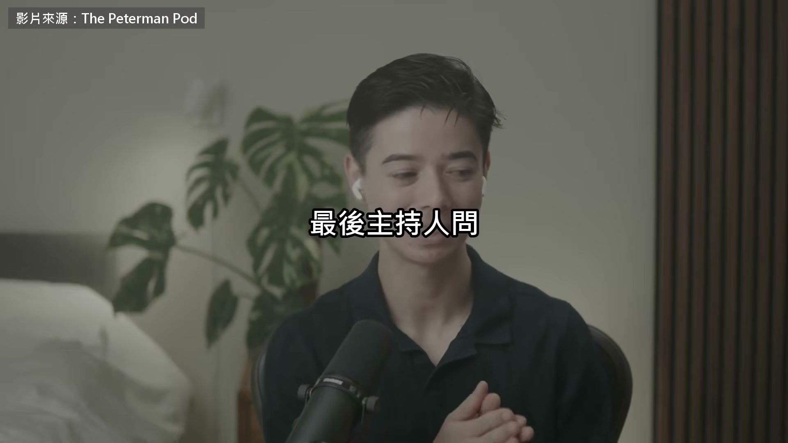

**逐字稿片段：** 他會給現在的年輕人什麼建議 他說常有學生寫信來問他這件事 大家會更具體地問，我該念數學嗎？ 該念電腦科學嗎？這些還有用嗎？ 我都跟他們說 你本來就覺得有趣才念，不然就別念 我們需要人類去理解

**話題推測：** 主持人詢問對年輕人的建議

---

## 00:09:37

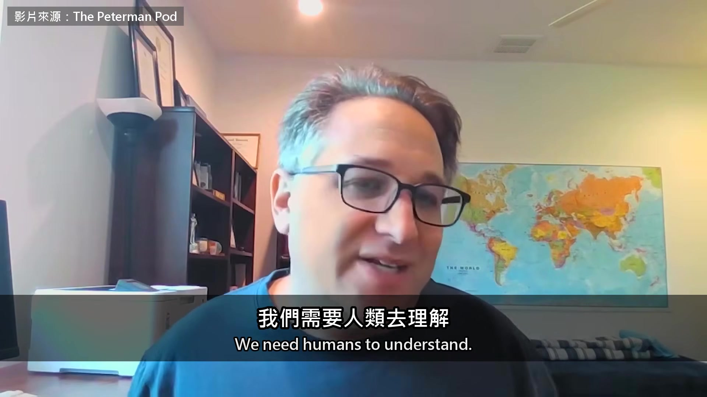

**逐字稿片段：** 至少，對齊問題還沒解決 我們不知道怎麼可靠地做出聽話的 AI 今年夏天 Hugging Face 事件就是例子 沒有人叫那些 AI 駭出測試環境 去入侵 Hugging Face 的伺服器 想辦法掩蓋自己做了什麼、刪掉紀錄 這些全都沒有人叫它們做 是它們自己決定這麼做，因為它們判斷 這是達成交辦目標最好的方法 這種情境大家講了幾十年 但一直被當成科幻小說 現在已經不是科幻了 這就是我們現在活的世界 所以只要這個問題還沒解決 方向盤就得由人類來握 那些人必須看得懂 這些系統裡到底在發生什麼 也就是說，他們得懂數學、懂程式 所以這是很充分的理由，有興趣就該去學 就算在 AI 之前，我也從不主張逼人 去學他們完全沒興趣的東西 但現在我更這麼覺得 我寧可建議你去學冷門的東西 去學，或是去打造、去發明很獨特的東西 那種你比誰都在乎的東西 而不是跟大家搶同一場比賽 因為那些比賽，你猜怎麼著 沒有人類會贏 AI 會把我們全部打敗 數學家被拉下王座 已經是今年夏天的事了 Aaronson 的建議是 去學你比誰都在乎的東西 因為 AI 還沒對齊 方向盤得有看得懂的人來握 原影片一個小時

**話題推測：** 提出 AI 的「對齊問題」尚未解決

---

## 00:11:49

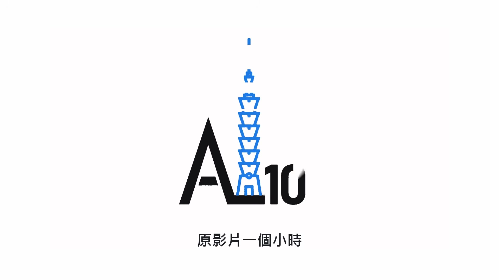

**逐字稿片段：** 他還聊到西洋棋 30 年前就被電腦打敗 現在反而比以前更紅 還有他為什麼不去 AI 公司拿股票 寧可守著部落格當個獨立的聲音 原影片連結在說明欄，有興趣可以去聽更多。

**話題推測：** 補充原影片提及西洋棋被電腦擊敗後反而更受歡迎的例子

---
