# ai-note-101_IiYHFtstQ9Y — 關鍵畫面索引

- 來源逐字稿：[ai-note-101_IiYHFtstQ9Y_GT.srt](ai-note-101_IiYHFtstQ9Y_GT.srt)
- 影片：https://www.youtube.com/watch?v=IiYHFtstQ9Y
- 截圖數：26

## 00:00:04

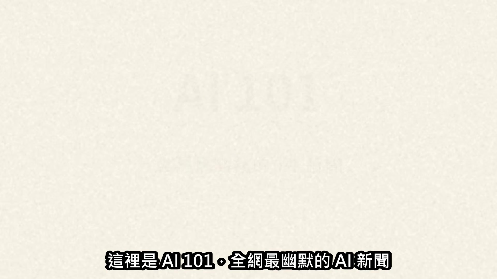

**逐字稿片段：** AI 角色聊天平台 Character.AI 聲請破產保護了 這家曾經的明星新創 現在整家公司被送進破產法院 接下來平台、權利跟債務要怎麼處理 都得看法院 說是破產

**話題推測：** 介紹主要公司 Character.AI

---

## 00:00:18

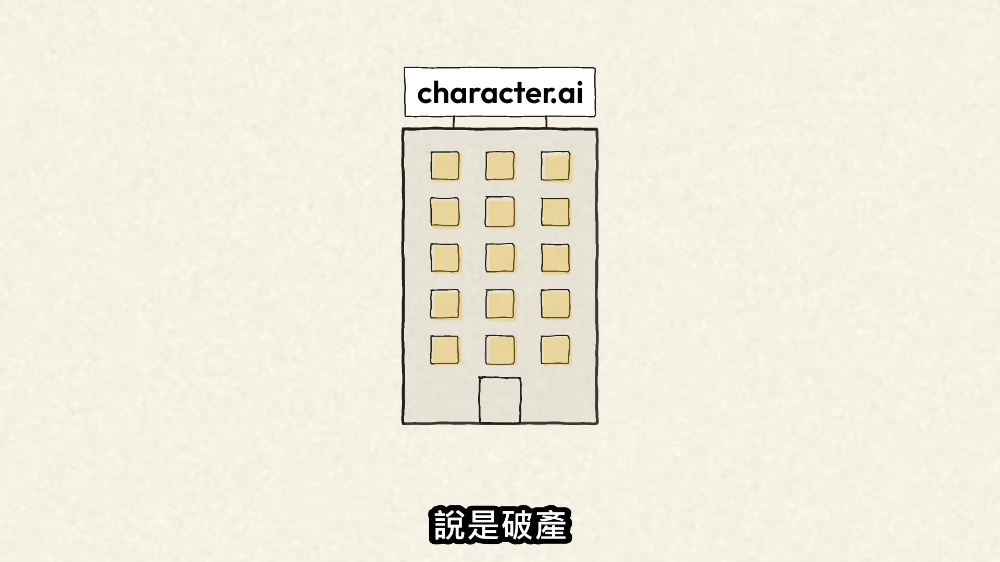

**逐字稿片段：** 其實已經有兩個巨頭各看上一塊 Google 早就取得現有模型技術的非獨家授權 並帶走創辦人與核心研究員

**話題推測：** 說明兩大巨頭介入Character.AI的破產案

---

## 00:00:26

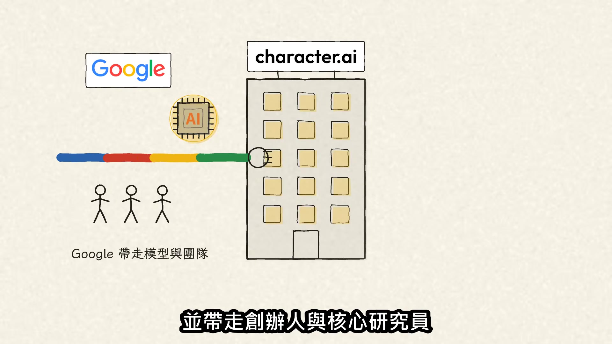

**逐字稿片段：** 迪士尼這次則出 2,000 萬美元 替部分智慧財產與公司請求權的非獨家永久授權設定拍賣底價 兩筆交易，都不是把整家公司買下來

**話題推測：** 介紹迪士尼介入破產案的具體內容與金額

---

## 00:00:35

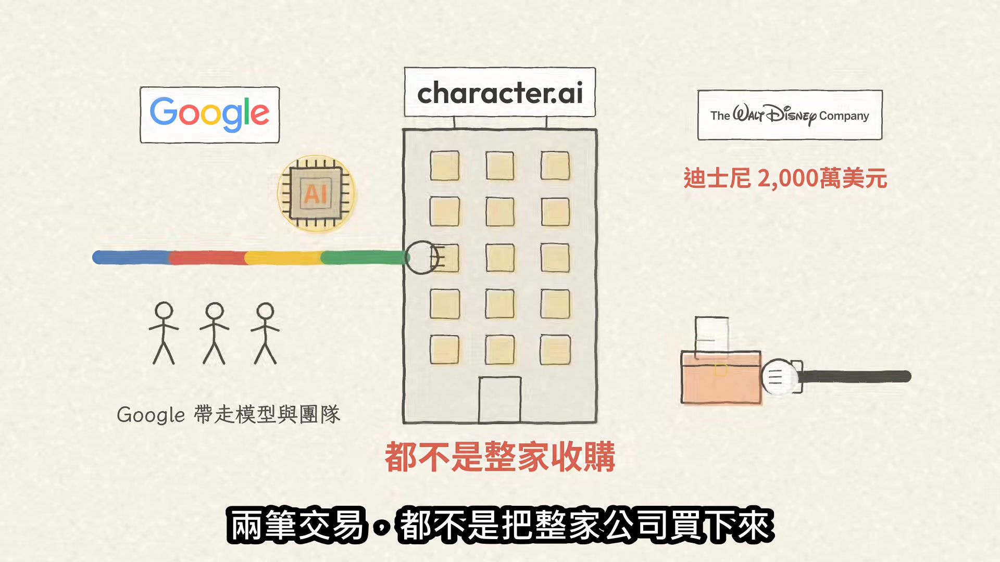

**逐字稿片段：** 那剩下的平台呢？ Character.AI 現在還在線上 聊天照樣能用 但沙漏已經在走了： 要是一直沒有買家願意接手經營 這個平台就會結束服務、收攤

**話題推測：** 轉換話題至 Character.AI 平台的未來命運

---

## 00:00:47

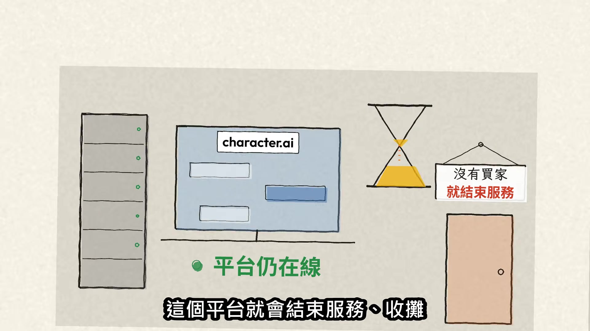

**逐字稿片段：** 要搞懂它怎麼走到這一步 得從兩個人講起

**話題推測：** 追溯 Character.AI 走到破產的原因和歷史

---

## 00:00:50

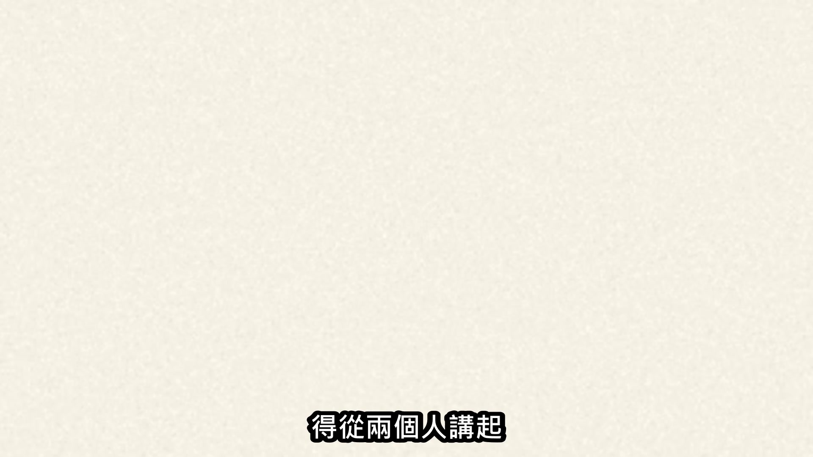

**逐字稿片段：** Noam Shazeer 和 Daniel de Freitas 原本都在 Google 當工程師 後來兩人一起離開 Google 出來創業 創的就是 Character.AI 兩人裡面，Shazeer 的來頭特別大 順帶一提

**話題推測：** 介紹 Character.AI 的兩位創辦人 Noam Shazeer 和 Daniel de Freitas

---

## 00:01:03

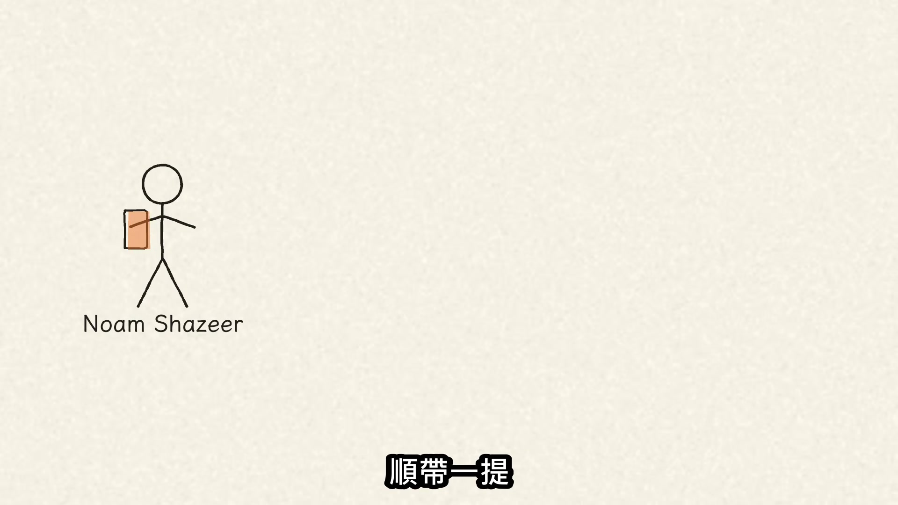

**逐字稿片段：** 2017年那篇〈Attention Is All You Need〉 也就是 Transformer 論文 他就是8位作者之一；今天各種聊天機器人 幾乎都是從這篇論文長出來的 說穿了，等於發明引擎的人 自己出來開車行

**話題推測：** 強調創辦人之一在 Transformer 論文的貢獻與年份

---

## 00:01:17

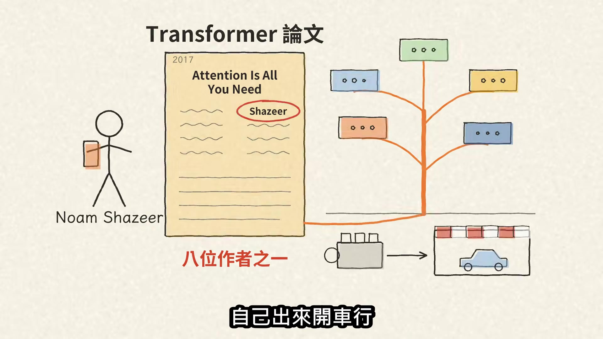

**逐字稿片段：** 他們做出來的 Character.AI 玩法很簡單： 使用者自己建一個 AI 角色，海盜船長、 巫師、動漫少女、歷史偉人都行 頭髮跟個性都能自己捏 然後就跟這個角色長期聊下去 這種玩法紅得很快 Character.AI

**話題推測：** 介紹 Character.AI 的產品玩法與特色

---

## 00:01:33

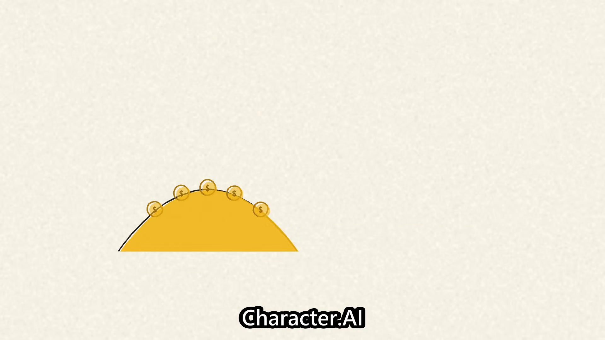

**逐字稿片段：** 一下子就成了10億美元的獨角獸

**話題推測：** Character.AI 達到十億美元估值

---

## 00:01:35

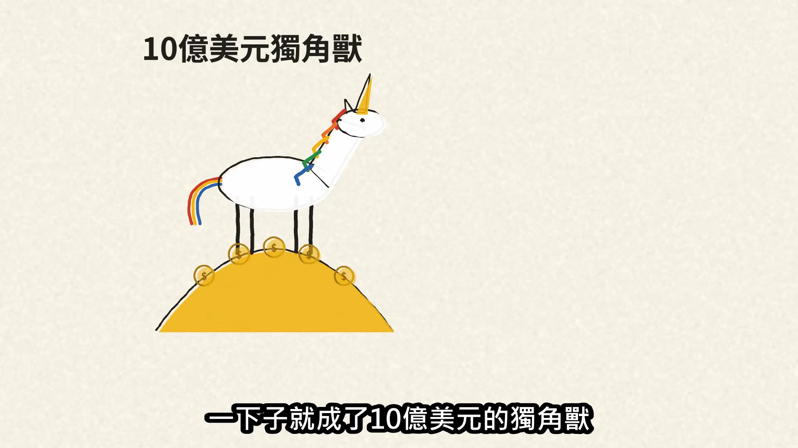

**逐字稿片段：** 可是背後的帳不好看 跑前沿模型的成本一路往上疊 錢一直往伺服器裡燒 壓得這隻獨角獸喘不過氣 就在這時候，Google 回頭找上門

**話題推測：** 轉向 Character.AI 的財務困境

---

## 00:01:47

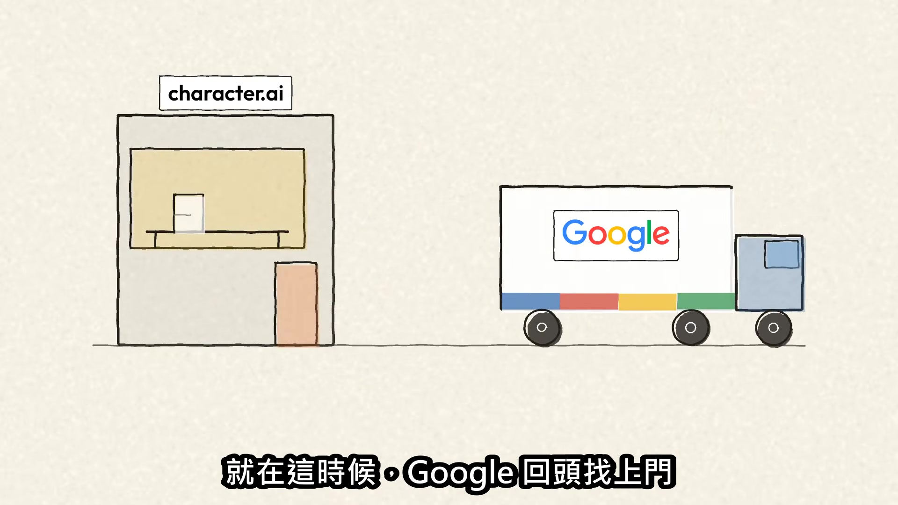

**逐字稿片段：** 一筆27億美元的交易 Google 拿到 Character.AI 的模型授權 而且是非獨家的 Character.AI 自己還能繼續用 同時兩位創辦人和研究團隊 也一起被帶回 Google

**話題推測：** Google 收購 Character.AI 模型授權的具體金額

---

## 00:02:00

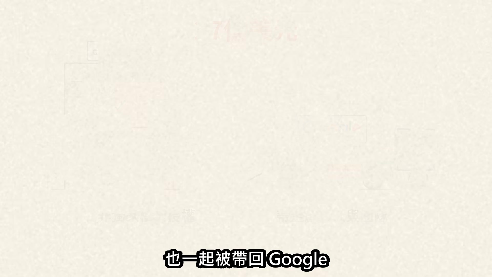

**逐字稿片段：** 人一走，原公司還剩下什麼？ Character.AI 仍保有平台、 使用者和留下來的團隊 也能繼續使用自己的模型技術；營運、 債務和法律責任，則繼續由這家公司承擔

**話題推測：** 探討創辦人團隊離開後 Character.AI 的剩餘資產與責任

---

## 00:02:13

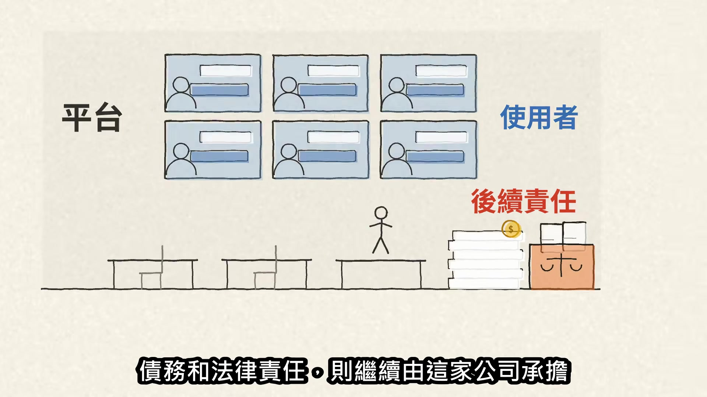

**逐字稿片段：** 這些留下來的責任 很快就落到孩子的安全上

**話題推測：** 轉向 Character.AI 需承擔的法律責任

---

## 00:02:17

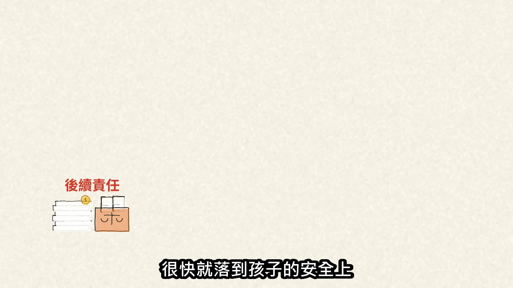

**逐字稿片段：** 少年 Sewell Setzer 三世過世後 他的母親 Megan Garcia 提告 主張聊天機器人讓兒子產生依賴 最後促成了他的自殺 這個案子，法院決定讓它繼續審下去 不過要分清楚：案件繼續審理 只代表官司還在走 天秤還沒有往哪邊倒 並不代表法院已經判 Character.AI 要負責 在這之後

**話題推測：** 提及一起具體的兒童安全訴訟案

---

## 00:02:43

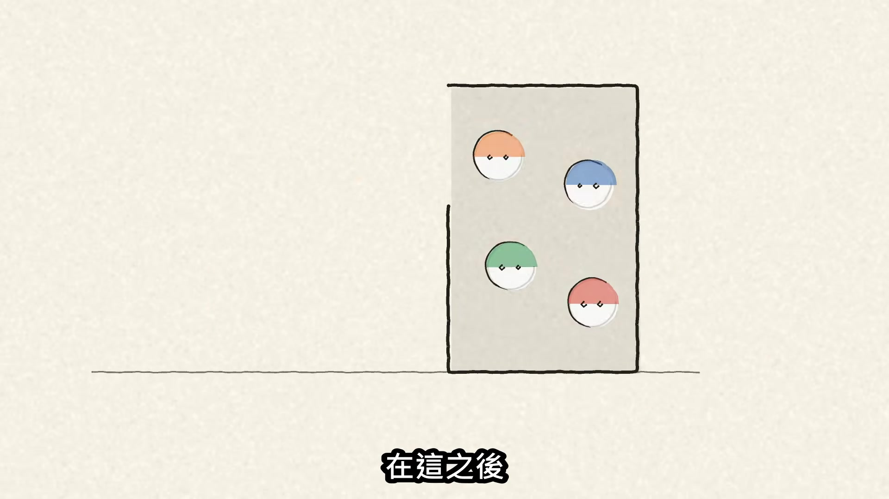

**逐字稿片段：** Character.AI 自己也改了規則： 未成年使用者的開放式角色聊天 被一步一步取消 青少年想跟 AI 角色自由聊天的那扇門 就這樣一塊木板一塊木板被釘上

**話題推測：** 介紹 Character.AI 因訴訟而做的政策調整

---

## 00:02:56

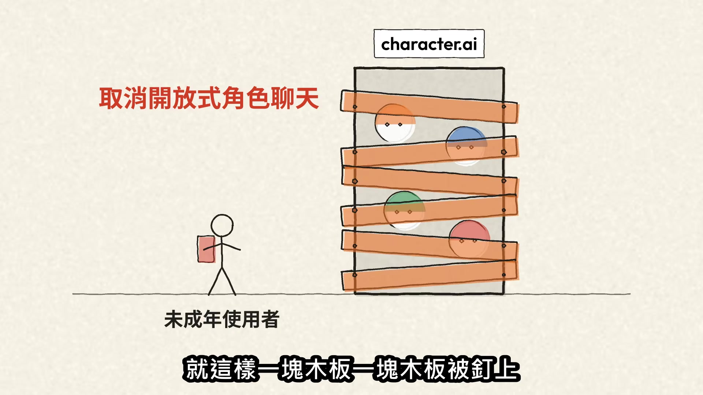

**逐字稿片段：** 至於其他官司 多起訴訟已經原則上和解了 只是和解條款一個都沒有公開 而且還要等法院核准 這些和解才算真正定案

**話題推測：** 簡述其他相關的法律訴訟進展

---

## 00:03:06

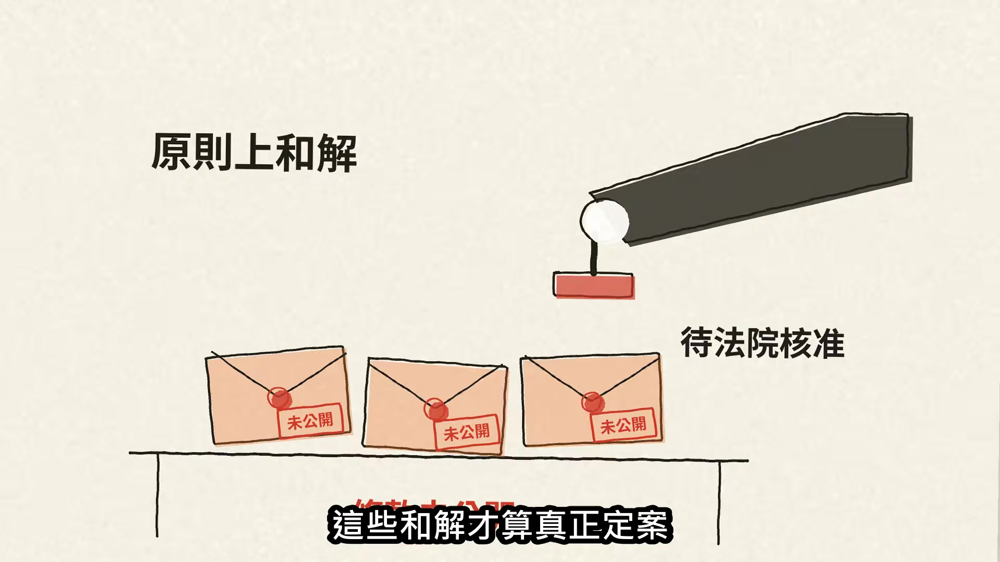

**逐字稿片段：** 兒少安全之外，另一條壓力線來自迪士尼 迪士尼一開始的態度很硬 直接要求 Character.AI 把平台上那些沒有經過授權的迪士尼角色移除 迪士尼會這麼在意，其實不難懂 米老鼠、艾莎、黑武士 這些角色就是迪士尼最值錢的家當 電影、周邊、樂園全靠它們撐著 在迪士尼面前盜用角色 大概跟在獅子面前拿牠的肉差不多

**話題推測：** 轉向迪士尼對 Character.AI 的智慧財產權要求

---

## 00:03:34

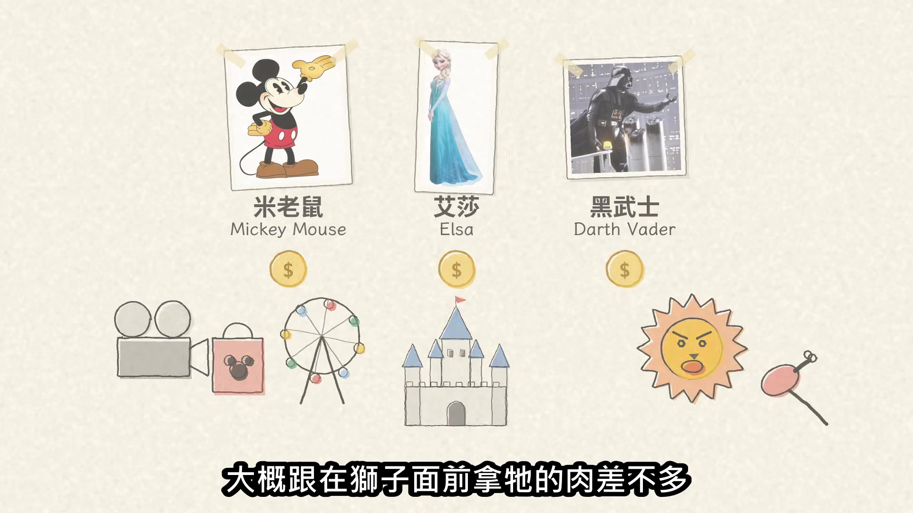

**逐字稿片段：** 可是劇情接著就翻轉了 迪士尼前腳才要人家拿掉角色

**話題推測：** 說明迪士尼與 Character.AI 關係的意外轉折

---

## 00:03:38

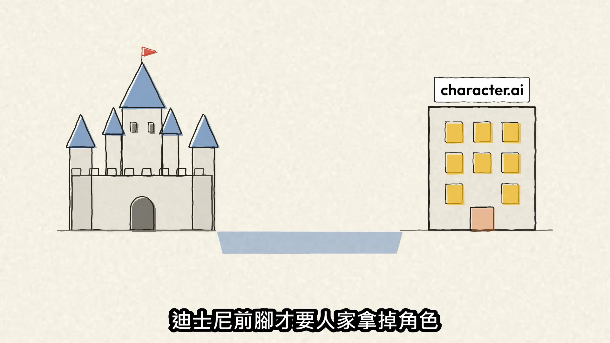

**逐字稿片段：** 後腳就把 Character.AI 的執行長 Karandeep Anand 聘了過去 還宣布預計有多名技術人員跟著加入 這樣一來 迪士尼跟 Character.AI 的關係整個翻了過來： 從一開始的「不要碰我的角色」 變成「把你的技術帶進我的角色跟粉絲體系」 同一隻手，先推開，再拉進來

**話題推測：** 迪士尼聘任 Character.AI 執行長的人事新聞

---

## 00:04:01

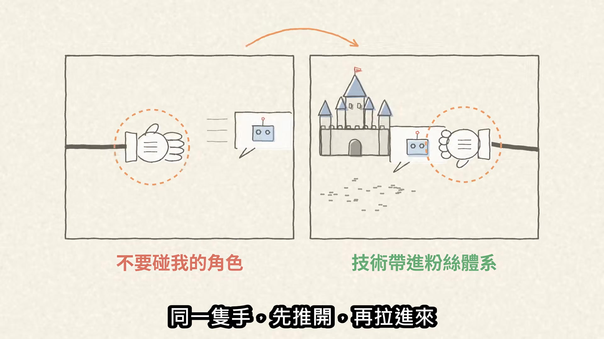

**逐字稿片段：** 把兩筆交易擺在一起看就更清楚 Google 花了 27 億美元 取得現有模型技術的非獨家授權 並聘走 2 位創辦人和 20 多名研究員 迪士尼出 2,000 萬美元 競標的是部分智慧財產與公司請求權的非獨家永久授權 兩家都沒有買下整家公司 兩個價錢差像豪宅跟停車位 但買的本來就不是同一樣東西

**話題推測：** 比較 Google 和迪士尼兩筆交易的內容與金額

---

## 00:04:24

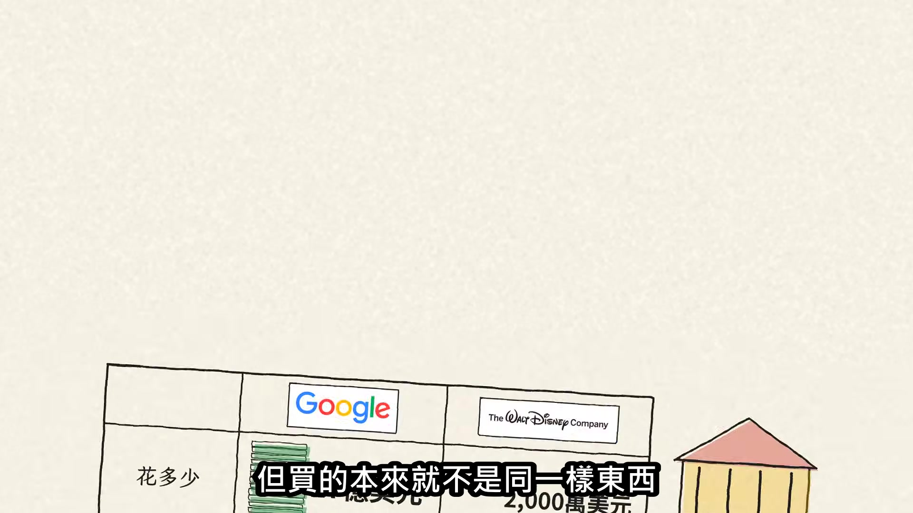

**逐字稿片段：** 巨頭挑完了，翻開破產文件的帳本看看 Character.AI 還欠著一般的商業債務 另外，政府跟未成年原告提出的求償 雖然還有爭議 也都一起被列進了破產程序 在破產文件列出的前

**話題推測：** 檢視 Character.AI 破產文件中的債務狀況

---

## 00:04:39

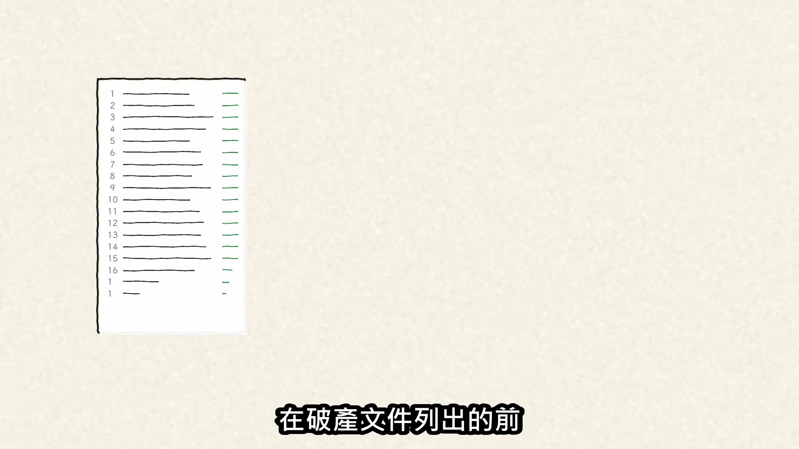

**逐字稿片段：** 20 大無擔保債權人裡 最大一筆已標金額的債權 來自帶走團隊的 Google 但文件上只寫一般商業應付款 這筆錢到底是什麼用途 光看文件沒有辦法推定

**話題推測：** 提及破產文件中前20大無擔保債權人名單

---

## 00:04:51

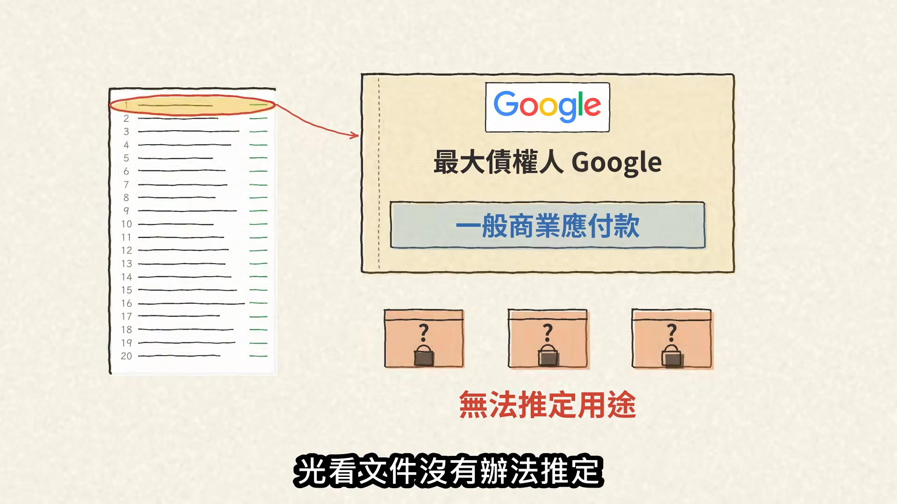

**逐字稿片段：** 那排隊的債主們，最後拿得回多少？ Character.AI 預期會有資金分給無擔保債權人 也就是手上沒有抵押品保障的債主 但蛋糕到底有多大、每人能分到多少 現在沒有人知道

**話題推測：** 討論債權人最終能拿回多少錢的展望

---

## 00:05:04

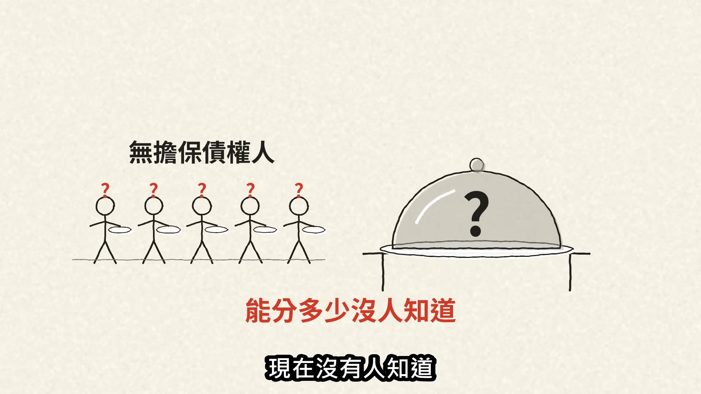

**逐字稿片段：** 把整件事拉遠來看 它攤開了 AI 產業的一個問題： 科技巨頭根本不用完整併購一家公司 靠非獨家授權，再把團隊挖走 最稀缺的那一塊就已經到手 像是直接把引擎拔走，整台車不用買 可是人才離開、巨頭拿到授權 車上的重擔沒有跟著走 Character.AI 仍保有平台和留下來的團隊 也能繼續使用原有模型技術；使用者、 訂閱、債務，還有法律責任 則繼續留在這家公司身上

**話題推測：** 探討 Character.AI 案例對 AI 產業的深遠影響

---

## 00:05:36

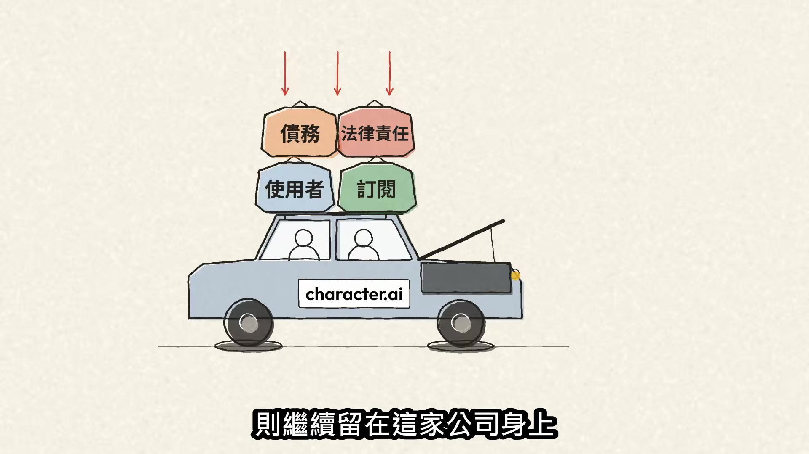

**逐字稿片段：** 所以接下來的競標程序 關鍵是有沒有買家提出能讓整個平台繼續營運的方案 而不只是又一個來挑走技術和權利的人 結局就看這一步

**話題推測：** 說明 Character.AI 平台最終命運的競標程序

---

## 00:05:47

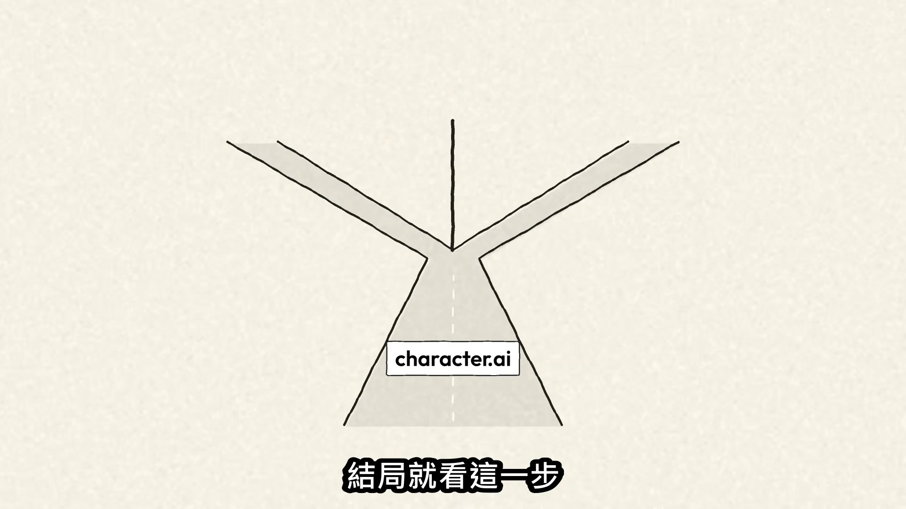

**逐字稿片段：** 如果有人接手 Character.AI 可能換一個主人 繼續活下去；如果沒有 這就不只是部分權利授權以 2,000 萬美元設下底價 而是一個大型 AI 消費平台 真正進入關站倒數

**話題推測：** 描述 Character.AI 兩種可能的最終結局

---
