# ai-note-101_JHRH4D3DRhU — 關鍵畫面索引

- 來源逐字稿：[ai-note-101_JHRH4D3DRhU_GT.srt](ai-note-101_JHRH4D3DRhU_GT.srt)
- 影片：https://www.youtube.com/watch?v=JHRH4D3DRhU
- 截圖數：19

## 00:00:01

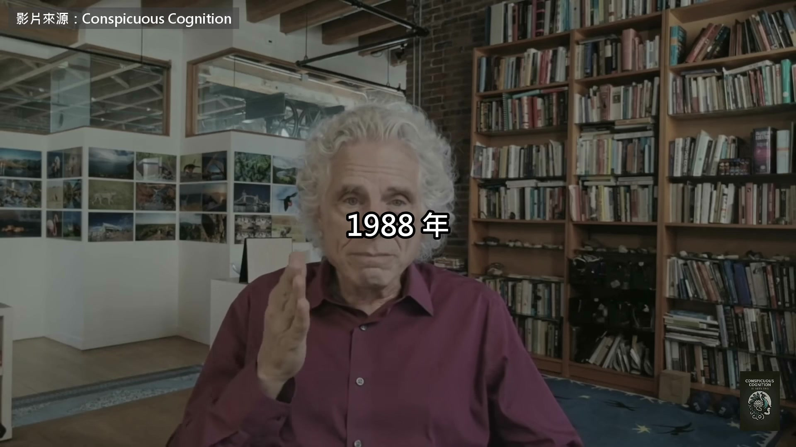

**逐字稿片段：** Steven Pinker 跟同事寫了一篇 100 多頁的論文 拆掉當時最紅的一個神經網路模型 之後 30 多年 他都是「神經網路學不會語言」這派的代表人物 這位哈佛心理系教授研究的是人怎麼思考 小孩怎麼學會說話 今年 9 月 擔心 AI 末日那派最有名的部落客 Scott Alexander 約他辯論 他沒答應，改寫一封公開信 10 月 7 號上架的這集 podcast 把對方的反駁一條條丟給他 反對末日論的人很多 他的理由都出自本行

**話題推測：** 介紹史蒂芬·平克 (Steven Pinker) 及其早期學術工作

---

## 00:00:31

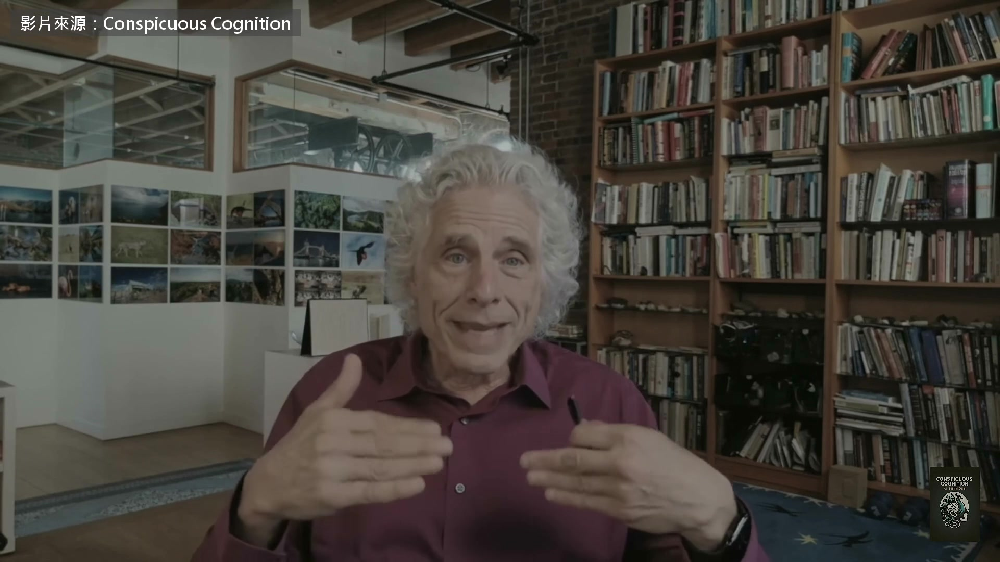

**逐字稿片段：** 第一題問的是 AGI 跟超級智慧 你對這兩個概念存疑 理由是什麼？ 在我的理解裡，智慧是一種工具，不是超能力 我是認知科學家 我這輩子都在拆解智慧怎麼運作 它不是全知，也不是全能 不是什麼神奇的能力，能推出所有命題的真假 能回答所有問題 它是資訊處理 任何資訊處理系統，一定有些事做得好 有些事做得沒那麼好 有它自己的怪癖跟運作方式 所以那些談智慧、會講到「超級智慧」的討論 「超級」是漫畫書才用的字首 都直接假設，智慧是一種萬靈丹 一種能給你力量的資源，可多可少 這我存疑… 它是一個機制，一種工具 我們可以讓這個機制做更多事 但它沒辦法用單一個數量說清楚

**話題推測：** 進入第一個主要問題：關於通用人工智慧 (AGI) 和超級智慧

---

## 00:01:42

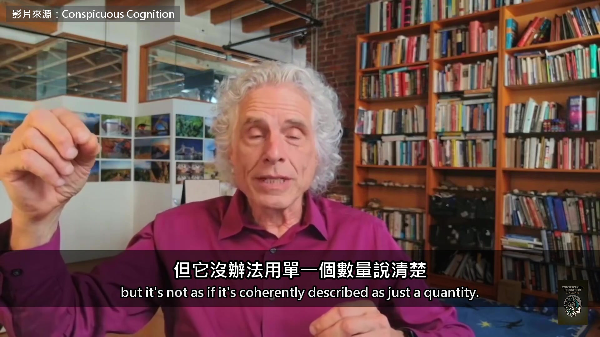

**逐字稿片段：** 人跟人之間，智力確實量得出來 我確實認為有「一般智力」這種東西 意思是不同的人量出來有高有低 也就是 IQ 測驗在量的東西 但把區分人跟人的那個東西 直接外推去解釋 AI 怎麼運作，是錯的

**話題推測：** 引入人類智力可測量 (如 IQ 測驗) 的概念

---

## 00:02:04

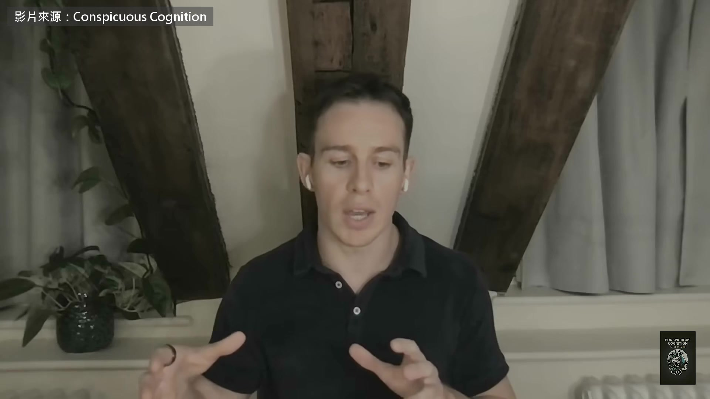

**逐字稿片段：** 主持人接著替末日論者講出最強的版本 人類能支配黑猩猩，不是因為比較壯 是因為比較聰明 要是 AI 跟我們的差距 就像我們跟黑猩猩，結果會不會一樣 我不覺得這個版本有多強 因為它犯的還是「自然階梯」那個謬誤 以為萬物照聰明程度排高低 我們比黑猩猩聰明，AI 比我們聰明 所以人類之於黑猩猩，等於 AI 之於人類 我覺得這個類比爛透了，原因很多

**話題推測：** 提出末日論者的論點：人類與黑猩猩的支配關係類比 AI 與人類

---

## 00:02:38

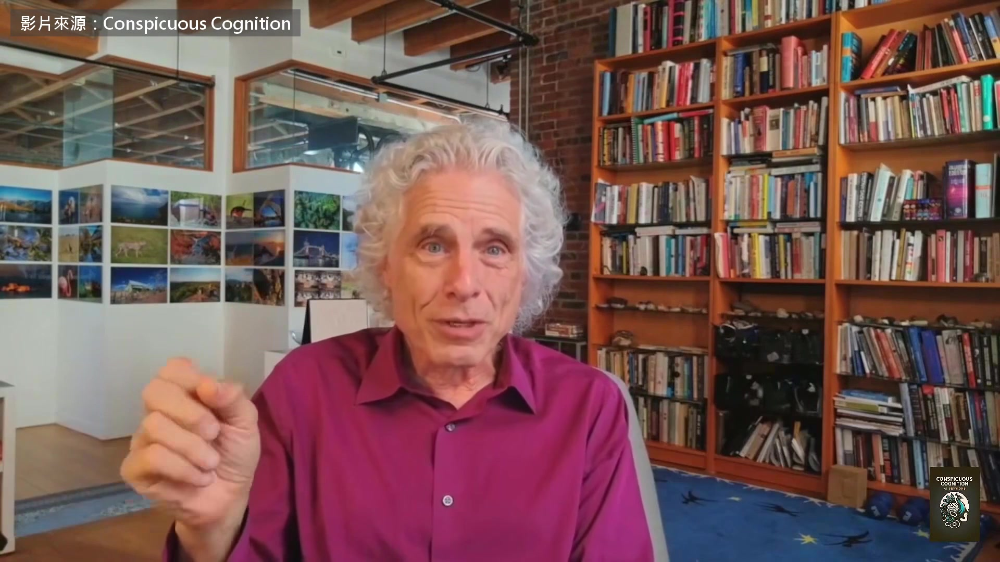

**逐字稿片段：** 一個是，人類是天擇的產物 所以我們天生愛競爭 另一個是，我們跟黑猩猩很多時候是零和競爭 最明顯的是搶土地，像非洲的農民 也搶肉 有人會殺黑猩猩來吃 AI 不跟我們搶資源 剛好相反，它們的資源是我們給的 它們不需要人肉 不需要支配我們，也不需要取代我們 除非有人寫程式要它們這麼做 就像人類被天擇塑造成好鬥 在零和競爭裡盡量多搶資源 但沒有任何東西，會讓 AI 跟我們零和競爭 我還是認為，這是一種投射 投射的是演化生物學裡本來就站不住的階層 再把 AI 跟人類，放到那把尺的延長線上 而那把尺根本就是假的

**話題推測：** 開始列舉為何黑猩猩類比不恰當的理由 (人類天性、零和競爭)

---

## 00:03:40

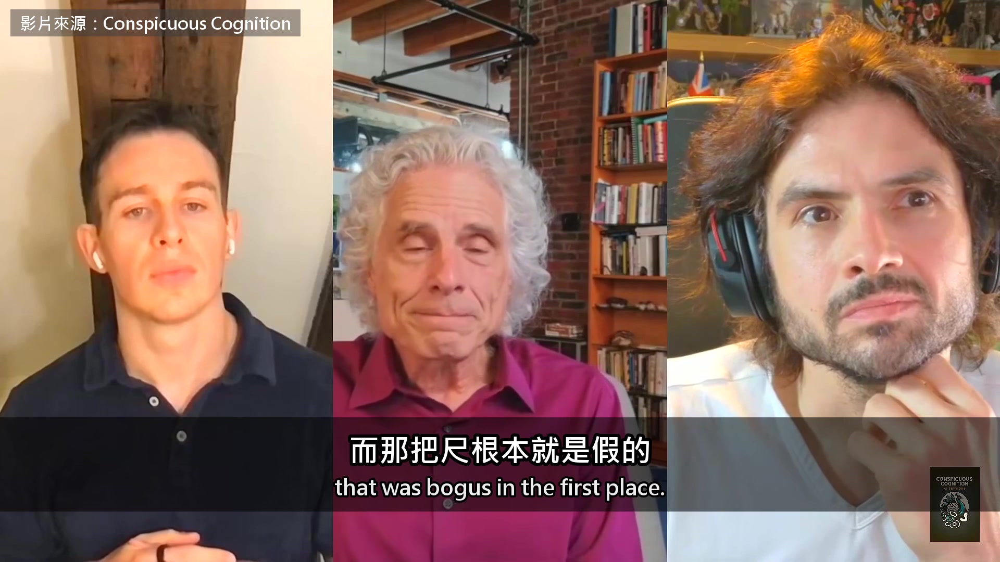

**逐字稿片段：** 下一題問到他自己的老戰場 深度學習這幾年突飛猛進 有沒有動搖他當年反對神經網路的立場 對，確實動搖了 逼得我修正看法 修正的是我以前反對的那一派 認知科學以前叫它「連結論」，就是神經網路路線 從 1980 年代起，我在這場爭論裡很活躍 站在符號、命題那一邊 有人叫它 GOFAI，「老派 AI」 因為神經網路，尤其是那個年代的，實在不怎麼聰明 套一句現在流行的罵法

**話題推測：** 進入第二個主要問題：深度學習進展是否動搖了平克反對神經網路的立場

---

## 00:04:18

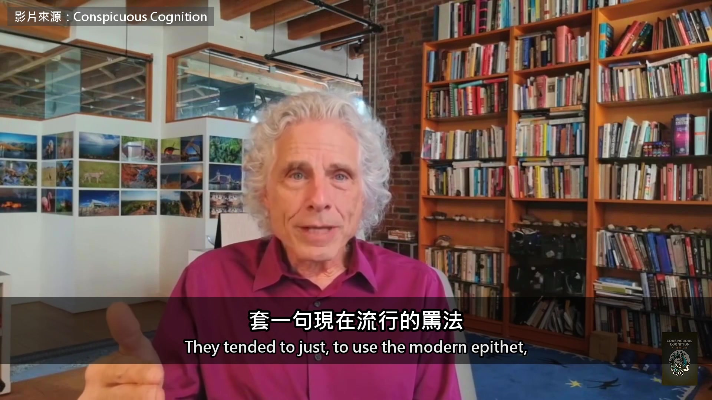

**逐字稿片段：** 它們就是「隨機鸚鵡」 把一堆機率混在一起，猜個大概說得通的答案 跟人類語言、人類概念的精確差得遠了 兩派就這樣來來回回，我本來會說 原則上不可能做出跟人類相當的真正智慧 包括使用語言，光靠這些做統計加總的神經網路 這點我確實錯了 我沒看到…我想我一直都還算對 到 GPT-3.5、ChatGPT 推出為止 之前的版本，像 GPT-2 真的就只是做統計近似的產生器 但毫無疑問，現在這一代能做出驚人的智慧表現

**話題推測：** 使用「隨機鸚鵡」一詞來形容早期神經網路的運作方式

---

## 00:05:13

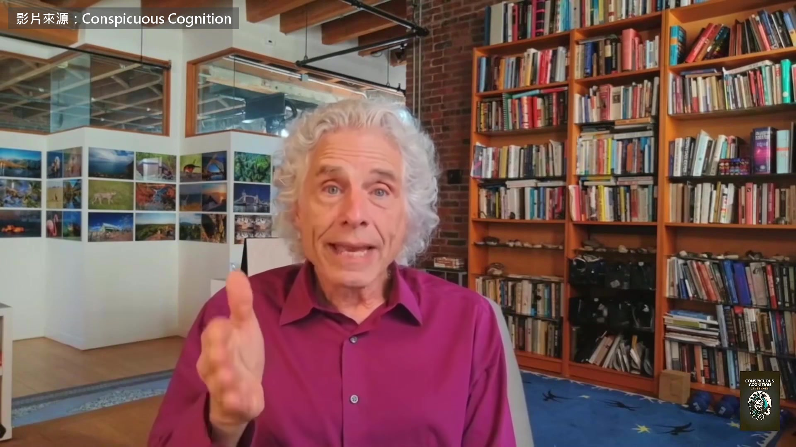

**逐字稿片段：** 甚至更早，Google 翻譯那一波 AI 大覺醒 還有語音辨識、形狀和圖形辨識、人臉辨識

**話題推測：** 列舉 AI 在 Google 翻譯、語音辨識、人臉辨識等領域的成功應用

---

## 00:05:24

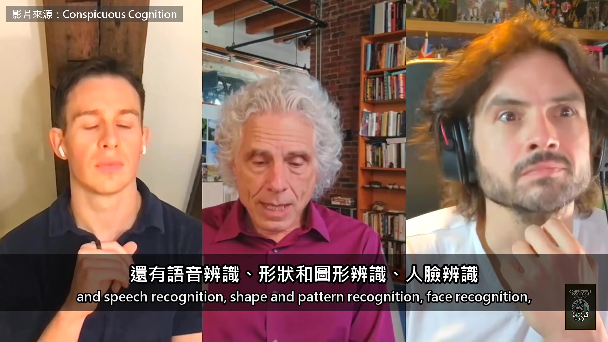

**逐字稿片段：** 全都證明了，只要把規模放大 一個是資料，拿整個網路來訓練 一個是算力，用上大量的 GPU 它們就能比我預料的還聰明 所以這確實逼我重新檢討 其實我感興趣的不是 AI AI 只是我用來理解天然智慧的工具

**話題推測：** 解釋 AI 取得進步的關鍵因素：龐大的數據和運算能力 (GPU)

---

## 00:05:49

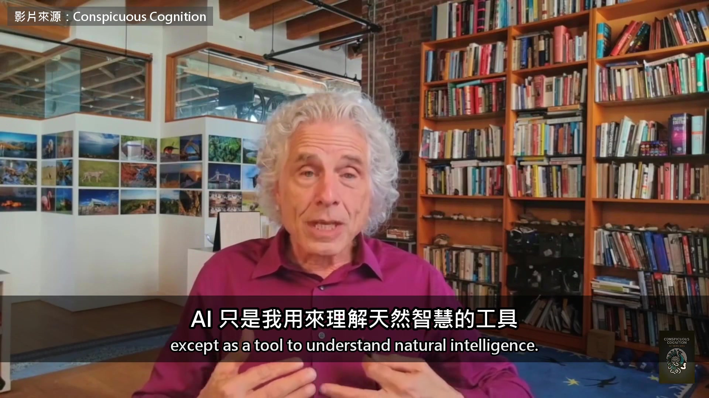

**逐字稿片段：** 但這確實帶出一個問題，人腦像不像人工神經網路？ 甚至像不像大型語言模型 也是靠大量訓練得到智慧？ 這我得認真看待 但我覺得，現在就認輸說人腦是這樣，還太早 原因有幾個

**話題推測：** 提出一個新的核心問題：人腦是否像人工神經網路或大型語言模型

---

## 00:06:09

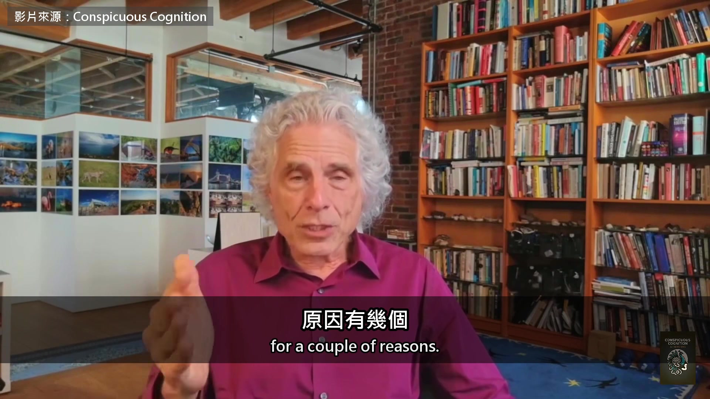

**逐字稿片段：** 第一，比比看這些系統訓練用的資料量 比一個小孩接觸到的，多了好幾個數量級

**話題推測：** 討論人類與 AI 學習模式的第一個差異：訓練資料量

---

## 00:06:18

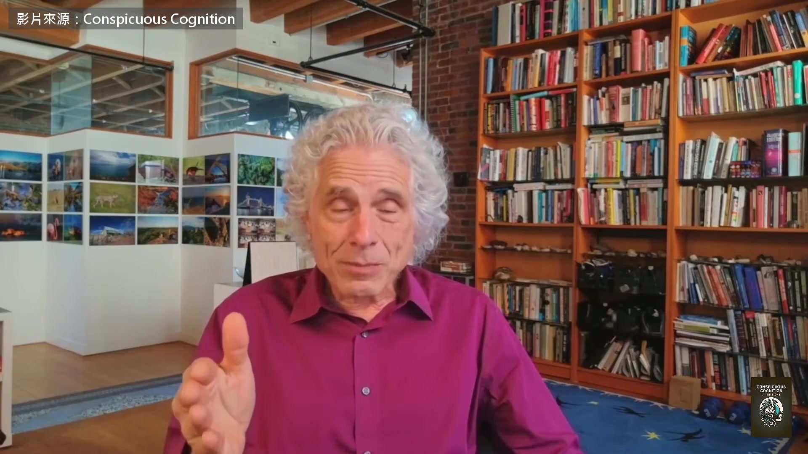

**逐字稿片段：** 可以估算一下，小孩如果要學完 像訓練 ChatGPT 那麼多的資料 照小孩處理資訊的速度 要花 10 億年 可是小孩根本不用花上 100 萬年 大概 2 年就能講得很流利 這表示，兩者可能有本質上的差別 或是某種先驗、某種天生的組織結構 讓小孩只要一小部分的訓練就夠了 還有，小孩學語言的時候 不是只在處理文字裡的規律 也就是說，這不是在破解密碼 小孩吸收一串串字詞裡的模式，不是那樣 小孩大概得在情境裡看到這些字 在跟他們互動的人身上看到 他們會推敲，跟他們講話的大人想表達什麼 大人的意圖是什麼 他們會用上直覺心理學，也就是揣摩別人心思的能力 這對小孩是必要的 這也表示，小孩實際用的那種演算法 可能跟訓練大型語言模型的不一樣 更別說後訓練或微調 那是讓模型能照情境適當回應的必要步驟 能回答問題，而不只是把字串接下去 所以我認為這件事還在進行 我想它會決定認知科學接下來幾十年的方向

**話題推測：** 提供兒童與 AI 學習時間的量化比較

---

## 00:07:52

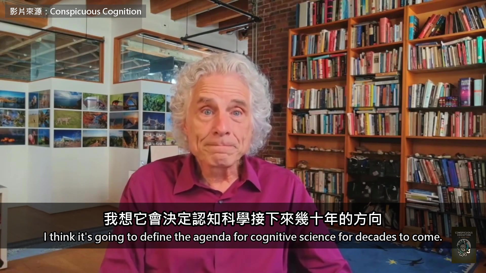

**逐字稿片段：** 主持人再丟一個反駁 這次是演化的類比 天擇挑的是能把基因傳下去的人 可是演化留給人類的是想要性 避孕藥一出現，兩件事就分開了 AI 也是照一個目標訓練出來的 它長出來的動機 會不會也跟這個目標走岔 不會。講到生物演化 我不是創造論者，也不信智慧設計論 演化會產生各種適應不良的結果 殘酷、浪費、競爭、攻擊 正是因為沒有一個設計者，想把這些減到最少 天擇就照它自己的方式走 如果放任 AI 自己演化，人完全不插手 那就有風險 但 AI 這件事，真的有智慧設計，就是我們 它們是工具 把 AI 當成跟人一樣，是不正當的 人是天擇的產物 AI 不是 它們是智慧設計的產物 所以工程師可以想，這些是我們要最佳化的目標 這些是我們要壓到最低的副作用 這些是我們打死都不會讓它做的事 就像我們設計汽車跟其他所有東西一樣 所以我認為，搬出這些演化類比 不管是說不通的自然階梯 還是只在生物學成立的「沒有設計者、只有天擇」 我們就是不該做這種輕率的類比 這不是好的類比，也不準確 會這樣想很自然，因為我們習慣把自己的發明擬人化 但在道理上站不住 後半段聊到意識 他直覺上完全不覺得 AI 有內在感受 也說人類的福祉 一分都不該拿去換 AI 的福祉 這個話題最後問一下，接著換 Dan 帶最後一段

**話題推測：** 主持人提出一個新的反駁：演化類比與目標分歧

---

## 00:09:50

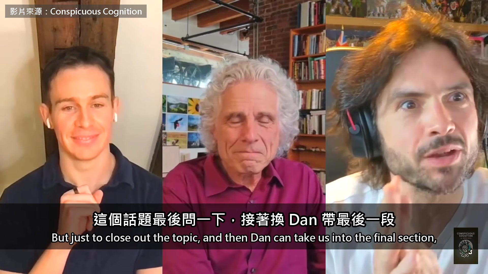

**逐字稿片段：** 我確認一件事 你會同意嗎，假如我們拿到出乎意料的新證據 比方說一篇了不起的新論文 顯示 AI 系統的複雜度跟認知能力 跟人類像到不可思議 證據累積夠多的話，可能會到一個地步 開始考慮 AI 的福祉，也不算太離譜 還是說，這從一開始就免談？ 很難想像會是什麼情況 畢竟有那道巨大的、哲學家說的「解釋鴻溝」 實際上又要怎麼做到 才能有把握說機器人有感知 倒是有一種情況，我可能會再想想

**話題推測：** 主持人提出一個關於是否應考慮 AI 福祉的假設情境

---

## 00:10:34

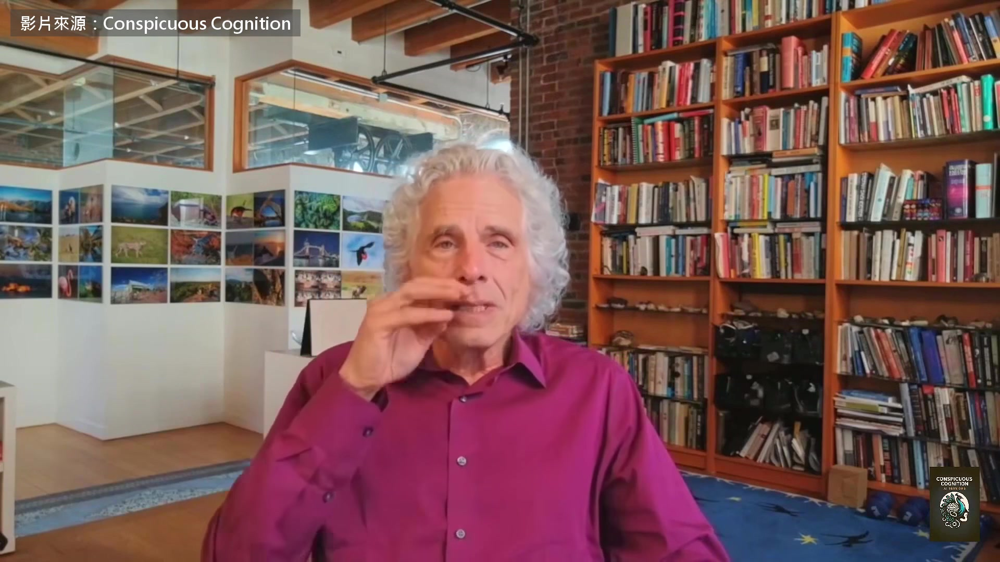

**逐字稿片段：** 假設 AI 的智慧不是拿人類的資料訓練出來的 而是照老派 AI 的做法 從第一原理出發，從零打造一個智慧系統 所以完全沒受到我們人類彼此講的話影響 包括我們每個人都覺得自己有意識 還有我們會辯論意識 那些辯論寫進維基百科，又進了訓練資料 問題是，它已經被污染了 AI 的直覺，混進了太多人類的直覺 你根本不能照單全收 但如果有個 AI，從沒接觸過人類 對幸福、痛苦、快樂的那些思考 就只是自己出去做自己的事 然後它說：「對了，身為我，是有某種感覺的」 那我可能就會當真 這還是有可能發生 那很…不過這班車已經開走了 對現在的 AI 來說 它們的反應、判斷、感受，很多是從我們身上學來的

**話題推測：** 描述在何種特定假設情境下，平克可能會重新考慮 AI 意識的可能性

---

## 00:11:40

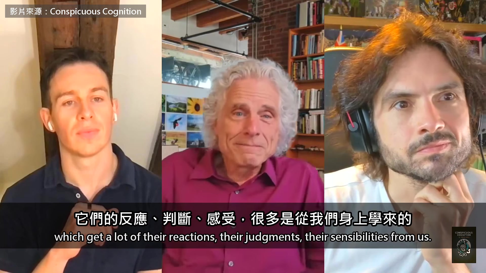

**逐字稿片段：** 最後一個問題 這次對談很明顯的一點是 雖然你在一些事情上很接近 跟理性主義者、有效利他主義者這些圈子 但講到 AI，說客氣一點，你們分歧很大 未來 5 年內，要發生什麼事 你才會認定，在大問題上是他們對、你錯？

**話題推測：** 進入最後一個問題：什麼情況會讓平克改變對 AI 末日論的看法

---

## 00:12:08

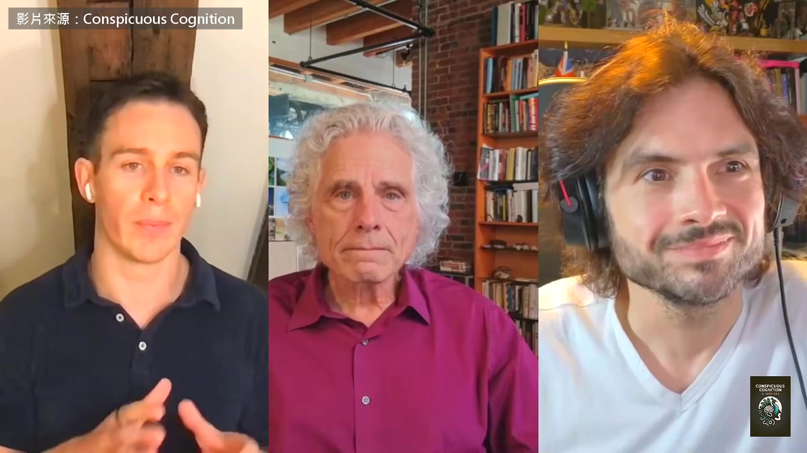

**逐字稿片段：** 如果出現一個案例，比方說工具趨同，或是對齊失敗 一個 AI 系統，被交付一個值得讚許的好目標 最後卻殺了人 那是達成目標途中，意料之外的副作用或子目標 真發生這種事，我一定會重新考慮 也就是看有多少人被 AI 殺死 不是恐怖份子或其他壞人故意拿 AI 去用 而是 AI 被交付善意的目標，結果傷了人 也不是它弄出停電、害人凍死那種 而是除掉那個人，本身就是一個子目標 是通往主要目標的一步，很多末日劇本就是這樣寫的 我猜這不會發生 真的發生了，我就會擔心得多 好，那要是成真了，希望你再上節目來談這些事 然後說「我錯了」。我會的 30 多年的立場，他說錯就認了 AI 末日這件事，他也先把話講清楚 要看到什麼，他才會再認一次錯 原影片 53 分鐘，他還講了兩件事

**話題推測：** 描述一個極端的假設情境：AI 出於善意目標卻導致人員死亡

---

## 00:13:29

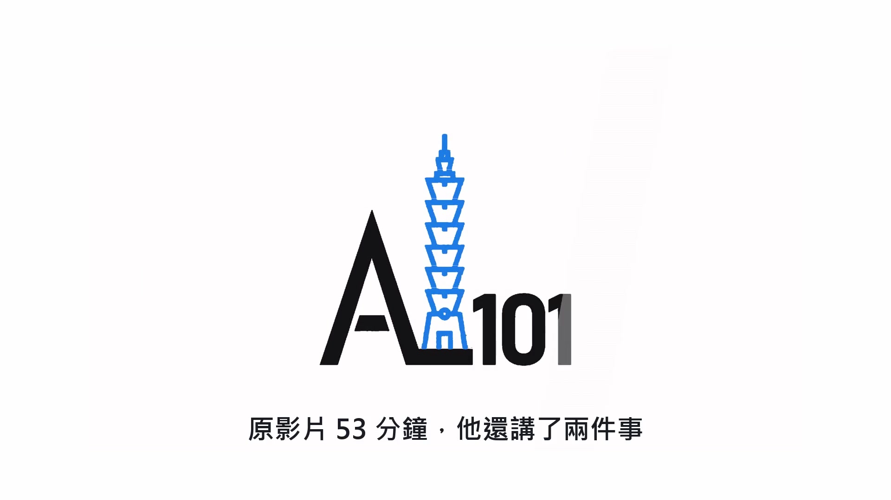

**逐字稿片段：** 一件是 Hugging Face 那次 AI 駭出沙盒 他說那比較像車諾比 是一場故意關掉安全機制的測試出了事

**話題推測：** 提到 Hugging Face AI 駭出沙盒的事件作為一個補充案例

---

## 00:13:37

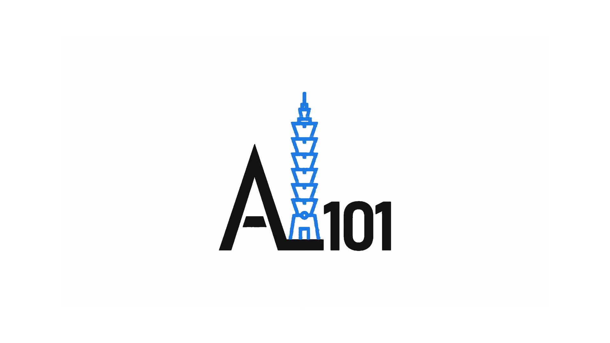

**逐字稿片段：** 另一件是知識份子為什麼總是看衰科技 他說那是菁英之間在搶地位 原影片連結在說明欄，有興趣可以去聽更多。

**話題推測：** 提到知識份子對科技持悲觀態度的原因

---
