# ai-note-101_NdTSBSH1mmk — 關鍵畫面索引

- 來源逐字稿：[ai-note-101_NdTSBSH1mmk_GT.srt](ai-note-101_NdTSBSH1mmk_GT.srt)
- 影片：https://www.youtube.com/watch?v=NdTSBSH1mmk
- 截圖數：23

## 00:00:02

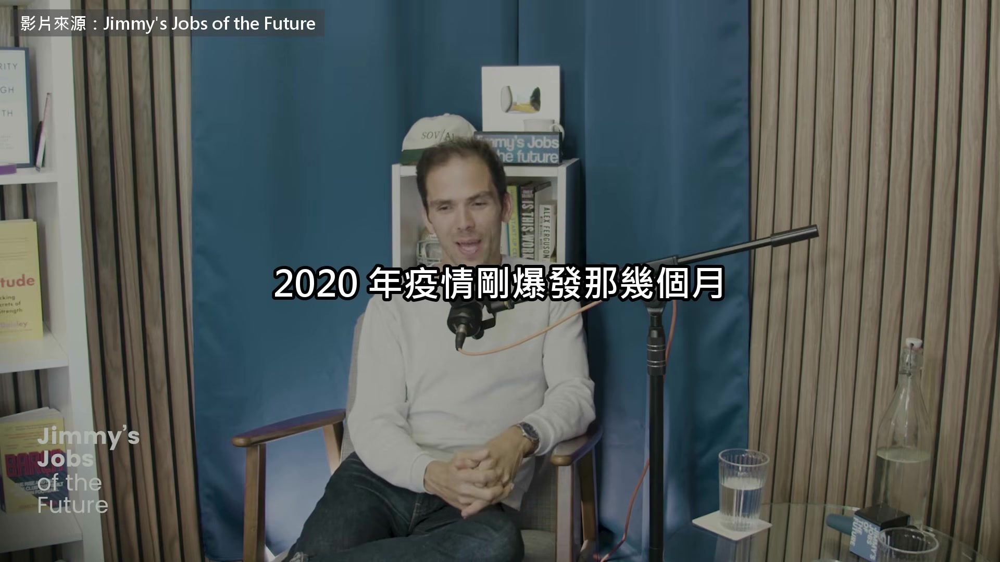

**逐字稿片段：** 很多人每天都在追《金融時報》那張各國疫情曲線比較圖 畫圖的就是 John Burn-Murdoch 他現在是這家報社的首席數據記者 專門用圖表拆經濟新聞 這幾年大家都說 AI 讓年輕人找不到工作 他在這集 10 月中上架的 podcast 裡把數據拆開來看 剛畢業的人確實比較難找工作 可是原因不只 AI John，歡迎來到我們節目 跟我們說說，你覺得現在

**話題推測：** 提及《金融時報》各國疫情曲線比較圖，預期會出現該圖表。

---

## 00:00:31

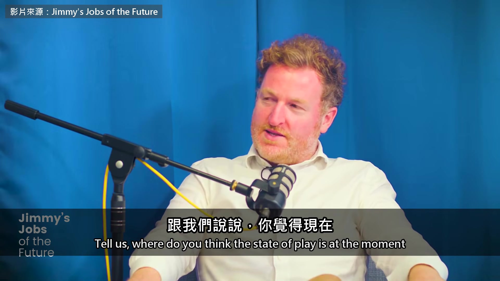

**逐字稿片段：** AI 搶工作這場辯論進行到哪了 好大的問題 我覺得現在還沒有定論 而且就算我們已經看到明確的跡象 也可能只是幾年的過渡期 不一定代表這個趨勢會一直延續

**話題推測：** 主持人提出 AI 搶工作辯論的進度問題，預期畫面可顯示問題文字。

---

## 00:00:57

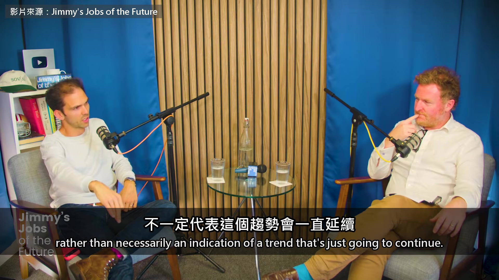

**逐字稿片段：** 到目前為止，最有力、也最一致的發現 來自美國、英國和很多地方的研究 在看得到 AI 把人擠出工作的地方

**話題推測：** 開始總結研究發現，預期會出現數據圖表或重點摘要。

---

## 00:01:12

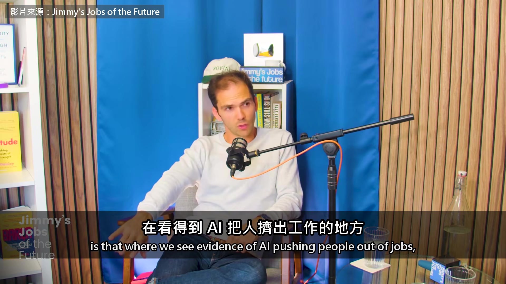

**逐字稿片段：** 受影響的都是特定職業裡的新進員工

**話題推測：** 指出受影響的是特定職業的新進員工，預期畫面會強調此數據或結論。

---

## 00:01:20

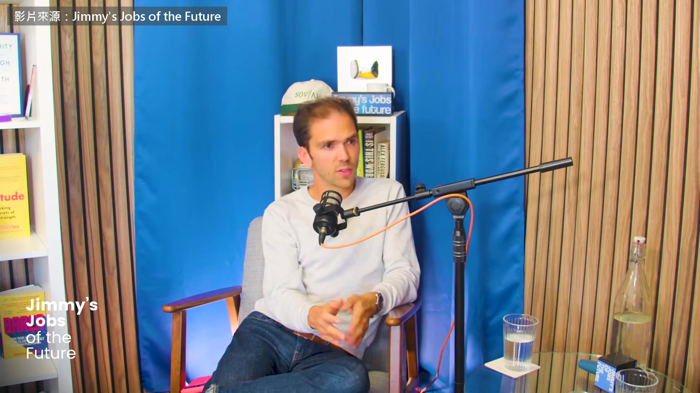

**逐字稿片段：** 很多研究看的是軟體開發 或是客服人員這類工作

**話題推測：** 提及軟體開發和客服人員等特定職業，預期可顯示相關行業的數據。

---

## 00:01:27

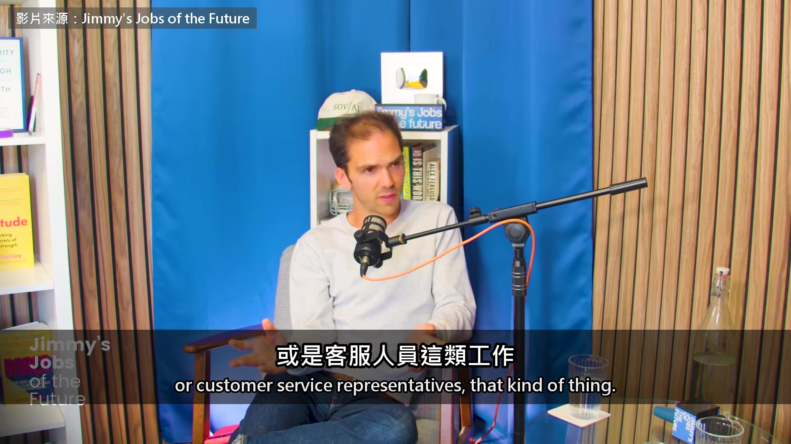

**逐字稿片段：** 在這些工作裡，新鮮人職位的招聘率 跟其他職位比起來好像掉了 所以就算是軟體和客服

**話題推測：** 討論新鮮人職位的招聘率，預期會有相關的趨勢圖或比較圖。

---

## 00:01:38

**逐字稿片段：** 現在在職的人其實還是比 2022 年多 只是增加的都是比較有經驗的員工 可是最新的那批，22、23、24 歲的人 工作機會好像真的少了一些

**話題推測：** 引入 2022 年的比較數據，預期會更新圖表或顯示不同年份的數據。

---

## 00:01:54

**逐字稿片段：** 大家都在想 ChatGPT 推出這件事 下個月就滿四年了，對吧 照理說，數據裡現在應該看得出來了

**話題推測：** 話題轉向 ChatGPT 的推出，預期會顯示 ChatGPT 相關畫面或發布時間軸。

---

## 00:02:03

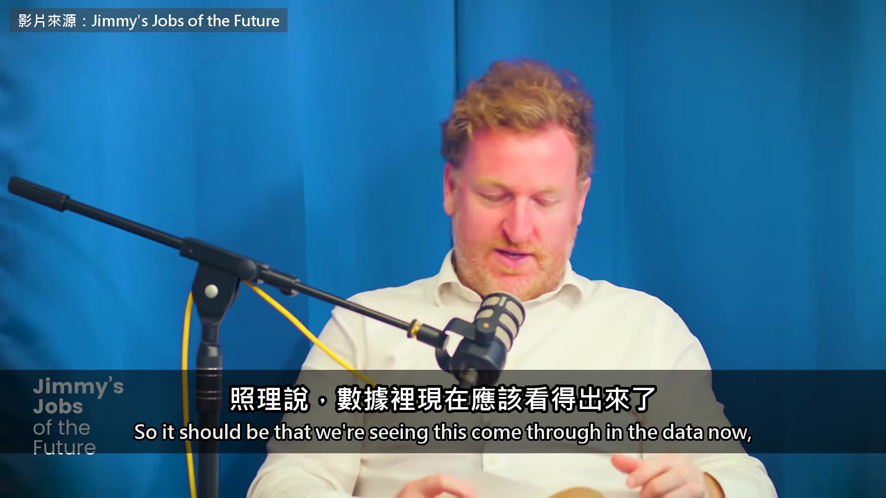

**逐字稿片段：** 可是你也講到升息 還有當時全球經濟的大趨勢在變 所以有一大堆事情同時在影響就業 對，那段時間同時發生了太多事 你提到的升息，這點很有意思

**話題推測：** 引入「升息」這個新的經濟因素，預期會顯示利率相關圖表。

---

## 00:02:19

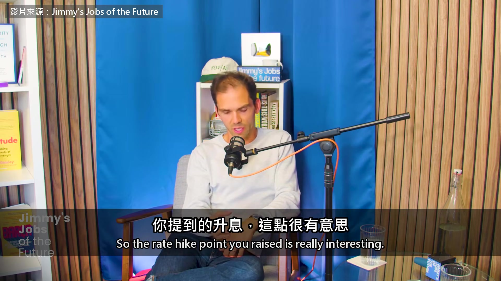

**逐字稿片段：** 基本上，大約在 ChatGPT 推出前 6 個月 美國、英國和大部分國家都升息了 原因是疫情後供應鏈出問題、通膨飆升 這 6 個月的時間差很重要 因為利率一變，大約要 6 個月 才會影響到招聘這些事 利率一升，公司當然就會縮手 尤其是科技業，受影響特別大 就算 2022 年底沒有 ChatGPT 你還是會看到招聘變少，尤其是新鮮人 2022 年底就會因為升息而縮減 我覺得這件事顯然真的發生了 不過細節在於，比較嚴謹的分析 在看 AI 對工作的影響時 會先說，好，升息這件事我們知道 我們知道很多職業，尤其是科技業 招聘確實縮了 可是在科技業裡面，某些職位是不是縮得更多 像是入門的程式設計師 結果大部分的分析確實看到 一些跡象，那一塊確實有狀況 不過有意思的是 軟體顯然是 AI 很拿手的東西 說到底就是一堆 0 和 1，對吧

**話題推測：** 比較 ChatGPT 推出與升息的時間點，預期可顯示時間軸圖示。

---

## 00:03:42

**逐字稿片段：** 2024、2025 年那陣子，職缺確實減少了

**話題推測：** 提及 2024、2025 年的職缺趨勢，預期會更新年份的職缺圖表。

---

## 00:03:48

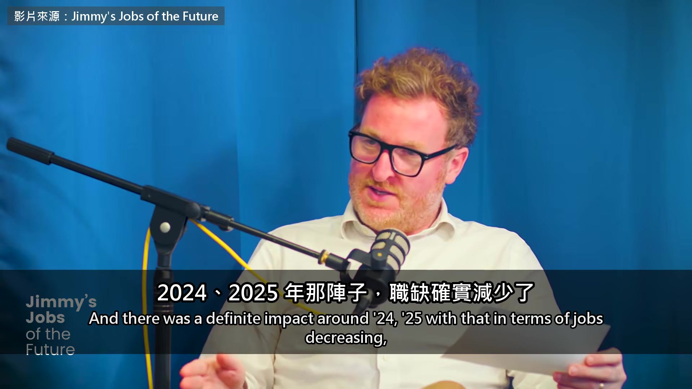

**逐字稿片段：** 可是英國和美國後來都反彈了，對吧 對，這件事又可以看出很多面向

**話題推測：** 提到英國和美國的職缺反彈，預期會顯示兩國職缺趨勢比較圖。

---

## 00:03:59

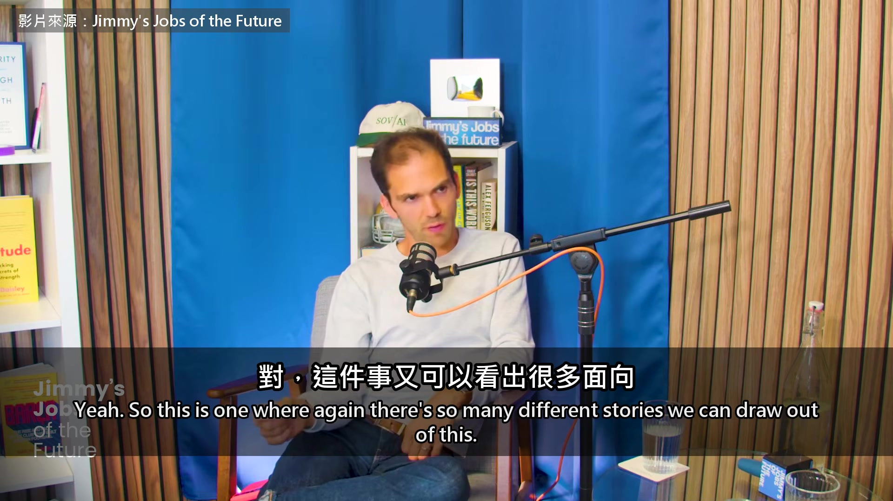

**逐字稿片段：** 最主要的是，軟體業的工作、就業人數 軟體業的整體招聘，在大部分國家其實都在增加 而且增加得比整體招聘還快 這清楚說明，什麼「軟體工作已死」 根本站不住腳

**話題推測：** 總體討論軟體業的就業人數和招聘，預期會顯示軟體業的整體趨勢圖。

---

## 00:04:19

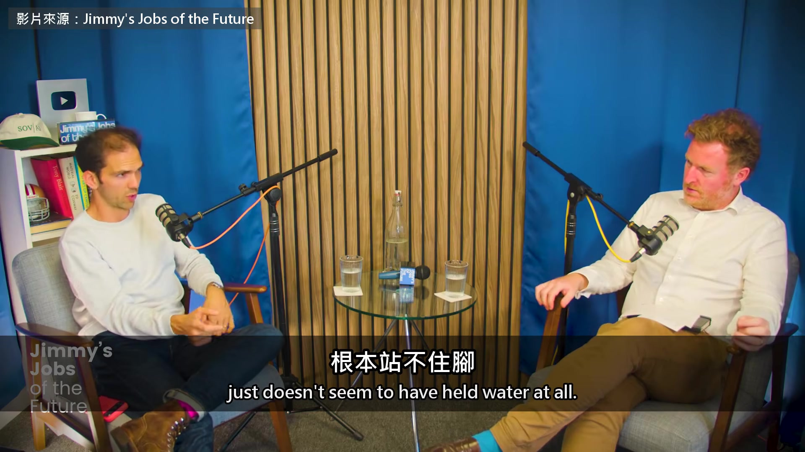

**逐字稿片段：** 可是這裡又有一個細節 你去看職缺廣告 要找 3、4、5 年經驗的人 這種職缺多了不少 可是說要找剛畢業新鮮人的職缺 還是差不多持平 我覺得從頭到尾的關鍵是 一份工作越是只有動手做 像是執行一件事、寫程式、寫文章 你的工作越只是動手做，風險就越大 普林斯頓的教授 Arvind Narayanan 他和一兩位同事做了很有意思的研究

**話題推測：** 指出職缺廣告的細節，預期會出現針對不同經驗年資職位的分類數據圖。

---

## 00:05:00

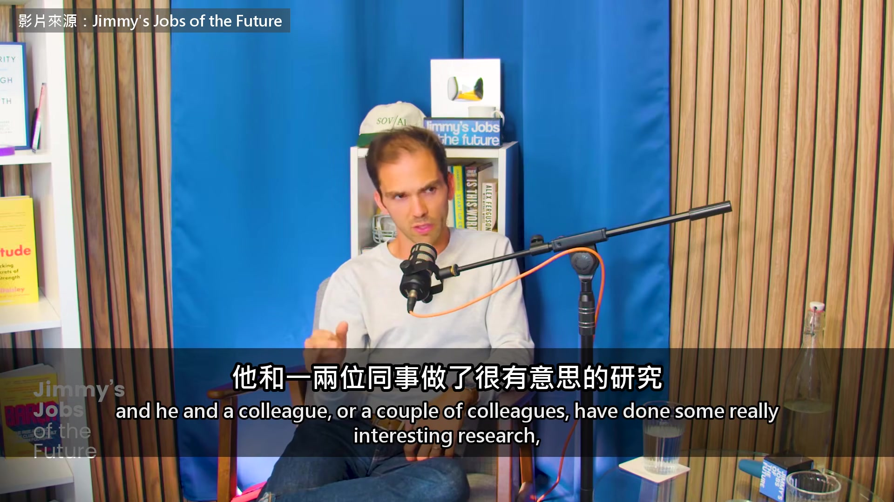

**逐字稿片段：** 他們提出一個框架，工作，特別是知識工作 可以拆成決策、執行、交付 總要有人決定做什麼 再由某個人去做 然後決定怎麼交到客戶手上

**話題推測：** 提出工作「決策、執行、交付」的框架，預期會顯示流程圖或示意圖。

---

## 00:05:17

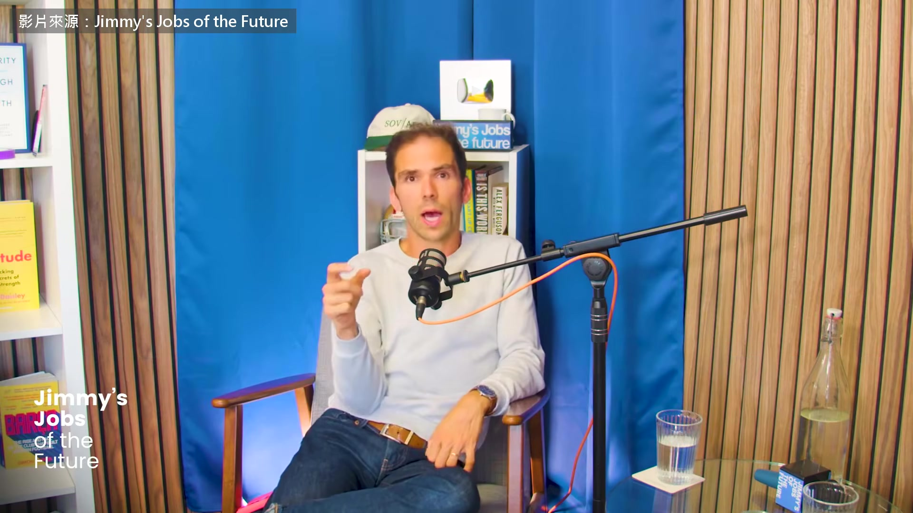

**逐字稿片段：** 零工經濟、像 Fiverr 那種接案，就是純執行 說穿了就是別人決定好，叫你去執行 至於軟體業 軟體業的人講到這裡都很愛強調 軟體工作不只是寫程式 裡面要做的事很多 要管產品、管人際關係 還要想策略這些

**話題推測：** 以零工經濟平台 Fiverr 為例，預期會顯示 Fiverr 的介面或相關圖示。

---

## 00:05:38

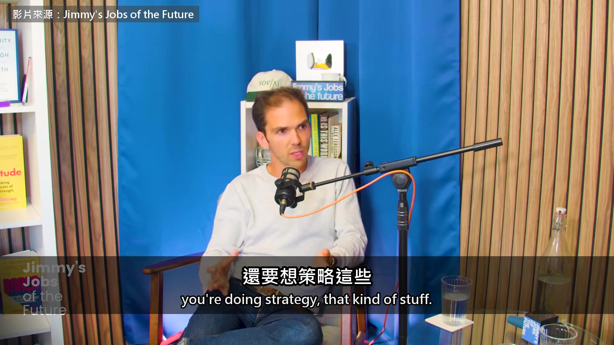

**逐字稿片段：** 可是重點是最基層的職位，22、23 歲做的那種 工作有九成以上是執行 別人做決定，再問你，新來的，這個你能做嗎 交付又是別人負責 所以對我來說，我們今天聊的這些，共通點是 知識工作裡執行的那一段 不管是寫程式、寫文章，還是做圖、畫插畫 已經被 AI 衝擊得很嚴重 而且每出一個新模型，情況就更糟 所以一份工作要是全部、或幾乎全部 都是動手做 我們已經看到，這種工作不再增加了 我一直覺得你用過的那個比喻很有意思 消防水管接進瓶頸，對吧

**話題推測：** 聚焦於基層職位（22、23 歲）的工作內容，預期可顯示針對年輕族群的數據。

---

## 00:06:25

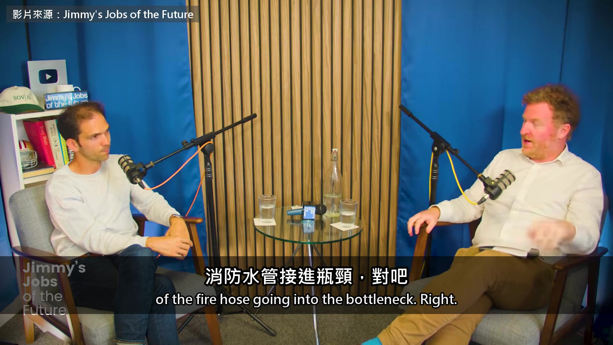

**逐字稿片段：** 其實我同事 Sarah O'Connor 跟我合寫電子報的那位 她舉過一個很好的例子

**話題推測：** 介紹同事 Sarah O'Connor，預期會顯示其照片或名字。

---

## 00:06:31

**逐字稿片段：** 科學研究的一個瓶頸，是能拿來做實驗的老鼠數量 前面那些初步研究、寫計畫、想點子、提假設 現在越來越容易，也做得越來越多 可是要走到最後 做完實驗、拿到結果 把成果發表出去、申請專利之類的 這一段我們沒有變強，也沒有比以前快 所以問題就是，老鼠不夠 因為那裡會撞上實體的限制，或是法規 還有各種不會因為多用 ChatGPT 就放大的事 這也是為什麼，在我看來 說到這會怎麼影響人力需求 需求有可能反而增加 因為很多工作現在都能做得更多 產出更多內容、更多資訊 可是總會在某個地方，卡在一個人形的瓶頸 人形的瓶頸要怎麼解 多請一些人 所以只要科學、新聞這些東西的需求還在增加 要用 AI 創造更多價值、更多產品或服務 最好的辦法，到頭來就是多請人

**話題推測：** 舉科學研究中「老鼠數量」的例子，預期可顯示實驗室或老鼠相關意象。

---

## 00:07:53

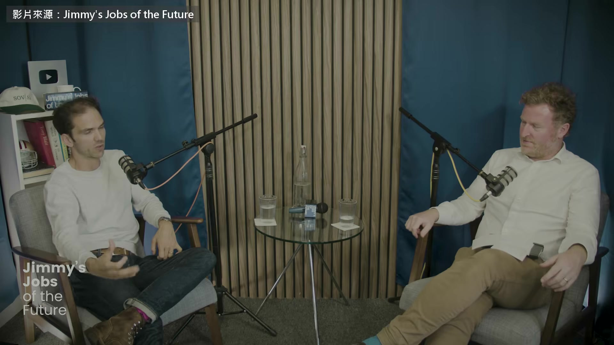

**逐字稿片段：** Anthropic 的 Dario Amodei 預測過 1 到 5 年內

**話題推測：** 提及 Anthropic 的 Dario Amodei 及其預測，預期畫面會顯示人物照片或預測文字。

---

## 00:07:56

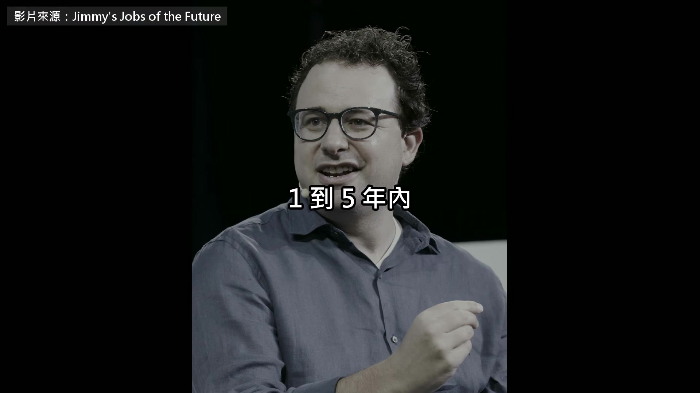

**逐字稿片段：** 一半的入門白領工作可能會被 AI 取代 訪談快結束時，主持人拿這個預言問他 你覺得 Dario 對未來五年白領工作的預測對嗎 這很難說 我覺得不對，至少現在來看 而且要說清楚，就連 Anthropic 自己都發過很多種預測，Dario 發的是他的 可是他們也發過保守得多的預測 所以大家的誤差範圍都很大 我覺得現在不太可能出現白領大失業 原因就是我們剛剛聊的瓶頸 想像一個世界，大量的東西 都是 AI 做出來、送到真實世界裡的 我總會卡在一個問題，到底是誰在檢查 我們有哪些產品和服務 是在沒有人監督之下做出來 然後拿去買賣、給人使用的 也許以後會有，但現在看起來跳得太遠了 現在我們還是需要人來審核這一步 也需要人來做決定 所以我覺得比較可能的是，至少在短中期內 生產力會大幅提升 有些瓶頸也會開始被解開 可是我還是覺得，這些瓶頸往往 是靠人來解，而不是把人拿掉 就算沒有 ChatGPT 升息也會讓新鮮人難找工作 AI 真正打到的 是工作裡只負責執行的那一段 可是 AI 做出來的東西越多 越需要有人檢查 所以 Burn-Murdoch 認為 瓶頸最後多半還是靠多請人來解 原影片一個多小時

**話題推測：** 具體引用「一半入門白領工作可能被 AI 取代」的預測，預期可顯示重點文字或引言框。

---

## 00:09:55

**逐字稿片段：** 後面他們還聊了兩件事 一是全世界的生育率這十幾年一起往下掉 他覺得手機和社群媒體是原因之一

**話題推測：** 總結原影片後續討論的兩個主題，預期畫面可顯示話題列表或相關意象。

---

## 00:10:02

**逐字稿片段：** 二是英國年輕人為什麼開始往國外看 他說美國連長一點的文章都讀不太懂的人 薪水都跟英國上班族的平均一樣 原影片連結在說明欄，有興趣可以去聽更多。

**話題推測：** 介紹第二個後續主題：英國年輕人往國外看，預期可顯示移民或薪資比較圖。

---
