# ai-note-101_ObWeD9z9Cn4 — 關鍵畫面索引

- 來源逐字稿：[ai-note-101_ObWeD9z9Cn4_GT.srt](ai-note-101_ObWeD9z9Cn4_GT.srt)
- 影片：https://www.youtube.com/watch?v=ObWeD9z9Cn4
- 截圖數：15

## 00:00:05

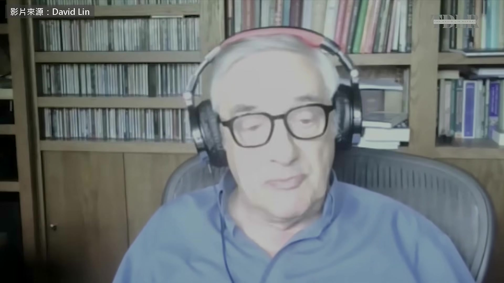

**逐字稿片段：** Joel Mokyr 研究的就是為什麼會這樣 去年因此拿下諾貝爾經濟學獎 九月中他接受 David Lin 專訪

**話題推測：** 介紹主要學術人物Joel Mokyr。

---

## 00:00:12

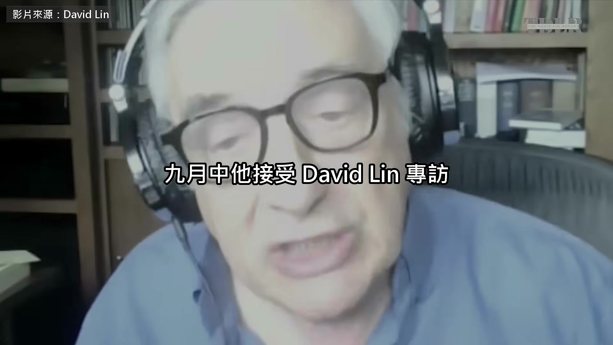

**逐字稿片段：** 那陣子 AI 圈正在吵 AI 會不會滅絕人類 主持人先問他，AI 跑得這麼快 制度跟不跟得上，他說跟不上 大家已經在問要不要管 AI 說來奇怪，這現象很反常 其實是企業自己覺得該被管 而不是政府要求管它們 這跟一般人想的不一樣 而且這種事以前就發生過 但我認為，AI 真正嚴重的問題 不是它會讓人類滅絕 我覺得那種說法有點荒謬 而是 AI 能做到的事

**話題推測：** 轉向當前熱門的AI爭議話題。

---

## 00:01:04

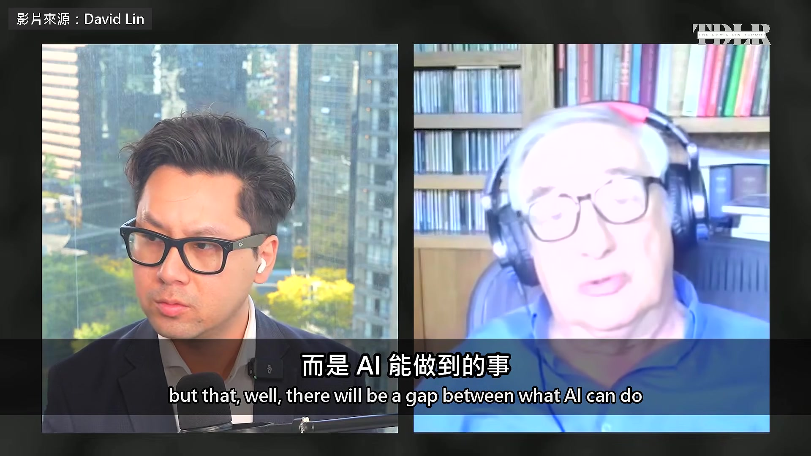

**逐字稿片段：** 跟管它的機制之間會有落差，制度得跟著改 才不會讓這東西出軌、亂來 我擔心這個落差 倒不是怕它反過來對付我們 或用化學武器消滅我們這種蠢事 而是它會讓貧富差距急速拉大 變得非常不平等 結果可能是，控制 AI 的那些人

**話題推測：** 闡述AI能力與其治理機制之間的落差。

---

## 00:01:47

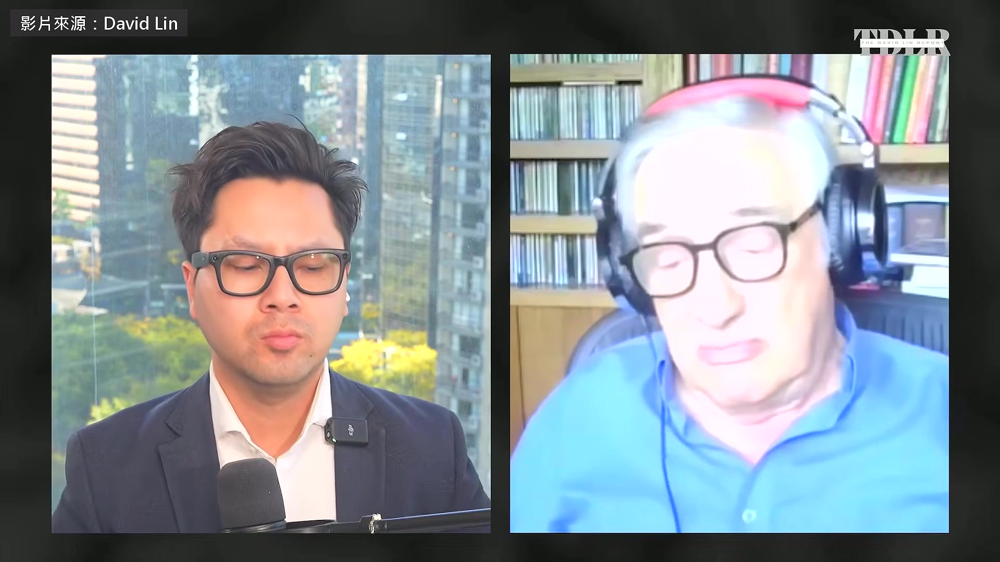

**逐字稿片段：** 會變成兆富翁，馬斯克已經說自己是了 財富會大量集中，權力也跟著集中 落在少數幾個人手上 這部電影我們看過

**話題推測：** 提到馬斯克及「兆富翁」概念，說明財富集中現象。

---

## 00:02:05

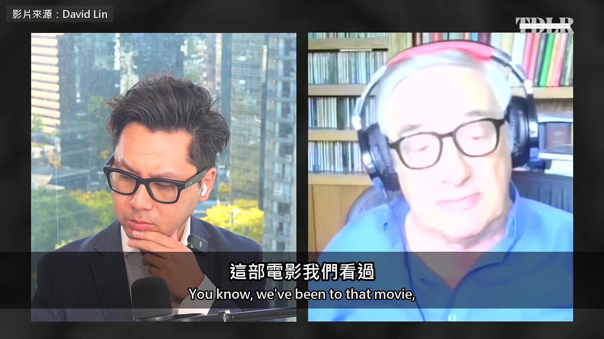

**逐字稿片段：** 19 世紀末、20 世紀初美國的鐵路 就出現過類似的事 那時出了一批有名的「強盜大亨」 像 Stanford、Vanderbilt、Harriman 這些人（都是 19 世紀美國鐵路大亨） 他們都變得非常有錢 但那個時候，出現了一些政治運動 最後把他們管住了 所以這些家族都過去了，只剩在大學名稱裡

**話題推測：** 引入19世紀末、20世紀初美國鐵路大亨的歷史類比。

---

## 00:02:41

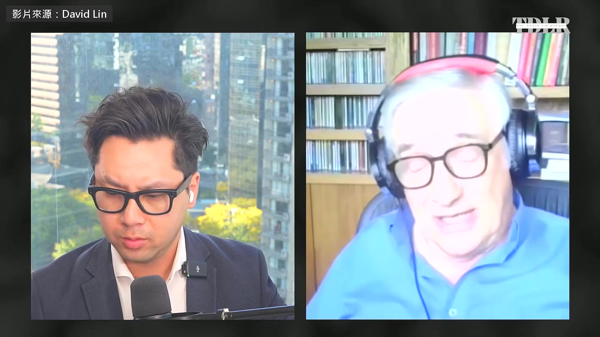

**逐字稿片段：** 這一次，祖克柏、馬斯克這些人會不會也一樣 還很難說 這就是制度調整得不夠快的好例子 我們大可以直接把話講明白

**話題推測：** 將現代科技巨頭祖克柏、馬斯克與歷史人物進行對比。

---

## 00:02:58

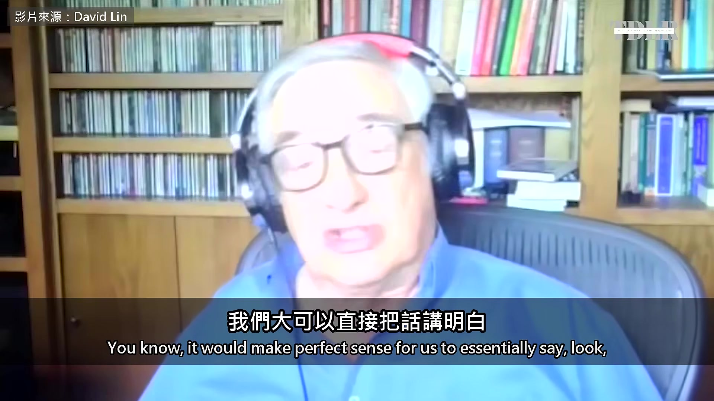

**逐字稿片段：** 如果你一年賺 3000 億美元 你怎麼樣都花不完 所以我們要課一種稅 你賺超過某個數字的部分 全部歸政府，拿來管你這個產業 這種調整看起來說得通 你贊成這樣調整嗎？ 當然贊成 頭腦清楚的人，根本不可能花得完那麼多錢 除非花在一件事上 賭博先不算，他們很少人賭

**話題推測：** 提出一年賺3000億美元的假設數字，討論財富稅議題。

---

## 00:03:42

**逐字稿片段：** 一年 1000 億美元，只有一種花法 就是拿去買政治權力 我也不是要大家財富平均 我可不是 Bernie Sanders 這不是什麼社會主義的主張 我只是說，資本主義得有合理的限制 限制個人能累積多少財富

**話題推測：** 討論一年1000億美元財富的可能用途，指出購買政治權力。

---

## 00:04:07

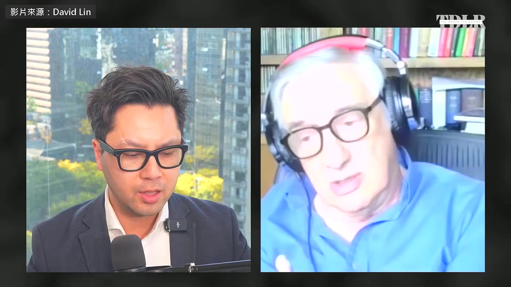

**逐字稿片段：** 我們回到 AI 這件事前陣子吵得很兇 AI 的風險，最近一直上主流新聞

**話題推測：** 明確轉回AI主題。

---

## 00:04:13

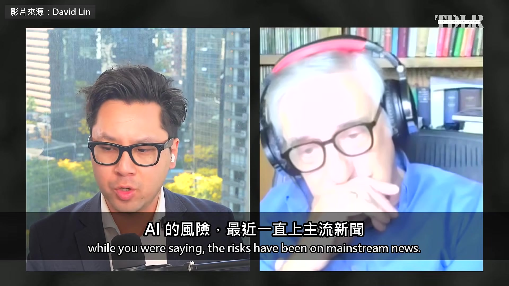

**逐字稿片段：** Anthropic 執行長 Amodei 上週末寫了長信 呼籲放慢 AI 的發展 順帶一提，中國官員說這是在製造恐慌 川普總統則說，我們不需要這個 我們唯一需要的保障… 他們說這是騙局，對 對，騙局，我們不需要這個 唯一需要的保障，是一個高 IQ 的總統 九月初

**話題推測：** 介紹Anthropic執行長Amodei發出關於AI發展的長信。

---

## 00:04:36

**逐字稿片段：** 前 Anthropic 研究員 Jacob Coxon 離職 說打造 AI 的人真心相信 它可能在這個十年結束前殺光所有人 他在 Anthropic 的前同事 Evan Hubinger 也公開附和 說他自己估 十年內發生的機率超過一成 這些到底有幾分是真的 也許可以從社會學的角度來看 還是說，這又只是對新技術的恐慌 你研究過這段歷史

**話題推測：** 介紹前Anthropic研究員Jacob Coxon離職及發表的觀點。

---

## 00:05:02

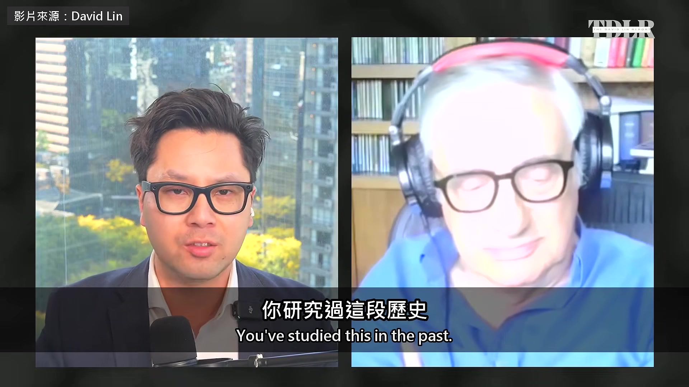

**逐字稿片段：** 電力跟蒸汽機出現時，大家怎麼反應 當時有人覺得，蒸汽機會在十年內殺光所有人嗎 有誰真的認為蒸汽機會殺光所有人 因為蒸汽機根本不可能殺死任何人 除非你剛好站在它旁邊 是有發生過一些爆炸，特別是後來 大家做出高壓蒸汽機以後 但那都是局部的事 我想 AI 也可能出一些局部的事件 像最近聽到的那些駭客事件 可是說它們會殺光我們… 如果你真的想擔心，有什麼會殺光我們 我要提醒大家，我們早就有能力用核武 消滅地球上所有的人、植物和動物 從 1950 年代中期就有了 你想擔心人類滅絕 就去擔心核武擴散，那才是真正的危險 這個危險，在 AI 出現前早就存在了 危險在全球暖化 AI 是解方的一部分，不是問題的一部分 說它哪天會突然起來 派出大批暴力機器人攻擊我們 或是什麼病毒來消滅我們 那是科幻小說

**話題推測：** 將AI恐慌與電力、蒸汽機問世時的社會反應進行歷史對比。

---

## 00:06:30

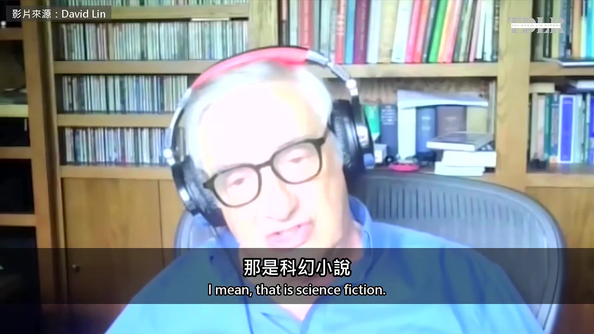

**逐字稿片段：** 我不認識 Jacob Coxon（前 Anthropic 研究員，九月初離職） 他看起來腦袋很好，但歷史上多的是 非常聰明、卻想出荒唐點子的人 這可能就是其中一個 這件事我難得跟川普總統看法一樣 我幾乎什麼事都不同意他 而且我其實不覺得他懂自己在講什麼 但他可能誤打誤撞，碰巧說對了 這帶來的是希望，不是恐懼 要怕人類滅絕 Mokyr 說先去擔心核武跟氣候變遷 AI 真正該盯緊的 是錢跟權力會不會集中到控制它的那幾個人手上

**話題推測：** 再次提及Jacob Coxon，並對其觀點表示不認同。

---

## 00:07:19

**逐字稿片段：** 原影片一個小時 他還講了兩件跟 AI 有關的事

**話題推測：** 轉向總結原影片中未詳細闡述的其他AI相關議題。

---

## 00:07:23

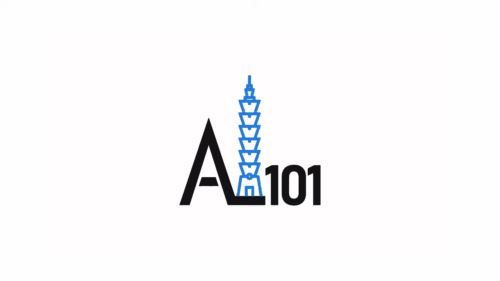

**逐字稿片段：** 一件是美中 AI 競賽 他說把科技當成賽馬 以為誰先衝線誰就贏 是不懂經濟學的人才有的想法 歷史上也沒有一個國家能一直保持創新 另一件是教育 他說 AI 能讓老師認識每一個學生 把教學變成量身訂做 原影片連結在說明欄，有興趣可以去聽更多。

**話題推測：** 介紹美中AI競賽作為影片未討論的議題之一。

---
