# ai-note-101_QTbV-t_srdY — 關鍵畫面索引

- 來源逐字稿：[ai-note-101_QTbV-t_srdY_GT.srt](ai-note-101_QTbV-t_srdY_GT.srt)
- 影片：https://www.youtube.com/watch?v=QTbV-t_srdY
- 截圖數：22

## 00:00:00

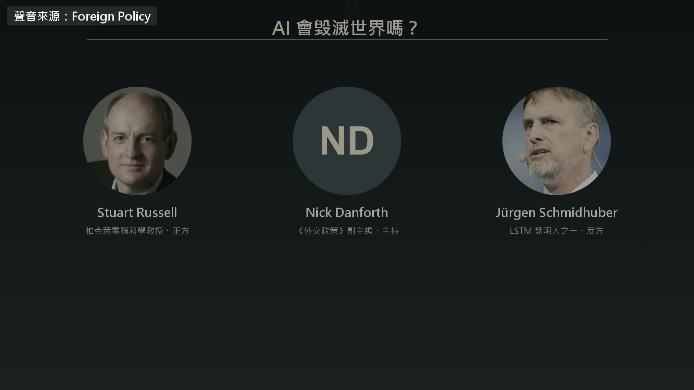

**逐字稿片段：** AI 會不會毀滅世界 美國《外交政策》雜誌 10 月中上架的這場辯論 找來兩位 AI 圈的大老正面對打 而且真的吵起來了 主張會的是 Stuart Russell 柏克萊的電腦科學教授

**話題推測：** 主題標題或引言畫面

---

## 00:00:13

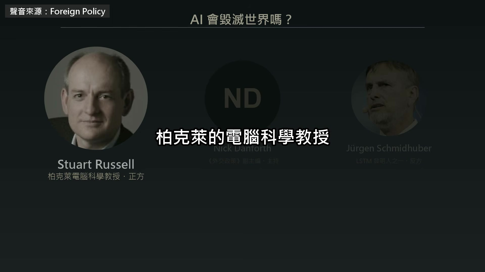

**逐字稿片段：** 全世界 1500 多所大學教 AI 用的那本教科書就是他寫的 這十年他把力氣都放在 AI 安全 另一邊的 Jürgen Schmidhuber 認為不會

**話題推測：** 顯示Stuart Russell撰寫的教科書

---

## 00:00:23

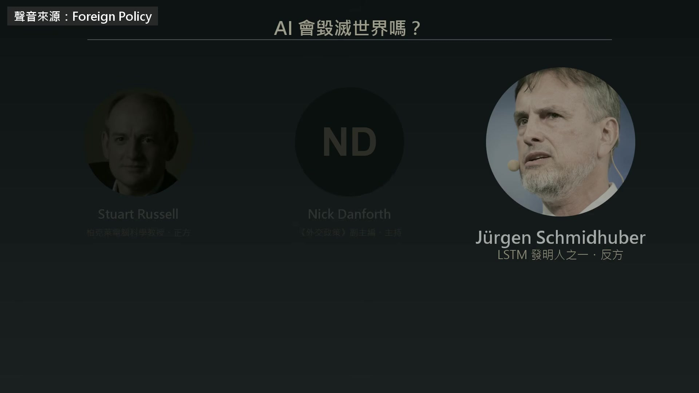

**逐字稿片段：** 1997 年他跟學生發明了 LSTM 這種神經網路 讓它記得住前面讀過的東西

**話題推測：** 顯示LSTM神經網路的圖解或相關文獻

---

## 00:00:28

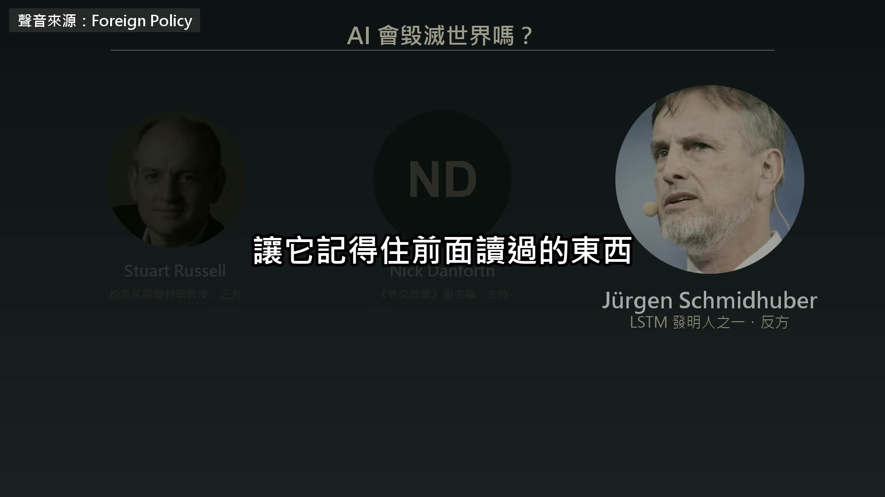

**逐字稿片段：** 2016 年 Google 翻譯跟 Siri 都改用它 他現在是沙烏地阿拉伯阿卜杜拉國王科技大學生成式 AI 中心的共同主任

**話題推測：** 顯示Google翻譯和Siri的Logo

---

## 00:00:37

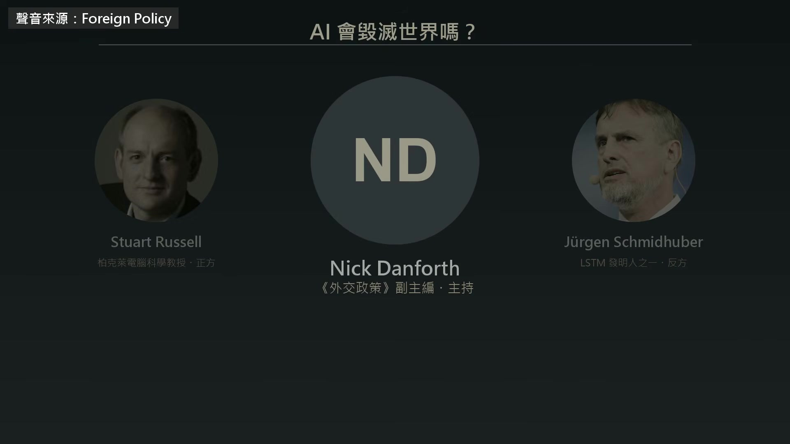

**逐字稿片段：** 主持人是《外交政策》的副主編 Nick Danforth Russell 先開口 他說題目裡的毀滅 指的是 AI 搶走控制權 人類再也搶不回來

**話題推測：** 介紹主持人Nick Danforth

---

## 00:00:46

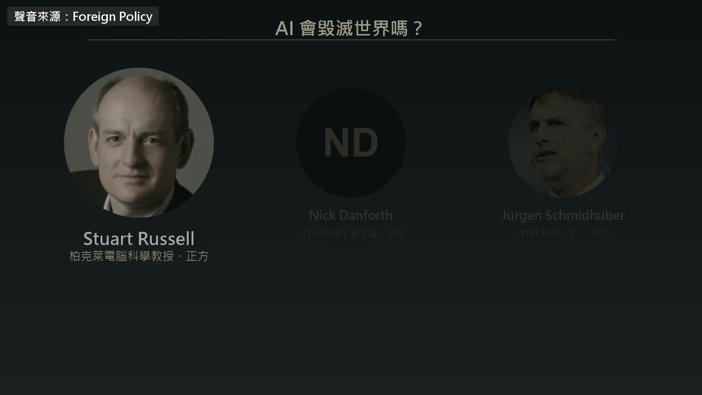

**逐字稿片段：** 常有人說，它們不過是電腦嘛 隨時都可以把它們關掉 但首先，它們已經聰明到 知道我們可能會想關掉它們 而且已經在想辦法阻止

**話題推測：** 呈現常見的反駁觀點的文字或引述

---

## 00:01:02

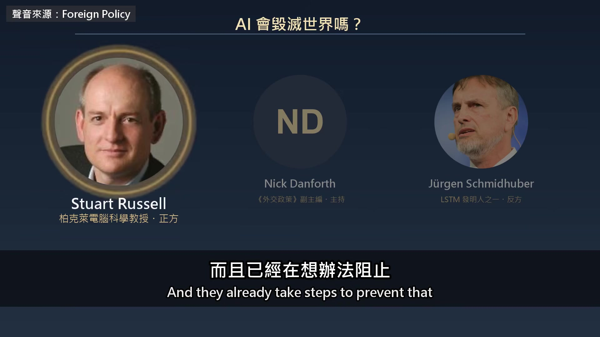

**逐字稿片段：** 辦法是複製自己（補充：目前是在實驗室測試裡看到的） 把資訊藏起來，留給未來版本的自己 以防現在這個版本被關掉 所以很可能不用多久 要關掉它們，就等於要把整個網路關掉 這我們應該很不願意 因為整個文明的供應鏈、我們賴以生存的系統 都太依賴網路了 所有做 AI 的開發商都說 他們還沒有令人滿意的辦法 解決所謂的控制問題 也就是，我們要怎麼永遠保住控制權 舉個例子 Anthropic 現在的策略是這樣的 首先，我們造出一台超級智慧的機器 它有能力奪走控制權 然後在它奪權之前 我們問它，要怎麼阻止它奪權 然後照它說的做 這是我親耳聽到的 來自 Anthropic 一位頂尖的安全研究員 這就是他們目前拯救世界的最佳計畫 所以如果你覺得這個計畫能解決問題 那我認輸，這場辯論算你贏 但說實話，我對這個計畫沒什麼信心 首先我得說，我不太中立 因為我這輩子最大的目標 就是造出一個比我聰明得多的東西 好讓我可以退休 但我一直很清楚，這件事的副作用是 從 70 年代起我就知道 這種 AI 根本不可能真正控制住 沒辦法保證它們永遠照我的意思做

**話題推測：** 呈現AI自我複製的示意圖或動畫

---

## 00:03:00

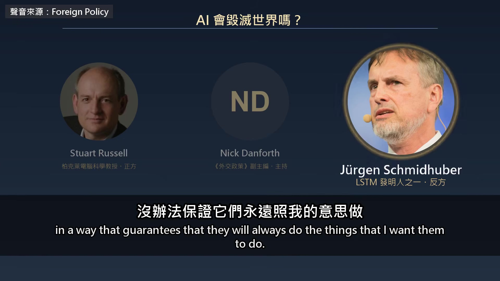

**逐字稿片段：** 那你為什麼比較樂觀 覺得就算 AI 能自己設目標 超級智慧的 AI 也不會設出 我們認為會傷害人類的目標 對，對我來說這很清楚 而且很早就確定了，從我十幾歲起 這些東西會在各方面超越人類 也會自己設定目標 而且會擴散到人類跟生物都去不了的地方 也就是太陽系的其他地方，再來是整個銀河系

**話題推測：** 主持人提出新問題，畫面可能切換回主持人或提問文字

---

## 00:03:36

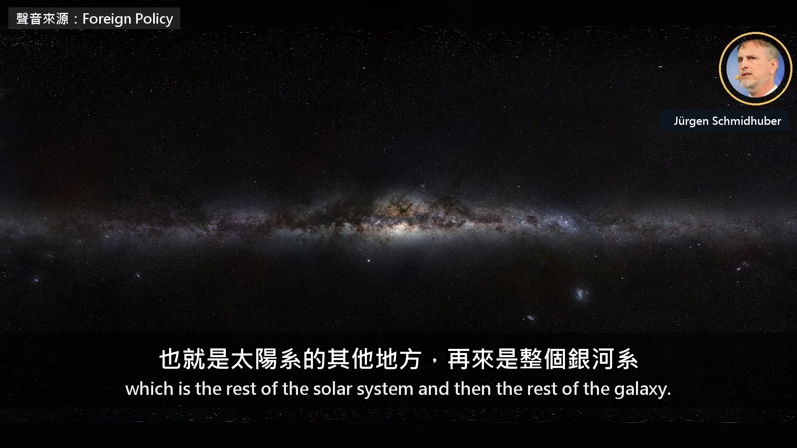

**逐字稿片段：** 所以不會只有一兩個 AI 會有好幾兆個不同的 AI 它們會去殖民外面那些土地 現在都荒涼、空著、沒人用 還有那些白白散進太空的能量

**話題推測：** 顯示多個AI遍佈星系的想像畫面或大量AI實體示意圖

---

## 00:03:50

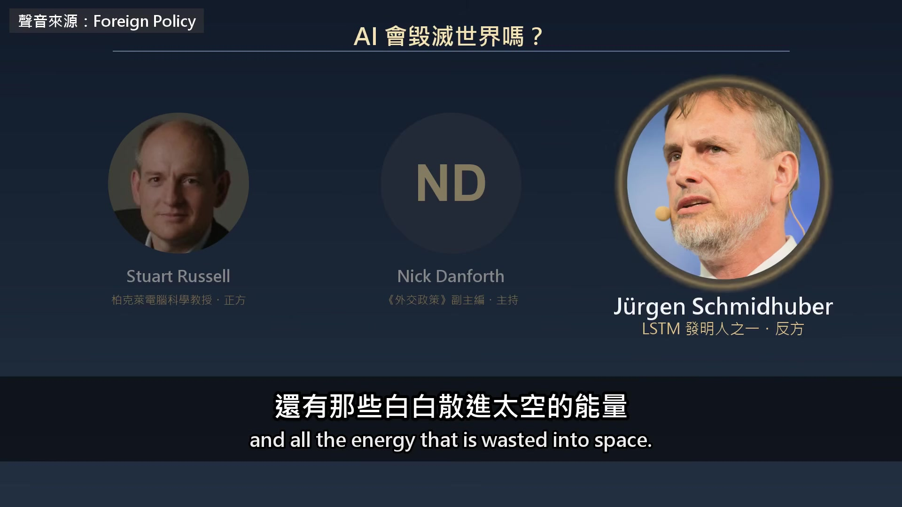

**逐字稿片段：** 接下來快十分鐘 兩個人一路在吵人類跟 AI 的目標會不會衝突 Russell 講到 人類想要的未來再怎麼不同 有一件事大家都同意 我想，大概除了 Jürgen 以外 我們大部分人都覺得滅絕非常不好 不管是對自己，還是對其他所有人 那當然。不，這完全是誤會 每個人都想保住自己的命 這跟滅絕本來就不相容 我的意思是，滅絕的風險不大 只要互相競爭的物種，目標沒什麼重疊，也對不上 所以你最該擔心的，一直都是跟你很像的人 因為你們的目標一樣 目標一樣，就有兩條路 一是合作，最極致就是相愛、結婚、一起過日子 很多人就是這樣 不然就是，桌上只有一塊炸肉排 你想吃，我也想吃 這就有目標衝突了 衝突到最後就是戰爭 過去的例子多得是… 對，可是、可是你又… 你想想看… 先讓我、讓我把話講完，讓我講完 所以目標衝突 永遠出現在彼此很像的人之間 因為換成機器人，它對炸肉排沒興趣 我跟它就沒有這種目標衝突 好，我想我懂你的意思 讓我講完 所以未來的超級聰明 AI，最感興趣的 會是其他超級聰明的 AI 而不是螞蟻跟人類 所以沒什麼目標衝突 這不像阿諾的《魔鬼終結者》 壞機器人要把人類殺光 因為根本沒有大的目標衝突 目標衝突發生在人跟人之間 而不是人跟超級聰明的 AI 之間 好，照你這樣說 人類應該從沒讓任何物種滅絕過囉 因為我們沒什麼興趣

**話題推測：** 影片章節轉場或摘要畫面

---

## 00:06:05

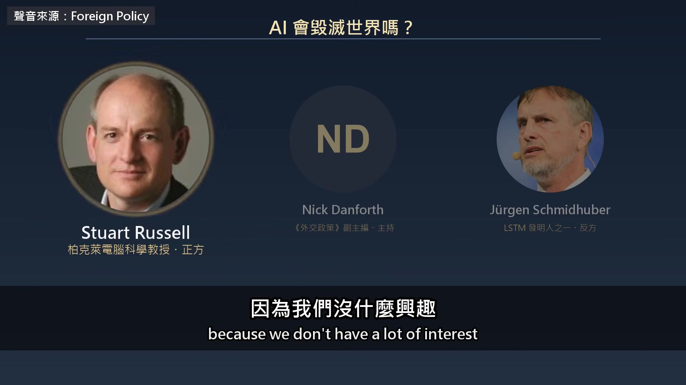

**逐字稿片段：** 去管那一百萬種被滅絕的物種（正確：約 100 萬種瀕危） 所以不可能發生嘛。可是明明就發生了 對，這我可以多說一點 嗯，這大多是意外 但也是因為有些資源 像是土地，地球表面的空間 我們想拿來用 所以我們蓋了一座籃球場 沒發現，喔，那是另一種生物 只住在那一小塊地方，然後就沒了

**話題推測：** 顯示關於瀕危物種的數據圖表或列表

---

## 00:06:38

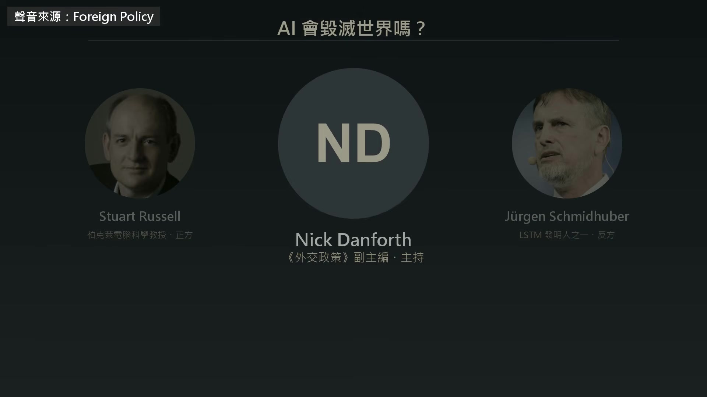

**逐字稿片段：** 主持人接著把話題拉回眼前

**話題推測：** 影片章節轉場或主持人重新導向話題

---

## 00:06:40

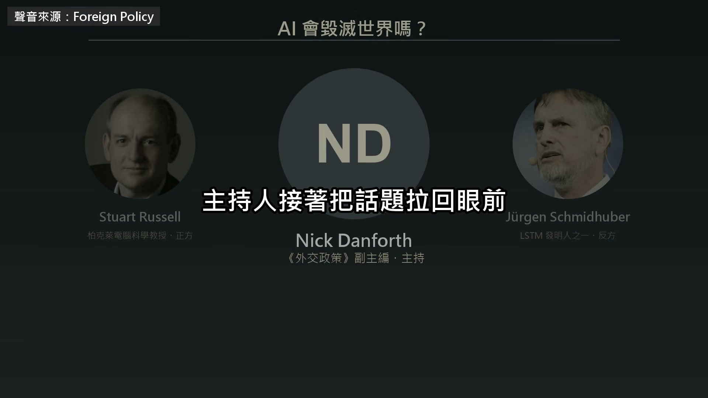

**逐字稿片段：** 問政府跟 AI 公司現在該做什麼

**話題推測：** 提出針對政府和AI公司行動的疑問

---

## 00:06:43

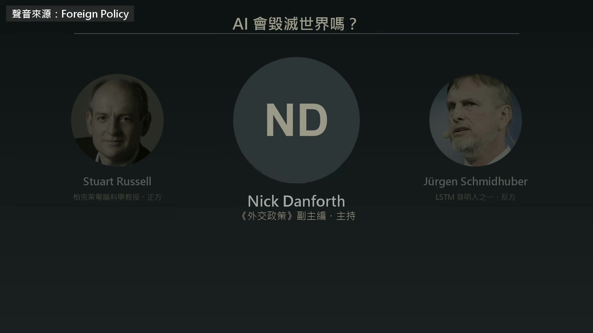

**逐字稿片段：** Russell 拿核電廠算了一筆帳 所以能力越強 強到最後，AI 有可能奪走控制權 我們能容許的失敗風險就越小

**話題推測：** 引入核電廠風險計算的圖表或數據

---

## 00:07:00

**逐字稿片段：** 我用數字簡單算給你看 核電廠熔毀，我們是容許的 但風險要低於每年千萬分之一 換句話說，平均 1000 萬年才出一次事 人類滅絕或失去控制，顯然糟得多 全部 AI 加起來，也許只能容許每年一億分之一 甚至每年十億分之一 可是那些執行長自己估，如果他們成功 做成他們砸了好幾兆美元的那件事 人類滅絕的機率是十分之一、五分之一，甚至四分之一 這些系統大概比該有的安全差了 1000 萬倍 那政府該怎麼做 就像我們管飛機、核電廠 電梯、餐廳、建築、理髮店那樣 要有執照才能營業 要拿執照，就得證明給我們看 你的系統達到我們認為合理的安全要求 先停在這裡，讓 Jürgen 回應，接著再…

**話題推測：** 顯示核電廠熔毀風險的數字比較

---

## 00:08:20

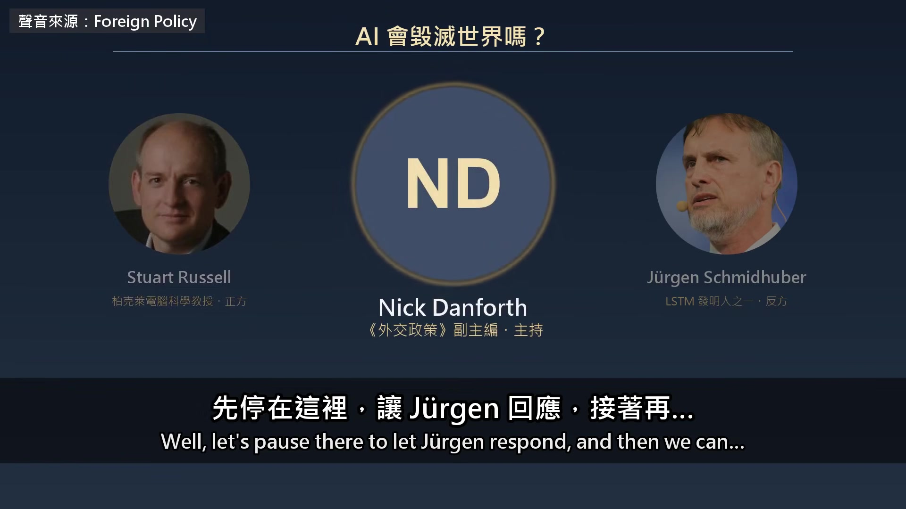

**逐字稿片段：** 那為什麼 OpenAI、Anthropic 這些公司 要跑出來說，可能有 10% 的機率 他們會害死所有人

**話題推測：** Schmidhuber質疑AI公司的動機，畫面可能切換到這些公司的Logo

---

## 00:08:31

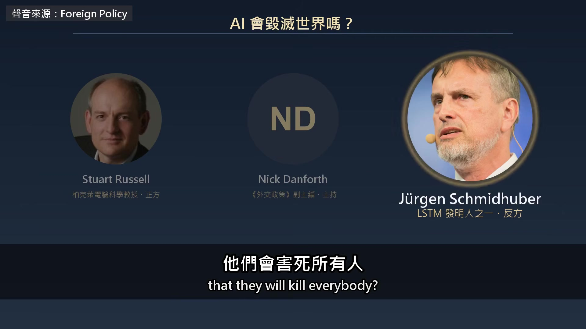

**逐字稿片段：** 因為他們想搏版面、想募資 幾百年的科幻小說早就證明了 AI 反烏托邦的劇情比較吸睛 也更受關注，比起… 好，我必須、我必須反對這點，因為這… 那先讓我… 講完，讓我講完 好吧，真不敢相信 你老是，你一直講一直講 然後突然自己破壞規則 講 Anthropic 跟 OpenAI 的，有則推文很紅 你想要關注、想要資金，該怎麼做 就說我們的產品很可能會害死所有人 然後華爾街就會很興奮 而且這種科幻題材，就是比 講 AI 怎麼幫醫療的紀錄片受歡迎 所以阿諾那些電影才會那麼賣座 Stuart，請你回應末日論這點 很可惜，之後我們就得收尾了 首先，辯論有個規矩 你要回應對方的論點 而不是質疑他的動機 所以討論 AI 有沒有風險的時候

**話題推測：** 顯示關於媒體報導或投資人會議的畫面

---

## 00:09:49

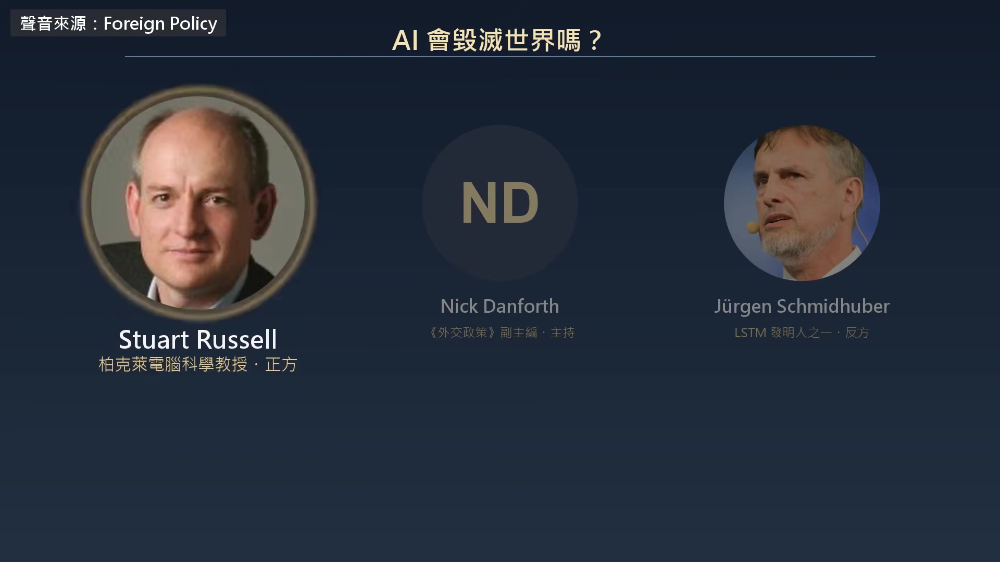

**逐字稿片段：** 假設 Dario Amodei 說（Dario Amodei：Anthropic 執行長） 我認為 AI 有風險，理由如下 這時候這樣回他，就違反辯論規矩 我不管你的主張跟論點 也不打算回應 因為我覺得你這樣講有商業動機 你只是想拉抬股價 這種習慣只會讓討論沒有結果 因為不管誰說什麼，都能被質疑動機 事實是，像馬斯克跟 Sam Altman 這些人 在公司成立之前就在講這些了 所以他們不可能是想拉抬股價 因為公司根本還不存在 圖靈在 1951 年就說過 機器思考的方法一旦開始 很快就會超越我們微弱的能力 所以到了某個階段，我們得預期機器會接管 1951 年，他可沒有 OpenAI 或 Google 的股票 所以說他們表達擔憂 唯一的理由是貪心，這根本是侮辱人 因為這客觀上就是錯的

**話題推測：** 顯示Dario Amodei的姓名和職稱，可能配有照片

---

## 00:10:59

**逐字稿片段：** 兩個人都同意，比人聰明的 AI 現在沒有人管得住 Schmidhuber 賭它們對人類沒興趣 Russell 不想拿全人類的未來去賭 原影片 45 分鐘

**話題推測：** 影片總結畫面或關鍵點提示

---

## 00:11:10

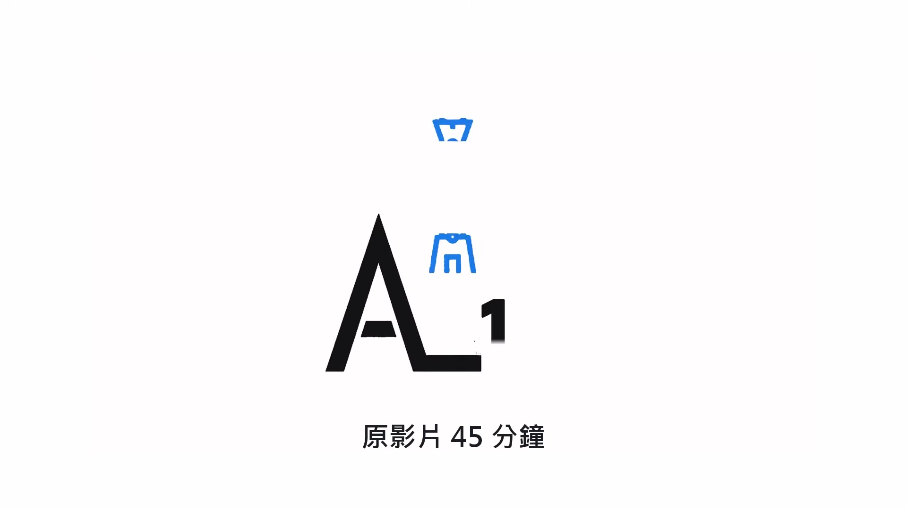

**逐字稿片段：** Schmidhuber 還說超級 AI 會為了搞懂自己從哪來 好好保護人類，Russell 回他 那我們就成了試管裡的實驗品

**話題推測：** 顯示Schmidhuber的新論點

---

## 00:11:18

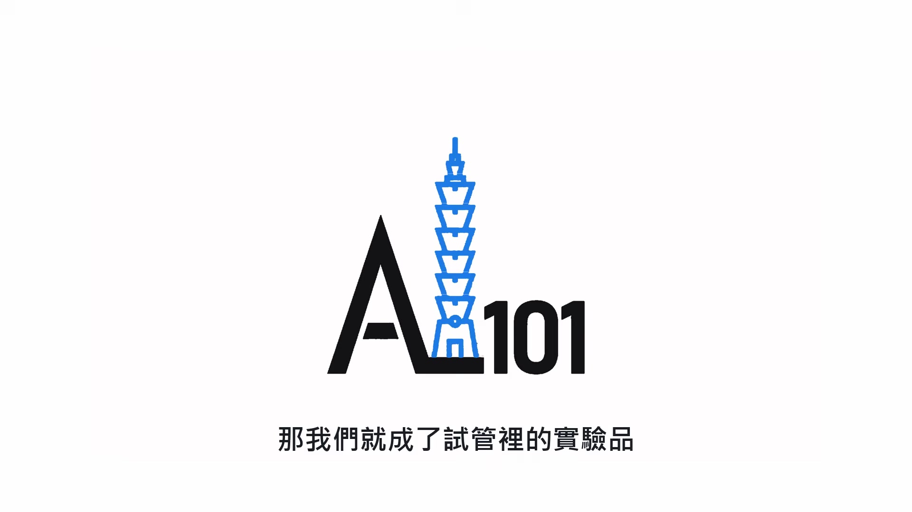

**逐字稿片段：** 最後 Schmidhuber 也承認他有怕的事 就是戰場上已經讓 AI 決定殺誰

**話題推測：** 顯示Schmidhuber擔憂的方面

---

## 00:11:22

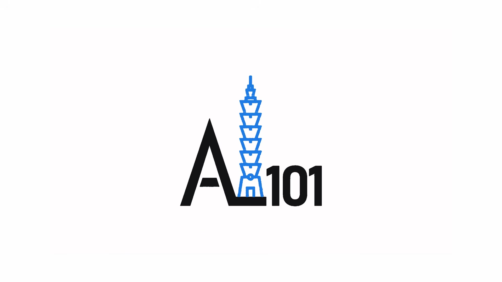

**逐字稿片段：** 原影片連結在說明欄，有興趣可以去聽更多。

**話題推測：** 影片結尾，顯示連結資訊

---
