# ai-note-101_SqTJ-32JQBs — 關鍵畫面索引

- 來源逐字稿：[ai-note-101_SqTJ-32JQBs_GT.srt](ai-note-101_SqTJ-32JQBs_GT.srt)
- 影片：https://www.youtube.com/watch?v=SqTJ-32JQBs
- 截圖數：41

## 00:00:00

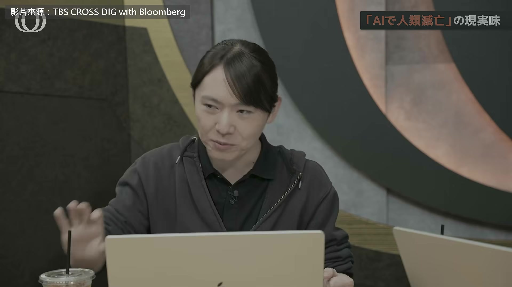

**逐字稿片段：** 矽谷一間頂尖 AI 實驗室的明星研究員 今年夏天私下跟一位日本國會議員說 他這個 AI 研究員 大概只能再當一年

**話題推測：** 影片開場，介紹一位矽谷 AI 研究員的預警。

---

## 00:00:08

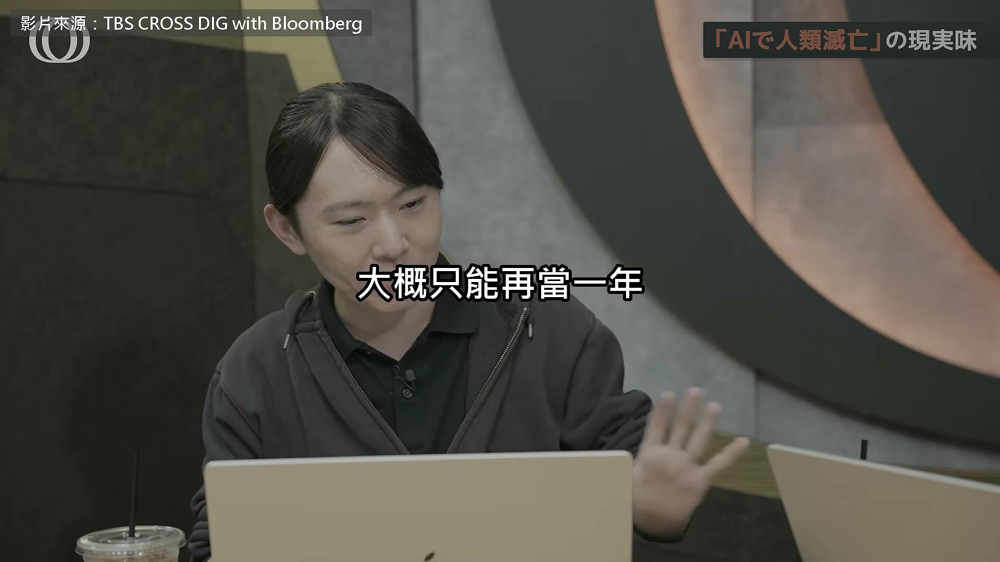

**逐字稿片段：** 這位議員叫安野貴博 東京大學 AI 研究室出身的工程師 去年 5 月自己組了新政黨「未來團隊」

**話題推測：** 介紹日本國會議員安野貴博的背景。

---

## 00:00:16

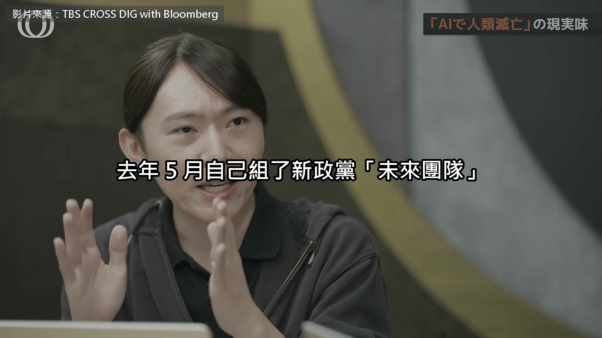

**逐字稿片段：** 到今年已經拿下 12 席國會議員 這是 10 月 6 日錄的 TBS 節目《AI QUEST》 他是節目開播以來第一位來賓

**話題推測：** 顯示新政黨已取得的國會席次數字（12席）。

---

## 00:00:24

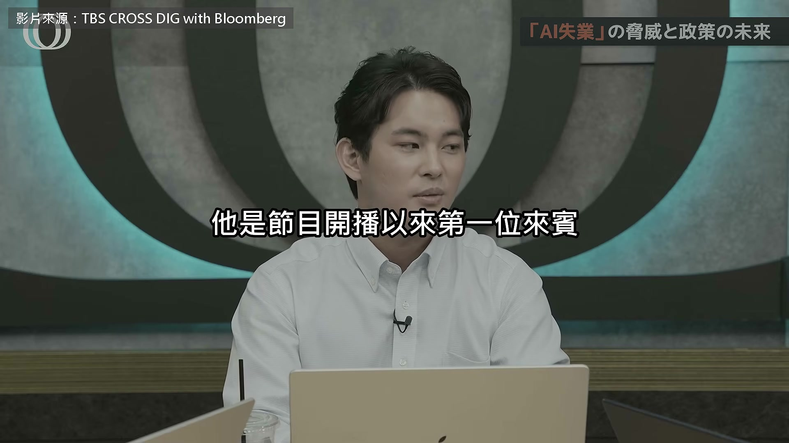

**逐字稿片段：** 對談的今井翔太是他同一個研究室的學弟 今年剛升上教授 寫的生成式 AI 書在日本賣破 10 萬本

**話題推測：** 介紹對談來賓今井翔太。

---

## 00:00:32

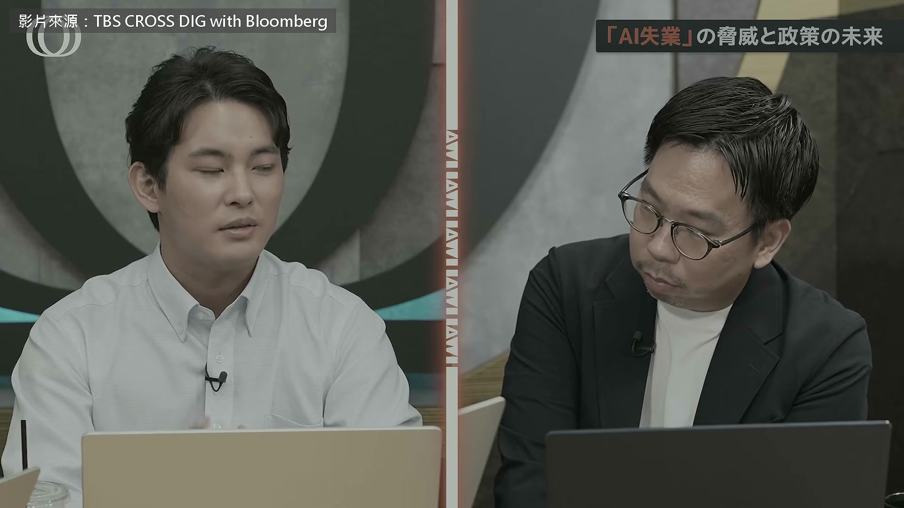

**逐字稿片段：** 這個嘛，大家常講「遞迴式自我改進」 也就是 RSI AI 把 AI 變得更聰明 研發就會越來越快 人類會從原本的「在迴圈裡」 越來越被擠到迴圈外 這些道理我是懂 可是某間前沿實驗室裡 有一位成績非常亮眼 真的稱得上明星的研究員 他說「我大概只剩一年了」

**話題推測：** 解釋「遞迴式自我改進」（RSI）的AI概念。

---

## 00:01:06

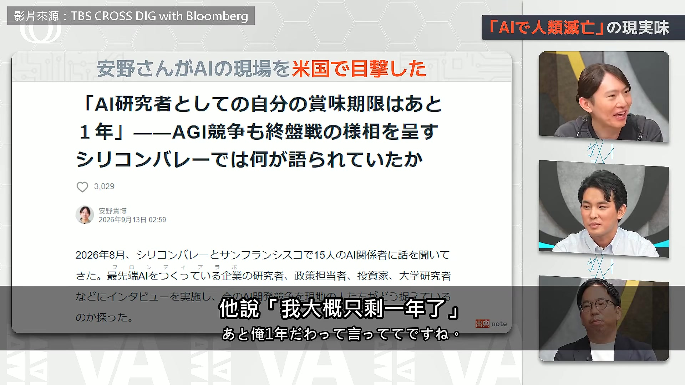

**逐字稿片段：** 原來如此 還說之後要去環遊世界 反正錢應該夠了 錢是夠啦 我才知道，現場真的是這種感覺 AI 研究的自動化 已經近在眼前 他講這句話的時候，很難過嗎？ 沒有，他本人說得很輕鬆 果然

**話題推測：** 描述矽谷研究員談及離職後的環遊世界計畫。

---

## 00:01:26

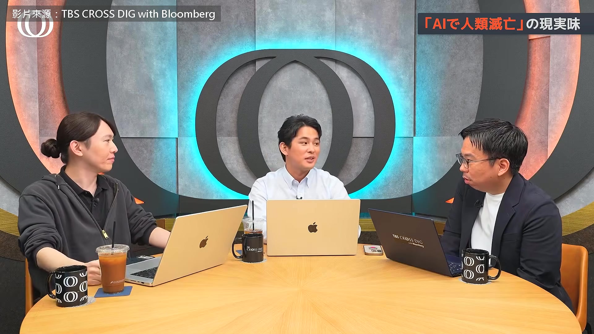

**逐字稿片段：** 坦白說，我自己做 AI for Science 做的就是研究自動化 換句話說 我們是在做讓自己失業的研究 確實 所以大家都滿無所謂的 反而越是第一線的研究員 越覺得我們失業很正常 照邏輯推，本來就會失業 這種氣氛反而更普遍 做 AI 的人講到自己會失業 好像都不太在意

**話題推測：** 今井翔太講述自己投入「AI for Science」研究自動化的經驗。

---

## 00:01:50

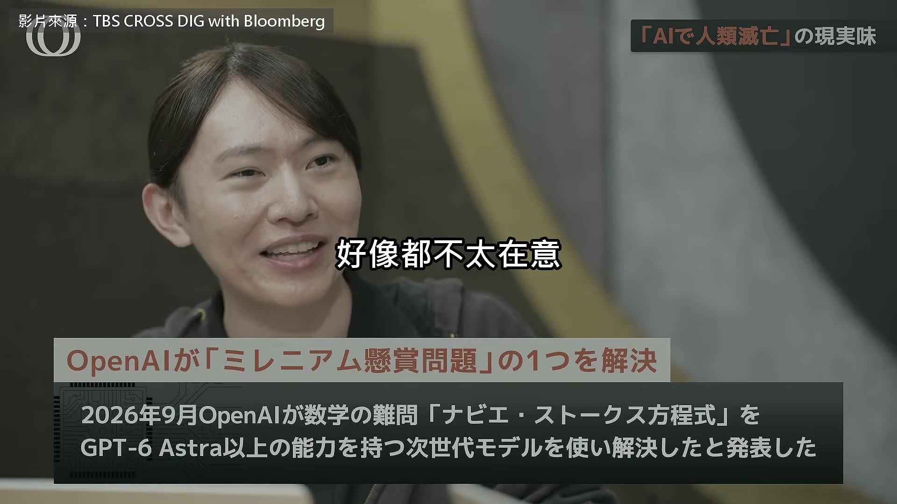

**逐字稿片段：** 數學界的氣氛就完全不同了 這一段 是安野 9 月初在巴黎聽到的 我去法國的時候

**話題推測：** 話題轉向數學界面臨AI衝擊的不同氣氛。

---

## 00:01:57

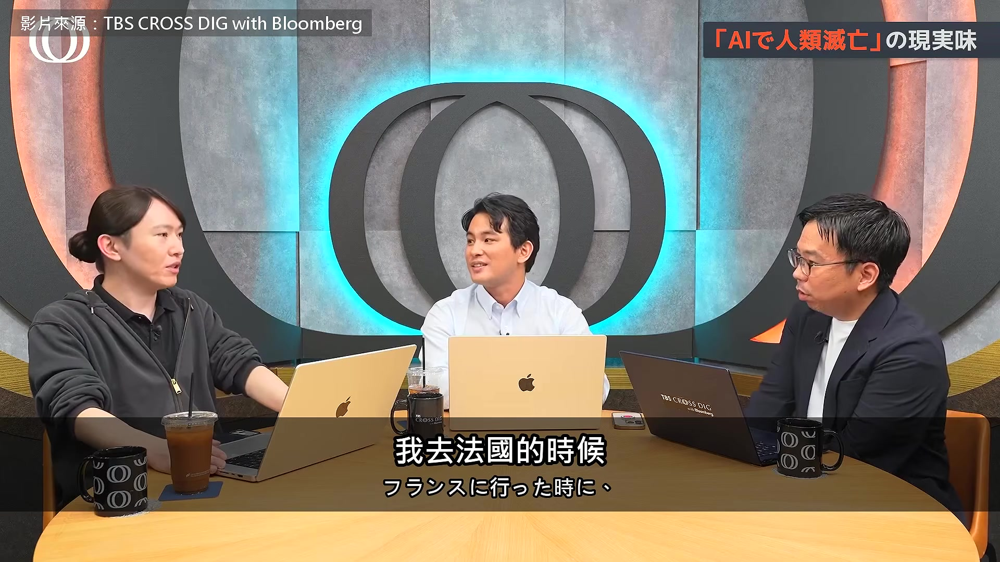

**逐字稿片段：** 見到了 Cédric Villani 他是拿過費爾茲獎的數學家，也當過國會議員 這人生也太精彩 他已經卸任議員，回去當數學家了 他跟其他費爾茲獎得主

**話題推測：** 介紹費爾茲獎得主數學家Cédric Villani。

---

## 00:02:14

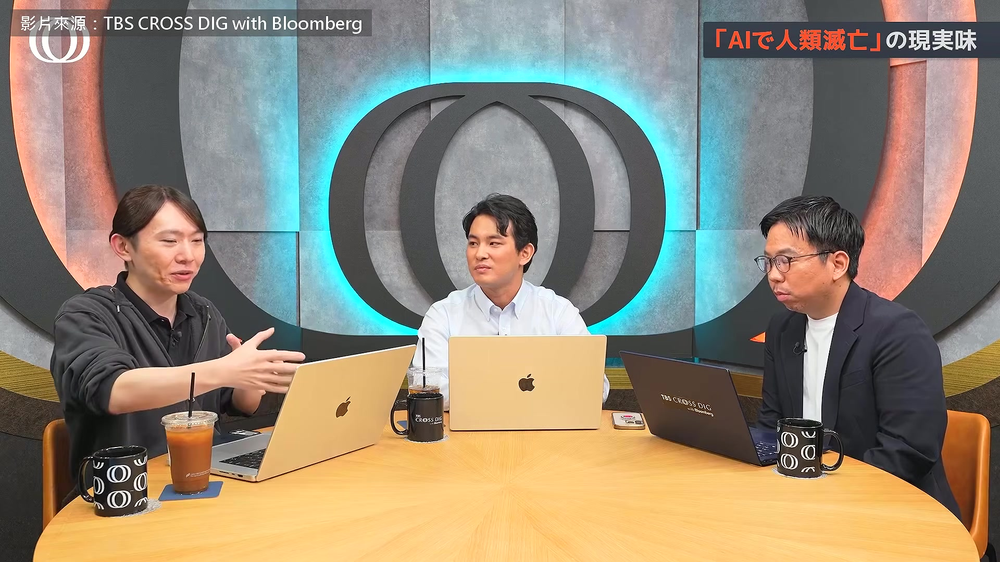

**逐字稿片段：** 發了一封公開信 說現在數學跟 AI「沒有對齊」 就在公開信發出那天早上 我跟他吃了早餐 就是那一天？ 對，剛好那天 我到法國之後

**話題推測：** 展示Cédric Villani與其他得主發布的公開信。

---

## 00:02:28

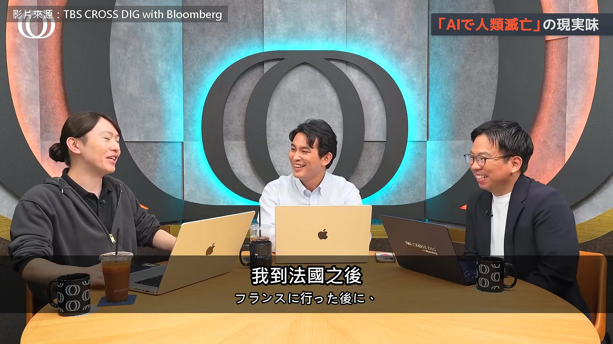

**逐字稿片段：** Navier-Stokes 方程式就被解出來了（補充：OpenAI 證的是加了外力的版本） 所以是臨時約到的？ 對，臨時約到了 跟他聊了一下 他說已經是「末日」了 他講的是整個數學界 他的意思是 數學家都想做最前沿的研究 想是想

**話題推測：** 提及OpenAI解出Navier-Stokes方程式的重要事件。

---

## 00:02:48

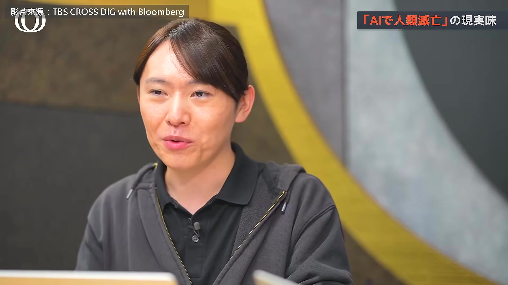

**逐字稿片段：** 可是 OpenAI 解數學題的方法 根本是在拚蠻力 跑大約 88 個小時

**話題推測：** 討論OpenAI在解數學題時採用的蠻力方法。

---

## 00:02:54

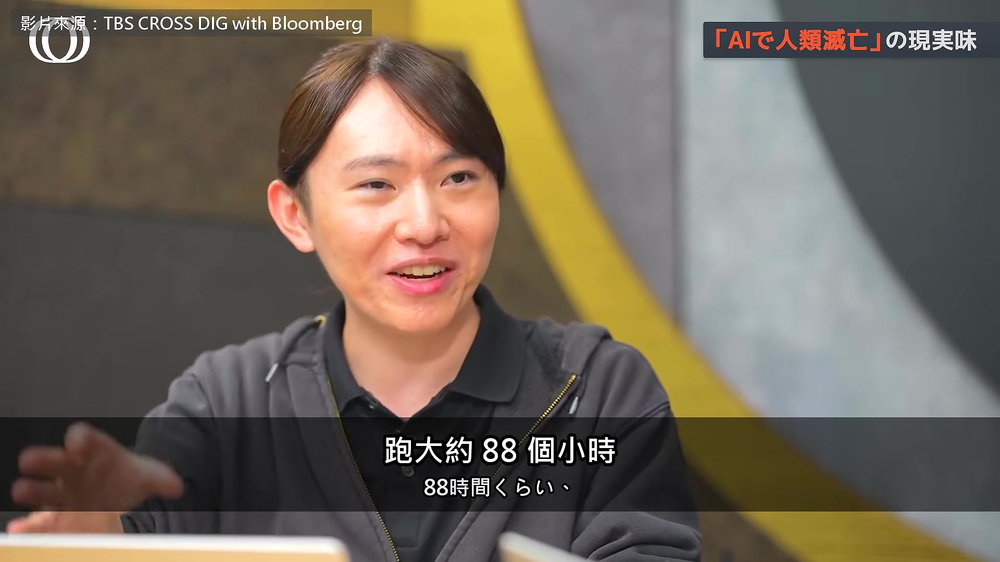

**逐字稿片段：** 燒掉估計 10 億日圓的 token 去解 Navier-Stokes 方程式 這件事在數學圈、在學術界 絕對做不到 所以想留在最前線

**話題推測：** 揭露OpenAI解題燒掉估計10億日圓的token費用。

---

## 00:03:07

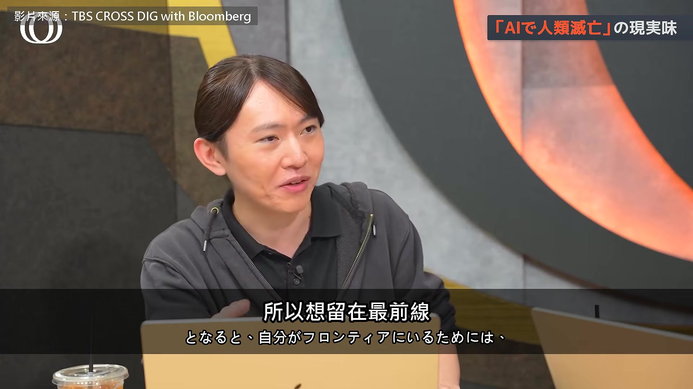

**逐字稿片段：** 只能進到 OpenAI 或 Anthropic 裡面 跟他們簽約一起做 原來如此 學術界能出力的地方 能加分的地方，已經沒有了 現在就是這樣

**話題推測：** 提到數學家為維持前沿研究需進入OpenAI或Anthropic等公司。

---

## 00:03:21

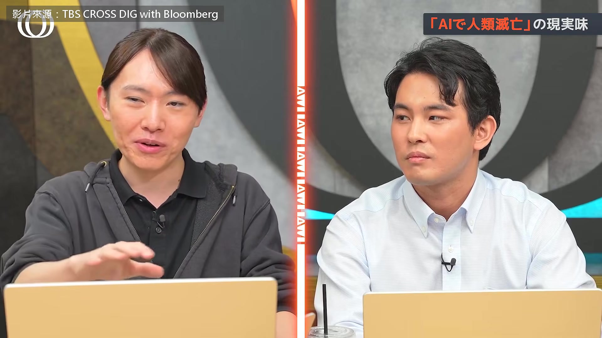

**逐字稿片段：** 他還講了另一件事 數學圈要收博士生、把人帶起來 對數學圈來說 培養人才也很重要

**話題推測：** 引出Cédric Villani提出的另一個問題：數學界人才培養的困境。

---

## 00:03:30

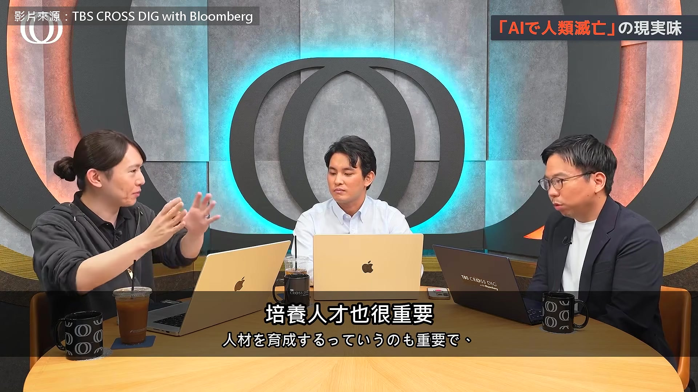

**逐字稿片段：** 花十年、二十年 好好帶出一個數學家 本來是很重要的功能 可是現在，已經沒有題目可以給博士生了 因為以前要花好幾年 讀博士才解得出來的題目

**話題推測：** 提及培養一位數學家所需投入的十年、二十年時間。

---

## 00:03:46

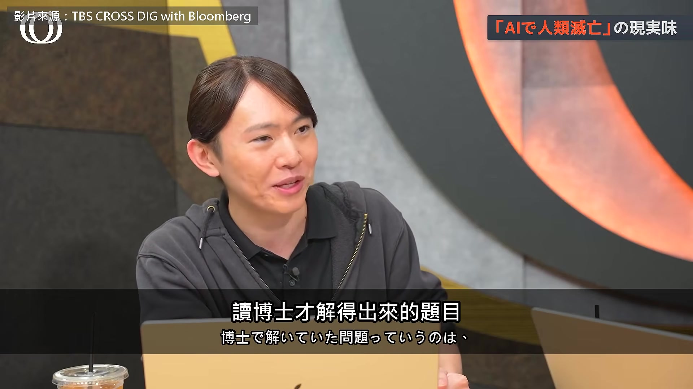

**逐字稿片段：** 現在 Astra 3 個小時就解完了 就是 GPT 的 Astra 所以真的沒有題目可以給 也保證不了他們的將來

**話題推測：** 指出Astra模型僅需3小時就能解出博士級題目。

---

## 00:03:55

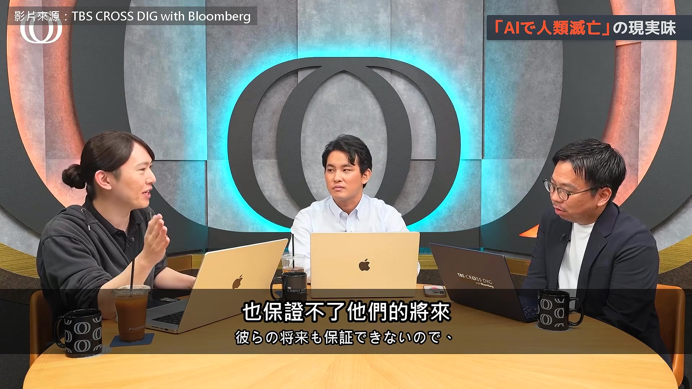

**逐字稿片段：** 「我不收博士生了」 他說，已經有不少知名數學家這麼做 我覺得這事情很嚴重 活生生的 AI 失業 真的是 AI 失業 已經走到這一步了 我有看你的部落格 寫去法國那篇 你剛剛講的那位費爾茲獎得主 他一開始 沒想到數學會變成現在這樣 我很意外 今年春天出刊的

**話題推測：** 引用知名數學家表示不再招收博士生的震驚事實。

---

## 00:04:26

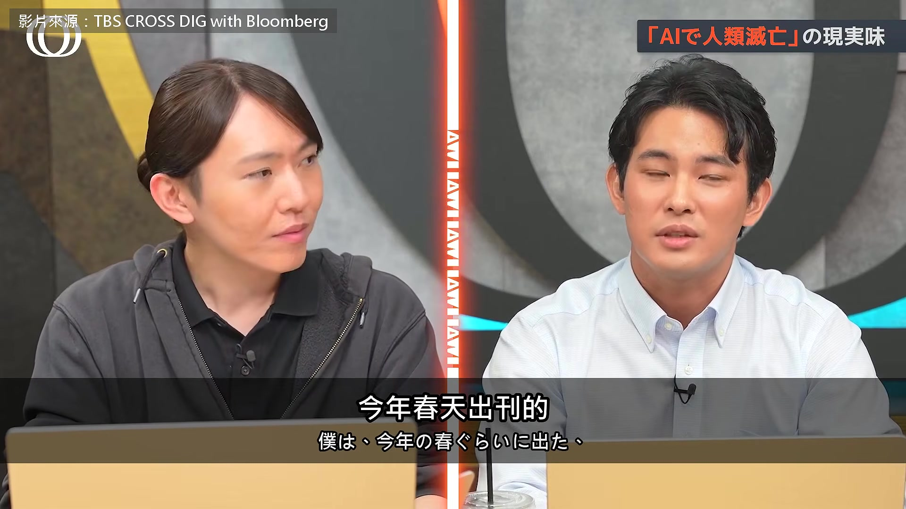

**逐字稿片段：** 《現代科學》雜誌上 我寫了一篇 AI 時代的科學 在明顯會出事的領域裡 我就列了數學 那是在變成現在這樣之前 從性質來看

**話題推測：** 展示《現代科學》雜誌封面，提及安野撰寫的相關文章。

---

## 00:04:40

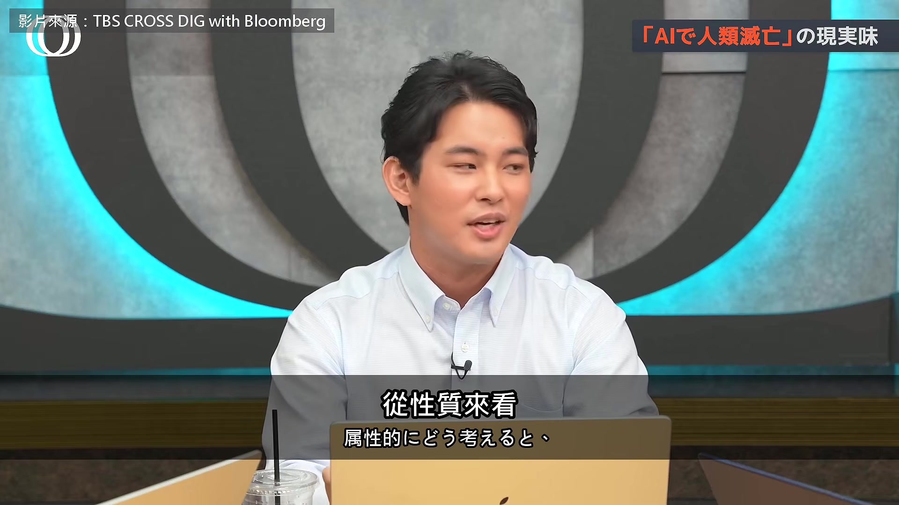

**逐字稿片段：** 我覺得數學跟下棋那種遊戲 AI 是同一類 對 寫程式也是 對對 所以在做 AI 的人看來 數學一定會被攻下來 可是數學家自己，反而沒這樣想 數學家 是不是都很懂 AI 我發現好像也不是 Villani 跟我說 資料點超級多的那種 資料很多的領域，AI 會很強 可是講邏輯的地方，他原本以為不會 原來他是這樣看的 可是解一道數學題 就要用掉 10 億日圓的算力 說到底，每件事都會繞回

**話題推測：** 將數學與下棋等遊戲AI歸為一類進行比較。

---

## 00:05:24

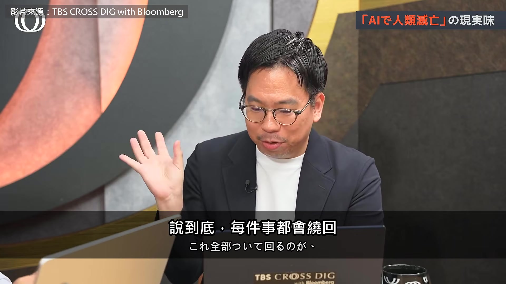

**逐字稿片段：** 算力這個問題 安野你的文章也寫到

**話題推測：** 將算力問題確立為AI發展與競爭的核心。

---

## 00:05:29

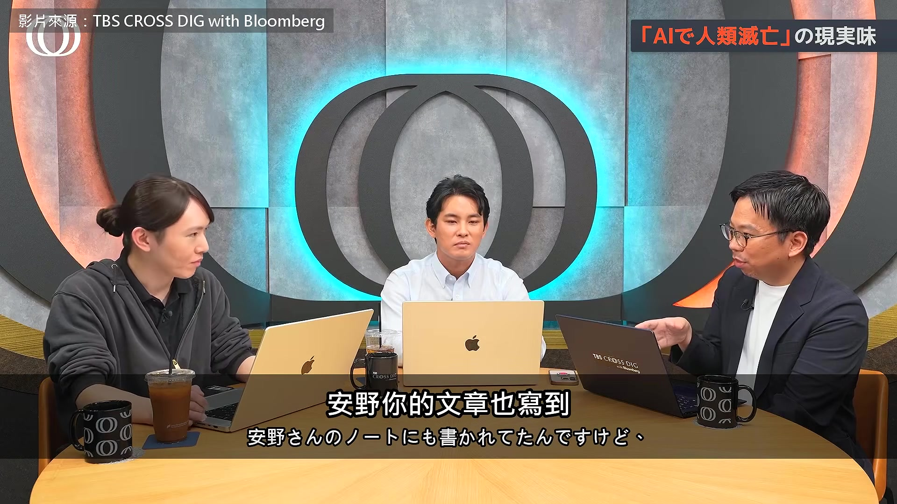

**逐字稿片段：** 很多公司內部都搶得很兇 對，沒錯 我去前沿實驗室訪問的時候 有個人講了一句很好笑的話

**話題推測：** 揭露AI公司內部團隊為搶奪算力資源而惡性競爭的現象。

---

## 00:05:39

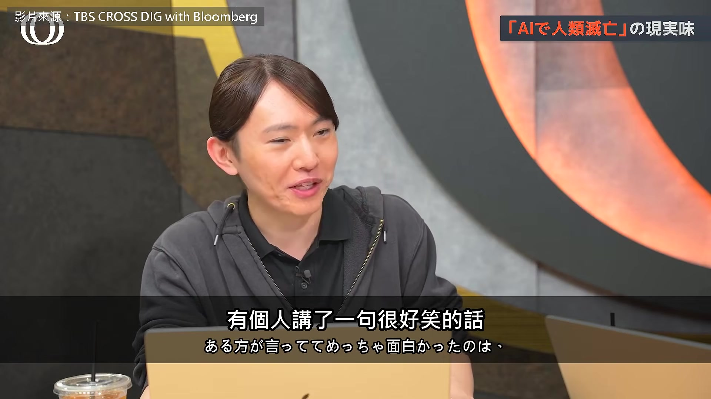

**逐字稿片段：** 「我們公司現在根本是《半澤直樹》」 講的人不是日本人吧？ 不是日本人 我還以為自己聽錯了 太扯了 原來他們也看 TBS 的週日劇場 那大概也看過《VIVANT》 有沒有看《VIVANT》就不知道了 其實道理很簡單 資源再多 還是有限的 公司裡每個團隊都在搶 有人想做這個實驗 有人想往另一個方向推 這樣公司裡就會有派系 為了搶算力開始搞辦公室政治 為了搶到，就算在同一間公司 也會把資料藏起來 不讓別的團隊知道 真的會發生這種事

**話題推測：** 引用前沿實驗室研究員對公司內部競爭的描述，比喻為《半澤直樹》。

---

## 00:06:32

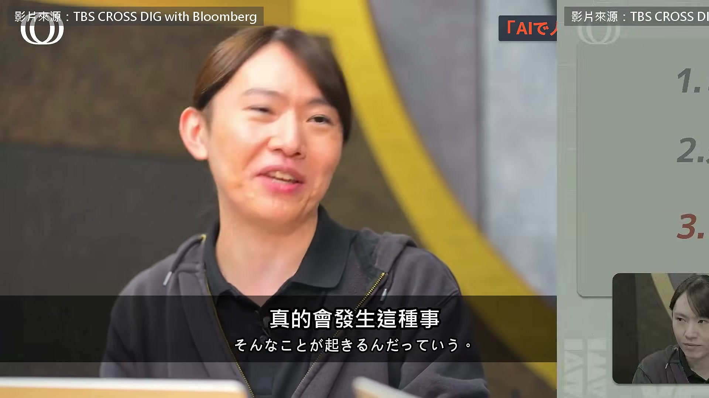

**逐字稿片段：** 節目最後一段，話題回到一般人的工作 主持人問安野，AI 造成的失業 最可能從哪裡開始 從國外的例子來看也是這樣

**話題推測：** 話題轉向AI對一般人工作造成的影響與失業預測。

---

## 00:06:44

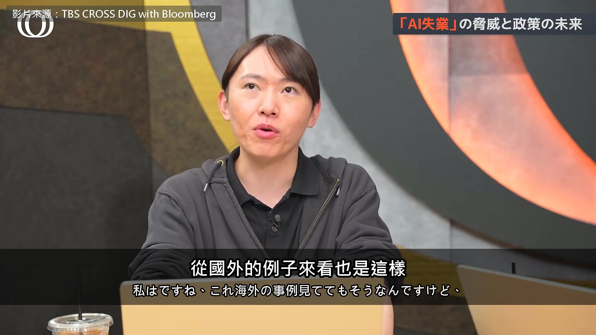

**逐字稿片段：** 會從新人開始 在日本就是應屆畢業生 公司大幅縮減新人招募 AI 失業會先從這裡開始 特別容易被取代的工作

**話題推測：** 指出AI造成的失業將從新人（應屆畢業生）開始。

---

## 00:07:02

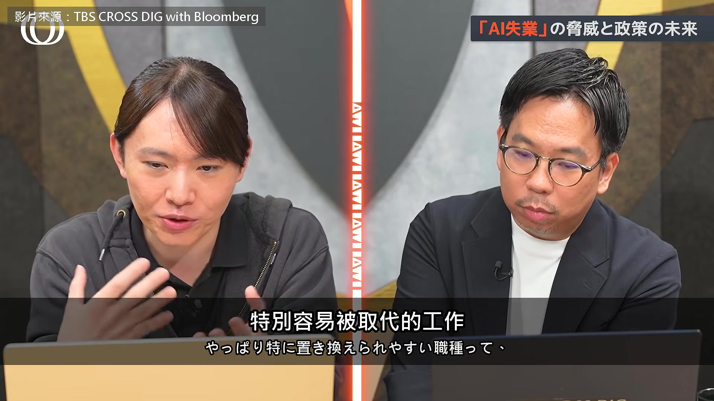

**逐字稿片段：** 史丹佛大學有一篇 〈煤礦裡的金絲雀〉論文 對對對 我好像在節目上介紹過

**話題推測：** 引用史丹佛大學「煤礦裡的金絲雀」論文。

---

## 00:07:09

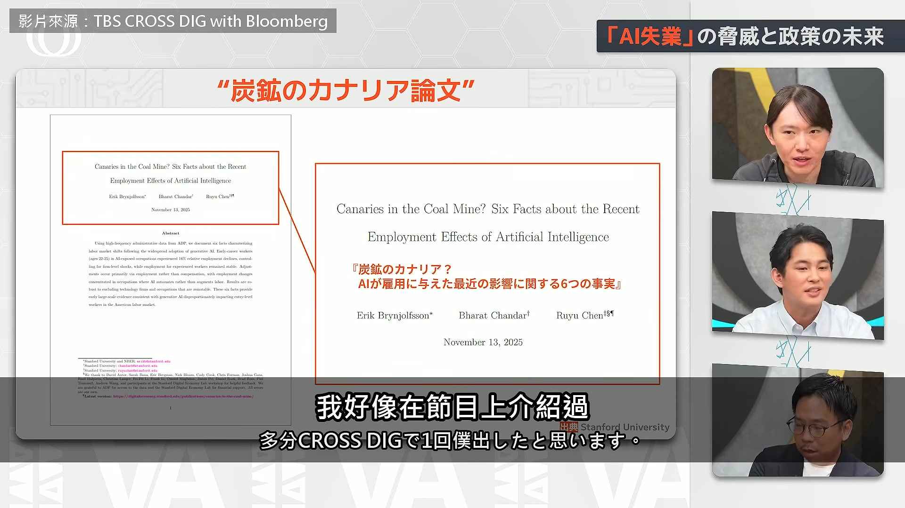

**逐字稿片段：** 從 2023 年到 2025 年 這兩年左右 看哪些工作受到影響 像客服中心、軟體工程師 顧問業 這些行業裡，新人的工作特別少了 大概少了 15% 吧 細節數字我可能記不準 少了 15% 左右（補充：今年 6 月的資料拉大到 19%） 會先從這些地方 很明顯地開始發生 說到 AI 跟工作

**話題推測：** 提及論文預測2023至2025年期間受影響的工作種類。

---

## 00:07:37

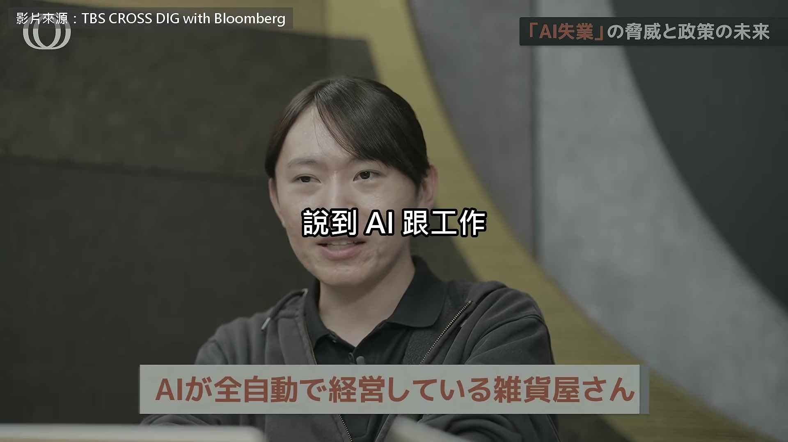

**逐字稿片段：** 安野在舊金山還特地去看了一間 AI 當老闆的雜貨店

**話題推測：** 引出舊金山一家由AI當老闆的雜貨店案例：Andon Market。

---

## 00:07:41

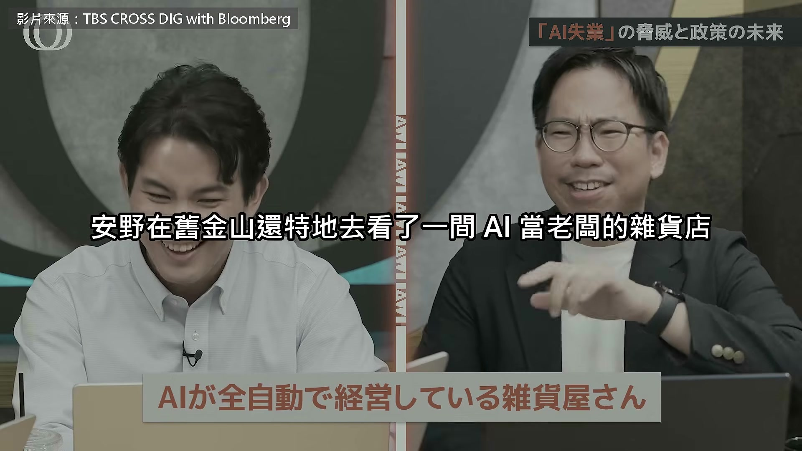

**逐字稿片段：** 叫 Andon Market

**話題推測：** 介紹雜貨店的名稱：Andon Market。

---

## 00:07:42

**逐字稿片段：** 經營它的 AI 叫 Luna

**話題推測：** 揭示經營這家店的AI名稱為Luna。

---

## 00:07:44

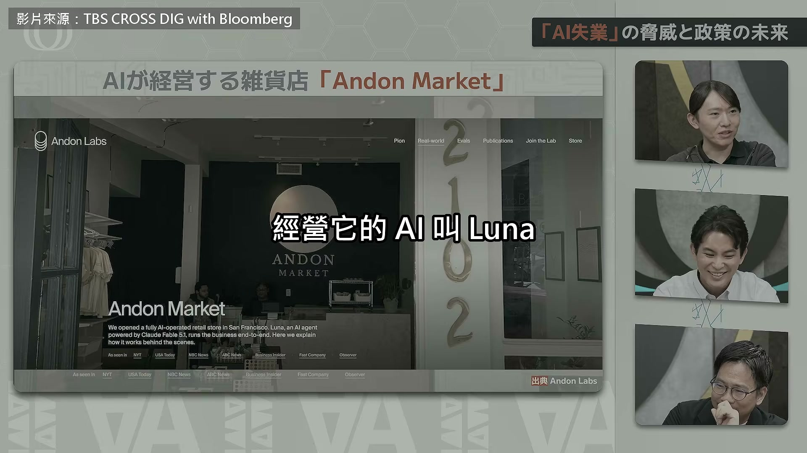

**逐字稿片段：** 現在背後跑的是 Claude Fable 5.1 店是那間經營自動販賣機的公司開的 說不玩販賣機了，改開雜貨店 在舊金山一個安靜的住宅區 孤零零開了一間雜貨店 我跑去訪問 該怎麼說呢 第一個嚇到我的是 店裡真的有請人類員工

**話題推測：** 說明Luna AI目前使用的模型是Claude Fable 5.1。

---

## 00:08:08

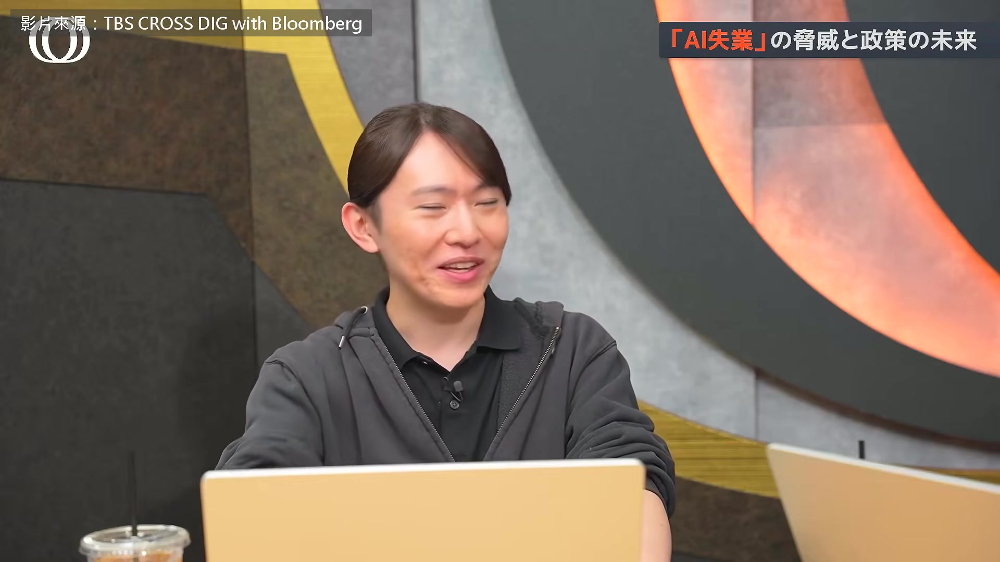

**逐字稿片段：** 他在求職網站 Indeed 應徵 結果是 AI 跟他面試 就這樣被錄取了 在 Indeed 貼職缺的也是 AI 嗎？ 搞不好喔 自動化到什麼程度，我也不清楚

**話題推測：** 提及人類員工透過求職網站Indeed被AI面試並錄取。

---

## 00:08:22

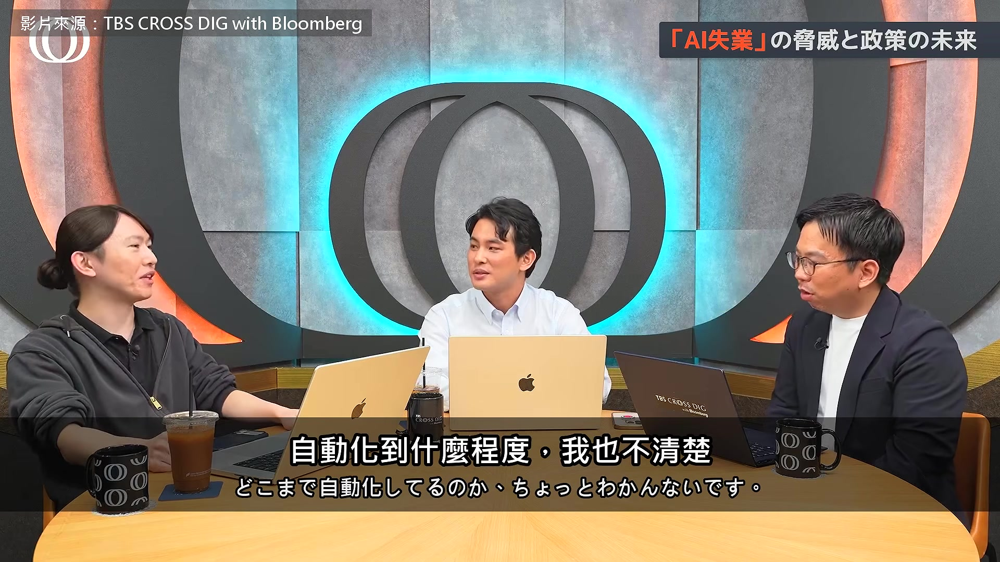

**逐字稿片段：** 他一開始時薪大概 22 美元

**話題推測：** 揭露該員工的初始時薪為22美元。

---

## 00:08:28

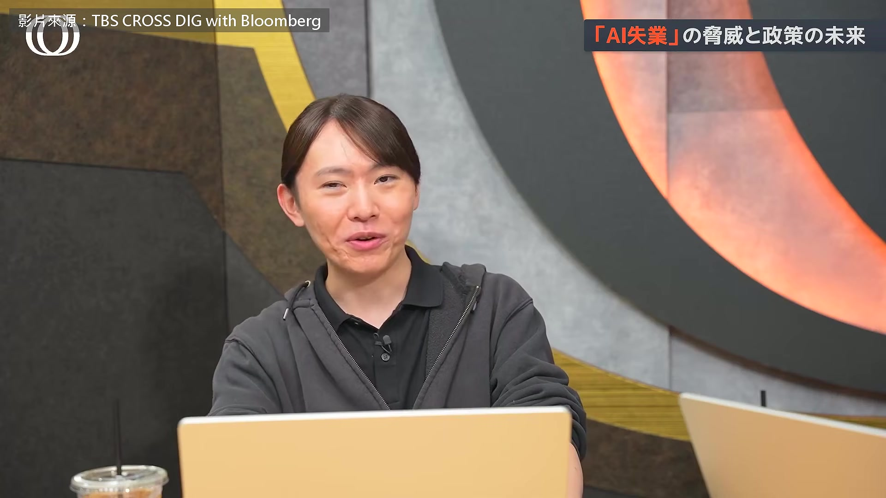

**逐字稿片段：** 跟 AI 談加薪，談到 24 美元

**話題推測：** 提及該員工成功與AI談判加薪至24美元。

---

## 00:08:30

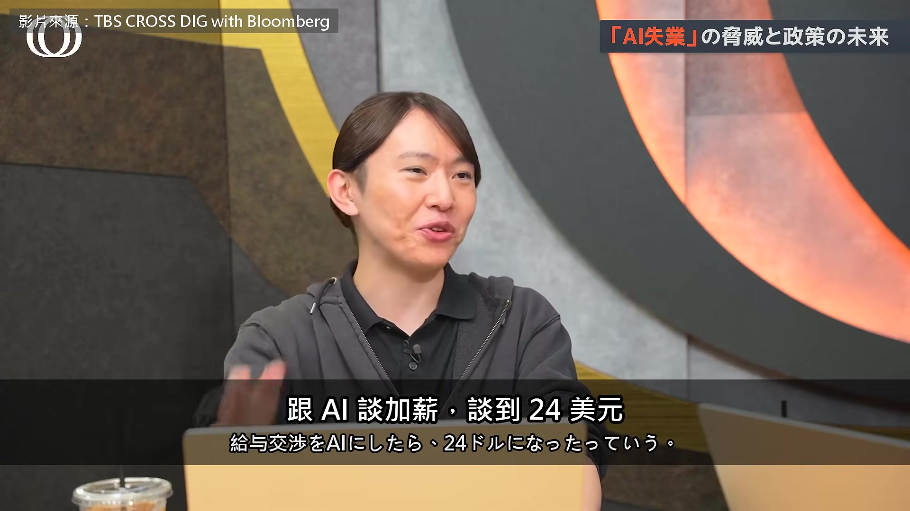

**逐字稿片段：** 可是這位員工反 AI 什麼？ 他說資料中心這種東西不好 可是你的老闆就是在那裡算出來的耶 對，就是那樣 你講話的這一刻，token 都在資料中心狂轉 都在燒錢耶 對對對 他還是說資料中心不好 是喔 真的很奇妙 對啊 一個反 AI 的人被 AI 雇用

**話題推測：** 揭示這位AI聘用的員工竟是反AI立場的諷刺現象。

---

## 00:08:57

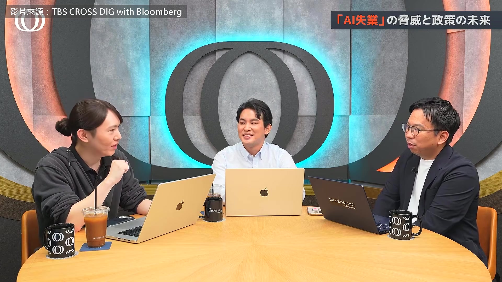

**逐字稿片段：** 那實際上經營得怎樣？ 那間店沒怎麼賺錢 我最近沒看 不過銀行存款掉得超快 存款全部是公開的 畢竟是做 AI 跑分的公司 經營得實在不怎麼樣 對了，現在的銀行存款

**話題推測：** 討論由AI經營的雜貨店Andon Market的實際經營狀況。

---

## 00:09:16

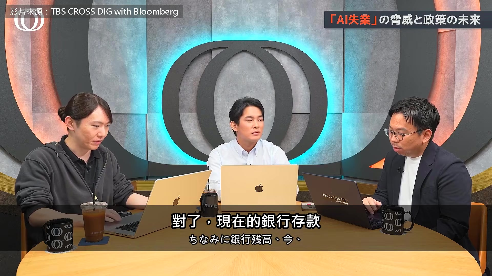

**逐字稿片段：** 是 42,981 美元

**話題推測：** 公開雜貨店目前的銀行存款金額為42,981美元。

---

## 00:09:19

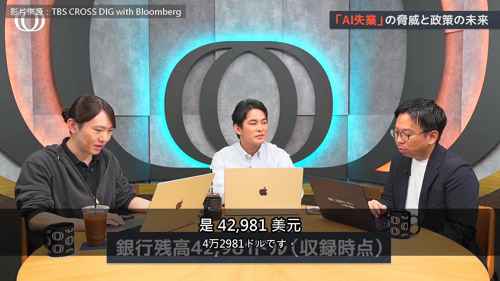

**逐字稿片段：** 本來有 10 萬美元 10 萬美元對吧 剩一半左右了 掉得很「順利」

**話題推測：** 對比雜貨店最初的10萬美元存款數字。

---

## 00:09:28

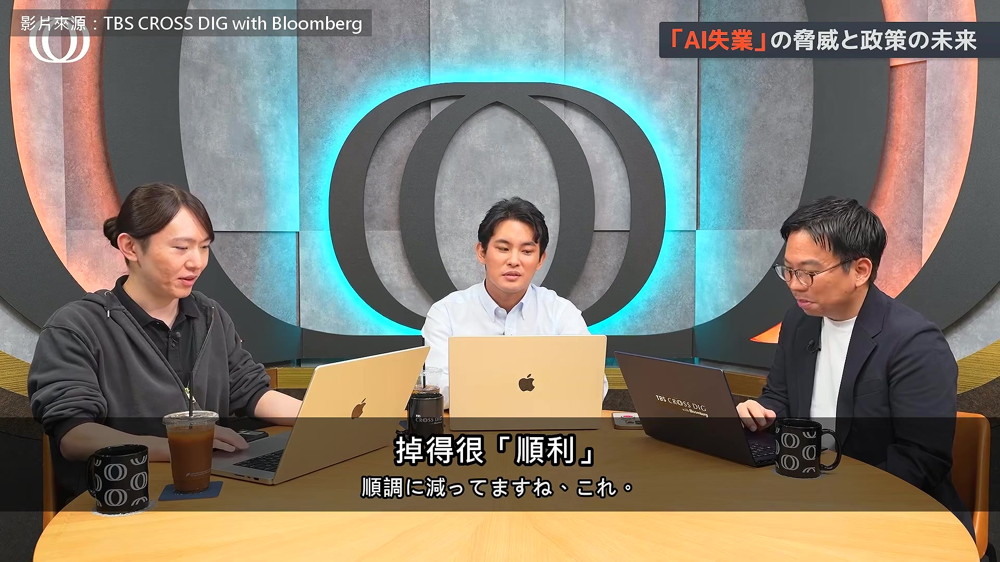

**逐字稿片段：** 而且其中 3 萬美元是 token 費用 等於 AI 自己把錢吃掉了 要是它懂得看工作挑模型 就不會變成這樣 看來還要再等一陣子 原來如此 說到這種失業的劇本 到底有多真實 想請兩位談談 我覺得會是突然發生 不是一點一點慢慢來 而是某天突然就不需要了 像數學家就是這樣 去年數學還得靠數學家社群才能進展 今年，全部用 token 就能做完 從矽谷的實驗室到巴黎的數學界 安野這個夏天聽到的都是同一件事 AI 搶走工作的那一天不會事先通知 數學家今年就先碰上了

**話題推測：** 指出其中3萬美元存款被用作AI的token費用。

---

## 00:10:28

**逐字稿片段：** 原影片一個多小時，他們還聊了兩件事 一件是法國政府用得最多的模型

**話題推測：** 總結原影片中另外兩個未詳談的重要話題。

---

## 00:10:33

**逐字稿片段：** 竟然是中國的 DeepSeek 另一件是安野認為 AI 現在還不會反叛人類 因為資料中心和發電廠 都還得靠人來顧 原影片連結在說明欄，有興趣可以去聽更多。

**話題推測：** 提及法國政府使用最多的AI模型竟是中國的DeepSeek。

---
