# ai-note-101_YL3yve9tIB0 — 關鍵畫面索引

- 來源逐字稿：[ai-note-101_YL3yve9tIB0_GT.srt](ai-note-101_YL3yve9tIB0_GT.srt)
- 影片：https://www.youtube.com/watch?v=YL3yve9tIB0
- 截圖數：25

## 00:00:01

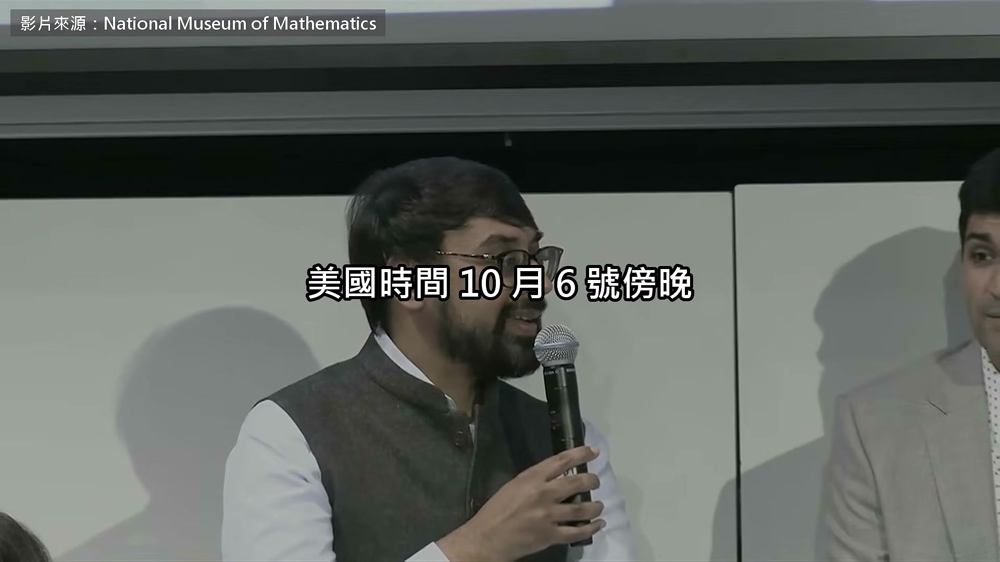

**逐字稿片段：** OpenAI 一口氣公布將近 400 項數學結果 說是一個還沒發布的內部模型做出來的 隔天 OpenAI 自己撤回其中三篇 一篇的關鍵論證把正負號寫反了 另外兩篇建立在它上面，一起撤下 當天晚上 美國國家數學博物館的年度晚宴有一場座談 四位講者上台 談這一天對數學代表什麼 主持的是 2014 年費爾茲獎得主 普林斯頓大學的數論學家 Manjul Bhargava 台上的 Kontorovich 我們介紹過 七月底在國際數學家大會 他說定理沒有內在價值 在乎它的是數學家 還有拿它來行銷的 AI 公司 這一晚 OpenAI 說解掉了多道題目 其中一題，就在他那一行

**話題推測：** OpenAI 公布近 400 項數學結果的重大新聞。

---

## 00:00:42

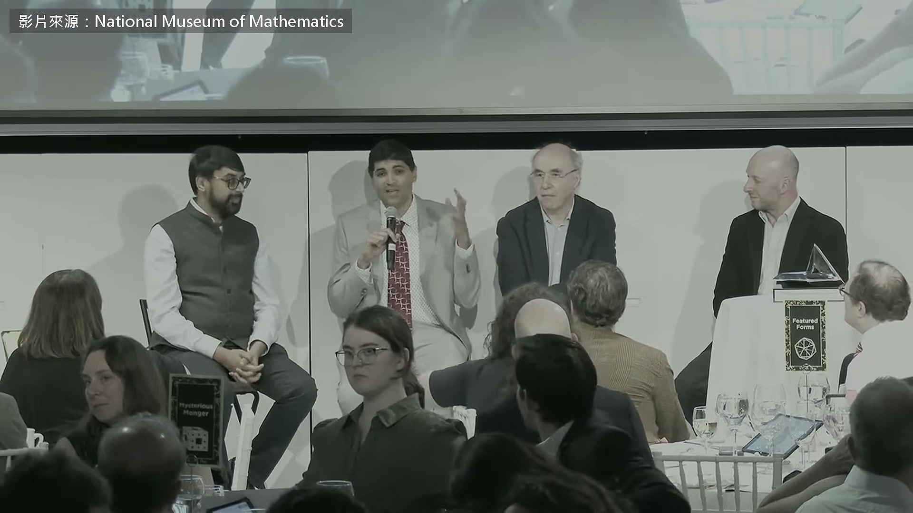

**逐字稿片段：** 今天台上有 Alex Kontorovich， 羅格斯大學的數學教授， 對數學跟 AI 想得很深

**話題推測：** 介紹第一位講者 Alex Kontorovich。

---

## 00:00:49

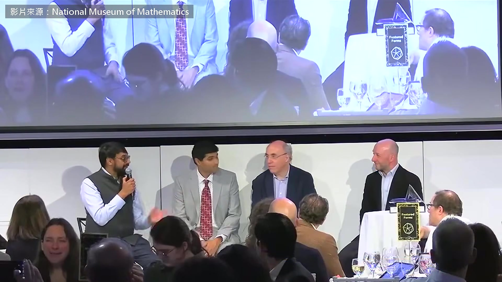

**逐字稿片段：** Stephen Wolfram，大家都認識他 Wolfram Alpha 跟數學軟體 Mathematica 的開發者， 幾十年來一直在想計算跟數學 是這個領域真正的大思想家之一 還有 Ankur Moitra， MIT 的數學教授， 專門研究機器學習跟 AI 背後的理論， 現在在普林斯頓高等研究院訪問 研究 AI 的理論基礎 我想請教每一位， 首先，這次解掉的是哪些問題， 對數學有多重要

**話題推測：** 介紹第二位講者 Stephen Wolfram。

---

## 00:01:30

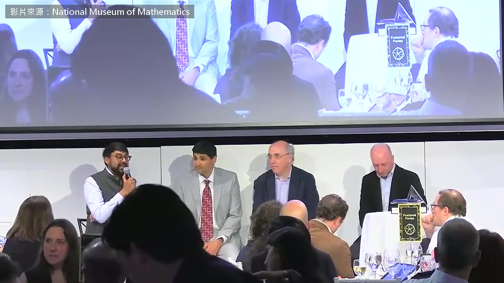

**逐字稿片段：** 再來是這代表什麼、我們怎麼走到這一步 也想聽聽數學跟 AI 的未來 還有數學會往哪裡走 那就先從你開始吧，Alex 我知道你整晚都在晚宴上， 但我們都在偷看到底解掉了哪些問題 我偷看了好多次，你也是 能不能簡單講一下，證出來的是哪些結果， 在你的領域算不算重要？ 我得說，在我的領域是相當重要 嗯，我們的領域很接近 是啊 我們都是做數論的 我自己是先翻了一下今晚公布的那 400 項解答

**話題推測：** 主持人提出座談的第二個主要問題：AI 發展的意義與過程。

---

## 00:02:13

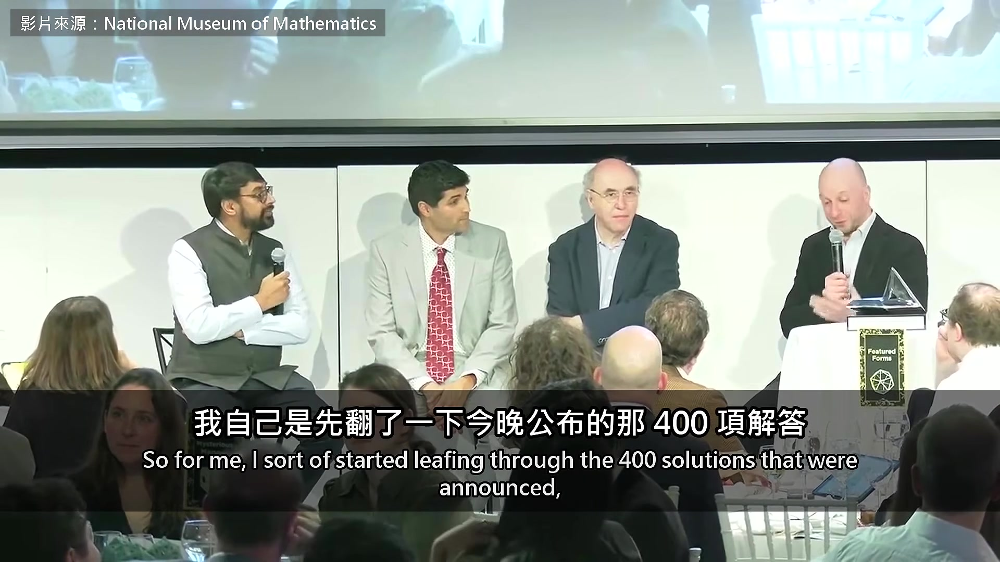

**逐字稿片段：** 一眼就跳出來的，是準黎曼猜想 黎曼猜想是這樣：有一個東西叫 zeta 函數 是黎曼大約 160 多年前研究的 他發現，就跟訊號處理一樣， 我的聲音在推動空氣分子， 這些空氣分子的運動會變成 0 跟 1 這叫做傅立葉分析 訊號處理就是把空氣的波形從麥克風收進來， 送到喇叭， 在喇叭裡放大重現 所以你們聽得到我的聲音 同樣的道理，質數可以想成那些空氣分子， 它們也有一個對偶的東西 對質數做訊號分析， 得到的叫做黎曼 zeta 函數的零點 這些零點是複數平面上的點 他猜這些零點全都落在某一條直線上， 至少重要的那些是 有一些是平凡零點，但重要的都在一條線上 那條線的實部是 1/2 總之有一條線，所有零點都應該在那上面 這對質數怎麼分布，有非常驚人的影響 我們 120 年前就知道的，是質數定理（正確：質數定理是 1896 年證明的，約 130 年前） 它等於是說，基本上沒有零點 落在實部等於 1 的那條線上，不是 1/2，是 1 所以中間有一段落差，只要能往內推進一點， 能證明有一整條直的帶狀區域，裡面完全沒有零點，

**話題推測：** Alex Kontorovich 提及 OpenAI 解決的重大問題之一：準黎曼猜想。

---

## 00:03:59

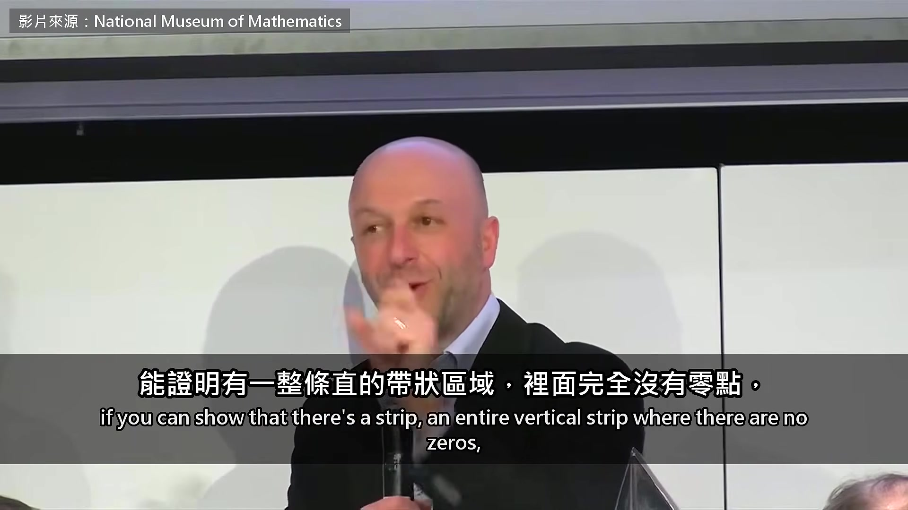

**逐字稿片段：** 這就叫準黎曼猜想 我們做解析數論的人常在講， 這不是很丟臉嗎？ 我們到現在都做不出接近那個強度的結果 明明其他方面這 120 年來有各種進展 今晚被解掉的就是這一題，大難題之一（補充：OpenAI 當天公布，尚未同行審查） 這只是今晚公布的 400 項之一 其他領域也有同樣重大的發表， 幾何、分析、組合數學、圖論都有 我剛剛舉的是數論的例子， 但數學很多分支都在發生類似的事 先讓大家感受一下發生了什麼事

**話題推測：** 具體解釋準黎曼猜想中「直的帶狀區域」的概念。

---

## 00:04:41

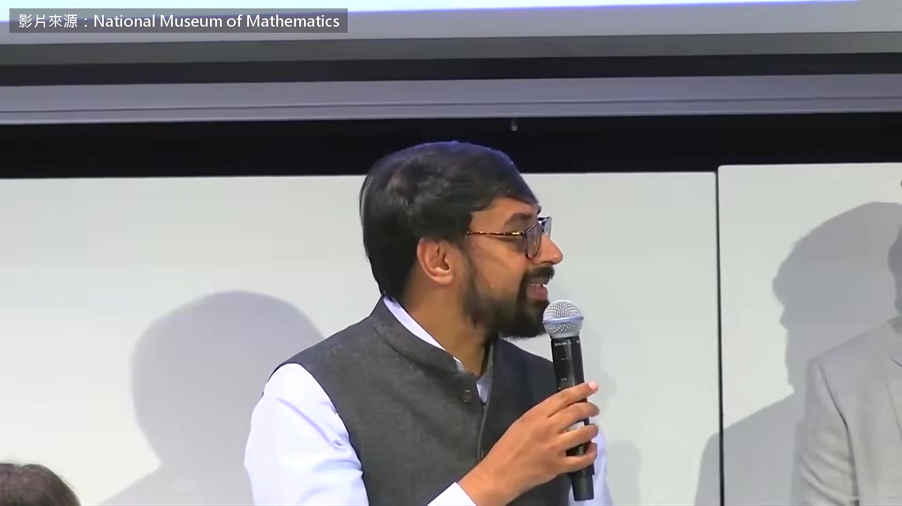

**逐字稿片段：** Stephen，問問你 這類事情你已經想了很多年 你料到會這樣嗎？這對數學的未來代表什麼？ 問題是，它到底是什麼？ 對，到底是什麼？

**話題推測：** 對話轉向 Stephen Wolfram，提問其對 AI 的看法。

---

## 00:04:51

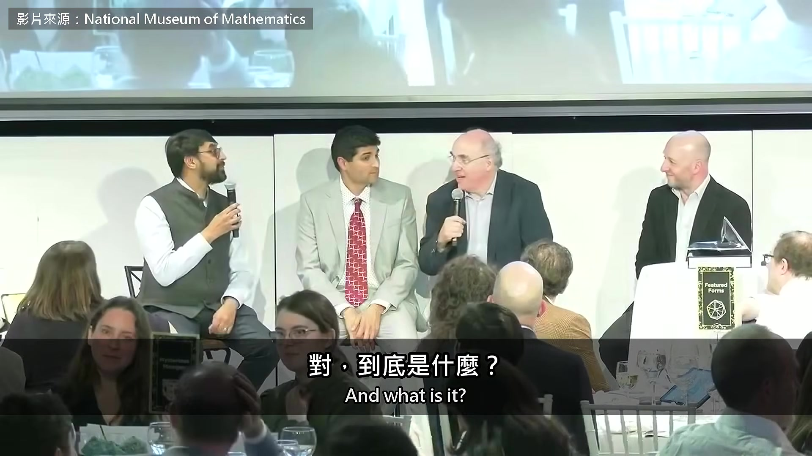

**逐字稿片段：** 數學文獻裡發表過的論文，大概有 400 萬篇 沒有一個人全部讀過 AI 全都讀得完 我覺得現在看到的很多結果，來自 這邊拿一點、那邊拿一點、再那邊拿一點， 然後拼在一起 用這種方法，能做出一定數量的東西 有點像 1970 年代末，我還是個做物理的毛頭小子， 我發現可以用電腦文獻檢索服務 去找各種主題的論文 這樣就能發現一堆東西 現在這個是它的超強化版 我覺得有意思的是去搞懂， 這對數學到底代表什麼 數學不是在解某一道特定的題目 數學是在解決問題 數學裡真正偉大的東西，

**話題推測：** 提及數學文獻中有 400 萬篇論文，突顯 AI 閱讀能力。

---

## 00:05:39

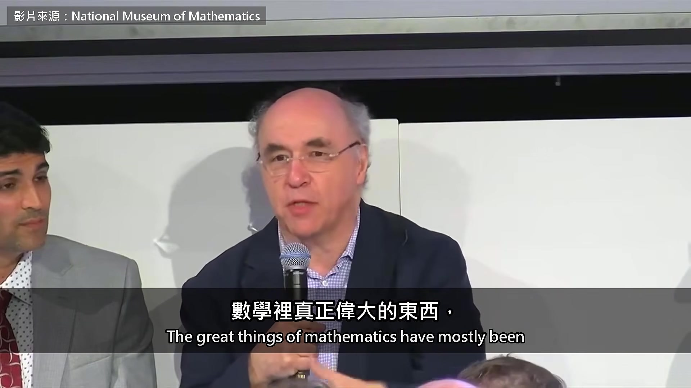

**逐字稿片段：** 大多是建立新的概念框架 這往往是跟人很有關係的事 因為這些概念框架是給我們人用的 這其實不太一樣， 它跟我們看到的解題，是不同類型的活動 另一件要講的是， 人到底看不看得懂它做出來的東西 我多年前參與過的， 我想是唯一一個由自動定理證明找到、 原本大家不認為成立的結果 那個證明根本看不懂 我想出這個東西 26 年了， 從來沒有人看懂那個證明 這對數學有什麼意義，還不清楚 這…這是個很複雜的題目 我上禮拜才寫了一大篇在講這個 至於今天看到的這些， 一家快要上市的公司，想再多添一兆美元市值， 這番努力能為世界做到這些，也滿酷的 說得好 我想… 好，你說 我想主持人出的題目是， 先跟大家講講解掉了哪些問題 我們很多人都還在消化，因為 消息來的時候，我們可能已經在吧台喝酒了 總之，我舉一個例子 我是做理論計算機科學的 計算複雜度理論有幾個非常重大的發現

**話題推測：** Stephen Wolfram 強調數學的偉大之處在於建立新的概念框架。

---

## 00:07:07

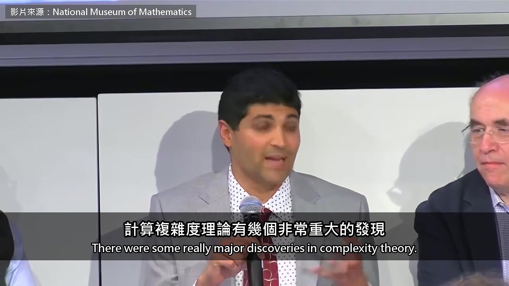

**逐字稿片段：** 其中一個大的，叫唯一遊戲猜想（補充：OpenAI 宣稱證出，尚未同行審查） 先講一點背景 有些最佳化問題，我們根本別指望解得出來 結果連近似解都別指望 有一種東西叫機率可檢驗證明 概念是，一個數學命題的證明， 可以編譯成一種語言， 只要抽查其中幾個位元，就能輕鬆驗證整個證明 這就成了一個框架，用來思考一個問題 不只是很難找最佳解，連近似都很難

**話題推測：** Ankur Moitra 提及 AI 宣稱證出的另一個重要問題：唯一遊戲猜想。

---

## 00:07:43

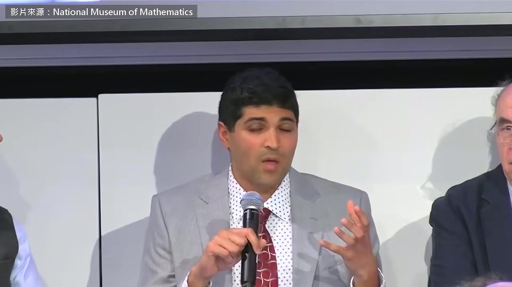

**逐字稿片段：** 有一個里程碑式的猜想，是 Subhash Khot 提的（Subhash Khot：紐約大學電腦科學教授） 叫唯一遊戲猜想 被當成「近似有多難」這個領域的聖杯之一 它用一種很有秩序的方式看世界， 如果它成立，整個領域就理出頭緒了 近似能做到哪裡，界線會一清二楚 我忍不住要說， 我今天來這裡吃晚餐之前，才剛見過 Subhash 就在 OpenAI 那批題目公布之前 我就問他，現在大家在討論一種新模式， 前沿實驗室找研究者，付錢請他們檢查這些證明 我問他：Subhash，假設啊， 如果唯一遊戲猜想有了一份證明， 因為外面傳言很多， 要請你花時間檢查，得付多少錢？ 你們今晚募到的錢真的很驚人，

**話題推測：** 介紹唯一遊戲猜想的提出者 Subhash Khot。

---

## 00:08:33

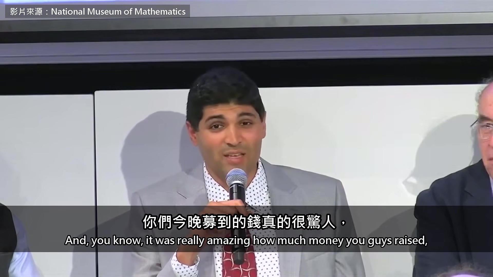

**逐字稿片段：** 不過 Subhash 開的價是 50 萬美元 這就是現在的行情，給大家參考 不過說正經的， 數學會發生非常劇烈的改變 我現在休假，待在高等研究院， 所以能帶幾位非常優秀的博士後 我覺得我這行最有成就感的，一直是帶學生 我喜歡做數學，喜歡學新東西 也喜歡研究還沒解開的問題 但能跟這些了不起的學生一起做研究， 看著他們成長、看他們怎麼看世界， 看他們出去做出了不起的事， 這才是最棒的 而現在最大的挑戰之一是， 這些東西會怎麼改變我們訓練研究生的方式？ 數學確實不是比誰先衝過終點的賽跑， 但能設下大家都同意的目標， 是我們訓練下一代很重要的方法 我們會設下很遠的目標， 但其實是在跟周遭的世界一邊學、一邊玩 想搞懂它，找出一些抽象的真理， 能從一個問題推廣到另一個問題 數學家要怎麼面對這件事，還有很多問題 我不知道，因為今天才第一天 不過我心裡有一個問題， 我們要怎麼確保自己還能一邊學、一邊玩？ 而且保住數學裡人的那一面 說到底，對數學家來說，

**話題推測：** 提及 Subhash Khot 檢查證明開價 50 萬美元的參考價格。

---

## 00:09:55

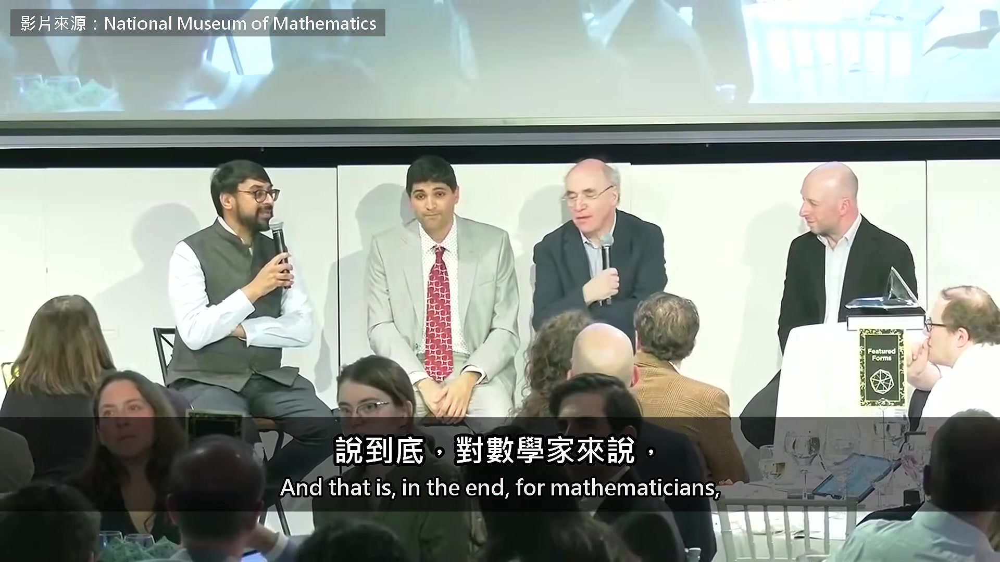

**逐字稿片段：** 數學是在追求一種藝術 而且是一種社交活動 比方說，我們不會叫藝術家別再創作、或換個方式創作， 只因為 AI 也會做藝術 數學有人性的成分，也有藝術的成分， 這些我們都得記著

**話題推測：** 強調數學的人性、藝術與社交本質。

---

## 00:10:17

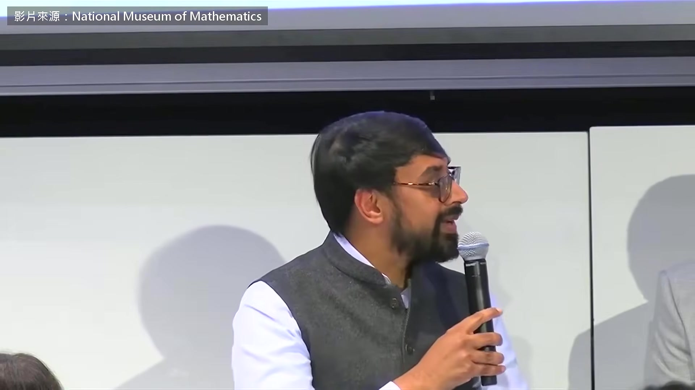

**逐字稿片段：** Stephen，你剛剛想說什麼？ 我覺得有一點很有意思，就我看到的，

**話題推測：** 對話再次轉向 Stephen Wolfram 發言。

---

## 00:10:21

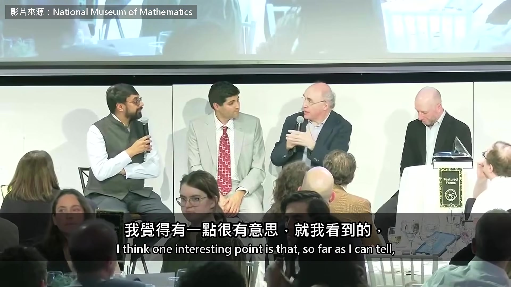

**逐字稿片段：** 這些題目全都是早就有人定義好的 對 很多領域都是這樣， 想出該問的那個問題， 沒錯 其實… 那是藝術很大的一部分 對，數學這門藝術 是問對問題 對，沒錯 我很好奇，你們可能知道， 因為你們真的看過這些證明， 這到底有多大程度，你們看得出來 它是這邊拿一點、那邊拿一點嗎 本來誰都做得到， 只是沒有人把那些論文全都讀過 是這樣嗎？還是不一樣？ 你不這麼認為？ 我覺得是。我是這樣猜的 另一件要搞清楚的是，新的數學很容易發現 如果你走進所謂的後設數學世界， 你有一堆公理，開始把公理組合起來 新定理很容易做出來，一兆個定理也很容易 問題是，大部分的定理根本沒人在乎 這是個複雜的問題，在所有可能的定理裡， 它們全都成立，全都能從公理推出來， 問題在於，更高一層的概念結構是什麼？ 就像世界上能想像的東西很多， 我們只替其中一小部分取名字 我們用少少幾個字，描述世界上大量可能的東西 我們替哪些東西取名字？ 這跟我們替哪些東西建立數學概念，是同一種問題 這不是… 機械那一面做得到的，是做出無限多個定理 對 話說回來，AI 這些技術非常有用 我自己用得很多 跟我過去 40 年打造的技術搭得很好 是很棒的東西 但要小心分辨，哪些是真正有意思的， 哪些大多只是上市前的炒作 好。今晚就開始了， 很多數學家會開始看這 400 篇公開的論文 剛剛就有人傳簡訊給我，第一批反應 是很多人、很多數學家都說，

**話題推測：** Stephen Wolfram 指出 AI 解決的問題多是已定義好的。

---

## 00:12:27

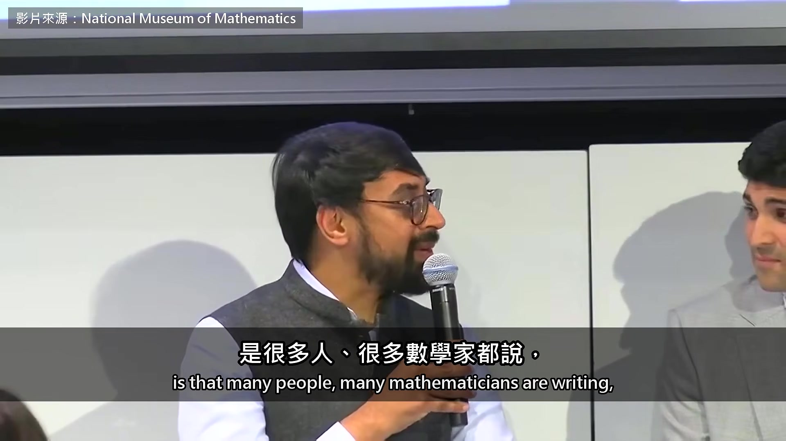

**逐字稿片段：** 這些論文其實寫得沒那麼糟 因為以前 AI 寫的數學論文，通常完全看不懂 這次他們真的下了功夫，讓人讀得懂 所以從今晚開始，大家都有功課了

**話題推測：** Alex Kontorovich 提及數學家對 AI 論文「寫得沒那麼糟」的初步反應。

---

## 00:12:42

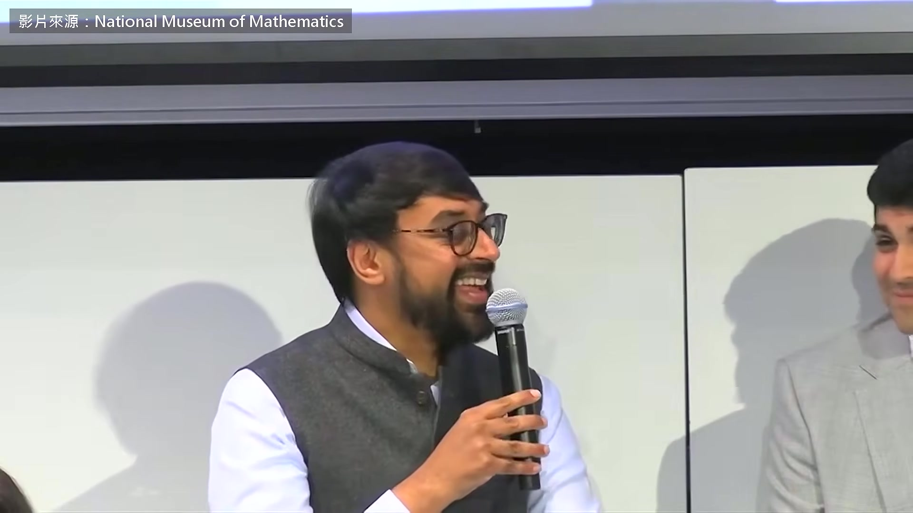

**逐字稿片段：** Alex，最後請你收尾 你覺得數學家該怎麼面對這件事？ 我們該開始看這些證明嗎？ 這會改變我們做數學的方式嗎？ 最後還有什麼想法？講完我們今晚就開工 我看這是我們的心理諮商時間吧？ 你說得完全沒錯，這次的證明比以前好看多了 之前有過一段很好笑的經過，

**話題推測：** 對話再次轉向 Alex Kontorovich 總結。

---

## 00:13:12

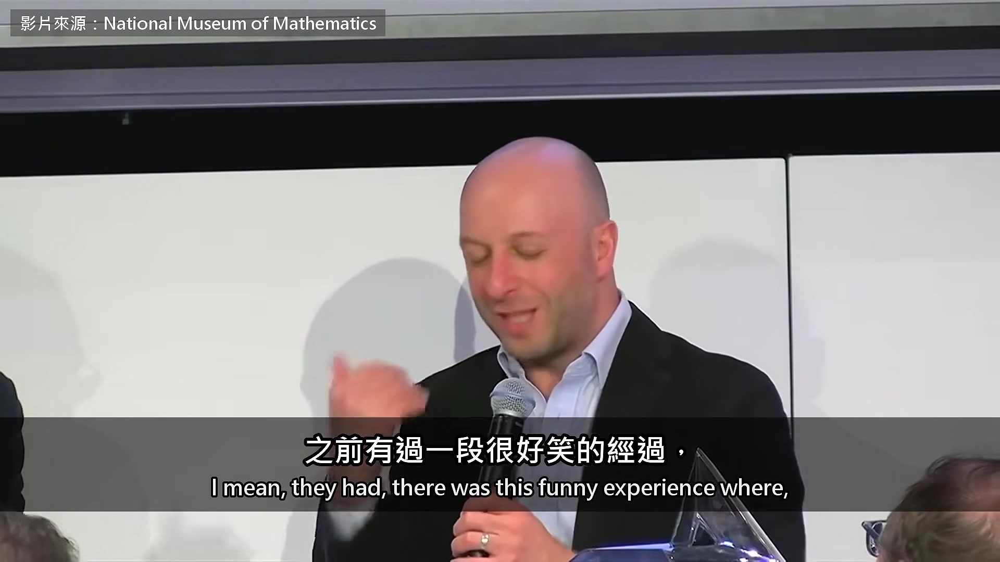

**逐字稿片段：** 5 月他們證出了單位距離猜想（正確：是推翻，模型找到了反例） 又一個重大的未解問題，很多人… 這差不多是他們第一次證出 不只是 Erdos 問過、60 年沒人想過的那種題目（Erdos：20 世紀匈牙利數學家） 而是很多很多人花了大把時間想過的題目 是圈內公認的未解問題，結果他們解掉了

**話題推測：** Alex Kontorovich 提及 5 月 AI 解決單位距離猜想的案例。

---

## 00:13:32

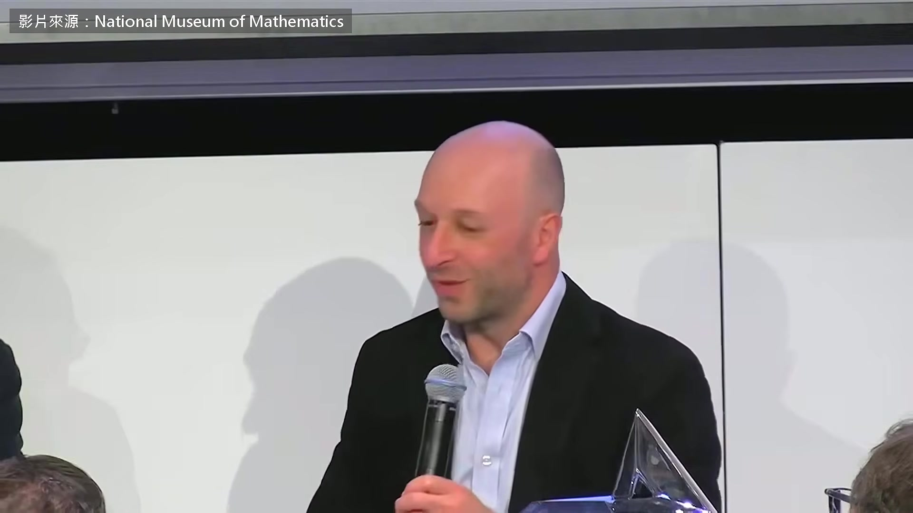

**逐字稿片段：** 我記得他們把它放上了論文預印本網站 arXiv， 數學家基本上就說： 你們竟敢拿 AI 垃圾，汙染 arXiv 上的科學文獻 好吧

**話題推測：** Alex Kontorovich 提到 AI 論文首次發布在 arXiv 平台。

---

## 00:13:41

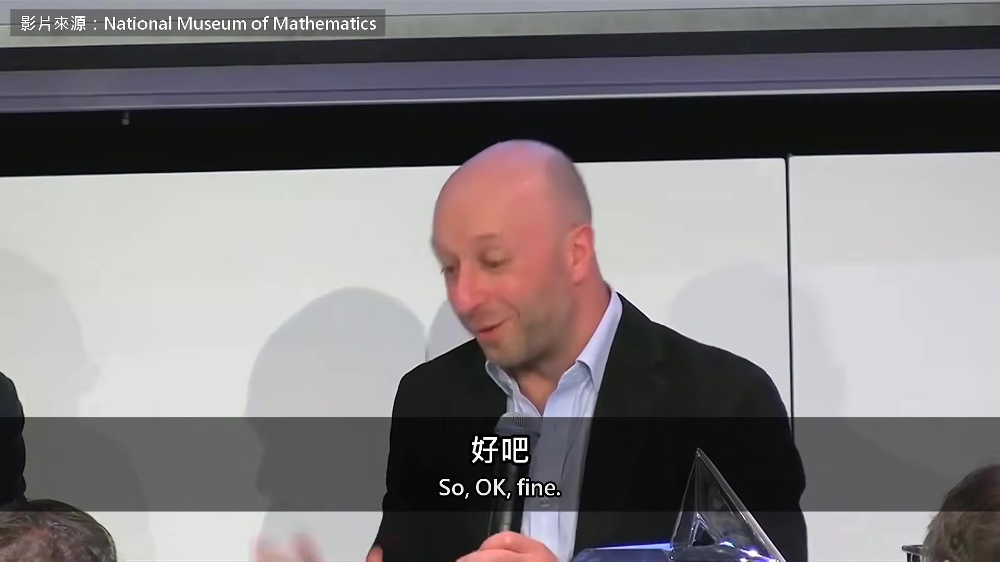

**逐字稿片段：** 然後到了 6 月，他們又證出了，（正確：是 8 月 1 日） 上一次他們大批發表的是 10 個問題， 包括非 sofic 群的存在性 這也是一個重要的研究領域 結果這次他們只發在推特跟自己的部落格上 因為數學家叫他們別放 arXiv 結果數學家又說：你們竟敢發在推特上？ 你們不能就這樣把東西丟出來 不能隨手丟進虛空裡 這些得成為數學文獻的一部分 所以他們開始把結果壓著不發 因為我們叫他們別發推特，也別放 arXiv 他們就不知道該怎麼辦了 然後我們又開始對他們吼：不行，快把結果放出來 我猜他們是等到對文章品質滿意了才發 也許這就是他們的模型下一個變強的地方 不過回答 Stephen 的問題， 那是一份 200 頁的證明 我今晚大多都在這裡 一直在跟大家寒暄，所以細節還沒看 但很多人都非常非常努力試過，把自己知道的全用上了 很有可能，它是在某個領域找到了一種技巧， 一個沒有任何解析數論學家熟悉的領域 就是靠那個破解的 也很有可能，它想出了一個前所未有的點子 是哪一種，時間會告訴我們 但每次我坐下來，想仔細講清楚 有什麼是我做得到， 而大型語言模型、或更廣義的 AI 永遠做不到的， 這個練習，我每次都失敗 所以我非常期待看到這一切會走向哪裡 最後主持人把問題拉大 AI 在數學上的用法 只是它走進生活的一個縮影 大家愈來愈依賴它 可是它為什麼行得通 理論上還說不清楚

**話題推測：** Alex Kontorovich 提及 8 月 AI 發表 10 個問題，包括非 sofic 群的存在性。

---

## 00:15:27

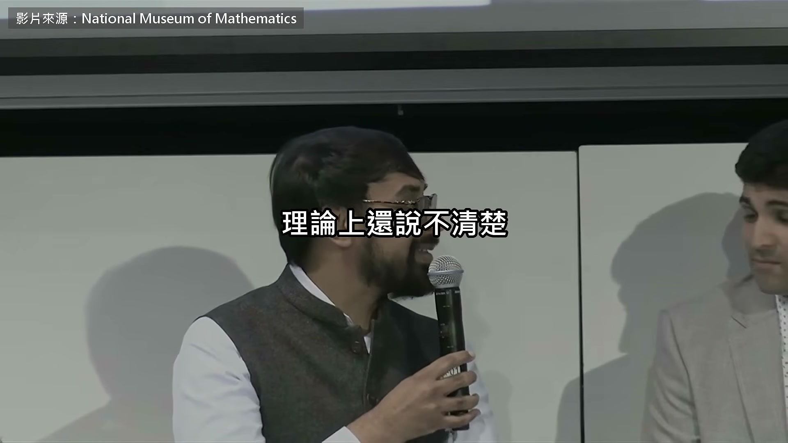

**逐字稿片段：** 他問 MIT 的 Moitra 這方面有沒有進展 Moitra 說 大家本來希望 AI 能像物理那樣 用幾個簡單的模型就完全看懂 可是 AI 學的是真實世界的資料跟語言 沒有那麼單純

**話題推測：** 對話轉向 Ankur Moitra，討論 AI 運作原理的解釋性問題。

---

## 00:15:40

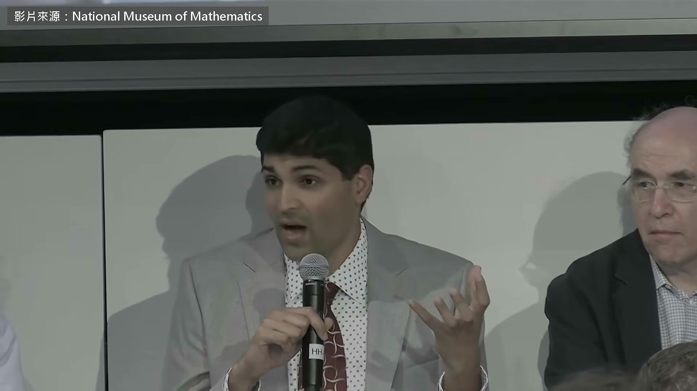

**逐字稿片段：** 所以這很難，得先改變我們認為什麼叫「解釋」 不是要一套從頭到尾、滴水不漏的理論， 而是要有能幫我們理解發生什麼事的模型， 讓我們能知道， 這些系統放進社會或其他場合之後，會發生什麼事

**話題推測：** Ankur Moitra 提出需要改變對 AI 系統「解釋」的定義。

---

## 00:16:00

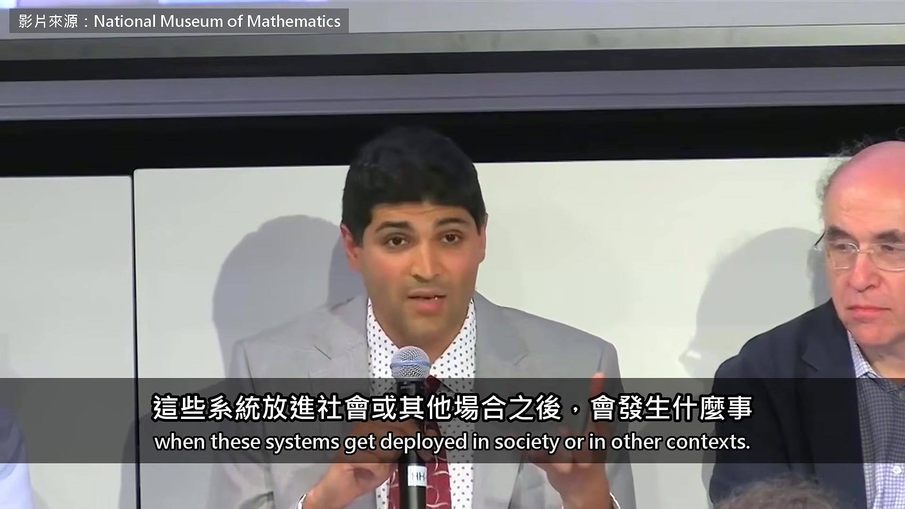

**逐字稿片段：** 它們公平嗎？推廣得好嗎？安全嗎？ 諸如此類 問題很亂，不代表我們就該躲開 我不覺得這很容易 但這就是我每天早上起床的動力 真心希望我們有在進步 我就講到這裡，謝謝

**話題推測：** Ankur Moitra 討論 AI 系統的公平性、推廣性與安全性問題。

---

## 00:16:19

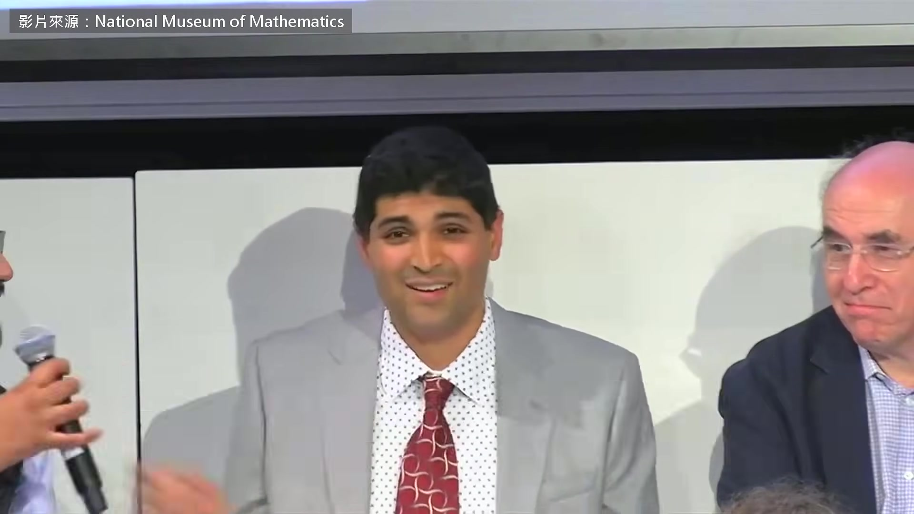

**逐字稿片段：** Stephen，你要補充嗎？ AI 的自然科學，這個問題很有意思 就像你剛剛提到的，這並不明顯， AI 不見得有類似自然定律的東西 一個 AI 系統的運作方式，很可能是

**話題推測：** 對話再次轉向 Stephen Wolfram 補充其觀點。

---

## 00:16:37

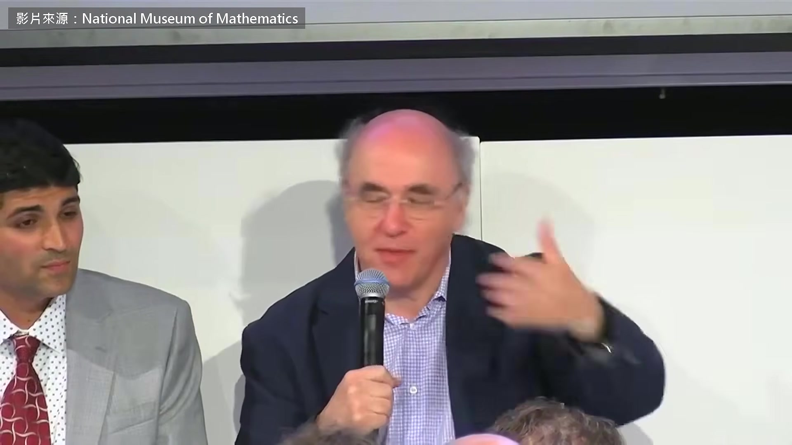

**逐字稿片段：** 我所說的「計算不可約」 底層的規則你都知道， 但要算出這個系統會做什麼， 你沒有別的辦法，只能一步一步跑，看會發生什麼 我認為 AI 很大一部分必然是這樣 這代表一旦有這種現象， 它永遠可能讓你嚇一跳 比方說，你永遠沒辦法說： 「我保證這永遠是安全的」 你沒辦法先跳到後面去說， 它永遠不會做出我不想讓它做的事 這能講的太多了，是個很有意思的題目 是啊 這個討論還會持續好幾年， 我們只是想在今晚先開個頭 Kontorovich 試過好幾次 想寫下哪件事是他做得到 AI 永遠做不到的，一次也沒寫成 Wolfram 說得更遠 連它接下來會做什麼 都只能等它一步一步跑完才知道 原影片將近 20 分鐘 Wolfram 還講了 科學是在大自然跟人腦想得懂的東西之間搭一座橋 數學也一樣 Moitra 也講到 有明確量尺的題目最讓研究生安心 可是 AI 的很多問題 連要怎麼描述都還不知道 原影片連結在說明欄，有興趣可以去聽更多。

**話題推測：** Stephen Wolfram 提出 AI 系統運作可能具有「計算不可約」的特性。

---
