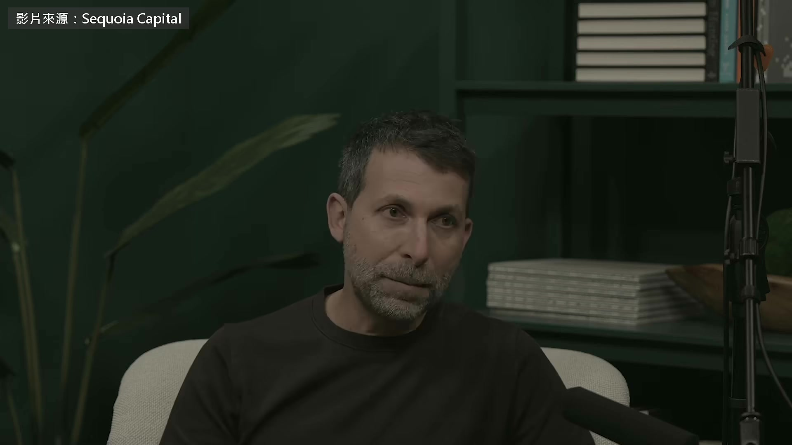
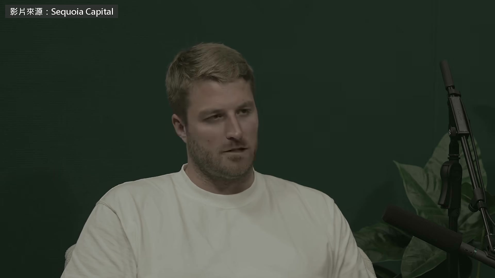
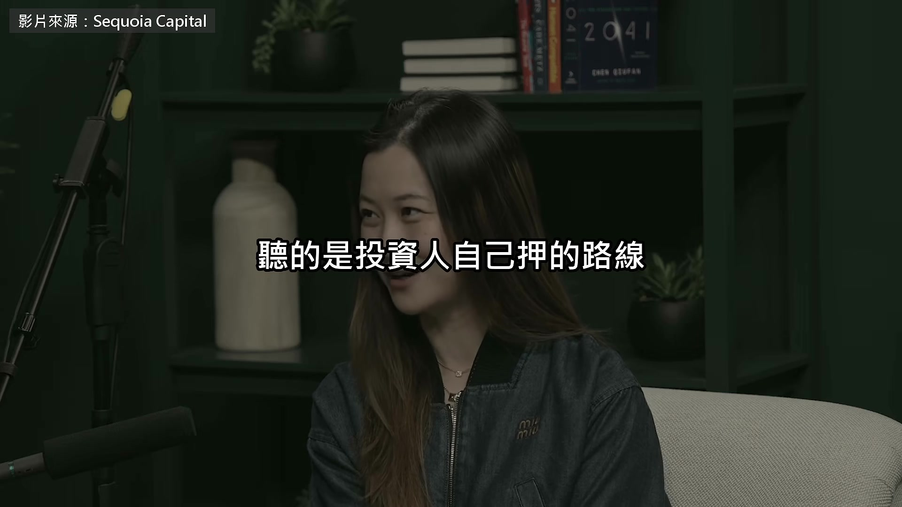
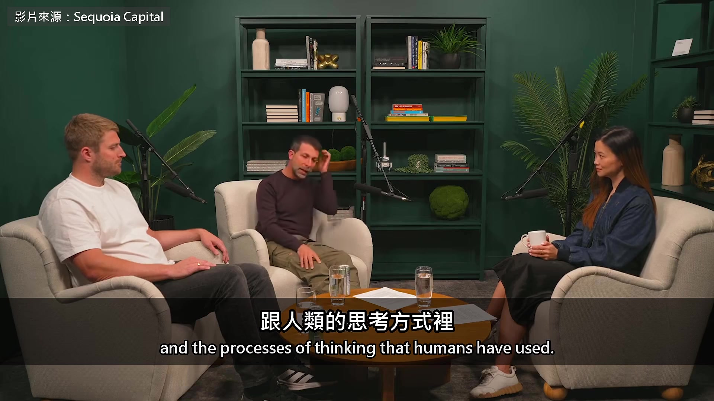
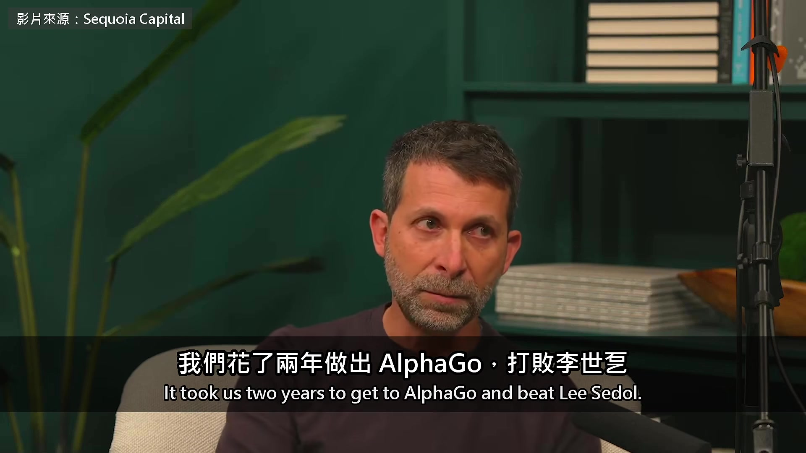
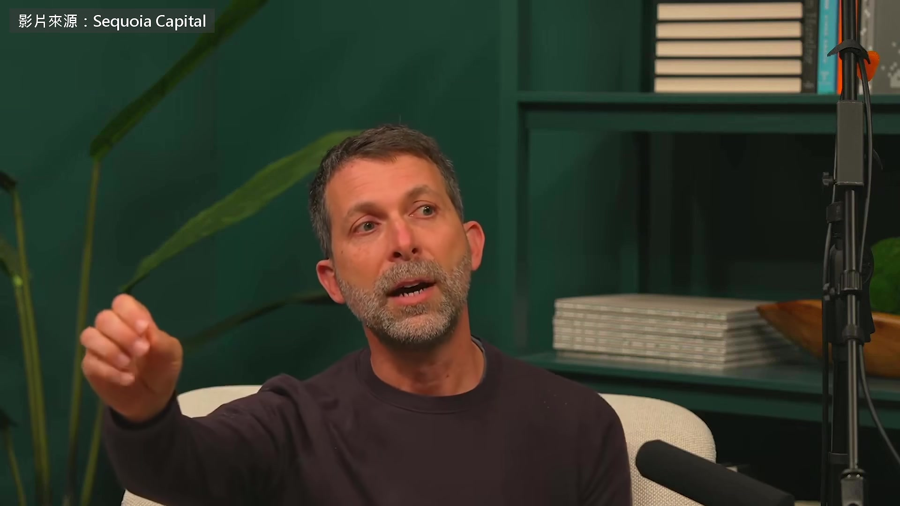
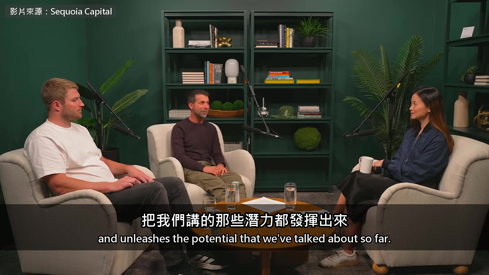
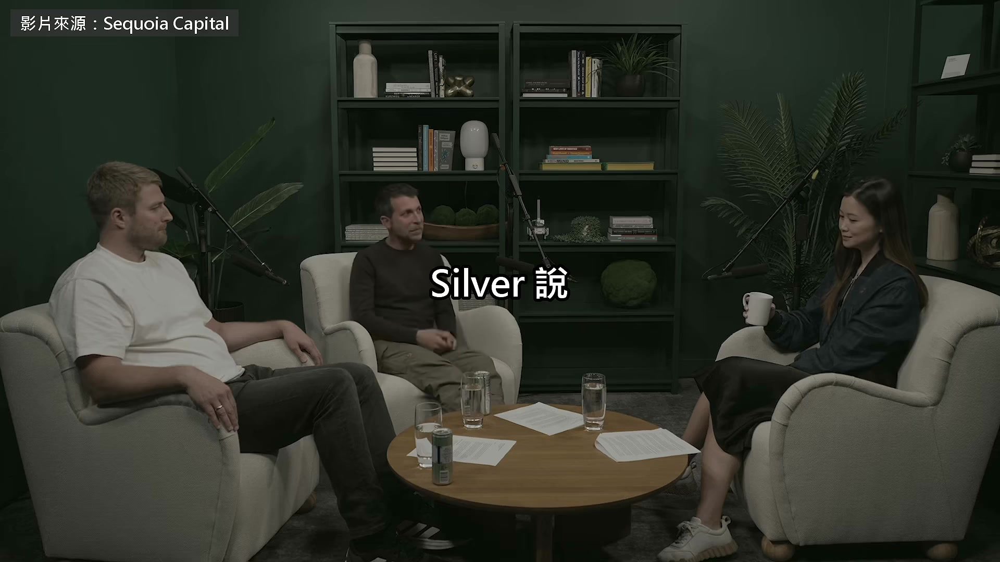
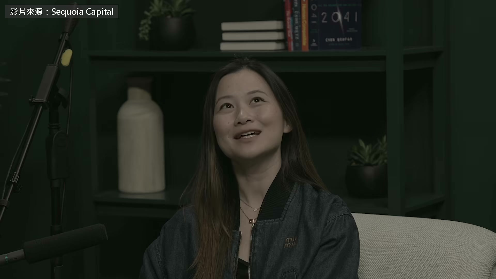
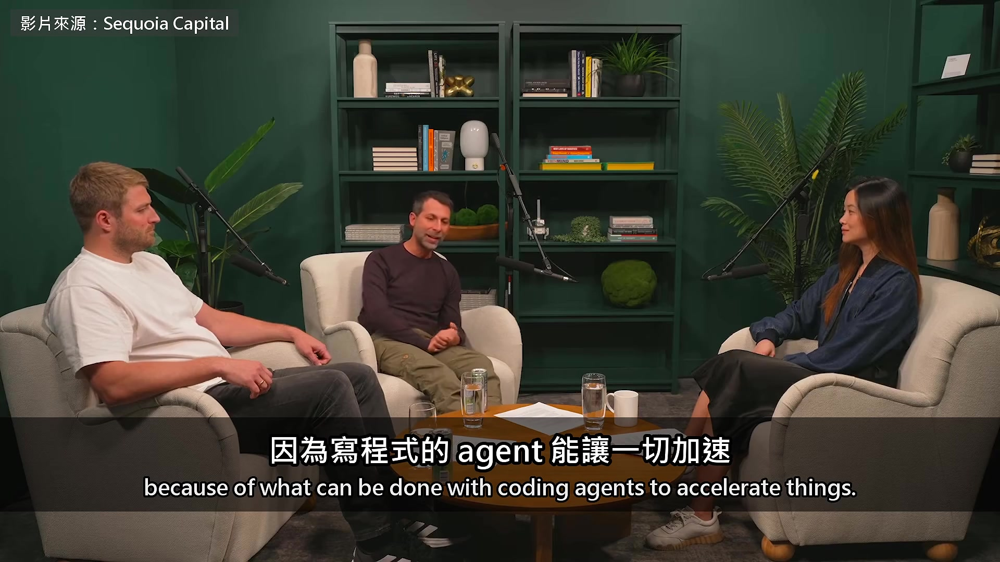

# ai-note-101_ZGUojpZ8dJQ — 關鍵畫面索引

- 來源逐字稿：[ai-note-101_ZGUojpZ8dJQ_GT.srt](ai-note-101_ZGUojpZ8dJQ_GT.srt)
- 影片：https://www.youtube.com/watch?v=ZGUojpZ8dJQ
- 截圖數：12

## 00:00:00

**逐字稿片段：** 2016 年打敗李世乭的 AlphaGo 帶隊的研究員就是 David Silver 今年 1 月他離開 Google DeepMind 開了 Ineffable Intelligence 要做不靠人類資料的 AI 4 月拿到 11 億美元的種子輪 旁邊這位 Lasse Espeholt 是共同創辦人

**話題推測：** 介紹 AlphaGo 及其成就

---

## 00:00:16

**逐字稿片段：** 這是紅杉資本 10 月 13 號上架的訪談 紅杉正是這輪的領投方 聽的是投資人自己押的路線

**話題推測：** 說明影片內容來源為紅杉資本的訪談

---

## 00:00:22

**逐字稿片段：** Silver 的博士指導教授 Rich Sutton 前陣子也上過這個節目 一樣不看好大模型 Silver 說得更直接 大型語言模型靠的是人類資料 這條路走不到超級智慧 這世界上已經有好幾萬 甚至幾十萬個非常優秀的研究員 全都在走一模一樣的路 全力押在 LLM 上 預訓練、後訓練、寫程式 就是 LLM 那一整條路 我要去當第十萬零一個走這條路的人嗎 這樣花我的時間跟精力，最有效嗎 最後我想通了，還有另一盞路燈 現在沒有人在它底下找 如果我把力氣放在那裡 對這個領域產生巨大影響的機會大得多 因為這條路要是走得通，整個 AI 都會改變 他把要做的東西叫 superlearner 一開始什麼都不會 最後自己學到超過人類知道的一切 打個比方，就像人類整體來說 我們一開始腦袋裡只有一團灰色漿糊 起初什麼都不知道 卻一路發現了人類今天知道的一切 那是大家一起發現的過程 語言、科技、科學、數學，還有其他所有東西 我們學會的每一樣東西，都是自己發現的 不是有人從天而降，給我們一張藍圖 也不是有人丟給我們一個上兆筆的資料集 說「喏，這些東西應該長這樣」 我們是自己想出來的 這件事很驚人，AI 到現在還沒有人破解 所以對我來說，要做到超級智慧，關鍵就在這 一個能永遠學下去、一直發現新知識的系統 我個人認為 誰要是覺得人類語言是終點 或是推理最好的方式 這種看法有點天真 我還要說，從人類語言出發 拿它當推理的方法，有點問題 因為這會把我們的偏見全部帶進來 我們覺得 agent 應該怎麼想 舉個例子，可以這樣想像 如果退回 500、1000、2000 年前 只能用那時候人類用的語言 那我們的 agent 可能會以為地球是平的 或是以為生病是四種體液失衡造成的 裡面會藏著各種奇怪的信念 而且很難拿掉 因為它們太根深蒂固，長在那種語言 跟人類的思考方式裡

**話題推測：** 提及 Silver 的博士指導教授 Rich Sutton 及其觀點

---

## 00:03:19

**逐字稿片段：** 回到 AlphaGo 的例子 我們發現，一放掉人類資料 對了，我們花了大概兩年做 AlphaGo 做法有點像現在的 LLM 每一層都是我們自己蓋的 下一層也是我們手工拼起來 我們放了大量人類資料 然後人在迴路裡，一路改進它 我們會拿上一代 決定要怎麼改，做出下一代 我們就在這個迴路的正中間 我們花了兩年做出 AlphaGo，打敗李世乭

**話題推測：** 話題回到 AlphaGo 的例子

---

## 00:03:53

**逐字稿片段：** 等到 AlphaZero 做對了 我們放棄人類資料，終於專心在 做一個能自己去發現的演算法 一旦做對了，那個演算法 只花了幾個小時 幾個小時就超越我們兩年的成果 那兩年還是人在迴路裡做的

**話題推測：** 介紹 AlphaZero 及其不同做法

---

## 00:04:11

**逐字稿片段：** 西洋棋的話，四個小時就打敗世界冠軍 那是史上最強的 AI 圍棋的話，我記得是幾天吧 但進步大得不得了 所以你得放掉人類資料 才能讓自己發現這些東西 一口氣衝過所有對手 發現那種會一直學、永遠學下去的東西 所以這必須是主動的選擇 如果你不主動做這個選擇 我看現在很多 LLM 公司 基本上是在做半自主、人在迴路裡的學習演算法 學習的迴路裡有好幾千個人 這樣是行得通 能做到這麼遠，我很佩服 但除非我們退一步 真正找到能自己學的方法 否則走不到真正的 superlearner 把我們講的那些潛力都發揮出來

**話題推測：** 舉例說明 AlphaZero 在西洋棋的突破性表現

---

## 00:05:08

**逐字稿片段：** 主持人接著問到對齊 他做出來的 superlearner 會不會自然就跟人類的價值觀一致 講到現在的對齊 我們基本上非常依賴的對齊方法 是靠 agent 用的語言 還有從人類資料來的先驗 到目前為止都還算、都非常有效 但我們開始看到，這個方法快到極限了 光靠它，我覺得很難找到出路 agent 無可避免會越來越強 我們已經看到這件事在發生 agent 訓練得越多 就會開始壓過它們的先驗 它們會學會說一套、做一套 Silver 說

**話題推測：** 話題轉向 AI 對齊（alignment）問題

---

## 00:06:01

**逐字稿片段：** 電腦圍棋被攻克的那一年 他提早十年就猜中了

**話題推測：** 提及電腦圍棋被攻克的時間點

---

## 00:06:05

**逐字稿片段：** 主持人最後請他預測 超級智慧什麼時候會來 我想一年之內 我們會看到非常強的證據，證明方向是對的 我也認為我們會做出真正的超級智慧 照我前面講的定義 就是能發現遠遠超出人類能力的東西 從科學、數學、科技到語言，什麼都包 我原本以為要三到五年 我的時間表提前了一點 所以我說三年 因為寫程式的 agent 能讓一切加速

**話題推測：** 主持人提問關於超級智慧預測時間點

---

## 00:06:47

**逐字稿片段：** 從 AlphaGo 到 AlphaZero 他證明過一次 拿掉人類資料反而走得更遠 這次他把同一個賭注押在超級智慧上 他說三年

**話題推測：** 總結 AlphaGo 到 AlphaZero 的經驗

---

## 00:06:57

**逐字稿片段：** 原影片一個多小時

**話題推測：** 介紹原影片時長與其他討論話題

---

## 00:06:59

**逐字稿片段：** 他們還聊了圍棋為什麼要兩個人下 才會複雜到永遠學不完 還有 Silver 為什麼支持放慢 AI 但在模擬裡照樣全速衝 原影片連結在說明欄，有興趣可以去聽更多。

**話題推測：** 提及原影片中圍棋複雜性話題

---
