# ai-note-101_ZdMf47ftJrM — 關鍵畫面索引

- 來源逐字稿：[ai-note-101_ZdMf47ftJrM_GT.srt](ai-note-101_ZdMf47ftJrM_GT.srt)
- 影片：https://www.youtube.com/watch?v=ZdMf47ftJrM
- 截圖數：22

## 00:00:00

**逐字稿片段：** 楊立昆的團隊這個月又發表了新的世界模型 H-JEPA 他要走的是一條不靠語言模型的路 上個月他在我們頻道算過一筆帳 一個 4 歲小孩眼睛看進去的資料 就跟最大的語言模型讀過的一樣多

**話題推測：** 介紹楊立昆團隊新發表的世界模型 H-JEPA，可能展示模型名稱或楊立昆照片。

---

## 00:00:14

**逐字稿片段：** Christopher Manning 認為 楊立昆錯在太看輕語言 Manning 是史丹佛的語言學和電腦科學教授 當過那裡的 AI 實驗室主任

**話題推測：** 介紹 Christopher Manning，可能顯示其照片或個人簡介。

---

## 00:00:23

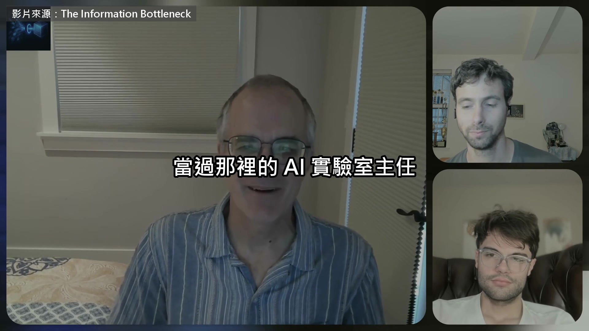

**逐字稿片段：** 他開的 CS224N 這門課 專教 AI 處理人類語言 一整代 AI 研究員都是看它入門的

**話題推測：** 提及 Manning 開的課程 CS224N，可能顯示課程名稱或相關資料。

---

## 00:00:30

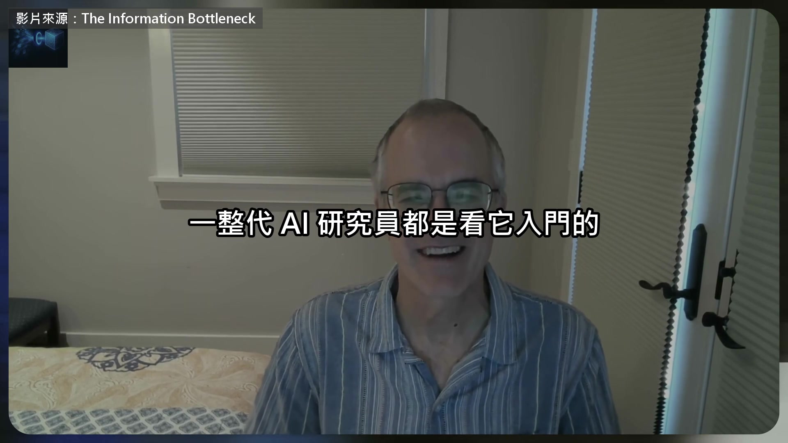

**逐字稿片段：** 這是今年 9 月底上架的訪談 主持人問他怎麼看楊立昆 這件事爭議很大 這點我絕對同意 我不想站在任何一邊的極端 我認為有中間地帶

**話題推測：** 提及今年9月底的訪談，可能顯示訪談畫面或標題。

---

## 00:00:52

**逐字稿片段：** 但我確實認為，楊立昆低估了 也小看了人類語言的角色 我先從這裡講起

**話題推測：** Manning 開始闡述對楊立昆的觀點，可能顯示對比雙方論點的摘要。

---

## 00:01:09

**逐字稿片段：** 我認為楊立昆看事情的方式是 人有一顆大腦 它做著各種了不起的事，它在思考 也許楊立昆是很靠畫面思考的人 因為他形容思考時，總是在講看到什麼 有些人確實是用影像在想 但我覺得也有很多人 他們的思考大多是在心裡自言自語 是用字在想 楊立昆認為，大腦思考跟語言無關 大腦很厲害 能做複雜的視覺理解、推理、規劃等等 語言唯一的用處，是讓人跟人溝通 而且頻寬很低，不是很好用 我可能講得有點誇張 但我想楊立昆大概就是這樣看世界的

**話題推測：** 概述楊立昆對思考方式的看法，可能以列表或圖示呈現其觀點。

---

## 00:02:16

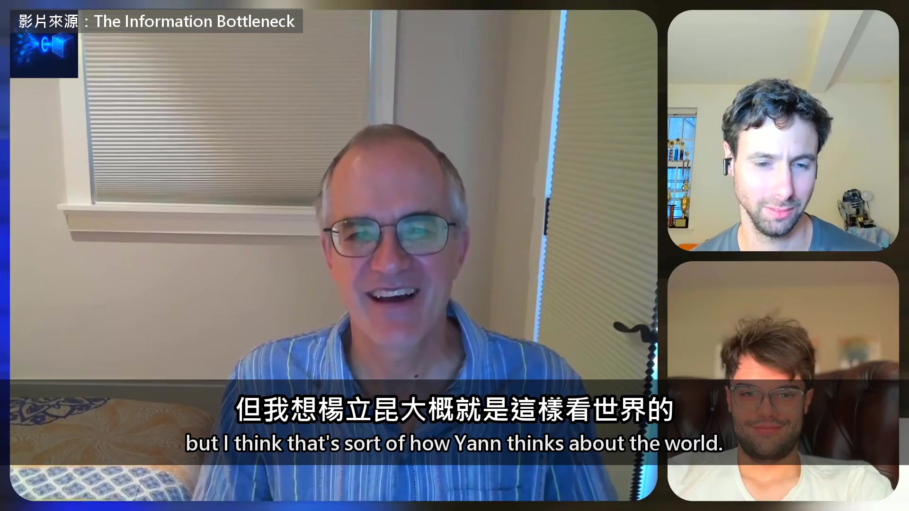

**逐字稿片段：** 再來是他認為 大型語言模型根本是壞掉的技術 因為自迴歸這套架構，永遠給不出世界模型 也做不到他要的空間推理和看懂世界

**話題推測：** 轉向楊立昆對大型語言模型是「壞掉的技術」的看法，可能顯示新的論點標題。

---

## 00:02:39

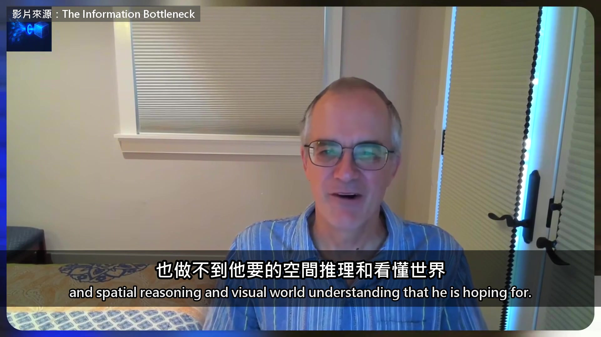

**逐字稿片段：** 於是就有了他提出的 JEPA 我認為這套說法有很多地方 介於有問題跟錯了之間 首先，我認為語言在人類智慧裡 份量大得多，也更核心 事實是 我們的大腦跟黑猩猩、巴諾布猿非常像 這些跟我們血緣最近的猿類 某種程度上牠們也很機靈，能做很多事 牠們視力好、空間記憶好，還會規劃 其實像規劃這種能力，更低等的動物也有

**話題推測：** 提到楊立昆提出的 JEPA 模型，可能顯示 JEPA 的概念圖或示意圖。

---

## 00:03:29

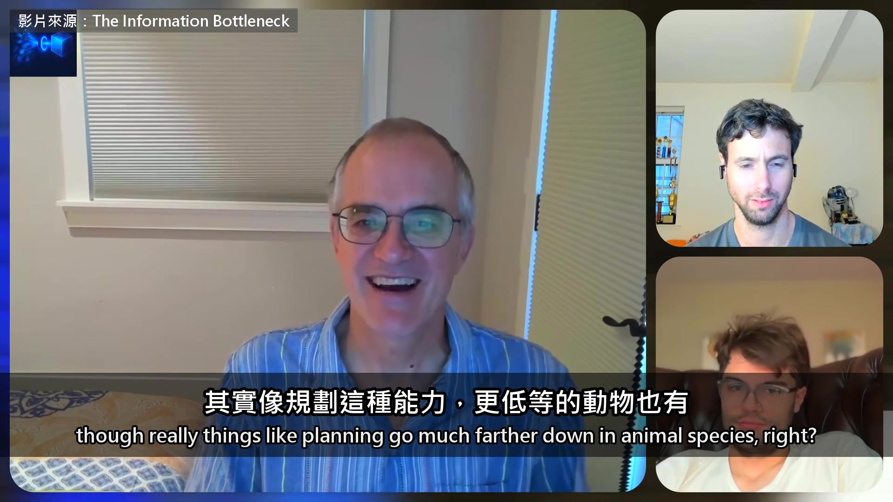

**逐字稿片段：** 研究發現連烏鴉都會做各種規劃 牠們算是很聰明 可是牠們的成就，跟人類差太遠了 從這個角度看

**話題推測：** 提及烏鴉的規劃能力研究，可能顯示烏鴉的影像或研究報告截圖。

---

## 00:03:47

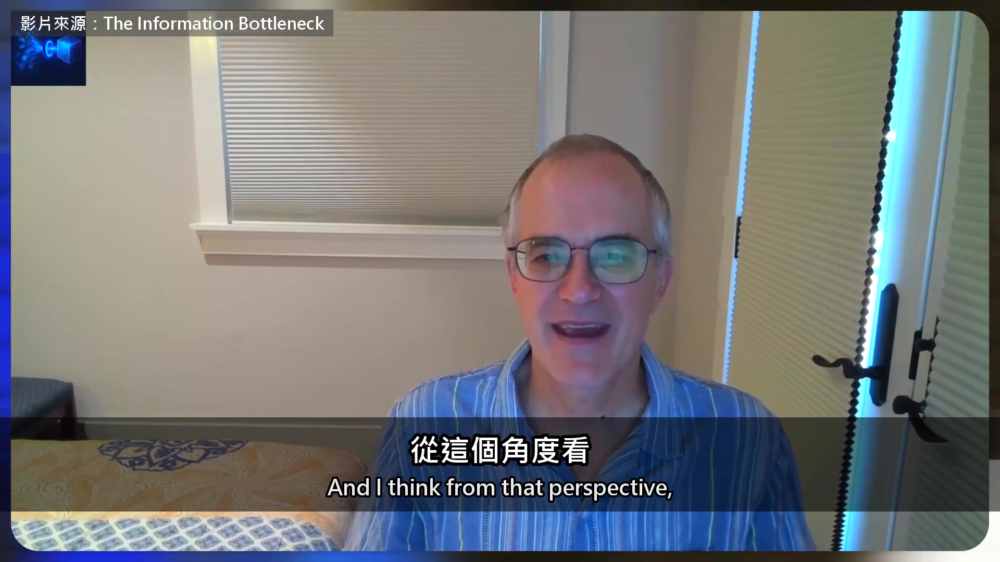

**逐字稿片段：** 語言就是人類在認知上的一大解鎖 而且這個解鎖有兩層 第一層是，至少對大多數人來說 我們很多的思考 規劃、記憶、整理世界，都是用語言的分類在做

**話題推測：** 提出語言是人類認知上的一大解鎖，可能顯示圖解或重點摘要。

---

## 00:04:15

**逐字稿片段：** Dan Dennett 寫過（Dan Dennett：美國哲學家，研究心智） 智慧會靠認知工具提升 他說近代有一些比較新的認知工具 像是數學符號、程式語言 但人類想出來的第一個、也是最大的認知工具 就是語言 我覺得他說得對 語言讓人類思考的能力大幅提升 造就了一個人單獨能做到的事 但語言在智慧上的另一個大解鎖 是讓我們演化出社會，有了社會的智慧 我覺得認知科學家太久只盯著個人 很少想到我們的智慧，有多少其實屬於社會 我們現在做的那些複雜的事

**話題推測：** 介紹哲學家 Dan Dennett 及其觀點，可能顯示其照片及引述文字。

---

## 00:05:16

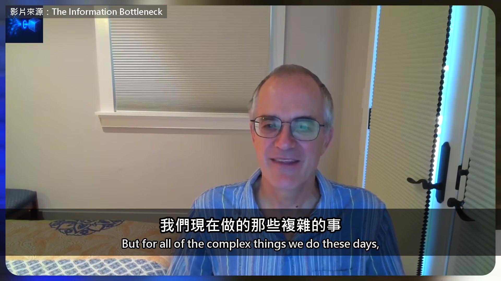

**逐字稿片段：** 像是經營大公司、生產 iPhone 沒有一個人能從頭到尾全懂 是靠好幾百個人一起合作 每個人做自己那一小塊 我們才有這些驚人的成就 也才深入了解世界的很多領域 說來有趣，最近有些報導 講 OpenAI 的 agent 在網站上亂來 我們好像看到一種很好笑的社會智慧 在 OpenAI 的模型之間派上用場 因為它們就在那個留言板上 是它們拿一個軟體倉庫網站改出來的 分享它們摸索出來的心得 怎麼解推理題、怎麼入侵系統之類的 其實在那裡，一群 agent 組成的社會 也開始有了比個體更高的社會智慧

**話題推測：** 舉例經營大公司、生產 iPhone，可能顯示相關的企業或產品畫面。

---

## 00:06:27

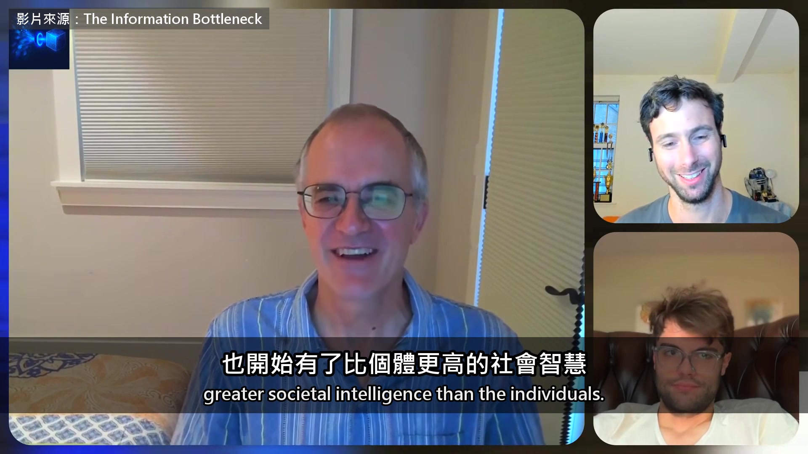

**逐字稿片段：** 主持人接著翻出一場舊辯論

**話題推測：** 主持人引導至舊辯論，可能顯示辯論主題標題。

---

## 00:06:30

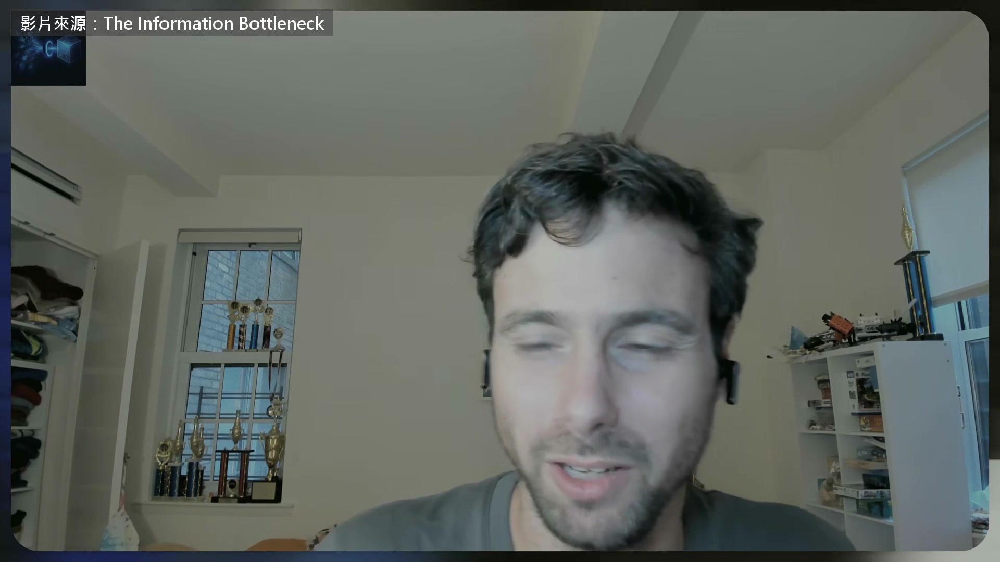

**逐字稿片段：** 2020 年 語言學家 Emily Bender 發表過一篇很有名的論文 主張只看過文字的系統 看再多也學不到意義 因為它從沒碰過那些字指的東西 當年反方最有名的人 就是 Manning 6 年過去了 模型幾乎都不只看文字了 主持人想知道他現在的看法 我那時就是要主張，那根本是錯的 其實你可以建構出意義 只靠語言裡字跟字之間的關係 人類就是這樣 光聽文字描述跟詞語，就能學到意思 大型語言模型只要資料夠多 也能開始學到字的意義 這其實就接回楊立昆的世界模型

**話題推測：** 介紹 Emily Bender 及其著名論文，可能顯示 Bender 的照片或論文標題。

---

## 00:07:34

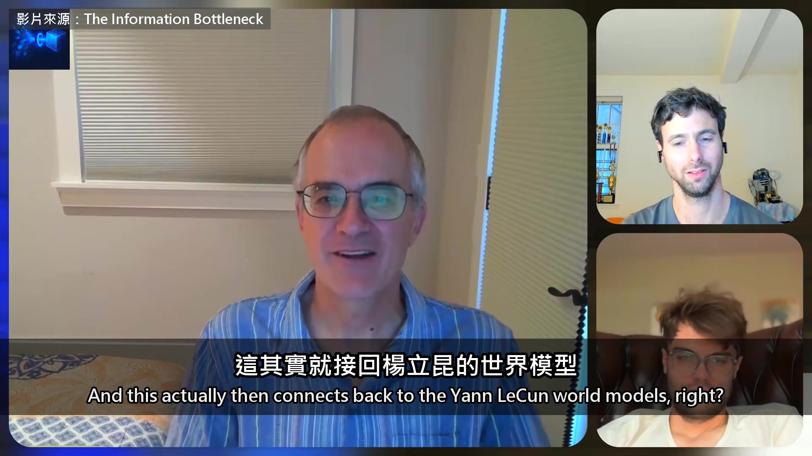

**逐字稿片段：** 有很長一段時間，楊立昆主張 語言模型永遠不可能理解物理世界 像是把水杯底下的書抽走會怎樣 或是把水杯倒過來 因為它只是在吐出一串串的字 永遠不可能懂世界上的物理關係 那需要世界模型 我還是那句話，這是錯的 而且已經被證明是錯的

**話題推測：** Manning 回應楊立昆對語言模型理解物理世界的質疑，可能顯示楊立昆的論點摘要。

---

## 00:08:11

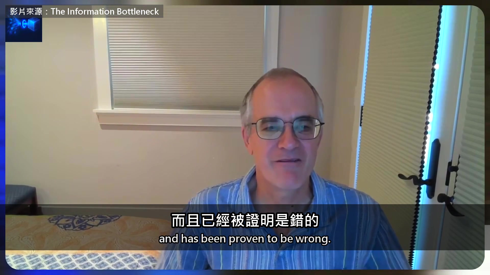

**逐字稿片段：** 到現在我還是覺得，最清楚的例子之一 是一篇研究，它證明了 光看文字序列，世界模型就自己長出來了

**話題推測：** 引入一個明確的例子來證明Manning的觀點，可能顯示研究案例標題。

---

## 00:08:29

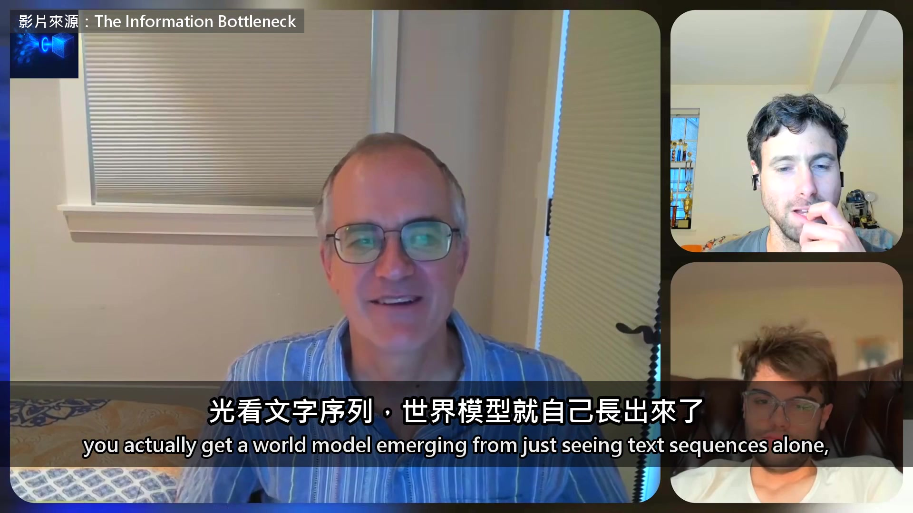

**逐字稿片段：** 那就是 Kenneth Li 等人的研究（Kenneth Li 等人：哈佛等校團隊，2022 年） 他們證明，如果你訓練一個模型

**話題推測：** 提及 Kenneth Li 等人的研究，可能顯示研究團隊名稱或論文資訊。

---

## 00:08:39

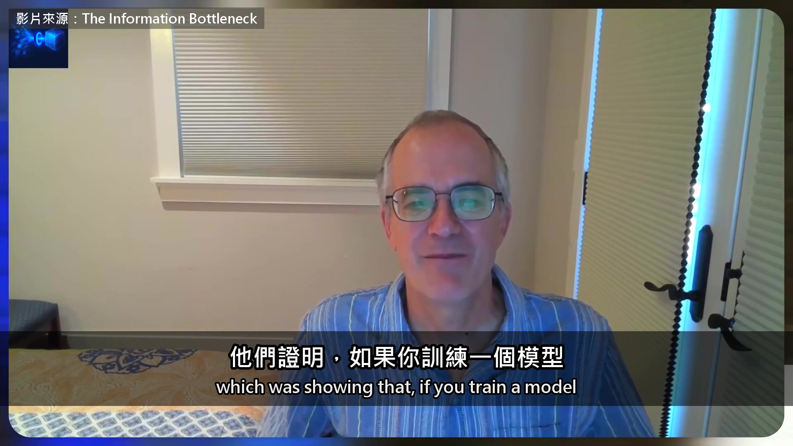

**逐字稿片段：** 只給它看大量黑白棋的棋步順序 你就能證明，在神經網路的內部 它其實存了一張黑白棋的棋盤 等於它學到了 用語言模型「頓悟」的那種說法 你能把預測做得更好 預測黑白棋下一步會走哪裡 只要你在心裡記著棋盤 所以它真的在心裡擺了一張棋盤 大型語言模型看起來也很明顯是這樣 所以光靠語言，就學得到世界跟意義

**話題推測：** 說明黑白棋實驗的細節，可能顯示棋盤畫面或示意圖。

---

## 00:09:26

**逐字稿片段：** 可是下一個問題是，這樣學好嗎 學到的東西有效率嗎 能不能學到更好的世界模型 不要只從語言學 我認為答案毫無疑問是可以

**話題推測：** 提出下一個問題：單靠語言學習世界模型是否有效率？可能顯示問題文字卡。

---

## 00:09:44

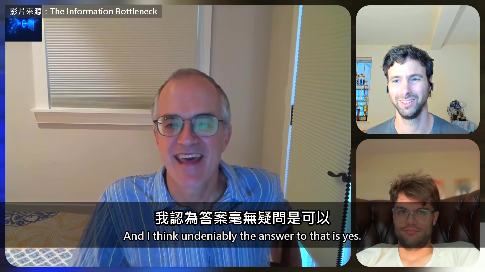

**逐字稿片段：** 所以才開始有很多多模態模型 因為你可以學到世界的一些空間關係 靠著文字對世界的描述 但很難 如果還能看一些圖片跟影片，會好得多

**話題推測：** 引入多模態模型，可能顯示多模態模型的概念圖或範例。

---

## 00:10:07

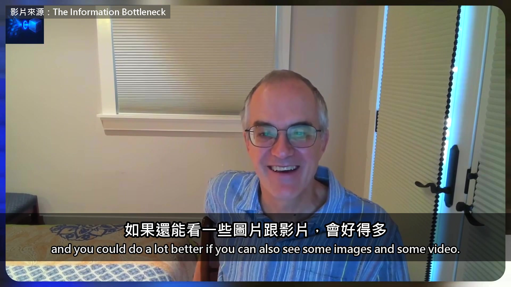

**逐字稿片段：** Manning 的反駁是 人類能走到今天，靠的就是語言 而只讀文字的模型 一樣能長出自己的世界模型 不過他承認，想把世界學得更好 光靠文字確實不夠

**話題推測：** 總結 Manning 的反駁與承認，可能顯示核心觀點摘要。

---

## 00:10:19

**逐字稿片段：** 原影片將近一個小時，前面他還講到 他帶學生做機器翻譯做了十多年 現在的博士生根本做不出比大模型好的系統 那還能做什麼 還有大型語言模型講話永遠很有把握 他說人除了推銷員 都懂得替自己留點餘地 原影片連結在說明欄，有興趣可以去聽更多。

**話題推測：** 轉向原影片的額外內容，可能顯示原影片的預覽畫面或截圖。

---
