# ai-note-101_aQP13mmH2mk — 關鍵畫面索引

- 來源逐字稿：[ai-note-101_aQP13mmH2mk_FIN.srt](ai-note-101_aQP13mmH2mk_FIN.srt)
- 影片：https://www.youtube.com/watch?v=aQP13mmH2mk
- 截圖數：38

## 00:00:00

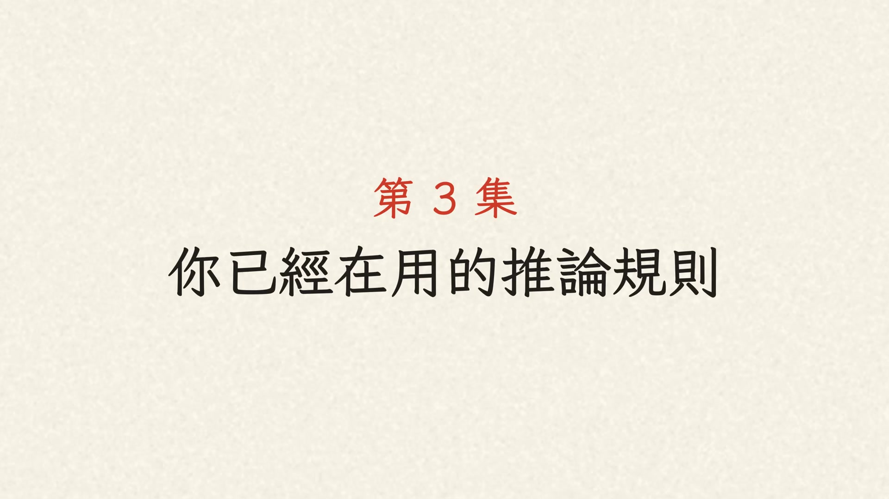

**逐字稿片段：** 這是第三集,你早就在用的推論規則。 上一集,我們學了形別這一側的寫法。

**話題推測：** 影片標題或開場畫面，說明本集主題是推論規則

---

## 00:00:06

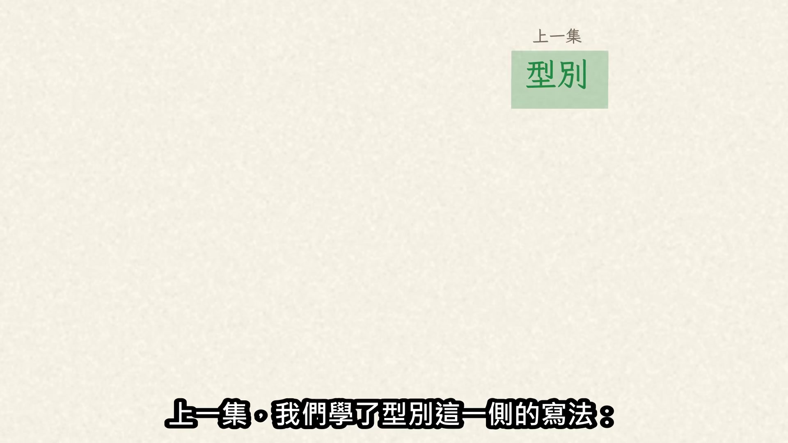

**逐字稿片段：** 在清單Gamma底下,T的形別是T。 這一集,我們換到另一側,也就是邏輯。 所以先暫時完全不管電腦。 接下來要做的事是,把你寫證明的時候早就在用, 但從來沒寫下來的規則,一條一條寫下來。

**話題推測：** 顯示形別的具體寫法或數學符號，例如「Γ ⊢ T : T」

---

## 00:00:24

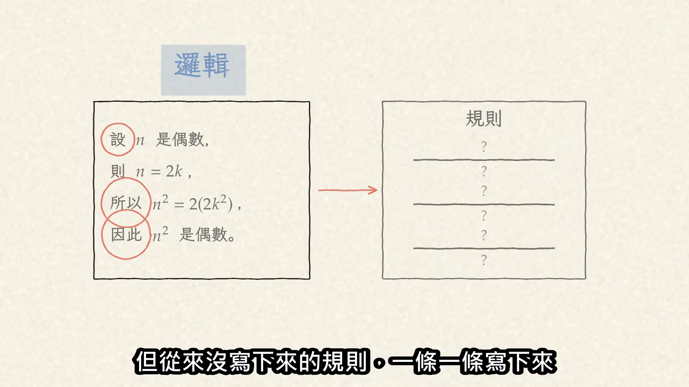

**逐字稿片段：** 我們從一個你一定寫過的句型開始。 假設要證明,如果P則Q,你會怎麼做? 通常你會先寫,假設P成立。 接著一路往下推 直到推出Q 最後再寫 所以如果P則Q 這裡的P和Q 代表的是任意的命題 如果P則Q 這句話邏輯裡寫成P 箭頭Q唸作P推出Q 英文叫implication 蘊含 所以這個系列講到邏輯的時候 箭頭一律念推出 不過剛才那個句型 其實有一個很微妙的地方 開頭那句假設P 到證明結束的時候 被收回了 換句話說 最後的結論 P推出Q 並不依賴P成立 P只是你在證明中間 暫時借來用的

**話題推測：** 開始介紹第一個常見句型，可能顯示例句或相關圖示

---

## 00:01:13

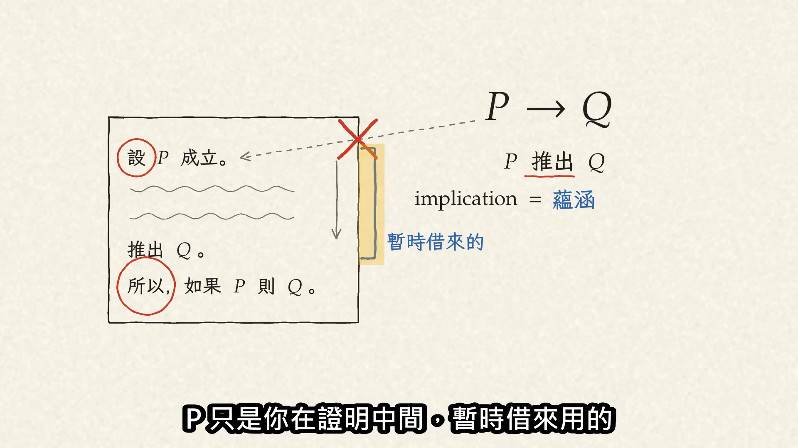

**逐字稿片段：** 接著看另一個矩形 這個更常見 常見到你可能沒意識到 它是一條規則

**話題推測：** 介紹另一個邏輯句型或推理規則

---

## 00:01:19

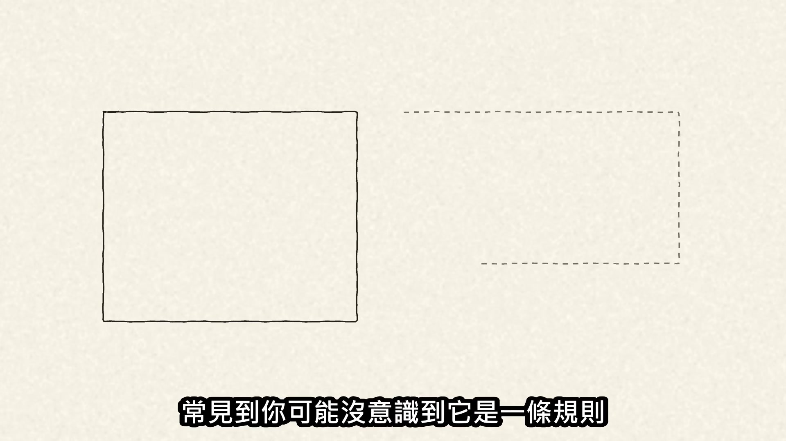

**逐字稿片段：** 一隻P推出Q 又一隻P 那就得到Q

**話題推測：** 顯示「若 P 則 Q，且 P，則 Q」的邏輯規則

---

## 00:01:23

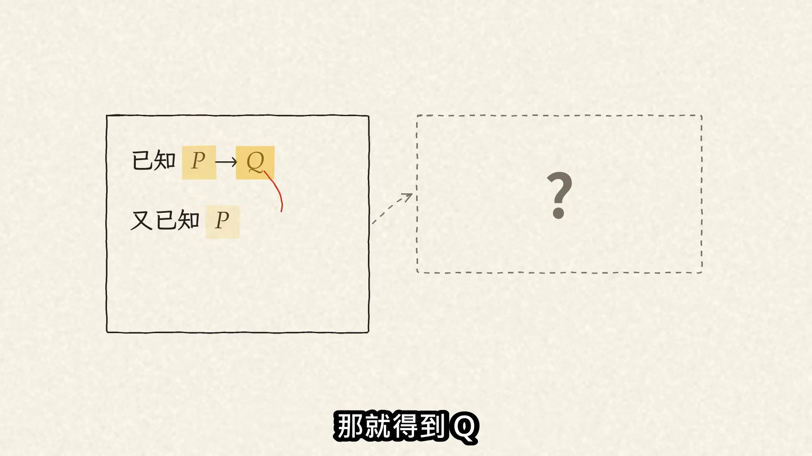

**逐字稿片段：** 這條規則有個拉丁文名字 modus ponens 中文 常翻作肯定前見

**話題推測：** 介紹該邏輯規則的拉丁文名稱「modus ponens」及中文翻譯

---

## 00:01:29

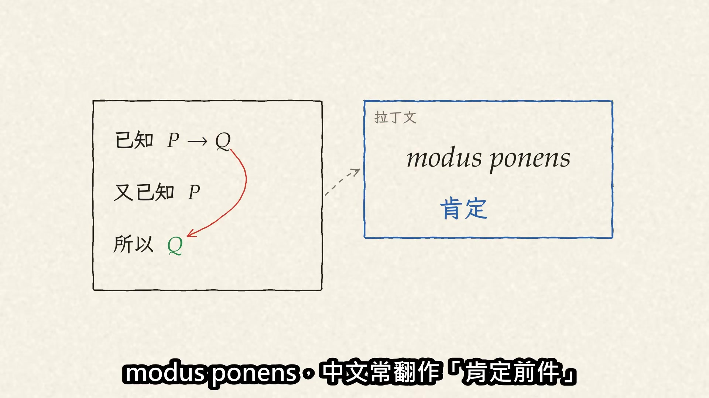

**逐字稿片段：** 邏輯課本會把這種規則 寫成一種很特別的格式 看起來像一個分數 橫線上面放前提 橫線下面放結論 意思是隻要上面那些都成立 就可以寫下下面那個 另外橫線右邊會寫上規則的名字

**話題推測：** 介紹邏輯規則的特殊分數格式寫法（前提在上方，結論在下方）

---

## 00:01:46

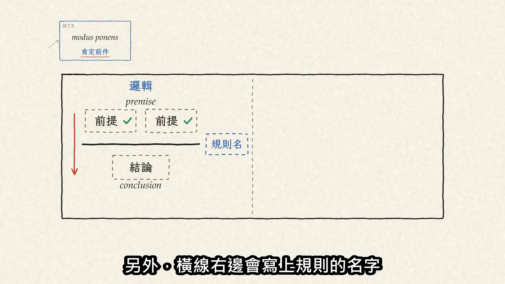

**逐字稿片段：** 這種寫法屬於一套叫自然演繹的系統 英文natural deduction 之所以叫自然 是因為它想照著數學家 平常自然的推理方式 一步一步寫下來

**話題推測：** 介紹「自然演繹」（natural deduction）系統的名稱

---

## 00:01:57

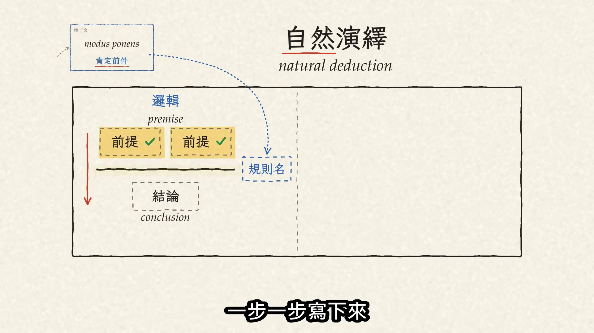

**逐字稿片段：** 那麼肯定前件寫成分數線 就是這樣 上面兩個前提 是P推出Q以及P本身 下面的結論是Q

**話題推測：** 展示「肯定前件」規則用分數線格式的具體寫法

---

## 00:02:07

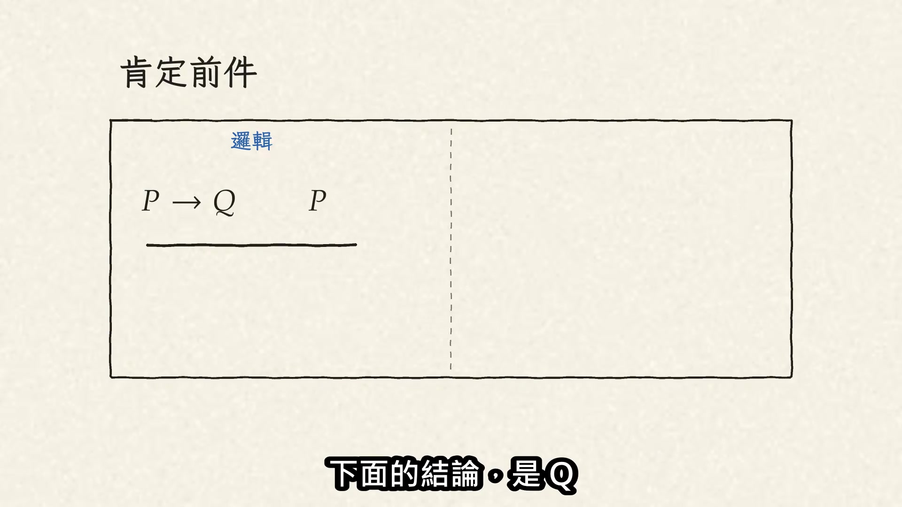

**逐字稿片段：** 它的名字叫推出的消去規則 為什麼叫消去 因為你手上原本有一個帶箭頭的命題 用完這條規則 箭頭就不見了 只剩Q 換句話說 你把箭頭用掉了

**話題推測：** 介紹「推出的消去規則」的名稱

---

## 00:02:20

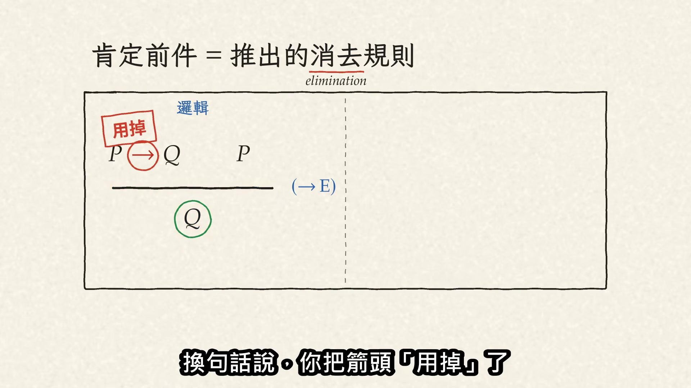

**逐字稿片段：** 我們用一個具體的例子走一遍

**話題推測：** 開始以具體例子說明規則應用

---

## 00:02:23

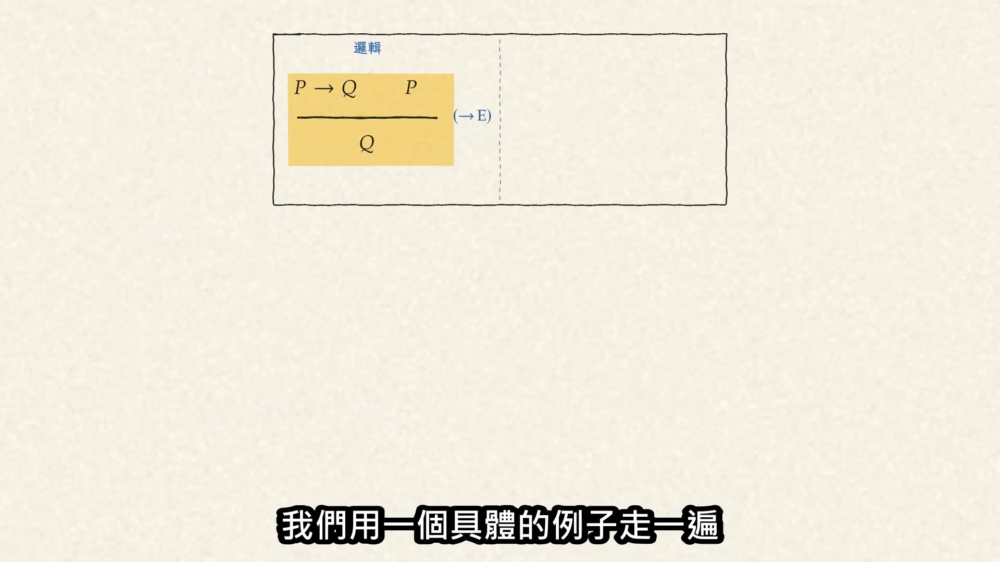

**逐字稿片段：** 讓P是N是4的倍數 Q是N是偶數 已知 如果N是4的倍數 那N是偶數 這就是P推出Q

**話題推測：** 定義P和Q為具體命題（N是4的倍數，N是偶數）

---

## 00:02:32

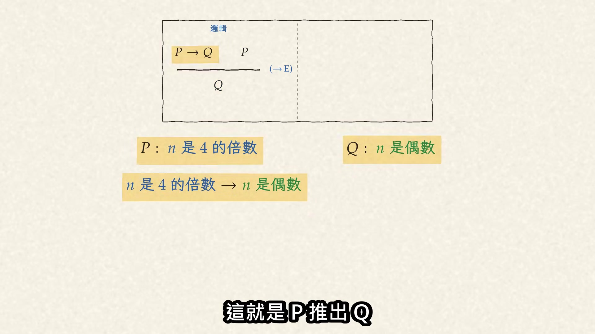

**逐字稿片段：** 又已知12是4的倍數 這就是P 只是N填了12 所以 推出的消去告訴我們 12是偶數 這就是Q 上面兩個前提 下面一個結論 箭頭也就用掉了

**話題推測：** 引入具體數字「12」作為例子中的P，並推導結論

---

## 00:02:47

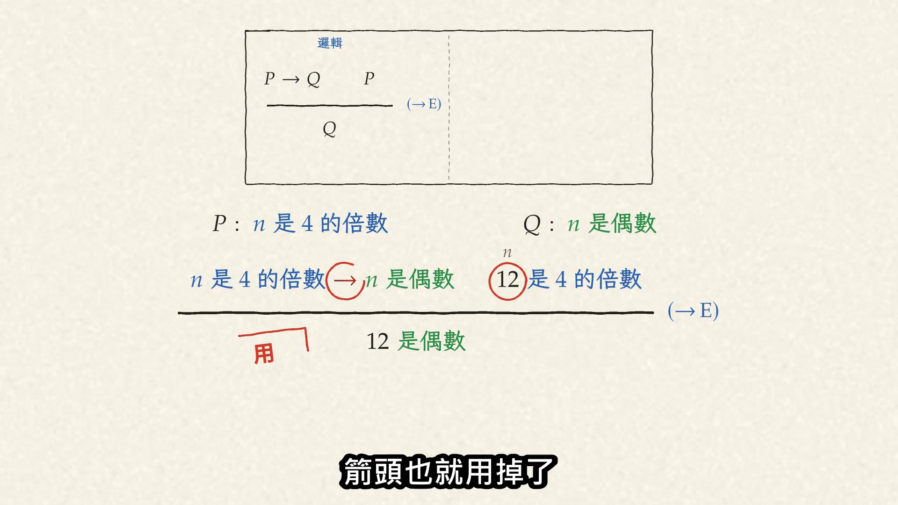

**逐字稿片段：** 再來是另一個句型 假設P推到Q 所以P推出Q

**話題推測：** 介紹另一個邏輯句型或推理規則

---

## 00:02:53

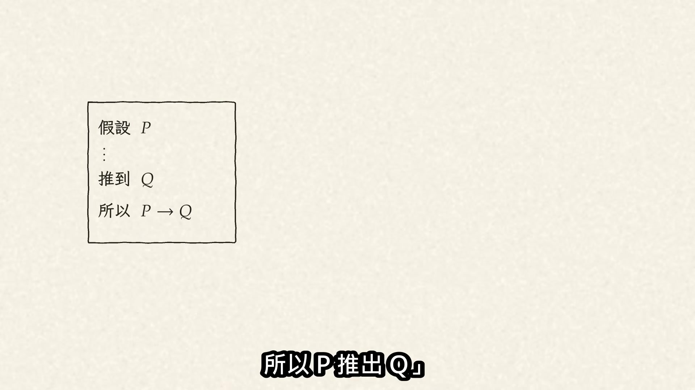

**逐字稿片段：** 這條叫推出的引入規則 因為它的結論多了一個箭頭 所以叫引入 可是問題來了 它的前提要怎麼寫 前提不只是Q成立 而是在多假設一個P的情況下 Q成立 所以要把這句話寫清楚 前提和結論都得說明 目前手上有哪些假設

**話題推測：** 介紹「推出的引入規則」的名稱及其基本形式

---

## 00:03:12

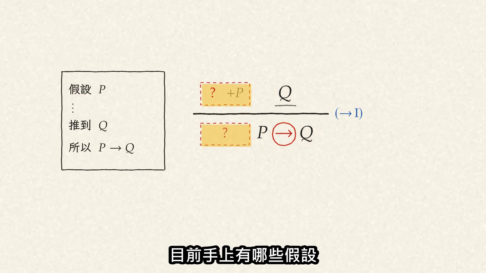

**逐字稿片段：** 因此我們把每一行都寫成 在這些假設底下 可以推的這個命題 寫法是 左邊放假設清單 中間放推得那個符號 右邊放命題

**話題推測：** 引入新的符號寫法，表示在假設清單（Gamma）下推得命題（Γ ⊢ P）

---

## 00:03:24

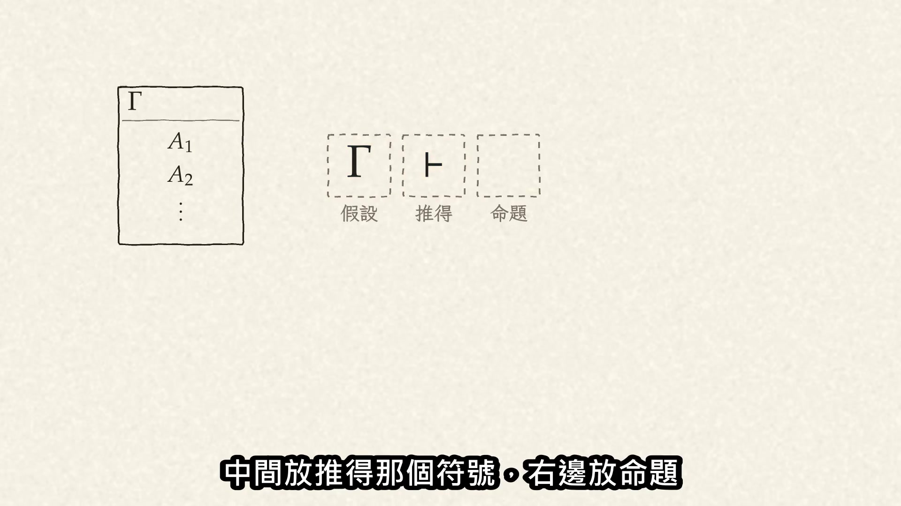

**逐字稿片段：** 有沒有覺得眼熟 沒錯 上一集行別那一冊 用的就是同一個推的符號 同一個gamma 只是這裡的gamma 是一張假設清單 gamma推的P 意思是 在假設gamma底下 可以推的P 差別只在於 這邊的右邊 只有一個命題P 沒有冒號 也沒有T 有了這個寫法 推出的引入 就寫得清楚了 前提是 在γ再加上p的假設底下推的q 結論是在γ底下推的p推出q 你看假設清單怎麼變 上面有p下面沒有p 也就是說p從清單移到了箭頭的左邊 這就是收回假設的精確意思

**話題推測：** 回顧上一集內容，可能並排展示新舊符號寫法的比較

---

## 00:04:07

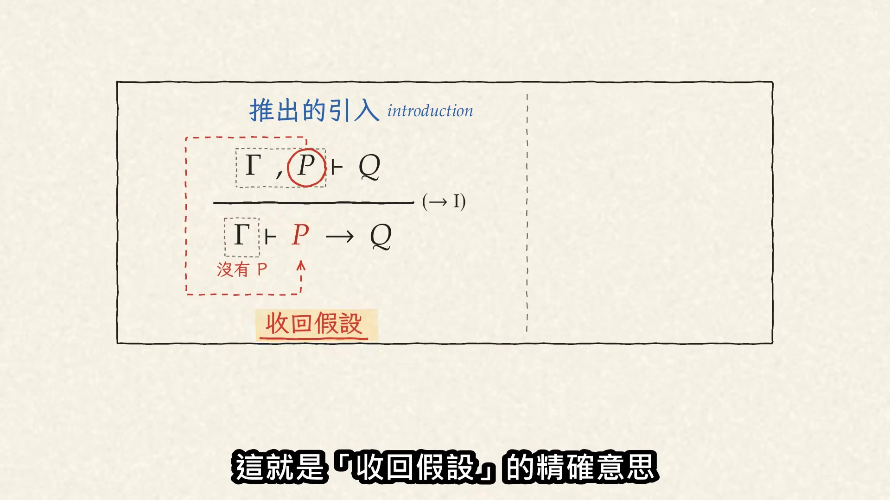

**逐字稿片段：** 我們拿同一個例子 這次換成引入的方向 要證的是 如果n是4的倍數 那n是偶數 紙上會這樣寫 設n是4的倍數 那麼n等於4乘某個k 也就是2乘2k 所以n是偶數 其中第一句設n是4的倍數 就是把p放進清單 接著一路推到n是偶數 就是在多了p的清單底下推的q 最後把p收回 結論就是p推出q 這時清單也回到原來的樣子

**話題推測：** 以具體例子說明「引入規則」的應用，與之前的例子方向相反

---

## 00:04:40

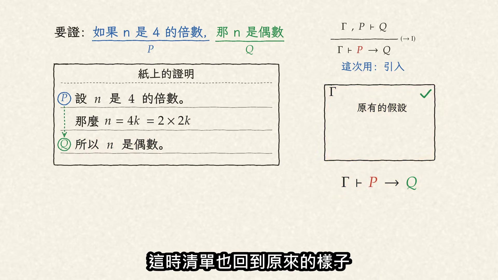

**逐字稿片段：** 回到推出的消去 我們也用同一種寫法重寫一次 前提有兩個 在γ底下推的p推出q 在γ底下推的p 結論是在γ底下推的Q 注意這裡清單沒有變 也就是說消去規則不收回任何假設

**話題推測：** 重新展示「推出的消去規則」，使用新的符號寫法

---

## 00:04:59

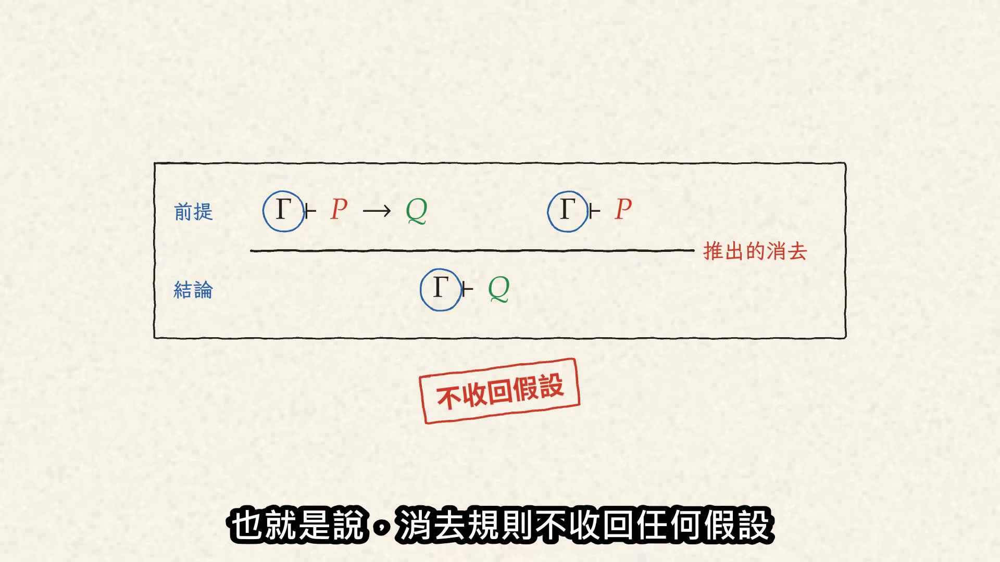

**逐字稿片段：** 不過還差一條最基本的規則 因為推論總得有個起點 這個起點就是假設本身

**話題推測：** 介紹第三條最基本的推論規則

---

## 00:05:07

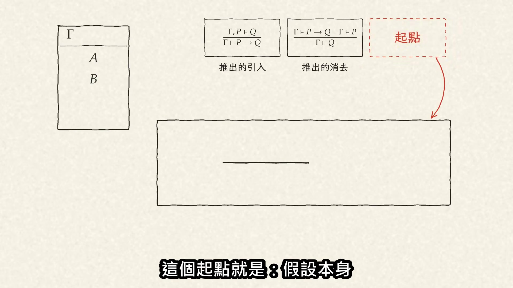

**逐字稿片段：** 如果P在假設清單裡 那就可以推的P 所以這條規則沒有前提 橫線上面是空的 旁邊只寫一個條件 P在清單γ裡

**話題推測：** 展示「假設規則」的寫法，即若P在清單Gamma中，則可推得P

---

## 00:05:16

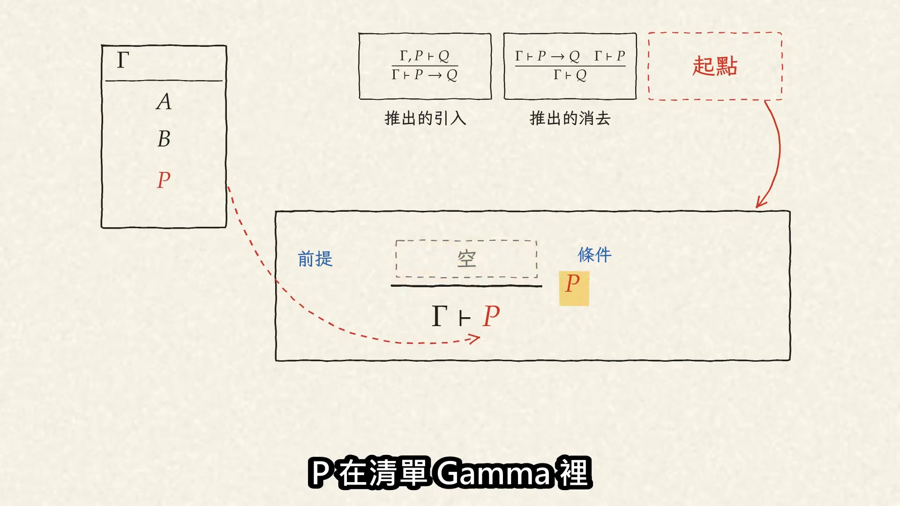

**逐字稿片段：** 我們叫它假設規則 到這裡三條規則都到齊了

**話題推測：** 介紹「假設規則」的名稱

---

## 00:05:23

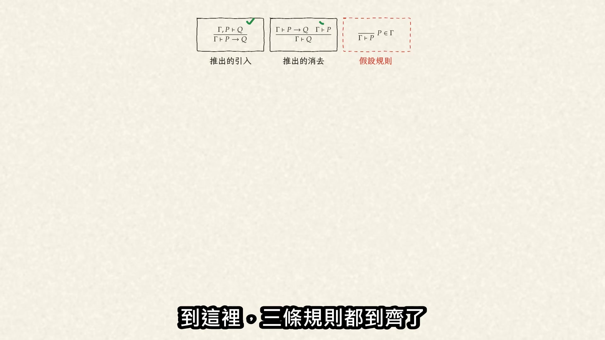

**逐字稿片段：** 接下來我們拿它們正一個定理 這個定理接下來幾集會一直出現 所以請記住它

**話題推測：** 開始演示如何使用已學規則證明一個定理

---

## 00:05:30

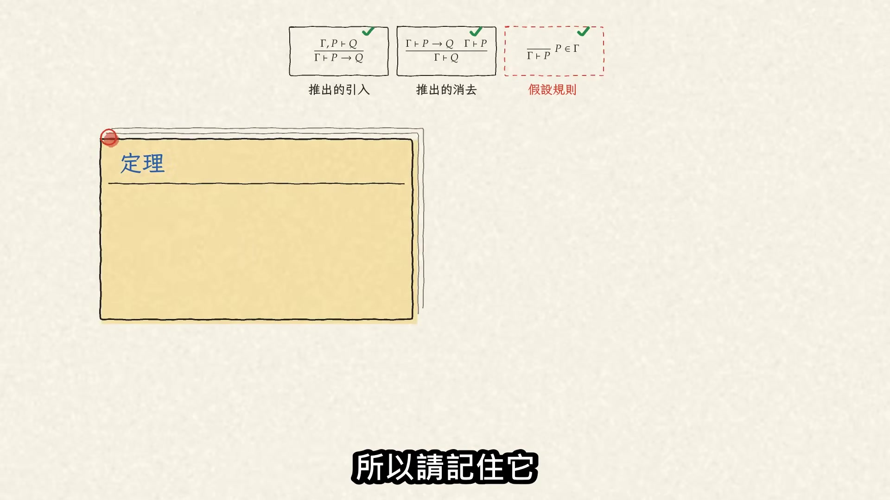

**逐字稿片段：** 如果P推出Q 而且Q推出R 那麼P推出R 這叫蘊含的傳遞性 我們幫它取個名字 就叫imptrans 蘊含傳遞 你在紙上大概會這樣寫 設P成立 因為P推出Q 所以得到Q 又因為Q推出R 所以得到R 最後P推出R 一共四句話

**話題推測：** 展示要證明的定理：蘊含的傳遞性（P→Q, Q→R ⊢ P→R）

---

## 00:05:54

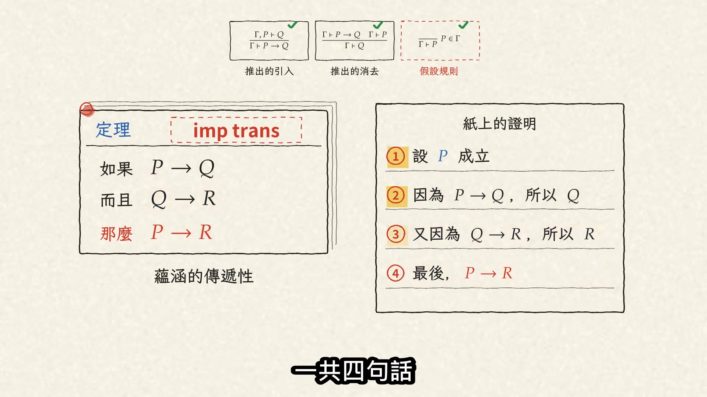

**逐字稿片段：** 現在把這四句話翻成規則 排成一棵樹 樹根在最下面是我們要的結論 樹葉在最上面是假設

**話題推測：** 將紙上證明轉換為規則樹狀圖，開始建構證明樹

---

## 00:06:05

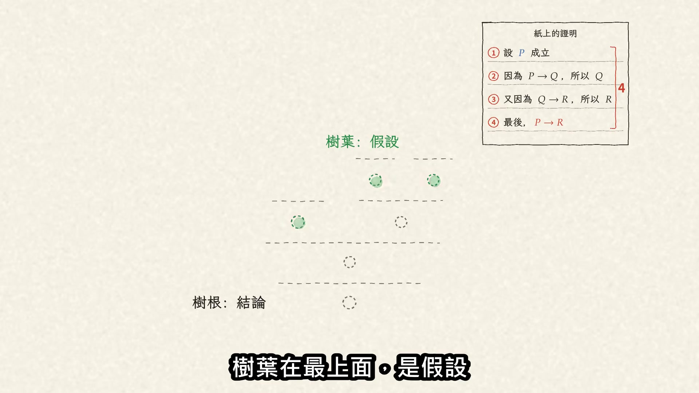

**逐字稿片段：** 首先定清單 我們手上有兩個一致條件 P推出Q以及Q推出R 這兩個放進γ 所以最下面的結論是γ 推的P推出R 要得到一個帶箭頭的結論 就用推出的引入 它的前提是γ再加上P推的R 這正是紙上那句 設P成立 清單多了一個P 接下來要在多了P的清單底下推的R 手上有Q推出R 所以用推出的消去 只要再推的Q就行 而Q推出R本身就在清單裡 用假設規則直接拿到 那Q又從哪來 再用一次推出的消去 P推出Q在清單裡 P也在清單裡 兩個都用假設規則拿到

**話題推測：** 設定證明樹的初始清單Gamma，包含P→Q和Q→R

---

## 00:06:51

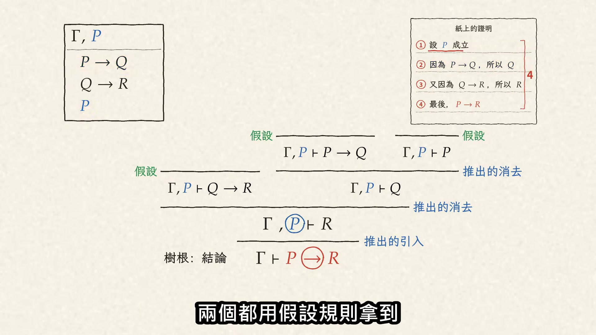

**逐字稿片段：** 所以樹的每一個葉子都是假設規則 換句話說 每一個葉子都是清單裡現成的東西 現在從下往上把這棵樹念一遍 你會發現它就是紙上的證明倒過來唸 最下面一步是推出的引入 負責收回P 上面兩步是推出的消去 最上面則全是假設 換句話說 你在紙上寫的每一句因為所以 都對到樹上的一條橫線 這棵樹就是你那四句話的精確版本

**話題推測：** 完整呈現蘊含傳遞性定理的證明樹，展示各規則的應用

---

## 00:07:21

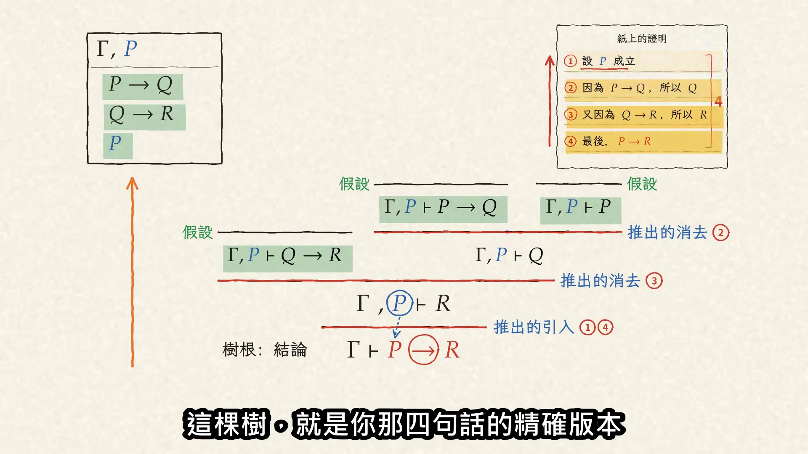

**逐字稿片段：** 我們再看一棵小樹 因為它會解決一個常見的疑惑

**話題推測：** 開始證明一個新的小定理，可能展示其證明樹

---

## 00:07:25

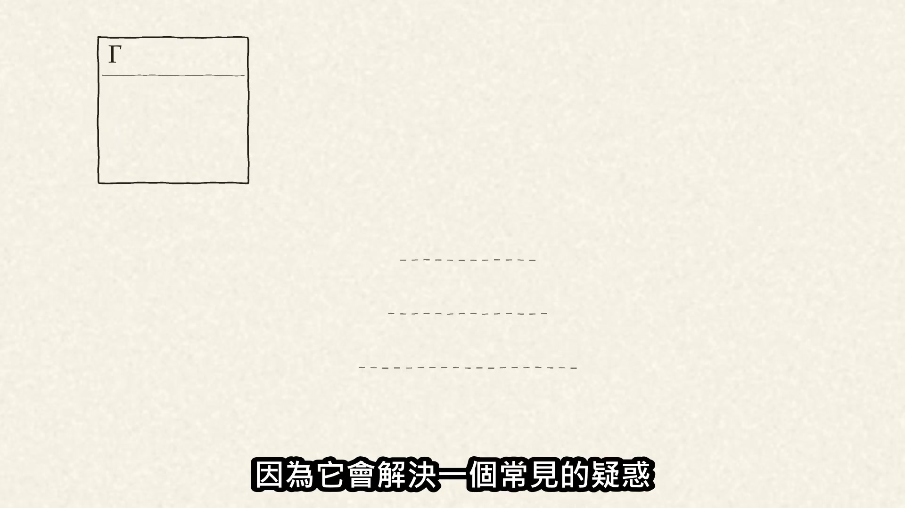

**逐字稿片段：** 要正的是P推出 括號Q推出P 一樣從下往上 要正P推出括號Q 推出P 就用推出的引入 清單加上P 接著正Q推出P 然後再用一次推出的引入 清單再加上Q 接著正P 這時候的清單寫成γPQ 意思就是清單γ再加上P和Q 這三樣都能拿來用 而P就在清單裡

**話題推測：** 展示要證明的定理：P → (Q → P)

---

## 00:07:55

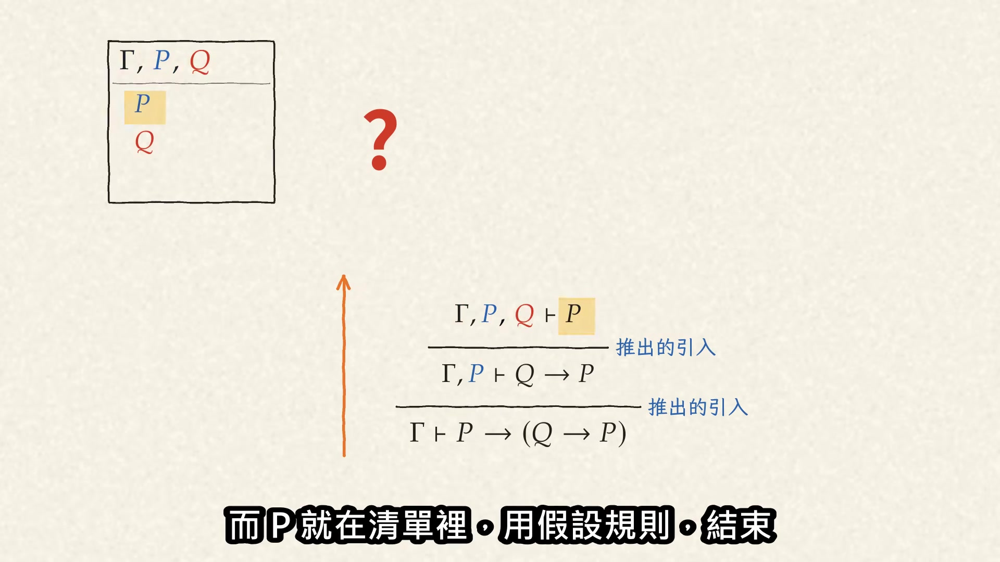

**逐字稿片段：** 用假設規則結束 可是注意Q這個假設 它被放進清單 然後被收回 中間卻從來沒用過 這是合法的 因為推出的引入 只要求在多一個假設的情況下 推得結論 並沒有要求一定要用到那個假設 其實你在紙上也這樣做過 要證如果Q則P 而P本來就成立 那Q根本不用看

**話題推測：** 完整呈現P → (Q → P)定理的證明樹

---

## 00:08:18

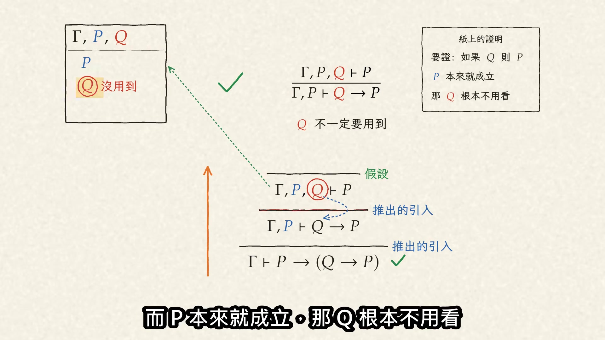

**逐字稿片段：** 總結一下 這一集只做了邏輯這一測 一共三條規則 假設推出的引入 推出的消去

**話題推測：** 總結本集所介紹的三條邏輯推論規則

---

## 00:08:26

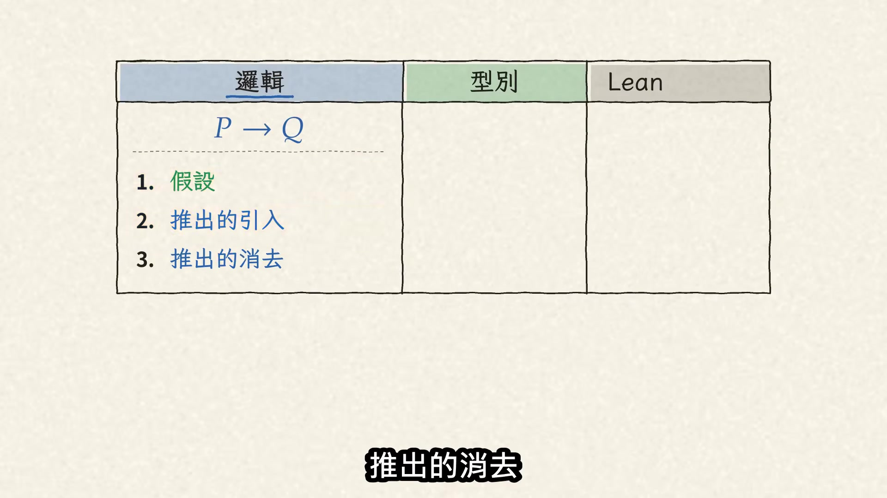

**逐字稿片段：** 所以三欄表補上這一列時 我只填邏輯那一格 至於行別和另兩格 我故意先留空打上問號 因為下一集你會看到 這兩格要填的東西 其實已經在上一集出現過了

**話題推測：** 展示一個三欄表格，填入本集邏輯內容並預告未來內容

---

## 00:08:40

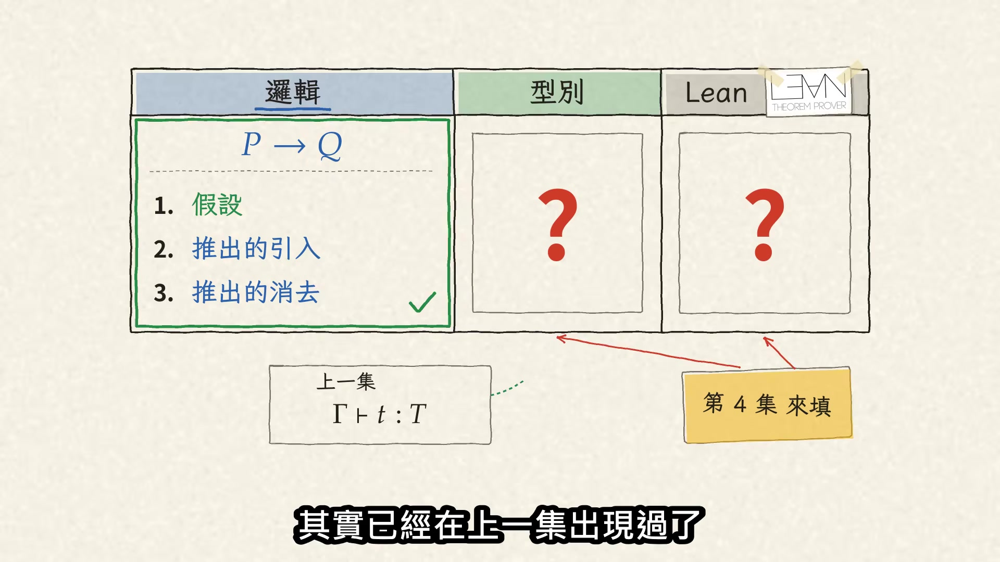

**逐字稿片段：** 這一集的分數線寫法 來自一個德國年輕人 Gerhard Jentzen 1933年夏天 他在哥廷根大學交出博士論文 那年他23歲

**話題推測：** 介紹自然演繹系統的創始人Gerhard Gentzen

---

## 00:08:52

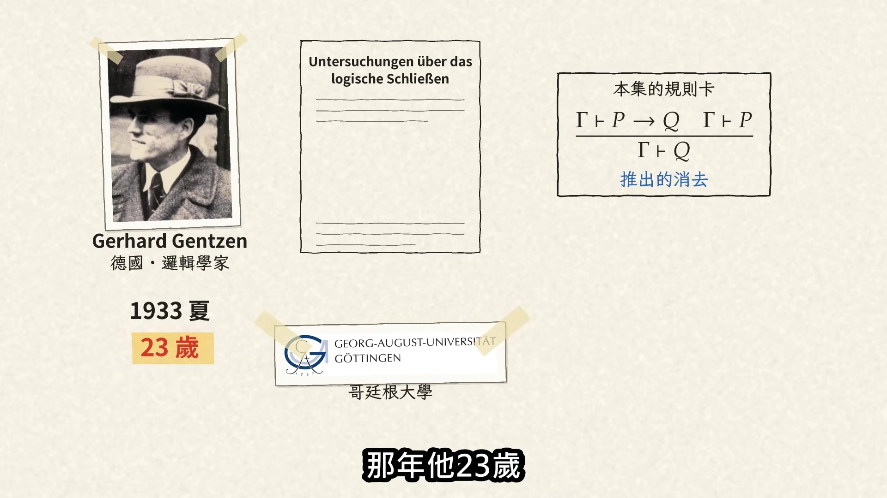

**逐字稿片段：** 這篇論文在1935年分兩期登出 題目叫《邏輯推理的研究》 而自然演繹 就是在這篇論文裡被正式提出的

**話題推測：** 展示Gentzen博士論文的發表資訊或標題

---

## 00:09:00

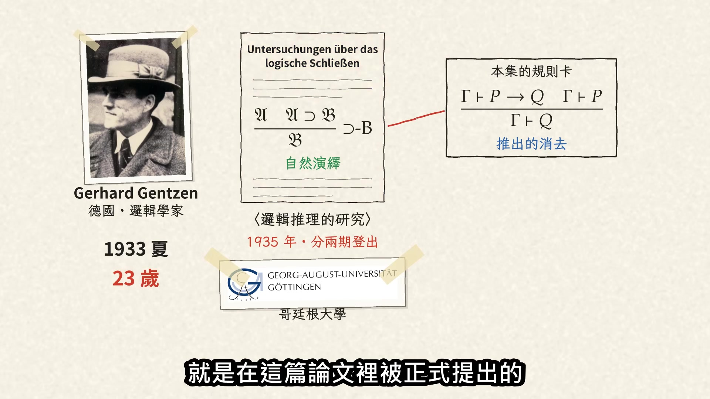

**逐字稿片段：** 差不多同一時間 波蘭邏輯學家Jaskowski 也獨立做出了類似的系統 當時他的指導教授Paul Bernice 是猶太人 1933年被大學解職 於是名義上的指導教授 換成了同樣在戈廷根的大數學家 Herman Weil 後來Jentison做出了更有名的成果

**話題推測：** 提及波蘭邏輯學家Jaskowski及其貢獻

---

## 00:09:20

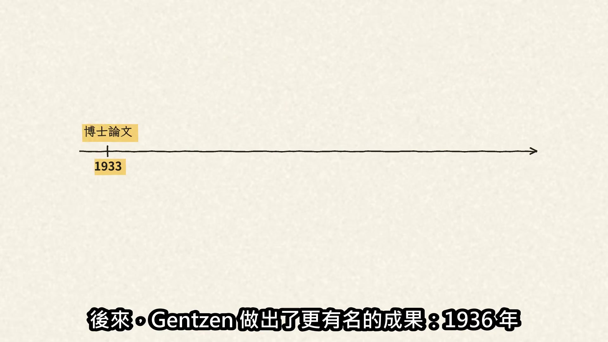

**逐字稿片段：** 1936年 他證明了自然數的算術不會推出矛盾 可是他的人生結局很不好 他在1933年加入納粹的衝鋒隊 1937年入黨 戰爭期間 他在布拉格的德語大學教書

**話題推測：** 介紹Gentzen在1936年的重要研究成果（證明自然數算術無矛盾）

---

## 00:09:36

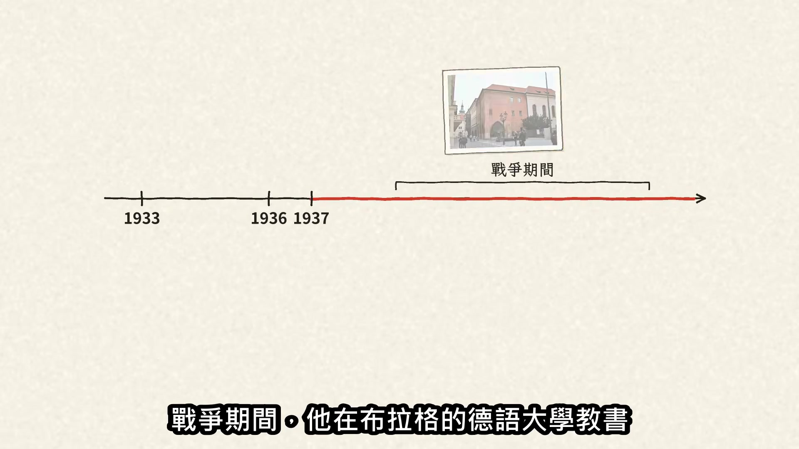

**逐字稿片段：** 到了1945年5月 布拉格起義 這所大學的教職員全部被捕 他被關了三個月 同年8月4日 在布拉格的牢房裡餓死 只有35歲 同牢房的人後來回憶 他整天躺在木板床上想數學 他甚至私下說 自己其實蠻滿足的 因為終於有時間 好好想怎麼證明分析學 也不會推出矛盾了

**話題推測：** 講述Gentzen在1945年布拉格起義後被捕並餓死的經歷

---

## 00:10:00

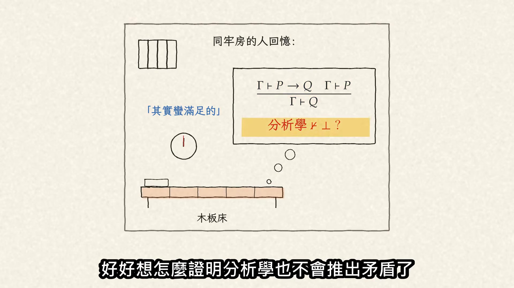

**逐字稿片段：** 下一集 邏輯和形別終於要並排站在一起 你會發現 推出和寫程式的函數 其實是同一件事 最後我們親手辦一次 Lint Kernel 一步一步檢查一個證明

**話題推測：** 預告下一集的主題和內容

---
