# ai-note-101_am1DCQjrTqc — 關鍵畫面索引

- 來源逐字稿：[ai-note-101_am1DCQjrTqc_FIN.srt](ai-note-101_am1DCQjrTqc_FIN.srt)
- 影片：https://www.youtube.com/watch?v=am1DCQjrTqc
- 截圖數：12

## 00:00:00

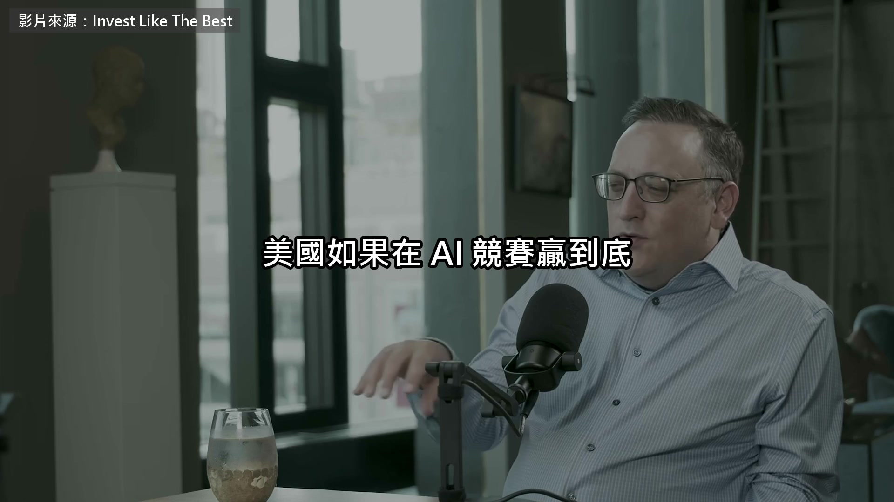

**逐字稿片段：** 美國如果在AI競賽贏到底,中國最合理的下一步是什麼? 把這題講得最白的人, 在臺北住了十幾年, 他叫Ben Thompson, 2013年開始, 一個人寫一份叫Strategy的付費電子報, 專門拆解科技公司的商業模式, 後來substack那一整批付費電子報, 走的都是他先走通的路。 這集是他今年8月上Invest Like the Best的訪談,主持人第一題就問,美國贏了AI會怎樣? 如果你控制AI,你的軍隊基本上比別人更好, 你能夠 somehow it fixes their manufacturing all these like things that I don't think 我認為AI不需要做這些事情 在真正的世界上負責,但是在這個世界上,中國的遊戲理論的最佳反應是什麼? 對我來說 主持人追問

**話題推測：** 影片主題或引言，關於美中AI競賽的戰略問題

---

## 00:01:21

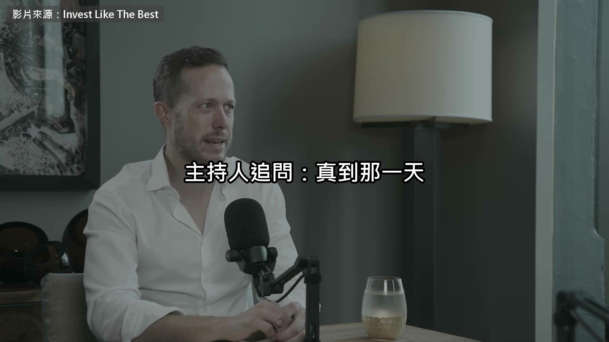

**逐字稿片段：** 真到那一天 美國不是早就把晶圓廠 搬回自己家了嗎 他說那是一廂情願 美國對中國供應鏈的依賴 被嚴重低估 不打一仗是解不掉的 那矽谷為什麼愛講 一定要贏中國 他的解釋很直接

**話題推測：** 主持人追問晶圓廠搬遷議題

---

## 00:02:04

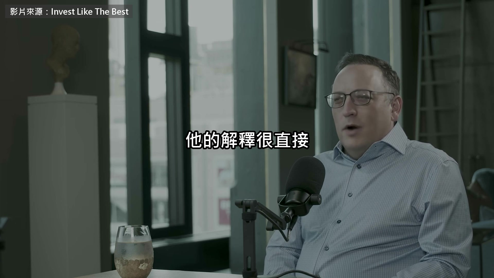

**逐字稿片段：** AI這門生意需要一個假想敵 沒有比中國更好用的 至於他心目中比較健康的局面 長什麼樣 主持人也問了 前面是地緣政治

**話題推測：** 探討矽谷強調戰勝中國的動機，解釋為AI產業需要假想敵

---

## 00:02:58

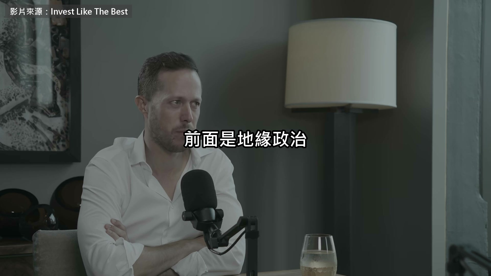

**逐字稿片段：** 接下來他把矛頭轉向臺積電自己 主持人問道前 今年全球AI資本支出 估計8000億美金 明年1.3兆 算力一上線就被用光 那為什麼還是不夠 他的賬從三年前算起 Like where our shortage of compute 將在下幾年中變得更差 Because a fab 的運行時間 比一個數碼中更大 It's not like all the money That the companies are putting in today Manifest in compute tomorrow

**話題推測：** 話題從地緣政治轉向臺積電

---

## 00:03:53

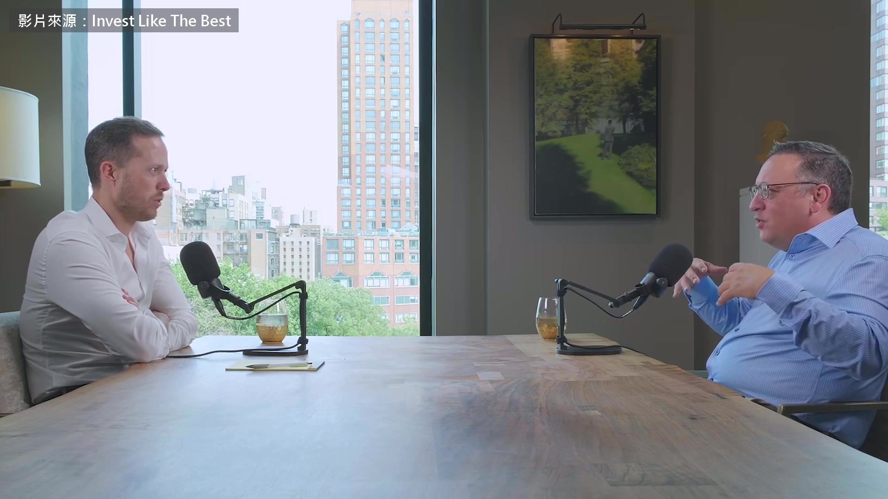

**逐字稿片段：** No it all manifests in compute In 2028 and 2029 為什麼臺積電不敢擴 他先講了記憶體的故事

**話題推測：** 指出AI算力投資產出時間點在2028-2029年，可能顯示時間軸

---

## 00:04:01

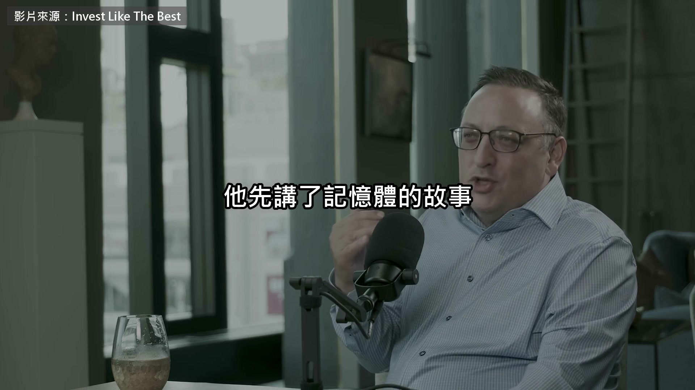

**逐字稿片段：** 三星當年在景氣谷底逆勢加碼 把日本廠商整批打出局 但市場只剩三家之後 大家都學乖了 寧可少賺也不敢多幹 等一下他會講到張忠謀 先補一個時間點 張忠謀2005年 把執行長交棒出去 2009年 金融海嘯最慘的時候回鍋 U.A.E. 和沙特阿拉伯 他們將建造洞口 他們將建造新的港口 他們不會再讓這件事發生 現在非常痛苦 但說伊朗想關閉 2035年的秩序 它不會有任何影響 因為它將被建造 我對記者的關注是 他們可能會做到同樣的事情 沒有人會讓自己 再次進入這種情況 至於記憶

**話題推測：** 講述三星在記憶體市場的歷史案例，可能顯示市場競爭圖

---

## 00:04:59

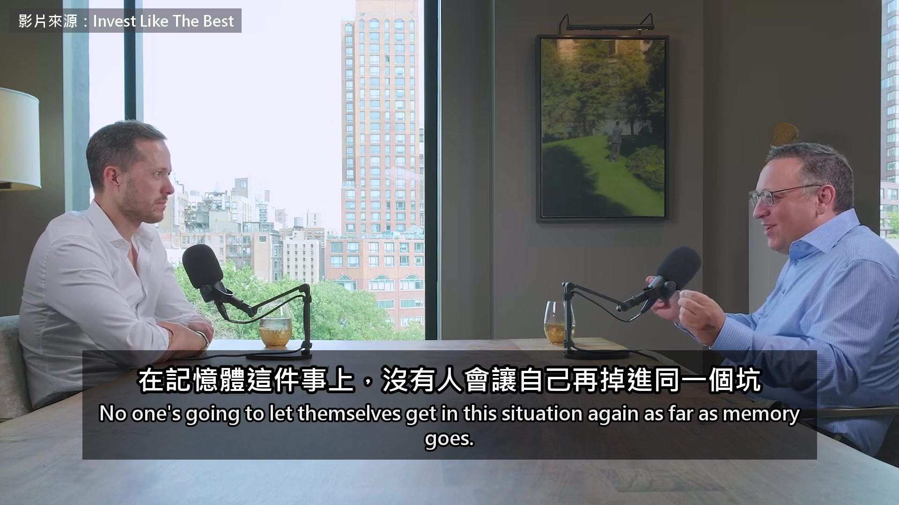

**逐字稿片段：** TSMC將會變得更糟 因為只有一個 有一家公司在前端 顯然Intel和Samsung 正在嘗試去到那裡 這也是一樣的事情 每個市場都承擔了風險 很多人的問題是 誰最後承擔了風險 我認為很多科技公司 不完全理解的是 TSMC在大科技公司上 他們做的方式是 TSMC擔心的風險是 超過能量 如果我們建造太多 不僅是我們建造太多 And we have all these fixed costs That are not being fully utilized But if we build a fab We expect that fab to run for 30 years We've like baked in too much capacity 幾年幾年幾年 So they are very biased Towards being much more conservative 為了更加的保守 One of the most interesting TSMC stories It's kind of a now list That Samsung story Morris Chang辭職在2000年之後 And new leadership took over 所以他們把他們的投資計劃拿回來 他進來,把所有人都打光了 他說,剛剛發佈的iPhone 這是我們從來沒有看過的最大機會 我們必須不斷地投資,不斷地斬斬 他們投資了,通過大逆轉折 通過那種下跌 這就是他們在那段時間 所謂的最高級車輛的基礎 莫斯汀是個一對一的 在我認為, 在我認為最偉大的技術經營人與最有優勢的專業人的心態中, 整個fabulous計劃是如此重要的, 什麼技術是什麼,什麼它做的,以及那時候在那時候做的那些事,尤其是在一個那裡生活的人, 有一個文化不一定會這樣做那些猜測,TSMC他們真的太隨意了,以坦白說, 那麼,到底怎麼回事?如果我們不想取決於風險,TSMC就說,我們不想取決於風險,風險不消失。 It just moves The risk is right now Where you have Every single big tech company Realizes if we had more compute We could be making more money So there's lots of foregone revenue And foregone profits That is the manifestation of the risk That TSMC handed off to them Risk doesn't disappear It just gets handed off And sometimes that risk Doesn't manifest in losing money It manifests in not making money

**話題推測：** 指出臺積電面臨的單一供應商風險將更嚴重

---

## 00:07:33

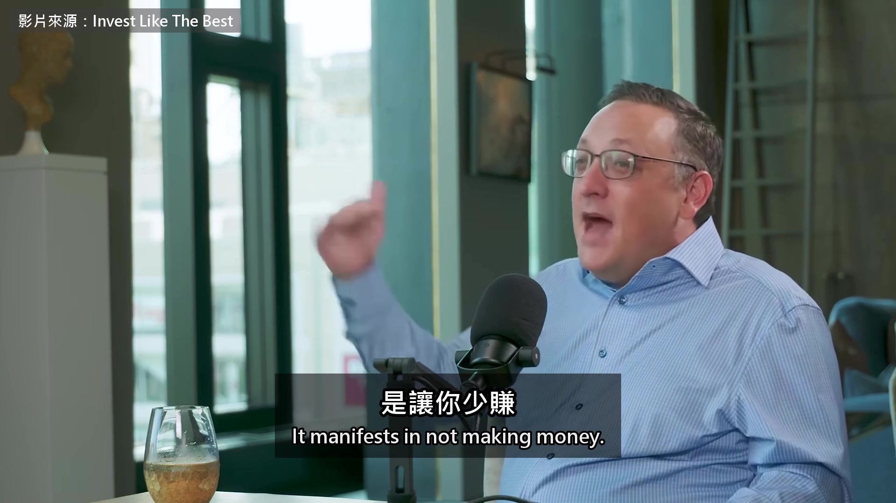

**逐字稿片段：** 臺積電不想扛的風險 最後被誰接住

**話題推測：** 轉向討論臺積電不願承擔的風險最終由誰接手

---

## 00:07:36

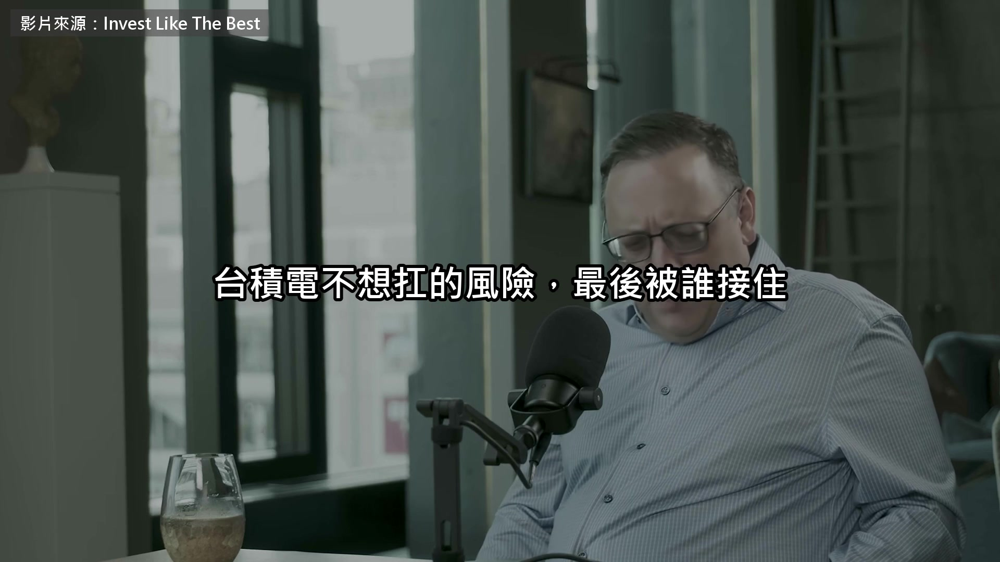

**逐字稿片段：** 答案繞回一家被嫌棄了10年的公司 他2013年就寫文章 勸Intel去做晶圓代工 Intel沒理他 股價一路漲到2020年 才發現自己落後了 剛剛那個海峽的比喻 他等一下會直接用到臺積電自己身上 我來感受到這種稅務問題 for a big tech company to go to Intel and say Intel you make our chip and by the way the biggest benefactor of this is going to be you because you're going to learn how to work with a partner and the biggest pain is going to be us 因為我們要找辦法與你合作 how to work with you we could just go to TSMC they are awesome they are so great to work with 我們知道他們會做一個好工作 it just never made rational sense for anyone to go work with Intel 這就是他們的基礎問題 在不變的世界中 TSMC就會永遠贏

**話題推測：** 揭示承擔風險的公司是Intel，可能顯示其公司標誌或簡介

---

## 00:08:41

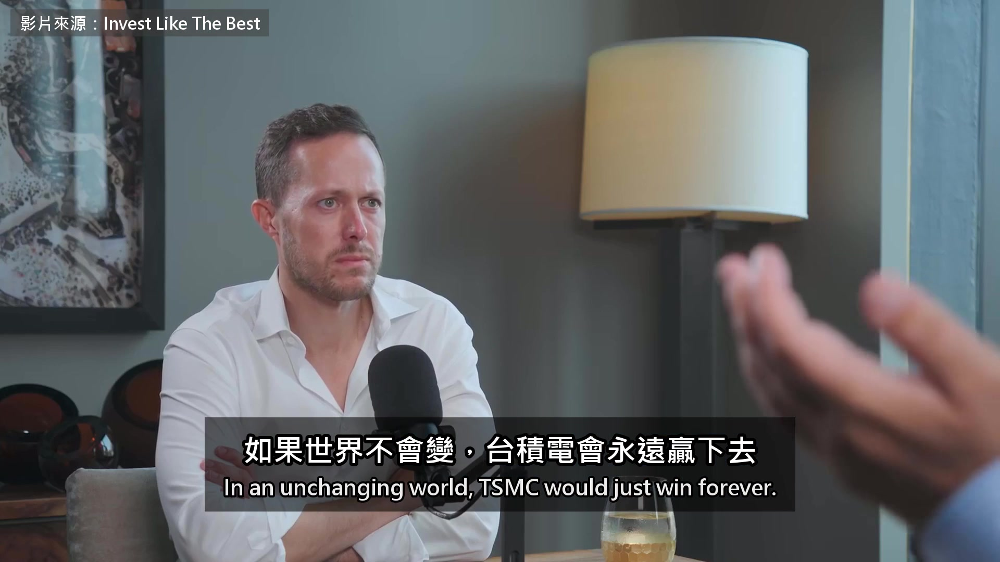

**逐字稿片段：** 但是這就是為什麼TSMC 在某些方面 做了同樣的錯誤 作為賺錢者 做了同樣的錯誤 如果我可以 繼續用這個語言 因為他們不投資 在過去幾年 這些缺陷 將會變得太悲劇了 大型公司 在這麼多利潤 和這麼多利潤 因為我們沒有 足夠的計算 我們會經歷 的痛苦 從進行英特爾 到速度 把Samsung的邏輯提升到速度 缺乏是最終保護Intel的

**話題推測：** 指出臺積電在某些方面犯了不投資的錯誤

---

## 00:09:11

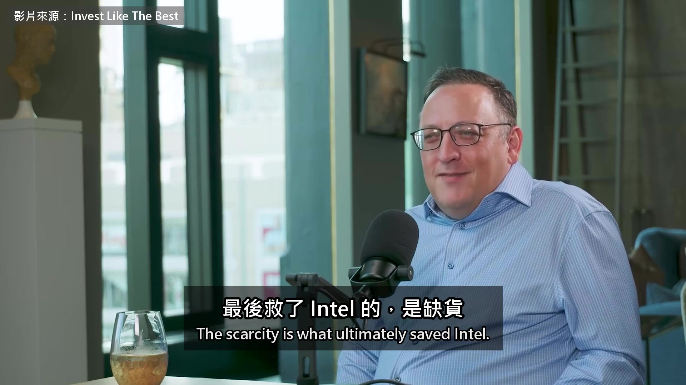

**逐字稿片段：** 我預期在某一段時間 他們會宣佈 第一次與某個大夥伴合作 這會成為很大的一件事 但最終是TSMC自己帶來的 高價的治療是高價的一件事 我們肯定會圍繞著它們 對 就像 在旁邊有很多的分析師 你可以寫下這些東西 他開頭那一題 到結尾才真的答完

**話題推測：** 預期Intel未來將與大夥伴合作的展望

---

## 00:10:01

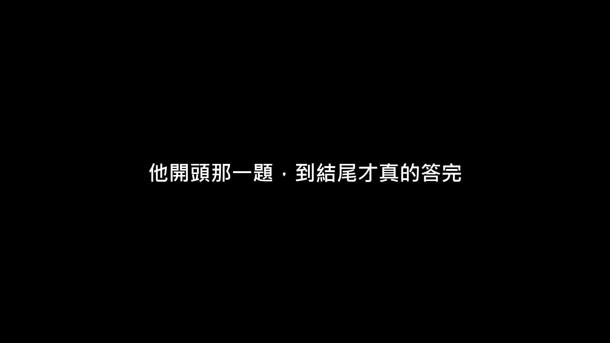

**逐字稿片段：** 讓美國不再只能壓在臺灣 辦法不是誰贏 是讓全世界都有理由去別的地方蓋廠 而照他的說法 這件事已經開始了 原影片85分鐘 後半還有他對Invidia Meta跟微軟的看法 連結在說明欄 有興趣可以去聽更多

**話題推測：** 總結開頭問題的答案，提出分散式設廠的解決方案

---
