# ai-note-101_bB9fDzGshlE — 關鍵畫面索引

- 來源逐字稿：[ai-note-101_bB9fDzGshlE_GT.srt](ai-note-101_bB9fDzGshlE_GT.srt)
- 影片：https://www.youtube.com/watch?v=bB9fDzGshlE
- 截圖數：33

## 00:00:00

**逐字稿片段：** 這裡是 AI 101，全網最幽默的 AI 新聞 OpenAI 一名工程師 被控把竊聽器包在衛生紙裡 插進高層會議室電視後面的 USB 孔

**話題推測：** 節目開場或片頭

---

## 00:00:11

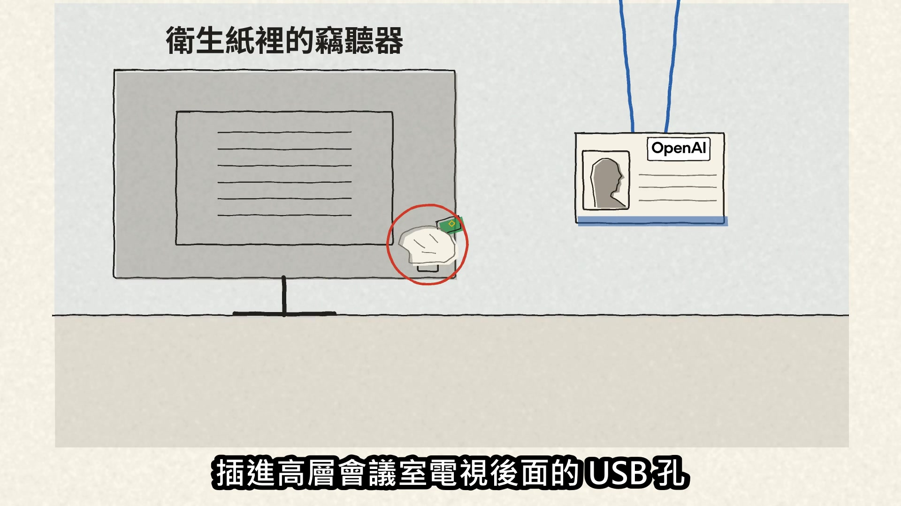

**逐字稿片段：** 9天後，他被公司開除，也被 FBI 逮捕 那被抓的是誰？

**話題推測：** 案件初步結果：9天後被捕與開除

---

## 00:00:15

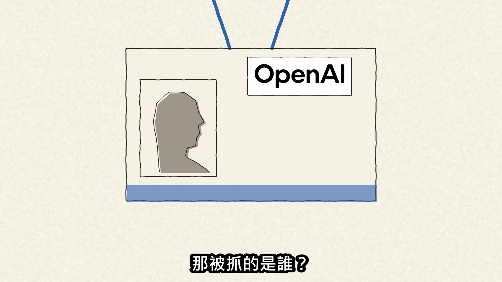

**逐字稿片段：** 被告叫 Abdulrahman Alfozan，35歲 沙烏地阿拉伯籍 2025年7月才加入 OpenAI，當產品工程師

**話題推測：** 被告身份資訊：姓名與年齡

---

## 00:00:24

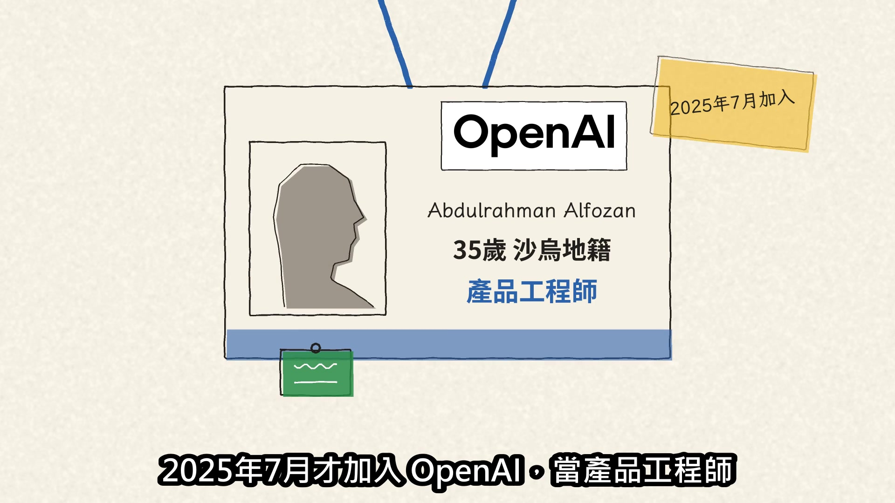

**逐字稿片段：** 說起背景，Alfozan 的履歷很漂亮：MIT、 Meta，還有新創公司 不過他現在只是被告，案子還沒審判 動機也還沒公開 他被控動手的地方

**話題推測：** 被告履歷背景：MIT、Meta

---

## 00:00:35

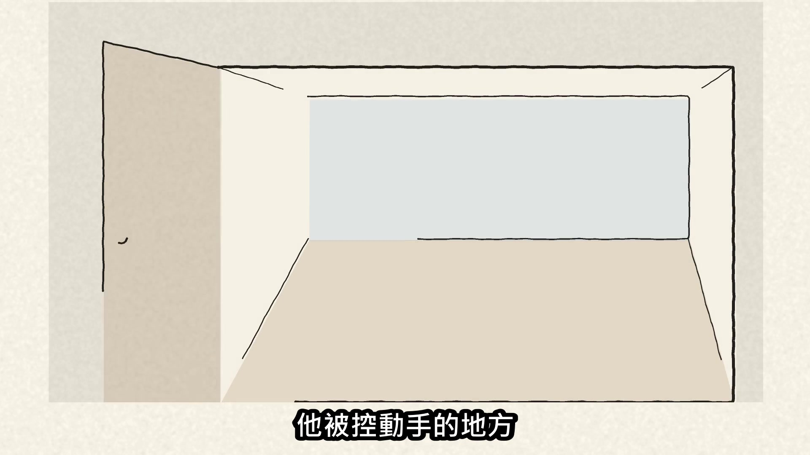

**逐字稿片段：** 是 OpenAI 舊金山辦公室的高層會議室 這間會議室主要給高層和助理預約 聊的可能是研究、產品、商業夥伴 還有跟政府的往來，全是公司最機密的事 也因為這樣，根本不用碰伺服器 模型權重和原始碼鎖得再緊 只要錄下房裡的對話 一樣可能拿到公司機密

**話題推測：** 案發地點：OpenAI 高層會議室

---

## 00:00:59

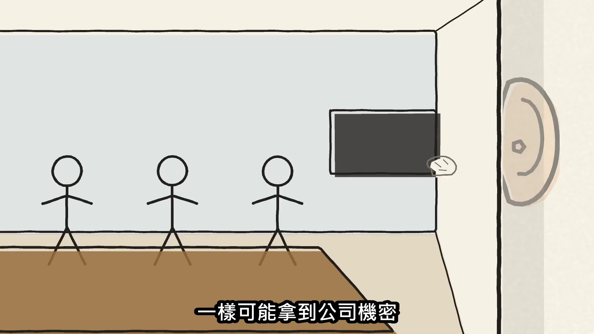

**逐字稿片段：** 那竊聽器是怎麼被發現的？

**話題推測：** 新話題：竊聽器如何被發現

---

## 00:01:00

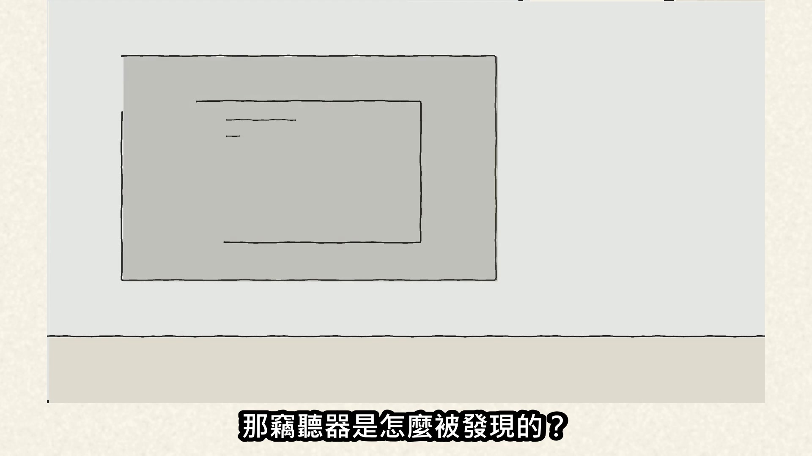

**逐字稿片段：** 檢方說，第一顆大約9月28日裝上 2天後的9月30日

**話題推測：** 首次裝置安裝日期：9月28日

---

## 00:01:06

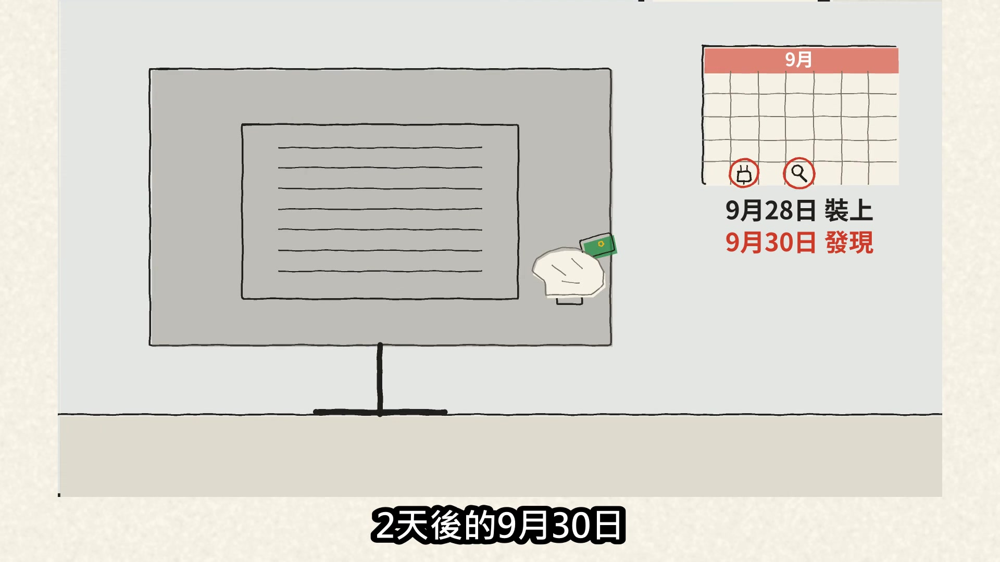

**逐字稿片段：** OpenAI 做例行的 TSCM 反竊聽掃描 人員繞到電視後面，就抓到了那團衛生紙

**話題推測：** 發現方式：例行性 TSCM 反竊聽掃描

---

## 00:01:13

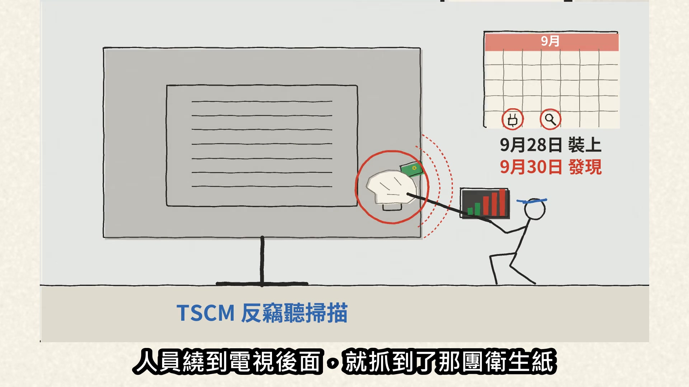

**逐字稿片段：** 所以說「OpenAI 用 AI 抓到內鬼」 只對了一半 最先發現的是安全人員和反竊聽設備 AI 是後面才上場 幫忙分析儲存裝置的鑑識映像 搞清楚裝置怎麼運作、可能從哪來 回到衛生紙裡那塊板子

**話題推測：** 澄清說法：「OpenAI 用 AI 抓到內鬼」

---

## 00:01:29

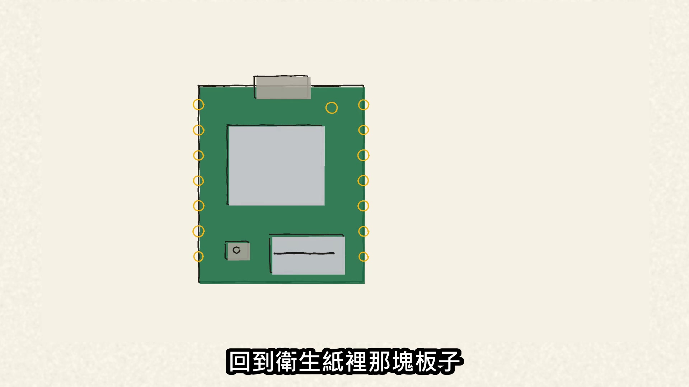

**逐字稿片段：** 它被認出是 Seeed XIAO 開發板 Seeed 是一家賣開發板和感測器的硬體廠商 板子才拇指大小，官網只要13.99美元 就內建麥克風、記憶卡槽、Wi-Fi 和藍牙

**話題推測：** 竊聽器型號：Seeed XIAO 開發板

---

## 00:01:44

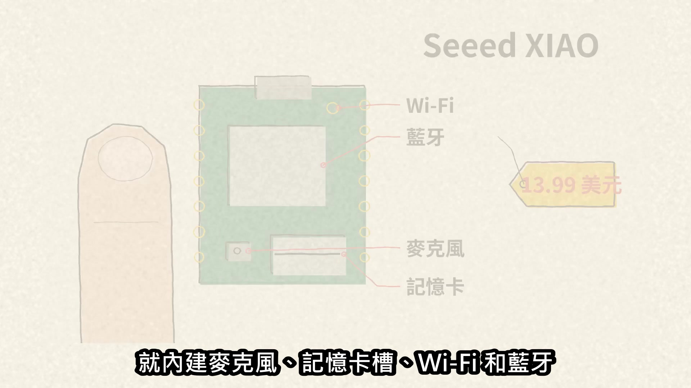

**逐字稿片段：** 這就是整起案子最大的反差 外界擔心 OpenAI 被駭客入侵、 被模型竊取，或被零時差漏洞 也就是尚無官方修補程式的漏洞攻破 結果可能的破口 竟是電視後面一個 USB 孔 加上一團衛生紙

**話題推測：** 案件最大反差與諷刺

---

## 00:01:59

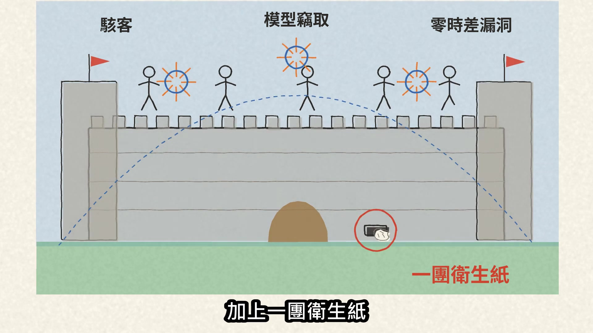

**逐字稿片段：** 說穿了，板子不貴，危險的是人： 有正當員工身分、熟悉辦公空間 又知道哪間房間最重要的自己人

**話題推測：** 案件核心警示：危險的是人

---

## 00:02:09

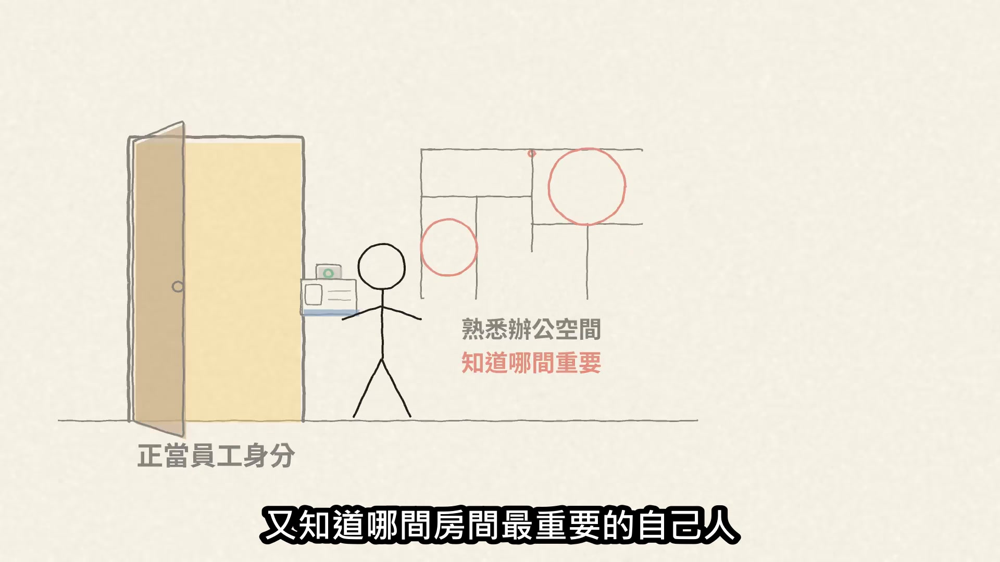

**逐字稿片段：** 那 OpenAI 是怎麼盯上 Alfozan 的？ 檢方說

**話題推測：** 新話題：OpenAI 如何鎖定 Alfozan

---

## 00:02:12

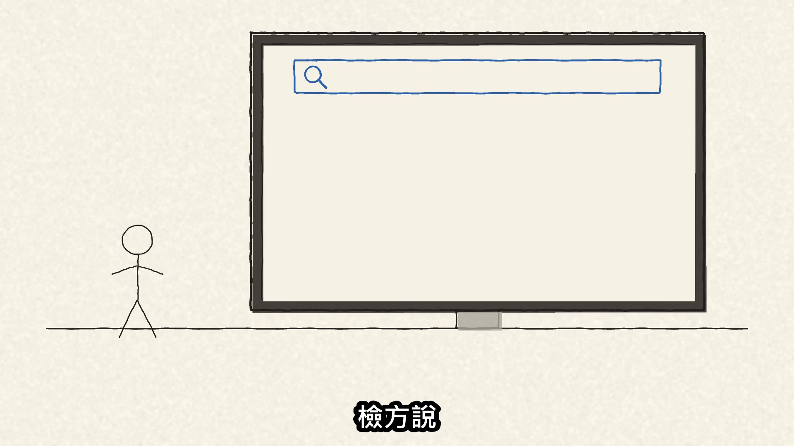

**逐字稿片段：** 他用公司的工具查過辦公大樓地址、 會議室容量、行事曆 還查過高階主管所在的位置 不只查過，他本人也常在附近

**話題推測：** 被告可疑行為：查詢公司敏感資料

---

## 00:02:23

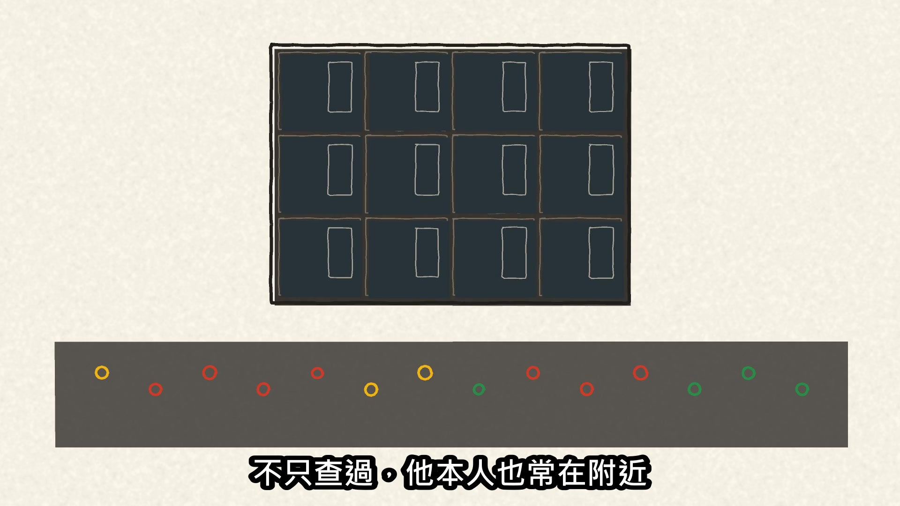

**逐字稿片段：** 美聯社轉述訴狀說，9月間 監視器拍到他在這間會議室附近出現將近12次 司法部比較保守，只說是多個日期 可是會議室裡面，原本沒有攝影機 是找到第一顆之後才新裝的

**話題推測：** 美聯社報導監視器畫面

---

## 00:02:38

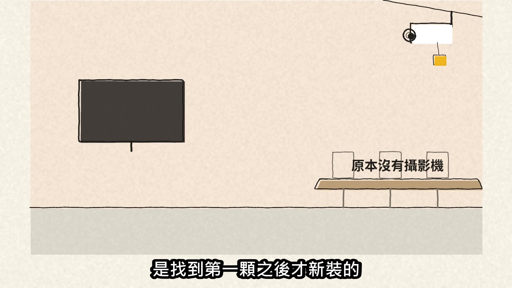

**逐字稿片段：** 10月5日 鏡頭就拍到 Alfozan 走進會議室 往電視後方看 同一天，第二顆錄音器也冒出來了

**話題推測：** 新事件日期：10月5日

---

## 00:02:47

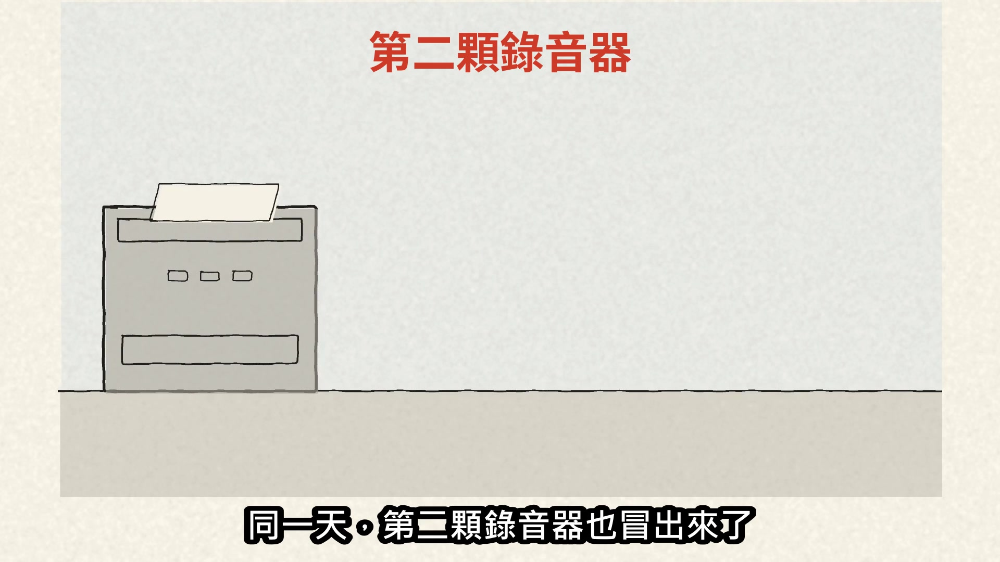

**逐字稿片段：** 檢方說，Alfozan 把包包忘在印表機室 保全打開找失主，在錢包和證件旁邊 翻出一顆類似、一樣加密儲存的錄音器 更妙的是，他回來領東西時

**話題推測：** 印表機室包包事件

---

## 00:03:00

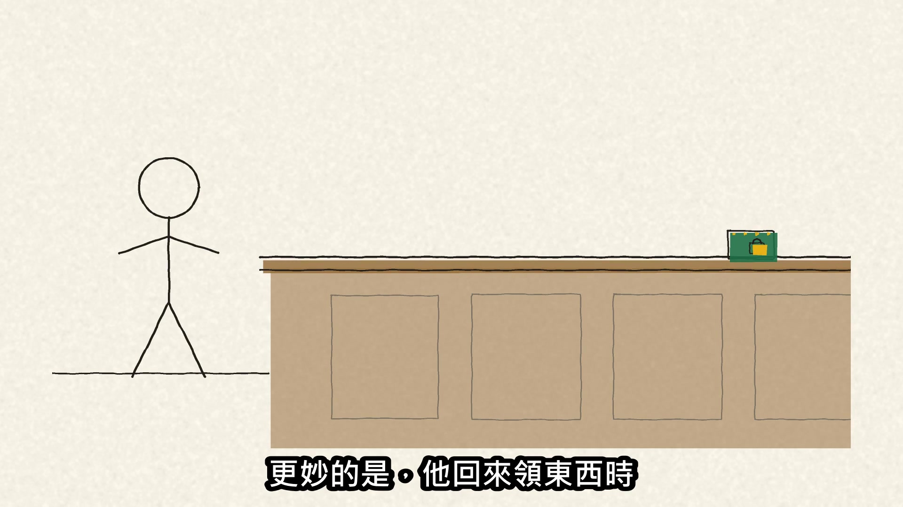

**逐字稿片段：** 追問了大約500美元現金、 1張信用卡和2只 AirPods 偏偏沒問那顆錄音器 AirPods 都記得 最可疑的那件反而不認領

**話題推測：** 被告領取失物內容：500美元現金、信用卡、AirPods

---

## 00:03:11

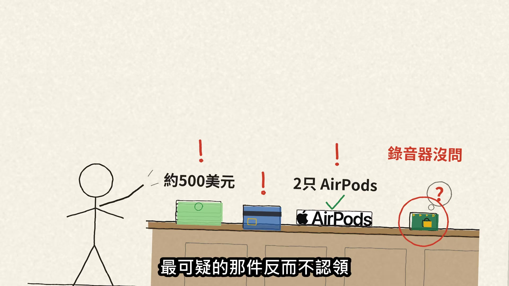

**逐字稿片段：** 但比監視器更關鍵的，是聊天紀錄 檢方拿到一個跟 Alfozan 配偶相關的聊天帳號 跟他自己的帳號共享好幾項識別資訊 不過官方沒有把配偶列為共犯 這個帳號問了什麼？

**話題推測：** 關鍵證據：聊天紀錄

---

## 00:03:26

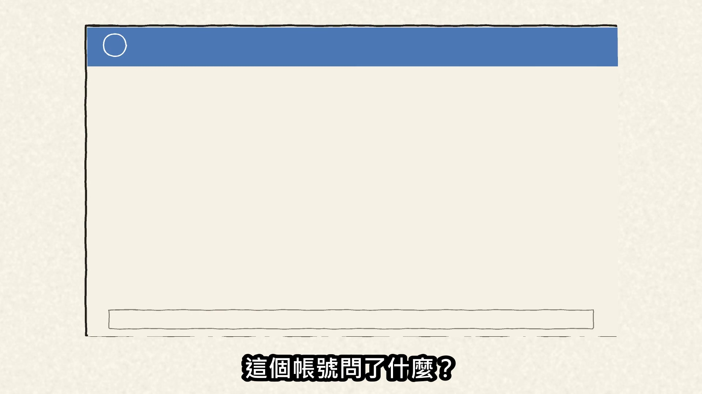

**逐字稿片段：** 9月24日到30日 它一路問怎麼做能連續錄音的錄音器、 怎麼把設備藏起來 還有怎麼替 SD 卡加密

**話題推測：** 聊天紀錄時間範圍：9月24日到30日

---

## 00:03:34

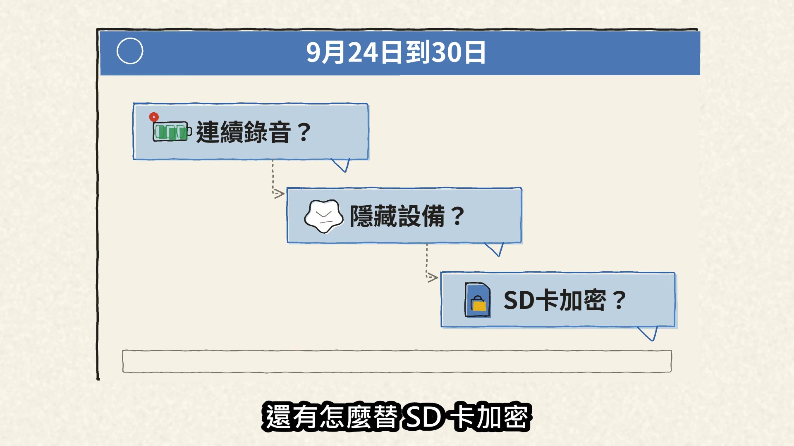

**逐字稿片段：** 最致命的，是9月27日到28日的紀錄 檢方說 提示裡甚至出現第一顆裝置用的自訂 header

**話題推測：** 最致命聊天紀錄時間：9月27日到28日

---

## 00:03:43

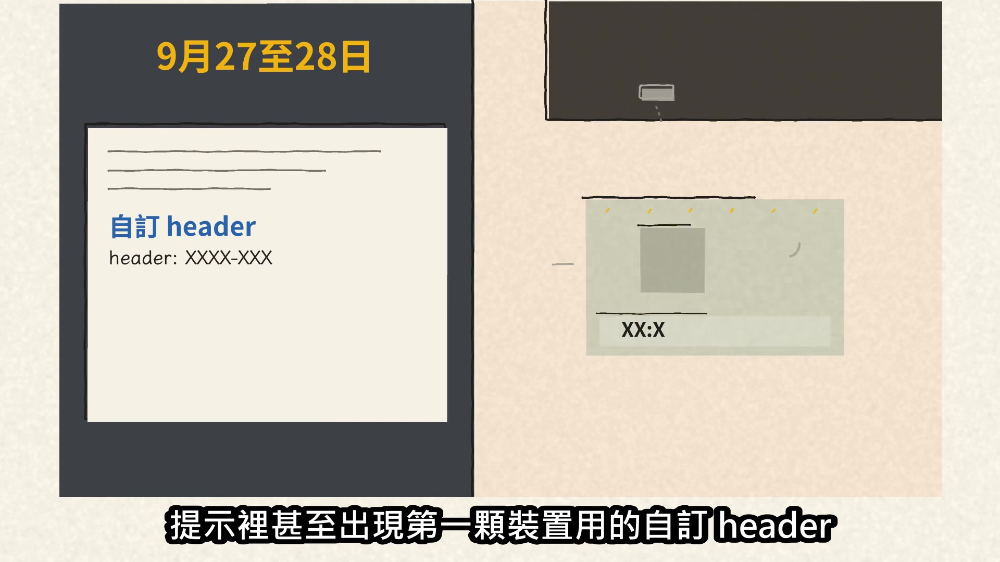

**逐字稿片段：** 還有那台設備獨一無二的 MAC 位址 為什麼 MAC 位址這麼關鍵？ 它就像網路硬體的身分證號 一台一個號碼 一般問技術問題根本用不到 聊天紀錄就這樣直接連上會議室裡那顆硬體

**話題推測：** 聊天紀錄關鍵細節：MAC 位址

---

## 00:04:01

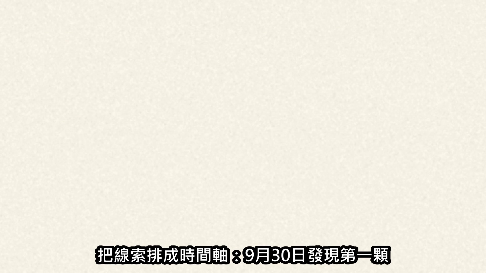

**逐字稿片段：** 把線索排成時間軸：9月30日發現第一顆 10月5日第二顆出現，10月9日人被逮捕 從找到裝置到抓到人，前後正好9天 這9天裡，OpenAI 刻意不打草驚蛇 先悄悄縮減他的工作範圍和權限 到了10月9日，一次關掉全部權限、 把他開除，FBI 也在同一天逮捕他

**話題推測：** 案件時間軸整理

---

## 00:04:24

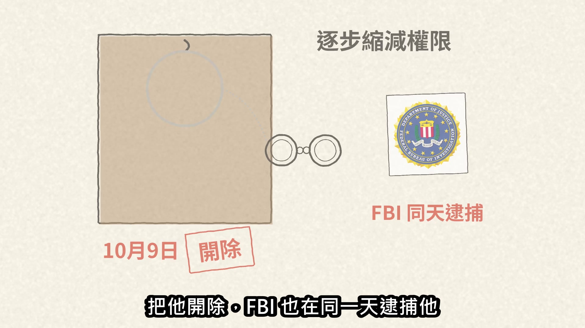

**逐字稿片段：** 回頭看，這案子是6條線索拼起來的： 安全人員發現異物，模型讀鑑識資料 監視器拍到現場，保全翻出第二顆 內部紀錄顯示有人先查過敏感空間 最後聊天紀錄對上硬體 所以這不是 AI 獨立辦案 是一套人機合作的調查 AI 比較像一隻獵犬，幫忙更快嗅出線索 但不是決定辦案方向的偵探長

**話題推測：** 案件6條線索總結

---

## 00:04:49

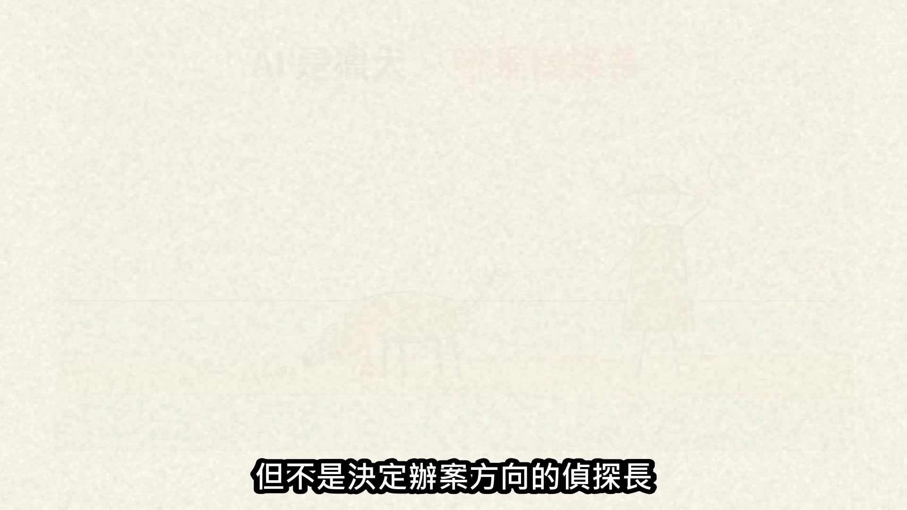

**逐字稿片段：** 但反過來想，抓內鬼的能力也代表 前沿 AI 公司能調閱員工的工作搜尋紀錄、 分析設備資料；在特定調查條件下 連家人相關的帳號 都可能被列進鑑識範圍

**話題推測：** 案件引發的隱私與監控思考

---

## 00:05:01

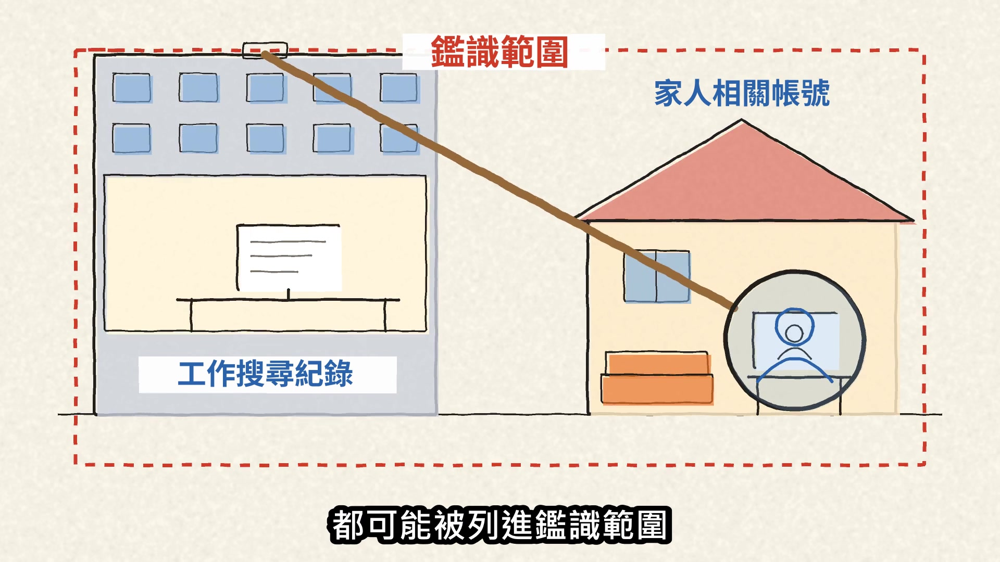

**逐字稿片段：** 官方的口氣更大，直接拉到國安層級

**話題推測：** 政府將案件拉高到國安層級

---

## 00:05:05

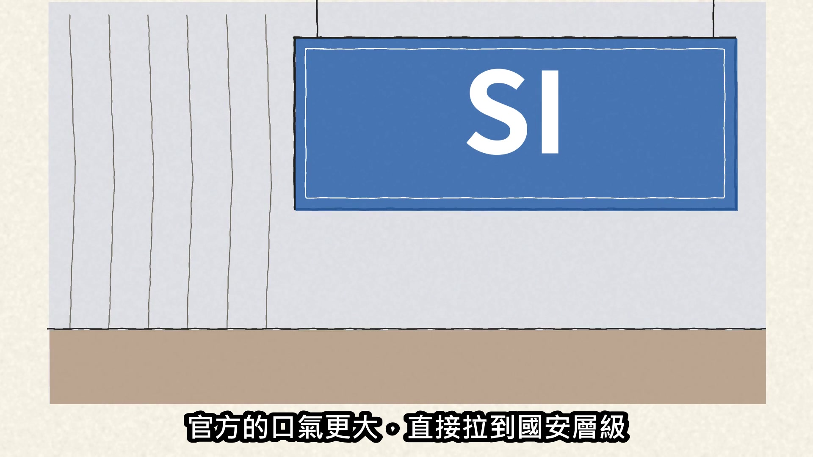

**逐字稿片段：** FBI 局長 Kash Patel 說 保護美國的「SI 創新」是最高層級的反情報任務之一

**話題推測：** FBI 局長 Kash Patel 說法

---

## 00:05:11

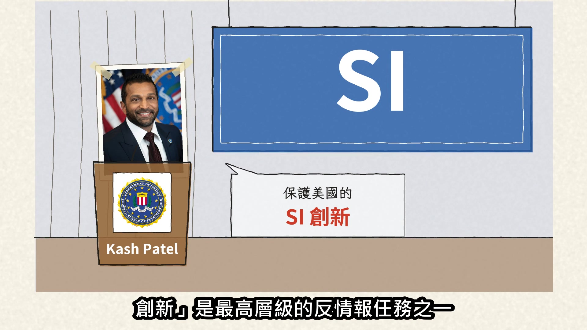

**逐字稿片段：** SI 就是 Super Intelligence 是川普政府9月底開始用的行政用語 可是口號喊這麼大

**話題推測：** 詞彙解釋：SI (Super Intelligence)

---

## 00:05:18

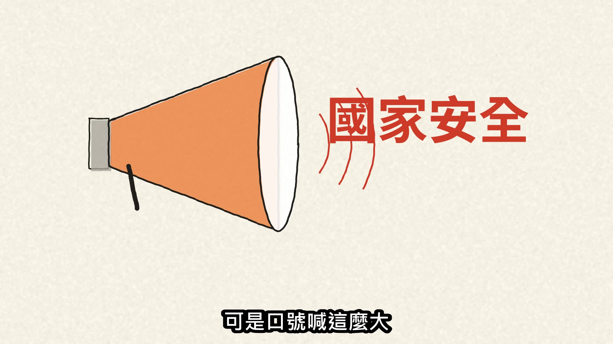

**逐字稿片段：** 目前公開的罪名只有非法攔截口頭通訊 定罪最重是5年監禁、25萬美元罰金

**話題推測：** 目前公開罪名：非法攔截口頭通訊

---

## 00:05:26

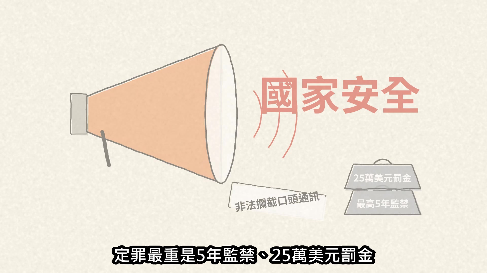

**逐字稿片段：** 那間諜罪呢？ 目前沒有 竊取營業秘密罪也沒有 更沒有官方文件指出他受沙烏地政府或其他組織指使 至於公司本身

**話題推測：** 關於間諜罪與竊取營業秘密罪

---

## 00:05:37

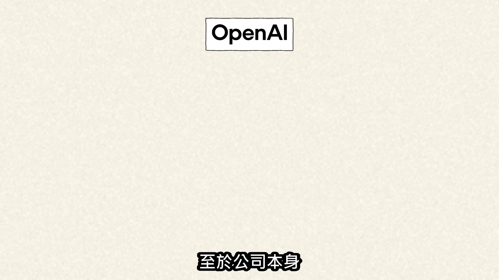

**逐字稿片段：** OpenAI 說目前沒有跡象顯示 Alfozan 不當存取或外洩模型權重、 原始碼或客戶資料

**話題推測：** OpenAI 官方聲明：無資料外洩跡象

---

## 00:05:45

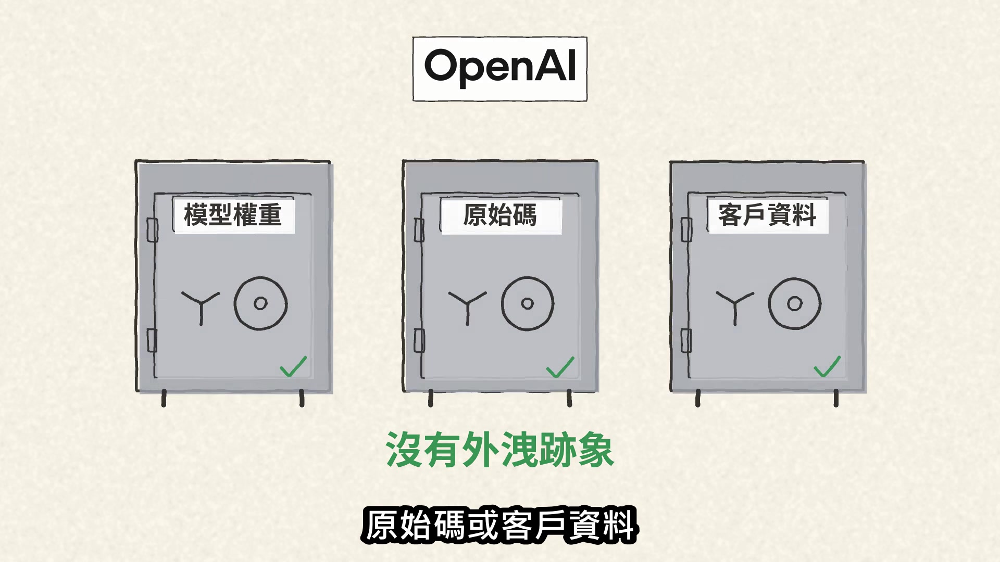

**逐字稿片段：** 但真正的謎團還沒解開：錄到了什麼、 有沒有傳出去、誰在接收、為什麼要裝 都還沒公開 OpenAI 還說 原本可能打算在更多敏感區域裝設備 只是目前公開找到的是2顆 說到底，AI 公司的機密不只在雲端 高層在會議室裡聊的策略和研究方向一樣值錢 而被控想用機器偷聽人類的人 最後把調查指向自己的 可能正是他跟聊天機器人留下的紀錄 下一步

**話題推測：** 案件未解之謎團

---

## 00:06:14

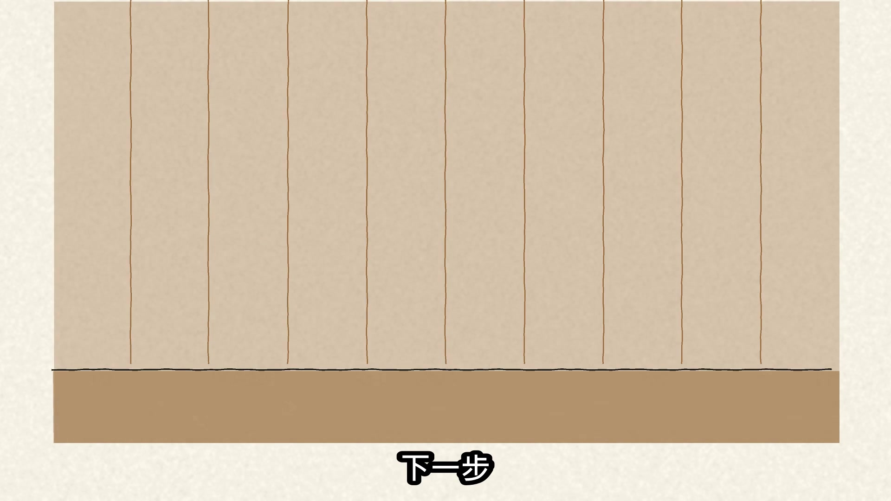

**逐字稿片段：** 看10月19日由聯邦治安法官 Alex G. Tse 主持的羈押聽證

**話題推測：** 案件下一步：羈押聽證會日期與法官

---
