# ai-note-101_c3phPGTS1m4 — 關鍵畫面索引

- 來源逐字稿：[ai-note-101_c3phPGTS1m4_GT.srt](ai-note-101_c3phPGTS1m4_GT.srt)
- 影片：https://www.youtube.com/watch?v=c3phPGTS1m4
- 截圖數：31

## 00:00:00

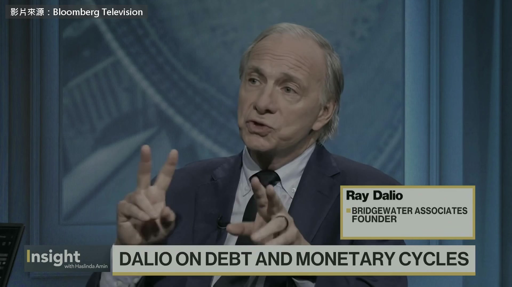

**逐字稿片段：** 2007 年春天 有一家基金開始警告 金融業借了太多錢 隔年金融海嘯，這家基金幾乎沒受傷

**話題推測：** 介紹時間背景：2007 年春天

---

## 00:00:08

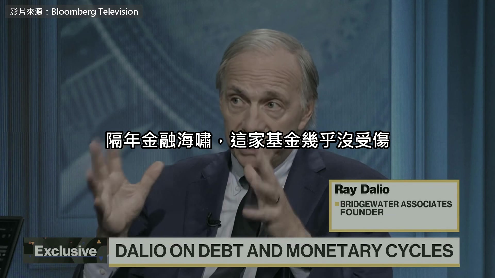

**逐字稿片段：** 它叫橋水，替退休基金這種大機構管錢 是全世界最大的避險基金 創辦人叫 Ray Dalio 這是 10 月 6 號 Bloomberg 在新加坡對他的專訪

**話題推測：** 介紹橋水基金及其業務

---

## 00:00:17

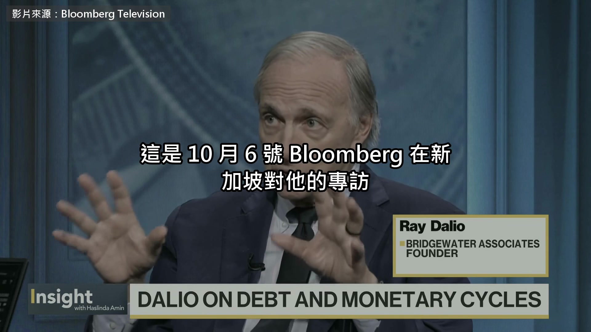

**逐字稿片段：** 主持人問到 AI 泡沫 他說泡沫會破在大家需要現金 只好把資產賣掉的那一刻

**話題推測：** 主持人提問 AI 泡沫化議題

---

## 00:00:23

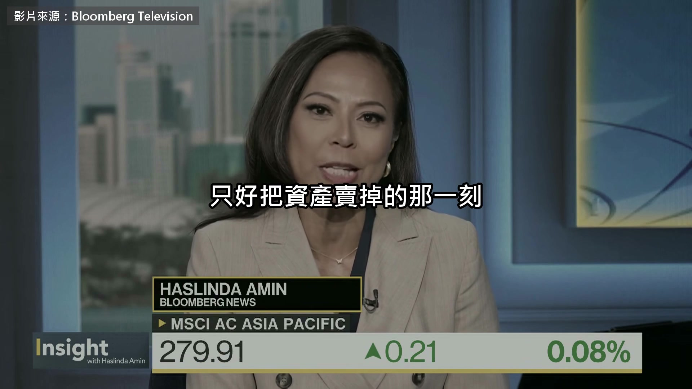

**逐字稿片段：** 訪談前半段談的是美國的債 他說利率一路往上，股票又已經很貴 買股票能比買債券多賺的那一截快沒了 他管這一截叫股市的緩衝 而且股市的風險還非常集中 也就是說，少數幾支股票，尤其是跟 AI 有關的 跟那個未來綁在一起的，成了最主要的考量 所以問題不只是那個緩衝正在消失 而且越來越說不清 這也代表大家都集中在同一件事上 那件事就是 AI，還有 AI 成長會帶來的一切

**話題推測：** 訪談前半段討論美國債務問題

---

## 00:01:03

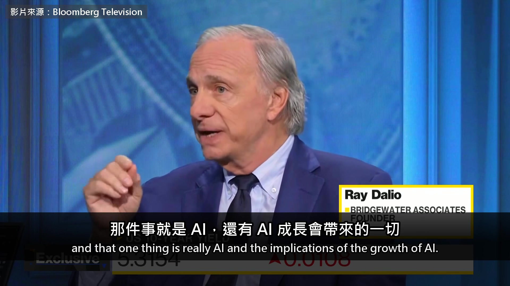

**逐字稿片段：** 所以我覺得，雲端巨頭開始碰到問題了 換句話說，以前他們用的是股東的錢 現在越來越得靠借錢 你會看到他們開始撞到極限 再往後看，那些報酬 我覺得報酬會轉移 不再是那些雲端巨頭 而是擴散到所有能從這裡面賺到錢的公司 換句話說，有人在做 AI 也有人在用 AI 拿 AI 來做出巨大的轉變 你當年是在自己車庫裡起家的

**話題推測：** 指出雲端巨頭面臨的問題

---

## 00:01:48

**逐字稿片段：** 但現在你看那些多策略平台、那些超大型避險基金 像 Citadel、Millennium，錢全被它們吸走 報酬卻不見得配得上那種規模 這種平台賺大錢的日子，是不是已經過了高峰？ 我想你指的是我創辦橋水、把橋水做大 我想它到現在還是全世界最大的避險基金

**話題推測：** 提及 Citadel 和 Millennium 等超大型避險基金

---

## 00:02:25

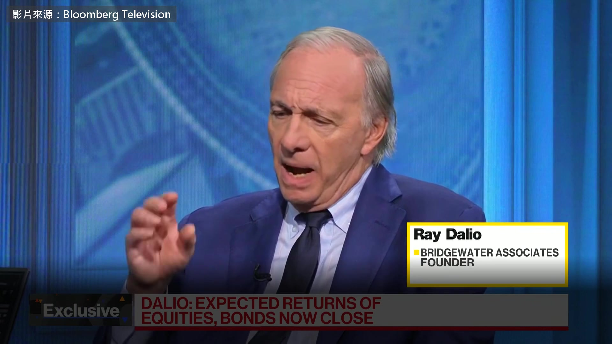

**逐字稿片段：** 我覺得我們正進入一個新時代

**話題推測：** 宣告進入利用 AI 在市場賺錢的新時代

---

## 00:02:30

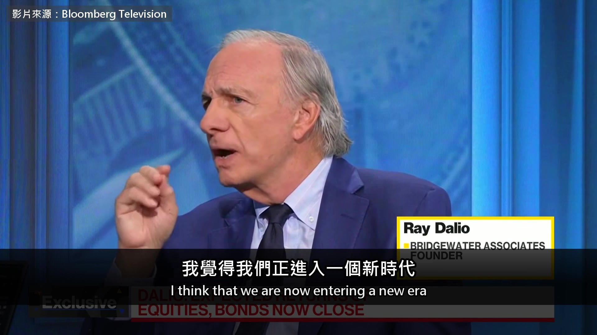

**逐字稿片段：** 可以用 AI 在市場上賺錢 所以把決策系統化 做出一套投資管理系統，這就是未來 所以我覺得，這對每個人都是很棒的機會 每個人都會越來越有本事，用不同的方法賺錢 只要你真的比別人聰明，因為這就是超額報酬 能創造超額報酬，成績就會很好

**話題推測：** 強調系統化決策和投資管理系統的重要性

---

## 00:03:05

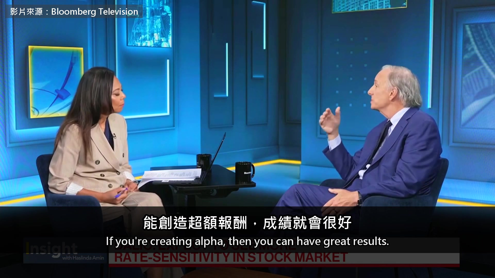

**逐字稿片段：** 我是在一間兩房的公寓裡創辦橋水的 後來它變成全世界最大的避險基金，別人也在這樣做 這是很正常的路 所以我覺得，把 AI 當成工具

**話題推測：** 講者回顧自己創辦橋水的經歷

---

## 00:03:19

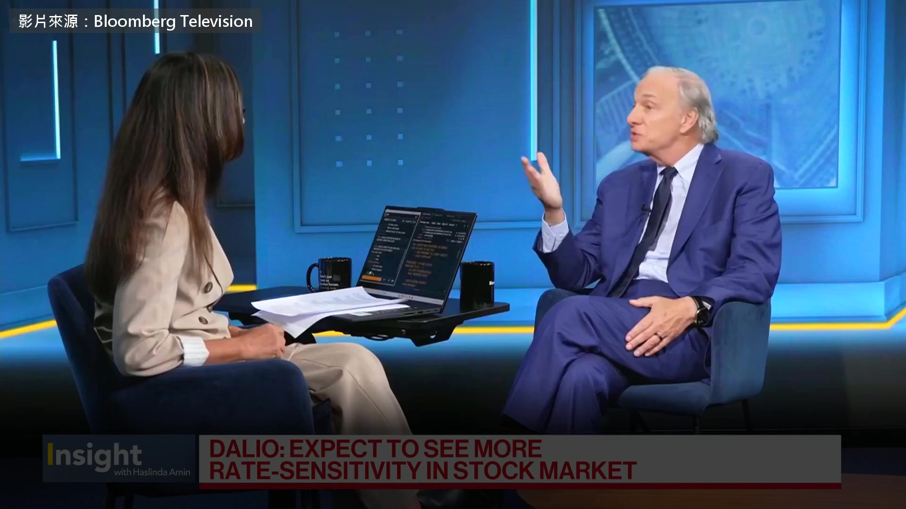

**逐字稿片段：** 我講的 AI，1956 年就開始了，有過各種形式 把你的決策系統化 搞懂因果關係 再用 AI 在市場上賺錢 對很多人來說，是一個拉平差距的大好機會 做法會一直變 但基本的道理不會變 所以，你會看到它就這樣一路演變下去 關鍵是，你在這上面一定要有競爭力

**話題推測：** 追溯 AI 技術的歷史發展

---

## 00:03:54

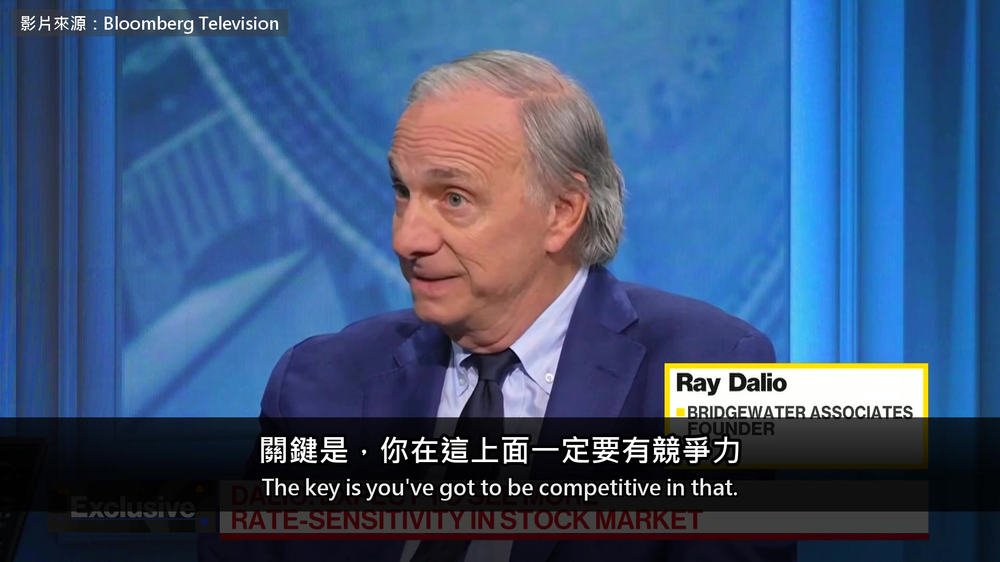

**逐字稿片段：** 你說 AI 會提升生產力

**話題推測：** 主持人問及 AI 對生產力的提升

---

## 00:03:58

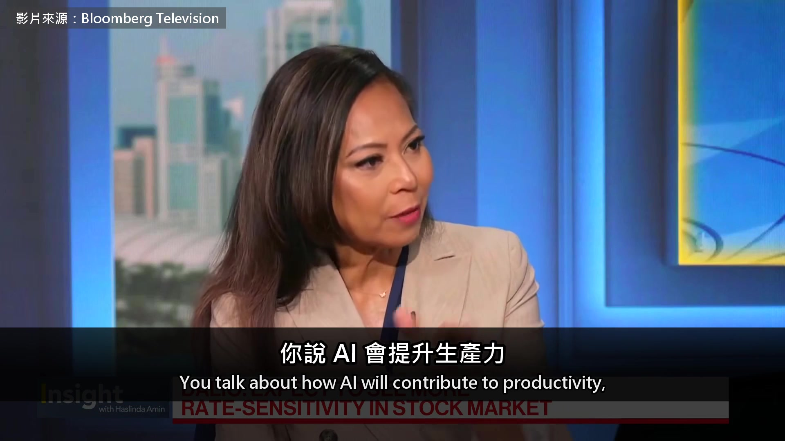

**逐字稿片段：** 但我們也看到了泡沫，對吧？ 有哪些跡象？ 這兩個向來是一起來的

**話題推測：** 探討 AI 相關的泡沫現象

---

## 00:04:05

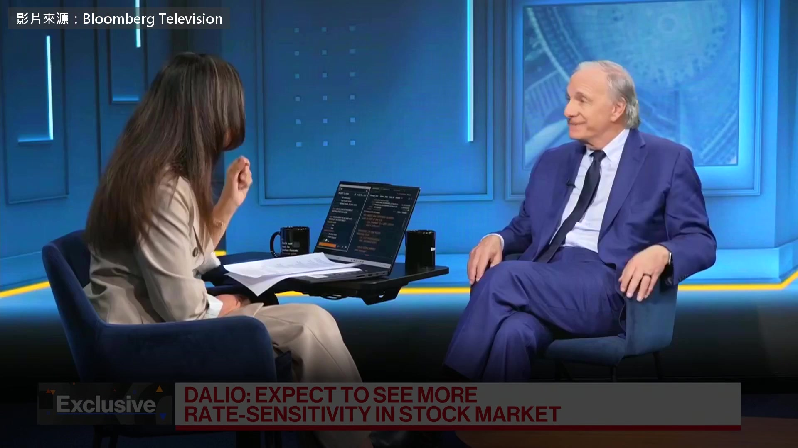

**逐字稿片段：** 我研究過去 500 年的歷史 因為我出生以前發生過的事 我發現現在又在發生 所以我得去研究那 500 年

**話題推測：** 提到對過去 500 年歷史的研究

---

## 00:04:16

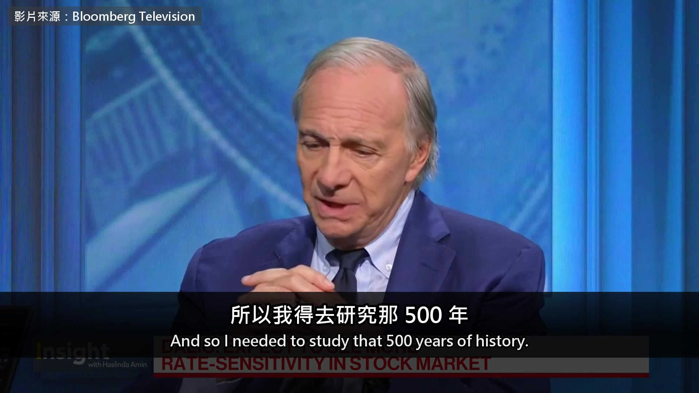

**逐字稿片段：** 你會看到，舉例來說，想想 1920 年代後期 20 年代末那場大崩盤之前 那是電第一次走進一般人家裡 有了冰箱，有了電燈 第一次有汽車，第一次有飛機 第一次有電影，第一次有收音機 你身邊到處都是驚人的創新 大家都知道它會改變世界 每個人都想押一把 結果就形成一種局面，大家都很興奮 他們說「我要買，而且要借錢來買」 這就很不一樣了 因為財富跟錢，有一個很重要的差別 財富某種程度上很容易創造 但財富不能拿來花 你得先把財富賣掉，換成錢才能花 所以當很多人借錢買這些資產

**話題推測：** 舉例說明 1920 年代後期的經濟泡沫

---

## 00:05:15

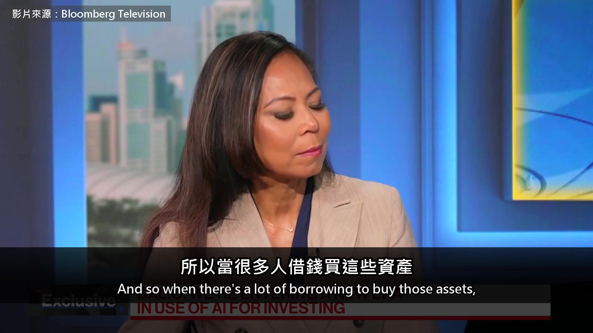

**逐字稿片段：** 或甚至有了財富稅 逼你賣掉財富來換錢

**話題推測：** 提及財富稅對泡沫破裂的影響

---

## 00:05:21

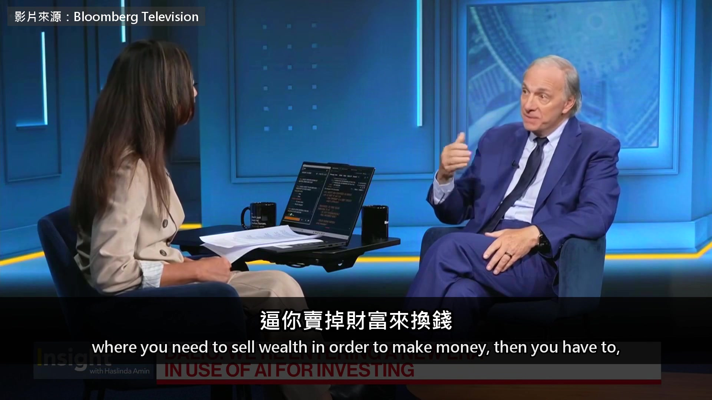

**逐字稿片段：** 泡沫就破了 我們現在看到的，就是這種局面 大家不看價格 這也沒辦法，本來就不可能算得準 因為在這種新技術上 未來有太多說不準的東西 你不能少投資，還想跟人競爭 所以你多半會投資過頭 這就吹出了泡沫 讓泡沫破掉的，是你需要現金 你開始把手上的財富變現 為了拿到現金，你只好賣掉財富 像財富稅就會造成這種結果 要還債，向來也會這樣 這種局面正在發生 我們得盯著 延續泡沫會破這個話題

**話題推測：** 總結泡沫破裂的時刻

---

## 00:06:18

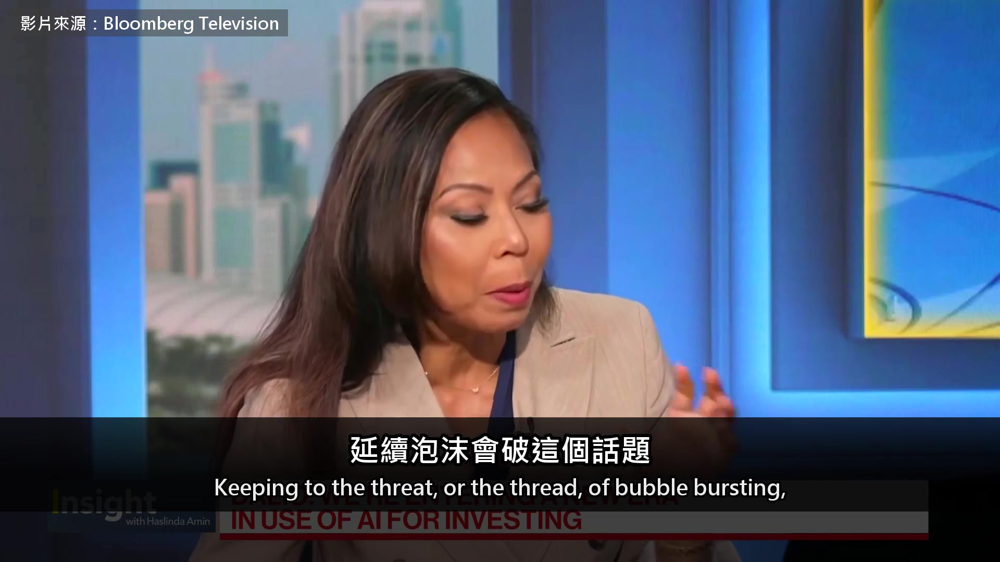

**逐字稿片段：** 泡沫會不會在韓國這樣的市場破掉

**話題推測：** 討論泡沫是否會在韓國等市場破裂

---

## 00:06:22

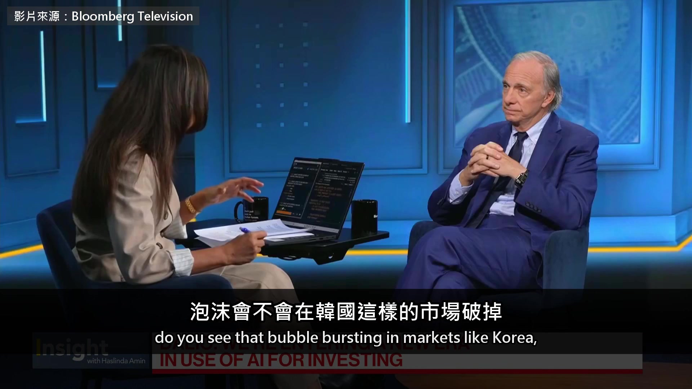

**逐字稿片段：** 或是台灣這樣，吸進大量 AI 資本支出的市場？ 錢有沒有投錯地方？ 生產力的表現一直很棒 但同時也發生了一件事 他們已經超出了自己的生產力 然後到全世界去買 他們把賺進來的錢、那些生產力 拿去投資全世界 結果在這上面出了問題 這些就是泡沫開始的典型例子 你會看到泡沫破掉的那種樣子 看到那種價格的起伏 所以是，我覺得這就是它的本性 但這不會威脅到整個金融體系 但我們確實有一件事，就是 AI 大多集中在少數幾家公司 未來能賺多少現金，非常不確定 而且現在非常貴

**話題推測：** 具體提及台灣作為 AI 資本支出市場

---

## 00:07:23

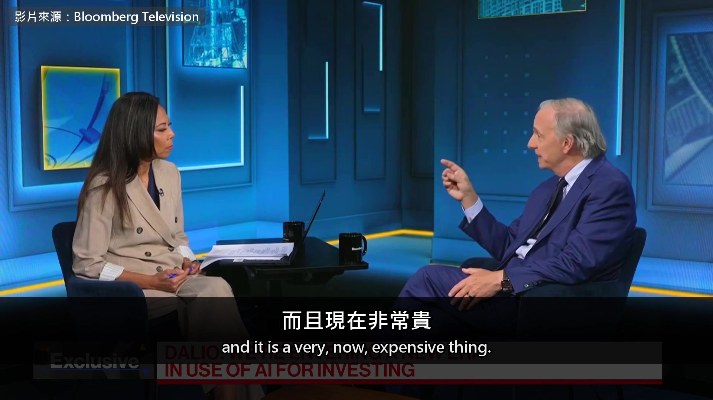

**逐字稿片段：** 你常講的五大力量裡，有一個是地緣政治

**話題推測：** 談及五大力量之一的地緣政治

---

## 00:07:26

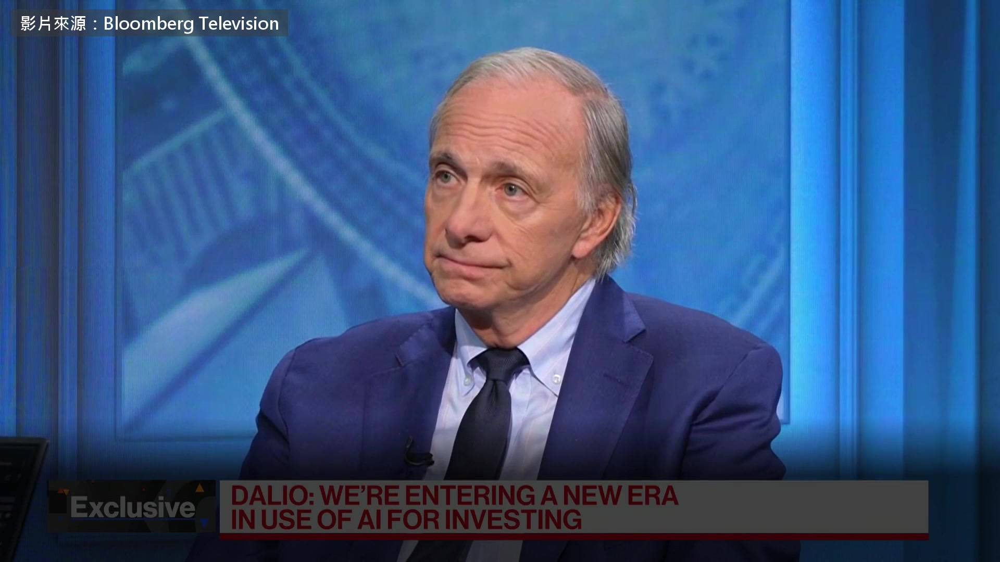

**逐字稿片段：** 我想聊聊美中 你覺得會分成兩個陣營嗎？ 我是說科技上、資本上 你覺得會怎麼發展？ 歷史上一直是這樣，今天當然也是 科技是經濟上的戰爭 也是軍事跟地緣政治的戰爭 現在就是這樣 換句話說，這場科技戰你一定得贏 這有兩種不同的打法

**話題推測：** 聚焦美中關係的發展

---

## 00:07:58

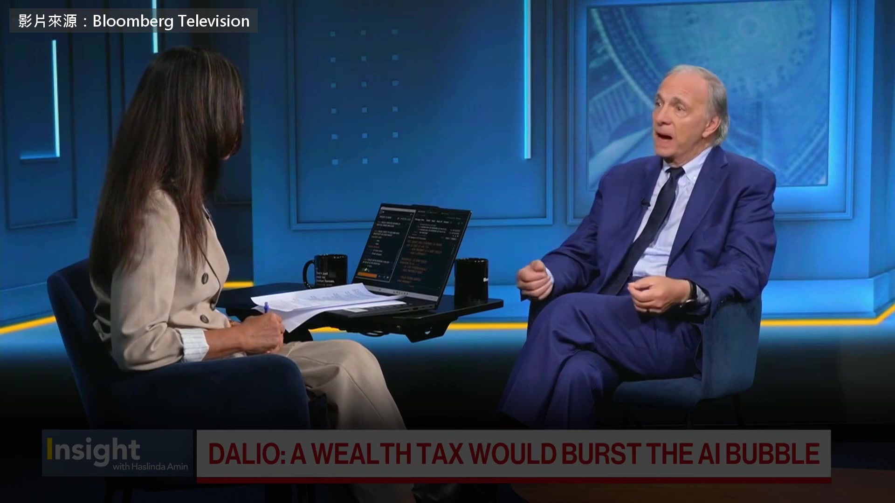

**逐字稿片段：** 中國挑了某些領域，像機器人 他們在前沿模型的發展上，只落後一點點 不過追得很快 就半年，要看是哪個模型 而且因為很多是開源的 又非常便宜 所以在中國，用 AI 的人多得多

**話題推測：** 指出中國在機器人等領域的發展

---

## 00:08:29

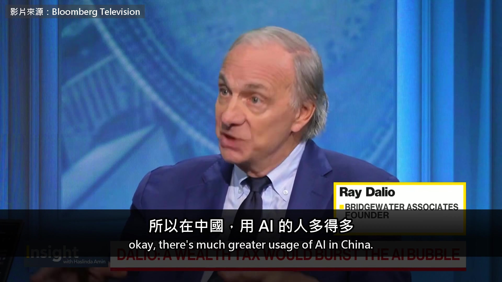

**逐字稿片段：** 其實在美國，現在也在吵一件事 要不要替 AI 的發展踩煞車 所以競爭是有的 只是這種競爭在某種程度上，甚至可以說大幅 在兩國之間受到限制，在世界其他地方就沒有 所以沒錯，我確實認為，經濟戰裡有一場 AI 戰爭

**話題推測：** 提及美國關於 AI 發展的爭論

---

## 00:08:53

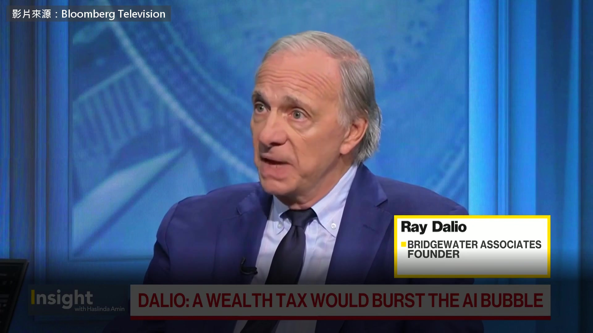

**逐字稿片段：** 誰會贏，Ray？ 你說這是一場科技戰，總得有個贏家 誰會是贏家？ 我不知道 猜一個？ 我不知道誰會贏 我想說的是，最重要的事 是我們自己內部的狀況 比如說，在西方民主國家 真正的問題是，我們能不能好好合作？ 不只是貧富之間、左派右派之間，還有教育 換句話說，要做到最好

**話題推測：** 主持人追問誰將贏得科技戰

---

## 00:09:35

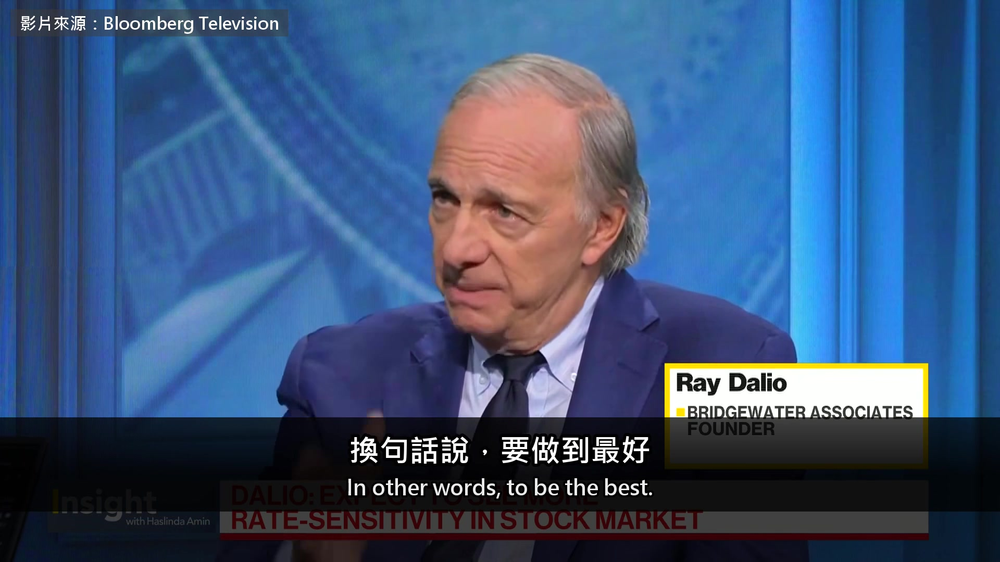

**逐字稿片段：** 美國很會創新，總是走在最前面

**話題推測：** 比較美國在創新方面的優勢

---

## 00:09:40

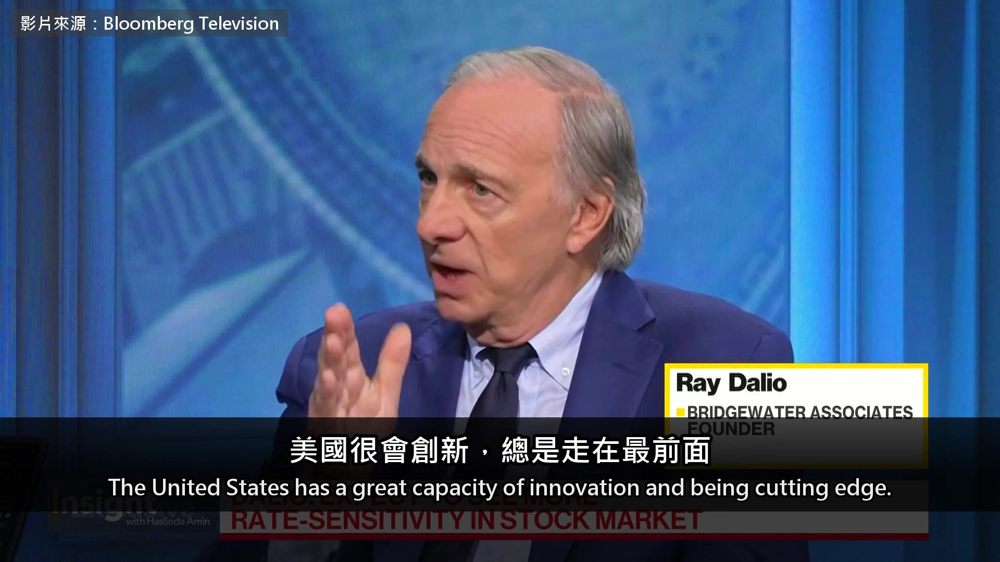

**逐字稿片段：** 在中國，有大量受過高等教育的人 合起來會非常有創新力，而且管得很嚴

**話題推測：** 指出中國大量受過高等教育的人才

---

## 00:09:52

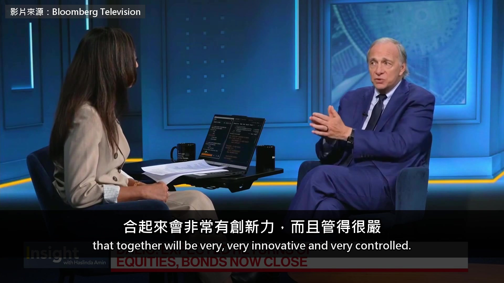

**逐字稿片段：** 我敢猜，中國內部的政治風險 比它的對手小，這些事比較不會被打亂 這會怎麼發展，我說不準 某種程度上，因為中國 很會把 AI 結合進去 不一定要最先進的 AI 沒那麼先進的 AI 用在製造業，就是很大的優勢

**話題推測：** 探討中國內部的政治風險

---

## 00:10:22

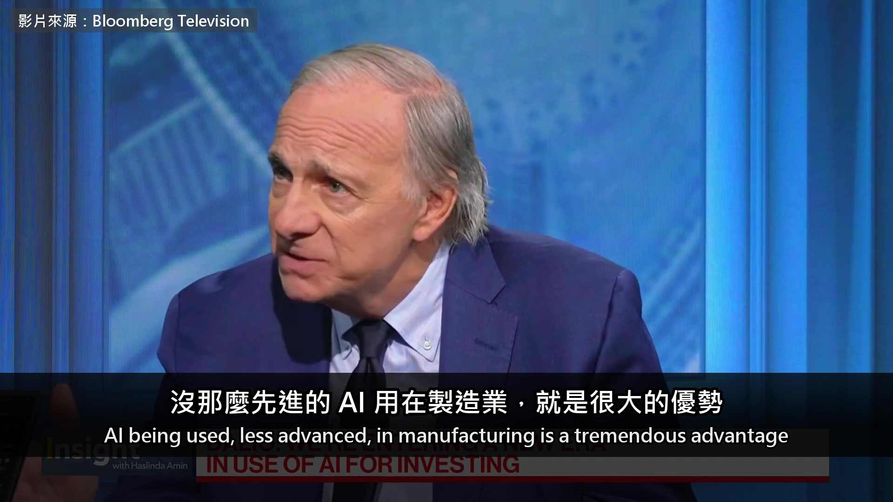

**逐字稿片段：** 把 AI 放進製造業，做出產品 所以中國賣到全世界的東西越來越多 所以最後會怎樣，我沒辦法告訴你 但我確定有一件事很重要，就是能不能和平 還有能不能讓雙方都得到好處

**話題推測：** 探討 AI 在製造業的應用及其帶來的優勢

---

## 00:10:42

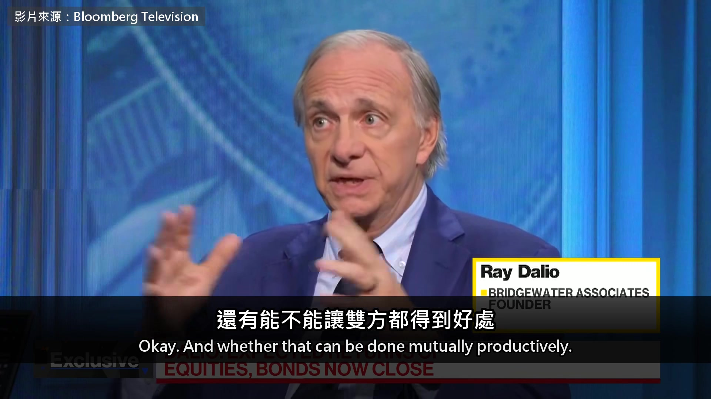

**逐字稿片段：** 在他看來，新技術跟泡沫總是一起來 泡沫會破在大家需要現金的那一刻 什麼時候破他沒說，但股市的緩衝 已經很薄了

**話題推測：** 影片結語總結新技術與泡沫的關係

---

## 00:10:53

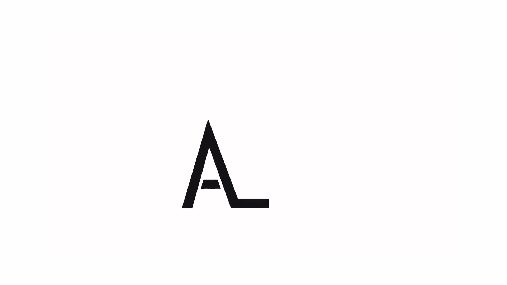

**逐字稿片段：** 原訪談 26 分鐘

**話題推測：** 提示原始訪談的總時長

---

## 00:10:54

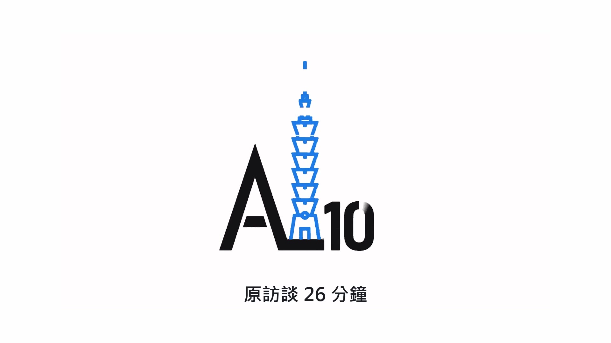

**逐字稿片段：** 前半段他認為美國三年內就會碰上債務危機

**話題推測：** 補充原始訪談中對美國債務危機的預測

---

## 00:10:58

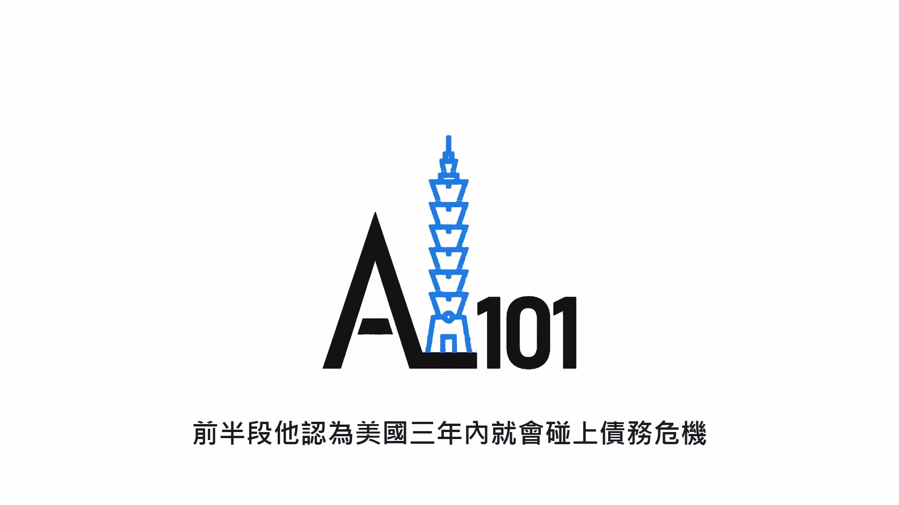

**逐字稿片段：** 後面也講了世界正在分成美洲跟亞洲兩塊勢力範圍 原影片連結在說明欄，有興趣可以去聽更多。

**話題推測：** 補充原始訪談中世界勢力範圍的劃分

---
