# ai-note-101_cnuExliGgjk — 關鍵畫面索引

- 來源逐字稿：[ai-note-101_cnuExliGgjk_GT.srt](ai-note-101_cnuExliGgjk_GT.srt)
- 影片：https://www.youtube.com/watch?v=cnuExliGgjk
- 截圖數：18

## 00:00:00

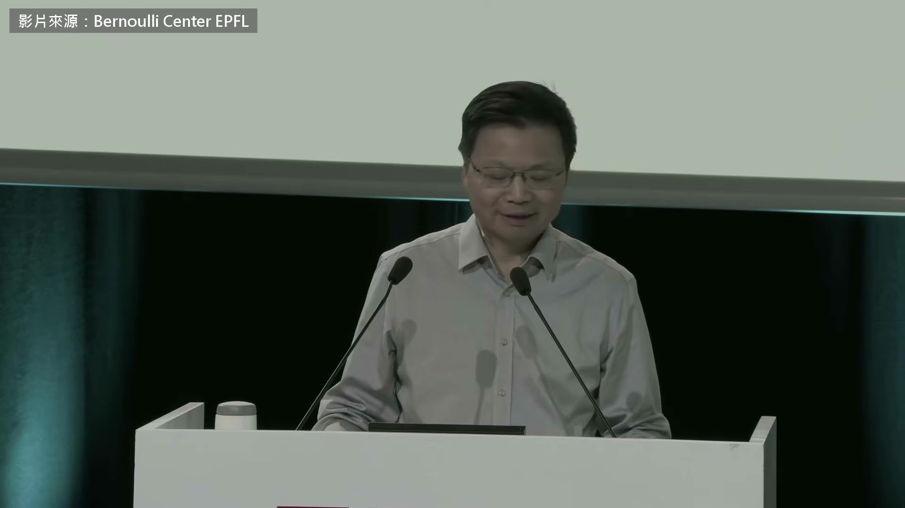

**逐字稿片段：** 2020 年 有一個團隊把有量子力學精度的分子模擬 從一千個原子推到一億個 拿下超級電腦應用的最高榮譽 Gordon Bell 獎

**話題推測：** 介紹一項重大科學成就，量子分子模擬擴展至一億個原子並獲頒 Gordon Bell 獎

---

## 00:00:09

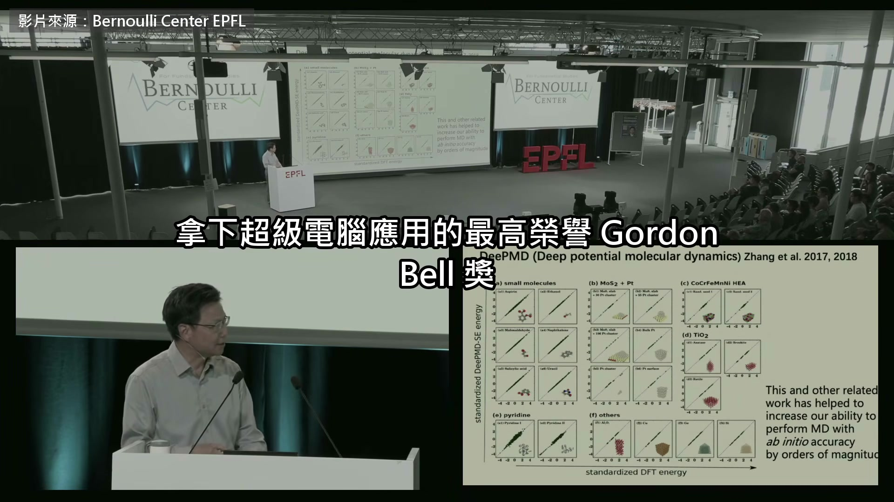

**逐字稿片段：** 團隊裡的數學家鄂維南 是北京大學教授、中國科學院院士 他說「AI for Science」這個詞 大概就是從他辦的一場會開始用的 這一場是今年 9 月 28 日 他在瑞士洛桑聯邦理工學院的講座 新材料、新藥、亂流 物理定律早就知道，題目卻一直算不動 他要用數學家的話講清楚 AI 為什麼派得上用場 為什麼有些問題很好解 有些，像剛剛說的那些，卻這麼難？ 這些難題都有一個共同點 就是變數很多 取決於非常多的變數

**話題推測：** 介紹關鍵人物鄂維南教授，以及「AI for Science」術語的來源

---

## 00:00:46

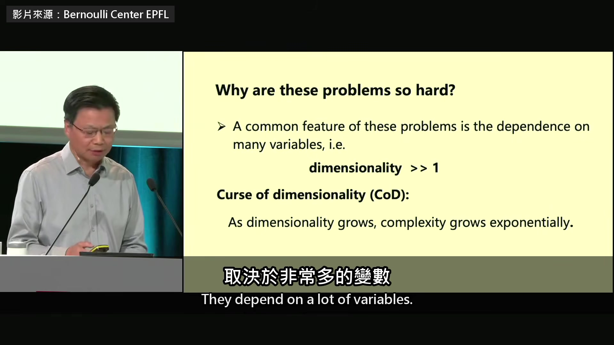

**逐字稿片段：** 在數學上，變數的個數叫做維度 這些問題的維度通常都非常大 這就有所謂的「維度詛咒」 意思是維度一升高 用傳統的數值方法，複雜度就會指數成長

**話題推測：** 引入數學概念「維度」，解釋為何這些問題難解

---

## 00:01:10

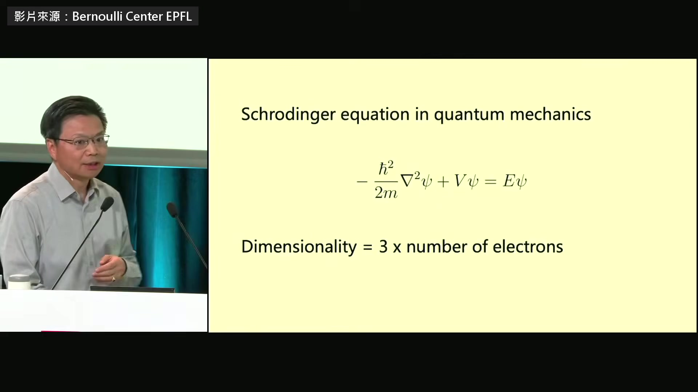

**逐字稿片段：** 一個例子是量子力學的薛丁格方程 這是基本方程… 薛丁格方程，薛丁格力學… 要解的就是波函數

**話題推測：** 舉例量子力學中的薛丁格方程，作為高維度問題的實例

---

## 00:01:23

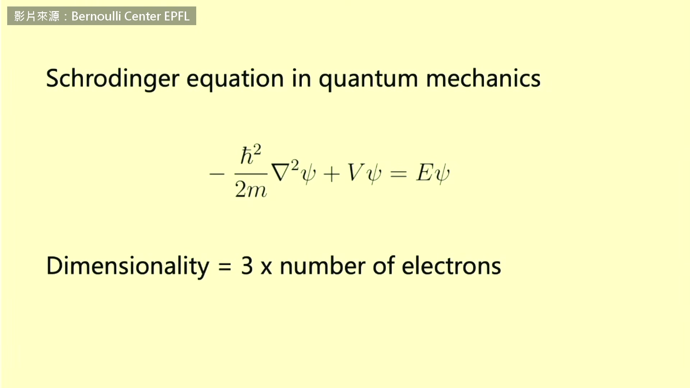

**逐字稿片段：** 可是波函數的變數個數 大約是電子數的 3 倍 所以 10 個電子的系統，聽起來很簡單 可是寫成方程就是 30 維，非常難解

**話題推測：** 用具體數字說明薛丁格方程在電子系統中如何產生高維度

---

## 00:01:37

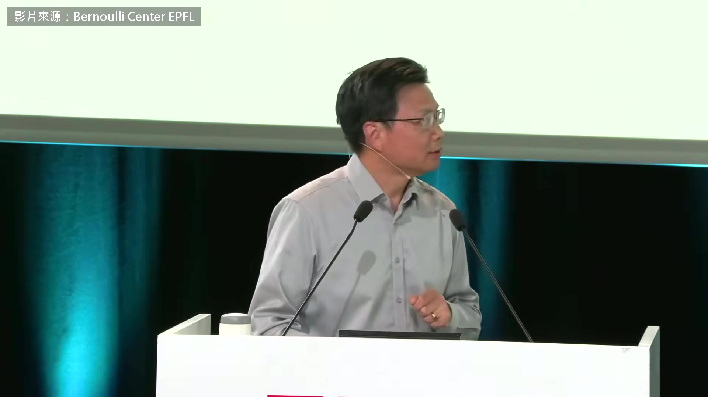

**逐字稿片段：** 這正是深度學習 AI 幫得上忙的地方

**話題推測：** 轉向說明深度學習 AI 如何在解決此類問題中發揮作用

---

## 00:01:42

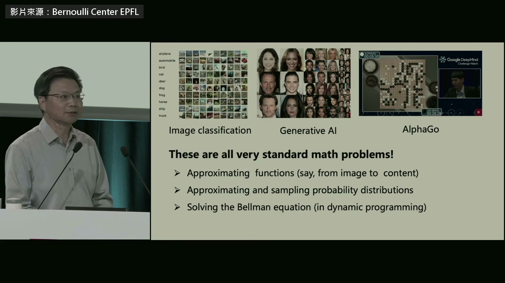

**逐字稿片段：** 他接著說，影像分類、生成人臉 下圍棋，換成數學語言 都是逼近函數這類應用數學的老題目 只是維度大得多 一張 32 乘 32 的彩色小圖 就有 3,072 個變數 數學家慣用的工具，是多項式 多項式跟神經網路差在哪

**話題推測：** 列舉影像分類、生成人臉、下圍棋等 AI 應用，並以 32x32 圖片為例說明其高維度

---

## 00:02:03

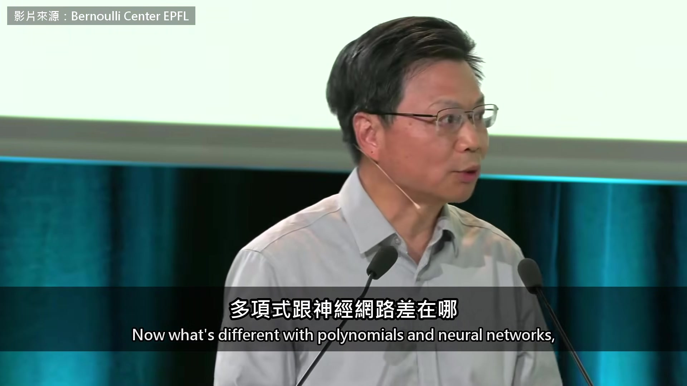

**逐字稿片段：** 大致就是下面這個逼近理論 設 ε 是誤差、d 是維度 m 是模型的參數個數 也就是神經網路的參數個數 或多項式的係數個數 如果用多項式來逼近 誤差隨著參數總數 m 下降 是 m 的負 d 分之一次方，d 是維度 也就是說，要把誤差降到十分之一 參數就得多 10 的 d 次方倍 不一定剛好是 d 分之一，總之是除以 d

**話題推測：** 介紹多項式逼近理論的數學公式及變數定義 (ε, d, m)

---

## 00:02:41

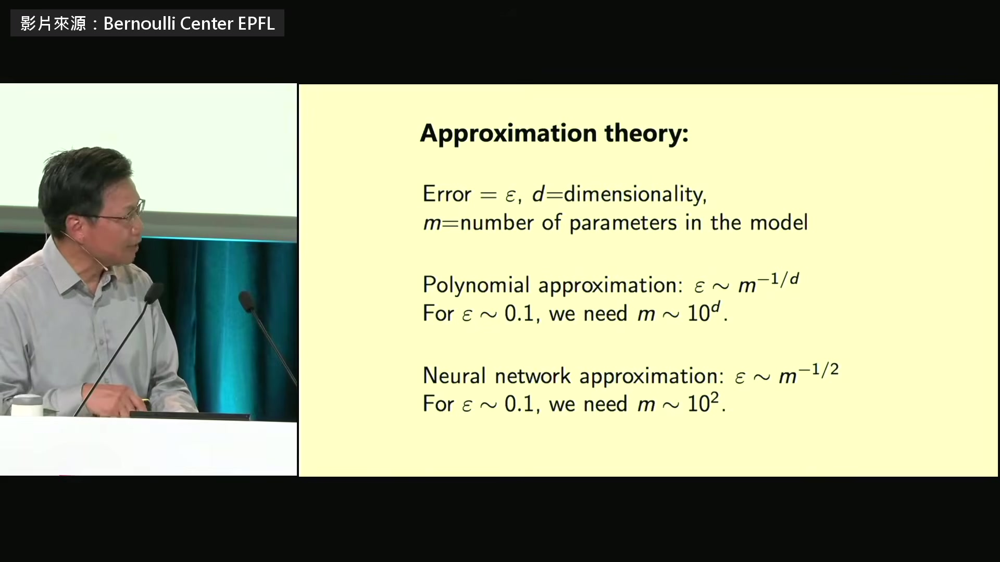

**逐字稿片段：** 如果 d 是 3,000，這就是天文數字 我說過，分子可能是別的數 但我們數學界一直在用的那類演算法 碰到的就是這個處境 再看神經網路，一樣，這還不是完整的定理 但想法是這樣 誤差大概會隨著 m 的…根號 m 根號 m 分之一下降 這就像蒙地卡羅法的誤差速度 所以指數跟維度無關 我說過，這還不是完整的定理 但我們大致知道神經網路做得到 所以這代表 深度神經網路是另一種逼近函數的方法 而且沒有維度詛咒

**話題推測：** 以 d=3000 的具體數字強調多項式在處理高維度問題時的困難

---

## 00:03:42

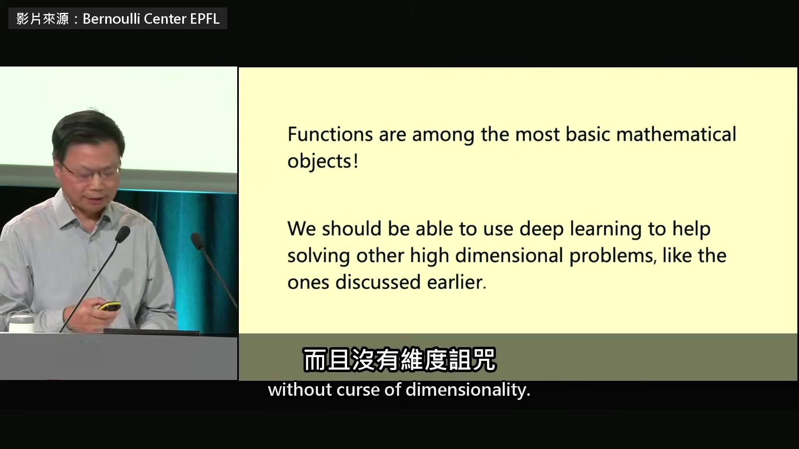

**逐字稿片段：** 換句話說，假如我們的世界 不是 3 維，而是 30 維 那我們一開始就不會用多項式 因為在 30 維，多項式根本沒用 微積分課、高中教的就會是神經網路 他說材料 化學過去理論和計算都使不上力 只能一次一次試 他的例子是找新的高壓超導材料 兩種元素的，之前已經有人找過一輪 所以我們問

**話題推測：** 總結神經網路能克服維度詛咒，並設想 30 維世界中學習模式的變化

---

## 00:04:13

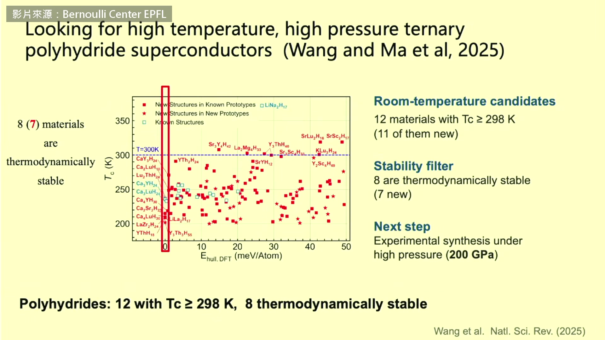

**逐字稿片段：** 能不能擴大到三元系統，三種元素

**話題推測：** 提出將材料研究擴展到「三元系統」（三種元素）的新挑戰

---

## 00:04:18

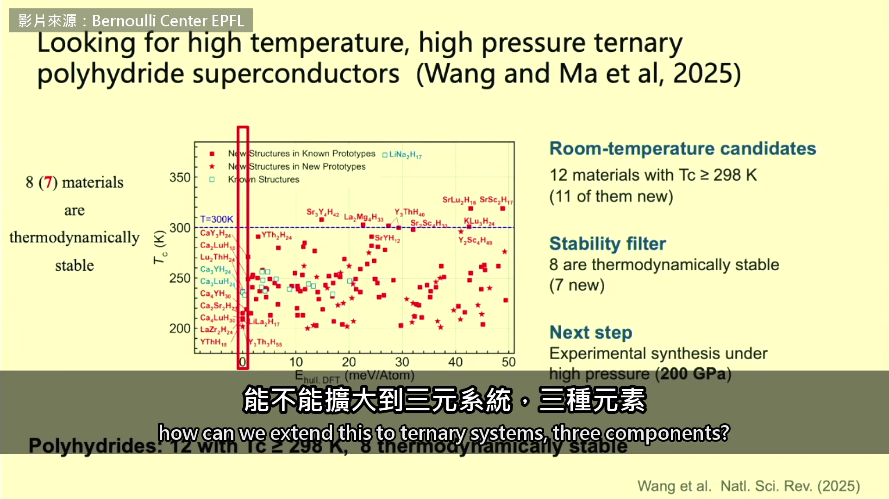

**逐字稿片段：** 結果大概一個星期 用我們的 DPA-4，其實是 DPA-3 模型 事實上，這是去年做的 就找到了這些新材料 大約 8 種熱力學上穩定的新材料 壓力要非常高，200 GPa，約兩百萬倍大氣壓 不過還沒有做實驗驗證 我們正在進行 我想說的重點是

**話題推測：** 展示 DPA-3 模型在一週內找到八種新材料的具體成果及高壓力條件

---

## 00:04:52

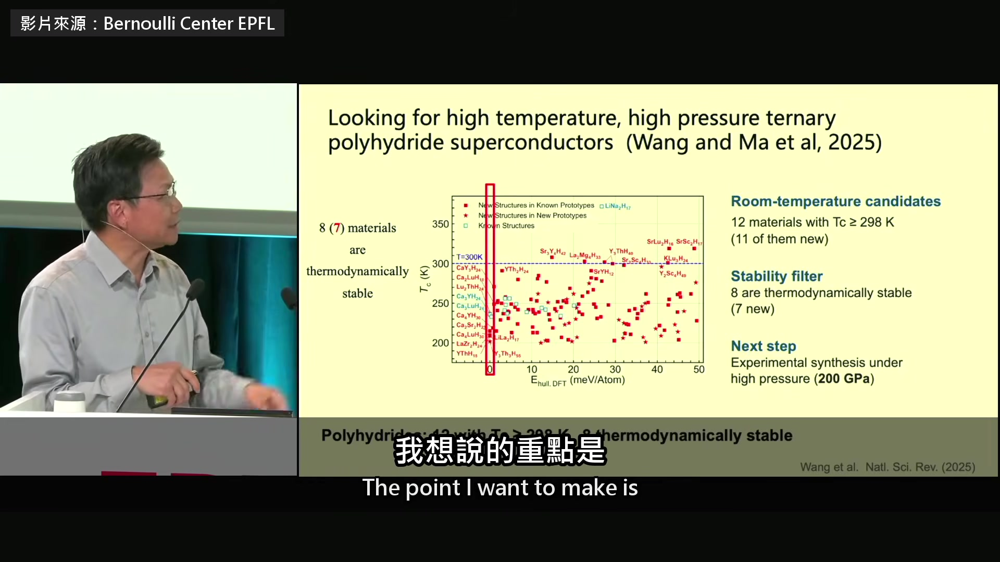

**逐字稿片段：** 這種工作本來要做好幾年 現在只要一個星期 AI 作為一門科學，是很奇怪的學科 它經歷過好幾次大起大落 而且沒有第一原理 進展主要靠試錯 很像一門實驗學科 資料中心就是實驗設備 所以非常燒錢

**話題推測：** 強調 AI 將數年工作縮短至一週的效率提升

---

## 00:05:26

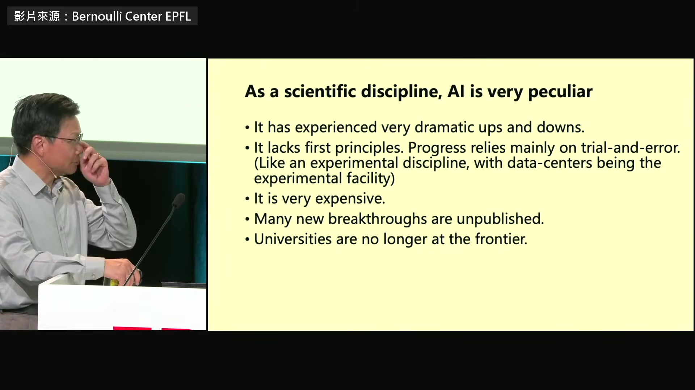

**逐字稿片段：** 現在新的突破都不發表 想像一下，你待的這門學科 最好的成果都不發表 這有點問題 像我們這樣的大學已經不在最前線 推動新進展的是公司 這學科很怪吧？ 會後有學生提到

**話題推測：** 指出 AI 領域的現狀：頂尖研究成果不公開、大學被邊緣化、公司主導發展

---

## 00:05:50

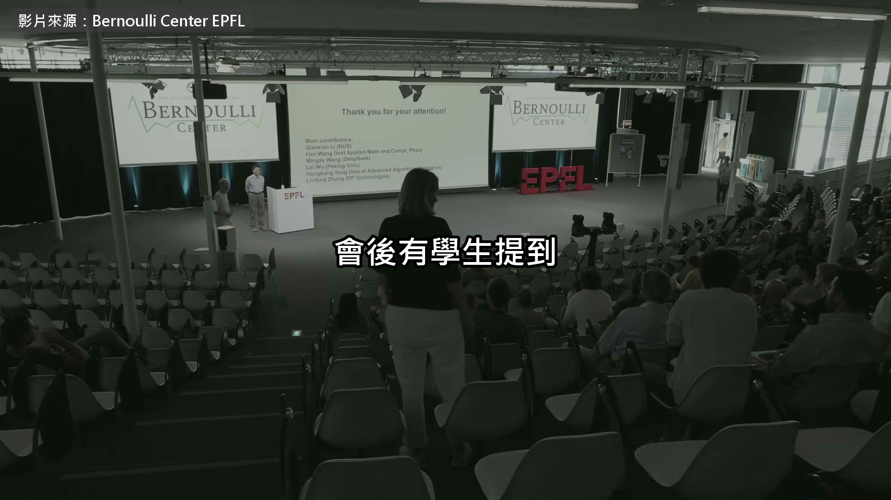

**逐字稿片段：** OpenAI 前陣子才宣布解掉千禧年難題 Navier-Stokes 問他數學家以後要做什麼 我今天想說服你們的只有一件事：AI 就是數學 我拿掉了一張投影片 上面是 AI 的先驅 他們大多是數學出身

**話題推測：** 提及學生提問 OpenAI 解決 Navier-Stokes 千禧年難題，以及數學家的角色

---

## 00:06:09

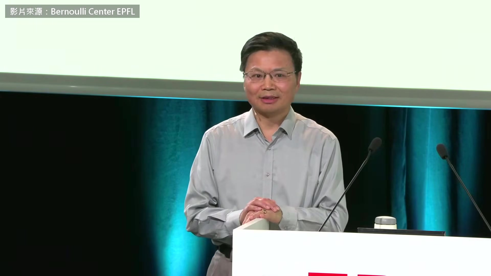

**逐字稿片段：** 可是自從 1956 年那場達特茅斯會議 數學就差不多退場了，被邊緣化 我覺得很可惜 第一，就像我一直想說明的 AI 就是數學加上電腦工程 但原理一定得從數學來 他的第二點是，AI 這麼貴 被大公司把持 就是因為沒人認真找它的第一原理 在鄂維南看來

**話題推測：** 回顧 AI 發展史，指出自 1956 年達特茅斯會議後數學家在 AI 領域的邊緣化

---

## 00:06:36

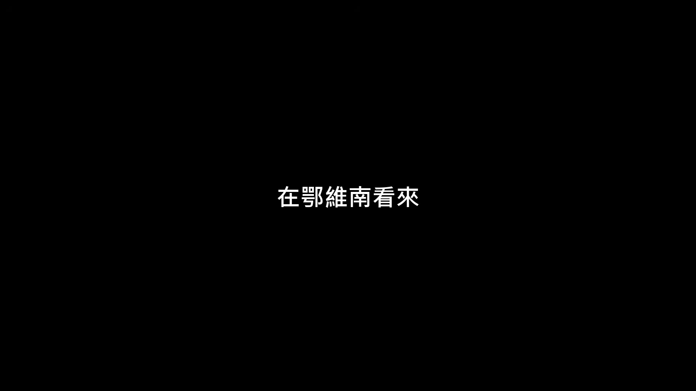

**逐字稿片段：** AI 本身就是對付維度詛咒的新數學 數學家該回頭，把它的原理找出來 原影片一個多小時，他還講到 他創辦的研究院裡

**話題推測：** 總結並呼籲數學家回歸，將 AI 視為對抗維度詛咒的新數學並找出其原理

---

## 00:06:46

**逐字稿片段：** 一個小團隊一週就把小型火箭引擎從設計做到試車 被問到 AI 安全，他也坦白說 自己還講不出什麼新東西 原影片連結在說明欄，有興趣可以去聽更多。

**話題推測：** 補充另一個快速實現的案例：小型火箭引擎設計到試車僅需一週

---
