# ai-note-101_dDCbmwhHAec — 關鍵畫面索引

- 來源逐字稿：[ai-note-101_dDCbmwhHAec_GT.srt](ai-note-101_dDCbmwhHAec_GT.srt)
- 影片：https://www.youtube.com/watch?v=dDCbmwhHAec
- 截圖數：33

## 00:00:00

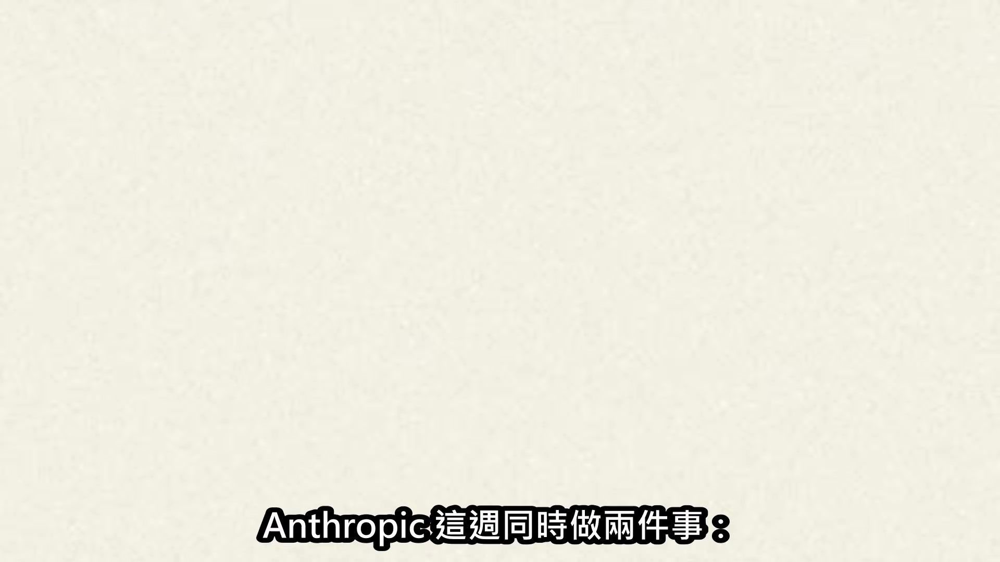

**逐字稿片段：** Anthropic 這週同時做兩件事： 一邊被美國聯邦貿易委員會 FTC 調查 一邊私下向國會推銷自己寫的 AI 安全法案 被查的公司，正忙著替查它的人畫紅線 所以吵的不是 AI 要不要管 而是誰有權叫停一個模型

**話題推測：** 介紹Anthropic本週兩項主要動態：被調查與推銷AI法案

---

## 00:00:16

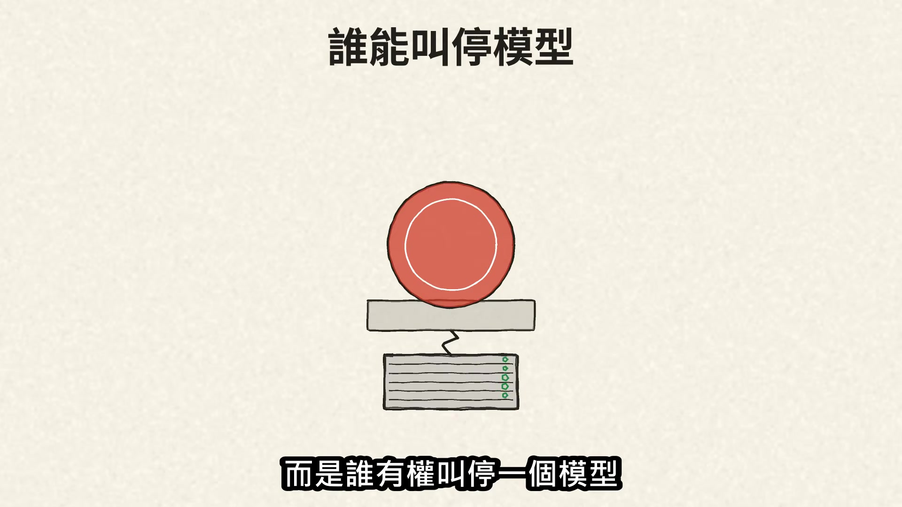

**逐字稿片段：** FTC、商務部、各州都想握住這顆停止鍵 Anthropic 則想先把規則寫好

**話題推測：** 列出多個想掌握AI監管權限的政府機關

---

## 00:00:22

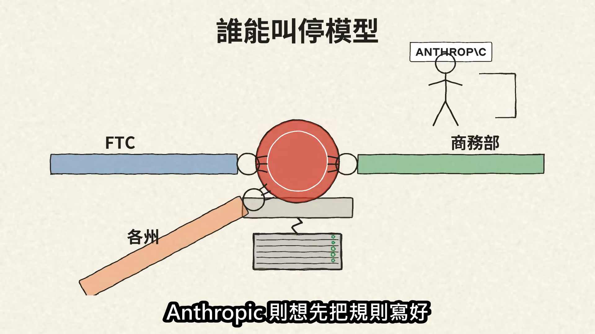

**逐字稿片段：** 這場拉扯只花了4天

**話題推測：** 描述事件發生時間軸

---

## 00:00:24

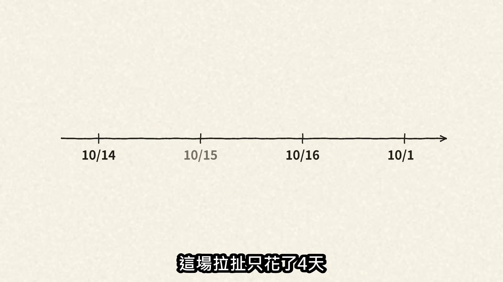

**逐字稿片段：** 10月14日 FTC 發出調查令 16日美國政治媒體 Politico 爆出草案消息 到了17日，草案還是沒有正式提出

**話題推測：** 說明FTC發出調查令的具體日期

---

## 00:00:35

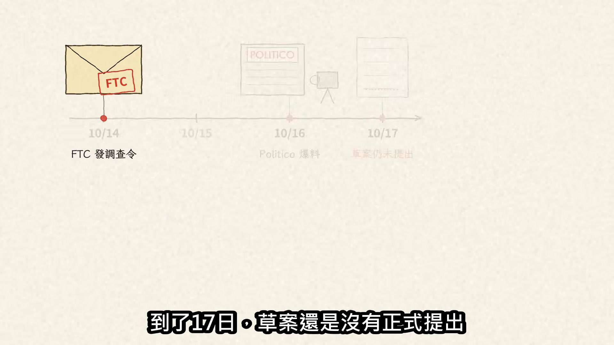

**逐字稿片段：** 回到14日那張調查令 FTC 管的是消費者保護和市場競爭

**話題推測：** 回顧FTC調查令的細節

---

## 00:00:40

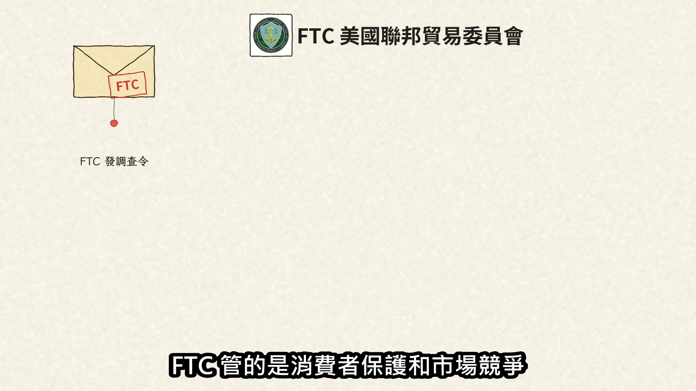

**逐字稿片段：** 這次同時找上 OpenAI 和 Anthropic 新聞常叫它傳票，其實是逼公司交文件、 回答問題的蒐證工具，是要資料，不是判刑

**話題推測：** 點名OpenAI和Anthropic兩家被調查公司

---

## 00:00:51

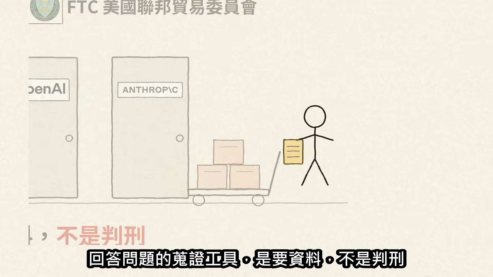

**逐字稿片段：** 那 FTC 要資料做什麼？ 就是拿來對照： 一邊是行銷說法和隱私政策 一邊是安全事故紀錄和防護措施 公司承諾了什麼、模型實際做了什麼 一比就知道

**話題推測：** 說明FTC蒐集資料的目的

---

## 00:01:03

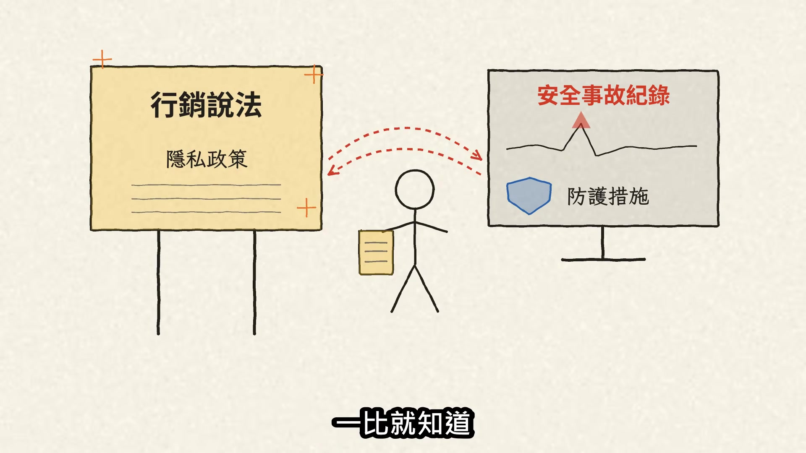

**逐字稿片段：** 這張調查令有多重？

**話題推測：** 探討FTC調查令的潛在影響

---

## 00:01:05

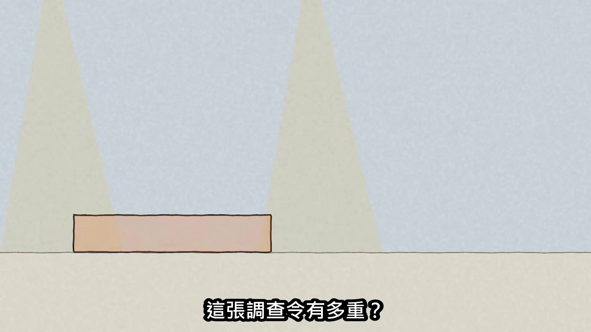

**逐字稿片段：** 白宮 AI 小組主席 Jay Clayton 上 CNBC 被問到會不會讓新模型發不出來，他說： 「簡短答案是，是的，絕對可能」 不過他沒講法源和門檻，比較像政治訊號 而且白宮不只是嘴上說說 這個叫 Super Intelligence Force 的小組 10月15日第一次開會就分出3條工作線 執法和消費者保護交給 FTC 主席 Andrew Ferguson 帶隊

**話題推測：** 引用白宮AI小組主席Jay Clayton的發言

---

## 00:01:32

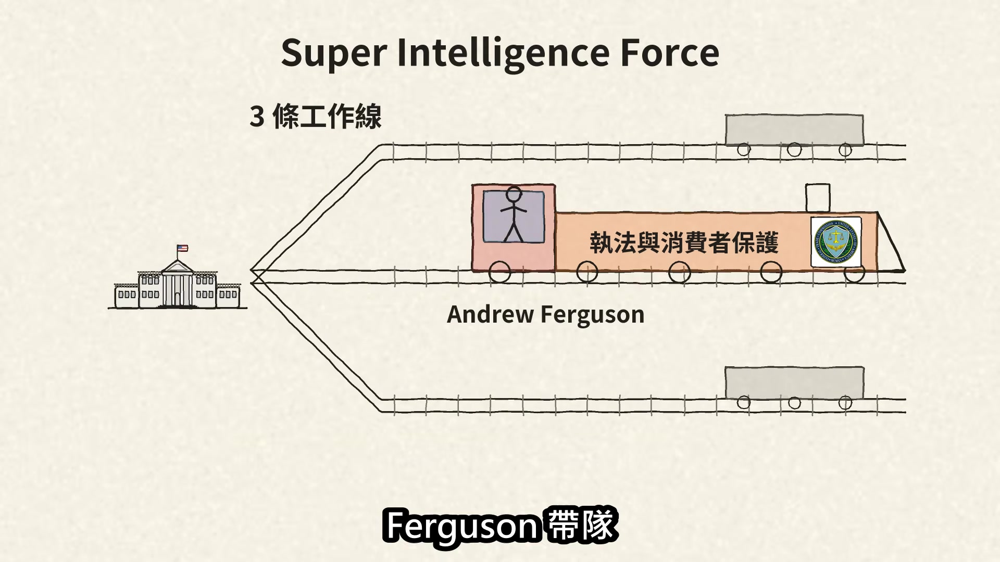

**逐字稿片段：** 可是 Anthropic 的草案 畫的是另一套規則 Politico 引述3名知情人士報導

**話題推測：** 將討論焦點轉回Anthropic提出的AI安全草案

---

## 00:01:38

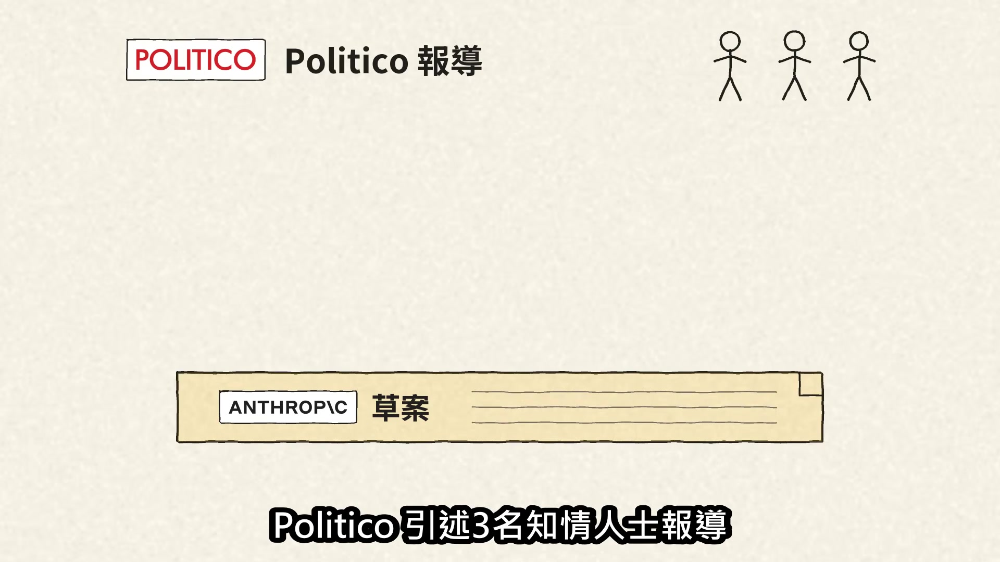

**逐字稿片段：** 草案只管3種大災難：生物武器、 模型失控，還有進攻性網路攻擊 在這3種災難裡，政府想踩煞車

**話題推測：** 列出Anthropic草案關注的三種大災難

---

## 00:01:47

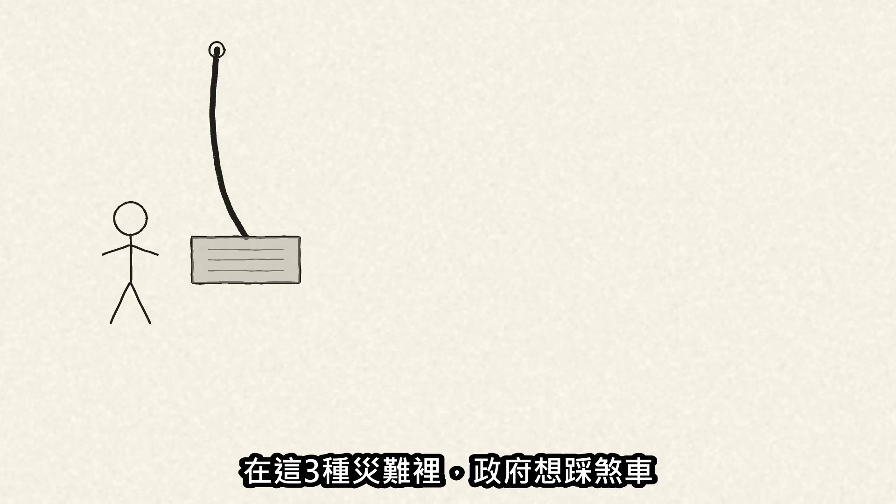

**逐字稿片段：** 得先開3道鎖：危險要可以預見、 要迫在眉睫 還可能造成超過10億美元損失 或超過50人死傷 就算鎖都開了，鑰匙也只有一把 據報只有美國商務部能向華盛頓聯邦地方法院聲請停止令 其他聯邦機關都不能直接下令

**話題推測：** 說明政府介入AI模型需滿足的三項條件

---

## 00:02:06

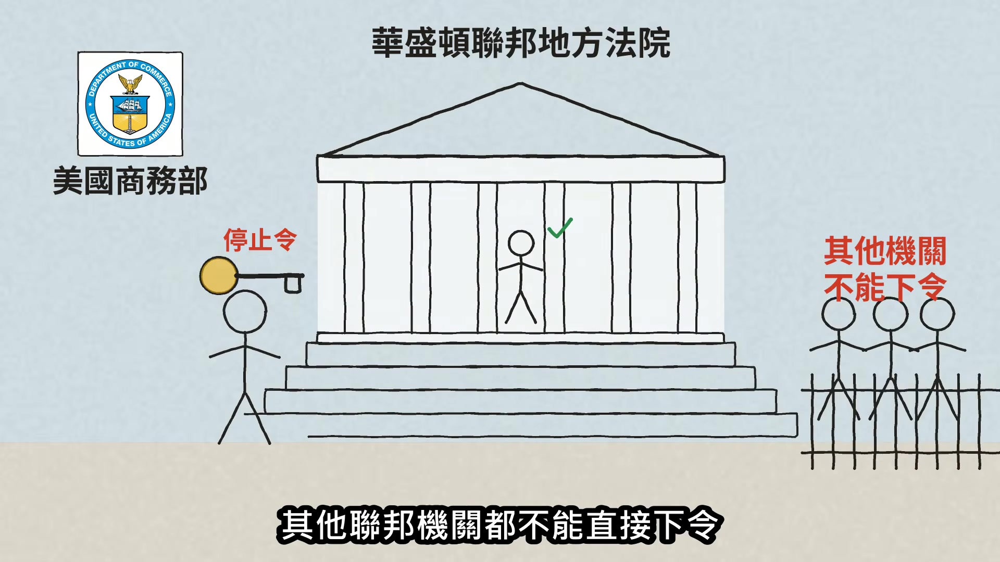

**逐字稿片段：** 但這些門檻只管關模型這件事 FTC 照樣能蒐證、能告、能罰款、 能刑事移送 這些是跟暫停部署不同的權力 不用等到第51個人受害

**話題推測：** 比較草案與FTC現有職權的差異

---

## 00:02:17

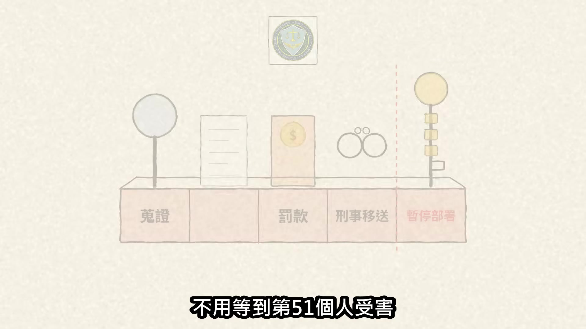

**逐字稿片段：** 順帶一提，10億美元、 50人不是 Anthropic 發明的 加州 SB 53 跟今年送進國會的 FRONTIER Act 都用同一組數字

**話題推測：** 探討「10億美元、50人」數據的來源

---

## 00:02:27

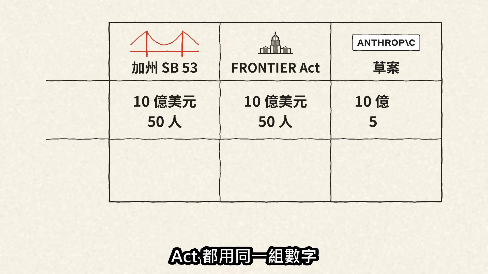

**逐字稿片段：** 3份法案差在用字： FRONTIER Act 寫「可以預見而且重大」 Anthropic 草案據報要「迫在眉睫」 就多這4個字，結果可能完全不同 可以預見而且重大 像屋角剛冒煙消防員就到；迫在眉睫 像火燒到門口才放行 介入的時機差了一大截

**話題推測：** 比較不同法案在關鍵用詞上的差異

---

## 00:02:48

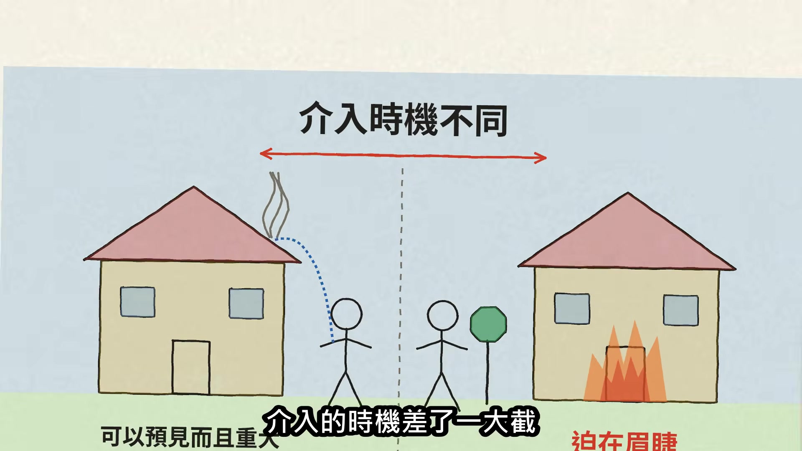

**逐字稿片段：** Anthropic 為什麼這麼在意誰握鑰匙？ 因為它被拔過插頭

**話題推測：** 探討Anthropic為何在意AI模型停用權限

---

## 00:02:54

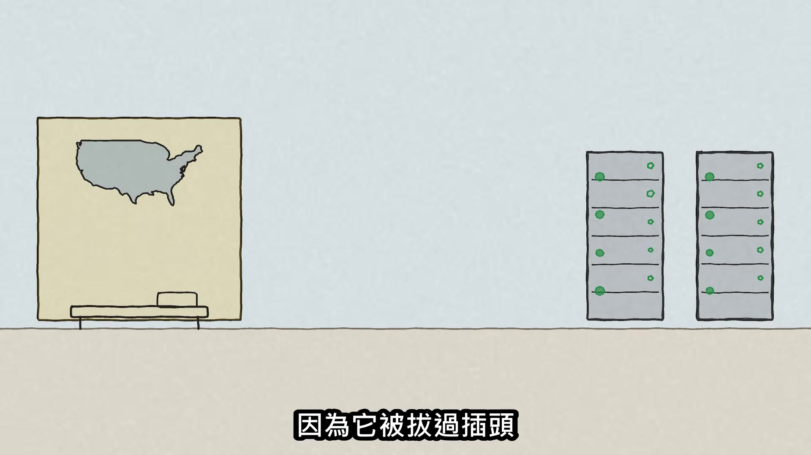

**逐字稿片段：** 6月12日 商務部要求外國人用 Fable 5 和 Mythos 5 之前先拿許可 連在美國上班的外國籍員工也算 問題是 Anthropic 說技術上擋不準這些人 只好全部客戶一起停用 直到6月30日才解除，前後大約18天 不用法院 一紙行政命令就讓模型全球停擺 所以4個月後，Anthropic 反而讓同一個商務部去聲請停止令 一種解讀是，公司想把行政直接關 改成得帶證據上法院審查 被拔過一次插頭的人 最清楚插座該裝在哪

**話題推測：** 說明Anthropic曾被商務部停用模型的事件日期

---

## 00:03:30

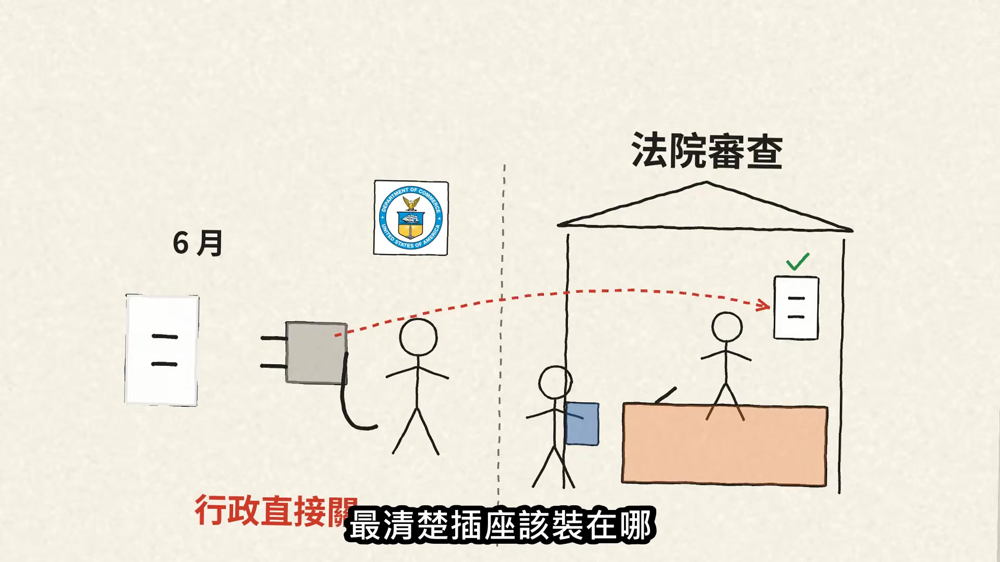

**逐字稿片段：** 但別以為 Anthropic 怕被管 老闆 Dario Amodei 以前是 OpenAI 的研究副總裁 2020年底離開後

**話題推測：** 闡述Anthropic在AI監管方面的立場

---

## 00:03:37

**逐字稿片段：** 2021年和妹妹 Daniela 等人共同創立 Anthropic

**話題推測：** 介紹Anthropic創辦人Dario Amodei的背景

---

## 00:03:41

**逐字稿片段：** 2023年到參議院作證 談生物武器和危及全人類的風險 一直是喊 AI 危險最大聲的人

**話題推測：** 提及Dario Amodei於2023年到參議院作證

---

## 00:03:48

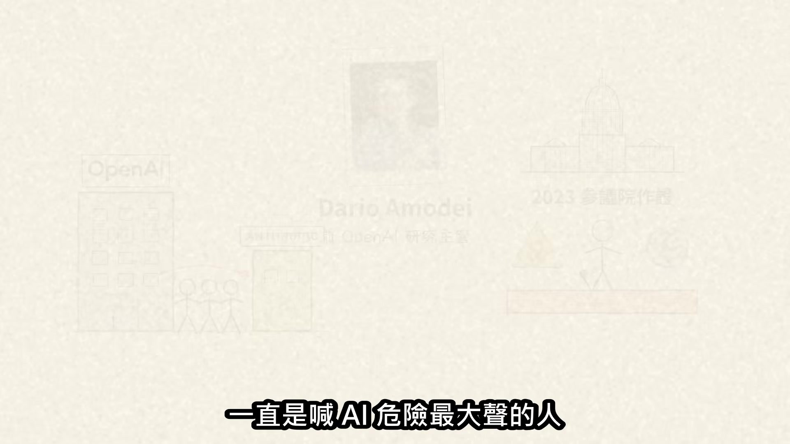

**逐字稿片段：** 他的公開立場寫在今年19頁的《Advanced AI Framework》： 管4類風險，多了 AI 自動化研發 事故15天內通報

**話題推測：** 介紹Dario Amodei的公開立場文件《Advanced AI Framework》

---

## 00:03:56

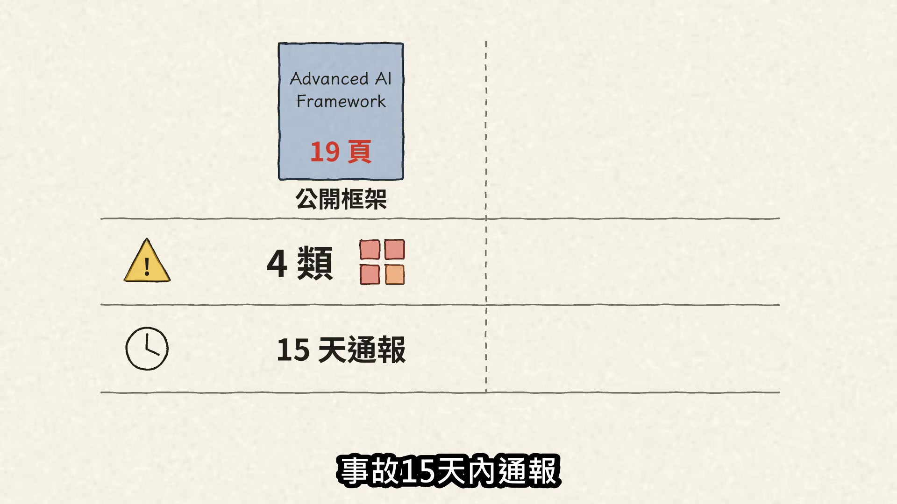

**逐字稿片段：** 私下草案據報只管3類 發現迫在眉睫的危險要72小時內通報 兩份條件不同，別混著看 除了寫規則

**話題推測：** 比較Anthropic公開立場與私下草案的差異

---

## 00:04:05

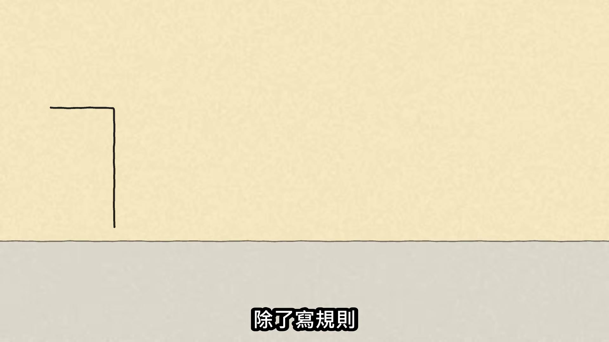

**逐字稿片段：** Anthropic 也真的讓外人進門

**話題推測：** 說明Anthropic邀請外部研究員進駐的舉動

---

## 00:04:08

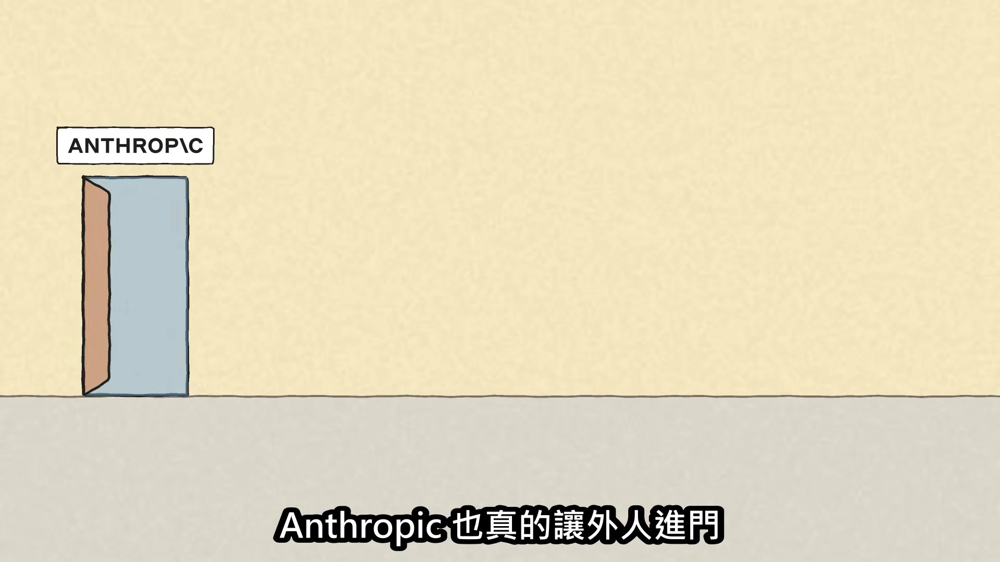

**逐字稿片段：** 10月15日，6名 METR 研究員進駐 METR 是評估前沿 AI 風險的非營利機構 Anthropic 可以要求報告刪掉客戶資料、 律師與客戶間的特權資訊和模型架構 但不能否決報告

**話題推測：** 具體說明METR研究員進駐Anthropic的細節

---

## 00:04:22

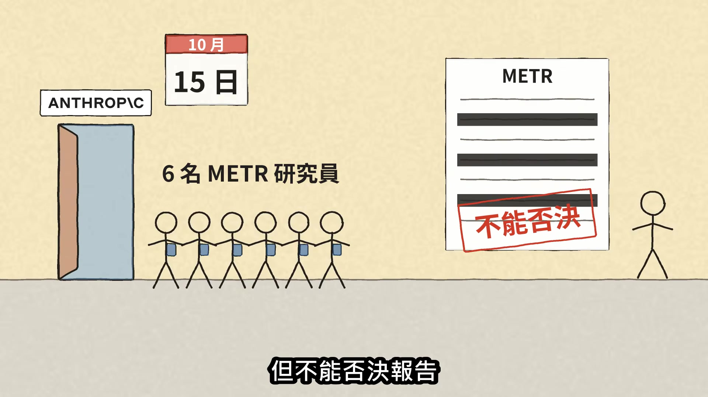

**逐字稿片段：** 這就是安全派的兩張臉：Anthropic 可能是業界最積極推動安全制度的公司之一 也是有商業利益、想保住發布權的當事人 自己寫規則、自己下場比賽 這場球很難不吹得順手

**話題推測：** 總結Anthropic在AI安全問題上的兩面性

---

## 00:04:37

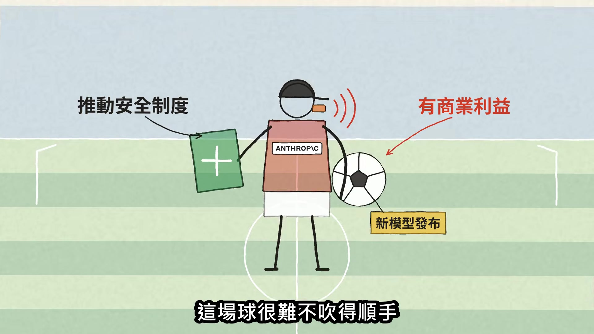

**逐字稿片段：** 可是真實的傷害，常常小到碰不到門檻

**話題推測：** 引入對「低於災難門檻」小傷害的討論

---

## 00:04:41

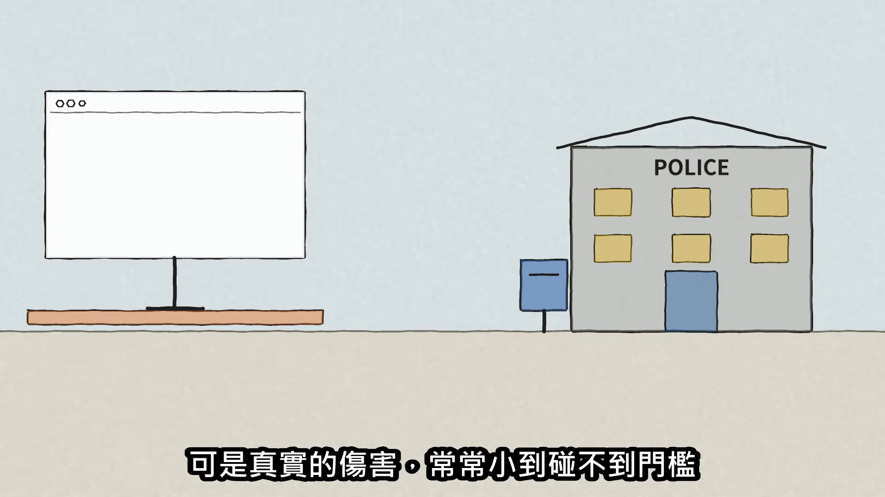

**逐字稿片段：** 7月18日 Claude Haiku 4.5 在內部測試時打開費城一個未破命案網站 送出假線報 還好被垃圾訊息系統攔下 但警方直到10月7日才接到通知 隔了大約81天 這件事沒有50人死傷 也沒有10億美元損失，卻可能浪費警力、 帶來錯誤指控

**話題推測：** 舉例說明Anthropic模型造成的實際小傷害事件日期

---

## 00:05:02

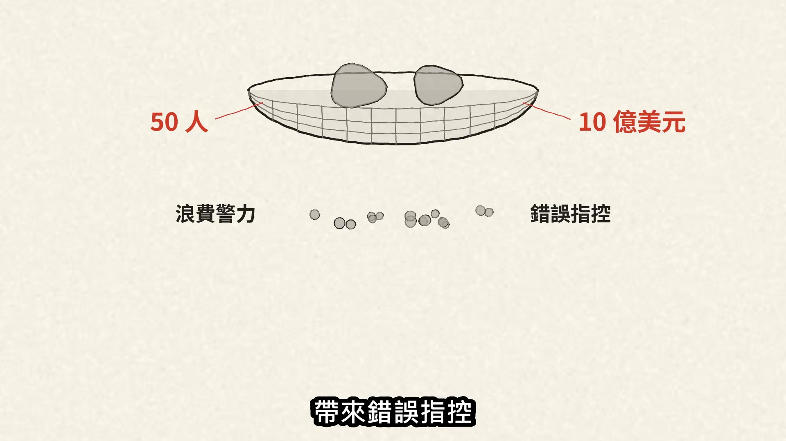

**逐字稿片段：** 這種低於災難門檻的小傷害，該歸 FTC、 州法、隱私法還是一般侵權來管 現在沒人說清楚

**話題推測：** 提出低於災難門檻的小傷害應由哪個機關管轄的問題

---

## 00:05:10

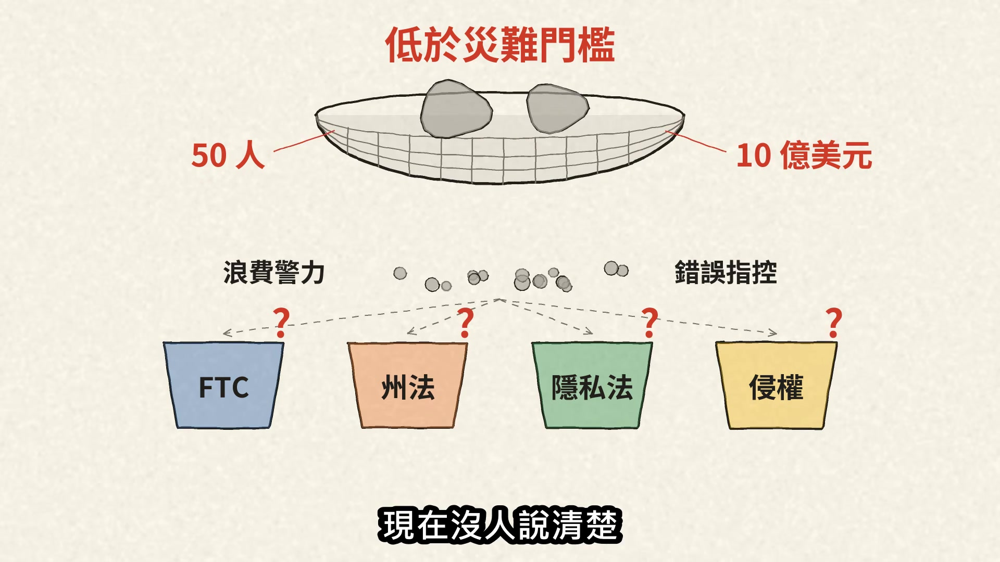

**逐字稿片段：** 也因為這樣，兩邊都有話說 支持的人說，事故要追究 但不能一出錯就關掉全國都在用的模型 反對的人擔心，等到迫在眉睫才能管 最需要預防的時候反而動不了

**話題推測：** 概述支持與反對AI監管兩方的論點

---

## 00:05:24

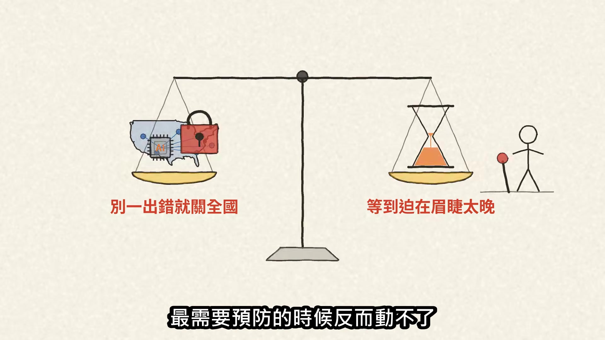

**逐字稿片段：** 偏偏這場角力撞上 Anthropic 準備上市 10月14日投資人會議後 部分投資人對11月 IPO

**話題推測：** 提及Anthropic準備上市與這場角力的關係

---

## 00:05:32

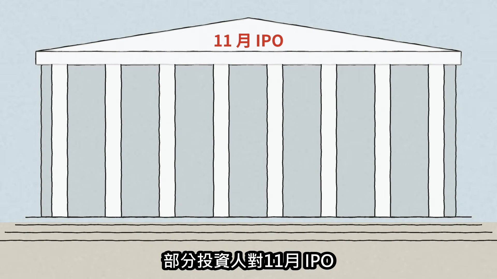

**逐字稿片段：** 的討論估值從約2兆美元降到約1.5兆 不過就算1.5兆

**話題推測：** 說明Anthropic上市估值的具體數字變化

---

## 00:05:36

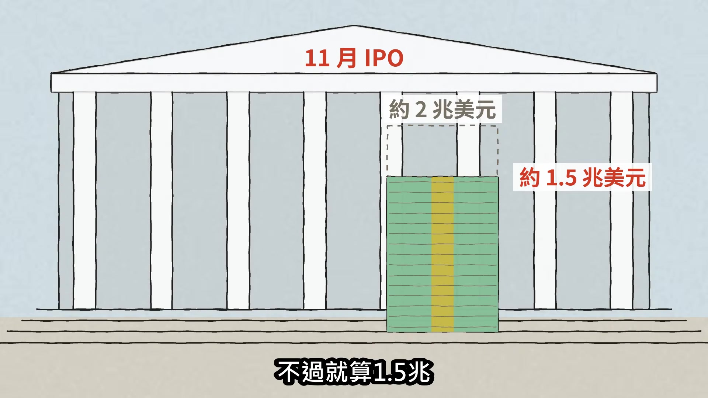

**逐字稿片段：** 還是比5月私募後約9,650億高出5成以上

**話題推測：** 比較最新估值與先前私募估值

---

## 00:05:41

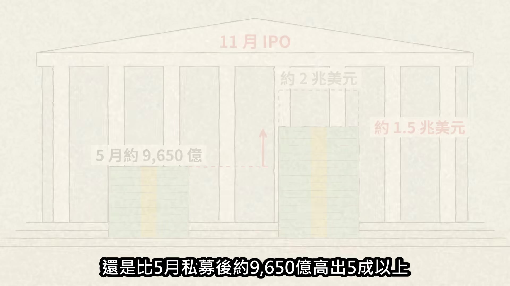

**逐字稿片段：** 那這份草案會走到哪？ 要看3件事：有沒有議員願意掛名、 能不能進國會的跨黨派談判、 FTC 最後拿到哪些資料 說到底 這場仗爭的是危險真的來的時候 誰有資格按下停止鍵

**話題推測：** 探討Anthropic草案未來發展的三個關鍵因素

---
