# ai-note-101_dGjprQY9dCI — 關鍵畫面索引

- 來源逐字稿：[ai-note-101_dGjprQY9dCI_GT.srt](ai-note-101_dGjprQY9dCI_GT.srt)
- 影片：https://www.youtube.com/watch?v=dGjprQY9dCI
- 截圖數：21

## 00:00:00

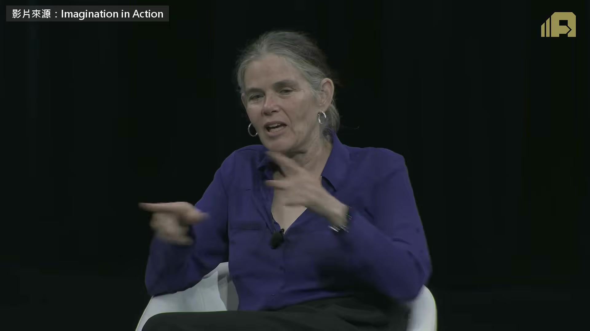

**逐字稿片段：** AI 會在 5 到 10 年內治好所有疾病 這兩年好幾個 AI 公司的老闆都講過類似的話 今年 8 月 有人寫了一篇長文潑冷水 標題叫〈新藥研發沒有魔杖〉 作者 Daphne Koller 原本是史丹佛電腦科學系教授

**話題推測：** 介紹影片主軸：AI治癒所有疾病的誇大說法

---

## 00:00:14

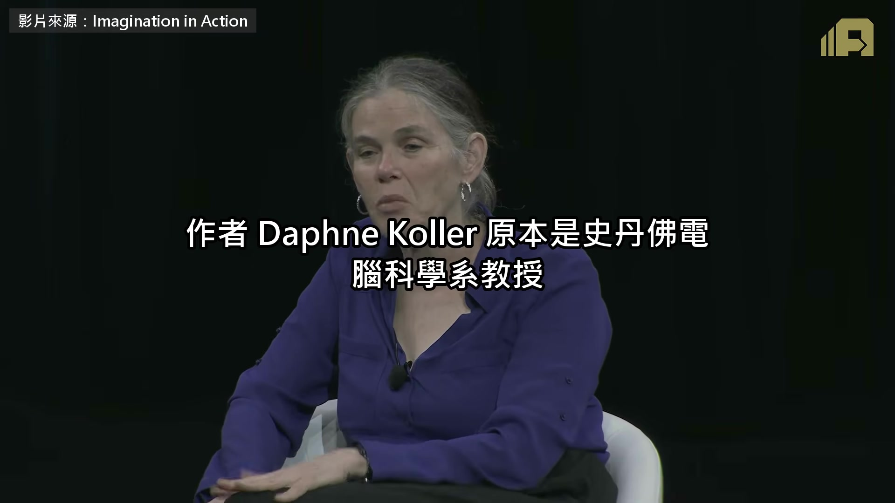

**逐字稿片段：** 當年跟吳恩達一起創辦了 Coursera

**話題推測：** 提及Daphne Koller共同創辦的Coursera平台

---

## 00:00:17

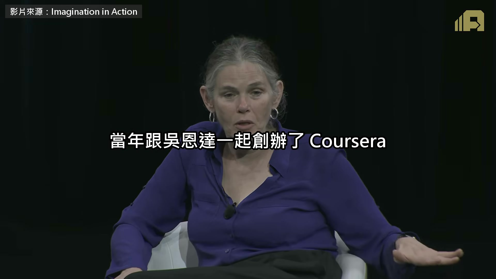

**逐字稿片段：** 現在全球註冊的學員超過 2 億人 2018 年 她自己開了一家用 AI 找新藥的公司

**話題推測：** 顯示Coursera全球註冊學員超過2億人的數字

---

## 00:00:22

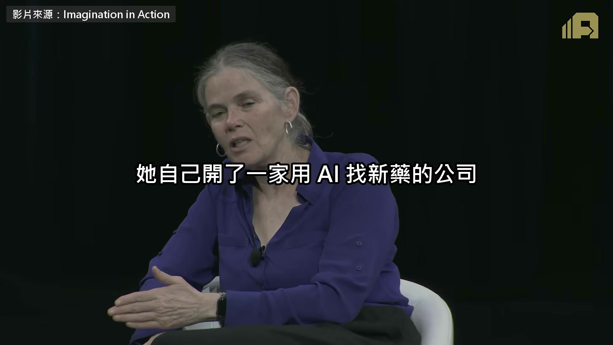

**逐字稿片段：** 叫 insitro 這是 9 月 14 號

**話題推測：** 介紹Daphne Koller創辦的AI新藥公司insitro

---

## 00:00:25

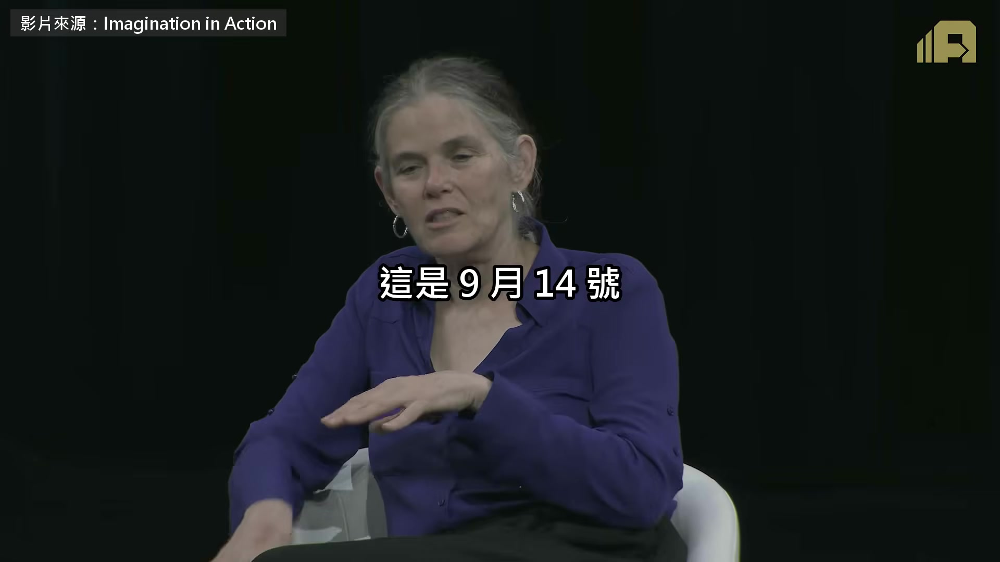

**逐字稿片段：** 她在 Google 園區一場 AI 論壇上的對談 跟我們說說，你這 8 年走了一段什麼樣的路 現在走得怎麼樣？ 走得很好，而且真的是一段旅程 因為我們現在活在一個 位元，AI 的位元，碰上真實世界原子的世界 我覺得大家常常低估了 這個交界有多複雜 一旦你離開那個世界 那裡的資料都是 80 億人的腦袋生出來的 網路上的圖片、文字等等 還有寫完馬上就能測的程式碼 換到另一個世界，不管是產生資料 還是驗證你做的東西到底有沒有用 都得照物理世界的速度來 你不再是用光速在工作了 所以我很佩服那些公司 那些在做世界模型的 真的把物理世界的種種複雜都模擬出來 我們就活在那樣的世界裡 只是我們還多了一層 我們要介入的，是人體這個世界 人體這一層到底難在哪 先從一顆新藥怎麼做出來講起 她在文章裡把它拆成三步 第一步，找出疾病是哪個環節出了錯 也就是藥要去打的目標，業界叫標靶 通常是某個蛋白質 第二步，做出一個能打中標靶的分子 第三步，拿到病人身上做臨床試驗 三步走完，平均要 10 年以上 她說這波 AI 製藥的熱潮 幾乎都擠在第二步

**話題推測：** 說明目前對談的場合與時間：Google園區AI論壇

---

## 00:02:07

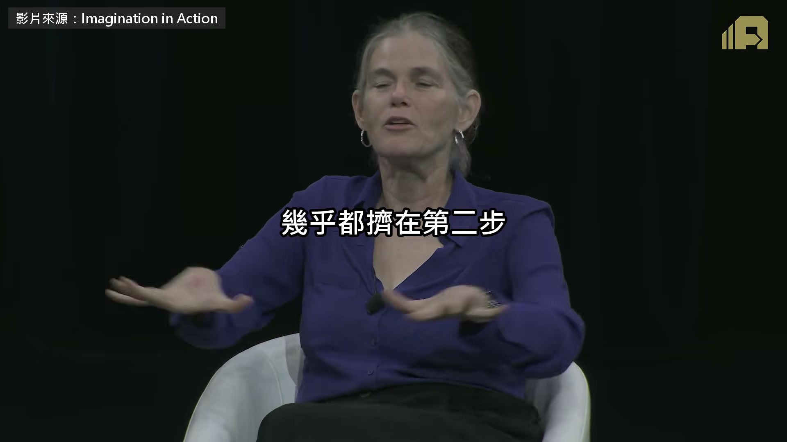

**逐字稿片段：** 起點就是 AlphaFold 你上個月發表了〈新藥研發沒有魔杖〉 能不能跟大家說說，這篇為什麼重要？ 你在 AI 跟生物的交界做了快 30 年 為什麼現在寫？是突然頓悟了嗎？ 還是有遊說團體付錢請你寫？ 要是有人付錢請我寫，那倒不錯 沒有，我都是用自己的空閒時間寫 我覺得現在大家很熱衷、很興奮 想著 AI 能在物理世界扮演什麼角色 特別是在人類健康上 我覺得這並不是不合理 我們都希望 AI 能讓世界變得更好 而不是那些世界末日的預言 這也帶出很多預言 方向是我們嚮往的 但時間表我覺得不切實際 所以當你說 AI 會在 5 到 10 年內治好所有疾病

**話題推測：** 提及AI製藥熱潮的起點AlphaFold

---

## 00:03:17

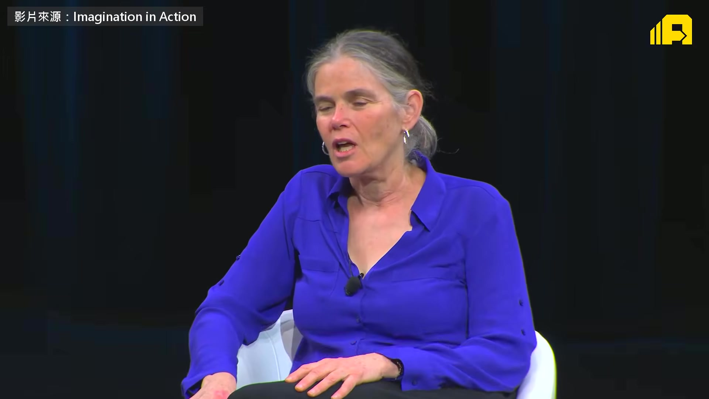

**逐字稿片段：** 我就會想起 Eric Topol 的回應 Eric Topol 是很了不起的醫師科學家 也是我認識最聰明的人之一 他說，如果把我們「治好」的疾病列出來 傳染病不算 底下是一個空格 除了傳染病，我們還沒治好過任何一種病 還有少數幾種兒童癌症 要治好什麼病都很難 你可以延緩病情，也可以治療 所以說 5 到 10 年治好所有疾病 我覺得有點樂觀 方向上，那確實是我們想做到的 但我們也得搞清楚什麼做得到 還有要怎樣才走得到 我在那篇文章裡想講的重點之一是 我們現在的條件好多了 多虧 AlphaFold 這類技術的驚人進展 它就出自這個園區的主人（Google） 能做出更好的分子，好得多的分子 比以前快得多，也容易得多 可惜大多數的病 我們根本不知道分子該往哪裡打 我們不懂背後的生物學，這不是化學問題，是生物學問題 我們手上能拿到的資料 拿來理解人體生物學的那些 跟需要的比起來，只是九牛一毛 越是人類特有的疾病，越是這樣 像神經退化、精神疾病這類 動物模型給不了 細胞也給不了 得從人身上拿 這就變成難得多的問題 所以我只是想讓大家看清現實 同時也記得這個問題有多重要 多值得我們去追 好 那篇文章裡有個數字讓我很在意 每年進入研發的新標靶

**話題推測：** 引用醫師科學家Eric Topol的觀點

---

## 00:05:14

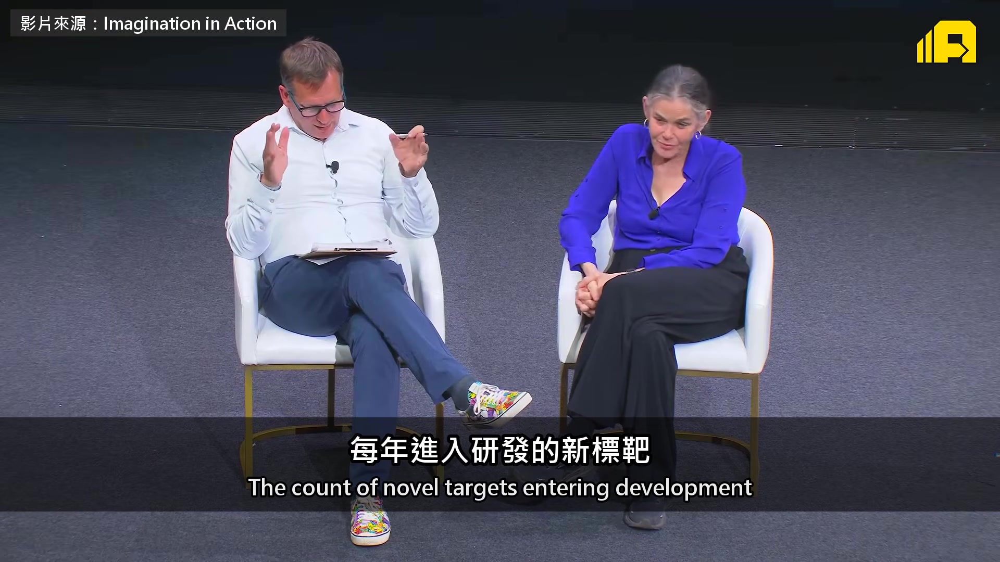

**逐字稿片段：** 從 2015 年的約 100 個，掉到 2024 年的 30 個 剛好就是 AI 設計分子突飛猛進的那十年 這個數字在告訴我們什麼？ 這是一個警訊嗎？ 是不是在告訴我們該換個做法？ 這裡面有沒有機會… 這數字很驚人 也很讓人沮喪，而且就像你說的… 是幾年前開始的嗎？還是… 我覺得那時候大家沒有現在這麼避險 我覺得…

**話題推測：** 顯示每年進入研發的新標靶從2015年的100個掉到2024年的30個

---

## 00:05:51

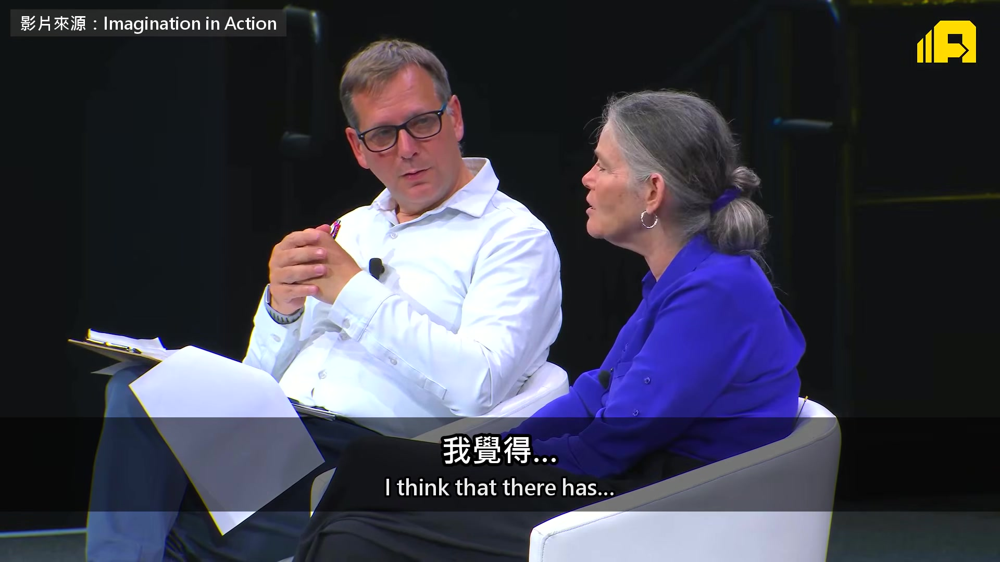

**逐字稿片段：** 「避險」是什麼意思？ 避險的意思是… 專業術語嗎？還是… 是行話，就是個行話 是投資圈的行話，在生技業特別常用 指的是大家不願意冒生物學上的風險 10 年前，大家也許比較願意 去探索新標靶 可是我們這一行的數字

**話題推測：** 解釋「避險」在生技投資圈的意義

---

## 00:06:15

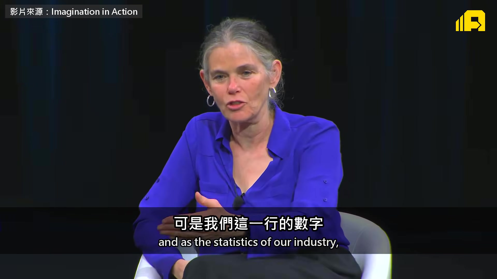

**逐字稿片段：** 一直是慘兮兮的 10% 成功率 這是全新機轉的藥進到臨床試驗之後的成功率 大家就會想，我幹嘛冒這個險 我寧可去打一個標靶 一個別家藥廠兄弟已經幫我排過雷的 我當第二個進臨床就好，第三、第四，甚至第 17 個 順帶一提，有 37 個… 37 個標靶，每個都擠了 50 個以上的研發計畫 這數字高得嚇人 當然你可以說 最好的降膽固醇藥 statin 也許不是第一個 也許是第六、第七個 可是第 30 個能帶來什麼？ 沒什麼 病人肯定得不到什麼 可是現在有種很誇張的現象，叫標靶擁擠 又是一個行話 大家不想冒生物學上的風險 不想去探索新的生物學 我再補一個你沒提到的數字 但我覺得一樣重要 有 FDA 核准藥物的疾病，佔多少比例 看你分母怎麼算 從不到 10% 到 22% 都有 也就是說，絕大多數的病 連一種 FDA 核准的藥都沒有 有藥的那一小群，很多藥也沒什麼效果 我們 insitro 很期待的一個計畫 是漸凍症 漸凍症有 4 種核准的藥 在座有多少人知道漸凍症？ 嗯，很多人

**話題推測：** 顯示全新機轉藥物進入臨床試驗後10%的低成功率

---

## 00:07:43

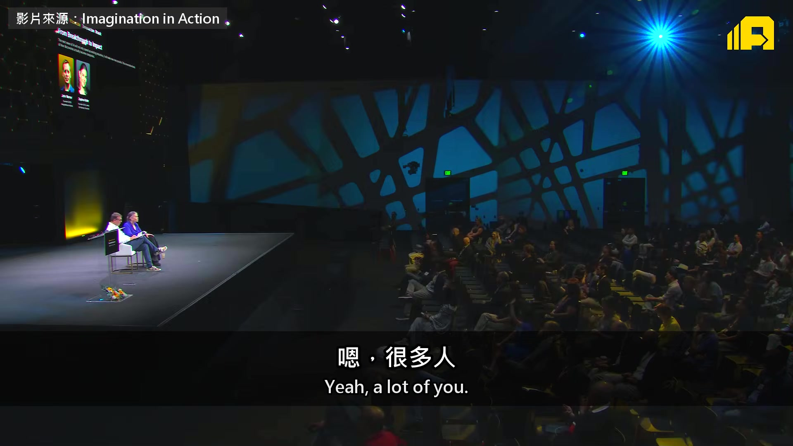

**逐字稿片段：** 冰桶挑戰 對，冰桶挑戰 等於被判了 3 到 5 年的死刑 死得非常痛苦 現有的藥只能多活 2 到 3 個月 就這樣而已，頂多算緩和治療 這還是在那一小群 真的有「FDA 核准藥物」的病裡面 效果還是很有限 所以我們該把心力放在這裡 回到我剛才說的，這不是化學問題 我們做不出更多漸凍症的藥 不是因為有個確定有效的標靶 只是沒人做得出打中它的藥 是因為我們根本不知道該打什麼 所以我覺得這個問題，正好是個大好機會 去發掘新的生物學 讓我們有機會 一種病接著一種病去攻 做出真的有效的藥 用行話說，就是能改變病程的藥

**話題推測：** 提及漸凍症相關的「冰桶挑戰」

---

## 00:08:38

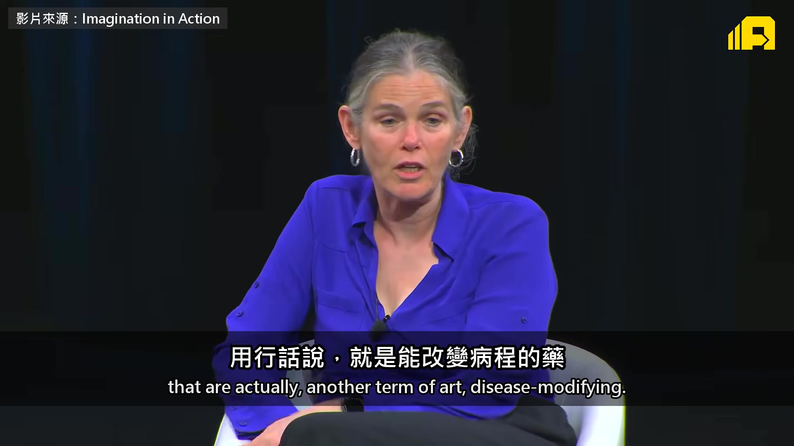

**逐字稿片段：** 現在真正的限制是什麼？ 算力、資料，還是對的資料？ 你說你們在產生資料，實際上是在做什麼？ 大家聽到資料，想到的是一排伺服器 你們的大樓、實驗室裡，到底在做什麼 裡面有生物學家，也有做機器學習的人 一定像對流一樣吧，還是他們… 他們隨時都在交流 這其實是我們創新很大的來源 兩邊互相激盪 說到你講的「對的資料」 現在拿來訓練 AI 模型的資料 大多是觀察來的 它告訴你，世界現在是什麼樣子

**話題推測：** 探討目前AI新藥研發面臨的限制

---

## 00:09:21

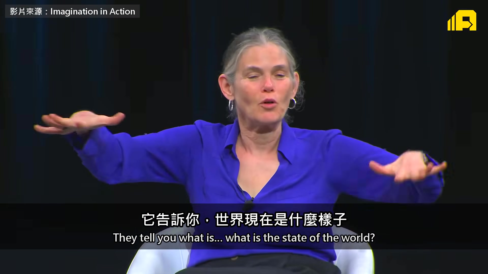

**逐字稿片段：** 是規律，是相關性 相關性很好用 要寫一篇稿子、生一張圖，那很棒 可是如果你問，我們做了 X 會怎樣

**話題推測：** 區分AI模型資料中的「規律」與「相關性」

---

## 00:09:30

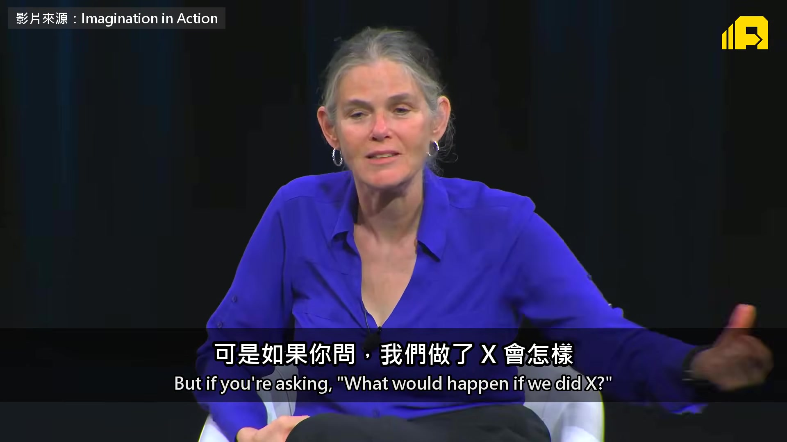

**逐字稿片段：** 這就是因果問題 這種問題牽涉到在真實世界採取行動 而如果那個行動… 你用了「因果」這個詞 AI 是在預測，可是你說 AI 是… 我是說，AI 必須懂因果 如果要拿它來預測在真實世界採取行動的後果 …有人在做這個嗎？ 我覺得它主流過一陣子 你去問任何一個統計學家、經濟學家 流行病學家或臨床醫師 他們都會告訴你，相關跟因果 是天差地遠的兩回事 大家常常出錯的地方 就是把相關當成因果 兩件事剛好有相關 可能是因為背後有共同的干擾因子 可是你去動其中一個，另一個根本不受影響 你要做一個藥放進人體 還要做好幾年 常常要花 10 億美元以上的臨床試驗 因果最好給我搞對 你最好有把握 當你做一件世上從沒人做過的事 也就是用某種特定方式介入一個人的身體 那真的會在那個人身上起作用 所以這是非常關鍵的缺口 就在我們手上的資料裡

**話題推測：** 強調AI在藥物開發中理解「因果問題」的重要性

---

## 00:10:50

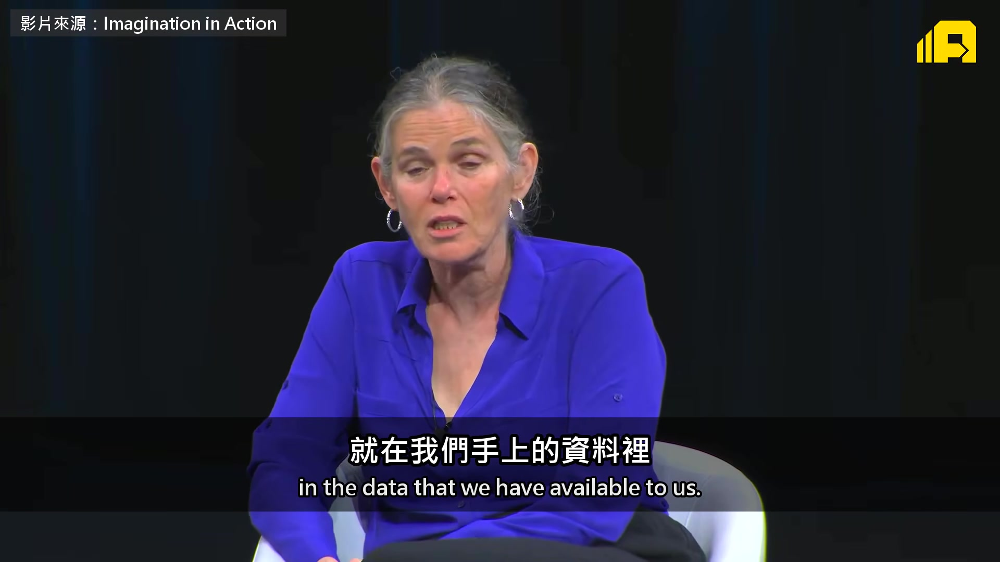

**逐字稿片段：** 她的公司補這個缺口，分兩頭做

**話題推測：** 說明insitro彌補資料缺口，在實驗室和人體兩方面著手

---

## 00:10:53

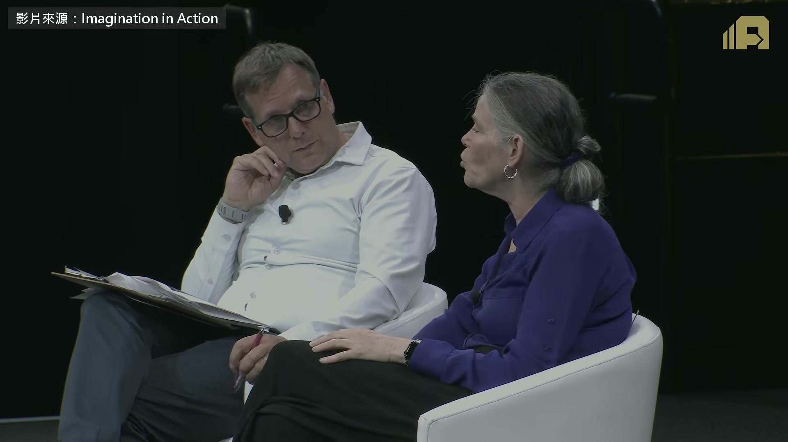

**逐字稿片段：** 一頭在實驗室，拿幾十億個人類細胞 一次關掉或調高一個基因 再用顯微鏡跟定序看細胞起了什麼變化

**話題推測：** 展示實驗室中操作人類細胞，關閉或調高基因的畫面

---

## 00:11:01

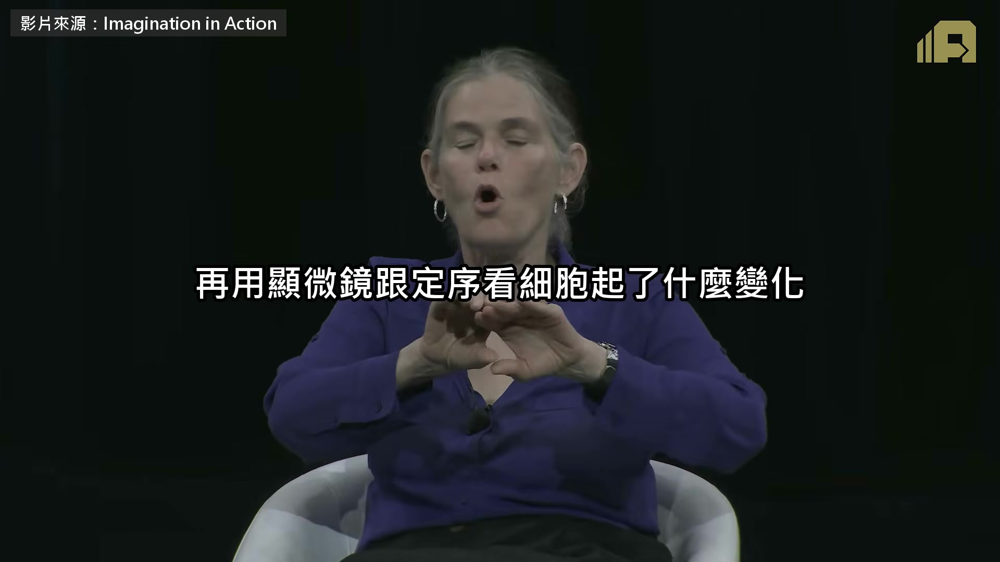

**逐字稿片段：** 另一頭在人身上 人不能隨便拿來做實驗 但天生帶著某個基因變異的人 等於大自然已經替你做過一次 研究發現，有人類基因證據撐腰的標靶 進臨床試驗後成功的機率 大約是沒有的兩倍 對談最後 主持人要她講一句夠深刻的話 我要回到我們一開始聊的 夠不夠深刻我不知道，但就是這樣 我覺得機會非常多 就看我們願不願意接受那種… 怎麼說？ 那種不安、不自在 離開自己專業領域的那種難受 站在兩個領域的交界 一邊是你如魚得水的領域 另一邊你老是在問很蠢的問題 因為你連基礎都不懂 我覺得這對人來說很不舒服 但影響力最大的地方也在這裡 因為在那裡，你可以把自己覺得再自然不過的點子 拿到另一個領域，帶來翻天覆地的改變

**話題推測：** 展示從帶有基因變異的人類身上獲取數據的畫面

---

## 00:12:07

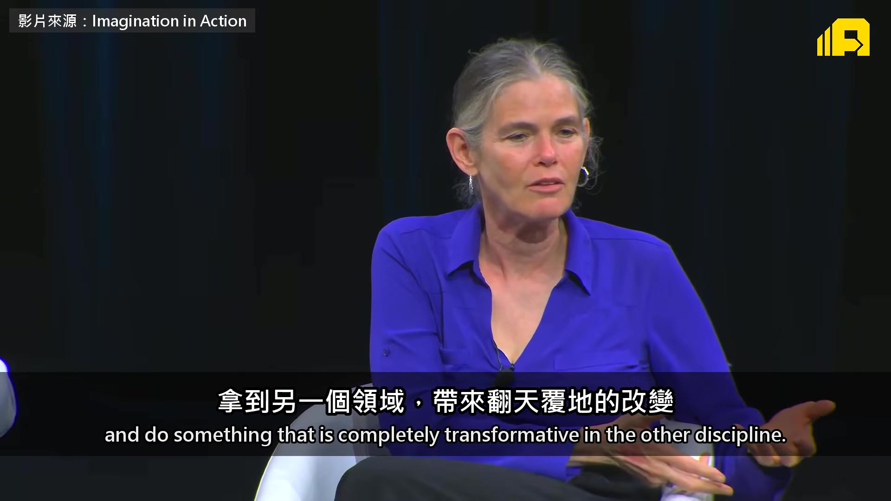

**逐字稿片段：** 不管是像我這樣做 AI 醫藥 還是 AI 農業、AI 政府 我想得到的大概有一、兩打領域，甚至更多 AI 都還沒真正打進去，影響卻可能非常大 你是想做最新的一點小微調 用在下一個 Transformer 小變體上 還是想做真正有影響力的事？ 我覺得後者的機會多很多 所以我鼓勵大家走出舒適圈 去做一點這樣的事

**話題推測：** 列舉AI在醫藥、農業、政府等不同領域的潛在應用

---

## 00:12:46

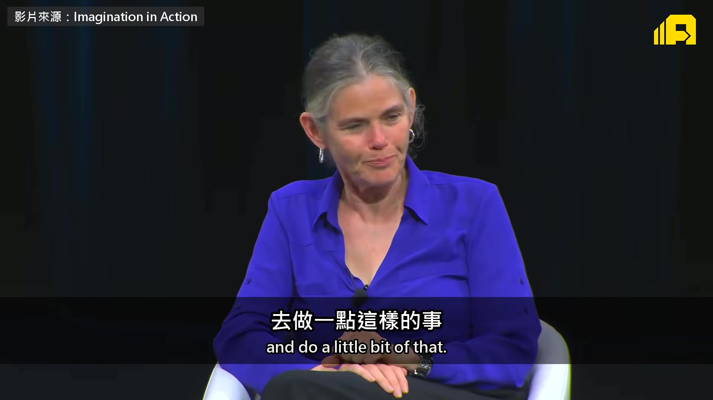

**逐字稿片段：** 5 到 10 年治好所有疾病 她覺得太樂觀，因為大多數的病 我們連該打哪裡都還不知道 她押的是一條比較難走的路 先用 AI 把人體的因果一點一點量出來

**話題推測：** 總結講者對於「5到10年治好所有疾病」的看法

---

## 00:12:59

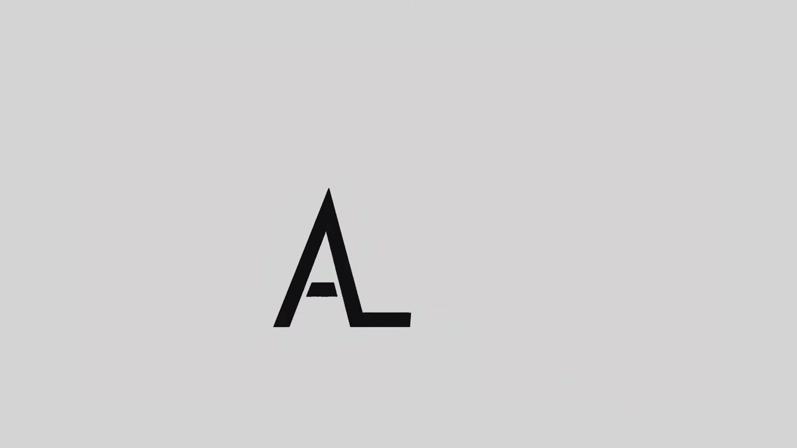

**逐字稿片段：** 原影片 26 分鐘，她還聊了兩件事

**話題推測：** 引導至原影片中另外兩個未展開的討論話題

---

## 00:13:01

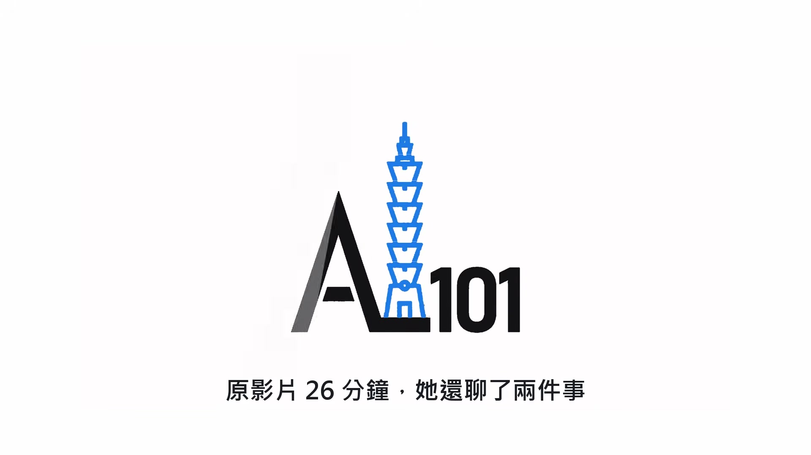

**逐字稿片段：** 一件是 Coursera 她說當年做到了規模 卻做不到一對一家教的效果 要是今天重新創辦 她大概會先做 AI 家教 另一件是她離開史丹佛的原因之一 學界想出來的點子 很難變成業界用得上的產品 原影片連結在說明欄，有興趣可以去聽更多。

**話題推測：** 回顧Coursera的發展與今日AI家教的潛力

---
