# ai-note-101_e8EZnTFAwSQ — 關鍵畫面索引

- 來源逐字稿：[ai-note-101_e8EZnTFAwSQ_GT.srt](ai-note-101_e8EZnTFAwSQ_GT.srt)
- 影片：https://www.youtube.com/watch?v=e8EZnTFAwSQ
- 截圖數：12

## 00:00:00

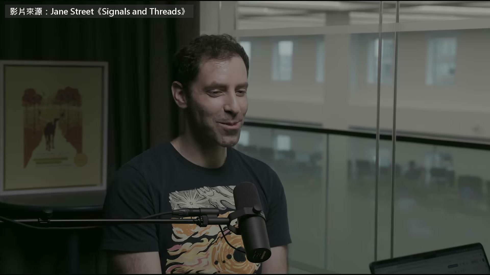

**逐字稿片段：** 華爾街交易公司 Jane Street 的實習生 以前進公司第一個專案要做 4 週 今年差不多一個 prompt 就做完了 整套實習課只好重寫 Jane Street 靠程式在全球市場自動買賣 去年第二季光是交易營收就有 101 億美元 比華爾街每一家大銀行都多 參與重寫的 Aaron Bauer 以前在大學教電腦科學 現在在 Jane Street 寫程式 同時負責教同事寫程式 平常待在維護全公司編輯器的團隊

**話題推測：** 介紹華爾街交易公司 Jane Street。

---

## 00:00:28

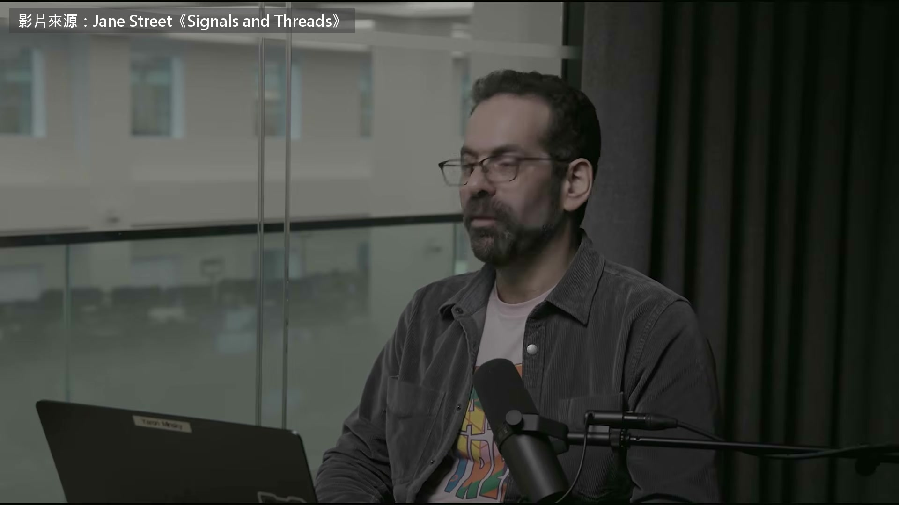

**逐字稿片段：** 主持人 Ron Minsky 2003 年進 Jane Street 公司核心系統全面改用冷門語言 OCaml 來寫 就是他帶頭推的 這集是九月下旬放出的官方播客 兩人從 AI 怎麼改變寫程式聊起 一路聊到新人到底還要學什麼 到處都有很多工程師 Jane Street 也有，很少再自己打程式碼 他們打的字多半是 prompt 可是他們還是在讀程式碼 還是在看型別、看定義 編輯器裡的事一樣在做，只是比較少動手改 對，這讓做編輯器的人 很迷惘，現在到底做什麼才有用？ 一年後什麼會有用？還會有東西有用嗎？ 我最近很感興趣的一件事 尤其我們編輯器團隊一直在加強

**話題推測：** 介紹主持人 Ron Minsky。

---

## 00:01:26

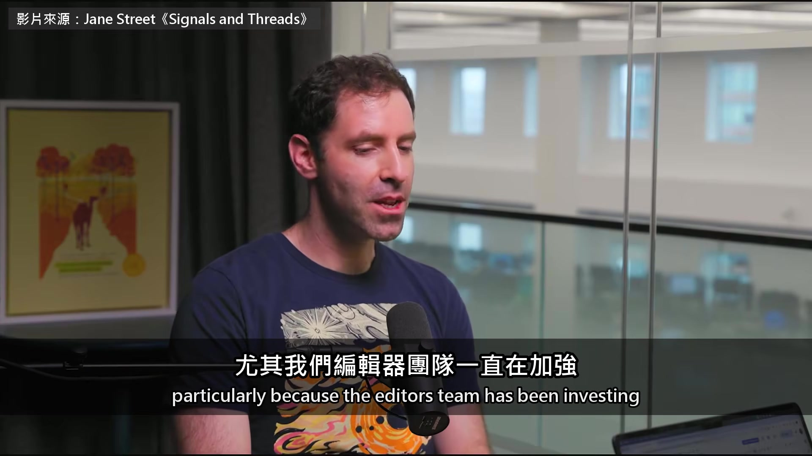

**逐字稿片段：** 遙測，記錄大家在編輯器裡做了什麼 還有大家怎麼用 OCaml 的語言伺服器 就是拿這些數據，看大家的工作到底怎麼變了 我前幾天去查，我原本有個假設 看每個人在 OCaml 裡點進去看定義的次數 如果 LLM 寫出來的程式夠好 大家不用自己寫、也不用一直查 API 每個人點進去看定義的次數就會變少

**話題推測：** 講者提到編輯器團隊正在加強的「遙測」功能。

---

## 00:02:11

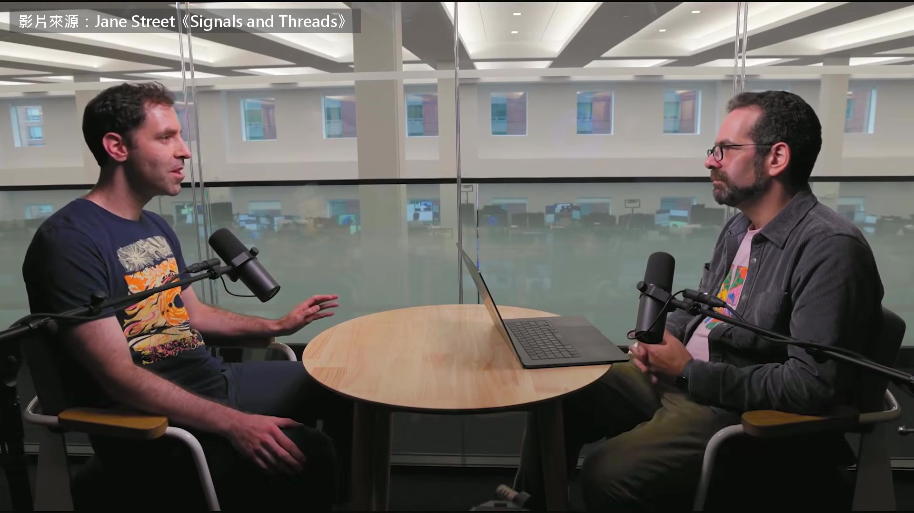

**逐字稿片段：** 可是數據顯示，次數反而還多了一點 這蠻出乎意料的 但也可能是因為，大家現在 得讀懂的程式碼比以前更多 對，很有道理 你說用數據來帶方向 比我的直覺對，我只會憑空推論 不過說到憑空推論

**話題推測：** 數據顯示查詢定義的次數反而多了一點。

---

## 00:02:33

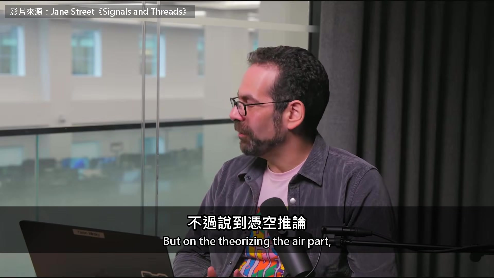

**逐字稿片段：** 我確實覺得，現在最重要的就是看懂 做出一份看起來像樣的 PR，要花多少成本？ 這是借用 Charlie Marsh 的說法（Python 工具 uv 的作者） 做出一份像樣的 PR，成本已經趨近於零 可是驗證它的成本差不多，甚至更高 特別是有一種說不上來的詭異 LLM 寫出來的很多功能，都非常光滑 看起來很漂亮 很多你以為代表有問題的跡象 都看不到，可是常常根本是壞的 我最近也在想，大家叫 LLM 寫程式時 實際怎麼做，跟最後看不看得懂有什麼關係

**話題推測：** 講者轉向討論看懂程式碼的重要性。

---

## 00:03:29

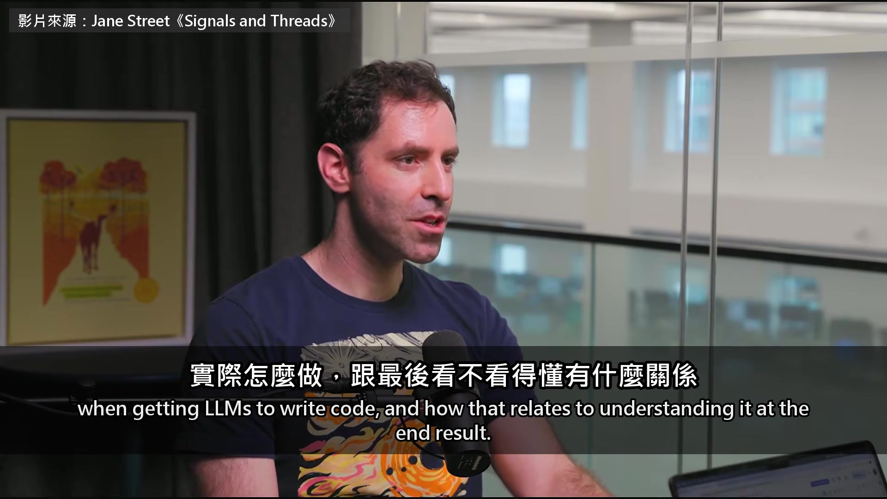

**逐字稿片段：** 我在教學工作裡玩過一個東西 Claude Code 的學習模式 它會改系統提示，叫它偶爾停下來 在程式碼裡留一個 TODO(human) 的註解 請人類自己把那一段補上 我自己用了發現，讓它寫到一半停下來 我就得去讀它寫到目前的東西 讀懂到能自己把這段補上 做完之後我覺得 寫這段程式的過程比較愉快 要真正看懂它寫了什麼，也更順、更有效 我最近給一群實習生講怎麼審程式碼 有一張投影片寫著「審程式碼很難」 自己寫程式時，理解是一點一點建立起來的 抓到錯的時候，就是在修正你腦中的模型 可是審別人的程式碼時 對方直接把成品丟給你 你只能很彆扭地，自己在腦中拼出它的樣子 我馬上想到，等一下 用 LLM 寫程式就是這樣 連自己正在寫的程式，都更難在腦中掌握 這讓我更確定要往這個方向走 也許我們該換個方式跟它們合作，至少有時候 Bauer 另一半的工作是教人 他帶新進工程師的測試課 教大家用幾套寫測試的函式庫 當你在教人用一個不熟的函式庫 LLM 直接就能幫他寫好 那這個函式庫，實際上到底哪些非懂不可 哪些又只是不必學的樣板程式碼 一開始的骨架可以變得很簡單 模型做這個做得還不錯 可是你非讓人搞懂不可的是什麼 對，目前我們的結論是 這類問題，人還是得自己想過一遍 至少親手實作一次 這對真正學懂非常重要 就算他們之後做的事 是去讀 LLM 先寫好的版本 自己做過一次累積起來的理解 是之後判斷得了 LLM 寫得好不好的關鍵 不過問題已經看得到了 確實有人出了狀況

**話題推測：** 講者分享在教學中使用 Claude Code 學習模式的經驗。

---

## 00:06:22

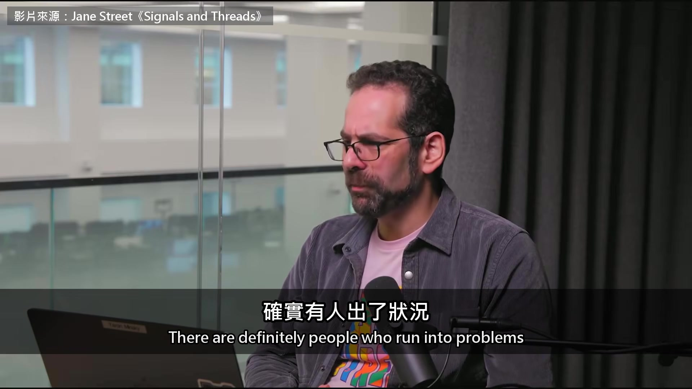

**逐字稿片段：** 他們 vibe coding 過了頭 叫 LLM 生出一堆東西，自己完全不想 這真的是問題。你還是得動腦 我更擔心的是，這對整個教育體系代表什麼 我認為學習很關鍵的一環，就是跟教材硬磕 如果你身邊永遠有個神燈精靈 隨叫隨到，幫你把問題解掉 這本身就很麻煩 簡單到適合初學者練習 又難到 LLM 沒辦法一次解掉 兩者的交集，現在幾乎是空集合 所以這問題很棘手 這真的讓我想到，在紙上寫、不用電腦的做法 有時候，教學要有效 關鍵就在故意不給某些輔助 我怕有一整個世代的人 在一個連我們都不知道該怎麼辦的新環境裡學習 不知道哪些輔助該給、哪些該收 也擔心我們沒能為這個時代的人，建立好的教育體系 我想你，還有幾乎所有做教育的人 都非常憂心這件事 我們來聊一下實習這件事 你參與了一次相當大的翻修 把新人進公司的入門教育整個重做 可以多講一點，當初為什麼要改 還有我們試了哪些做法嗎？ 直接的起因就是，哇，AI 工具現在真的很強 以前實習生一進來先做的那個 4 週專案 現在大概一個 prompt 就做完了 這樣就沒辦法拿來評估實習生 也不值得交給實習生做

**話題推測：** 講者指出有人過度「vibe coding」的問題。

---

## 00:08:35

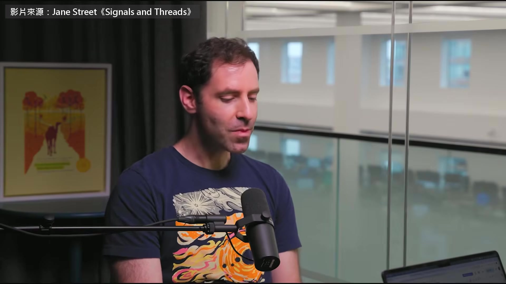

**逐字稿片段：** 所以好，我們要改變實習生專案的性質 變得更開放 多加一些設計、蒐集需求這類的東西 基本上就是更難、也更貼近真實 對，而且不只看你能不能寫出夠多好程式 光是寫出程式碼，以前大概是最重要的指標之一 我會說，現在沒那麼重要了 所以專案要對準我們希望他們做好的事 為了讓他們做得好，我們該多教一點 怎麼下手，Jane Street 怎麼看這些事 而且不是直接把他們丟進深水區 「LLM 給你用，祝你好運」 而是真的訓練他們該留意什麼 怎麼用這些工具才有效 Jane Street 有哪些工具，大家都怎麼用 也趁這個機會，加進一些新的軟體工程主題

**話題推測：** 宣佈要改變實習生專案的性質。

---

## 00:09:51

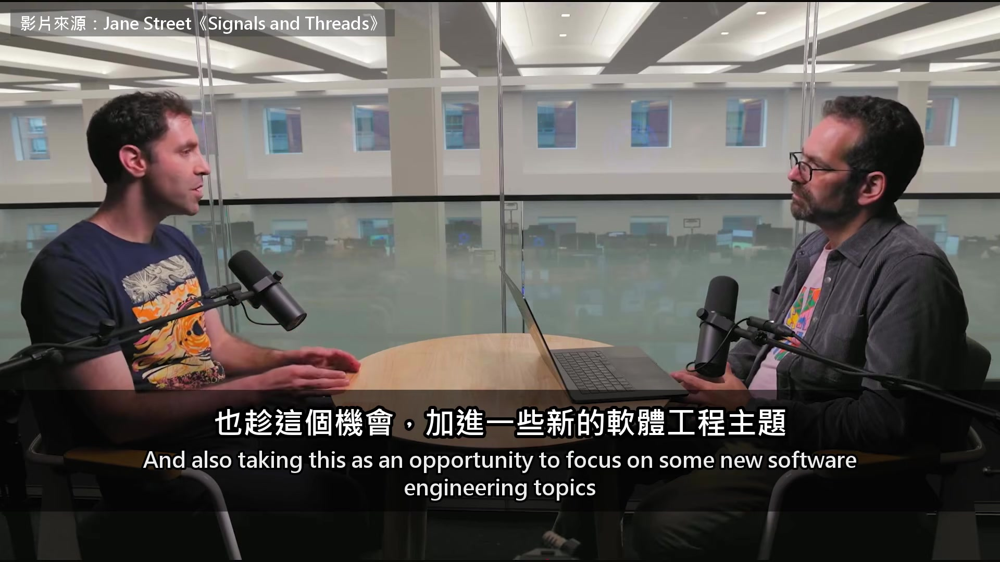

**逐字稿片段：** 以前實習剛開始不太正式教的，像是測試 替這個接資料庫的應用程式寫一套很好的測試 就是新課程的一部分，而且… 測試一直都很重要 但現在更重要，因為模型要靠回饋才做得好 你得給它們辦法，判斷自己做得對不對 只要超出比較簡單的東西 它們就是沒辦法一次給出好答案 最後我要提的一塊是 我們聊過，審程式碼在工作裡越來越核心 所以我們以前不太讓實習生審別人的程式碼 至少很少見

**話題推測：** 具體提到新課程中增加了「測試」教學。

---

## 00:10:36

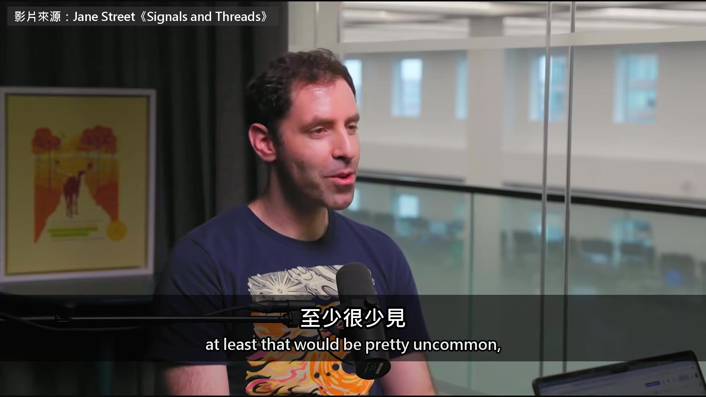

**逐字稿片段：** 可是今年夏天，我們要實習生做這件事 也想真正看看他們做得怎麼樣 為此，我們多排了三天的訓練 在實習中段，專門練審程式碼 實習生會拿到事先做好的功能 加在同一個應用程式上 就是他們前面寫測試、做設計的那一個 他們要留下審查意見 再看一份參考，等於是標準答案 也就是別人可能會留的那些意見 再一起討論看到什麼、哪些不同意 接著他們也自己寫功能 實習生互相審程式碼，多練幾回 之後導師跟正式專案，就會真的丟功能給他們審 這是很大的改變 不只是實習的教學，連整個實習怎麼運作都變了 你覺得效果如何？

**話題推測：** 宣佈今年夏天開始讓實習生審別人的程式碼。

---

## 00:11:52

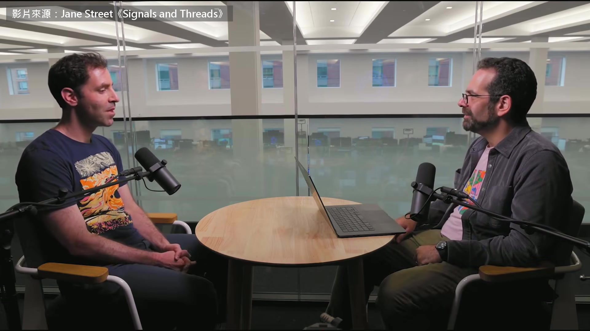

**逐字稿片段：** 我想我們學到很多教訓 實習生是分好幾梯進來的 整套課程一直在大改 整個夏天，每一梯進來都不一樣 可是比較早的那一梯，一開始 重點放在多工、vibe coding 那些 事後我們覺得，那不是對的起點 它替後面的練習定了錯的基調 所以重新排過了 現在我們會先從測試開始 把這套測試寫到品質非常高 課程就繞著它來安排 而不是「你可以叫 LLM 同時做三件事，很酷吧」 是很酷啊 AI 寫程式越寫越好 Jane Street 發現人反而要花更多力氣 去讀懂、去驗證它寫的東西 所以他們把實習課重新排過 現在一開始先教寫測試

**話題推測：** 討論實習課程翻修後所學到的教訓。

---

## 00:12:58

**逐字稿片段：** 原影片一個半小時，前半段還聊到 Jane Street 審程式碼的意見直接寫在編輯器裡 同事還會直接動手改你的程式 所以公司要自己養一個編輯器團隊 後段也講到怎麼設計一堂課 先寫下上完之後，學生要能做到哪些事 原影片連結在說明欄，有興趣可以去聽更多。

**話題推測：** 影片進入結尾，開始總結並介紹原影片內容。

---
