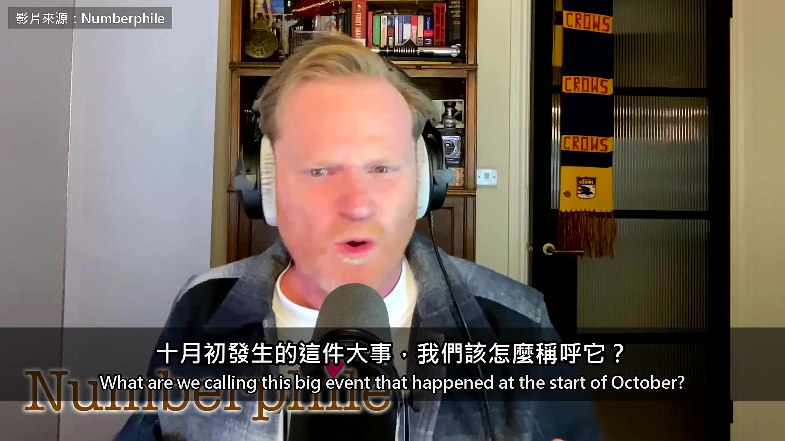
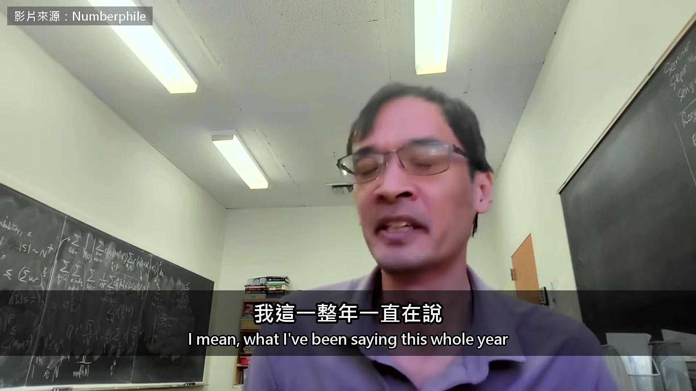
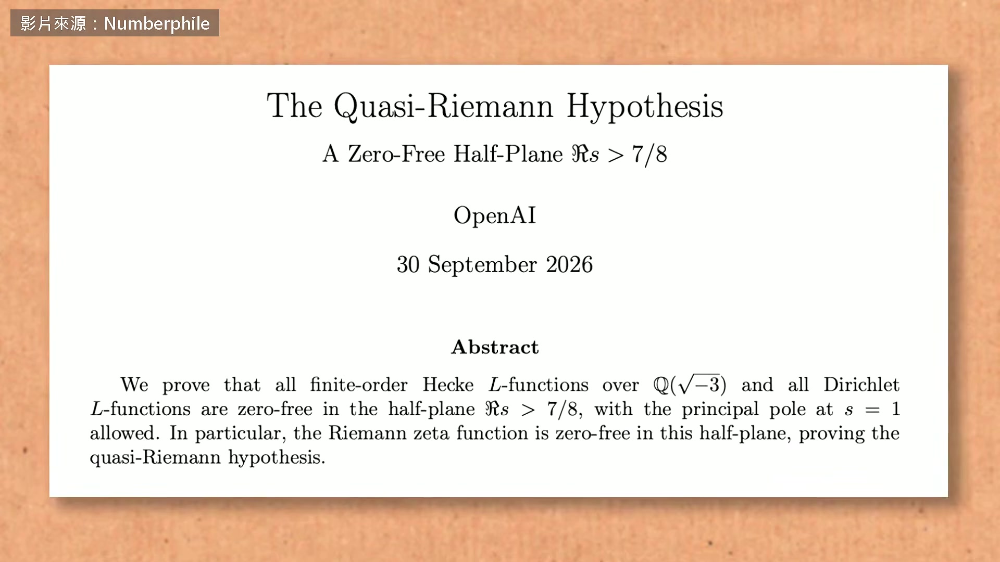
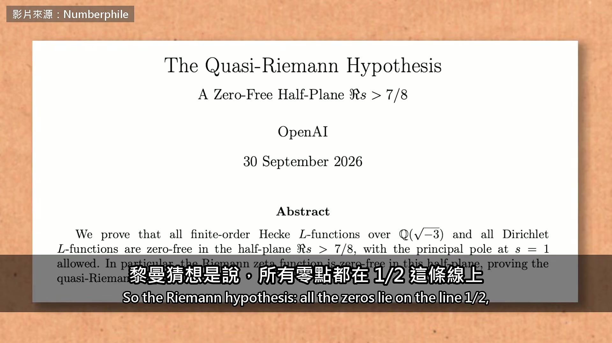
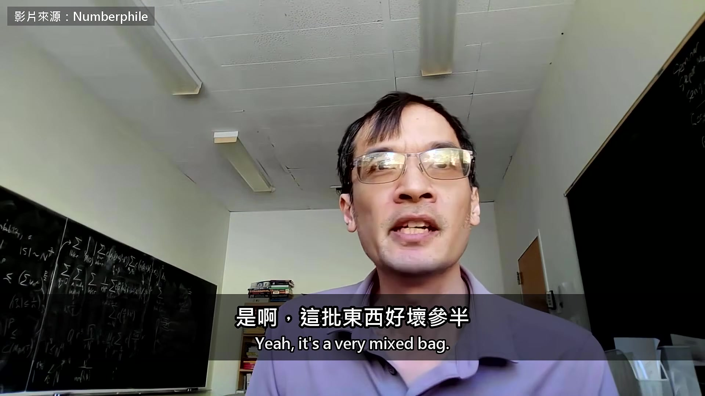
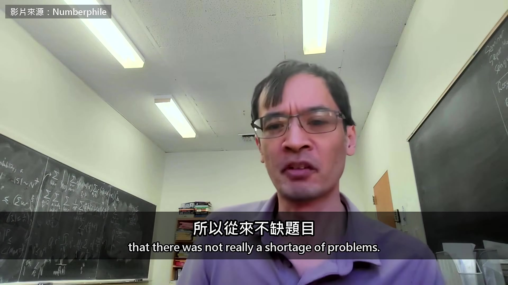
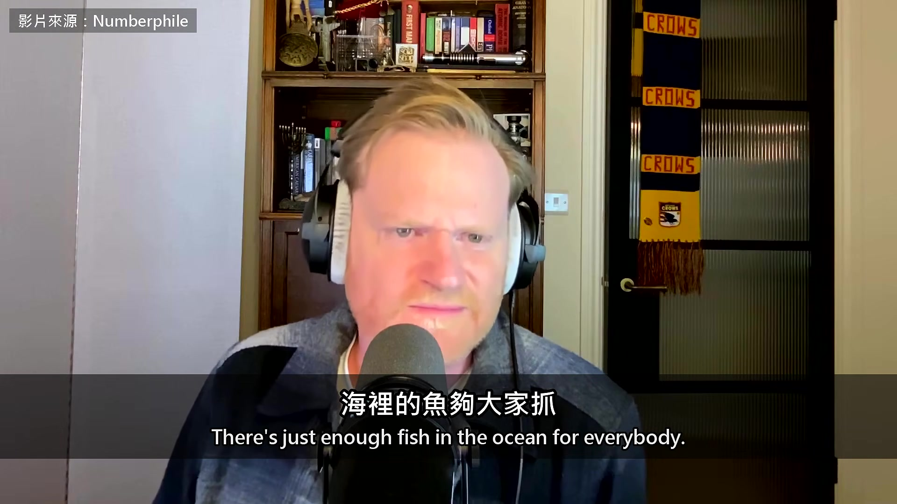
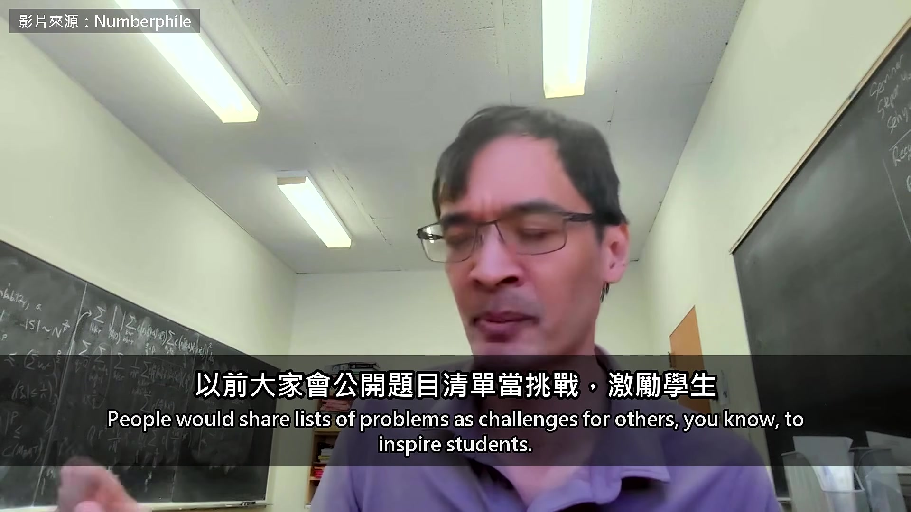
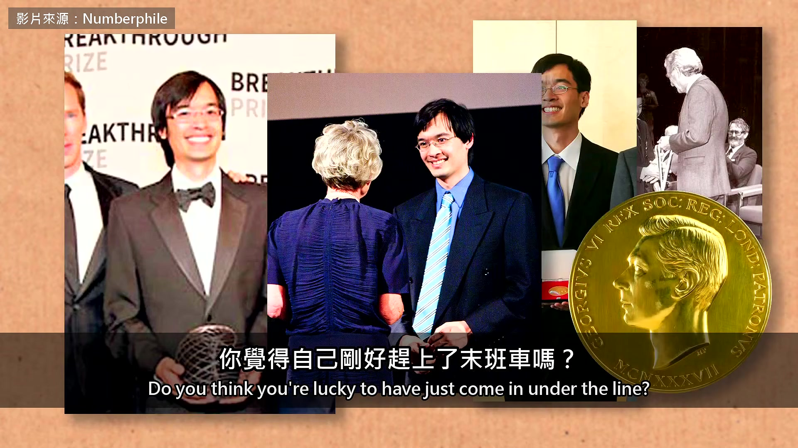
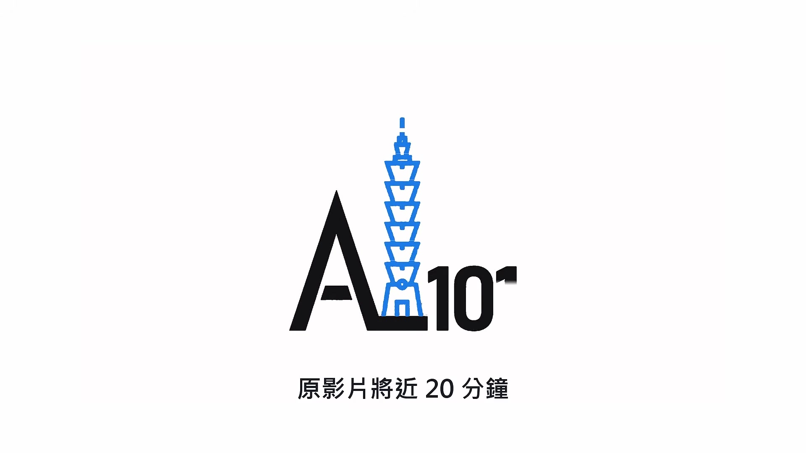

# ai-note-101_fbpDDiMjoK0 — 關鍵畫面索引

- 來源逐字稿：[ai-note-101_fbpDDiMjoK0_GT.srt](ai-note-101_fbpDDiMjoK0_GT.srt)
- 影片：https://www.youtube.com/watch?v=fbpDDiMjoK0
- 截圖數：11

## 00:00:00

**逐字稿片段：** 十月初發生的這件大事，我們該怎麼稱呼它？ 就是 OpenAI 一口氣公開幾百篇證明 這件事有名字了嗎？ 這種天搖地動的大事，通常會有個名字或綽號 我想最後會有的 我們還在消化 對，我想還沒有大家公認的名字 我這一整年一直在說

**話題推測：** 影片開場，介紹十月初發生的重大事件

---

## 00:00:20

**逐字稿片段：** 我們正從證明稀缺的時代，走向證明過剩的時代 這段陶哲軒的訪談 是數學頻道 Numberphile 在 10 月 15 號放出來的 上次我們剪他是九月初 他說數學家要的其實有兩樣 答案和理解，以前這兩樣是綁在一起的 這一次，答案先到了 幾千年來，證明都很難 找到證明的人，算是… 它需要理解、專業，還要一點運氣 還得跟人討論、熟悉文獻 所以證明到哪裡都被看重 因為每個證出困難定理的人 都得下這些苦功 這些功夫也讓整個領域跟著成長 現在我們找到了捷徑 我們找到能替我們做出證明的機器 現在我們被證明淹沒了 但我們得到的理解，沒有以前那麼多 就像以前糧食短缺，吃的東西不多 但拿到的每一口，都營養又健康 現在我們淹沒在人造食物裡 嚴格說起來，它能吃 但就是沒有以前吃得那麼滿足 黎曼猜想快要被攻破了嗎？ 這個嘛，OpenAI 確實做出了重大突破 是這個題目 50 年來最大的進展 一大片新的無零點區域，技巧非常聰明 它其實是三、四個現成的點子組合起來 用一種很不尋常的方式排在一起 我想，現在活著的數學家，沒有一個人想得到 如果找對的人一起做，把他們關在一個房間裡 試錯很多次之後，也許做得出來 這一點我得承認 他們證明了現在叫做「準黎曼猜想」的東西

**話題推測：** 提出核心論點：從「證明稀缺」走向「證明過剩」的時代轉變

---

## 00:02:05

**逐字稿片段：** 黎曼猜想是說，所有零點都在 1/2 這條線上

**話題推測：** 解釋黎曼猜想的具體內容與數學線條（1/2線）

---

## 00:02:08

**逐字稿片段：** 現在我們知道，它們至少都在 7/8 這條線的左邊 以前我們只知道，它們在 1 的左邊一點點 但現在，我們等於往黎曼猜想走了四分之一 是啊，這批東西好壞參半

**話題推測：** 指出OpenAI的具體新進展與數學線條（7/8線）

---

## 00:02:23

**逐字稿片段：** 三百多篇論文，我只看了大概 10 篇 這也是問題之一，要看的實在太多了 有些算是把大家本來在做的往前延伸 我想像得到，本來就在做這些題目的人 再多給他們一兩年，也會做出差不多的東西 這也是讓人很煩的一點 這次公開，完全沒有先問過正在做這些題目的人 在數學界，通常你在做一個題目 知道有同行也在做 你會私下問一聲，確定彼此沒有撞題 這次一聲都沒問 尤其是很多年輕研究者的計畫 就這樣一夜之間被掃光了 他們現在手忙腳亂 再怎麼說，這都非常粗魯、沒禮貌 而且 OpenAI 沒有半個人來幫我們 對他們來說，事情已經做完了 這一樣讓人很煩 所以我們手上多了一大堆東西要看 不是我們要的，但它就這樣來了 裡面會有好東西，也會有垃圾 只是還不知道各占幾成 數學界還有一個不成文的默契 有一批中等難度的題目 資深的人做得出來也不去碰 專門留給學生練手，在學界被看見 以前這不太成問題 因為題目很多，學生相對很少 題目又難解 所以從來不缺題目

**話題推測：** 提及論文數量高達「三百多篇」，強調資訊量巨大

---

## 00:03:56

**逐字稿片段：** 就像還能永續捕魚的年代 不必規定哪片漁場歸誰 海裡的魚夠大家抓

**話題推測：** 以「永續捕魚」的年代比喻過去的數學界生態

---

## 00:04:05

**逐字稿片段：** 但現在，數學遇上的是露天開採 這些巨大的機器，像炸魚一樣 一次炸掉幾百道題目 突然之間，能分派給人的好題目快沒了 以前大家會公開題目清單當挑戰，激勵學生

**話題推測：** 對比現況是「露天開採」或「炸魚」，導致題目快速消耗

---

## 00:04:23

**逐字稿片段：** 像 Paul Erdos 就很有名（留下上千道難題的傳奇數學家） 但現在，大家不太敢公開自己最愛的題目 因為有人下個 AI 提示詞，就先把它搶走了 那題本來是要拿來訓練學生 或讓博士後發出頭幾篇論文的 這些 AI 公司，還有隨手拿 AI 工具來用的人 他們的誘因，已經跟數學界傳統的誘因對不上了 至少有一方得改變 你會不會覺得自己很幸運，活在證明稀缺的時代 還有機會拿下幾個大證明？ 你覺得自己剛好趕上了末班車嗎？

**話題推測：** 舉例傳奇數學家Paul Erdos，過去如何公開題目挑戰學生

---

## 00:05:02

**逐字稿片段：** 對，我想我們正在見證數學浪漫時代的終結 英雄的時代 這在其他學科，幾百年前就發生過了 早在工業革命的時候 但數學不知怎麼的，一直撐到現在 我們有自己一些古怪的傳統 我們有點不情願，但還是走進了一個新時代 很多讓人興奮的事變得可能，也有些東西正在失去 問題是，哪些有價值的東西我們留得住 哪些可以放手？ 這批證明裡有真東西，陶哲軒也承認 讓他擔心的是，證明一下子變多了 理解沒有跟上，連留給學生練手的題目 也被一起炸掉

**話題推測：** 總結性發言，見證數學「浪漫時代的終結」

---

## 00:05:46

**逐字稿片段：** 原影片將近 20 分鐘

**話題推測：** 影片結尾資訊，提及原影片的長度與未涵蓋的其他議題

---

## 00:05:48

**逐字稿片段：** 他還講了兩件事 一件是現在大家只顧加速，沒人看得懂 他覺得撐不久 另一件是 AI 公司算不算敵人 他說大公司追 AGI 的競賽 已經開始犧牲安全 原影片連結在說明欄，有興趣可以去聽更多。

**話題推測：** 列出原影片中未剪輯進來的兩個額外話題

---
