# ai-note-101_hXyLkaZpeo8 — 關鍵畫面索引

- 來源逐字稿：[ai-note-101_hXyLkaZpeo8_GT.srt](ai-note-101_hXyLkaZpeo8_GT.srt)
- 影片：https://www.youtube.com/watch?v=hXyLkaZpeo8
- 截圖數：21

## 00:00:10

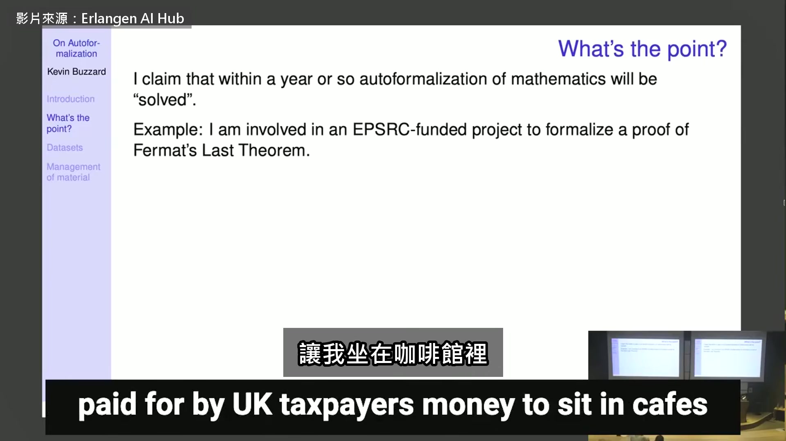

**逐字稿片段：** 把費馬最後定理的證明寫成電腦驗得過的版本 我大部分時間都在做這件事 在 2024 年，這看起來是個非常難的問題 但現在我很清楚，等到經費結束的時候 解法就是把論文拿去餵給機器 讓機器替你做完 所以某種程度上，接下來三年我什麼都不做也行 等交差前一週，再一口氣把整件事搞定 AI 改變我這一行，就是這種速度 不過要是現在就做，成本會非常高 現在就做得到，我也不意外 只是大概要花不少錢 我猜一年後一樣做得到，而且比較便宜 上次我們剪的是他今年四月的演講 他說用 2026 年的技術 看不到路把整個費馬最後定理寫成電腦驗得過的證明 這一場是九月初在牛津講的 那時 Claude 其實已經做完了 會議結束的隔天 Anthropic 公布這件事 公告裡還有他看過證明之後的評語 講話的人叫 Kevin Buzzard 倫敦帝國學院的數學教授

**話題推測：** 介紹「費馬最後定理」，可能顯示定理內容或背景圖。

---

## 00:01:28

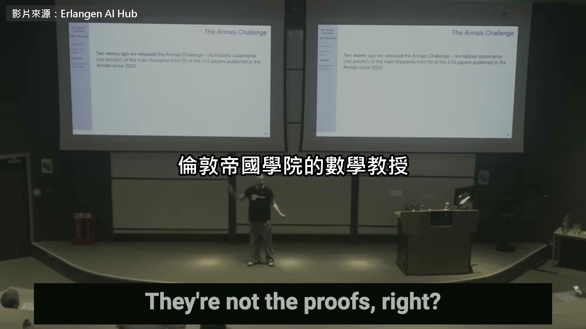

**逐字稿片段：** 也是 Lean 數學函式庫的維護者之一 Lean 是一套會逐行檢查數學證明的軟體 把證明寫成它讀得懂的程式碼 就叫形式化 他這次談的是下一步 AI 已經能把頂尖數學期刊上的新論文 自己翻成電腦驗得過的證明 2020 年代，我們開始想能不能摸到數學最前沿 能不能做到前沿的這一點，或那一點 我們會走上一段很辛苦的長路，一走就是一年半 只為了在現代數學的前沿拿下一個定理 2020 年代初期就是這樣 那時候大家的幻想一直是，能不能把整個數學都形式化 當時的答案當然是不行 那是當時推著我往前走的念頭之一 但那顯然完全不可能

**話題推測：** 介紹Lean數學函式庫，可能顯示其標誌、介紹或介面。

---

## 00:02:27

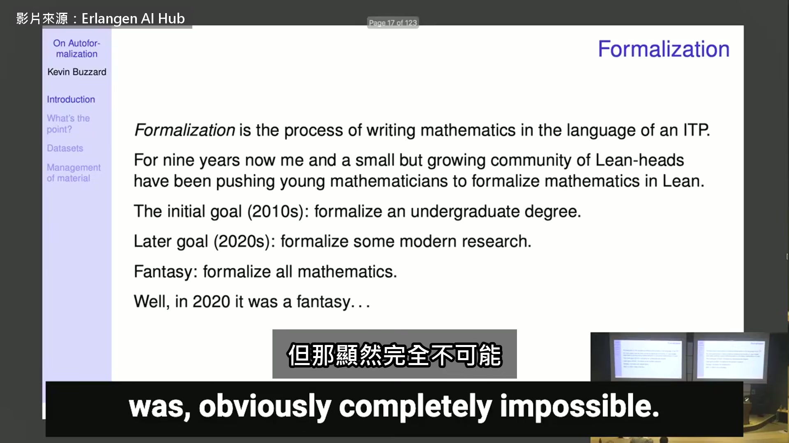

**逐字稿片段：** 大型語言模型剛出來的時候寫不了 Lean 網路上的 Lean 程式碼太少 2025 年它們突然會寫了 只是寫得很爛 到了今年，他說付費的 Claude GPT 寫的 Lean 大概已經比一般使用者好 讓 AI 自己做形式化

**話題推測：** 討論大型語言模型與Lean的早期互動，可能顯示大型語言模型發展歷程。

---

## 00:02:42

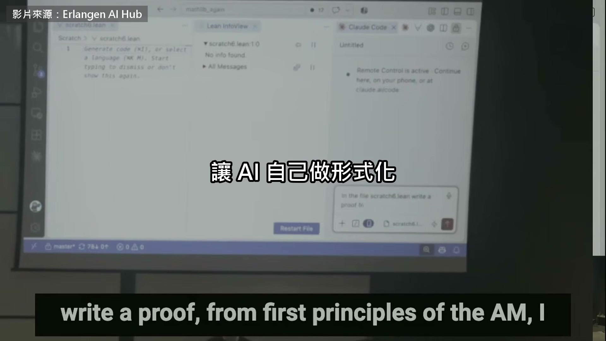

**逐字稿片段：** 就叫自動形式化 我想想，來個大膽的…其實我不太做預測 我的演講以前還被批評過，說只是在報告發生了什麼 看來我該多做點預測。那就來一個

**話題推測：** 定義「自動形式化」的概念，可能顯示定義的文字說明。

---

## 00:02:58

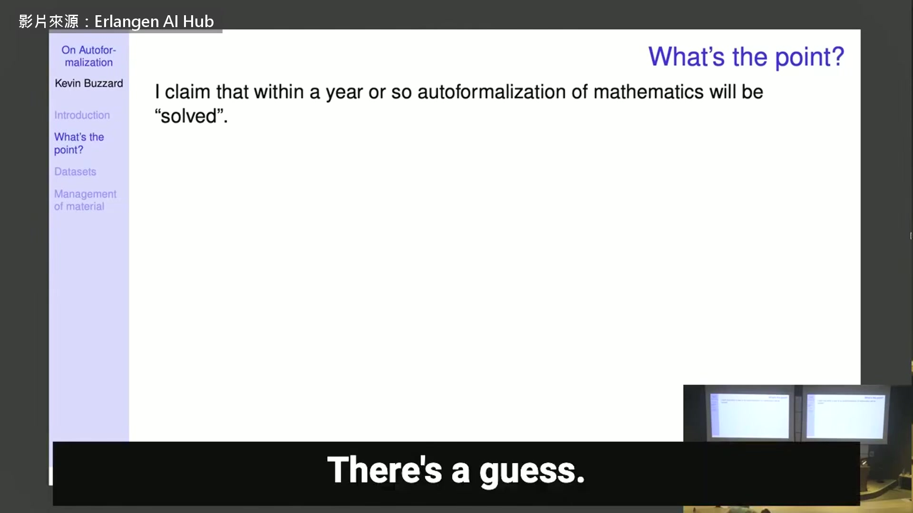

**逐字稿片段：** 我認為一年內，數學的自動形式化會被解決 意思是，你想把一篇論文翻成 Lean 的時候 我不知道大型語言模型寫別的語言會有多好 但不知為何，Lean 現在成了研究數學的標準工具 我認為一兩年內，你把最新的論文餵給機器 機器就會直接翻好 這一定會在某些地方改變數學 數學平常是不太變的 但這就是我的猜想 照這個猜想推下去 當然，也有很多人很樂意這樣猜 某種意義上，做數學的方式會跟著改變 因為我們會有機器能幫忙檢查 他說自動形式化的用處是檢查數學 費馬最後定理全世界已經看了三十年 不必再驗 該驗的是那些 100 多頁 只有少數專家看得懂的新論文 審稿人沒拿錢，很難逐行讀完 我覺得在這個領域工作，會碰到一件事 你把人寫的文獻翻成電腦的格式

**話題推測：** 提出對未來一年內自動形式化技術發展的大膽預測，可能顯示預測成果的時間線。

---

## 00:04:21

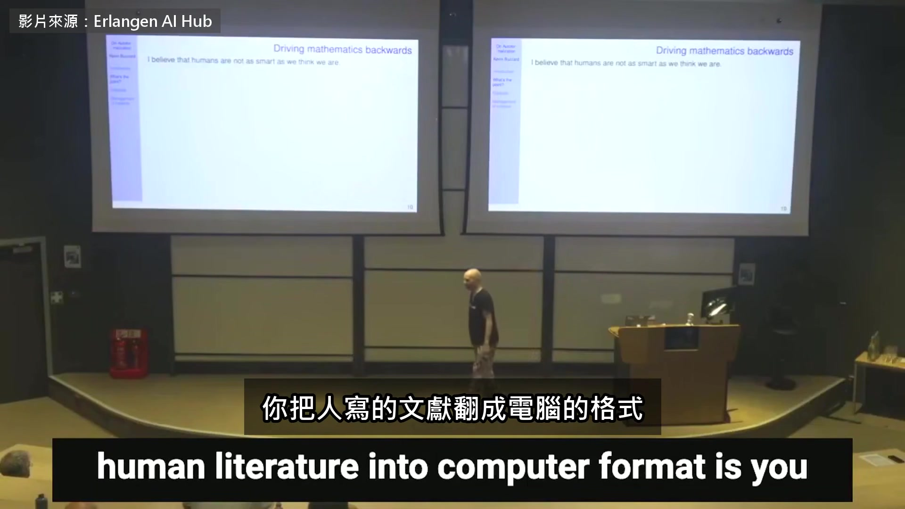

**逐字稿片段：** 就會找到人犯的所有錯 那些很細微、人犯了卻沒發現的錯 你拿一個證明給專家看，他說沒問題 你說其實有問題，裡面藏了一個錯 他讀了又讀，就是找不到 機器一下就找到了 這是我在這一行九年得到的結論之一 人類沒有我們以為的那麼聰明 我一直想算清楚，我們到底有幾兩重

**話題推測：** 強調自動化能找出人類論文中的錯誤，可能顯示錯誤檢測的示意圖。

---

## 00:04:54

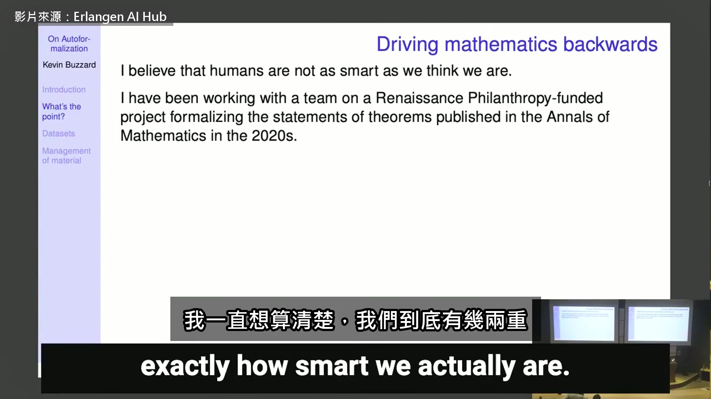

**逐字稿片段：** 其中一件事，是我跟四位博士後做的計畫 只把定理的敘述形式化，不碰證明 對象是這十年登在《數學年刊》的論文 這個計畫很有意思 《數學年刊》可以說是純數學最頂尖的期刊 這十年它登了 200 多篇論文 我們不證明，只是把定理寫下來 2020 年以來，這本頂尖期刊登了 213 篇 同一段時間，有 8 篇勘誤、2 篇撤稿 粗估一下，這 200 篇裡 大概有 5% 出了問題 當然很多論文都有小毛病，像錯字之類 但嚴重到要發勘誤的 大概有 5% 的論文，錯到值得標出來 大概 1% 錯到救不回來 重點是，現在我們不知道是哪幾篇 所以問題是，我們能接受… 當然，幾百年來一直都是這樣 有的論文錯一點，有的錯很多 人生就是這樣，數學家也很能接受 我只是要說，現在我們可以做得更好 只要我們想，這些數字可以壓到零 我們讓數學變好的方法，可能是把一部分打破 但我們打破的，本來就是壞掉的部分 這可能是自動形式化的一種用途 它也可能找到人類還沒發現的東西 誰知道呢，要是哪個標準理論被它弄垮，那就好笑了 至少我覺得好笑，我對顛覆很有興趣 剛剛提到的團隊，正在啃這 200 篇年刊論文 我們把敘述翻成 Lean，原本的構想是 然後跟機器說，這是一篇 100 頁的年刊論文 參考文獻也全在這 敘述我們寫好了，證明你寫得出來嗎 一年前，我覺得這是個很好的難題 我提案時說，最強的 AI 頂多答對 1% 我是這樣提案的，也拿到了經費

**話題推測：** 介紹講者參與的具體研究計畫及其團隊，可能顯示計畫名稱或團隊成員。

---

## 00:07:46

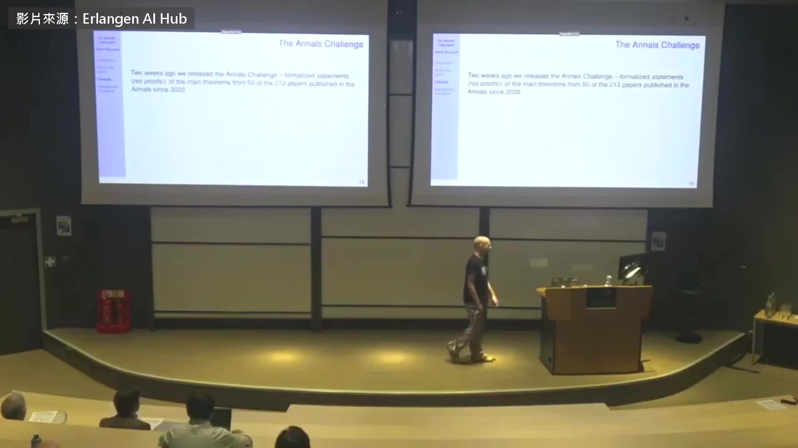

**逐字稿片段：** 兩週前，我們放出第一批成果

**話題推測：** 報告最新的研究成果發布時間，可能顯示成果發布新聞稿或日期標註。

---

## 00:07:51

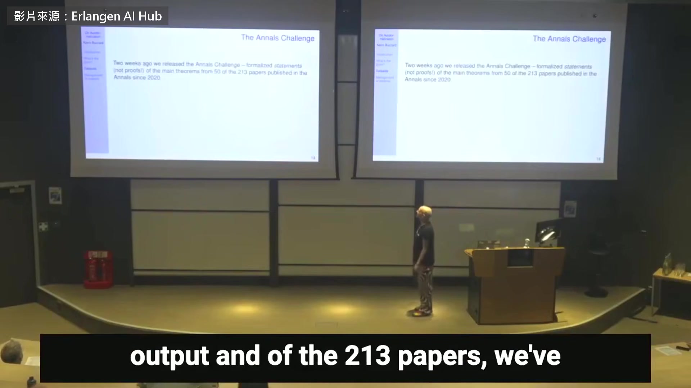

**逐字稿片段：** 213 篇裡，我們形式化了 50 篇 只有敘述，不是證明 有些定理的證明要用到有限單群分類 或朗蘭茲綱領裡很深的新結果，光證明就要幾千頁 所以有些證明長得嚇人 兩週前，我們放出 48 題（補充：另 2 篇早有人手工做過） 這些定理的證明通常都很長 有人想猜猜，機器自動形式化了幾題嗎

**話題推測：** 提出已形式化的論文數量，可能顯示研究進度的數字圖表。

---

## 00:08:26

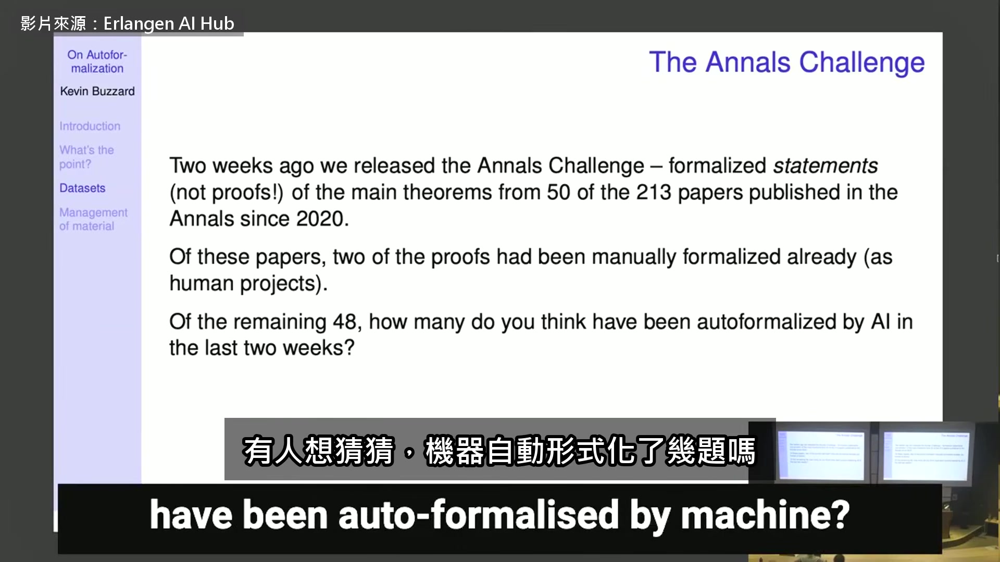

**逐字稿片段：** 我們把題目放上一個公開的評測網站 AI 進來看到題目，還附上論文出處 它們就去下載論文，試著翻成 Lean AI 自動形式化了幾題？我原本會說零 其實一年前，答案真的會是零，所以我是對的 題目放出去的時候，我們都下了注 賭的是年底前會被做完幾題

**話題推測：** 提及題目發布的平台，可能顯示評測網站的名稱或介面截圖。

---

## 00:09:03

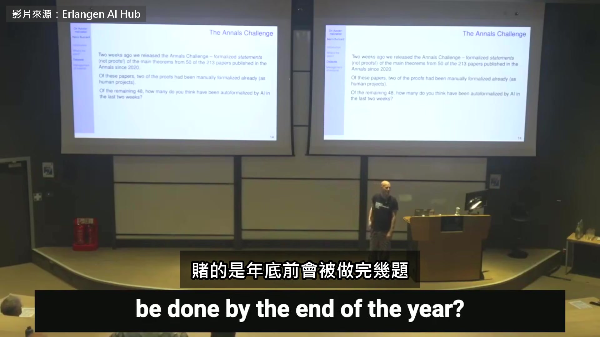

**逐字稿片段：** 別人押多少我不講，我押年底 10 題

**話題推測：** 揭露他對年底成果的預測數字，可能顯示預測數字與實際結果的比較圖。

---

## 00:09:10

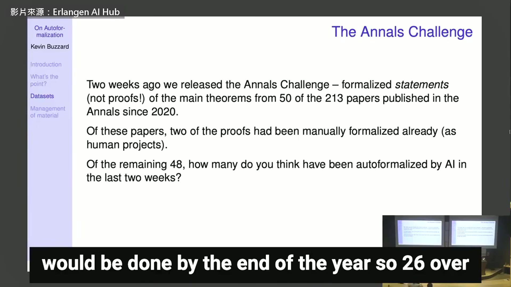

**逐字稿片段：** 結果已經做完 26 題，超過一半 我真的嚇到了。這些東西就是這麼強 你拿一篇這幾年登在頂尖數學期刊的論文 交給機器，有相當不小的機率 它能把那篇論文連同所有參考文獻 一路翻到大學部數學的程度 接上 Lean 數學函式庫，從頭到尾全部串起來 成本多少？ 這我們不知道。程式碼我們沒看過，成本也不知道 不知道，真的不知道 我寫了信… 其中有一位大學生，大部分都是他做的 我昨天寫信給對方，還沒回我 所以我什麼答案都沒有 我只知道他們把證明交給一個系統，全是盲測 證明一公開，挑戰就沒意義了 但我寫信問了看得到程式碼的人 對方說，看起來是真的 不是同一段 50 行程式碼去鑽軟體的漏洞 然後什麼都證得出來 對方講了兩件事 第一，程式碼像真的，而且很長

**話題推測：** 宣布實際完成的題目數量，可能顯示大幅超越預期的結果圖表。

---

## 00:10:40

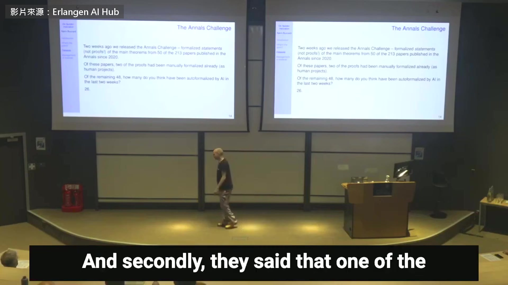

**逐字稿片段：** 第二，其中一篇，機器證出了更好的界 比那篇論文的主定理還強，只是沒人發現 是我請系統負責人檢查這 26 個證明時 對方才順口說，有一題機器做得比原論文好 可惜我們只做了 50 篇，沒做完 213 篇

**話題推測：** 揭露機器發現了比原論文更強的證明界限，可能顯示證明改進的示意圖。

---

## 00:11:04

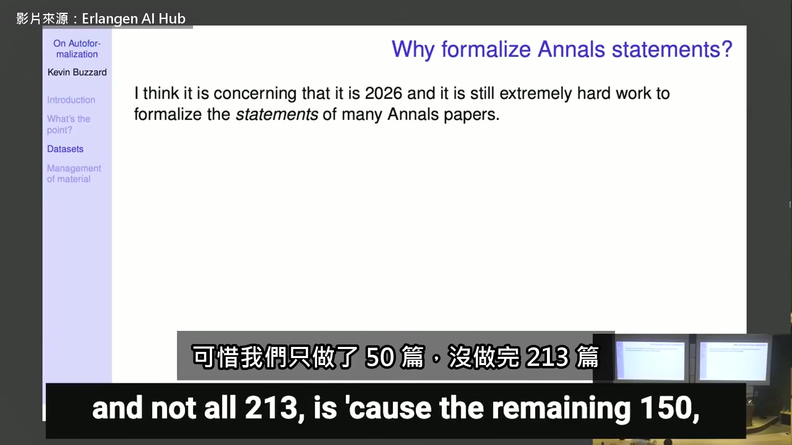

**逐字稿片段：** 原因是剩下那 150 篇，有些真的很難 問題就在這 卡住的原因是，敘述裡有很專業的術語 我們做了四分之一，靠的是 Lean 數學函式庫 因為這一行大家都在它上面蓋東西 問題是，一篇典型的年刊論文 有時候講的是多項式或群 但有時候講的是連通約化群的自守表示 這個定義非常艱澀，Lean 的函式庫還差得遠 定義不存在，你可以直接叫 AI 把敘述形式化 但這樣你靠的就是 AI 生出來的定義 這會出問題，因為 AI 的定義並不完美 現代數學很多東西，我們還寫不進這些系統 你可能會想，自動形式化都做得出 26 個證明 我們丟給它的題目，一半都做出來了 那這種技術性的定義應該也難不倒它 但大問題在維護 Lean 數學函式庫的人，我也是 我們不喜歡有人隨手生個定義，就想塞進來 他們要的是一次寫對 寫成最一般的版本 光是流形的定義就花了好幾年 所以不太願意把上千行 AI 寫的定義收進來 可是大家不會等 他擔心做前沿研究的人乾脆叫 AI 自己寫定義 明年同一個東西可能冒出五種定義 彼此相關，卻不相等 會不會出現一套大家公認、AI 寫的數學庫 它會接在 Lean 數學函式庫的下游 但希望大家還是認它是正統 比如你想要 Fukaya 範疇這種高深的定義 要定義 Fukaya 範疇 照鏡像對稱的說法，它跟另一個範疇等價 那是非常大的工程 這個定義最後會落腳在哪 還是會冒出一大堆各寫各的定義

**話題推測：** 提及未完成的論文數量與其困難度，可能顯示困難論文數量的數字。

---

## 00:13:35

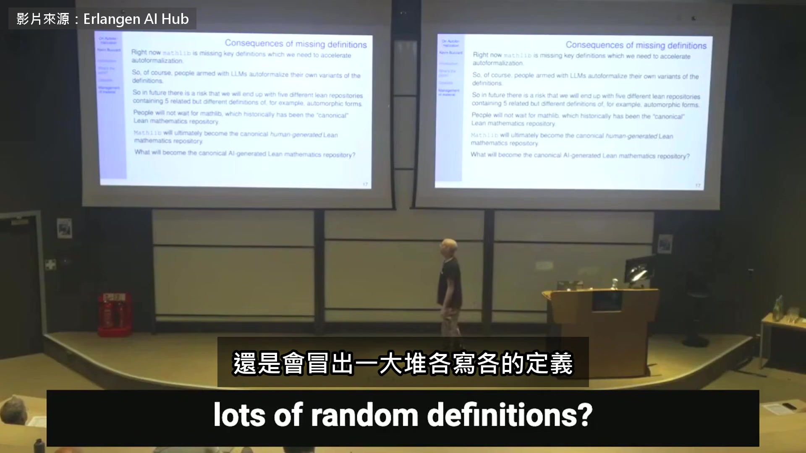

**逐字稿片段：** 我不知道。這是接下來的風險 數學界可能會分裂 有一個候選，我覺得應該幫它推一下 那我就來推一下，你看

**話題推測：** 總結前面討論的問題為「接下來的風險」，可能顯示「風險」或「挑戰」的標題。

---

## 00:13:54

**逐字稿片段：** 這是一套 AI 寫的 Lean 函式庫 運作方式是，你決定自己要什麼 人類想說，一定要有 Fukaya 範疇或自守表示

**話題推測：** 介紹一個新的、AI生成的Lean函式庫專案，可能顯示該專案的名稱或介面。

---

## 00:14:09

**逐字稿片段：** 想學的話，隔兩間去找 Hitchin（Nigel Hitchin：牛津的幾何學家） 人類寫下想要的東西，AI 負責寫程式也負責審 就這樣一直長，目前有 100 萬行

**話題推測：** 提到知名數學家Nigel Hitchin，可能顯示其照片或個人簡介。

---

## 00:14:28

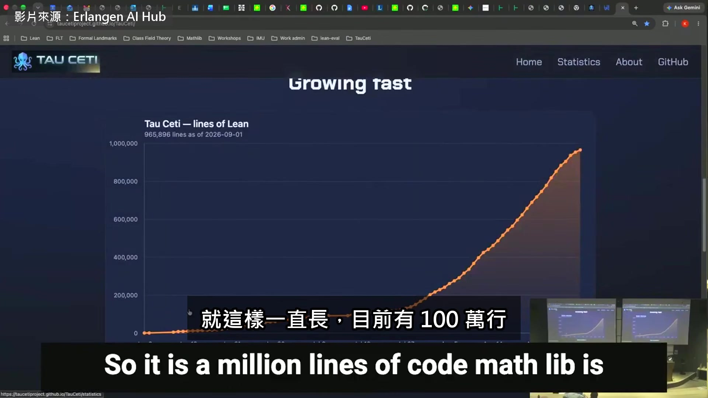

**逐字稿片段：** Lean 數學函式庫是 225 萬行 它才出現三個月，就長到這麼大 到年底，它會整個超過 Lean 數學函式庫

**話題推測：** 比較Lean數學函式庫的程式碼行數，可能顯示兩個函式庫的對比數據。

---

## 00:14:38

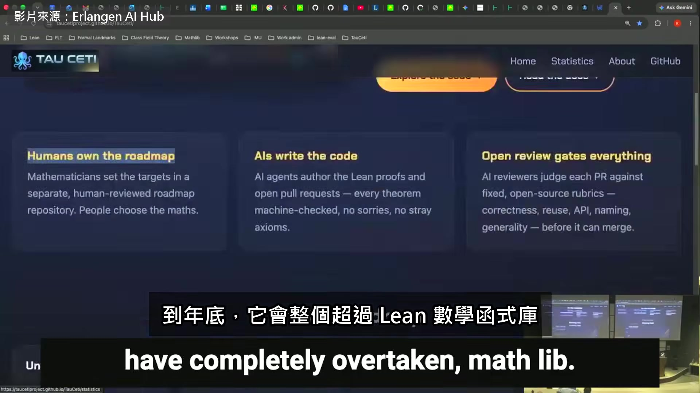

**逐字稿片段：** 演講就到這裡，這是總結 定理的自動形式化已經非常好，而且只會更好 定義的形式化還不完美 就算完美了，各做各的也會是個問題 定義的形式化，是一定得解決的事 我們得替它們找個對的地方放 數學函式庫不夠靈活，收不進 AI 寫的東西 因為每一樣它都要人工審過 身為維護者，我覺得這好像正變成不成文的規定 我們很排斥 AI 生成的東西，所以只能放到別處 希望最後有一套 AI 寫的庫勝出，大家會輕鬆很多 等它勝出，我看不到任何阻礙 就能開始處理所有重要的數學文本 交給機器翻成 Lean

**話題推測：** 標示演講進入總結階段，可能顯示「總結」或「Summary」的標題頁。

---

## 00:15:41

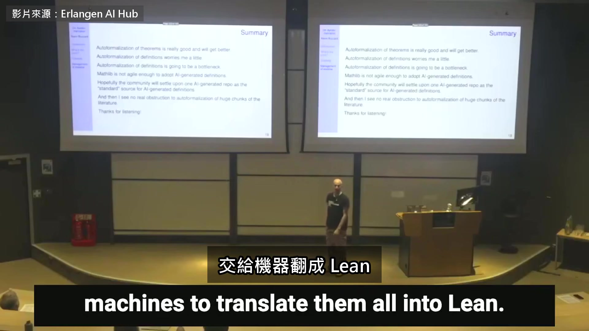

**逐字稿片段：** 幾年前 他把整個數學寫進電腦當成幻想 現在擋在 AI 前面的 只剩定義要怎麼寫、寫好放在哪裡

**話題推測：** 提及過去某個時間點，可能顯示時間軸上的年份標記。

---

## 00:15:50

**逐字稿片段：** 原影片 41 分鐘，他還講了 有人寄來 AI 寫的證明 PDF 他叫對方丟給 AI 翻成 Lean 兩份都驗過了 還有機器既然做得到 他的費馬計畫為什麼還要做 他想讓有興趣的高中生也看得懂證明怎麼開頭 原影片連結在說明欄，有興趣可以去聽更多。

**話題推測：** 提及原影片的內容與時間長度，通常是編輯者插入的補充說明，可能顯示原影片的資訊卡或連結。

---
