# ai-note-101_jk3dHesXA9E — 關鍵畫面索引

- 來源逐字稿：[ai-note-101_jk3dHesXA9E_GT.srt](ai-note-101_jk3dHesXA9E_GT.srt)
- 影片：https://www.youtube.com/watch?v=jk3dHesXA9E
- 截圖數：39

## 00:00:16

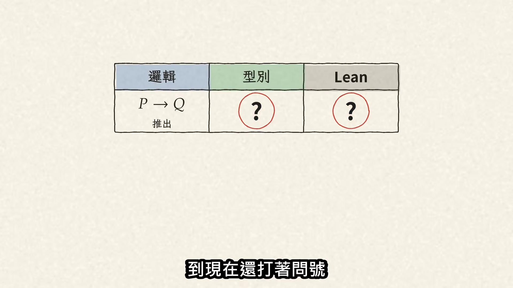

**逐字稿片段：** 所以這一集，我們要把問號擦掉 要填型別那一格

**話題推測：** 介紹本集主題：填補三欄表上的型別和 Lean 記號。

---

## 00:00:22

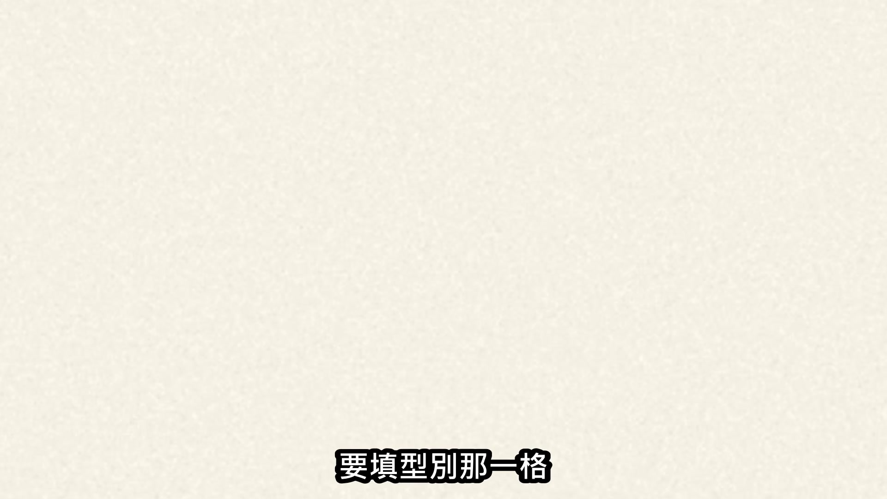

**逐字稿片段：** 我們先回到第 2 集的冒號 3、冒號、Nat，意思是：3 的型別是 Nat 第 2 集說過 型別就像掛在值身上的一張標籤 寫著這個值是哪一類東西 這種標籤，寫程式的人其實天天在用

**話題推測：** 回顧第二集型別概念，可能顯示「3: Nat」的範例。

---

## 00:00:37

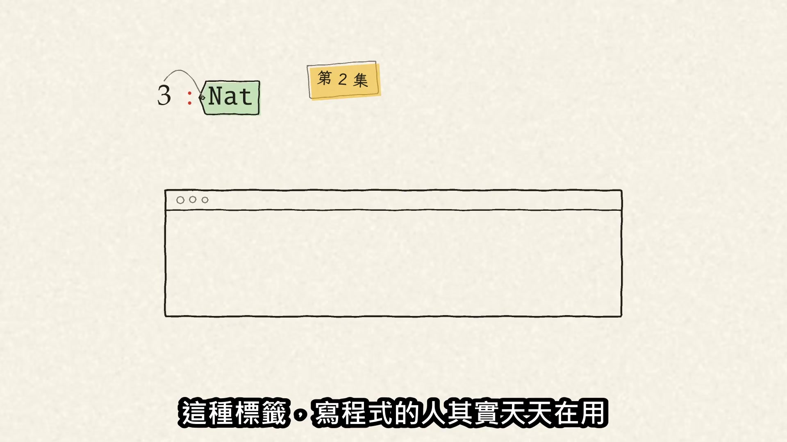

**逐字稿片段：** 我們再拿第 2 集見過的 Python 來看 加 1 的函數，第一行這樣寫： def add one，括號裡寫 n 冒號 int 括號後面再寫一個箭頭 int 第二行：return n 加 1 def 是英文 define 的縮寫 意思是定義一個函數 return 是把結果交回去 int 是整數的型別 所以 n 冒號 int，說的是吃進來的 n 標籤是整數；箭頭後面的 int 說的是吐出來的東西，標籤也是整數 你看，這個冒號，跟剛剛 3、冒號、 Nat 的冒號，是同一個意思： 左邊是東西，右邊是它的型別

**話題推測：** 引入 Python 程式碼範例，顯示 'def add one' 函數。

---

## 00:01:15

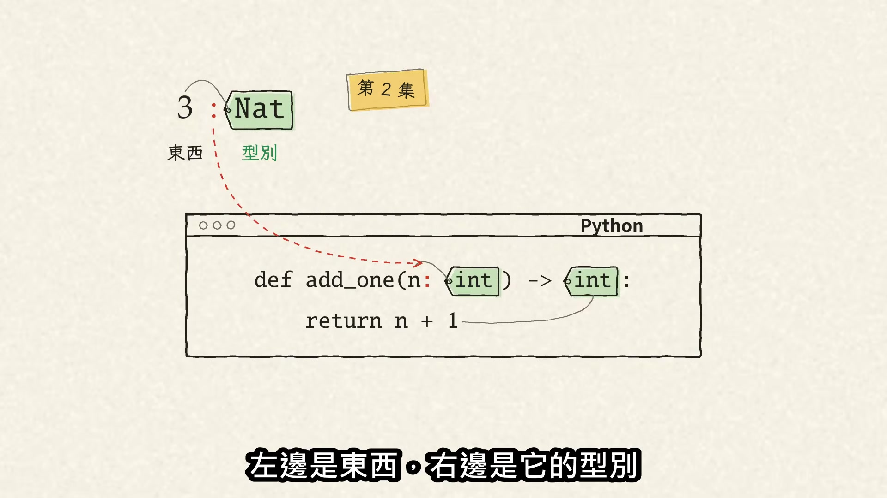

**逐字稿片段：** 不過，Python 自己執行的時候 並不會照著標籤檢查 餵它 2.5，它照樣算出 3.5 要等靜態型別檢查器來看 才會發現對不上

**話題推測：** 討論 Python 在執行時不檢查型別的特性。

---

## 00:01:25

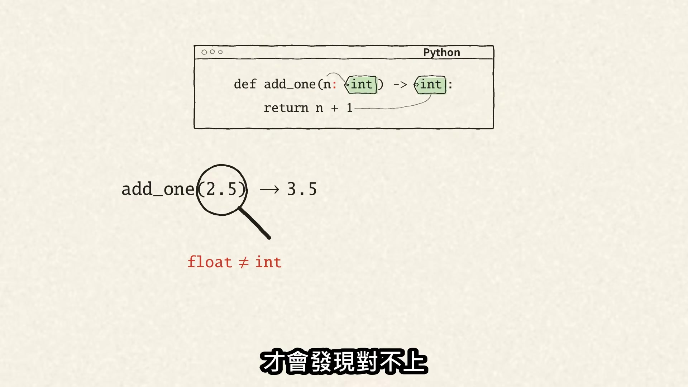

**逐字稿片段：** Lean 就不一樣了：在 Lean 裡 標籤一定會被檢查；對不上，就過不了

**話題推測：** 對比 Lean 語言的型別檢查機制，強調其嚴格性。

---

## 00:01:32

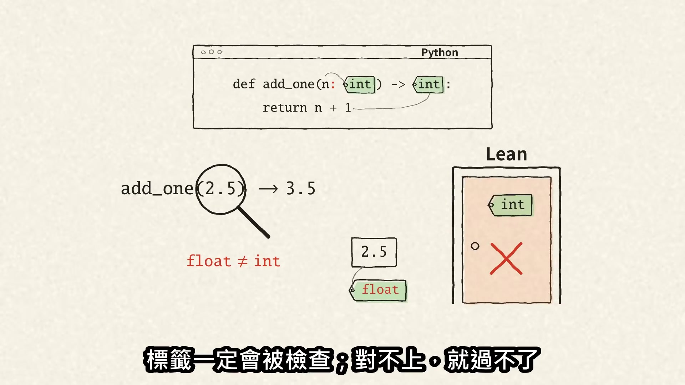

**逐字稿片段：** 那這跟證明有什麼關係？

**話題推測：** 提出證明與型別檢查的關聯性。

---

## 00:01:34

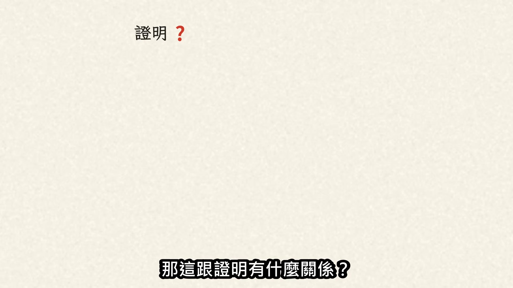

**逐字稿片段：** 第 2 集最後，我們寫過這一行：r f l、 冒號、2 加 2 等於 4 也就是 r f l 的型別是「2 加 2 等於 4」 證明放在冒號左邊，命題放在冒號右邊 所以命題站的，就是型別的位置 而它的一個證明 就是型別剛好是這個命題的一個東西 換句話說：證明

**話題推測：** 引用第二集關於「證明」的程式碼範例：「r f l : 2 + 2 = 4」。

---

## 00:01:56

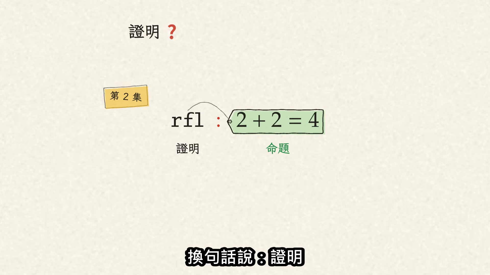

**逐字稿片段：** 就是造出那種型別的一個東西 這句話，是這一集的主角 那要怎麼造？

**話題推測：** 闡述本集核心概念：「證明就是造出那種型別的一個東西」。

---

## 00:02:02

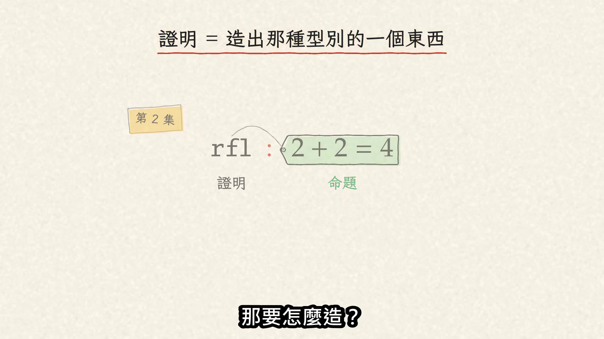

**逐字稿片段：** 做法很簡單：邏輯的規則放左邊 型別的規則放右邊，一條一條對 每一條，也都用 Python 寫一遍 我們先從最簡單的一對開始

**話題推測：** 說明將邏輯規則與型別規則對照的方式，可能顯示左右分欄。

---

## 00:02:14

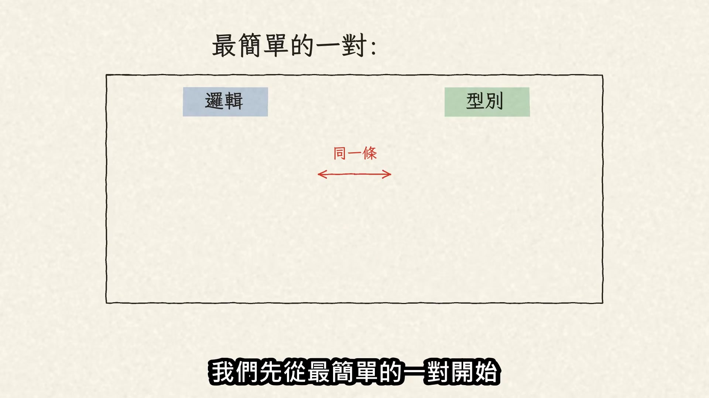

**逐字稿片段：** 也就是假設規則 左邊是邏輯：如果 P 在清單 Gamma 裡 那麼 Gamma 推得 P 右邊是型別： 如果「x 的型別是 A」這一筆在清單 Gamma 裡 那麼在 Gamma 底下，x 的型別就是 A 換句話說 清單上寫著這個變數是什麼型別 它就是什麼型別 這條叫變數規則 其實第 2 集我們查「n 的型別是 Nat」的時候 用的就是它 你看，兩邊幾乎一樣 唯一的差別，是右邊多了一個叫 x 的名字 而這個多出來的名字，其實很重要 因為在邏輯那邊，清單裡只寫命題

**話題推測：** 開始介紹第一對規則：假設規則與變數規則。

---

## 00:02:55

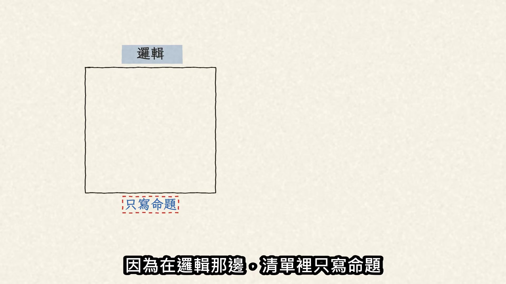

**逐字稿片段：** 例如：P 推出 Q、Q 推出 R、P 可是到了型別那邊，清單裡的每一筆 都要有一個名字

**話題推測：** 展示邏輯清單中的命題範例。

---

## 00:03:07

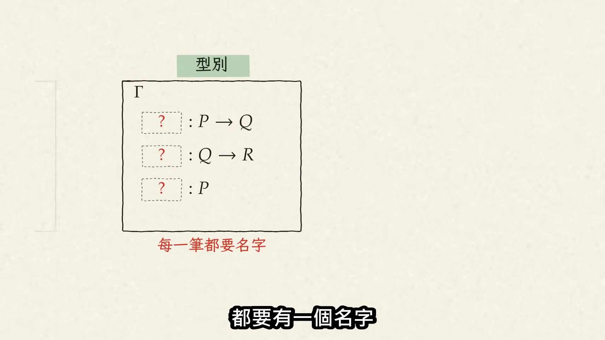

**逐字稿片段：** 所以，我們幫它們取名字 P 推出 Q 那一筆，叫 h p q Q 推出 R 那一筆，叫 h q r；P 那一筆，叫 h p 這裡的 h，是英文 hypothesis 假設的意思 所以 h p，就是「P 的那個假設」 這樣一來，型別這邊的清單就成形了： 每一筆，都是一個名字，配上一個型別 用一句話總結：一個假設，就是一個變數 而這個變數的型別 就是它假設的那個命題

**話題推測：** 說明型別清單中的命題需要命名，可能展示命名範例。

---

## 00:03:38

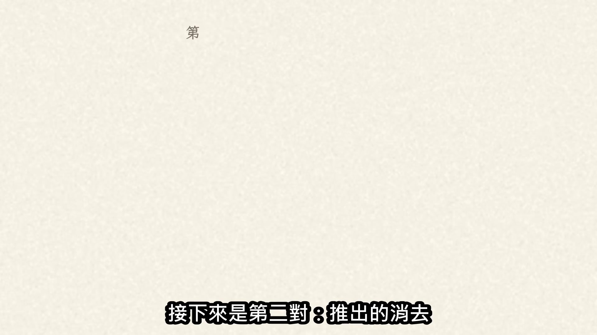

**逐字稿片段：** 接下來是第二對：推出的消去 左邊是邏輯：Gamma 推得 P 推出 Q Gamma 又推得 P，所以 Gamma 推得 Q 右邊是型別：在 Gamma 底下 f 的型別是「從 P 到 Q」 a 的型別是 P，那麼把 f 套用在 a 上 型別就是 Q 其實右邊這條，你在第 2 集已經見過了 就是「加 1 要 Nat，你給 Nat 結果就是 Nat」那一條 它叫套用規則，英文是 application 現在，請仔細看右邊 如果把右邊每一個「式子和冒號」都擦掉： f 冒號擦掉，a 冒號擦掉 f a 冒號也擦掉 那剩下的，就是左邊，一字不差 反過來說，右邊比左邊多記了一件事： 結論的那個 f a 記下了這個結論是怎麼來的 也就是拿 f 這個證明 套在 a 這個證明上 所以，推出的消去，就是函數套用 這句話如果換個方向說，會更清楚： 「P 推出 Q」的一個證明，就是一台機器 你餵它一個 P 的證明 它就吐出一個 Q 的證明

**話題推測：** 開始介紹第二對規則：推出的消去與套用規則。

---

## 00:04:46

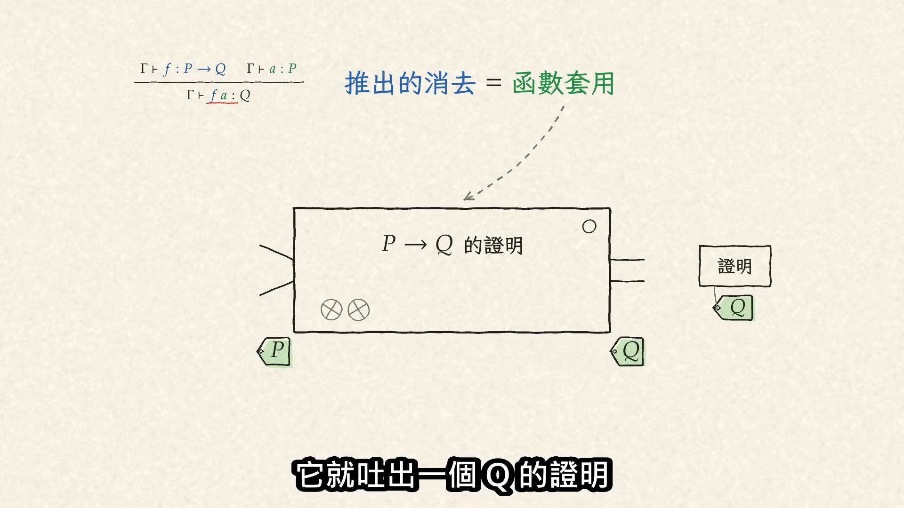

**逐字稿片段：** 寫成 Python，h p q 就是一個函數： def h p q，括號裡 h p 冒號 P，箭頭 Q 本體只寫三個點 這裡的 P、Q 是命題 我們把它們當成型別來寫 三個點的意思是：裡面怎麼把 P 變成 Q 我們不知道，也不需要知道 我們只看標籤對不對得上，不去算 要用它，就是呼叫它：h p q，括號，h p 光看標籤就知道，結果的型別是 Q 再來是第三對，也是最關鍵的一對：

**話題推測：** 展示「P 推出 Q」的 Python 函數程式碼範例。

---

## 00:05:23

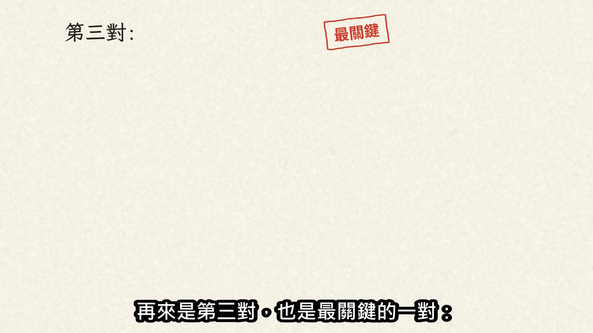

**逐字稿片段：** 推出的引入 左邊是邏輯：Gamma 加上 P，推得 Q 所以 Gamma 推得 P 推出 Q 右邊是型別

**話題推測：** 開始介紹第三對也是最關鍵的規則：推出的引入與 fun 規則。

---

## 00:05:31

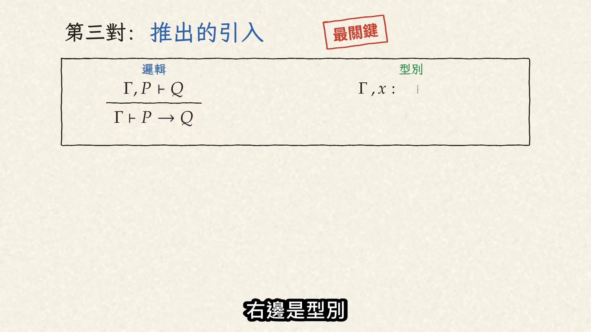

**逐字稿片段：** 這一條會出現好幾個新記號 我們慢慢來看 先看上面那一行 Gamma 後面的逗號，念作「加上」 意思是在清單 Gamma 裡再多放一筆 多放的這一筆是 x 冒號 P 也就是一個型別為 P 的變數 x 再看下面那一行 第一個新記號是 fun 它是英文 function 的縮寫，就念 fun 意思是：從這裡開始，寫一個函數 第二個是緊接在 fun 後面的 x 它叫做參數，是函數吃進來的東西 在函數裡面的名字 第三個是 x 後面這個粗箭頭 我們念它「箭頭」 它的左邊寫參數，右邊寫要吐出來的東西 第四個是箭頭右邊的 b 它是函數的身體，也可以說是函數的內容 最後，冒號右邊的「從 P 到 Q」 是這整個函數的型別：吃 P，吐 Q 所以 fun x 箭頭 b 的意思是： 一個函數，吃進一個 x，吐出 b 因為這條規則做的事 就是寫出一個 fun 所以我們就叫它 fun 規則

**話題推測：** 預告推出的引入規則將引入多個新符號，可能展示這些符號。

---

## 00:06:36

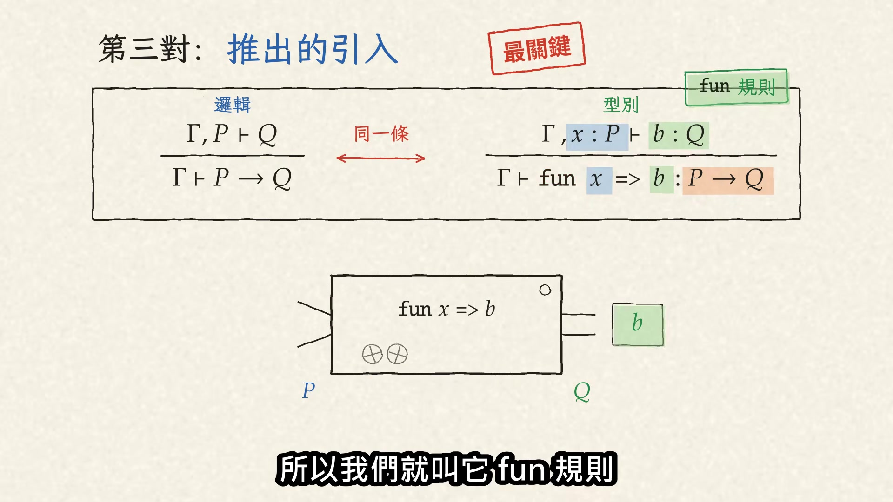

**逐字稿片段：** 請注意，型別，跟屬於這個型別的東西，要分開看 P 推出 Q 這個型別，是用箭頭把 P、 Q 組起來 就像第 2 集的 Nat 箭頭 Nat 隨時寫得出來 可是 fun 規則做的 是真的造出一個型別是 P 推出 Q 的東西 型別寫得出來，不代表造得出東西 造得出來，才算證明了 P 推出 Q 而這條規則 正好把上一集那個微妙的地方講得清清楚楚

**話題推測：** 強調區分型別與屬於該型別的「東西」，可能顯示概念對照圖。

---

## 00:07:08

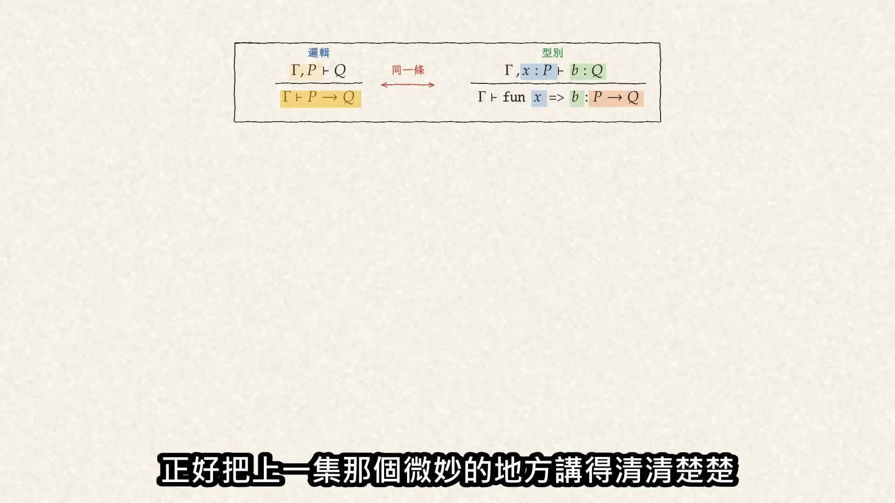

**逐字稿片段：** 我們分三步來看 第一步，「假設 P 成立」，在型別這邊 就是把一個型別為 P 的變數 x 暫時放進清單 第二步，「一路推到 Q」 就是在這個清單底下 做出一個型別為 Q 的東西 b 而且 b 裡面可以用到 x 第三步，「所以 P 推出 Q」 就是用 fun x 把 x 綁起來 綁起來以後，x 就不在清單裡了 因為它變成了函數的參數 換句話說，收回假設，就是函數的參數

**話題推測：** 以三步驟解釋「推出的引入」規則的運作方式。

---

## 00:07:43

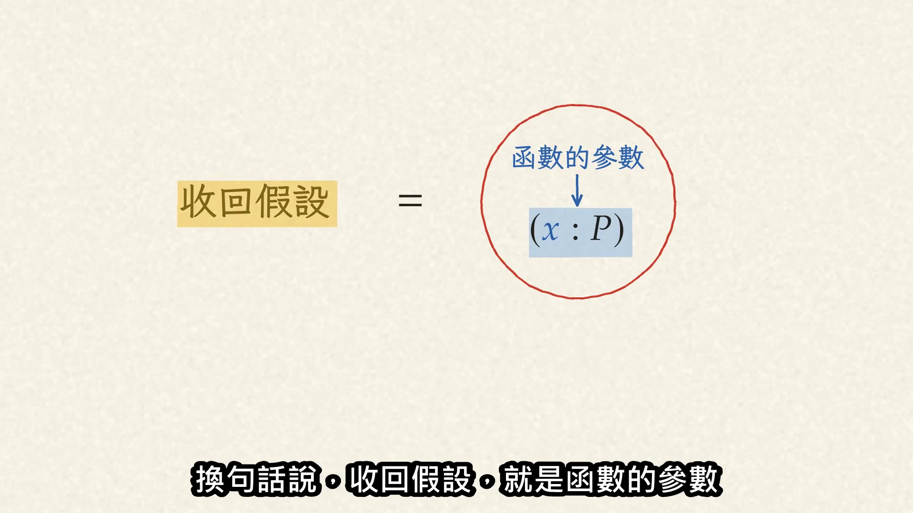

**逐字稿片段：** 拿開頭那個加 1 來看：放進清單的是 n 做出來的是 n 加 1，用 fun n 綁起來 就得到 fun n 箭頭 n 加 1 型別是從 Nat 到 Nat 這就是加 1 這台機器 這裡的身體，就是箭頭右邊的 n 加 1 也就是開頭那段 Python 裡 return 後面的那個 n 加 1 Python 寫 int，Lean 這裡寫 Nat 因為 Python 沒有自然數的型別

**話題推測：** 再次以「加 1」函數為例，說明其如何應用 fun 規則。

---

## 00:08:11

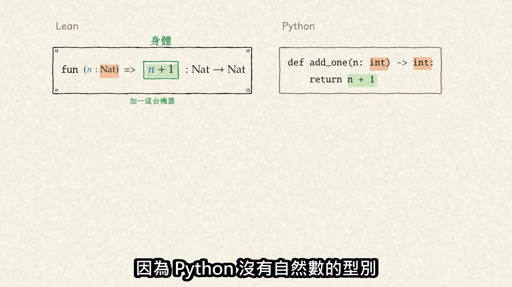

**逐字稿片段：** Python 還有一種更短的寫法 叫 lambda：lambda n 冒號 n 加 1 它是一個不取名字的函數，對到 Lean 就是 fun n 箭頭 n 加 1 要注意，lambda 後面這個冒號 不是型別的冒號；它的角色 是 fun 的那個箭頭

**話題推測：** 介紹 Python 的 lambda 寫法，可能展示其程式碼。

---

## 00:08:30

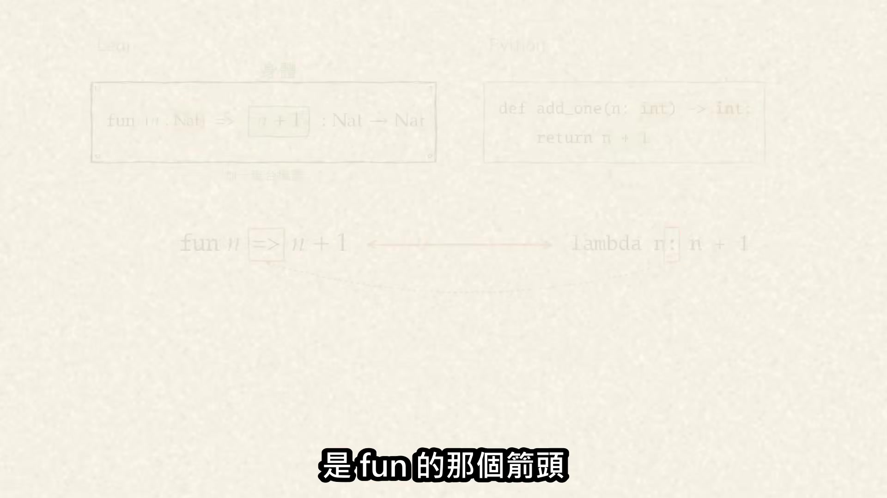

**逐字稿片段：** 那餵它 hello 呢？ n 的型別是 Nat hello 的型別是 String，對不上 型別檢查器直接擋下來 跟第 2 集一模一樣： 不是餵進去以後吐不出東西 而是根本餵不進去 這一點跟開頭的 Python 不同 Python 餵 2.5，是照樣算的 推出也一樣：fun x 箭頭 b 的 x 型別是 P，所以它只吃 P 的證明 不管餵進哪一個 P 的證明 都吐出一個 Q 的證明

**話題推測：** 提出以 'hello' 作為輸入的錯誤情境，顯示型別不匹配錯誤。

---

## 00:08:57

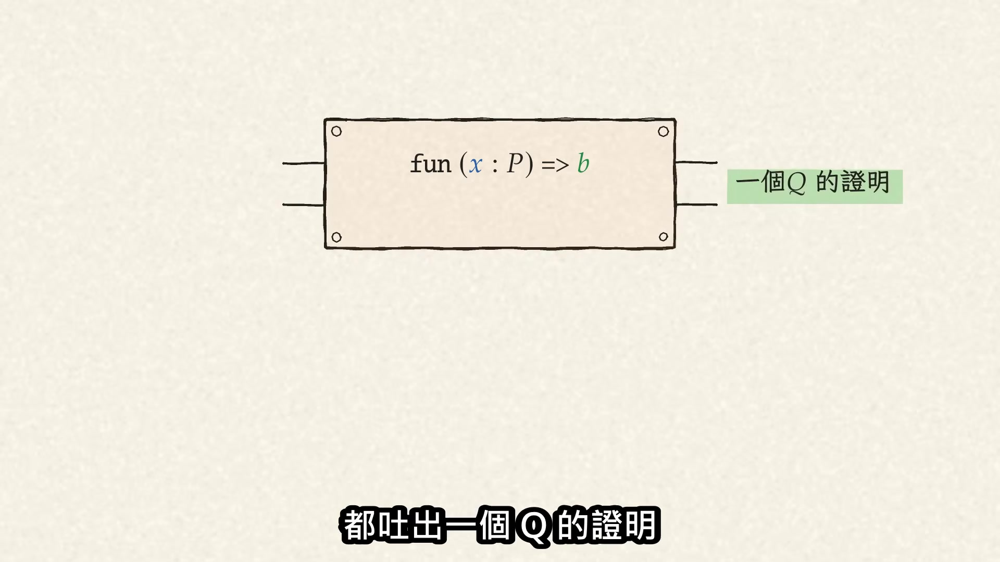

**逐字稿片段：** 接著看一個最小的例子：P 推出 P 要造的，是一台吃 P 的證明、 吐 P 的證明的機器 吃進來的已經是 P 的證明了 原封不動吐出去就好 所以它的證明是：fun、h p、箭頭、h p 寫成 Python 也是兩行：def ident 括號裡 h p 冒號 P，箭頭 P；下一行 return h p ident 取自英文 identity，恆等 所以這就是恆等函數 邏輯上最無聊的定理 剛好對應到程式裡最無聊的函數 到這裡，變數規則、套用規則、 fun 規則，三對規則都對上了

**話題推測：** 介紹 P 推出 P 的最小範例，可能顯示其證明或程式碼。

---

## 00:09:39

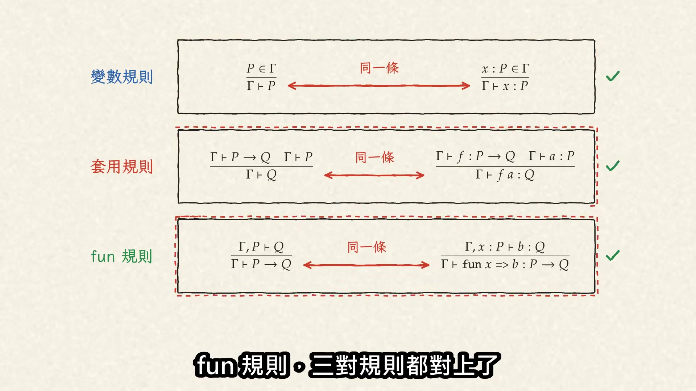

**逐字稿片段：** 我們整理一次： 推出，在型別這邊，就是函數型別 假設，就是清單裡的變數 要引入推出，就寫一個 fun；在 Python 就是 def 或 lambda 要使用推出，就拿去套用；在 Python 就是呼叫函數 前面看套用規則時說過 右邊比左邊多記了一件事

**話題推測：** 整理變數、套用、fun 三條規則的核心概念，可能顯示總結列表。

---

## 00:10:00

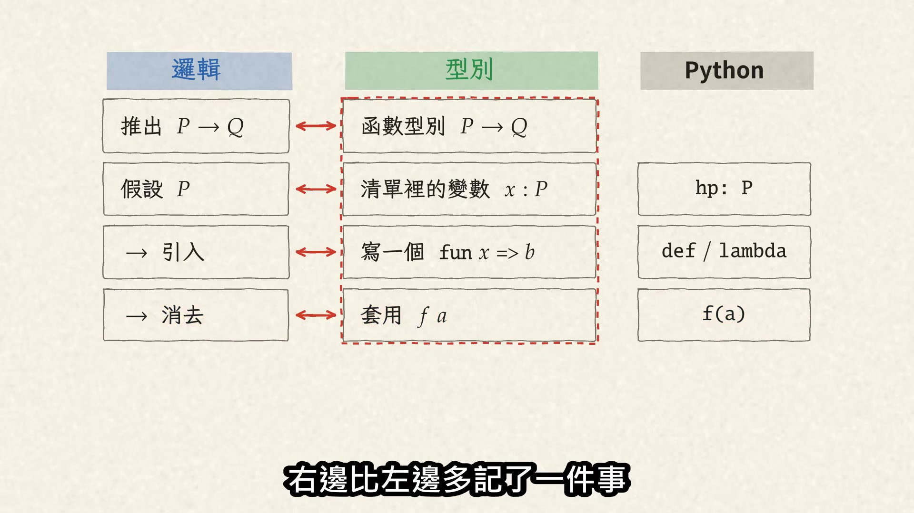

**逐字稿片段：** 放在同一張表上看，會更清楚： 每個結論旁邊，都帶著一個式子 記下這個結論是怎麼來的 每用一次規則，就多記一筆 一路記到最後，整個推論過程 就寫成了一個式子 這就是為什麼一個數學證明 可以被完整地寫下來 再交給電腦一步一步檢查 規則都齊了 接下來，換你自己來解一題

**話題推測：** 建議以圖表形式呈現結論，闡明證明如何在型別系統中被記錄。

---

## 00:10:24

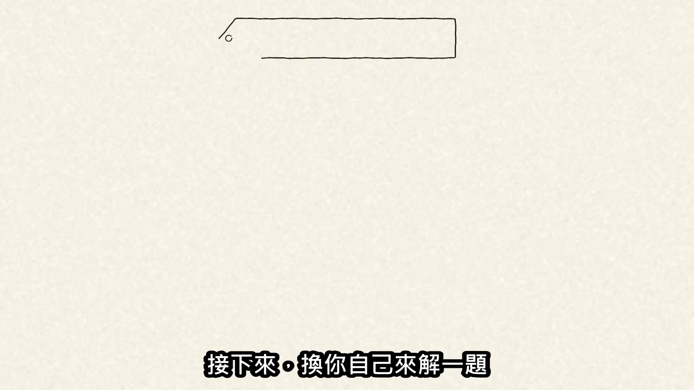

**逐字稿片段：** 題目是上一集那棵小樹：P 推出，括號，Q 推出 P 先別急著寫，先看清楚： 要造的是什麼型別的東西？ 最外層的箭頭說：先吃一個 P 的證明 吃完以後，要吐出來的不是 P 而是一個 Q 推出 P 的東西 也就是說，我們要造一台機器 它吃了 P 以後，吐出來的是另一台機器 那第二台機器裡面要放什麼？ 它要吃一個 Q 的證明 吐出一個 P 的證明 你可以先停下來，想一想 答案是：P 的證明，手上已經有了 就是一開始吃進來的 h p 不管吃進什麼 Q，把 h p 吐出去就好

**話題推測：** 提出一個挑戰題：「P 推出 (Q 推出 P)」，可能展示該命題的數學表示。

---

## 00:11:09

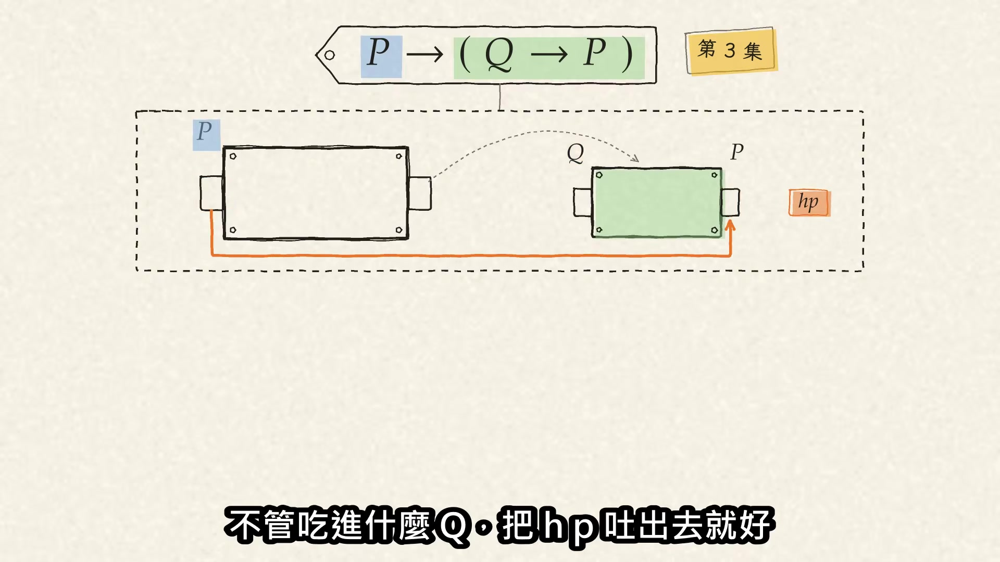

**逐字稿片段：** 寫成 Python：def k，名字隨便取 括號裡 h p 冒號 P 箭頭後面寫 Callable、Q、P Callable 是 Python 寫「函數型別」的方式 這裡讀作：吃 Q，吐 P 本體一行：return lambda h q 冒號 h p 寫成 Lean 就是 fun h p 箭頭 fun h q 箭頭 h p 你會發現，h q 從頭到尾都沒用到 上一集說過 收回一個沒用到的假設是合法的；在這邊 就是一個函數可以不理它的參數 其實，整個 Lean 就是在玩這樣的遊戲 遊戲規則是：每一種型別 都會告訴你怎麼造，也告訴你怎麼用 像推出這種型別，造它就寫 fun 用它就拿去套用 每一關，給你一個型別；你要照著規則 造出一個這種型別的東西 造得出來，就過關；過關，就是證完了

**話題推測：** 展示「P 推出 (Q 推出 P)」的 Python 程式碼解法。

---

## 00:12:11

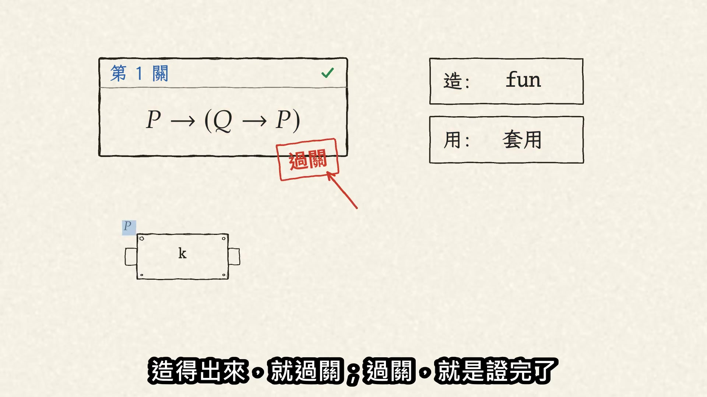

**逐字稿片段：** 第 5 集開始，會有更多種機器 更多種型別登場 但每一種，我們都會說清楚：怎麼造、怎麼用 而我們手上這台，推出的機器 就是第一台 好，再來一題，這次難一點：

**話題推測：** 預告第五集將引入更多型別和證明方式。

---

## 00:12:27

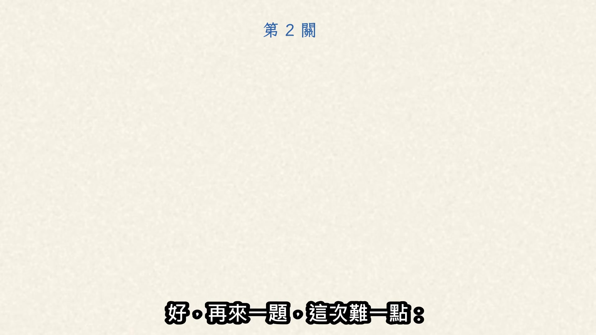

**逐字稿片段：** 上一集的 imp trans 一樣，先擺出手上有什麼 清單裡有兩個已知條件：h p q 型別是 P 推出 Q；h q r 型別是 Q 推出 R 用剛剛的話來說，它們是兩台機器： h p q 吃 P 的證明，吐 Q 的證明 h q r 吃 Q 的證明，吐 R 的證明 要證的，是 P 推出 R 也就是說 這一關要造出一個型別是 P 推出 R 的東西： 一台吃 P 的證明、吐 R 的證明的機器 手上有兩台機器，要做出第三台 要怎麼接？ 你可以先想一想 答案是：把 h p q 的出口 接到 h q r 的入口 我們順著走一遍 一個 P 的證明餵進來，我們叫它 h p 先把 h p 餵給 h p q 吐出來的是一個 Q 的證明 再把這個 Q 的證明餵給 h q r 吐出來的是一個 R 的證明 拿到 R，就結束了

**話題推測：** 提出更困難的挑戰題：上一集的 imp trans (蘊涵傳遞律)。

---

## 00:13:30

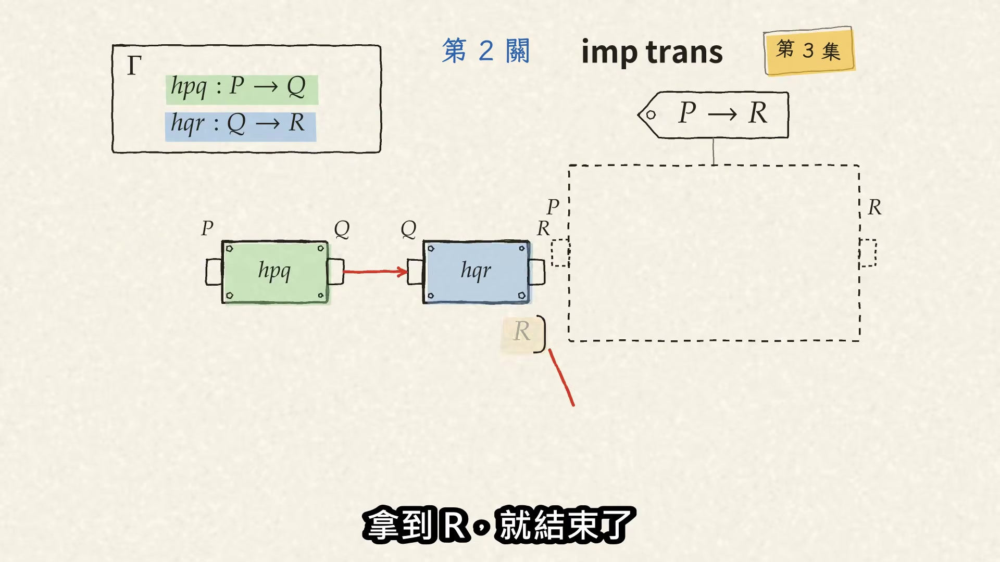

**逐字稿片段：** 寫成 Lean，就是這一行：fun、h p、 箭頭、h q r、括號、h p q、h p、括號 fun h p 箭頭 就是「一個 P 的證明餵進來，叫它 h p」 後面括號裡的先算：h p 先進 h p q 出來的再進 h q r

**話題推測：** 展示 imp trans (蘊涵傳遞律) 的 Lean 程式碼解法。

---

## 00:13:50

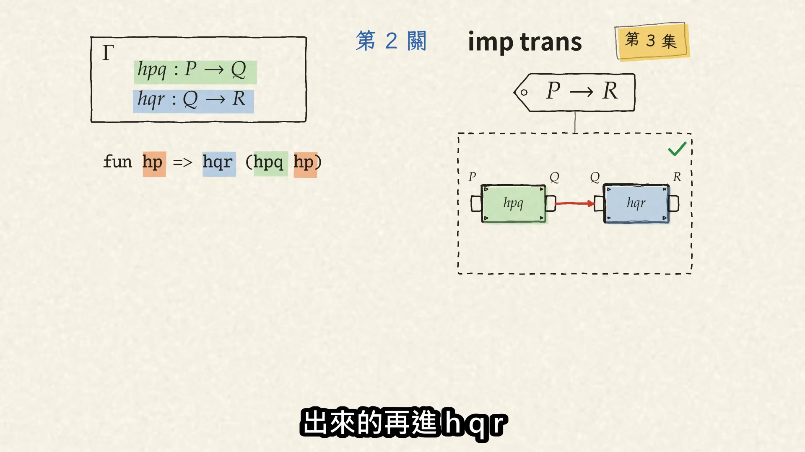

**逐字稿片段：** 同一件事寫成 Python：def compose compose 是英文「組合」的意思 括號裡兩個參數：h p q 型別是 Callable、P、Q 也就是吃 P 吐 Q 的函數；h q r 型別是 Callable、Q、R 箭頭後面，要吐出的是 Callable、P、R 本體一行： return lambda h p 冒號 h q r 括號 h p q 括號 h p 跟 Lean 那一行，是同一個形狀 你看，參數的標籤 就是手上的兩個已知條件 箭頭後面的標籤，就是要證的命題 在 Lean 裡，函數寫得出來、 標籤對得上，就證完了

**話題推測：** 展示 imp trans (蘊涵傳遞律) 的 Python 程式碼解法，使用 'compose' 函數名。

---

## 00:14:33

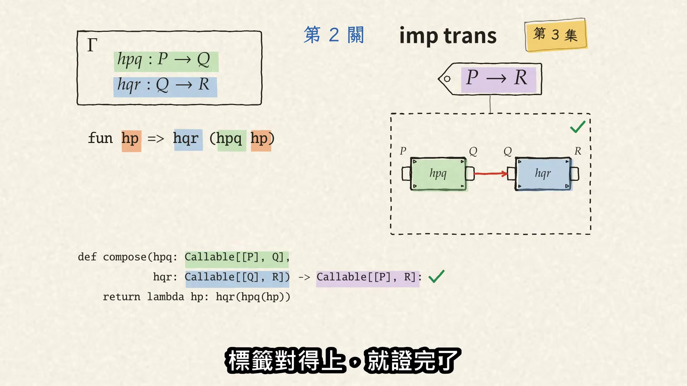

**逐字稿片段：** 反過來，如果接錯 直接把 h p 餵給 h q r： h q r 要的是 Q，給的卻是 P 標籤對不上，Lean 就不收 Python 的靜態型別檢查器 也會在同一個地方報錯 寫好的這一行交給 Lean 之後 最後拍板收不收的

**話題推測：** 演示錯誤的函數連接方式，顯示型別檢查器如何阻止。

---

## 00:14:51

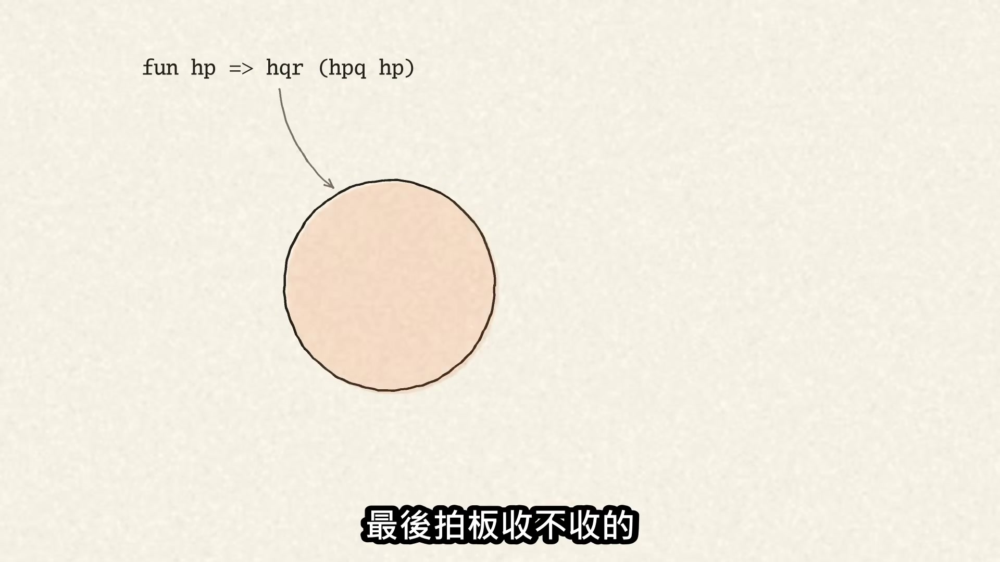

**逐字稿片段：** 是 Lean 裡一個很小的程式，叫 kernel kernel 這個英文字，原意是果核 也就是最核心的那一塊 用剛剛的遊戲來說，它就是裁判 它做的事 就是照我們今天對過的那三條規則 把這一行的型別算出來 再跟你寫下的命題比：一樣就收 不一樣就不收 剛剛那種接錯，到了它這裡 也一樣過不了 它不懂什麼叫傳遞性 也不知道這個定理有什麼意義 它只會照規則，對標籤 而且 kernel 拿到的，不是一行字

**話題推測：** 介紹 Lean 語言中的核心組件 'kernel'，說明其驗證角色。

---

## 00:15:24

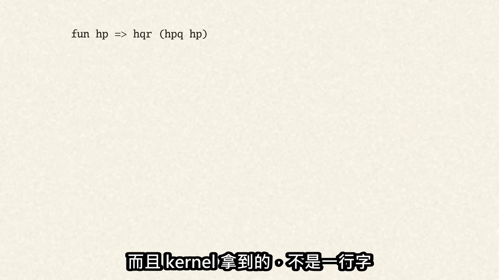

**逐字稿片段：** 而是一棵樹，就像第 2 集那棵語法樹 把 imp trans 那一行，先不標型別 畫成樹：最上面是 fun 底下是兩次套用，最下面是 h q r、 h p q、h p 三個葉子

**話題推測：** 說明 kernel 處理的是樹狀結構，可能顯示證明樹的視覺化。

---

## 00:15:37

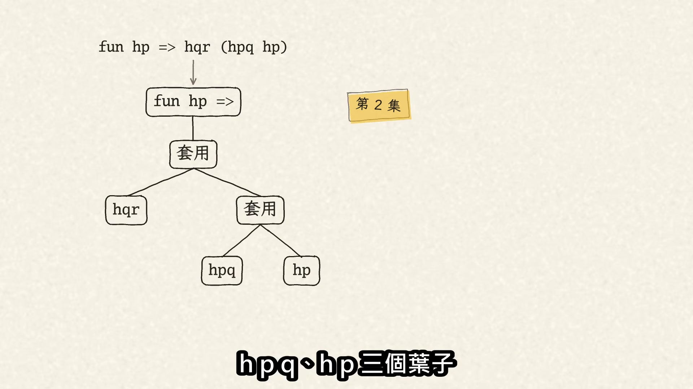

**逐字稿片段：** 現在，把上一集那棵邏輯的證明樹 上下翻過來，再移過去，疊在這棵樹上 你看，每一個節點都剛好疊在一起： fun 對上推出的引入 兩次套用對上兩次推出的消去 三個葉子對上三個假設 每一條分數線，都對上一個節點 換句話說，一個證明，就是一棵證明樹 壓成一行字

**話題推測：** 比較本集的型別證明樹與上一集的邏輯證明樹，疊合顯示兩者對應。

---

## 00:16:01

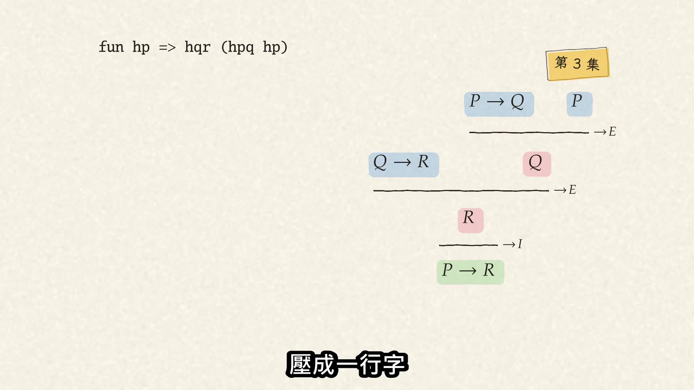

**逐字稿片段：** 所以，這一集的結論可以濃縮成三句話： 推出的消去，就是函數套用 推出的引入，就是寫 fun；而 fun 的參數 就是被收回的假設 至於假設清單 就是型別檢查器手上的 Gamma 這樣一來

**話題推測：** 總結本集三大核心結論，可能顯示條列式重點。

---

## 00:16:17

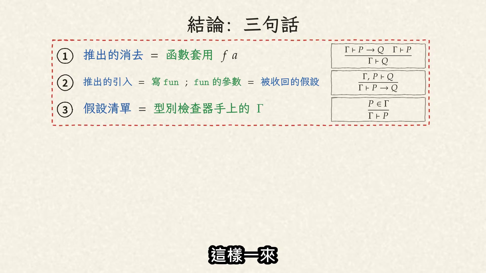

**逐字稿片段：** 三欄表這一列的問號就可以擦掉了： 邏輯是推出，型別是函數型別 Lean 的記號是 fun 和空格 而空格就代表套用 從這一集開始，這張表的第二欄 講的是型別怎麼造 第三欄講的是這種型別的值，怎麼造、 又怎麼用：fun 負責造，空格負責用 而整集最重要的，還是開頭那一句： 證明，就是造出那種型別的一個東西

**話題推測：** 更新三欄表，填入本集學習到的「型別」和「Lean記號」。

---

## 00:16:42

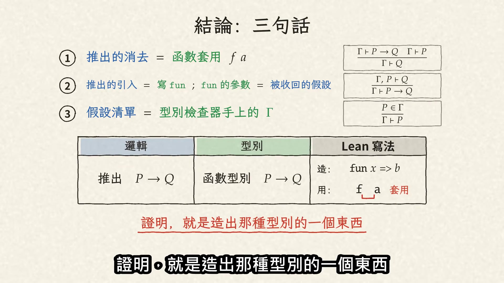

**逐字稿片段：** 說到「推出就是函數」這件事 最早注意到其中一角的 是美國邏輯學家 Haskell Curry 1934 年 他發現在他研究的那套符號系統裡 函數的型別，長得跟蘊涵的公理一模一樣

**話題推測：** 引入「推出就是函數」的歷史淵源，可能顯示 Haskell Curry 的肖像或介紹。

---

## 00:16:55

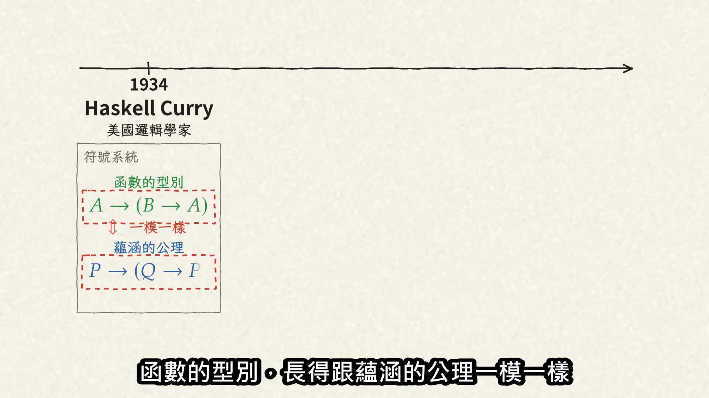

**逐字稿片段：** 35 年後，到了 1969 年 另一位邏輯學家 William Howard 把這個觀察推廣到且、或、對所有、 存在，也就是整套構造邏輯 構造邏輯 是只承認「造得出來的證明」的那種邏輯 第 6 集會講 他把結果寫成一份手稿 題目是〈構造的公式即型別觀念〉 可是這份手稿沒有正式發表 它在朋友之間傳來傳去，一傳就是 11 年 直到 1980 年 才收進一本獻給 Curry 的論文集，正式出版

**話題推測：** 提及 1969 年 William Howard 的貢獻，可能顯示其肖像或論文手稿。

---

## 00:17:28

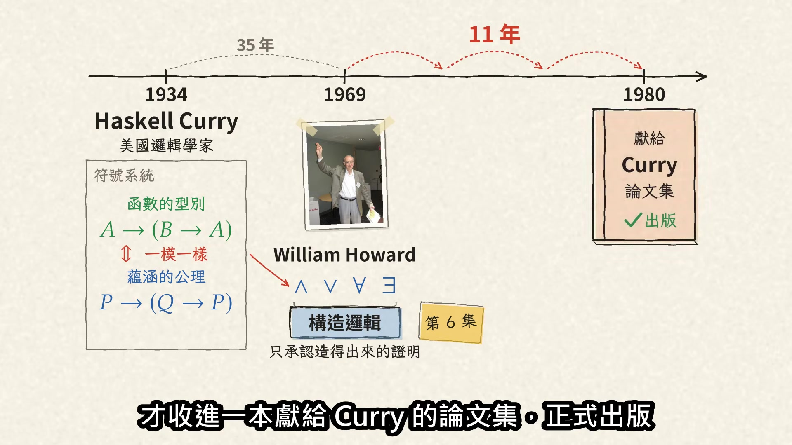

**逐字稿片段：** 所以今天這件事叫做 Curry Howard 對應 一個名字，來自 1934 年的一個觀察 另一個名字 來自一份在朋友間流傳了 11 年的手稿

**話題推測：** 介紹 Curry-Howard 對應的命名由來，可能顯示 Curry 和 Howard 的合照或名字。

---
