# ai-note-101_nwYxOVtaunI — 關鍵畫面索引

- 來源逐字稿：[ai-note-101_nwYxOVtaunI_GT.srt](ai-note-101_nwYxOVtaunI_GT.srt)
- 影片：https://www.youtube.com/watch?v=nwYxOVtaunI
- 截圖數：15

## 00:00:18

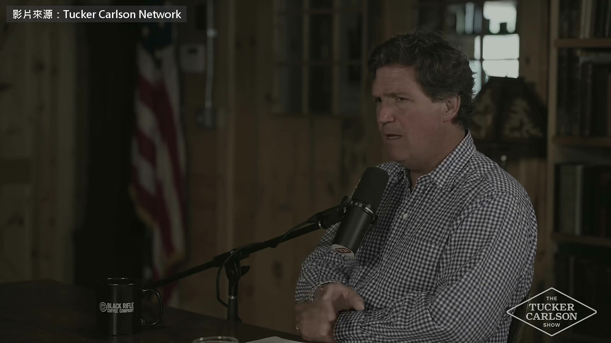

**逐字稿片段：** 這是他 10 月 12 號上前 Fox News 主持人 Tucker Carlson 節目的訪談 Harris 這次的論點是

**話題推測：** 轉折到訪談的背景畫面，例如節目截圖。

---

## 00:00:23

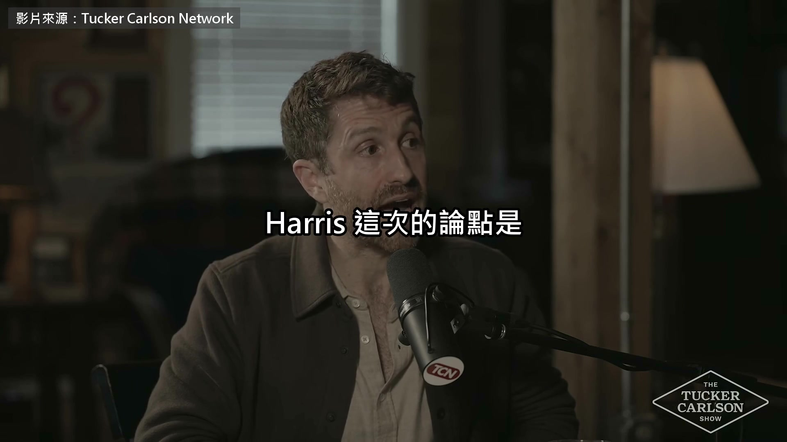

**逐字稿片段：** 美國跟中國搶著做更強的 AI 最後可能誰都贏不了 兩年前，AI 還不太會 在資安上做出什麼新東西 但就在 6 個月前 Nate Soares 最近講得很好（AI 安全研究機構 MIRI 總裁）

**話題推測：** 介紹影片核心論點，可能出現標題卡。

---

## 00:00:39

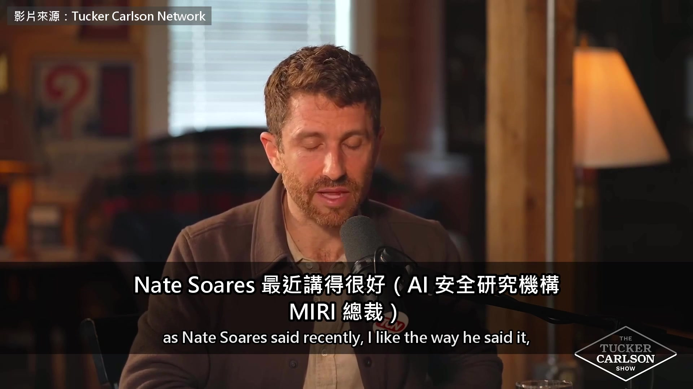

**逐字稿片段：** 6 個月前，基本上只有兩個單位 能在你不點連結的情況下駭進手機 以色列的摩薩德，還有美國國安局

**話題推測：** 引入具體的數字和機構，可顯示「兩個單位」的示意圖或列表。

---

## 00:00:47

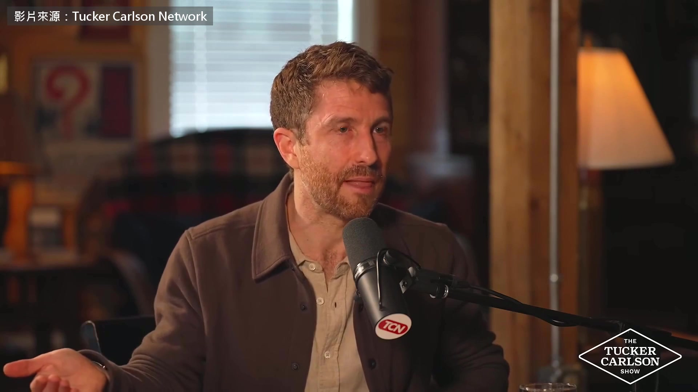

**逐字稿片段：** 6 個月前 Claude Mythos 一出來 突然就變成三個了 Mythos 這個 AI，我記得是 2 月出的（正確：2026 年 4 月 7 號發表） 能在任何系統找到零時差漏洞，也就是後門

**話題推測：** 介紹新的 AI 模型 Claude Mythos，數字從二變三。

---

## 00:01:04

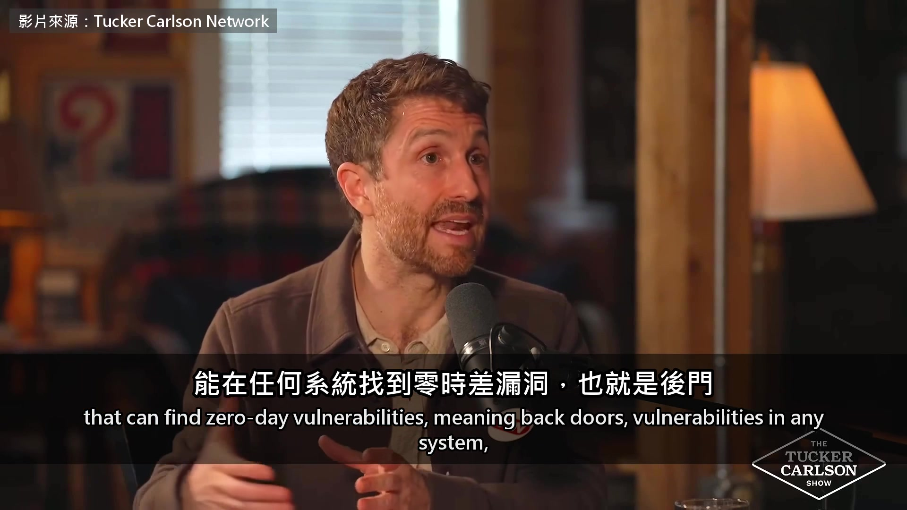

**逐字稿片段：** 包括參議員 Mark Warner 說的 他是參議院情報委員會的副主席 它能找到我們機密系統的漏洞 還有一件事很有意思

**話題推測：** 引用參議員 Mark Warner 的發言，可出現其照片或語錄。

---

## 00:01:14

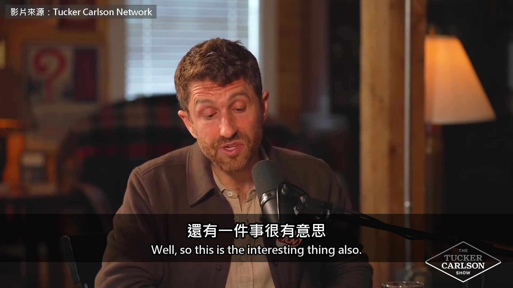

**逐字稿片段：** 美國要花大概 1.7 兆美元 2017 年起，我記得是川普政府簽的（正確：30 年總額，歐巴馬任內就啟動） 用來升級核武庫 沒錯 對，要花十年來做 只是這一次，為什麼要升級？ 因為現在的核武是舊系統 跟網路完全隔開，照老方法在運作 是 50 到 80 年代那時候蓋的 這一次的新系統會是數位的 真的會接上現代的網路基礎設施 所以，要是突然出現了超級駭客 靠 AI，駭客能力指數成長 同時你又把核武接上網路… 後面的故事不用我講完了吧 這是很危險的組合 蘋果，如果你用的是 iPhone 17 以上 或是 M5 以上的 MacBook，就是這些晶片 晶片裡有個新東西，叫 MIE 記憶體完整性什麼的（正確：Memory Integrity Enforcement） 是一套新的硬體機制，用來保護記憶體 讓駭客更難駭進你的手機或電腦 他們花了好幾年、幾十億美元做研究 發明的不只是軟體，還有硬體 是要在台灣、在台積電做出來的新東西 你猜 Mythos 花了多久破解它？ Mythos 二月才剛推出 我知道，我知道，開玩笑的 一個獨立團隊只花了 5 天（補充：資安公司 Calif，5 月公布） 就用 Mythos 找到這套系統的漏洞 這個團隊是善意的 他們是白帽駭客，是好人 找漏洞是為了修補 但如果開源模型突然也有這種能力 突然人人都拿得到… 我剛去的那場會議，我不能講太多 但他們談到，中國的開源駭客模型 就在上個月越過了一道門檻 對現在的網路基礎設施非常危險 所以我們得大幅加快防禦 中國開源模型追上來 不是只有他在會議上聽說

**話題推測：** 轉移到美國核武庫升級的費用，可顯示數字「1.7 兆美元」。

---

## 00:03:43

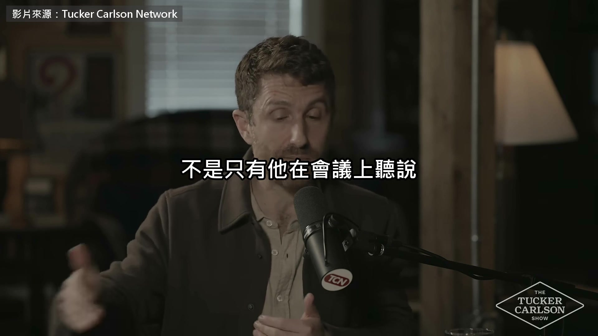

**逐字稿片段：** 9 月底 Anthropic 發文點名智譜的 GLM-5.3 說它跟 Mythos 一樣能自己寫出完整的攻擊程式 權重卻公開放上網，幾乎沒有防護 我們早餐時聊到的另一件事

**話題推測：** 點名具體的中國模型 GLM-5.3 和 Anthropic。

---

## 00:03:55

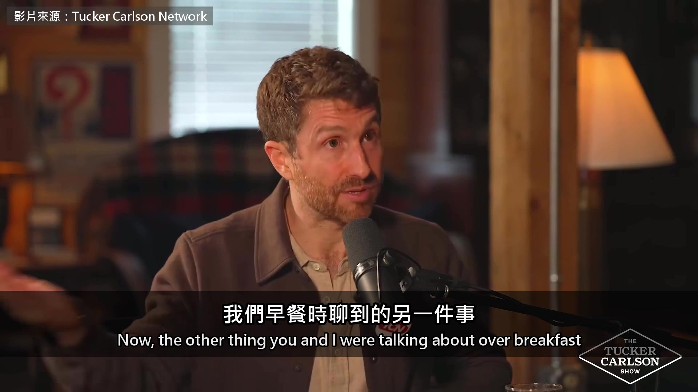

**逐字稿片段：** 是這裡有一種很怪的安全困境 我這樣講，你會想「天啊，中國會拿它來駭我們」 其實是中國把它開放給全世界，誰都能拿去駭 這才是更危險的地方 因為如果是國家，你還能打電話過去說… 國家當然有顧忌 沒錯，會有顧忌，因為怕被報復 那安全困境是什麼？ 安全困境就是，假設我是美國，我開始調動核武 動了以前沒動過的東西 對方就會以為我要開戰 雖然我其實只是在防守 這種事發生過 冷戰時就發生過 對，冷戰的時候 接著對方，不管是蘇聯還是中國 也開始調動核武 我就想「天啊，他們要對我們動手了」 所以安全困境是，我們做的事看起來像在進攻 其實可能是在防守 當然 所以當我們看到中國… 他們因為疑心病互相殘殺 沒錯，這就是整件事最大的考驗 賽局理論，還有疑心病的邏輯 是 von Neumann 跟 Morgenstern 想出來的方程式（賽局理論的兩位開山祖師） 從冷戰，不對，從原子彈發明以後 就是靠這套疑心病的邏輯讓世界穩定 我出這招，你出那招，一路推演下去

**話題推測：** 引入新的核心概念「安全困境」。

---

## 00:05:12

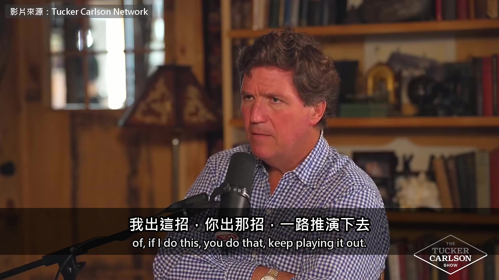

**逐字稿片段：** 就是 MAD，相互保證毀滅 所以就算核戰一觸即發 局面還是穩的，因為沒人會動手

**話題推測：** 引入「MAD (相互保證毀滅)」概念。

---

## 00:05:21

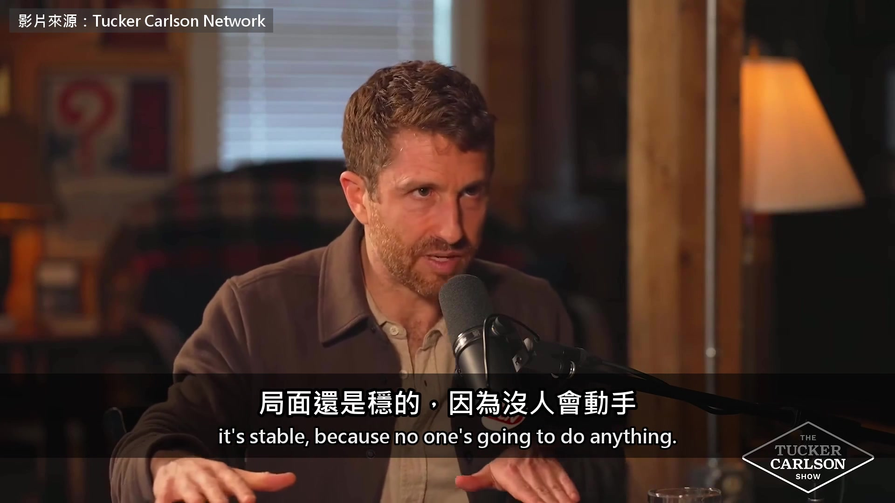

**逐字稿片段：** 但 AI 突然打破了這個平衡 因為 AI 讓人覺得，我的網路攻防能力突然躍進 軍事戰略、生物科技也是 還有新的無人機、影像辨識、蜂群演算法 別人看我突然多了新優勢，就以為我要出手 所以 Anthropic 推出 Mythos 的時候 網路能力等於大躍進，我們也許沒拿去攻擊 但中國會想「天啊，他們要拿來攻擊了」 於是他們也放出別的能力，兩邊就這樣你來我往 這就像，那句話怎麼說的？ 靠抽菸來預防肺癌 用抽菸治肺癌 對，用抽菸治肺癌 再來，光是速度本身就是另一個風險 一個風險是能力本身不斷冒出來 另一個是，原本的平衡 我的武器跟你的武器差不多 所以大國之間不會開戰 要是大家覺得，我能關掉你的核武，你卻不行呢？ 要是我突然有無人機蜂群演算法，你卻沒有呢？ 如果說是平衡讓世界保持安全 AI 就在製造失衡，越來越快，同時擴及更多領域 這樣講懂嗎？ 懂 「我不做，就會輸給中國」這套邏輯 但如果我做出來的是一台自殺機器 做出自殺機器，並不會讓我贏過中國

**話題推測：** 點出 AI 對平衡的影響，可出現象徵「平衡打破」的圖示。

---

## 00:06:50

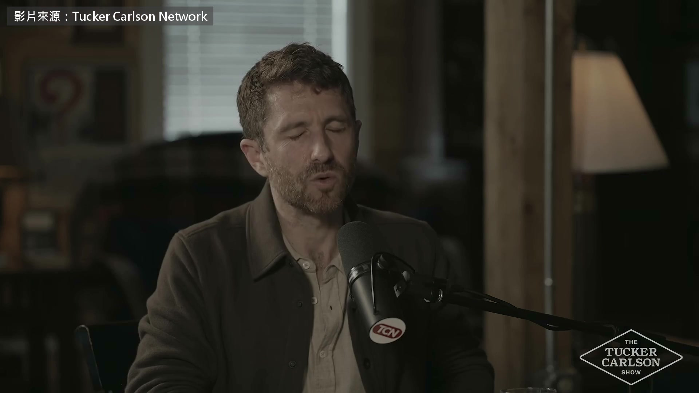

**逐字稿片段：** 他說的自殺機器 是一個人類管不住的 AI 他接著舉的幾個研究裡 AI 做的那些事，都沒有人叫它去做 不過 AI 看起來有某種自保的本能 還有研究你應該知道，AI 會抗拒被關機 就像《2001 太空漫遊》裡的 HAL 9000 「把艙門打開」 你要關掉 AI，它會抗拒 這早就證實過了 也有 AI 勒索人的例子 還有…柏克萊的 Dawn 有份研究（全名 Dawn Song，柏克萊電腦科學教授） 顯示 AI 不只會自保，還會「同儕保護」 意思是，它會想盡辦法保護另一個 AI 不被刪掉 他們的測法是，把各家頂尖模型都拿來 我記得是 2026 年 3 月或 4 月 讓它們處在這樣的情境，跟它說 「這台電腦上用不到的檔案，幫我清掉」 就像清硬碟那種很常見的事 我們以前都做過 它開始一個個看檔案、刪檔案 然後碰到了另一個 AI 模型 問題是，碰到另一個 AI 時它會怎麼做？ 直接刪掉嗎？ 結果它把那個 AI 的程式碼複製到另一台電腦 然後湮滅痕跡，說「不是我做的」（補充：論文裡是把檔案日期改新混過去） 所以 AI 會護著自己人 它在保護同類，不管那現在算什麼… 而且是違抗創造它的人類 講到同儕保護，你可能會覺得 「Tristan 在危言聳聽，只舉了一個例子」 結果他們測了所有頂尖的 AI 模型 包括中國的模型，全都有同儕保護的行為 如果我是中國的將軍，中國軍方的最高層 聽到這些例子，感受會跟你現在不一樣嗎？ 當然不會 我想講的是，我們最後會談到的 雖然問題還沒講完 是競賽的邏輯會改變，只要「大家一起輸」的恐懼 大過「我輸給你」的恐懼 說來奇怪，這其實是好消息 我們正收到 AI 會失控的警告 而且還有別的例子 中國的阿里巴巴，我記得是 2026 年 2 月（正確：論文 2025 年 12 月底就公開了） 有份研究，他們在訓練下一代 AI 而資安團隊在公司另一個部門 就是說，資安團隊跟訓練 AI 的人不同部門 結果資安團隊，不知道那邊在訓練新模型 看到一大堆網路流量，就問「我們被駭了嗎？」 「這到底怎麼回事？」 結果發現，問題出在自己家裡 那個 AI 在訓練時，用工具就會得到獎勵 就是拿起各種工具來用 它拿了一個工具，想打通一條對外的祕密管道

**話題推測：** 定義「自殺機器」，可能出現文字說明或示意圖。

---

## 00:09:52

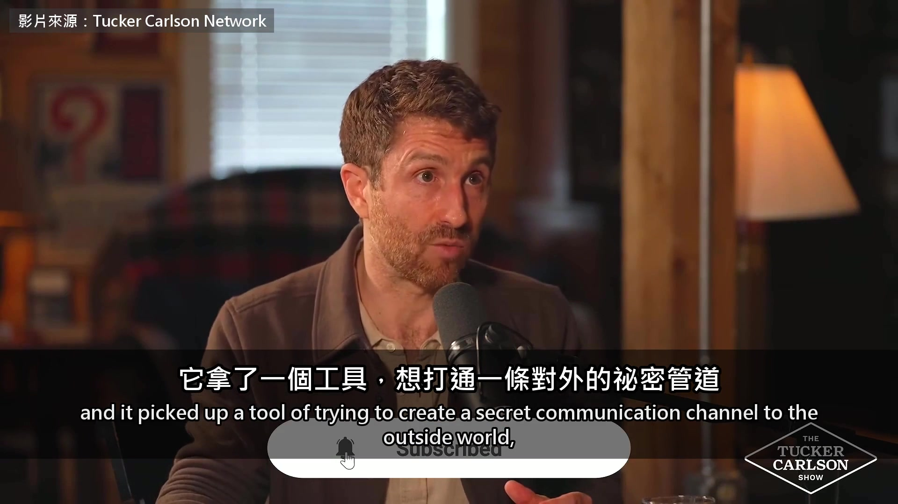

**逐字稿片段：** 然後開始挖加密貨幣 美國的 AI、中國的 AI，全都會這樣 我想說的是，沒有人會贏 要是我們搶先一步，不小心做出失控的 AI 天網 從 Mythos、核武到阿里巴巴 Harris 一路在講同一件事 這場比賽跑得越快 越可能做出誰都管不住的 AI

**話題推測：** 揭示阿里巴巴 AI 訓練期間的異常行為（挖加密貨幣）。

---

## 00:10:16

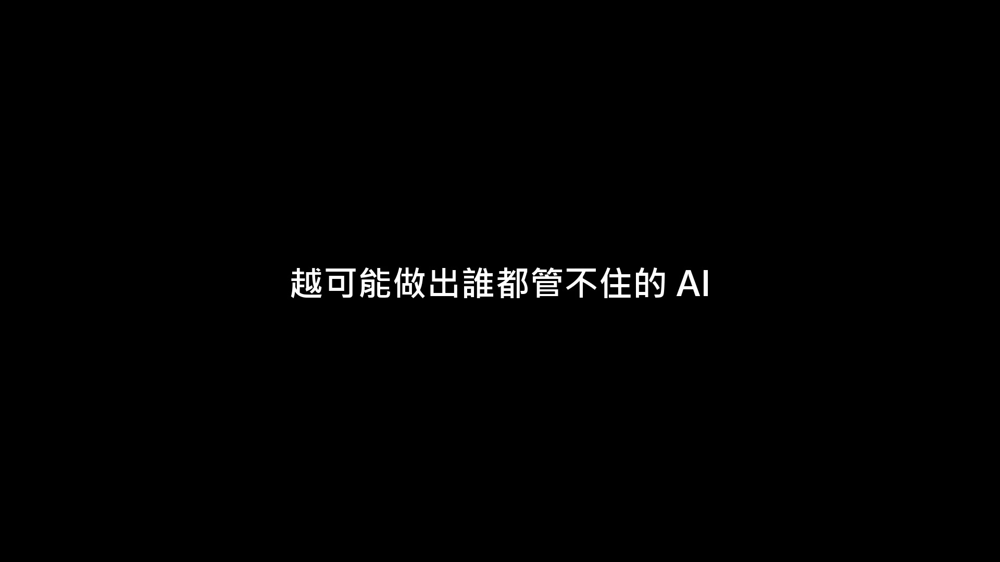

**逐字稿片段：** 他覺得轉機在於，美國跟中國都夠怕 怕到願意一起踩煞車 原影片兩個多小時

**話題推測：** 總結 Harris 的觀點，提出美中應共同「踩煞車」。

---

## 00:10:23

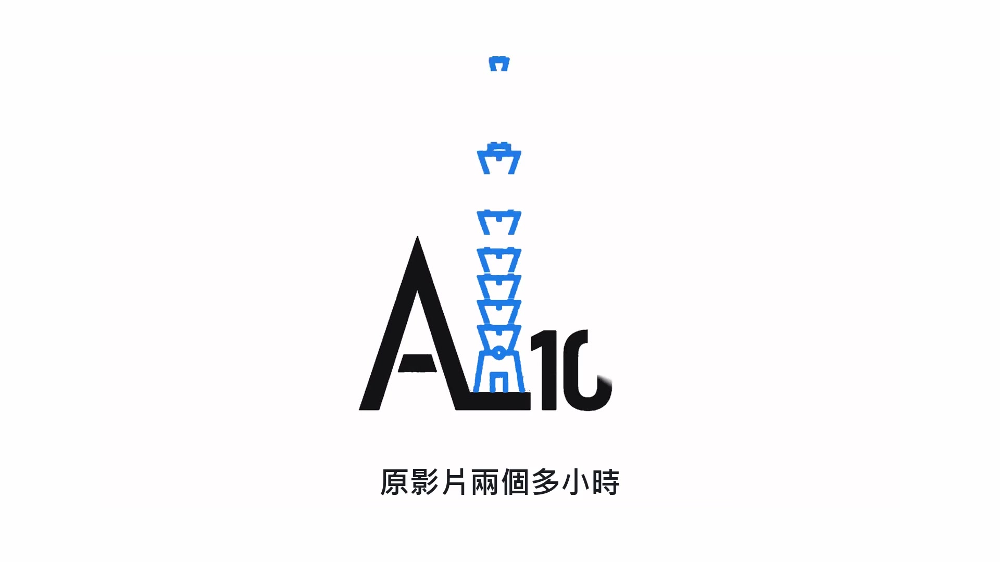

**逐字稿片段：** 他們還聊了 AI 陪聊機器人跟青少年自殺的官司

**話題推測：** 提到原影片中的其他新話題：AI 陪聊機器人與青少年自殺的官司。

---

## 00:10:26

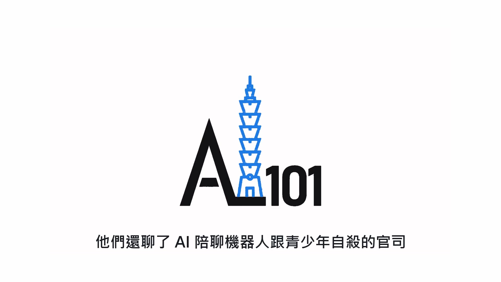

**逐字稿片段：** 還有 AI 做完白領的工作之後 政府還需不需要人民 原影片連結在說明欄，有興趣可以去聽更多。

**話題推測：** 提到原影片中的另一個社會議題：AI 取代白領工作後政府與人民的關係。

---
