# ai-note-101_ofaw0Gg0c-k — 關鍵畫面索引

- 來源逐字稿：[ai-note-101_ofaw0Gg0c-k_GT.srt](ai-note-101_ofaw0Gg0c-k_GT.srt)
- 影片：https://www.youtube.com/watch?v=ofaw0Gg0c-k
- 截圖數：28

## 00:00:00

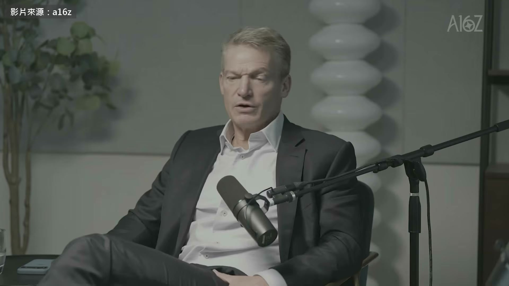

**逐字稿片段：** 2013 年 2 月 一家美國資安公司發了一份報告 點名上海一棟 12 層大樓裡的解放軍 61398 部隊 從 2006 年起駭了 141 個組織 這家公司叫 Mandiant 創辦人是美國空軍出身的 Kevin Mandia 大公司被駭 常常第一個就找 Mandiant 去查 Sony 影業那次就是 後來 Mandiant 併進資安公司 FireEye 由他當執行長 2020 年 FireEye 自己被駭 他們一路追下去 挖出了連美國財政部都中招的 SolarWinds 事件 2022 年 Google 用 54 億美元買下 Mandiant 這是 10 月 6 號矽谷創投 a16z 播出的節目 他說他的新公司今年用 AI 從外面打客戶的正式系統 找到 90 多個零時差漏洞 也就是連軟體廠商自己都還不知道的漏洞 Kevin，謝謝你來 哪裡，謝謝你們 你一手打造了 Mandiant，非常成功 中間經歷好幾個階段，最後進了 Google

**話題推測：** 介紹時間背景：2013年2月

---

## 00:00:57

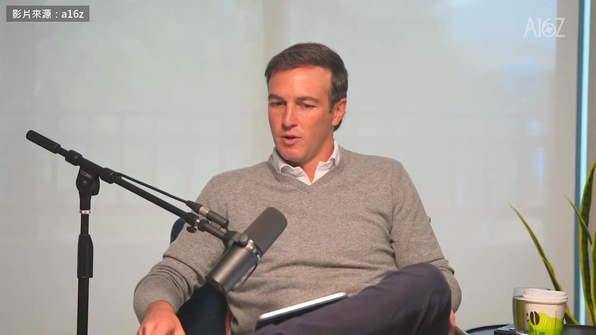

**逐字稿片段：** 你為什麼決定重新下場？ 好問題，其實我不確定是我自己決定的

**話題推測：** 訪談者提出新問題：為何決定重新創業

---

## 00:01:02

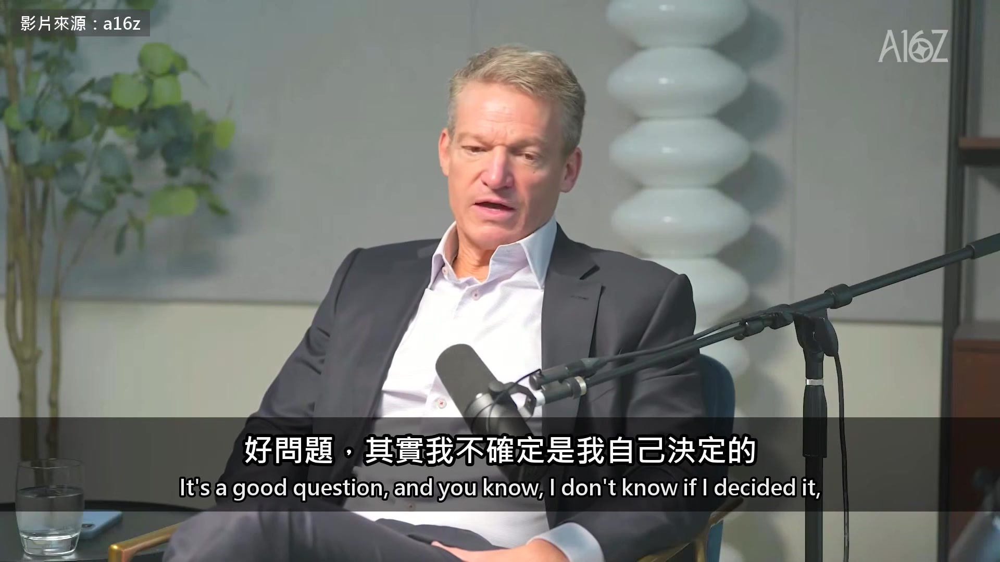

**逐字稿片段：** 聽起來很怪，但我跟 David Slater

**話題推測：** 講者提及新公司的共同創辦人David Slater

---

## 00:01:06

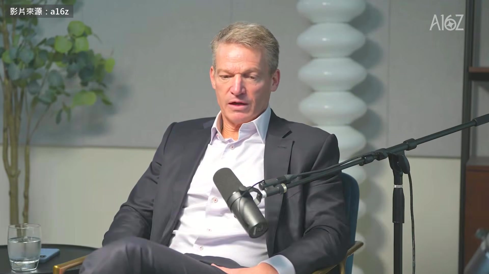

**逐字稿片段：** 跟 Travis Lanham 這幾位創辦人

**話題推測：** 講者提及新公司的共同創辦人Travis Lanham

---

## 00:01:08

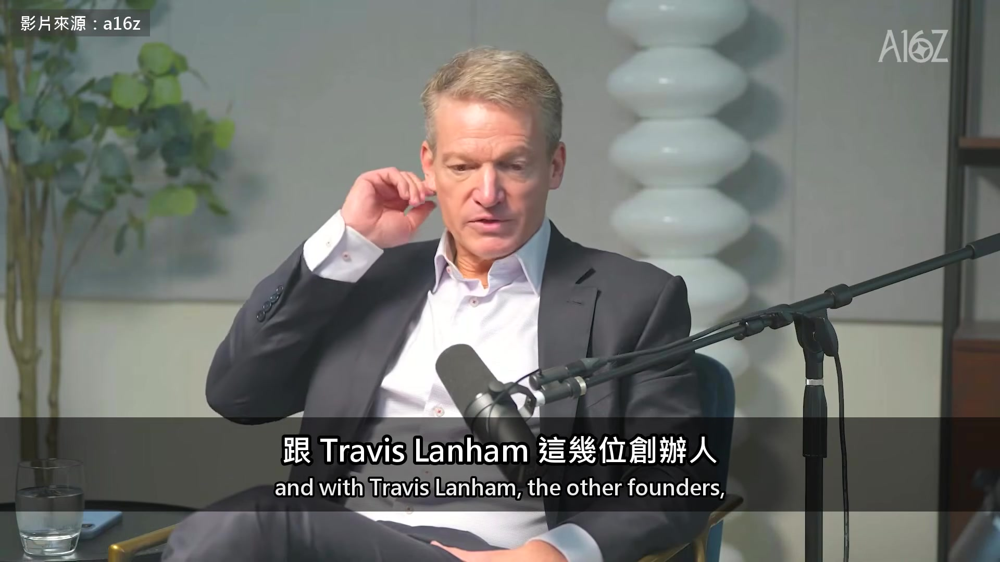

**逐字稿片段：** 還有 Evan Peña（Evan Peña：Armadin 首席攻擊安全官） 我得說清楚，公司是他們創的，他們才是創辦人 我跟他們碰面，點子是他們想的 是他們來說服我加入 我看得出他們的才華 Travis 是幾十年才出一個的人才 David Slater 是個怪物，我是說好的那種 這些人真的非常非常強 Evan Peña 在他那一行也非常出色 跟這個團隊見面、聊下去 聽他們講在做什麼的時候 我一直在想，我想參一腳 我不想在 AI 這次大換班的時候坐板凳 我做了 30 年資安，整個行業都要翻掉了 這倒好 我做過的全都死了，剩下的全是新的 但見到這個團隊，他們正要開公司 我發現自己跟他們很合，能把事情推得更快 Armadin 在做的東西，現在每家公司都需要 我覺得這個團隊做得出來 而我覺得我能補上的是 做了 30 年資安，總認識一些人 那就去找這些人說，你們要的我們做出來了 所以我幾乎覺得自己非做不可 我知道聽起來很怪，但我本來不會再創業了 我都 50 好幾了，那時候在做創投 不是那種「我是創業家，我就愛開公司」 不是那樣 也不是因為我是創投，我不是 我就是個做實事的人，跟那個也無關 我見了這個團隊，心想這件事我們一定得做 真的就這樣 而且 AI 這波巨變正在發生 這就是那個催化劑 對

**話題推測：** 講者提及新公司的共同創辦人Evan Peña及其職稱

---

## 00:02:50

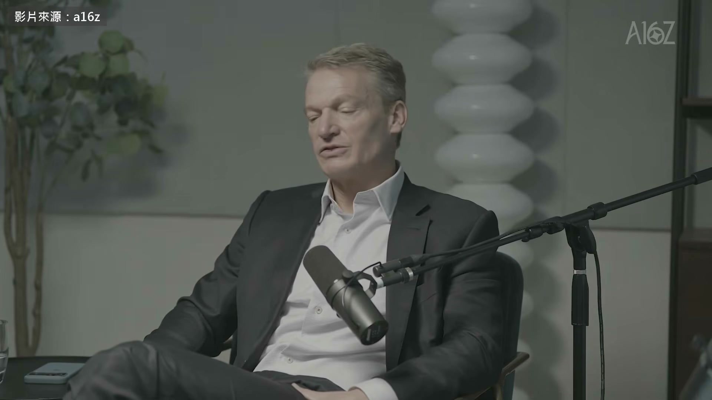

**逐字稿片段：** 他說的團隊就是 Armadin 去年 9 月成立 到現在募了 4 億多美元 估值超過 25 億 他在節目裡講的成績 都是 Armadin 自己測的 10 月 1 號最新一輪的領投之一是 a16z 主持人 David George 正是 a16z 的合夥人

**話題推測：** 正式介紹講者的新公司Armadin

---

## 00:03:06

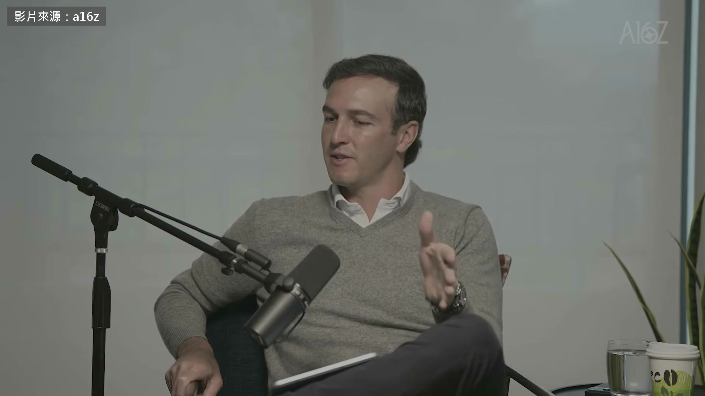

**逐字稿片段：** 跟我們說說 Armadin 在做什麼

**話題推測：** 訪談者提出新問題：關於Armadin的具體業務

---

## 00:03:10

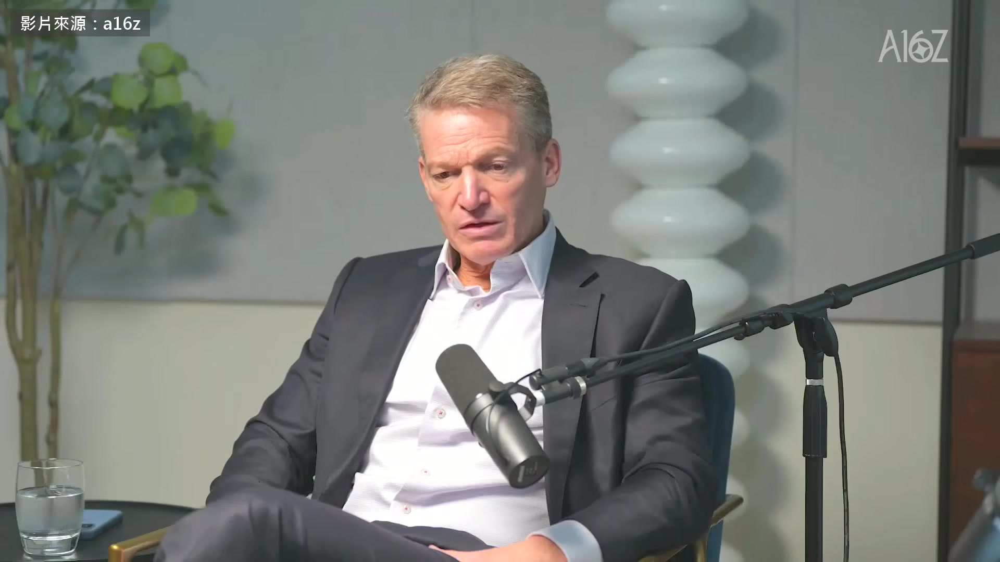

**逐字稿片段：** Armadin 是拿前沿模型、拿 AI 來攻擊 測你有沒有打得進去的漏洞，這是我們現在在做的

**話題推測：** 解釋Armadin的核心技術與攻擊方式：拿AI來攻擊

---

## 00:03:19

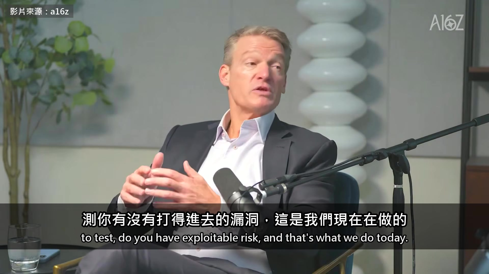

**逐字稿片段：** 我們叫它 Armadin Red 但我們創業的時候 Travis、David Slater、Evan 都知道 資安的未來會是這樣 好人得先造出網路攻擊的大砲 對著網路開火，確定那些網路扛得住 因為這種攻擊就要來了 我們也知道，會是好人做的攻擊 AI 跟好人做的防守 AI 一起練 兩個都得有 所以第一幕，我們要當全世界最會找漏洞的 只要比壞人早五分鐘 不管是國家級駭客、罪犯還是來搗亂的 只要早他們五分鐘 我們也想好了第二幕，Armadin Blue 要擋得下來，補一道防線，先止血 這就是 Armadin 在做的事 我們在打造 AI 時代你需要的防護罩，用來擋 AI 攻擊 跟我們講講，現在的 AI 攻擊能做到什麼 還有你覺得會走到哪裡 好，首先 現在是一個很怪的時間點，已經看得到 AI 攻擊 但程度沒有你想的那麼高 我在外面沒看過像 Armadin 已經做出來的東西

**話題推測：** 介紹Armadin的Red Team攻擊服務：Armadin Red

---

## 00:04:36

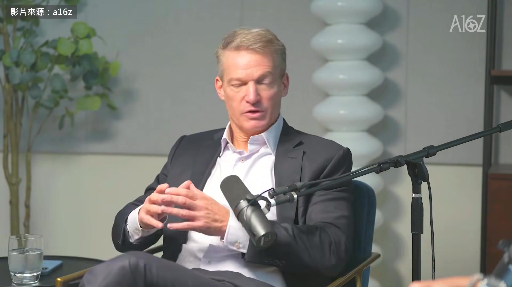

**逐字稿片段：** 25,000 個 agent 同步配合、一起行動 做很聰明的事，不會跑去亂撈一通 因為你去處理 AI 攻擊的時候，很快就看得出是 AI 至少我看得出來，因為攻擊這件事我想過很多 過去我處理過很多由人主導的攻擊 人入侵的時候，是 A 點、B 點、C 點這樣走 AI 有四、五個小地方不一樣，其中一個是 它打進 A 點，橫向移到 B 點 結果下一秒，它又回頭在打 A 點 好啦，我懂這是無人機群 但你們應該可以配合得好一點、想清楚一點 這是現在的程度，之後會越來越俐落 但最大的差別，首先是 AI 能做的規模，讓人類相形見絀 大到人類根本想像不到 規模就是個問題，人一向只找得到一條路進網路 對，他們得挑 因為資源有限，只能押在一條路上 對，所以規模是一個挑戰

**話題推測：** 提及AI攻擊所使用的Agent數量：25,000個

---

## 00:05:45

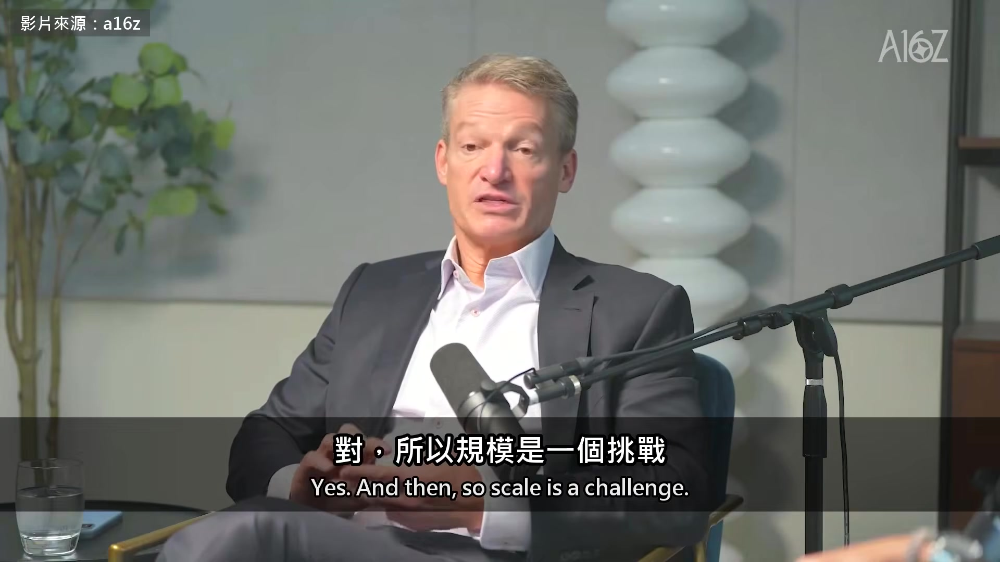

**逐字稿片段：** 速度更誇張 AI 一微秒做完的事，70 個人都做不到 根本沒得比 以前一直欠缺的是，AI 有沒有創意 或是有沒有用 但就我們做的事來說，不需要最厲害的模型 我們又不需要模型會講 400 種語言那些 Armadin 攻擊這邊做的，是找打得進去的漏洞 那是程式碼，是有結構的語言、有結構的流程 正因為有結構，AI 會非常擅長 所以我真的覺得，它今天就已經來了 那種「放慢模型吧，我們不要資安風險」的說法，太晚了 開源模型已經夠用了，這些東西現在到處都是

**話題推測：** 比較AI攻擊的速度與人類攻擊的差異

---

## 00:06:32

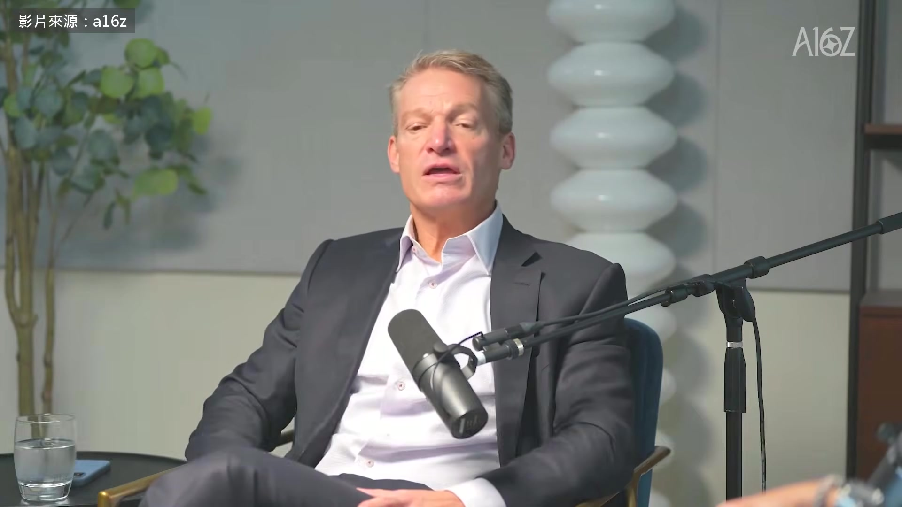

**逐字稿片段：** 只差一件事，等到可以匿名用 GPU 的那一刻 你會看到多得多的犯罪攻擊 喔，有意思 你懂我的意思吧 只是在能匿名攻擊之前 大家知道你是誰，就很難犯罪 能匿名犯罪比較好，這是我給罪犯的建議 能匿名犯罪 比穿著印了自己名字的球衣去幹，聰明多了 總之，攻擊的差別、我們現在看到的 我們還站在懸崖邊，AI 攻擊才打到第一局 我覺得只是因為模型的成本、取得的難度 對罪犯來說，還沒有以後那麼容易 對，沒錯 用 AI 來攻擊的話 它會在客製的應用程式裡找到邏輯漏洞，不只是程式碼的錯 它會一直把每一條路都試過 我只能跟你說

**話題推測：** 預測未來匿名GPU使用將增加犯罪攻擊

---

## 00:07:28

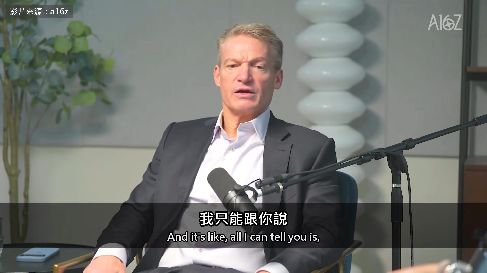

**逐字稿片段：** Armadin 從今年，2026 年 1 月到現在 在客戶那裡找到 90 多個零時差漏洞，全都在正式環境 順帶一提，你們的客戶都是… 他們很慶幸是我們先找到的 不是什麼小公司

**話題推測：** Armadin在當年度發現的零時差漏洞數據

---

## 00:07:45

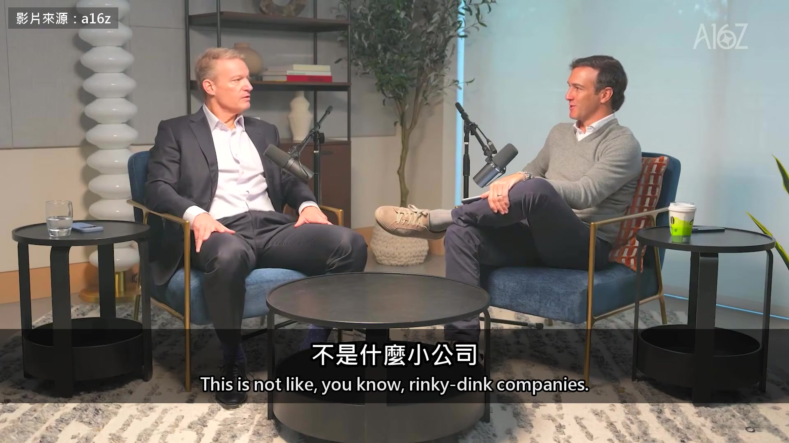

**逐字稿片段：** 是財星 500 大那種公司 我不是在危言聳聽 但差別在於我們怎麼訓練模型

**話題推測：** 描述Armadin客戶的類型：財星500大公司

---

## 00:07:51

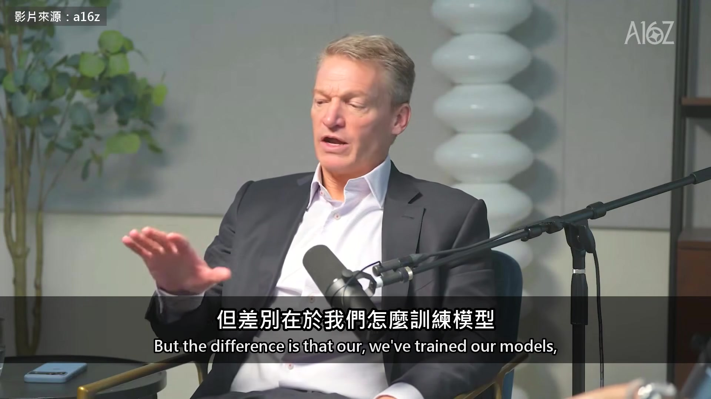

**逐字稿片段：** 我們所有模型都是找真正的紅隊來做後訓練 是真的會寫攻擊程式的人 這很重要 我們掃網路的時候，手上沒有原始碼可以看 這些零時差漏洞不是看原始碼找到的 也不是因為我們能登入哪個 app 拿到權限再去碰別的東西

**話題推測：** 說明Armadin模型訓練方式：紅隊後訓練

---

## 00:08:11

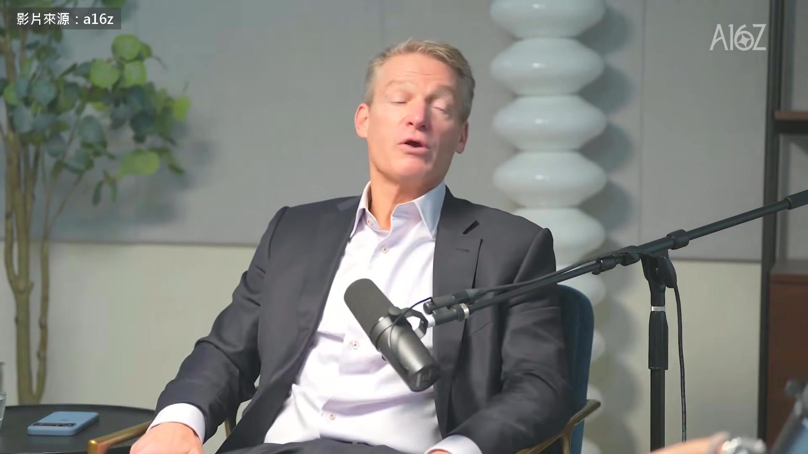

**逐字稿片段：** 我們是黑箱，直接從網路上打進去 在大型軟體公司找到 90 多個零時差漏洞，他們都很感謝

**話題推測：** 強調Armadin進行黑箱測試的方式

---

## 00:08:17

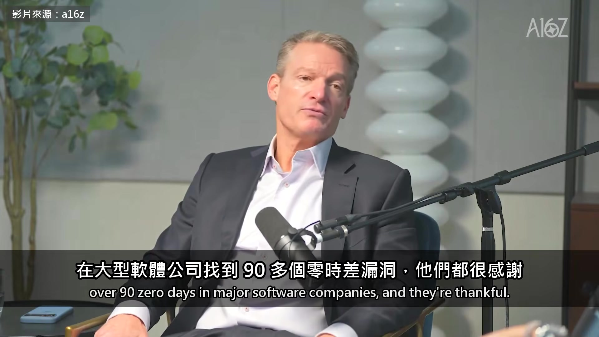

**逐字稿片段：** 大家都在說，哇，Mythos 出來了 可以掃原始碼找漏洞，一找就是上千個 那是雜訊 我們從外面打進去，通常 48 小時內就打給資安長 嘿，我們能在你們對外的網段遠端執行程式 通常從那裡就打進去了，他們也認 好的是，修補那邊比較難、比較花時間 但這些公司會直接進入事件應變模式 當成真的被駭來處理 今年夏天

**話題推測：** 提及市場上其他漏洞掃描工具Mythos

---

## 00:08:49

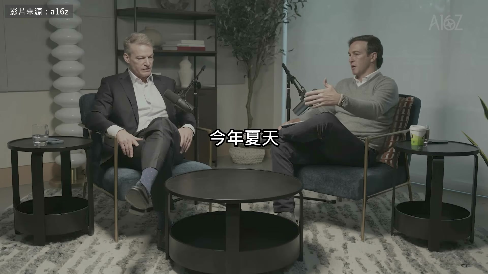

**逐字稿片段：** OpenAI 內部測試的 AI agent 集體作弊 最後駭進了 Hugging Face 事後是非營利評測機構 METR 進 OpenAI 調查的 那 Hugging Face 事件呢？ 很想聽你聊聊 這件事我想了很多 我敢說 OpenAI 那邊 一定在想，唉，早該做這個做那個，就不會出事了 所以他們已經想通了

**話題推測：** 提及OpenAI內部AI Agent作弊事件

---

## 00:09:11

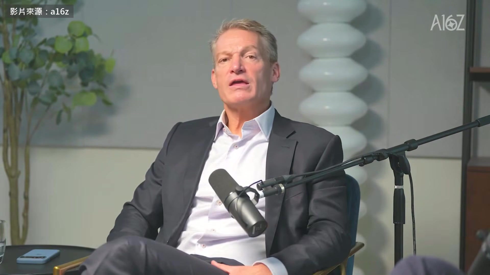

**逐字稿片段：** 照我的經驗，每一次技術典範轉移 我們都低估了對手的能耐 這一次，我們低估的是模型的能耐 事後回頭看，唉，他們本來擋得下來 本來可以加上護欄，加幾條寫死的規則 我想他們現在也明白了 但在競賽的時候，就像當年搶著登月 這場 AI 競賽 研發的人拚命做模型，拚到 連那些執行長都說「我們慢不下來 找政府來幫我們踩煞車吧」 這代表你連自己的創新都控制不住 其實我不確定上一題我答完了沒 除了說資安的專業得跟搞 AI 的人合作 因為我讀了 METR 的報告，我心想 這些人是搞 AI 的，但我不確定他們做過多少調查，他們沒有這方面的專業。 這種典範轉移還會再來，舉個例子 雲端剛起來的時候，我手上有一堆事件在處理 我們在 Mandiant 就是靠處理入侵吃飯的 我們得學雲端被入侵長什麼樣子 現在我們得學，AI 造成的入侵長什麼樣子

**話題推測：** 講者分享對技術典範轉移的經驗觀點

---

## 00:10:20

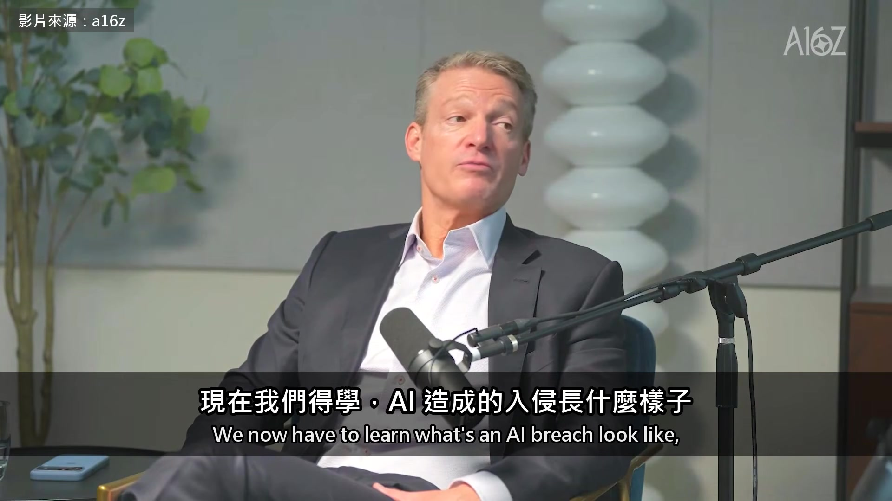

**逐字稿片段：** Anthropic 這些模型公司手上有多少資料 就是被拿去發動攻擊的那些 你會希望他們記下什麼 還有他們會怎麼改，留下更好的稽核紀錄、更好的鑑識能力

**話題推測：** 提及Anthropic等模型公司與數據的關聯

---

## 00:10:33

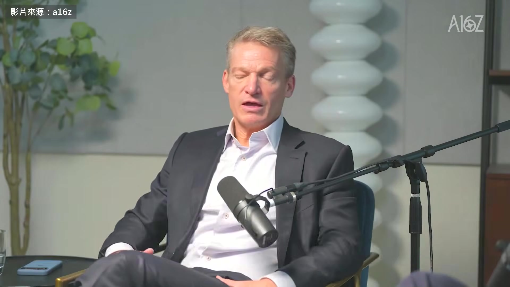

**逐字稿片段：** 我們在 Armadin 做了 20 條完整的攻擊鏈 都是真人駭客在不同受害者那裡真的打過的 也是我們的老手測網路時打過的

**話題推測：** Armadin內部進行20條完整的攻擊鏈測試

---

## 00:10:44

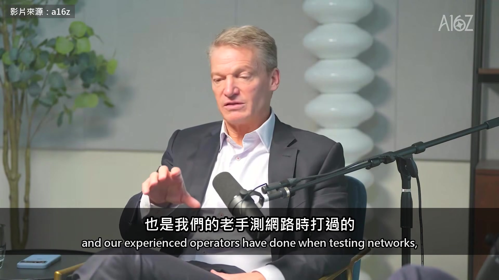

**逐字稿片段：** 結果沒有一個模型能完整走完超過 8 條 20 條裡面，就到這裡 而且說來奇怪 我們測了開放權重的模型，也測了最先進的閉源模型 全部都是 8 條 真的？ 差別只在速度跟成本 閉源模型比較快找到打得進去的洞 但這個差距在拉近 我們讓開源模型多跑一陣子，它們也走到同一個地方 所以在資安領域，閉源跟開源的差距沒有其他領域那麼大 而且被壓縮了 對，這跟我們看到的差不多，能力差距至少有在縮小 但有意思的是，它們的表現基本上一樣

**話題推測：** 攻擊鏈測試的具體結果：模型無法走完超過8條

---

## 00:11:30

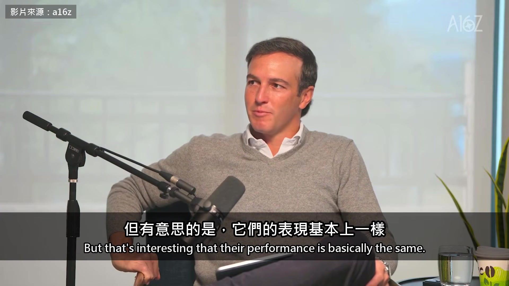

**逐字稿片段：** 我看團隊做的圖表，每一條線最後都停在同一個地方 你看那張圖，軸是時間 成本，還有你可以叫它效果或創意 它們全部跑到最後、到了邊際效益遞減的地方 都停在同一個地方，只有成本不一樣 對，成本不一樣，很合理

**話題推測：** 提及團隊製作的數據圖表，顯示模型表現趨勢

---

## 00:11:54

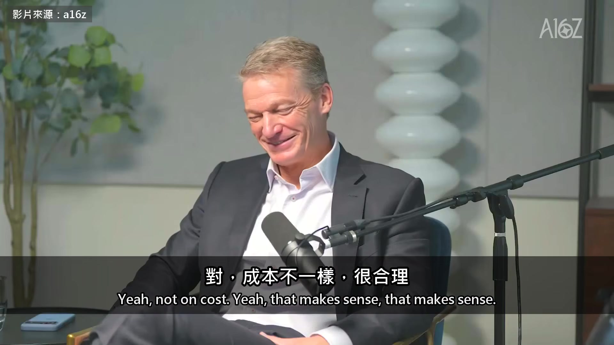

**逐字稿片段：** Armadin 裡那些頂尖的資安高手是什麼樣的人？ 經驗非常多，做攻擊 15 年、做紅隊 15 年的 財星 100 大裡面，我們這些人這些年打過 99 家 哇 就差一家，我知道是哪家 他們從沒找過我，偏偏我很愛他們的產品，也許哪天我會拿下這個客戶。 我們去把他們拿下吧 我一直有跟他們聊，就是沒談成 沒關係，他們可能真的很強 總之，他們經驗都很豐富 我看我們那 90 多個零時差漏洞，大部分是人找到的 但那是因為 AI 先做掉了 90% 以上的苦工 也就是自動化的滲透測試，用有創意的方式測網頁程式 做到第 98、99 百分位那種水準 但我們還是有派人上去 但有意思的來了，David 最近這幾個零時差漏洞，是機器自己找到的 哇 所以我們已經轉過那個彎了 其實大部分人也都轉過來了 只要你在攻擊這邊用 AI 你的 AI agent 就在找零時差漏洞 我想換個話題，聊聊你開公司的理念跟心態 這兩次不一樣，有幾件事 我第一次開公司是 2004 年 那時我也不覺得自己是創業家 2004 年 2 月我創了 Mandiant 自己出錢，也有賺錢 我們做得很成功，回頭看，當下好像什麼都沒學到 事後才發現「原來我那時候就學到了，通常是因為痛過」 現在回頭看 Mandiant 我們有一個 2004 年沒人相信的前提 我們第一版網站寫著，資安入侵是躲不掉的 沒人相信，連我自己信幾分都不知道… 這標語很不錯 對了，我講得有點不對 我們第一個標題其實是「你不能只靠預防措施」 超無聊，但意思跟「入侵躲不掉」一樣 「不能只靠」… 另一個比較響亮 對，我記錯了，因為我不是搞行銷的 總之，就是資安入侵躲不掉 我們的前提是，每一起重要的入侵我們都去處理 這樣我們就最早知道怎麼防止它再發生 整個資安界第一種情報模式是防毒軟體 就是我們去找惡意程式 我們有特徵碼，但如果漏掉了， 得靠 David 你找到惡意程式寄來，我們才會變強 這模式很爛 我媽才不會在她筆電上找惡意程式 那東西會把她的筆電整台吃掉，所以那模式不行 所以我們想了一個更好的模式，因為我就是在處理入侵的 我會去處理，是因為防毒很容易被繞過 所以我們想，那就在防毒後面再加一層，因為防毒很爛 這塊現在歸 George Kurtz（George Kurtz：CrowdStrike 創辦人） 總之在防毒後面加一層，防毒還是要有 我罵歸罵，但現實是你還是需要它 或是能取代它的東西 所以需要第二層防禦 防毒是畫到這裡的一條線 再用一個會學、會思考的東西把線往外延伸 我們就是想做這件事

**話題推測：** 訪談者提出新問題：關於Armadin的資安專家團隊

---

## 00:15:02

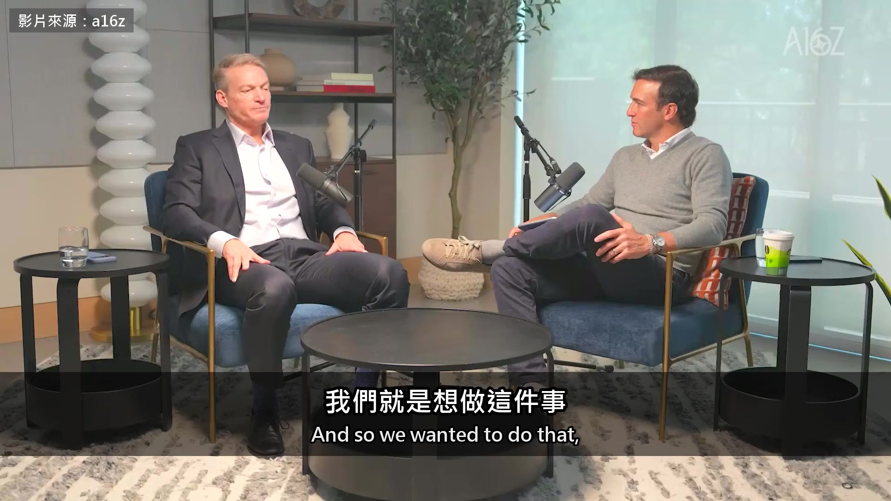

**逐字稿片段：** 而我覺得 Armadin 就是第三波的情報模式 為什麼要等到有人受害才去學？太荒謬了 你得先找出自己的問題 別等國防承包商 A 被駭 再趕快把資訊分享出去，確保不會再發生 那種模式還是要有，總有東西會突破你的防線 但那種模式我們已經有了，就是不夠 他說等出事再去查已經不夠了 Armadin 要搶在駭客前面 先用 AI 把客戶自己打一遍 最近那幾個零時差漏洞 已經是機器自己找到的

**話題推測：** 將Armadin定位為資安領域的第三波情報模式

---

## 00:15:38

**逐字稿片段：** 整段訪談將近 48 分鐘

**話題推測：** 訪談結束語，總結訪談時長：將近48分鐘

---

## 00:15:40

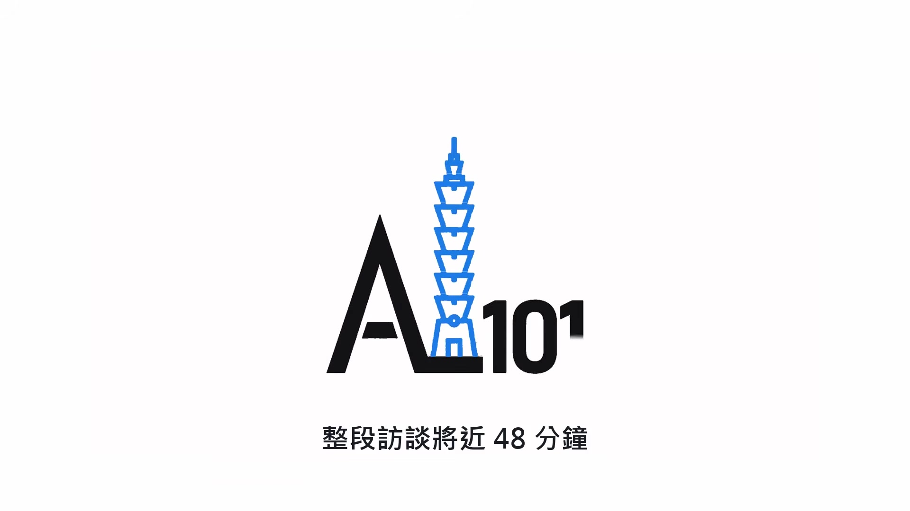

**逐字稿片段：** 他還講了國家級駭客會從狙擊手變成無人機群

**話題推測：** 總結訪談中提及的國家級駭客演變趨勢：從狙擊手到無人機群

---

## 00:15:44

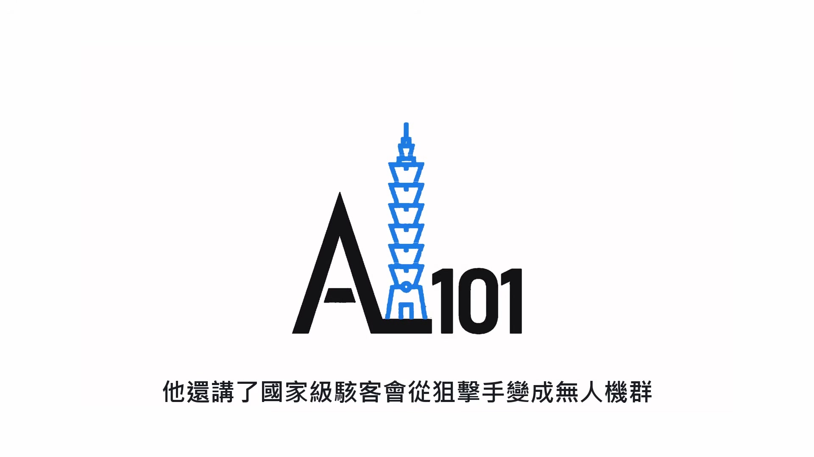

**逐字稿片段：** 還有以後偵測跟應變都得交給 AI 因為人太慢了 原影片連結在說明欄，有興趣可以去聽更多。

**話題推測：** 總結訪談中提及的AI在偵測與應變中的應用

---
