# ai-note-101_qrmlOhwvg4I — 關鍵畫面索引

- 來源逐字稿：[ai-note-101_qrmlOhwvg4I_GT.srt](ai-note-101_qrmlOhwvg4I_GT.srt)
- 影片：https://www.youtube.com/watch?v=qrmlOhwvg4I
- 截圖數：32

## 00:00:26

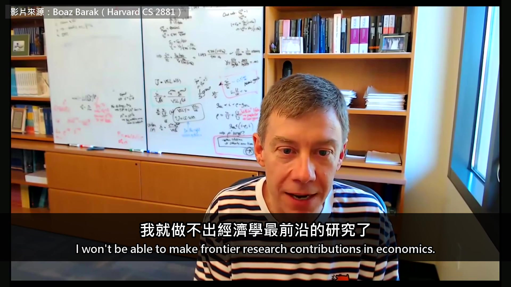

**逐字稿片段：** 說這段話的人叫 Chad Jones 史丹佛研究經濟成長的經濟學家 他跟同事算過，晶片要照摩爾定律翻倍 現在需要投入的研究人力是 1970 年代初的 18 倍 點子越來越難找 這三個月他借調到 Anthropic 不過他先聲明 今天講的研究大多是去之前做的 也不代表 Anthropic 這是他 10 月 1 號在哈佛 AI 安全課的客座演講 結論是 AI 的好處會來 只是來得很慢，壞處卻可能很快就到

**話題推測：** 介紹演講者 Chad Jones，可能搭配其照片或標題卡。

---

## 00:00:54

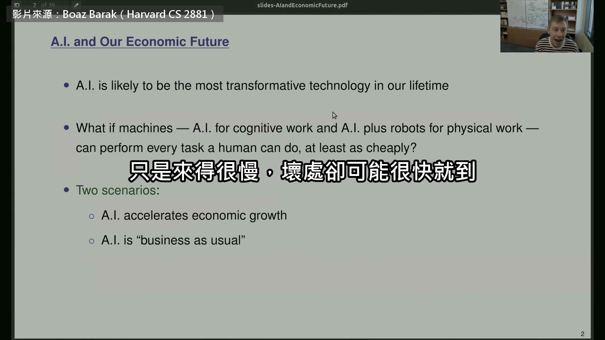

**逐字稿片段：** 他先擺出兩種劇本 AI 實驗室說成長會爆發 經濟學家的老看法是 AI 只是又一個新技術

**話題推測：** 介紹兩種關於AI成長的劇本或觀點，可能以並列圖表呈現。

---

## 00:01:02

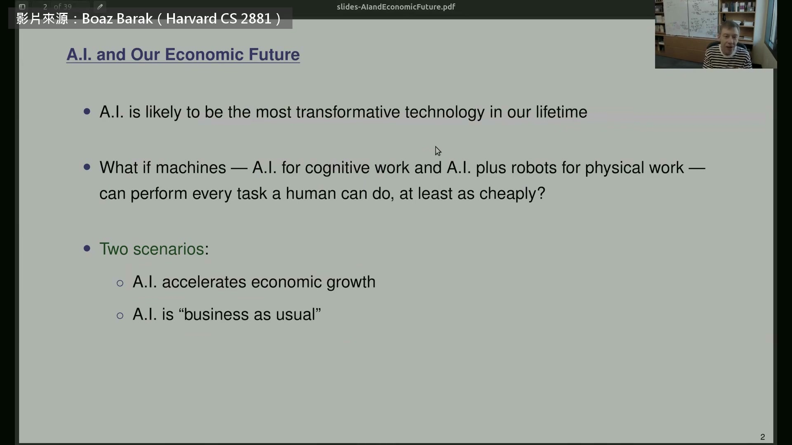

**逐字稿片段：** 我給大家看一張圖 這是我在經濟學裡最喜歡的一張圖 它有點像總體經濟學的摩爾定律 現在叫它總經的 scaling law 在對數座標上是一條直線

**話題推測：** 明確表示要展示一張圖，預期畫面切換到圖表。

---

## 00:01:17

**逐字稿片段：** 這是美國的平均每人所得 人均 GDP，150 年 過去 150 年，經濟成長穩得驚人，每年 2% 150 年，2%

**話題推測：** 說明圖表內容為美國平均每人所得與人均GDP，可能標註圖表軸線。

---

## 00:01:35

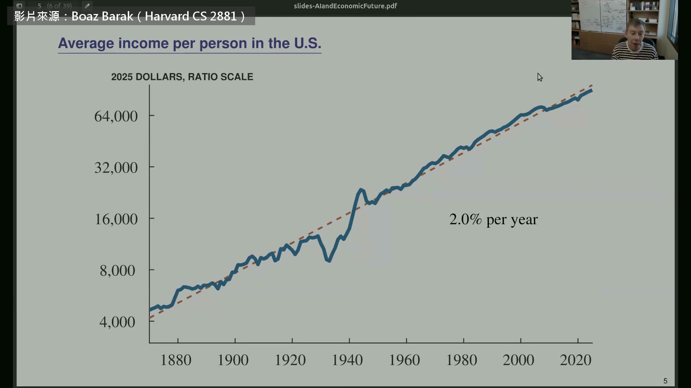

**逐字稿片段：** 1870 年 電力還只是愛迪生腦中的一個念頭 後來花了 50 年 才徹底改變美國經濟 可是畫出來，還是一條直線

**話題推測：** 提到1870年，可能在圖表上標示時間點或顯示歷史事件圖片。

---

## 00:01:44

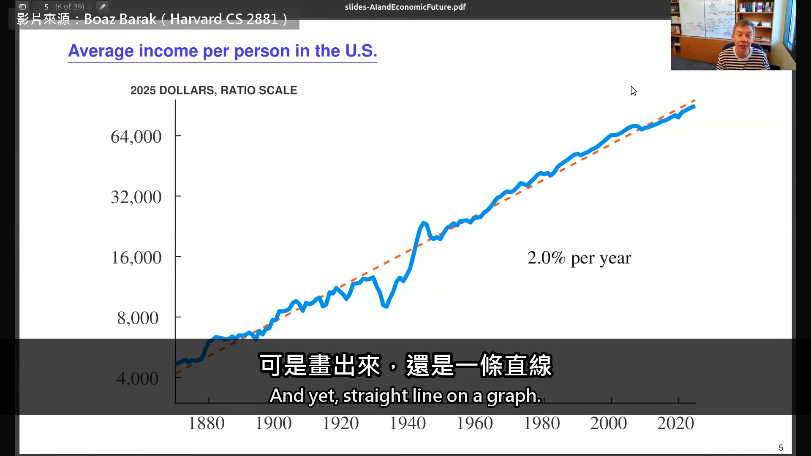

**逐字稿片段：** 內燃機、噴射引擎、飛機、搭飛機旅行 真空管、電晶體、半導體、抗生素 資訊科技、網路 每一項都是徹底改變世界的技術 可是從美國的數字看，全都落在每年 2% 裡 自動化應該會拉高成長 這條線卻 150 年都沒往上折

**話題推測：** 列舉內燃機、飛機等過去的改變世界技術，可能顯示這些技術的圖片或列表。

---

## 00:02:17

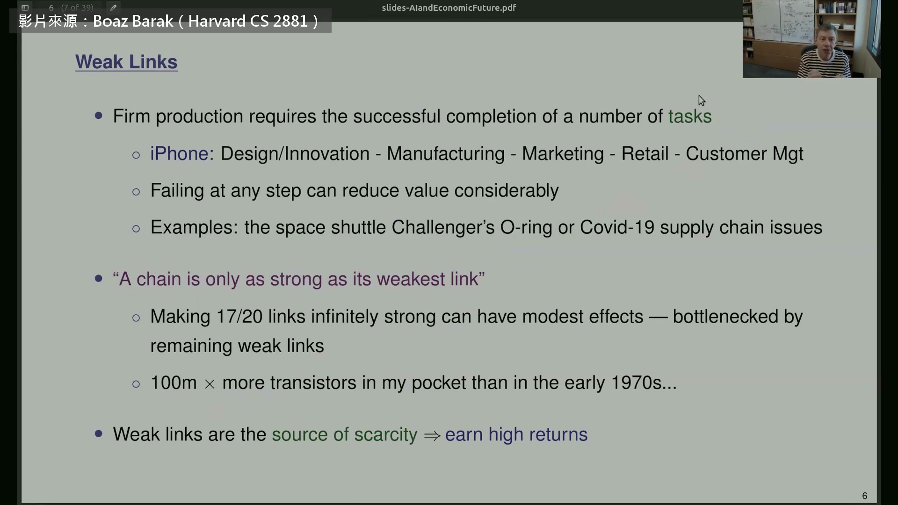

**逐字稿片段：** 他拿來解釋這件事的比喻 叫最弱的一環 這個比喻是，一條鏈子有多強，看它最弱的那一環 假設一條鏈子有 20 環 你想讓整條鏈子變強 就得把每一環都補強 就算 20 環裡有 17 環變得無限強 你還是會卡在剩下那幾個弱環

**話題推測：** 引出「最弱一環」的新比喻，可能搭配鏈條的圖示。

---

## 00:02:43

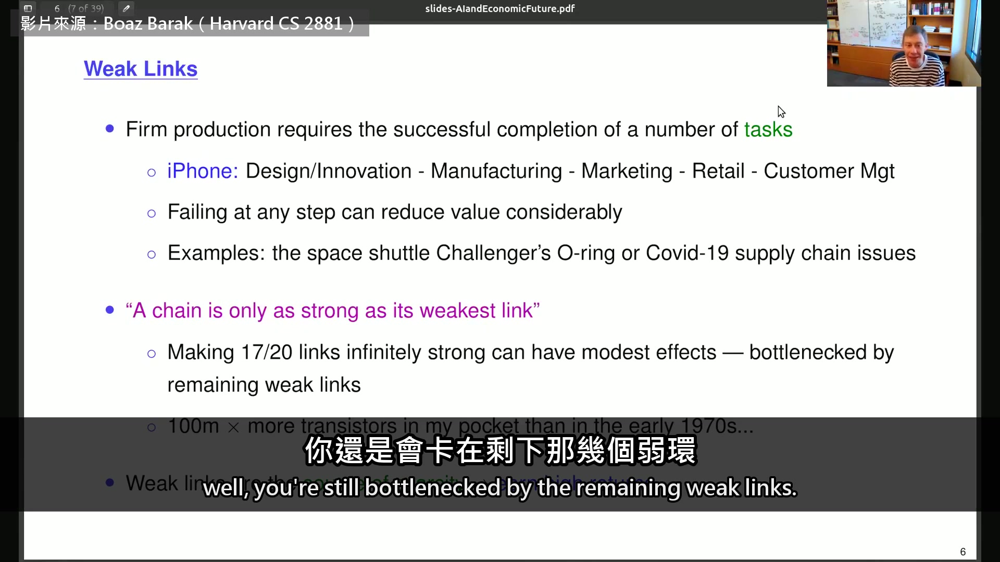

**逐字稿片段：** AI 實驗室劇本的第一步 是把寫軟體自動化 他就問，要是全美國的軟體多到用不完 經濟會變大多少

**話題推測：** 轉回AI實驗室的劇本，應用「最弱一環」的概念。

---

## 00:02:52

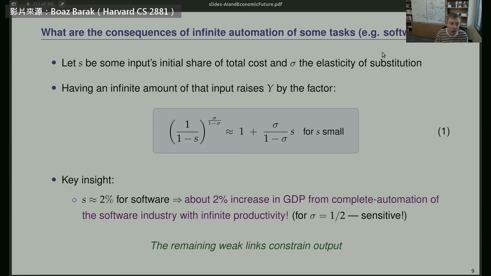

**逐字稿片段：** 有意思的是，軟體大約只占美國經濟總成本的 2% 如果軟體現在做的每件事，都變成無限多 重點是，不讓軟體多做任何新的事 那要更完整的模型才算得出來 光是現在做的事變成無限多

**話題推測：** 提出具體數字：軟體佔美國經濟總成本的2%，可能顯示圓餅圖或數字。

---

## 00:03:09

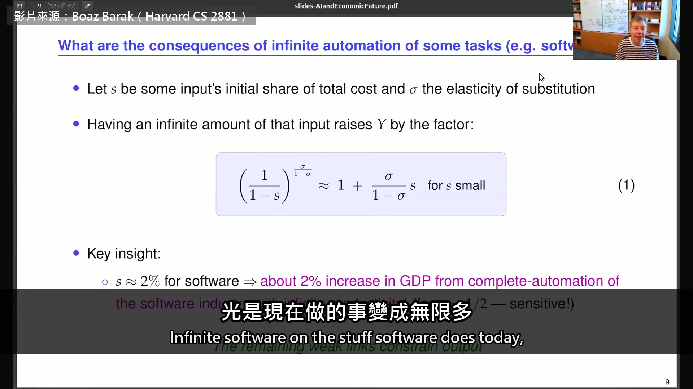

**逐字稿片段：** GDP 只會多 2% 這就是最弱一環的道理 你被其他所有環節卡住了

**話題推測：** 提出具體計算結果：GDP只會多2%，可能顯示在簡報上。

---

## 00:03:18

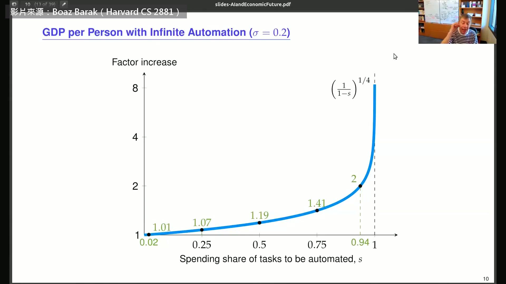

**逐字稿片段：** 就算把一半的經濟，也就是一半的成本，無限自動化 也只讓你富 20% GDP 要翻倍，得把 94% 的成本無限自動化 從 94% 推到 100%，就爆開衝到無限大 這條曲線看起來很平，然後突然爆開

**話題推測：** 提出新假設：自動化一半成本，可能顯示新的情境圖表。

---

## 00:03:42

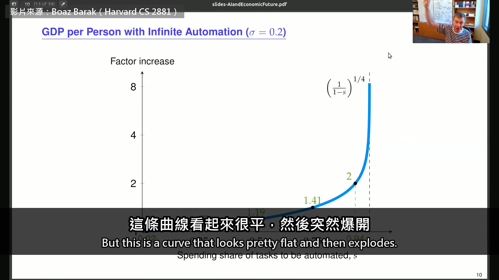

**逐字稿片段：** 他把同一條曲線的橫軸換成時間 假設每年把 1% 的成本無限自動化 50 年後只富 19% 要等 94 年才翻倍 畫在對數座標上 前 75 年看起來就像一條直線 等到最後 25 年，成長開始加速 在有限的時間內衝到無限大 我眼中現在的世界，大概就是這樣 我們已經自動化很久了 過去 150 年，每年約自動化 0.5% 成本 所以 150 年來看起來是一條直線 繼續下去就會動起來，成長真的會爆發 有限時間內，所得可以高到沒有上限

**話題推測：** 描述將曲線橫軸換成時間，可能顯示新的或修改後的圖表。

---

## 00:04:28

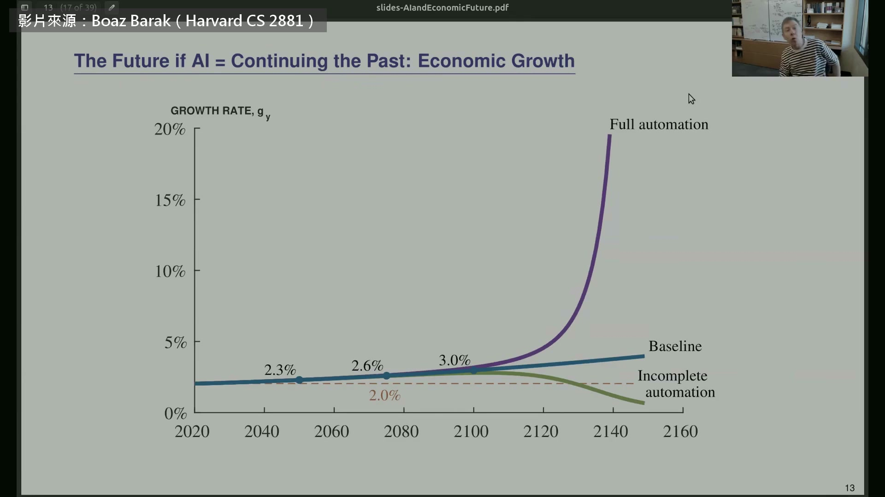

**逐字稿片段：** 他跟同事拿美國過去的資料校準了一個模型 跑了好幾種情況 就算是每件事最後都能自動化的那一種

**話題推測：** 引出校準模型與幾種情況的分析，可能顯示模型參數或結果圖表。

---

## 00:04:35

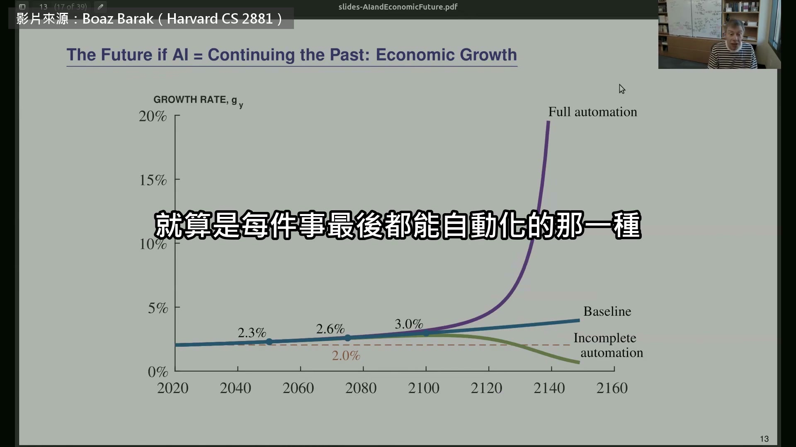

**逐字稿片段：** 模型算出的奇點也要等到 2140 年 你看，不管哪一種情況，都慢得驚人 這是讓我意外的地方

**話題推測：** 提出模型計算出的奇點時間：2140年，可能顯示時間軸或表格。

---

## 00:04:45

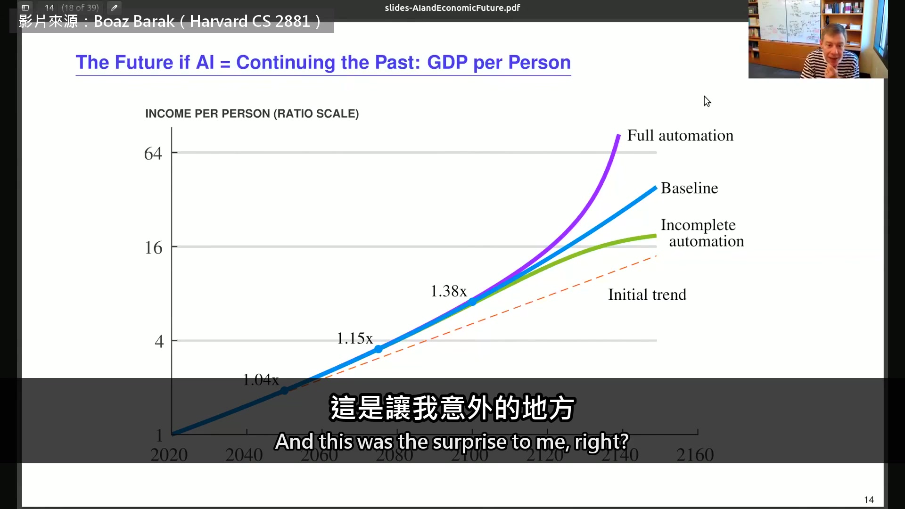

**逐字稿片段：** 等 30 年，也只比照原速成長多富 4% 到 2075 年，也只多富 15% 等上 150 年，就會變得無限富有 會發生，只是爆炸來得很慢 這一點我早該想到

**話題推測：** 提出具體預測數字：30年後多富4%，可能顯示預測曲線或數值。

---

## 00:05:07

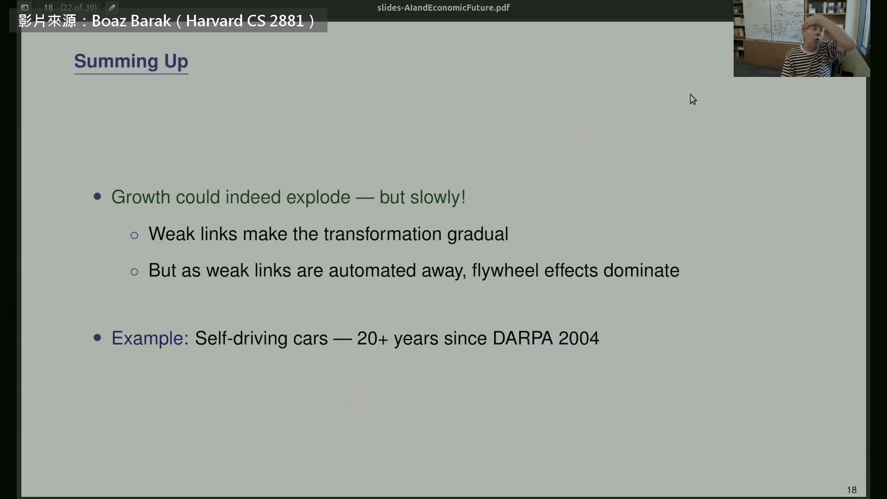

**逐字稿片段：** 他很愛舉的例子是自駕車 2004 年 美國國防部在沙漠辦了第一場無人車比賽 沒有一台跑完全程 現在一看，自駕車確實來了 技術已經解決了 你去舊金山、去史丹佛 都能坐自駕車到處跑，體驗很棒 可是就算在灣區，自駕車也不到 1% 放到全美國、全世界就更少了 從 DARPA 那場比賽到現在，已經 20 多年 自駕車一直說快來了 可是大概至少還要再 10 年 新車才會有一半是全自動駕駛 講完好處為什麼來得慢

**話題推測：** 引入自駕車作為新例子，可能顯示自駕車的圖片或影片片段。

---

## 00:05:56

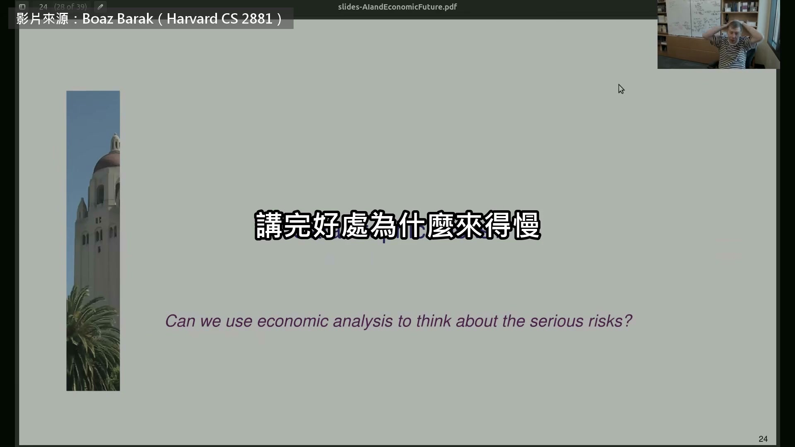

**逐字稿片段：** 他轉到這堂課的本題 AI 的災難風險 我看到那些圖的時候想 這對安全來說或許是好消息 危險的 AI 要是 40 年、100 年後才到 那我們有很多時間處理，我想也處理得了 可惜照最弱一環的觀點，這個想法完全錯了 壞處可能來得很快

**話題推測：** 明確轉變話題到「AI的災難風險」，預期為新的章節標題或簡報頁面。

---

## 00:06:22

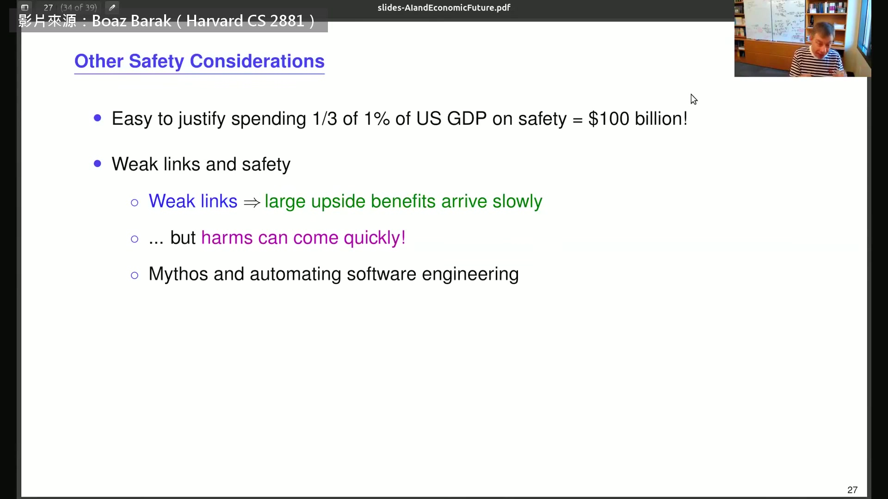

**逐字稿片段：** 回到那條 20 環的鏈子就知道了 要拿到好處，20 環都得自動化 鏈子的 20 環都得補強 可是壞處只要剪斷一環，鏈子就斷了 我們現在就看得到

**話題推測：** 再次提及「20環鏈子」的比喻，可能再次顯示鏈條圖示。

---

## 00:06:39

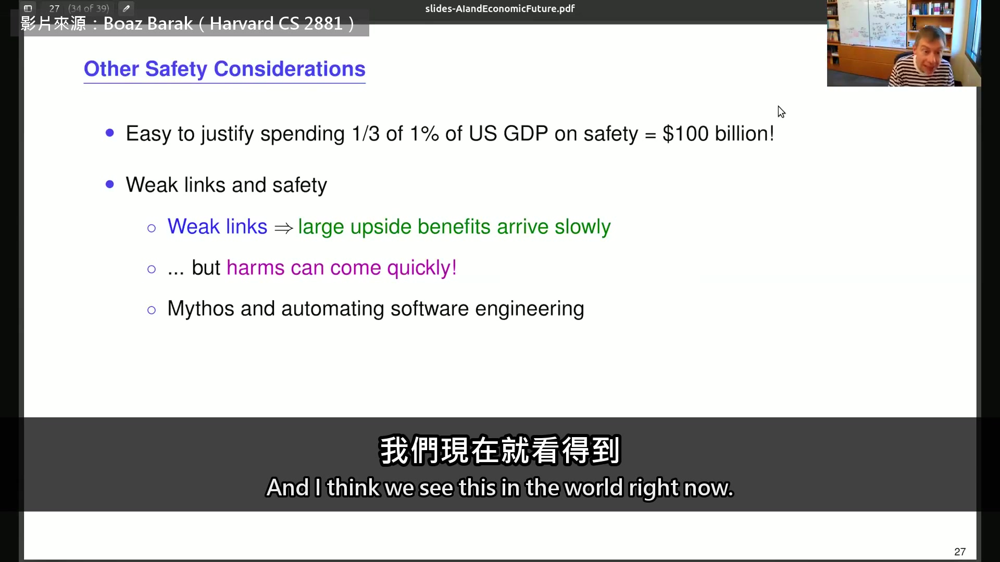

**逐字稿片段：** Mythos 等級、Astra 等級的模型 可以把軟體工程自動化 可是它們也能把壞事自動化 找程式漏洞、利用漏洞，已經比人類還強 把整個經濟自動化 比搞懂怎麼造出病毒難太多了 要搞破壞，得弄懂的事情一定比較少 比拿到所有好處要少 防守很難，進攻很容易 你得防住每一件事 他把剛剛算軟體的那條式子反過來 算壞的那一邊 這就是最弱一環的世界 把一樣東西變成無限多，產出多 2% 可是把某樣東西砍掉 90% 變成十分之一，而不是變成 10 倍 這就是不對稱，產出可能掉三分之二

**話題推測：** 提及Mythos、Astra等特定AI模型名稱，可能顯示其標誌或簡介。

---

## 00:07:36

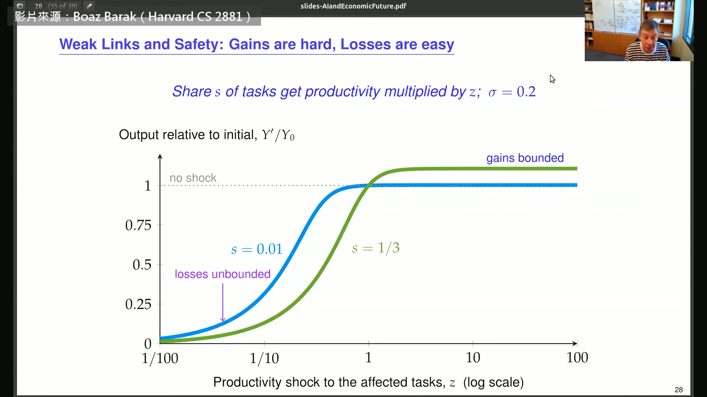

**逐字稿片段：** 假設是 1% 的工作 被網路攻擊打掉 90% 的產能，持續半年 在這個簡單的模型裡，總產出掉三分之二 這就是最弱一環 壞的那一邊，脆弱得不得了 好的那一邊，又非常有限 我有一篇論文問的是 該拿 GDP 的多少，現在該花多少錢 來降低這些災難風險？ 讓我真正動筆的，是我發現 我們最近才剛碰過這個問題

**話題推測：** 提出新的假設情境：1%工作受網路攻擊，可能顯示情境模擬圖。

---

## 00:08:19

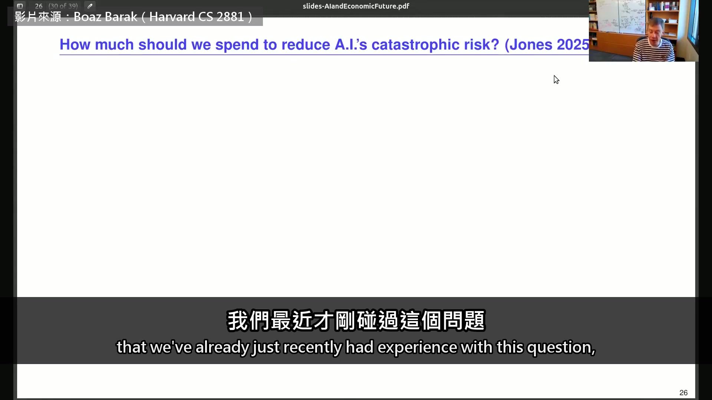

**逐字稿片段：** 就是新冠疫情 疫情期間，尤其是 2020 年 3 月前後 每個人都覺得自己大約有 0.3% 的機率會死 於是我們讓經濟停擺，待在家裡 這樣停擺、待在家 等於花掉了美國 GDP 的 4% 只為了降低 0.3% 的死亡風險 我猜 AI 的風險至少一樣大 照我們當時的做法，也許該花 GDP 的 4% 那是非常非常大的一筆錢 他也料到有人會說封城花太多

**話題推測：** 引入新冠疫情作為實際案例，可能顯示疫情相關新聞畫面或數據。

---

## 00:09:01

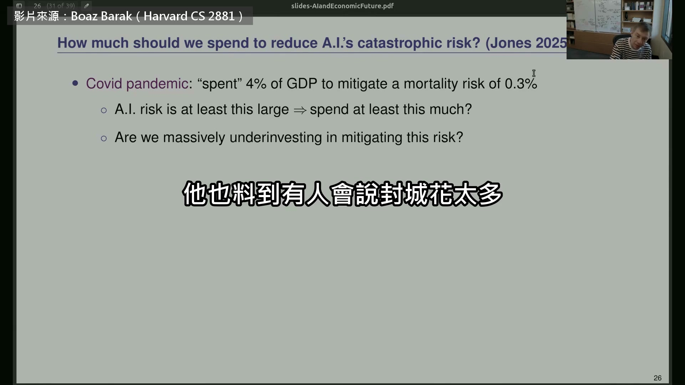

**逐字稿片段：** 所以換了一種算法 美國政府訂公路跟橋梁的安全標準時 一條命大約算 1000 萬美元

**話題推測：** 引出另一種算法，可能顯示新的計算模型或標準。

---

## 00:09:08

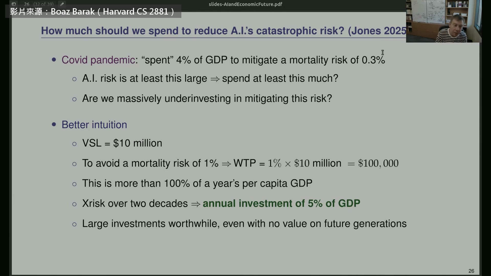

**逐字稿片段：** 要避開 1% 的死亡風險 整個社會願意付的錢 這個風險是分攤在很多人身上的

**話題推測：** 提出具體數字：避開1%死亡風險，可能顯示風險評估圖。

---

## 00:09:18

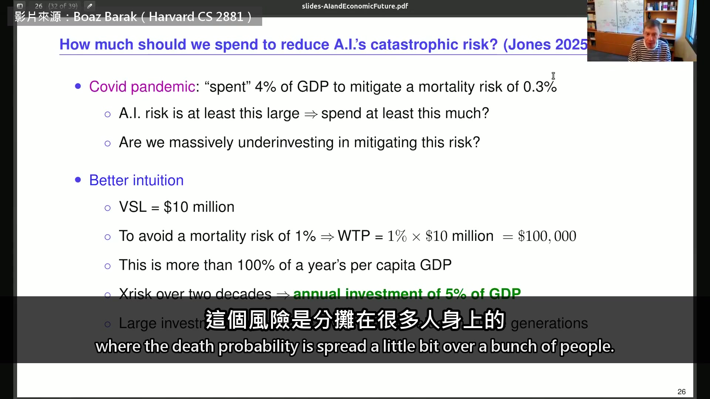

**逐字稿片段：** 1000 萬美元的 1%，也就是 10 萬美元 比美國每人一整年的 GDP 還多 這是很大的數字 如果攸關存亡的風險分散在 20 年裡

**話題推測：** 提出具體計算結果：10萬美元，可能顯示計算步驟或結果。

---

## 00:09:37

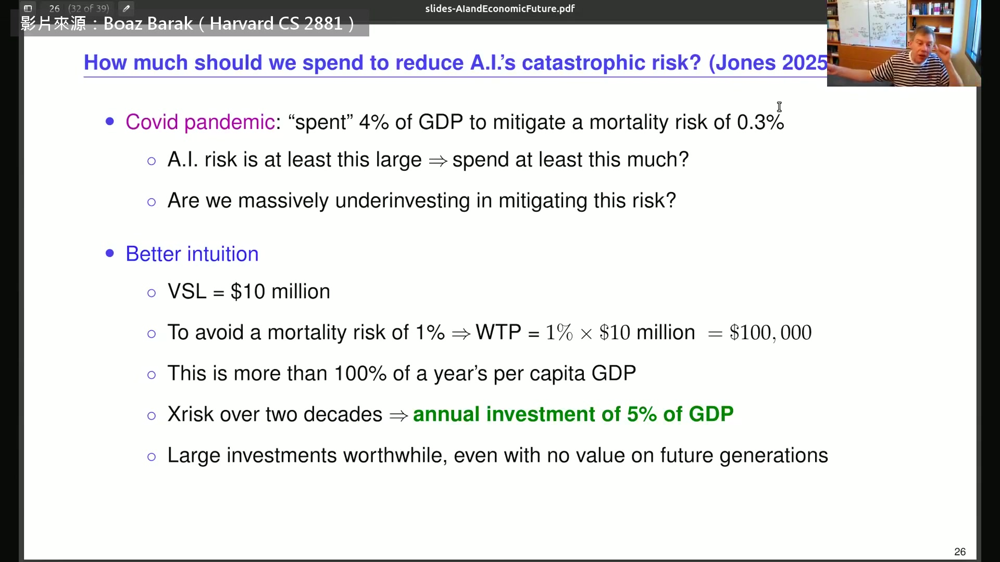

**逐字稿片段：** 每年投入 GDP 的 5% 都說得過去 可是這筆錢花下去有多大用？

**話題推測：** 提出具體數字：每年投入GDP的5%是合理範圍，可能顯示建議圖表。

---

## 00:09:42

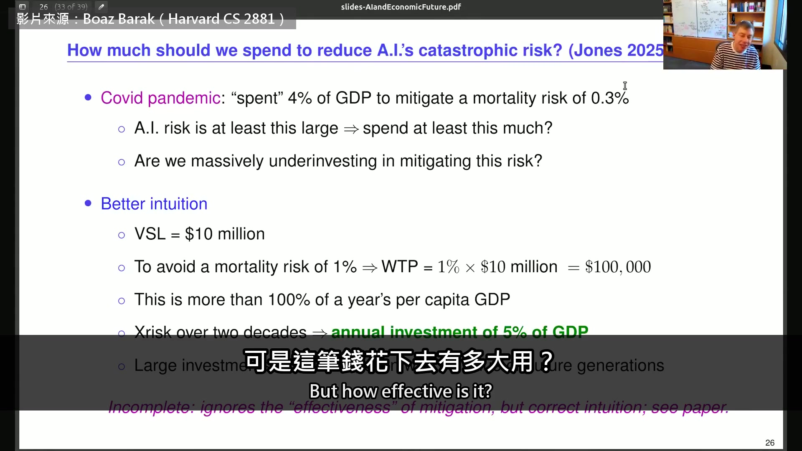

**逐字稿片段：** 有做蒙地卡羅模擬來看這件事 基本結論是 在安全上花 GDP 的三分之一個百分點，絕對值得 也就是 1000 億美元 大概是現在花的 30 倍 所以我認為，我們在安全上的投資嚴重不足 這只是用經濟學去算的一種方法 可惜的是，我真正擔心的 也是我想去前沿實驗室工作的原因 是雖然 OpenAI、Anthropic 的人 大概把變化想得太快了 但他們說壞處會很快到，這點完全正確 如果我們不解決這些風險、不處理這些問題 第一，可能會壞到攸關人類存亡 第二，我們可能活不到享受好處的那天

**話題推測：** 提及蒙地卡羅模擬，可能顯示模擬結果圖或流程。

---

## 00:10:38

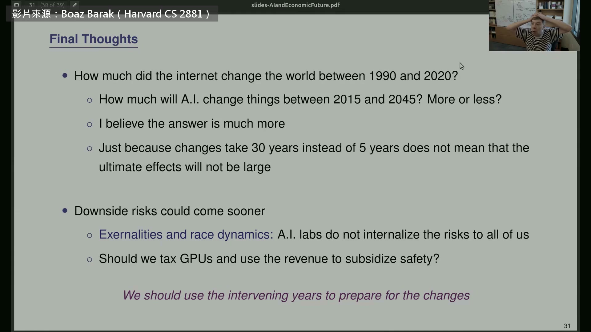

**逐字稿片段：** 他最後點出，AI 實驗室在賽跑 出了事卻是所有人一起承擔

**話題推測：** 引出AI實驗室「賽跑」與外部成本的新話題，可能顯示競賽圖示。

---

## 00:10:42

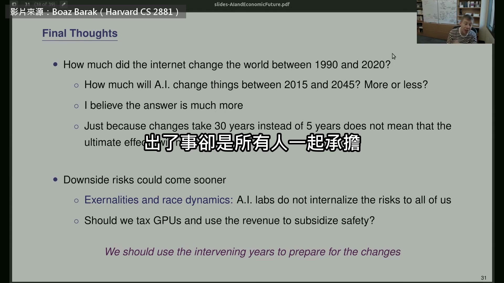

**逐字稿片段：** 經濟學家對付這種事的老辦法是課稅

**話題推測：** 引出經濟學家「課稅」的解決辦法，可能顯示政策工具圖。

---

## 00:10:46

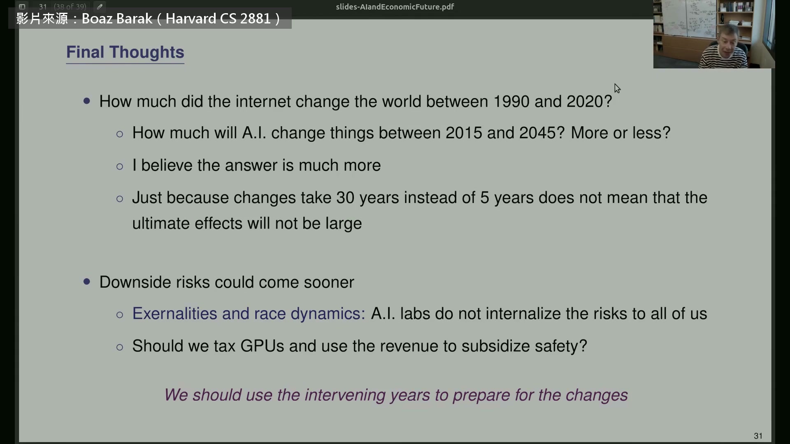

**逐字稿片段：** 對 GPU 課稅，拿這筆收入補貼安全研究

**話題推測：** 提出具體政策建議：對GPU課稅，可能顯示政策說明文字。

---

## 00:10:51

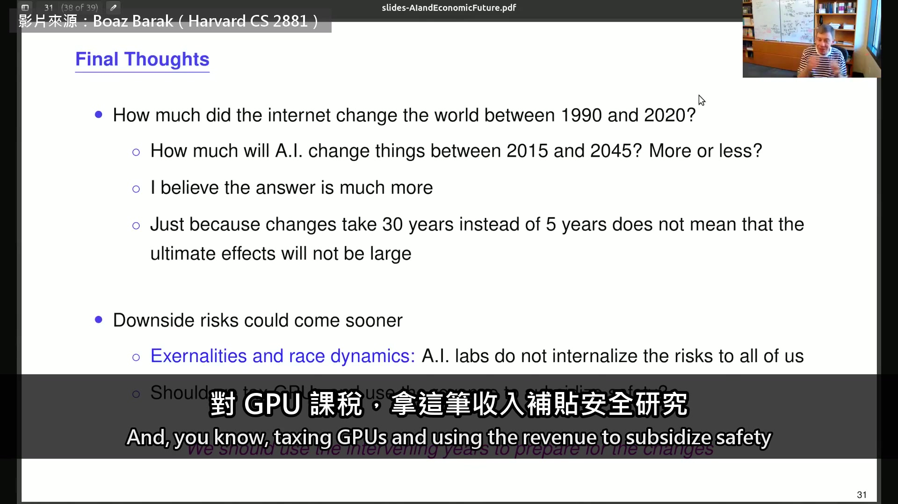

**逐字稿片段：** 從經濟學來看，就是該課的皮古稅（補充：對造成外部成本的東西課稅，像碳稅） 這也是值得考慮的點子 不管怎樣，我們該好好利用中間這些年 為眼前這場巨變做準備 照他的模型，AI 的好處要等幾十年 可是只要剪斷一環的壞處 現在就可能發生 所以他算出來 AI 安全至少該花 GDP 的三分之一個百分點 大約是今天的 30 倍

**話題推測：** 引出「皮古稅」的經濟學概念，可能顯示其定義或案例。

---

## 00:11:18

**逐字稿片段：** 原影片兩個多小時

**話題推測：** 切換話題，開始討論原影片的更多內容。

---

## 00:11:19

**逐字稿片段：** 上半場是 Erik Brynjolfsson 講圖靈陷阱 他說 AI 該拿來擴充人的能力 不該只顧著模仿人、取代人 問答時兩個人還聊到 大學生現在該學什麼 原影片連結在說明欄，有興趣可以去聽更多。

**話題推測：** 介紹原影片的另一位講者Erik Brynjolfsson及其「圖靈陷阱」概念，可能顯示其照片與概念說明。

---
