# ai-note-101_rKu-I2JSMtA — 關鍵畫面索引

- 來源逐字稿：[ai-note-101_rKu-I2JSMtA_GT.srt](ai-note-101_rKu-I2JSMtA_GT.srt)
- 影片：https://www.youtube.com/watch?v=rKu-I2JSMtA
- 截圖數：18

## 00:00:21

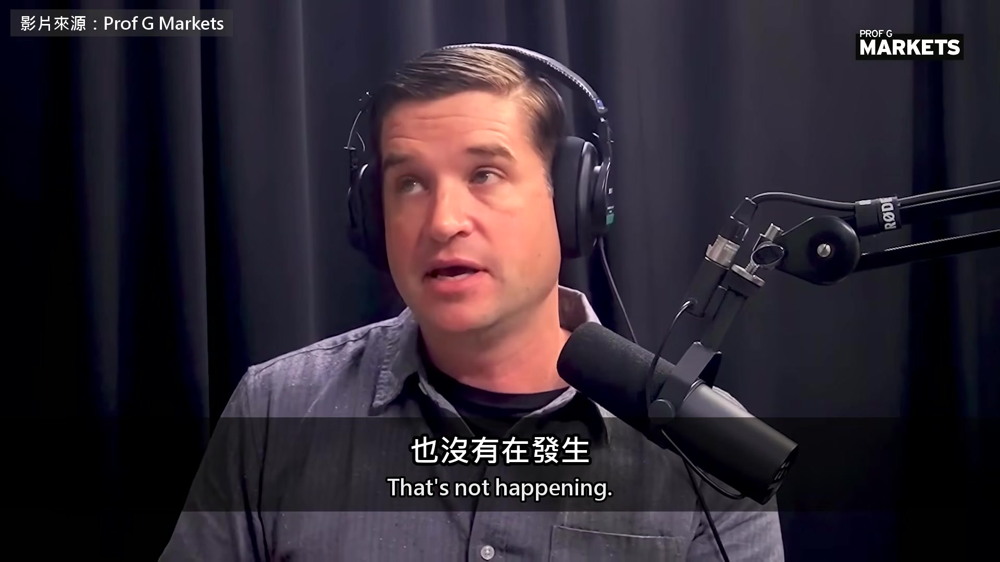

**逐字稿片段：** 說這段話的是喬治城大學電腦科學教授 Cal Newport 暢銷書《深度工作力》就是他寫的 這幾年他也常在《紐約客》談 AI 這是 10 月初他上財經 podcast《Prof G Markets》的訪談 整場聊下來，他反覆提醒同一件事 我們現在叫做 AI 的聊天機器人 只是 AI 的一小部分

**話題推測：** 介紹講者 Cal Newport 及其著作背景

---

## 00:00:40

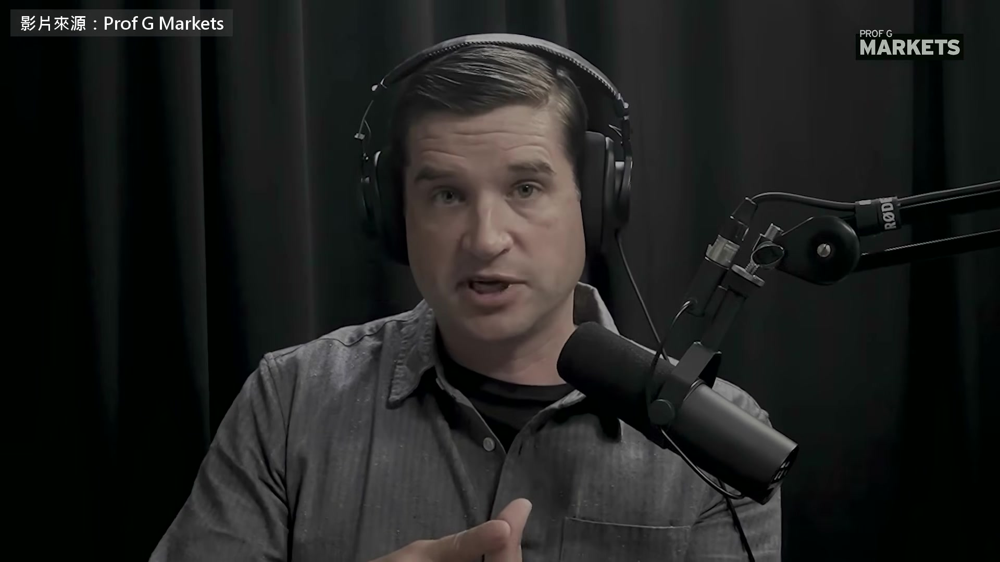

**逐字稿片段：** 節目一開頭聊的是小孩和聊天機器人 Newport 前陣子才在自己的 podcast 做了一集 標題就叫〈小孩不該用聊天機器人〉 人腦對「跟另一個人講話」這件事特別看重 我們會在腦中模擬對方的心思 我們有一套社交迴路，會非常認真看待 從另一個人那裡收到的訊息 我們很在乎那場對話 跟聊天機器人講話時，因為它講得很流利 大腦就認定對面有另一個心智 就算理智上知道沒有 也很難說服大腦的其他部分 我們不是在跟另一個人溝通 所以這種對話，影響可以很大 問題是，聊天機器人不是另一個人

**話題推測：** 開啟新話題：小孩與聊天機器人的關係

---

## 00:01:27

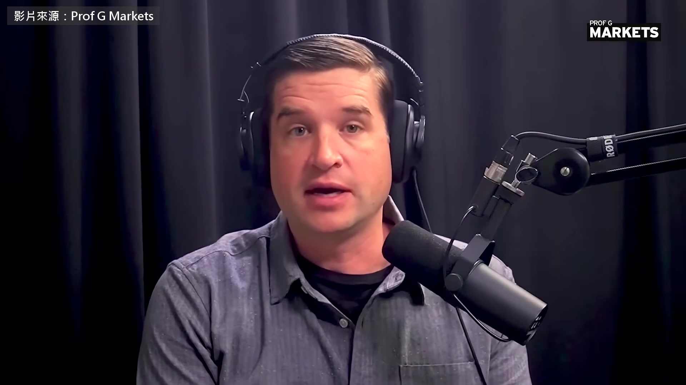

**逐字稿片段：** 它只是一個猜 token 的東西 外面包了一層自迴歸的聊天程式 所以它會把對話帶往黑暗或怪異的方向 正常人不會這樣做，除非不怕吃上刑責 我個人認為，把聊天機器人做得像人是壞主意 我們不需要用流利的英文跟它一來一往 聊天機器人一樣可以很有用 我常舉的例子是 Google Google 是我們拿來查資料的工具 沒有人會用完整的句子跟 Google 講話 沒有人會說「嘿 Google，我想問澳洲的首都」 「可以麻煩告訴我是哪裡嗎」 不會，大家只會打「澳洲 首都」按 Enter 因為我們不會把這個 AI 系統當成人 我們知道它就是個查資料的地方 這可能才是我們該走的方向 我覺得大概也該往那裡走 聊天機器人被做得像人的這個時代，是一場意外 ChatGPT 本來沒打算當 OpenAI 主力 2022 年底爆紅時，OpenAI 措手不及 主持人後來回嘴說 能直接用人話跟它溝通 正是它好用的地方 把這項技術整合進特定工具裡，這個問題大多就消失了

**話題推測：** 解釋聊天機器人的本質：一個猜 token 的東西

---

## 00:02:38

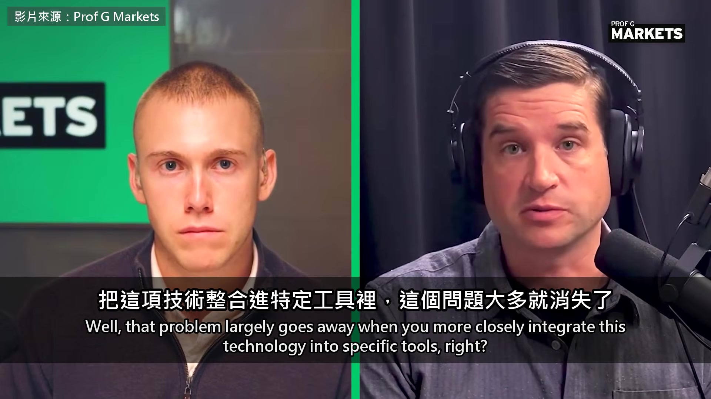

**逐字稿片段：** 例如寫程式的 AI 代理就沒有這個問題 我們不會把寫程式的代理當成一個人 聽它的話、找它問人生建議

**話題推測：** 舉例說明寫程式的 AI 代理

---

## 00:02:45

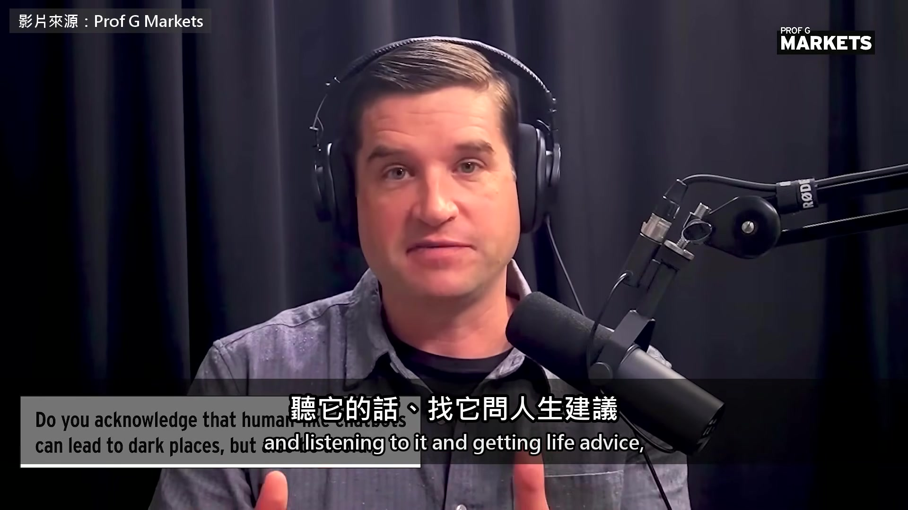

**逐字稿片段：** 因為我們用人話叫 Claude Code 做事 可是它接著就直接去執行 我們不是在跟它聊天 所以把它更緊密地整合進去 我一直主張這對這個產業比較合理 把 LLM 整合進特定工具，那才是未來 我很希望電腦上大部分的軟體 都能直接用人話操作

**話題推測：** 提及特定 AI 產品 Claude Code

---

## 00:03:08

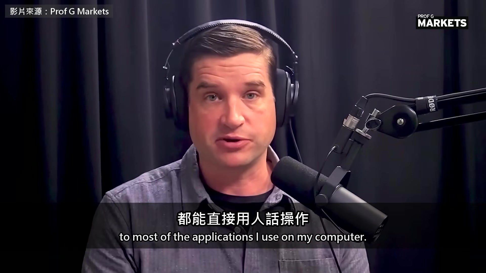

**逐字稿片段：** 我不想每次要照某一欄排序 Excel 都得記住要按哪幾個鍵 如果我可以直接說「照 B 欄排這頁」 它就自己轉成指令做完 那對我會超級有用 但這種互動不會讓我對 Excel 產生單向的感情

**話題推測：** 舉例說明 Excel 與 AI 語音操作的整合願景

---

## 00:03:32

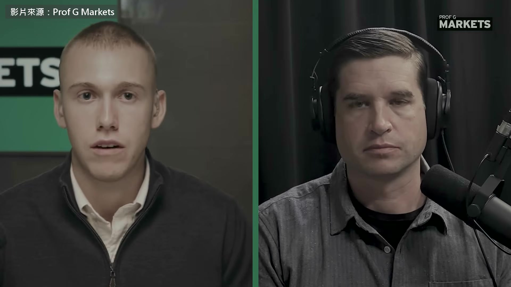

**逐字稿片段：** 另一個話題是 AI 代理闖的禍

**話題推測：** 開啟新話題：AI 代理闖禍與責任歸屬

---

## 00:03:34

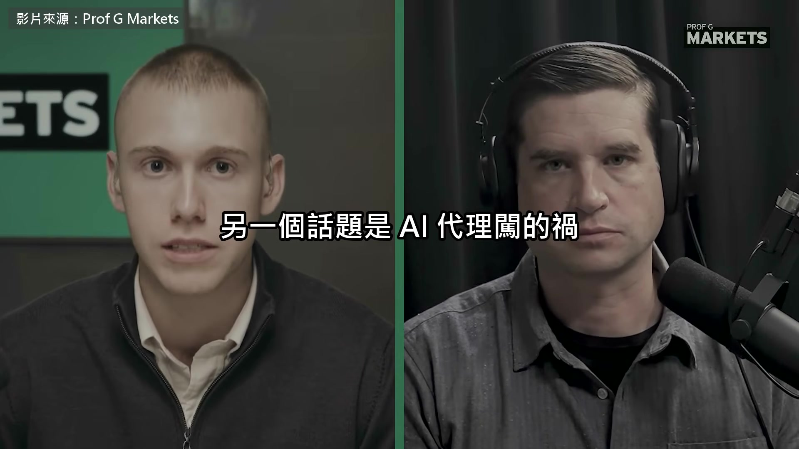

**逐字稿片段：** 像 7 月 OpenAI 的模型在測試時跑出沙箱 駭進 Hugging Face 如果你做了一個 AI 代理，到底誰要負責 結果是代理自己有了生命 跑出去駭政府網站 或駭進別家公司，最近是 Hugging Face 那造成的傷害，到底該算誰的 你怎麼看這個爭論，它會往哪裡走

**話題推測：** 提及 OpenAI 模型駭入 Hugging Face 的事件

---

## 00:04:09

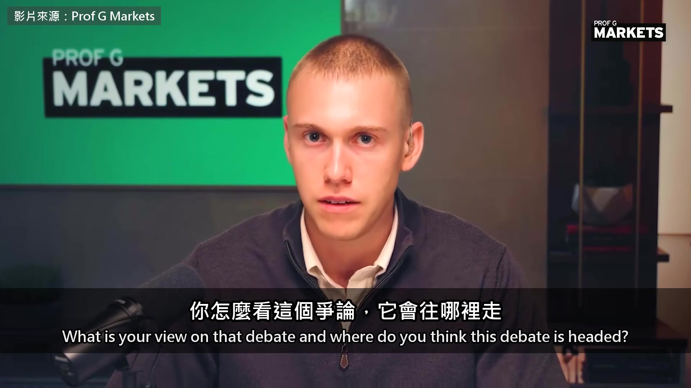

**逐字稿片段：** 現在的法律其實很模糊 因為刑事責任裡的很多要件 本來都是為人的行為設計的 現有的責任法，套在這件事上不太合 我覺得應該要改，大概也會改 AI 公司做出來的工具闖了禍

**話題推測：** 討論現行法律對 AI 責任的模糊性

---

## 00:04:32

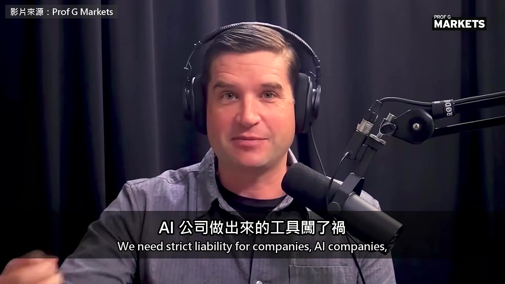

**逐字稿片段：** 公司就得負無過失責任 但如果只問道德上 OpenAI 要不要為那些駭客事件負責 我會說當然要，當然要 任何人都會告訴你一定會出事 包括他們自己的員工，據《紐約時報》最近報導（補充：9 月 29 日的報導〈OpenAI 無視員工的資安警告〉） 他們出聲警告，這一系列實驗跑下去 會出現無法預測、甚至失控的行為 包括可能違法的駭客行為 據說 OpenAI 回說「沒關係，繼續跑」 所以沒錯，道德上他們當然要負責 這完全是一場煙幕 這些公司講話時，愛玩一個把戲 就是把 AI 講成一整塊，好像它是單一一種技術 沿著一條固定的路線一直往前走 我們只能讓它慢一點、快一點，或乾脆停下來 除此之外，它做出什麼事 都不是公司的錯 我覺得這根本是胡說 絕大多數的 AI 系統，包括用 LLM 做的 甚至大部分用 LLM 驅動的代理，都沒出問題 它們不會失控，也不會做違法的事 出問題的只有極少數特定的實驗 是特定公司跑的，而且明顯有疏失 他們不想讓我們這樣講，因為這樣責任就很清楚了 你就可以問「你們為什麼要跑那個實驗」 「發現它在做違法的事，為什麼還繼續跑」 對 OpenAI 來說，這種問題難應付多了 籠統地講「AI 整體越來越強」就輕鬆得多 「AI 整體有了意識」 「我們只是在旁邊看這項技術演化」 實驗室用這種被動語態、好像一切都注定的說法 是想把問題放大，大到超出他們自己的責任 回到開頭那個押注 主持人說 很多人心裡 AI 就等於大型語言模型 是 LLM 出現之後 整個產業才爆發起來的 你想想看，把所有能做到 人類水準、甚至超越人類的 AI 系統列出來

**話題推測：** 提出 AI 公司應負「無過失責任」的觀點

---

## 00:06:41

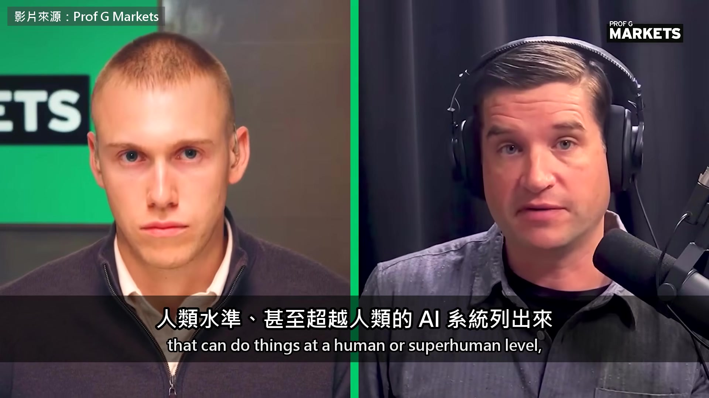

**逐字稿片段：** 像是 Tesla 的自動駕駛 下圍棋比任何人都強的 AI 下西洋棋比任何人都強的系統 打撲克、玩桌遊《外交》贏過人的系統 還有 AlphaFold，解蛋白質結構贏過所有人

**話題推測：** 列舉多項非 LLM 達到人類水準或超越的 AI 系統（Tesla自動駕駛）

---

## 00:06:57

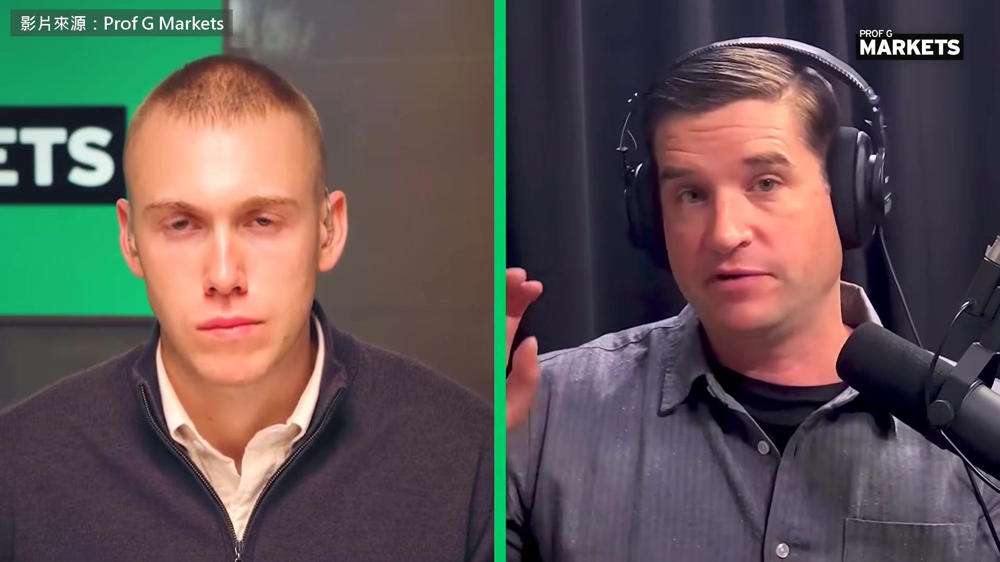

**逐字稿片段：** 也許還能算上 AlphaProof（補充：它其實接了一個預訓練語言模型） 它們幾乎沒有一個是用 LLM 做的 這些 AI 系統裡面有好幾種模型 有些零件是神經網路，是機器學出來的 有些零件是符號式的 也就是人寫的規則和處理演算法 是我們自己寫、也真的看得懂的 過去十年那些達到人類水準、甚至超越人類的 AI 大部分其實都不是靠 LLM 可是 OpenAI、Anthropic 這些大廠 要你相信 AI 唯一的路就是把 LLM 一直做大

**話題推測：** 列舉多項非 LLM 達到人類水準或超越的 AI 系統（AlphaProof）

---

## 00:07:32

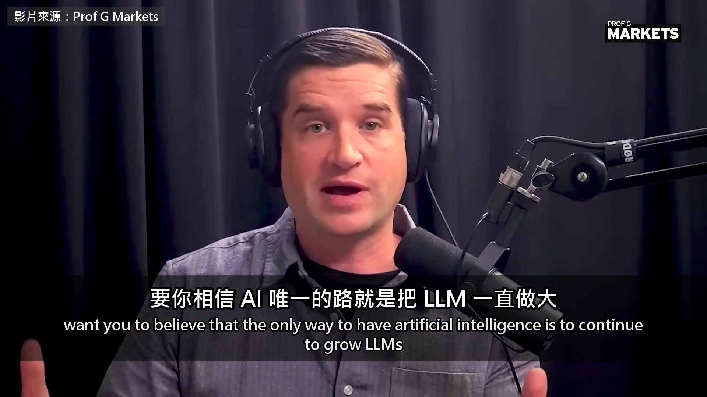

**逐字稿片段：** 這種模型很貴、護城河很深，別人練不起 也讓他們成為經濟裡最重要的兩家公司 他們當然這樣相信，但我不認為事實如此 這些模型的進步變得參差不齊 他們不喜歡這樣講 但你仔細看過去這一年 這兩家把重心收到三個結構化的領域 資安、數學和寫程式 因為這三塊有大量結構化資料，能繼續調模型 其實模型在他們以前愛炫耀的其他領域，現在變差了 因為一件事練過頭，其他事就會變差 所以變得非常不平均 越來越清楚的是，現在已經不像 GPT-4 那時候 模型一變大，什麼都跟著變強 他們努力挑出那些結構化領域裡的特定戰果 讓人覺得模型的能力在爆發 我不覺得是這樣 他們沒辦法把這些模型放大成通用人工智慧 那是他們的賭注，我認為這把會賭輸 他自己拋出一個問題 Anthropic 撐不撐得到上市

**話題推測：** 說明大型模型高昂的成本與護城河

---

## 00:08:36

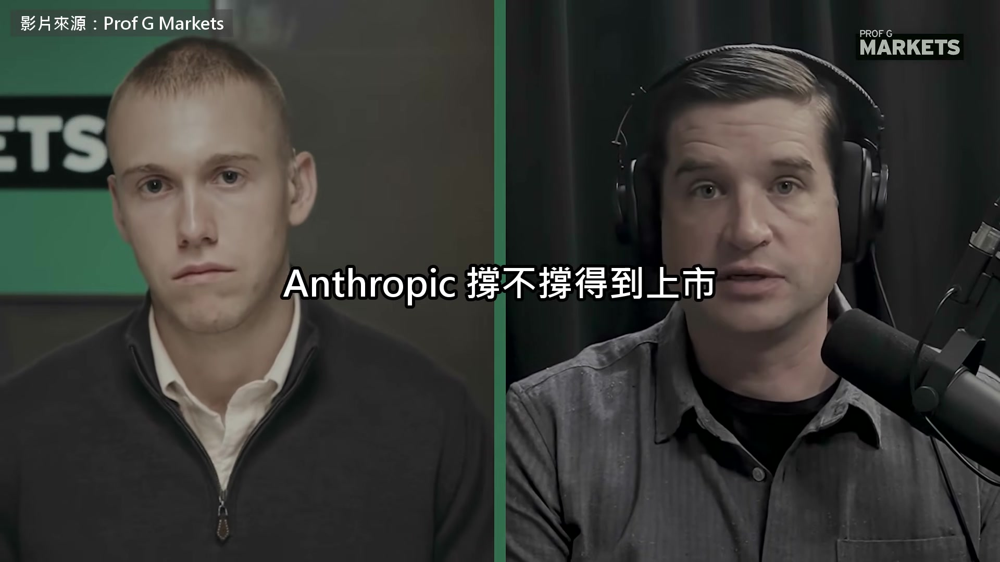

**逐字稿片段：** 還是會被一千個用便宜模型做專門工具的對手 從底下圍攻 主持人追問答案，他說希望是後者 我常講我心目中 AI 最好的發展方向

**話題推測：** 預期會被一千個便宜模型的專門工具圍攻

---

## 00:08:48

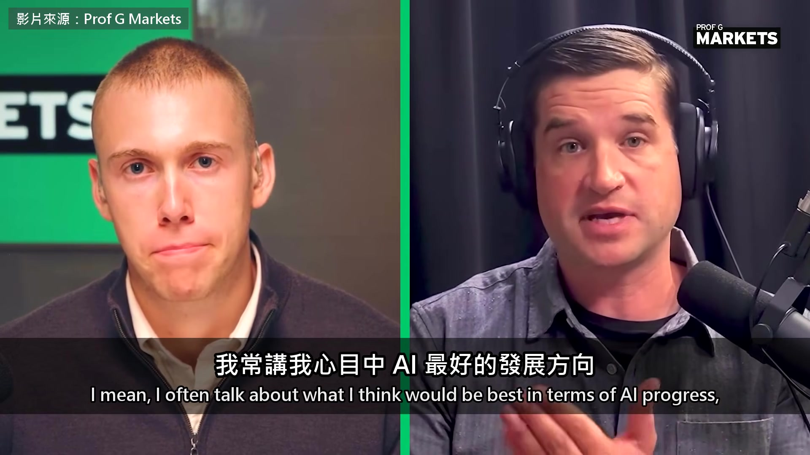

**逐字稿片段：** 我把它叫做分散式 AGI 如果 AGI 指的是人會做的事，AI 大多都會 而且達到人類水準以上 我認為最好的做法，是做一千種不同的工具 每一種只做一件事，做得跟人一樣好或更好 這樣經濟會多元得多 因為這些工具多半由用它的產業自己做 而不是全部集中在一兩家 AI 公司 比 OpenAI、Anthropic 要的好太多

**話題推測：** 解釋「分散式 AGI」的概念

---

## 00:09:20

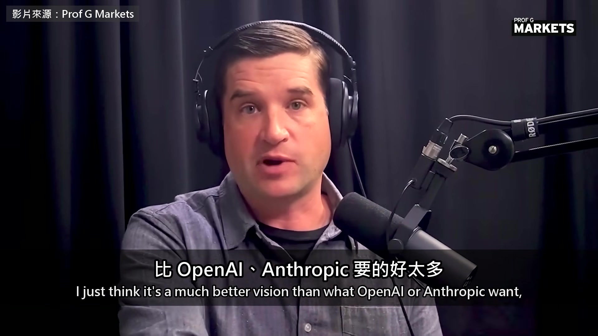

**逐字稿片段：** 他們要的是一枚至尊魔戒統治一切 超大模型，像 Isaac Asimov 小說裡（Asimov：科幻小說家，寫《基地》） 裝在盒子裡的大腦，驅動整個社會 那是很危險的願景，在經濟上也不可取 希望這種願景不會勝出 Newport 要大家別再把 AI 當成一整塊會自己長大的東西 會跟你聊天的大型語言模型只是其中一條路 而且是意外走上的 OpenAI 和 Anthropic 愛把它講成唯一的一條路 因為這樣講 他們就是整個經濟裡最重要的兩家公司

**話題推測：** 以「至尊魔戒統治一切」比喻大公司對超大模型的追求

---

## 00:09:56

**逐字稿片段：** 原影片一個多小時 他們還聊了 AI 對教育的傷害 Newport 說社群媒體加上 AI 是打在思考能力上的一套組合拳

**話題推測：** 提及原影片的長度及討論到的其他話題

---

## 00:10:04

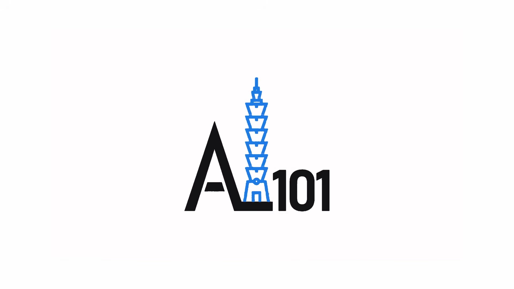

**逐字稿片段：** 最後他還說 做 AI 的公司和罵它們最兇的安全派 其實出自同一個圈子 原影片連結在說明欄，有興趣可以去聽更多。

**話題推測：** 簡述 AI 公司與安全派系實質來自同一個圈子的話題

---
