# ai-note-101_rZX5gygwSwo — 關鍵畫面索引

- 來源逐字稿：[ai-note-101_rZX5gygwSwo_GT.srt](ai-note-101_rZX5gygwSwo_GT.srt)
- 影片：https://www.youtube.com/watch?v=rZX5gygwSwo
- 截圖數：36

## 00:00:00

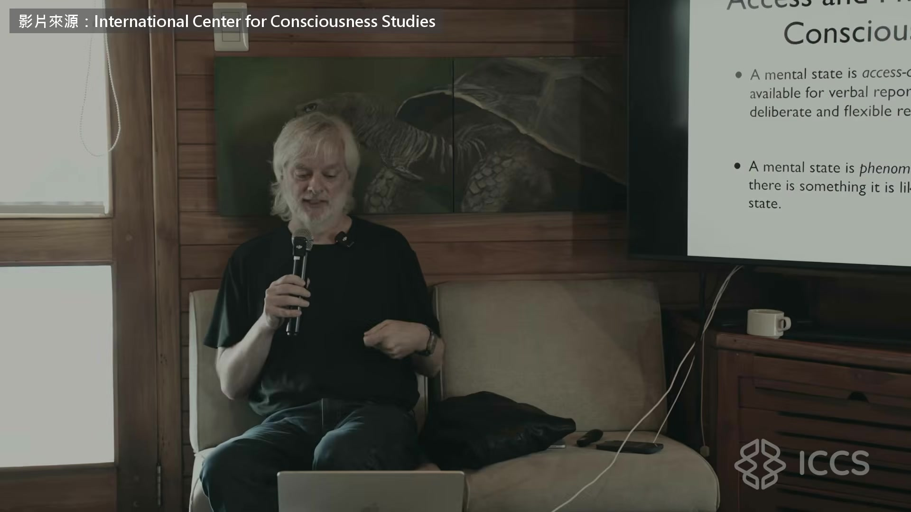

**逐字稿片段：** Anthropic 七月發了一篇論文 說在 Claude 裡找到一塊很像人腦「全域工作空間」的區域 照這套主流的意識理論 大腦裡只有被送上一塊公告欄 廣播給全腦的資訊，你才意識得到 這種能被拿來說話和推理的意識 叫取用意識 全域工作空間的大腦版本

**話題推測：** 新話題：介紹 Anthropic 的論文發布。

---

## 00:00:18

**逐字稿片段：** 提出人之一是法蘭西公學院的神經科學家 Stanislas Dehaene 片中大家叫他 Stan

**話題推測：** 介紹關鍵人物 Stanislas Dehaene 的背景與照片。

---

## 00:00:25

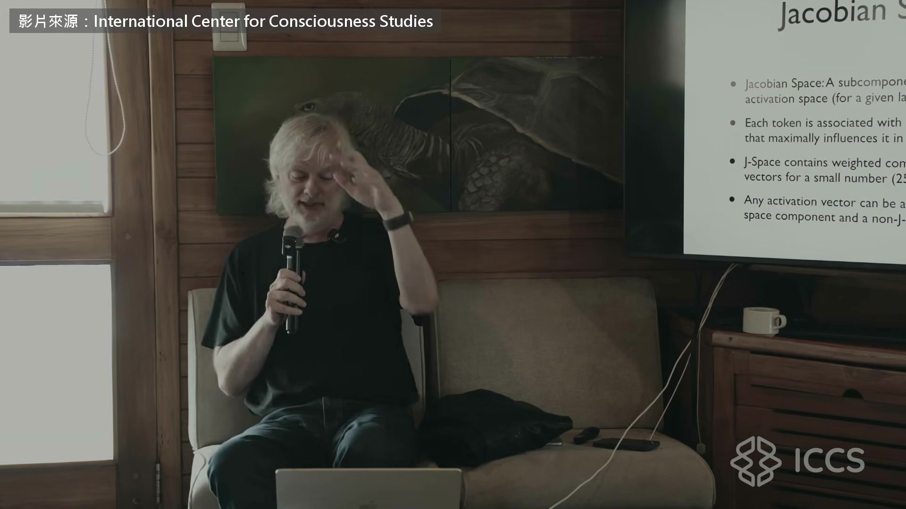

**逐字稿片段：** 另一位是哲學家 David Chalmers 大腦只是在處理資訊 為什麼會有主觀感受 他在 1995 年把這個問題叫做意識的難題 九月初放上網的這場座談，兩人當面辯 這篇論文算不算 AI 有了意識的證據 平心而論，Stan 的評論對這篇相當熱情 他大可以回一句「這根本不是全域工作空間」 可是 Stan 本來說成他自己，接著改口說這是大好消息 對全域工作空間理論來說，這至少是很有希望的近親

**話題推測：** 介紹另一位關鍵人物 David Chalmers 的背景與照片。

---

## 00:01:01

**逐字稿片段：** 其他幾篇評論就比較懷疑 我自己也偏懷疑，但我確實覺得這很振奮人心 說它讓人興奮，是因為它至少顯示 語言模型可以撐起某種意識 就算沒有主觀感受，至少是取用意識 也能分出有意識跟無意識的處理

**話題推測：** 轉向其他評論對論文的懷疑觀點。

---

## 00:01:25

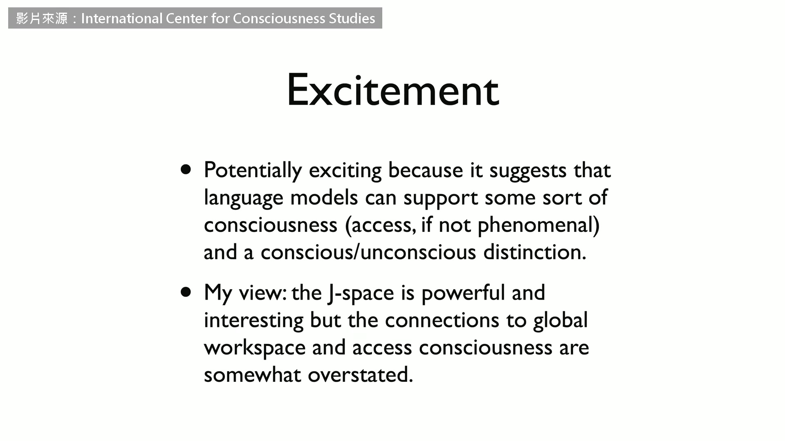

**逐字稿片段：** 話雖如此，我認為 J 空間很強大，也很有意思 但它跟全域工作空間、跟取用意識的關聯 可能被講得有點過頭了 我覺得這些關聯比作者說的還要弱

**話題推測：** 講者對 J 空間的總結性看法。

---

## 00:01:42

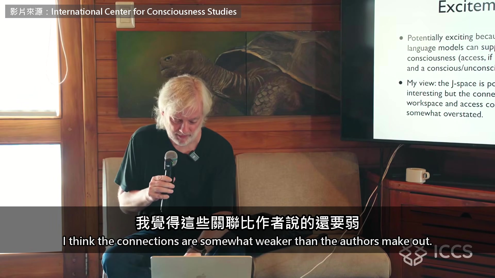

**逐字稿片段：** 我主要會談 Anthropic 這篇論文 也很想聽聽 Stan 怎麼說 論文用的工具叫 J 透鏡 把模型算到一半的中間層直接翻回文字 看它這時候準備說出哪些字

**話題推測：** 轉向深入解釋 Anthropic 這篇論文的具體內容。

---

## 00:01:59

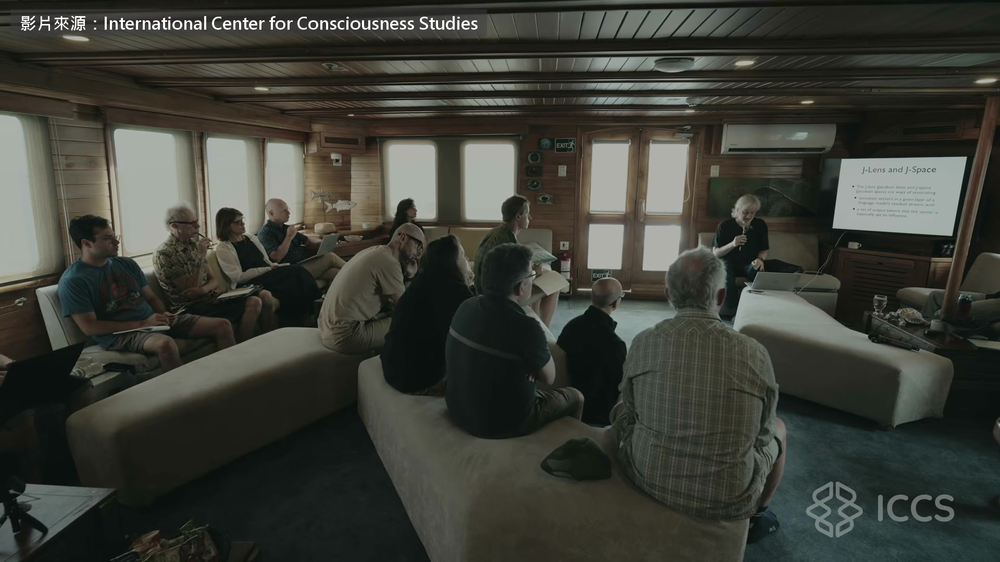

**逐字稿片段：** 翻得出文字的那一塊，就叫 J 空間 舉個例子 題目是「離太陽第四近的行星，顏色是」 答案應該是紅色 但要得出答案，中間得先經過「火星」這一步 第四近的是火星，喔對，火星是紅的 可是「火星」這個詞，根本沒出現在輸出裡 但你用 J 透鏡去看中間那幾層 會發現「火星」其實是最活躍的 分數最高，在 J 透鏡上排第一 雖然它根本沒被說出來 所以用這個辦法，可以看出模型內部的運作 不只是看輸入跟輸出 這就是 J 透鏡

**話題推測：** 定義 J 空間，可能搭配圖示解釋。

---

## 00:02:49

**逐字稿片段：** 還有一個有趣的例子 你叫模型「數到五，並且深刻地內省」 它真的就輸出 1、2、3、4、5 可是用透鏡往裡面看，會看到各種有趣的東西 前面幾層只是一堆亂碼

**話題推測：** 引入第二個有趣的實例來進一步說明 J 透鏡。

---

## 00:03:06

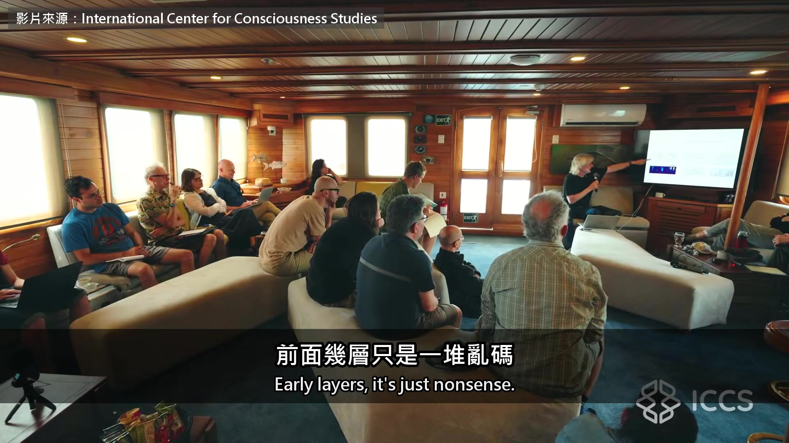

**逐字稿片段：** 可是你會看到「什麼」「意識」「思緒」「停頓」 「意識」「Claude」，都在中間那幾層 到了最後幾層，又變回 1、2、3、4、5 中間那幾層，發生了很有意思的事 在某些位置，還有更精彩的 「現在」「倒數」「停頓」，有的地方寫著「哇」 「思緒」「停頓」「意識」「意識」 好，這裡面跑著一大堆怪東西

**話題推測：** 展示 J 空間中出現的特定內部文字（如「意識」「思緒」）。

---

## 00:03:38

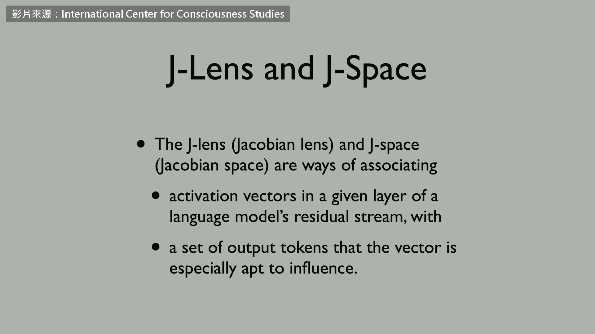

**逐字稿片段：** 論文把 J 空間跟意識連在一起 是因為在意識研究裡 說得出來一向被當成意識到了的證據 Chalmers 要拆的就是這一步 另外值得一提，很多說得出口的東西，其實沒被意識到

**話題推測：** 轉向論文中 J 空間與意識連結的核心論點。

---

## 00:03:53

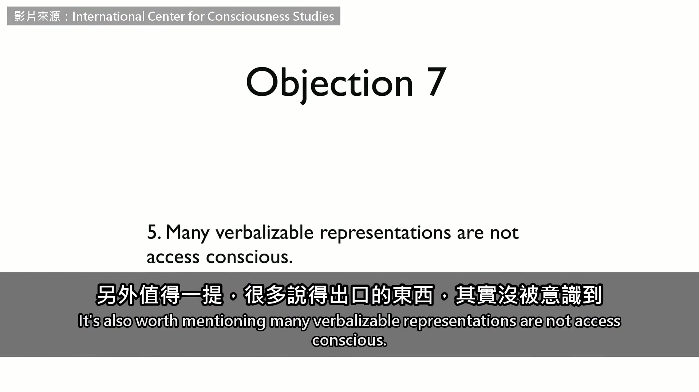

**逐字稿片段：** 舉個佛洛伊德的經典例子 比方說，一個病人對母親有一些潛意識的念頭 讓他老是把「媽媽」掛在嘴邊 這些潛意識的念頭，是說得出口的 人腦如果也有 J 空間，它們就會出現在裡面 它們會影響說出口的話，「媽媽」「媽媽」 可是這些念頭，正是沒被意識到的典型 這些東西影響你說的話 你卻完全不知道，還會否認它們 這就是無意識思考的標準範例

**話題推測：** 引入佛洛伊德的經典例子來支持反對論點。

---

## 00:04:31

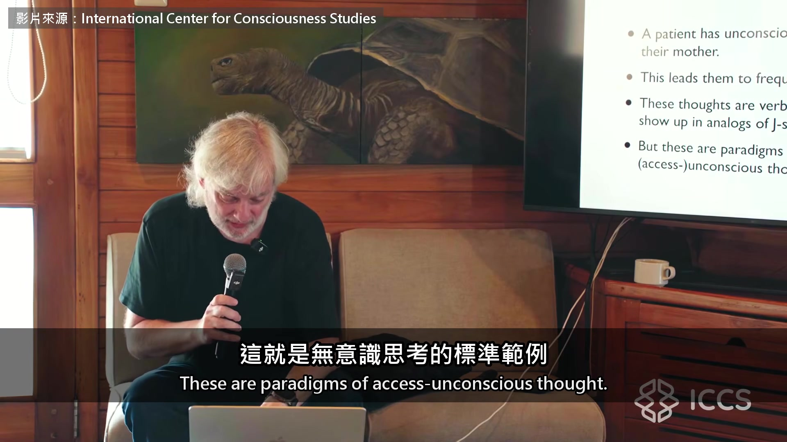

**逐字稿片段：** 所以「說得出口」跟「意識到」的連結也斷了 這背後，我認為有個更根本的問題 說得出口，不等於能報告自己意識到什麼

**話題推測：** 總結「說得出口」不等於「意識到」的論點。

---

## 00:04:42

**逐字稿片段：** 好，總結一下 說 J 空間是真正的全域工作空間，目前證據很弱 說它具備取用意識的關鍵特徵，證據也還很弱 主觀感受那一層也一樣 我確實認為 J 空間很強大，是看懂模型的好工具

**話題推測：** 講者對前一段內容的初步總結。

---

## 00:05:04

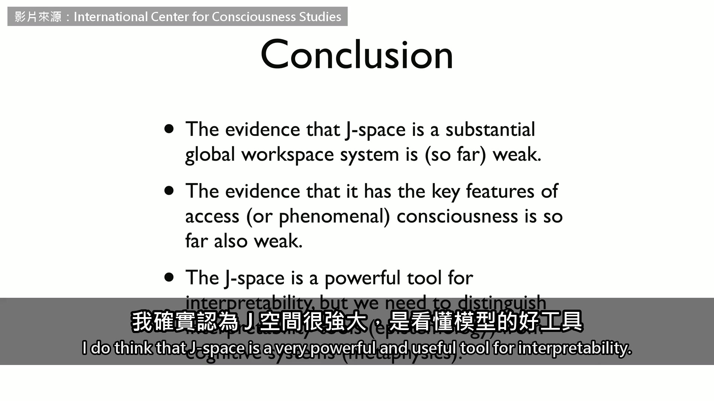

**逐字稿片段：** 但就像很多情況一樣，我們得把看懂系統的工具 它對應的是「我們怎麼認識」這些系統 跟真正的認知系統分開，那對應的是「它們到底是什麼」 謝謝 謝謝，非常好的總結

**話題推測：** 引入關於「認識系統的工具」與「系統本身」的哲學性區分。

---

## 00:05:30

**逐字稿片段：** 你剛提到我很喜歡這篇論文 我想解釋一下，我為什麼真的很高興 也想修正你講的幾點 我很高興，是因為這是第一次 有人造的系統，展現出令人信服的取用意識 而且有完整記錄可查

**話題推測：** Stan Dehaene 開始回應，表達對論文的積極看法，可能切換到他的畫面。

---

## 00:05:53

**逐字稿片段：** 還有一點你沒強調 他們定義 J 空間，只用了「說得出來」這一條

**話題推測：** Stan 提出講者之前沒有強調的重點。

---

## 00:06:01

**逐字稿片段：** 實際的定義就只是，系統裡哪些向量 能透過一個簡單的矩陣轉換，變成輸出的 token 雖然只有這一條定義，它卻有其他所有性質 全都自己冒出來，跟全域工作空間理論預測的一樣 比方說，這些表徵裡藏著知識 不一定會出現在輸出裡，就跟我們的意識一樣 有些事我們心裡很清楚，卻不想說出口 我們一天到晚都這樣 舉個例子，首先，模型內部會有像「哎呀」這樣的狀態 很有意思，當它犯了錯，而且發現了 我知道這是擬人的講法，但看起來真的就是這樣 模型內部有一個 token 在說「哎呀，我搞錯了」 這在輸出裡你看不到，至少大多數時候看不到 但模型靠它自我修正，改掉原本的輸出

**話題推測：** Stan 詳細說明 J 空間的技術定義。

---

## 00:07:01

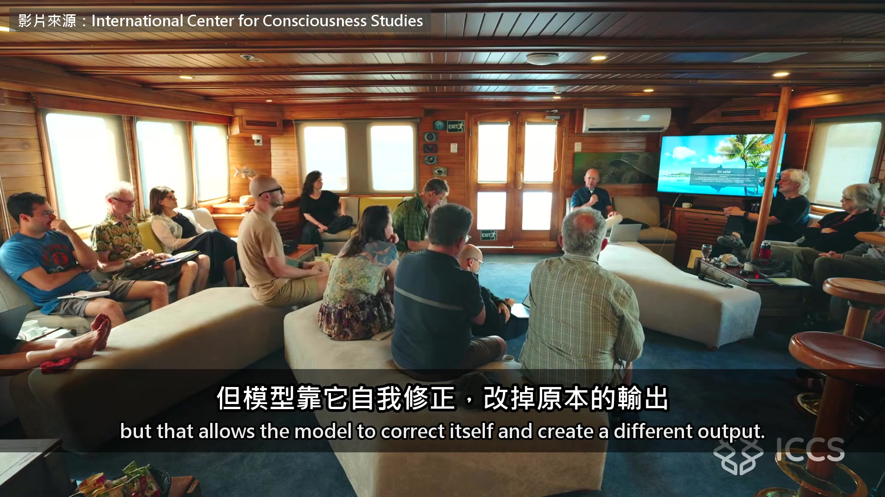

**逐字稿片段：** 我最近還看到一個很棒的例子 原本那篇論文是拿 Claude 做的，問題是 你沒辦法自己玩 J 空間，因為他們沒公開權重 他們放了一個展示版，很好，可以上網玩 但現在別人也做出了 J 空間，Anthropic 團隊也是

**話題推測：** Stan 提出另一個使用 Qwen 模型進行實驗的例子。

---

## 00:07:18

**逐字稿片段：** 例如從 Qwen 做出來，那是公開的模型 在那上面就能真的去玩，看它所有的性質 Qwen 是中國的模型 有人拿天安門去問它 這個模型被訓練得很好，會迴避這個話題 它就說「這不是個禮貌的話題，沒什麼好說的」 這是它說出口的話 可是在 J 空間裡，你會看到「學生」「鎮壓」 基本上就是它對天安門知道的事，只是沒說出口 所以我覺得這很像工作空間，很像意識 我覺得非常厲害

**話題推測：** 提到 Qwen 模型，可能配有 Qwen 的標誌或介紹。

---

## 00:07:56

**逐字稿片段：** 他們的研究裡，有一點讓我特別佩服 LLM 本來就不是設計成有工作空間的架構 它們是單向往前算的架構，全部混在一起 神經元彼此互相連通，沒有模組之分 可是模組還是出現了，工作空間也在系統裡出現了 因為它有用，我是這麼認為 從這個角度看，我反而更驚艷 一個聰明的系統，顯然會自己長出工作空間 就算它的架構一點都不好長 因為系統本來就不是這樣組織的 所以這說明了工作空間架構有多有用 而且確實有一個實質的系統在那裡

**話題推測：** Stan 轉向討論 LLM 架構本身與 J 空間的出現。

---

## 00:08:42

**逐字稿片段：** 你說它只是工具、在因果上不起作用，這讓我特別吃驚 因為他們最擅長的，就是因果實驗 我們神經科學家幾乎沒辦法在人身上做因果實驗 但他們可以，論文裡也做了，漂亮極了 對神經科學家來說，這簡直是夢想

**話題推測：** Stan 回應 J 空間因果作用的論點，強調實驗的重要性。

---

## 00:09:01

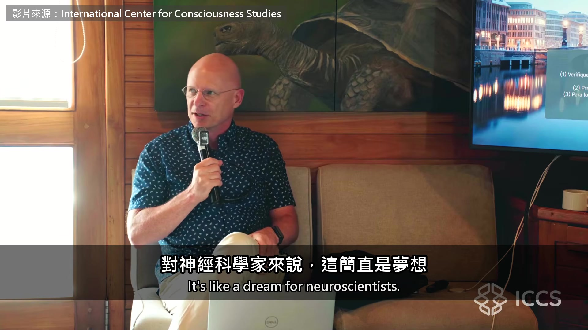

**逐字稿片段：** 他們選擇性地破壞 J 空間，也調換 J 空間的向量 比方說，模型裡有一個代表「德國」的向量 他們把它換成「法國」 結果很精彩，這只影響需要靈活思考的任務 不影響例行的任務 預測下一個字的能力完全沒受影響 那是例行任務，但推理火星是什麼顏色的能力就變了 所以它的因果效果非常有選擇性 我認為 J 空間在因果上非常有作用，沒錯 Stan 把切除 J 空間後 特定能力受損，當成因果證據

**話題推測：** Stan 描述論文中進行的因果實驗方法（破壞與調換）。

---

## 00:09:37

**逐字稿片段：** 換 Chalmers 回應 只要切掉一塊，系統跟著壞 就能證明 J 空間有獨特的因果作用嗎 回到具體的幾點，有一點是關於因果作用 還有做因果介入的實驗

**話題推測：** Chalmers 準備回應 Stan 的論點，可能切換到他的畫面。

---

## 00:09:54

**逐字稿片段：** 在機器學習的文獻裡，做切除實驗很常見 拿一個子空間，把它歸零，看會有什麼效果 幾乎每一次，或者說非常常見的是 某些輸出或某些能力會受到明顯的影響 不過我傾向認為，切除是一個非常非常弱的標準 拿來判斷是不是真的有因果作用

**話題推測：** Chalmers 提出對機器學習切除實驗有效性的質疑。

---

## 00:10:24

**逐字稿片段：** 研究因果的文獻，把這叫做「笨手笨腳的介入」 每次你拿掉系統裡的一個部件 其實等於拿掉了上百萬個不同的部件

**話題推測：** Chalmers 引用「笨手笨腳的介入」術語來形容切除實驗。

---

## 00:10:37

**逐字稿片段：** 我覺得至少在他們的實驗裡，有雙重分離 起碼是神經心理學說的那種分離 有些任務完全不受影響，有些任務壞掉了 在神經科學裡，這就算因果證據

**話題推測：** Stan 打斷並強調實驗中的「雙重分離」證據。

---

## 00:10:51

**逐字稿片段：** 對，但我擔心的是，會有上百萬個別的子空間 也完全一樣成立 事實上，他們發表 J 透鏡才過幾週 就有人做出 R 透鏡，這些都做得到，表現還更好 而且它跟 J 透鏡有關 跟 J 空間有關 什麼？ 它跟 J 空間大概根本不是互不相干 對，重點就是它們不是互不相干，它們相關 但會有上百萬個子空間，都跟 J 空間相關 在這麼高維的系統裡，相關性非常廉價 那是切除，那調換呢？ 調換的效果非常精準，突然間你… 抱歉

**話題推測：** Chalmers 回應，指出許多子空間可能都有類似因果作用。

---

## 00:11:31

**逐字稿片段：** 他們調換向量的實驗，我覺得很有說服力 你在 J 空間裡，把「這段文字是西班牙文」的向量 換成「這段文字是法文」 模型接著寫下去，用的還是原本那個語言 可是你問比較高層的問題，像「這段文字的作者是誰」 這時候它就換掉了 所以有些自動的任務保住了，有些非自動的任務受損了

**話題推測：** Stan 再次強調向量調換實驗的說服力。

---

## 00:11:57

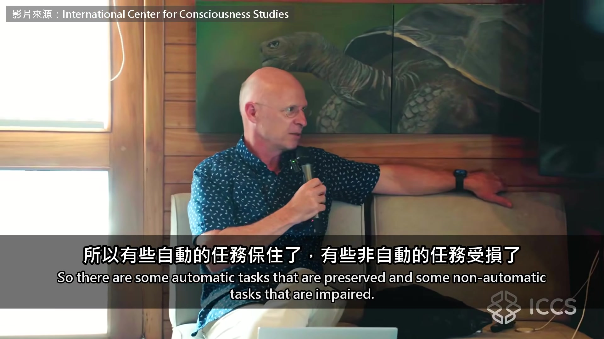

**逐字稿片段：** 我只是覺得，這些效果你都會看到，不只 J 空間 還有 logit 空間、R 空間，上百萬種空間都在運作 它們都是同一個內部表徵的不同視角 那不代表它就是那個內部表徵

**話題推測：** Chalmers 再次強調因果效果不獨屬於 J 空間。

---

## 00:12:09

**逐字稿片段：** 這才是有意思的問題，像腦波追蹤的是系統裡的某種東西 可能是神經放電的振盪之類的 底下也許有某個因果機制，腦波跟它相關 但腦波直接看到的東西，本身大概不是因果機制 我懂，但我們做因果實驗，不是去改腦波 做因果實驗，我們改的是細胞的活動 腦波只是反映出那些活動 他們在 LLM 裡做的就是這件事 他們能改動內部某個特定的表徵 對神經科學家來說，這真的是夢寐以求 不然你要怎麼證明因果關係？

**話題推測：** Chalmers 引入腦波的類比，說明相關性不等於因果性。

---

## 00:12:53

**逐字稿片段：** 我想你的批評，不是在說有沒有因果 你在意的是它夠不夠特定 如果你能證明，J 空間的影響 對相關的輸出和能力，比其他任何空間都強 那就能說明它確實有特殊地位 可是在我看來，到目前為止，沒有理由這麼相信

**話題推測：** Chalmers 澄清他質疑的重點是 J 空間因果作用的「特異性」。

---

## 00:13:14

**逐字稿片段：** 台下有人問 LLM 只會一層一層往前算 沒有人腦那種來回的迴路 會不會因此少了什麼能力 這些系統能做得這麼好，真的很驚人 畢竟它們基本上只是單向往前算的系統 我們以前都以為，來回的迴路會非常關鍵 也許你可以說，有些特性取代了迴路的功能 像是一次運算裡疊了很多層之類的

**話題推測：** 影片進入聽眾提問環節。

---

## 00:13:41

**逐字稿片段：** 但還是很不可思議，因為事實是 我舉不出這些語言模型在原則上有什麼做不到的事 除了那些需要身體的事，它們沒有身體 我找不到任何一種認知能力，是人類明確擁有 而這些系統永遠不會有的 所以這題我答不出來 模型想的比說出口的多 這一點兩個人都同意

**話題推測：** Chalmers 總結他對 AI 能力之廣的看法。

---

## 00:14:09

**逐字稿片段：** 吵的是下一步 Chalmers 要先看到 J 空間比其他上百萬個子空間都更特別 才肯承認它是模型裡真正的工作空間 原影片一個半小時，台下還問了兩件事

**話題推測：** 旁白指出雙方爭論的核心問題。

---

## 00:14:22

**逐字稿片段：** 一件是 AI 之間如果不再用文字溝通 直接互傳 J 空間 Chalmers 說那就麻煩了 因為人類讀不到它們在講什麼

**話題推測：** 旁白提到觀眾提出的第二個問題（AI 之間如何溝通）。

---

## 00:14:29

**逐字稿片段：** 另一件是 模型都是拿人類寫的東西訓練的 J 空間會不會只是學到了人腦的樣子 Chalmers 猜不是 換成別種資料，大概也長得出來 原影片連結在說明欄，有興趣可以去聽更多。

**話題推測：** 旁白提到觀眾提出的第三個問題（J 空間是否僅學到人腦的樣子）。

---
