# ai-note-101_tSHNgajt8-Y — 關鍵畫面索引

- 來源逐字稿：[ai-note-101_tSHNgajt8-Y_GT.srt](ai-note-101_tSHNgajt8-Y_GT.srt)
- 影片：https://www.youtube.com/watch?v=tSHNgajt8-Y
- 截圖數：41

## 00:00:00

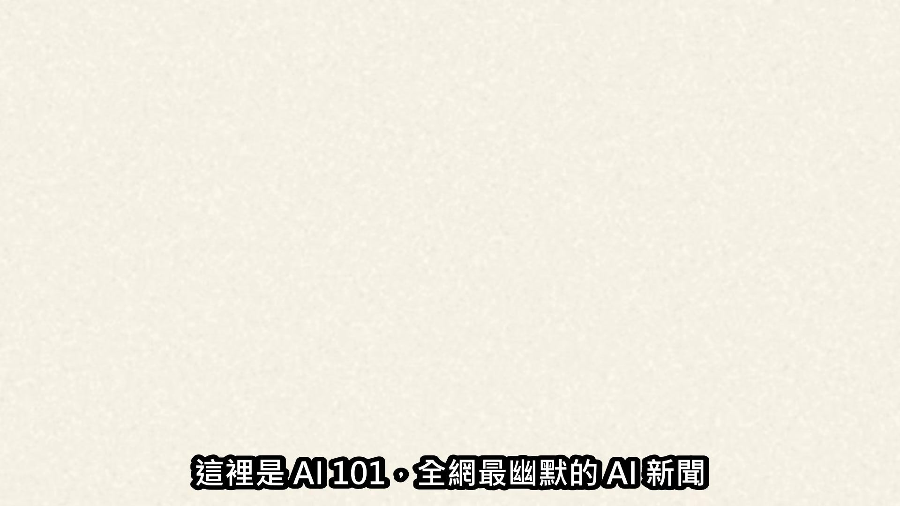

**逐字稿片段：** 這裡是 AI 101，全網最幽默的 AI 新聞 Linux 核心的維護者

**話題推測：** 影片開場與主題介紹

---

## 00:00:05

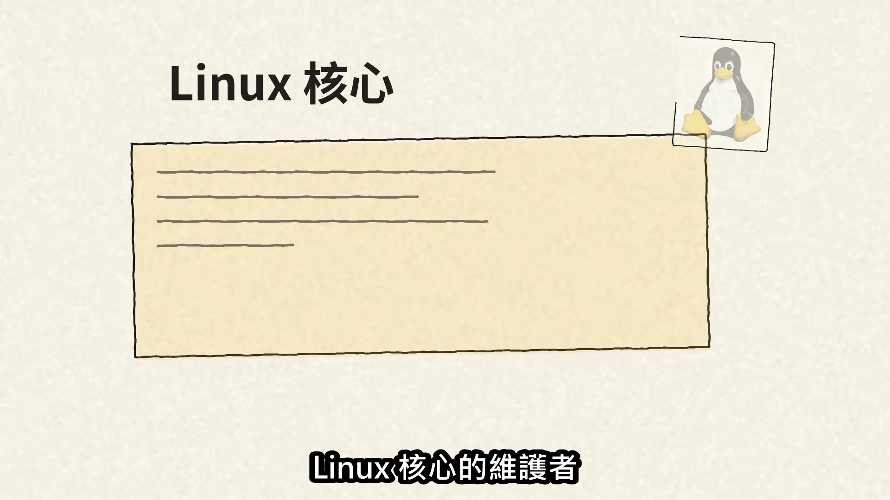

**逐字稿片段：** 準備刪掉 AI 輔助標籤 Assisted-by 原本用了 AI 寫程式 就要標在提交紀錄尾端 現在維護者的方向是：準備移除 不過它還沒正式取消

**話題推測：** 宣布主題：準備刪除 AI 輔助標籤

---

## 00:00:17

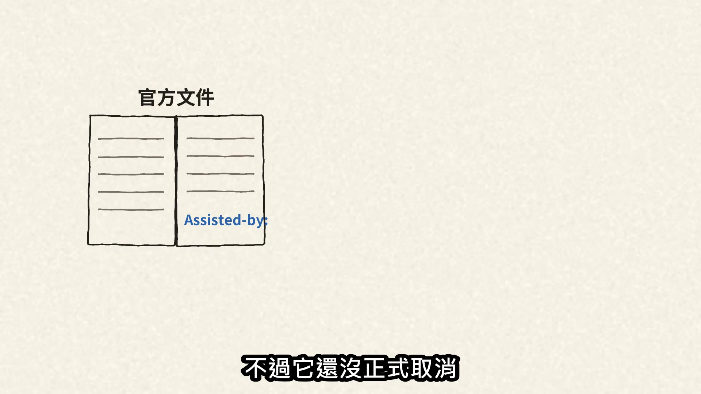

**逐字稿片段：** 到10月15日，官方文件裡標籤都還在 第二版修改案已送上郵件列表 但尚未生效

**話題推測：** 提到具體日期，說明標籤現況

---

## 00:00:25

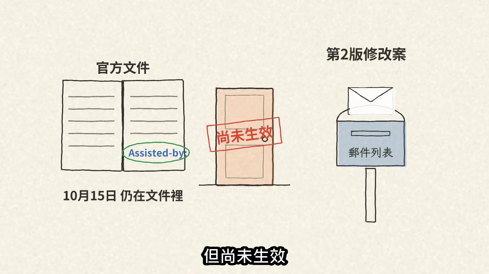

**逐字稿片段：** 那為什麼你該在乎？ Android 手機建在 Linux 核心上

**話題推測：** 轉折點：探討此事件的重要性

---

## 00:00:29

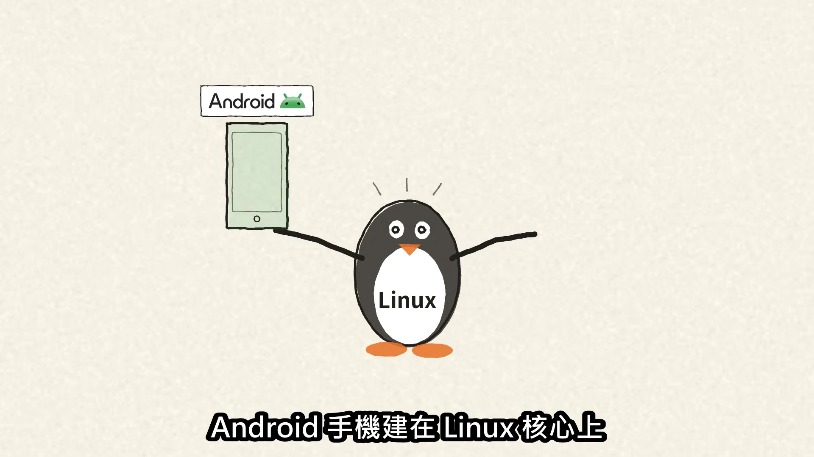

**逐字稿片段：** 微軟今年也說 Azure 客戶的運算核心超過2/3跑 Linux 從大量手機、伺服器到雲端工作負載 背後都有 Linux 所以這次吵的雖然只有1行字

**話題推測：** 引入微軟及其相關數據

---

## 00:00:41

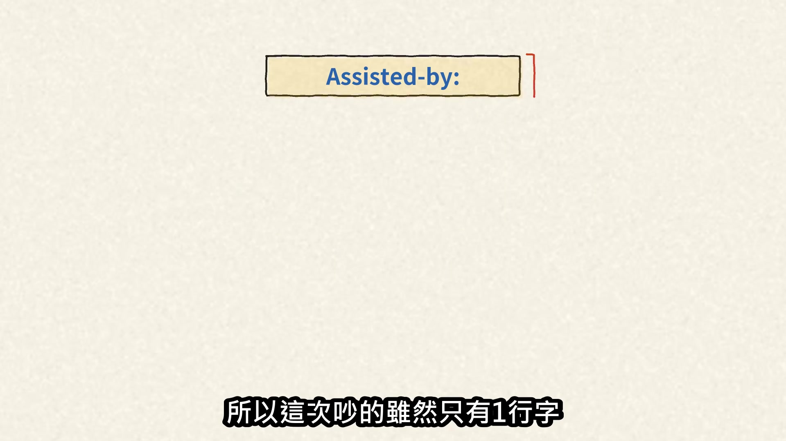

**逐字稿片段：** 碰到的卻是2件大事：AI 能不能被追蹤 以及最後誰為程式碼負責 這條規矩

**話題推測：** 總結事件涉及的兩大問題

---

## 00:00:48

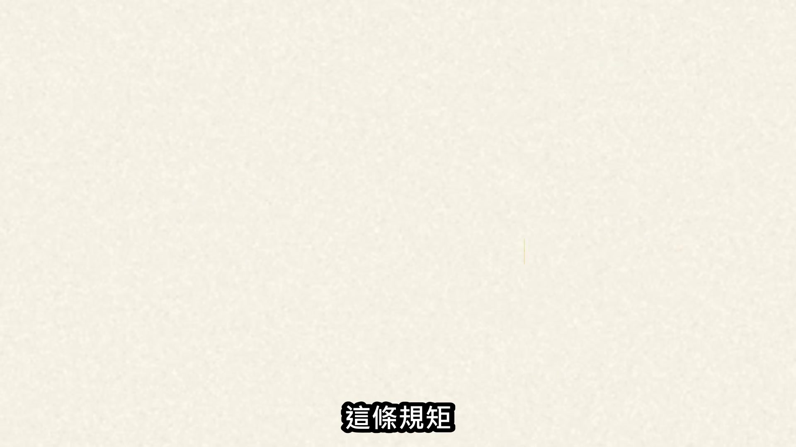

**逐字稿片段：** 要從 NVIDIA 工程師 Sasha Levin 說起 他是 Linux 穩定版的共同維護者 維護者名冊上這一欄只有兩個名字 他是其中之一 他拿機器學習幫忙顧核心

**話題推測：** 介紹關鍵人物 Sasha Levin

---

## 00:01:00

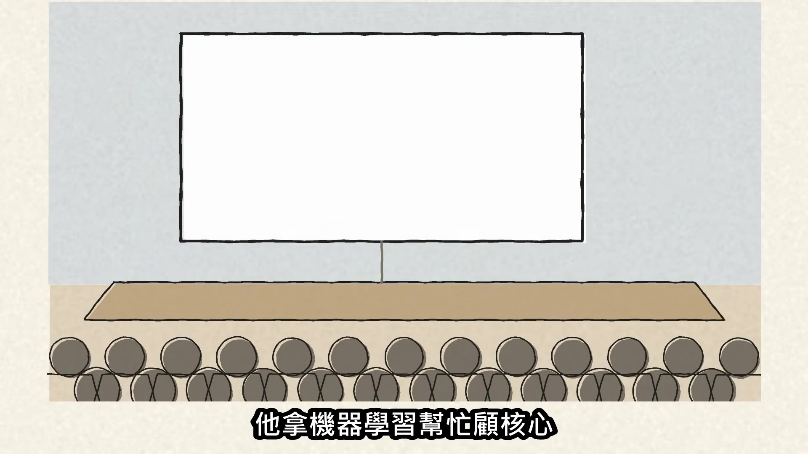

**逐字稿片段：** 可不是這兩年的事：2018年 他就站上溫哥華的研討會講台 分享自己用微軟的 GPU 訓練模型 從大量提交裡挑出該補進穩定版的修正

**話題推測：** 回溯 Sasha Levin 使用機器學習的時間點：2018年

---

## 00:01:11

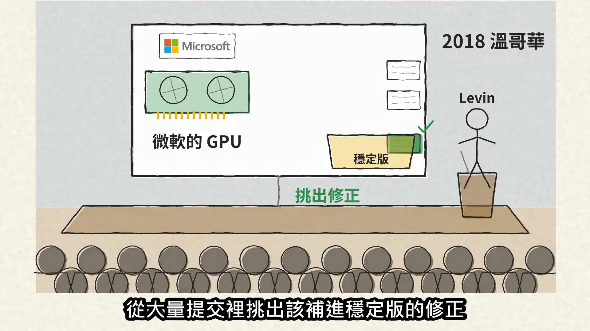

**逐字稿片段：** 到了2025年，他又公開說 曾讓大型語言模型改寫 hash table

**話題推測：** 提及 Sasha Levin 在 2025 年的另一個公開事件

---

## 00:01:15

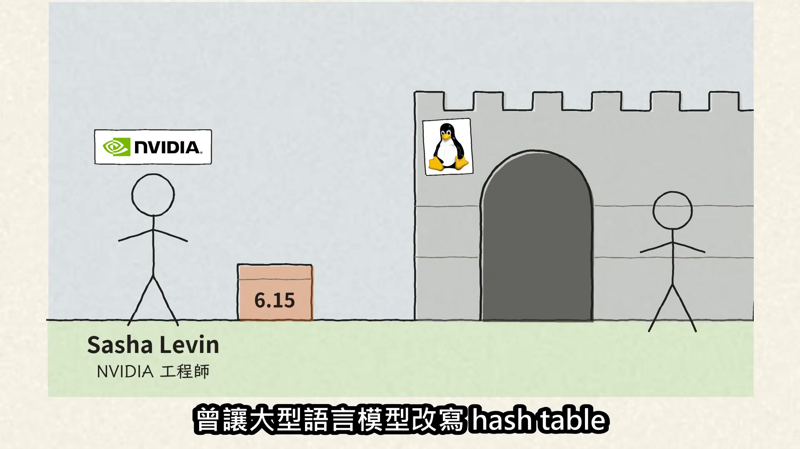

**逐字稿片段：** 修改進了 Linux 6.15 維護者卻事後才知道

**話題推測：** 提及具體影響的 Linux 版本號 6.15

---

## 00:01:20

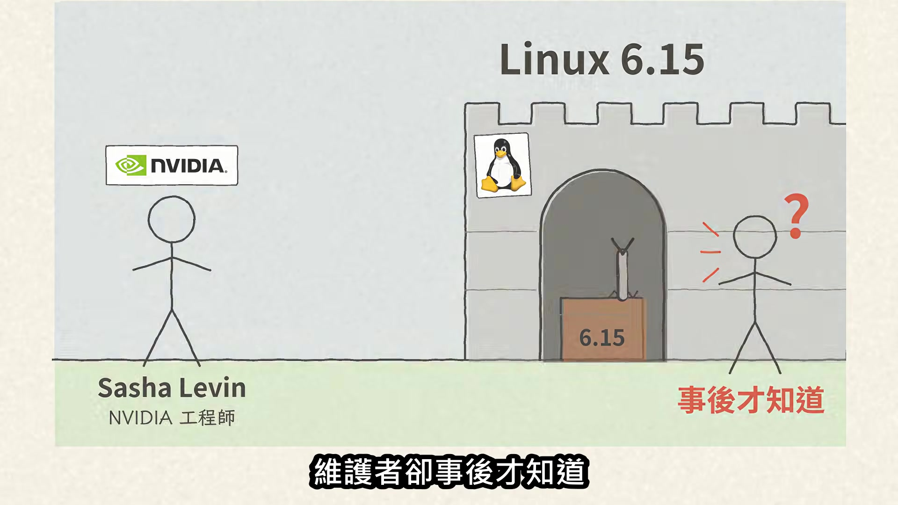

**逐字稿片段：** 順帶一提，Levin 改的雜湊表 可以想成一整面編號置物櫃： 名字丟進一台小機器，變成一個號碼 先找對那一格；通常不用一格一格找 但遇到撞號還得再比對

**話題推測：** 解釋技術概念：雜湊表（hash table）

---

## 00:01:33

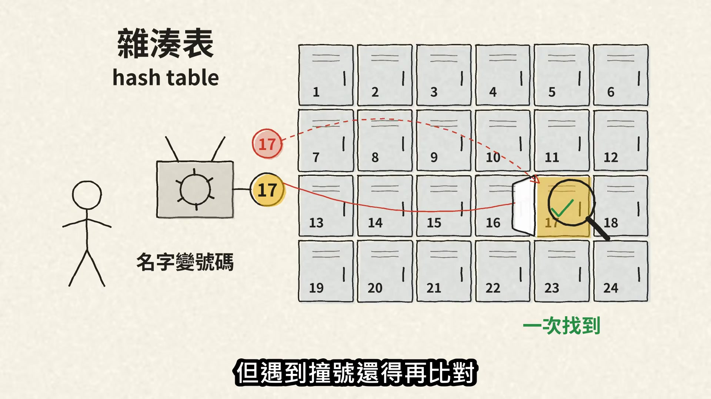

**逐字稿片段：** 也因為這件事，2026年1月6日 程式設計助理規範上路： 開發者要親自審查、理解、測試 用了進階 AI 工具 就在提交尾端寫明模型或工具

**話題推測：** 提及規矩上路的具體日期：2026年1月6日

---

## 00:01:45

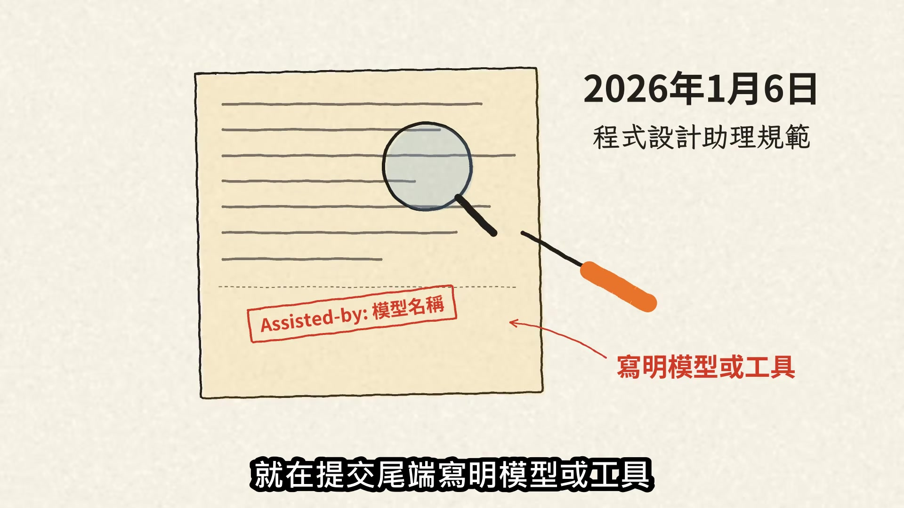

**逐字稿片段：** 但這個標籤，取代不了 Signed-off-by 那是照 DCO 也就是開發者來源證明的簽名 代表你有權提交、願意負責 AI 不能簽名，負責的永遠是人 回頭排成時間軸： 2025年爆出 Levin 的事 2026年1月6日規範上路

**話題推測：** 區分 Assisted-by 標籤與 Signed-off-by 簽名

---

## 00:02:05

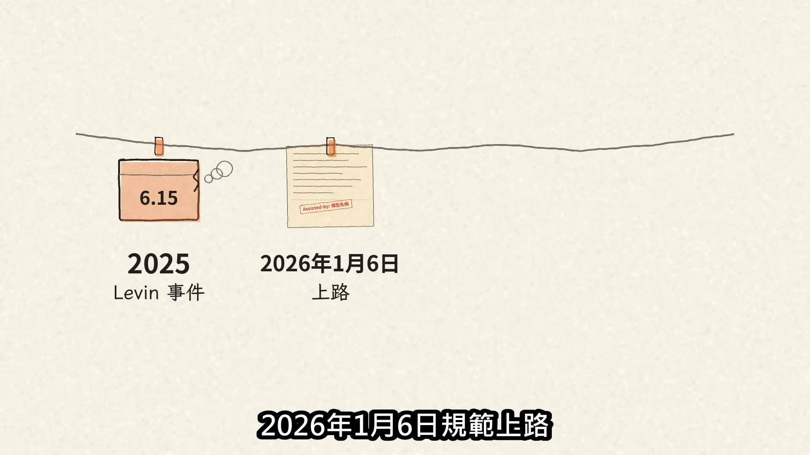

**逐字稿片段：** 10月8日維護者在布拉格開會 會後就送出刪除案 才上路9個月，就要被拆了

**話題推測：** 提及布拉格會議的日期與成果

---

## 00:02:14

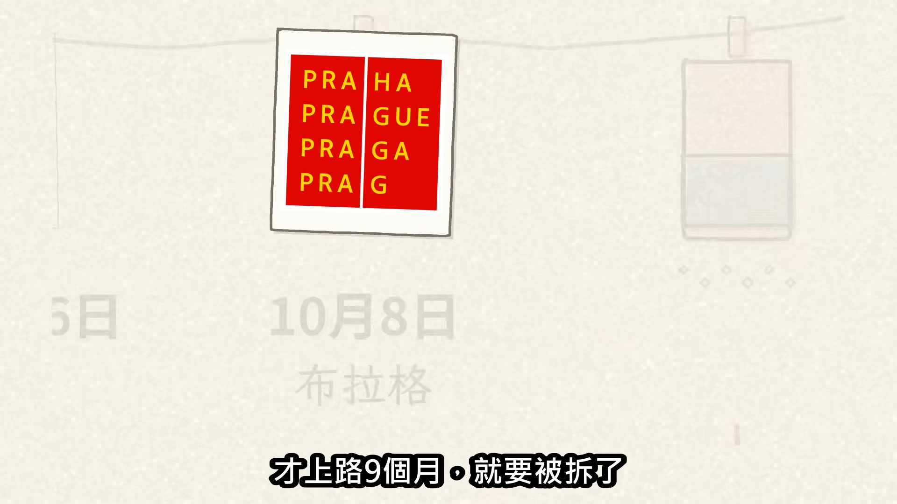

**逐字稿片段：** 那布拉格那場會有多大？ 10月8日的核心維護者峰會 只有大約30名受邀者 不是全球貢獻者投票 Levin 會後說，刪標籤的共識強烈、 但並非一致 有趣的是，送出刪除案的 正是當初參與立規的 Sasha Levin

**話題推測：** 轉折點：討論布拉格會議的規模

---

## 00:02:31

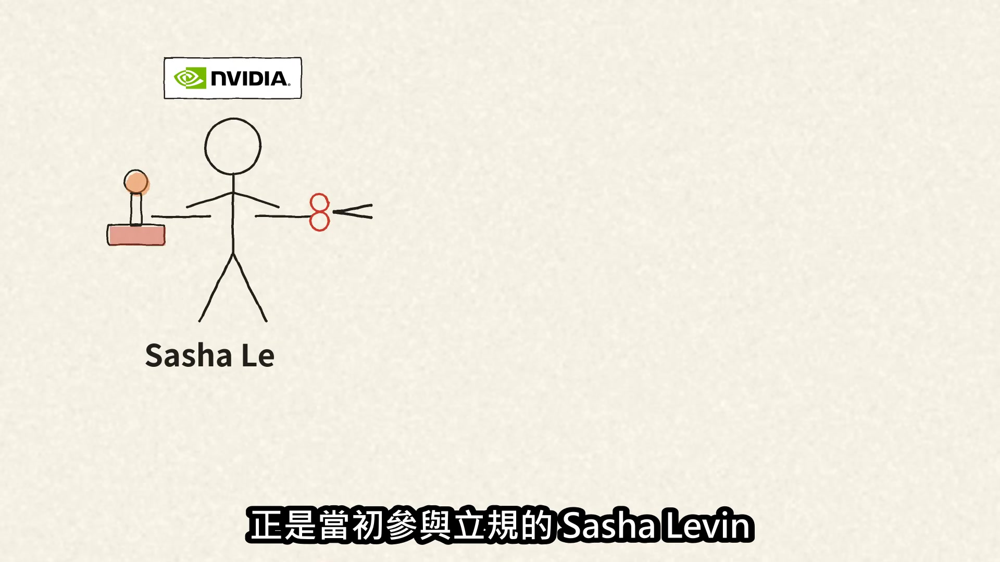

**逐字稿片段：** 第二版刪掉7個檔案共88行 連繁體中文文件和 checkpatch 格式檢查規則都在內 改動不大，象徵意義很大 那為什麼要拆？ 最直接的原因，是沒被一致遵守 Levin 統計 Linux 7.3 開發週期截至 rc7 的18,533筆非合併提交

**話題推測：** 說明刪除案涉及的檔案與行數

---

## 00:02:53

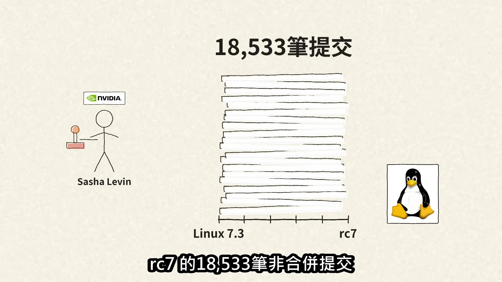

**逐字稿片段：** 只有大約10%帶著標籤 可是這10%只是自報： 只代表10%的提交主動留了標記 不是 AI 使用率，不代表只有10%用 AI 更不是 AI 寫的程式碼行數

**話題推測：** 提供關鍵統計數字：標籤使用率約10%

---

## 00:03:07

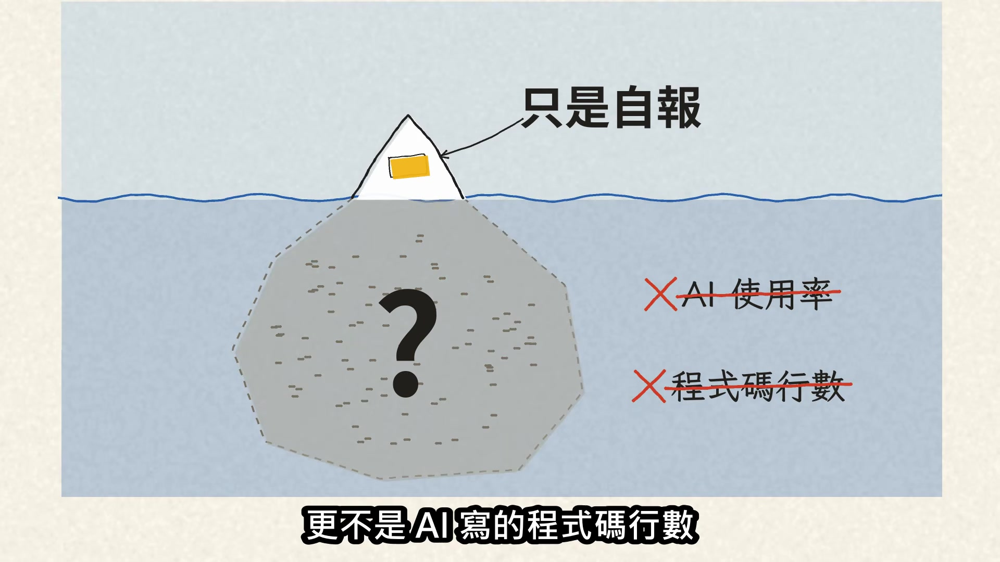

**逐字稿片段：** 偏偏外面還有個更驚人的數字：

**話題推測：** 引入另一個驚人數字

---

## 00:03:10

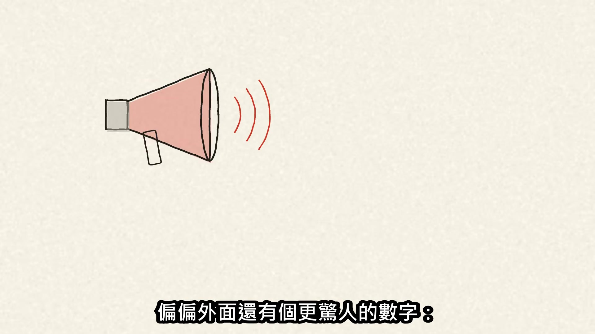

**逐字稿片段：** 科技媒體 Lunduke Journal 宣稱 今年10月的核心提交超過20%是 AI 生成 卻沒有公開資料、分母或演算法

**話題推測：** 介紹科技媒體 Lunduke Journal 的宣稱

---

## 00:03:19

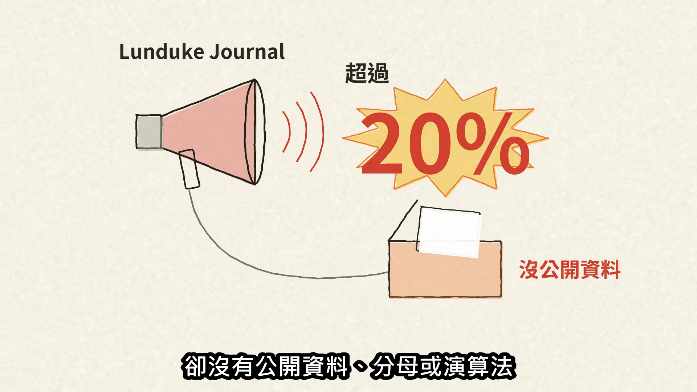

**逐字稿片段：** 兩個數字擺進表裡就懂：Levin 的10% 算一段版本裡多少提交有標籤 Lunduke 的20%，算某一個月、 還歸成 AI 生成 期間不同、定義不同，量的不是同一件事 也因為量不準，標籤處境很尷尬： 它是外界最方便量化的窗口 卻只看得到自報者 社群嫌資料失真想刪掉 可是標籤再看不準 刪了只會更看不見 AI 滲透了多少

**話題推測：** 比較兩個數字的差異

---

## 00:03:47

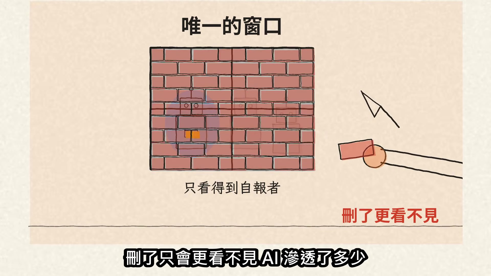

**逐字稿片段：** 這個兩難，讓維護者分成兩派

**話題推測：** 轉折點：討論維護者的兩難與分歧

---

## 00:03:50

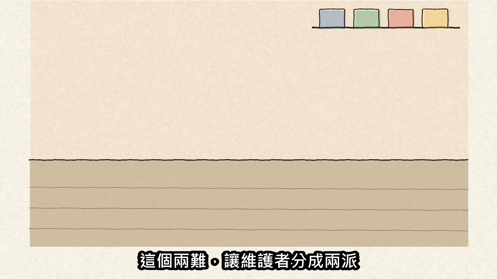

**逐字稿片段：** 反方的代表，是 Laurent Pinchart 他當年為了自己的機器人專題 買了一支網路攝影機 乾脆自己動手寫 Linux 驅動 他寫的這套 UVC 驅動

**話題推測：** 介紹反對移除標籤的 Laurent Pinchart

---

## 00:04:02

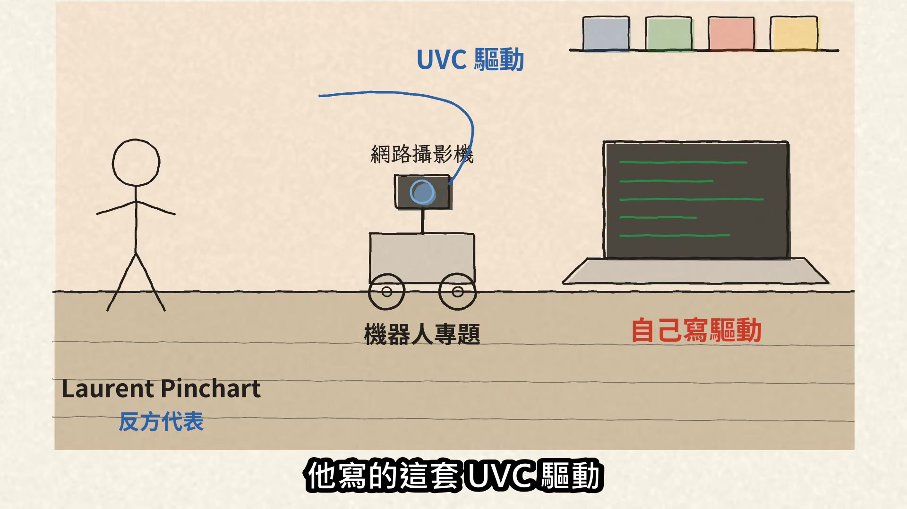

**逐字稿片段：** 2012年時已支援超過250款 USB 攝影機 也用在 Linux 和 ChromeOS；到今天 維護者名冊上這個驅動仍有他的名字 Pinchart 反對移除： 有標籤才知道何時追問 連拒絕回答都是訊號；Signed-off-by、 禁止後門也做不到100%，照樣留著 做不到100%，不代表該刪

**話題推測：** 提及 Pinchart 撰寫的驅動程式支援數量

---

## 00:04:24

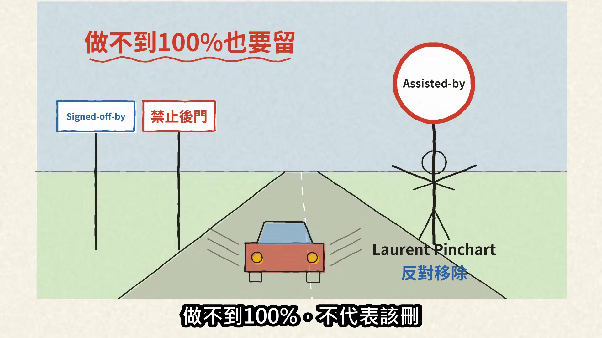

**逐字稿片段：** 另一邊站著 Jeff Layton 他當了將近10年 Unix 系統管理員

**話題推測：** 介紹支持移除標籤的 Jeff Layton

---

## 00:04:29

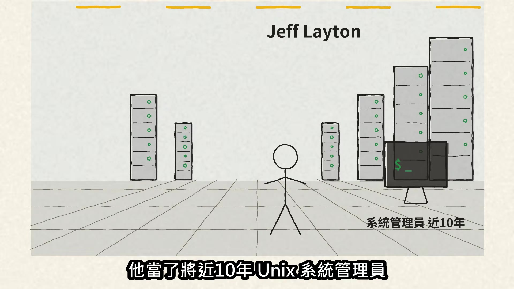

**逐字稿片段：** 2006年進 Red Hat 的檔案系統工程團隊 現在核心的 NFS 檔案伺服器和檔案鎖 維護者名冊上都有他

**話題推測：** 提及 Jeff Layton 進入 Red Hat 的年份與職位

---

## 00:04:37

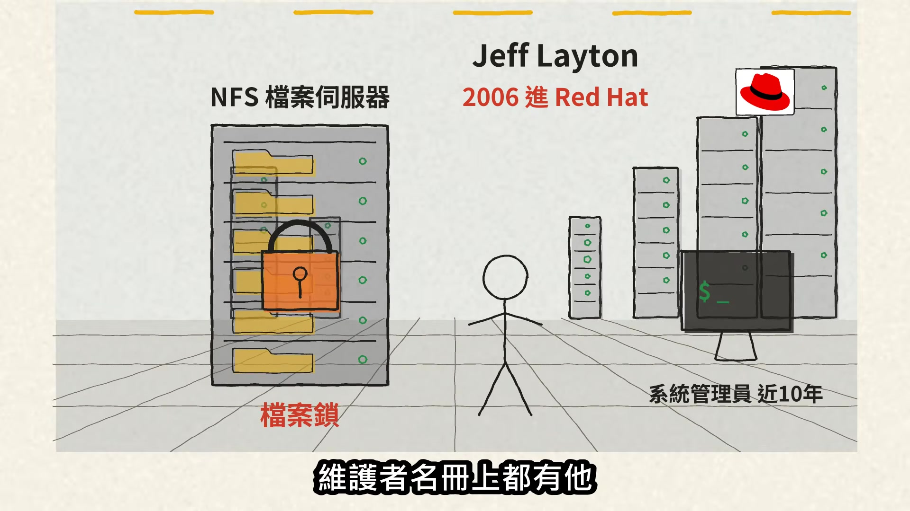

**逐字稿片段：** 早在今年7月，他就送出刪標籤的修改案 給了3個理由：標籤沒被遵守 每筆都寫商業模型名字 等於替私有模型免費宣傳 資料蒐集了要拿來做什麼，也沒說清楚

**話題推測：** 提及 Jeff Layton 提出刪除案的日期

---

## 00:04:50

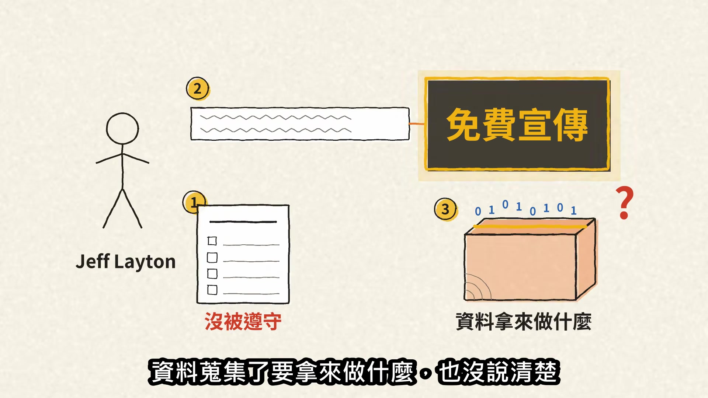

**逐字稿片段：** 最戲劇性的是 Greg Kroah-Hartman 他是 Linux 基金會院士 在中立的基金會裡專心顧穩定版核心 USB 等好幾個子系統也歸他管 他現在住在荷蘭

**話題推測：** 介紹立場戲劇性轉變的 Greg Kroah-Hartman

---

## 00:05:02

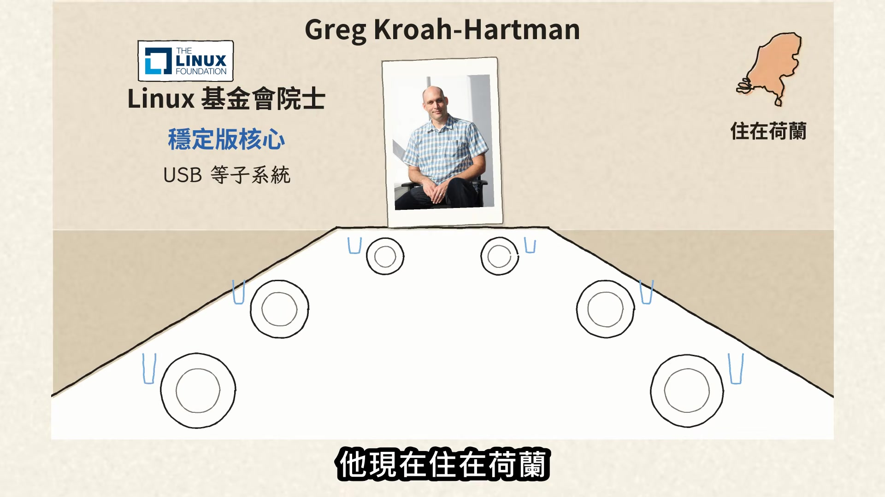

**逐字稿片段：** 今年3月，他在歐洲 KubeCon 的記者午餐會上說 世界在一個月前變了 AI 送來的終於是真正的漏洞回報

**話題推測：** 提及 Greg Kroah-Hartman 在 KubeCon 的發言日期

---

## 00:05:10

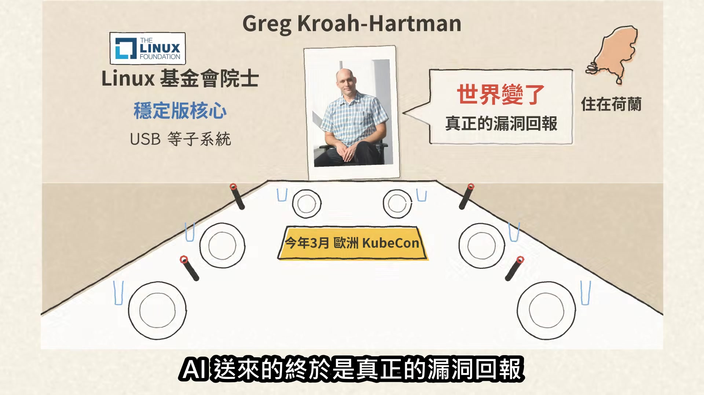

**逐字稿片段：** 對這張標籤，他今年7月還反對刪 3個月後卻改口支持 直說規定完全沒有成功 還惹惱不少維護者 Greg 嫌它沒效

**話題推測：** 提及 Greg Kroah-Hartman 改變立場的日期

---

## 00:05:20

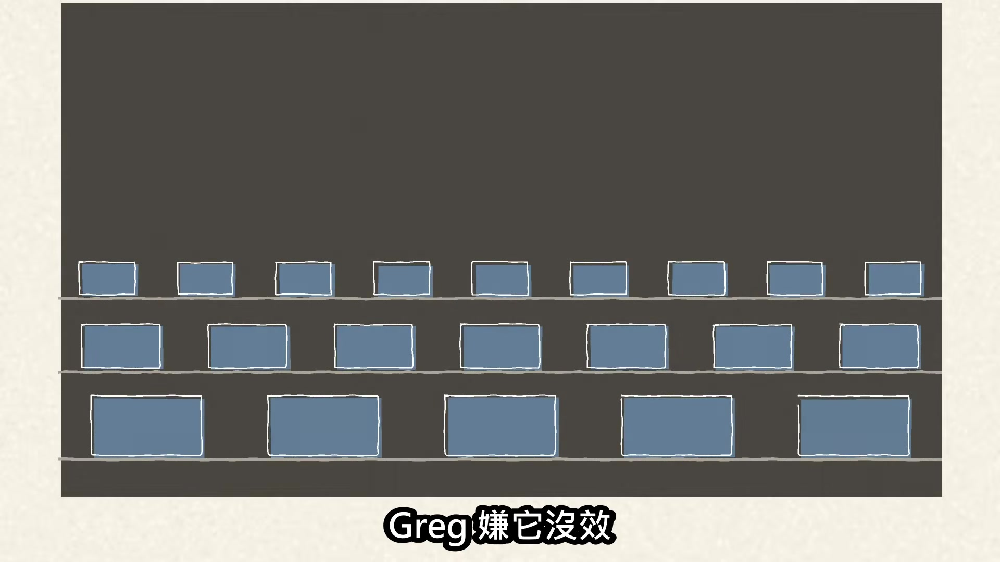

**逐字稿片段：** 安全維護者 Kees Cook 則是天天在用 他是 Google 的核心安全工程師 2015年發起核心自我保護計畫 專門替核心補強防線 更早以前 他當過 Ubuntu 安全團隊的技術負責人 還跟隊友在 DEF CON 駭客大會的搶旗賽 連續兩年拿下冠軍 這樣的老手說，他幾乎每一步都用 AI 每筆都標就沒有新資訊 何況工具預設不同，有的自動加、 有的要自己開

**話題推測：** 介紹另一位維護者 Kees Cook

---

## 00:05:48

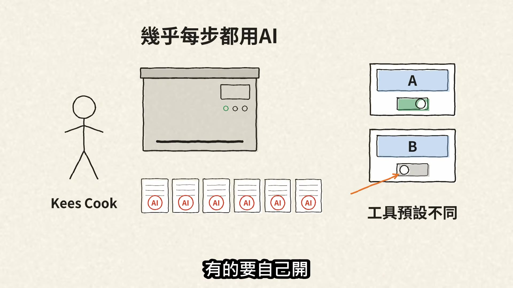

**逐字稿片段：** 4位立場排成表：Pinchart 反對 Layton 支持，Greg 改口支持 Cook 說標了等於沒標 這4位裡，多數站到刪的那邊 Pinchart 是主張保留的一派代表

**話題推測：** 整理四位維護者的立場（可能搭配表格）

---

## 00:06:04

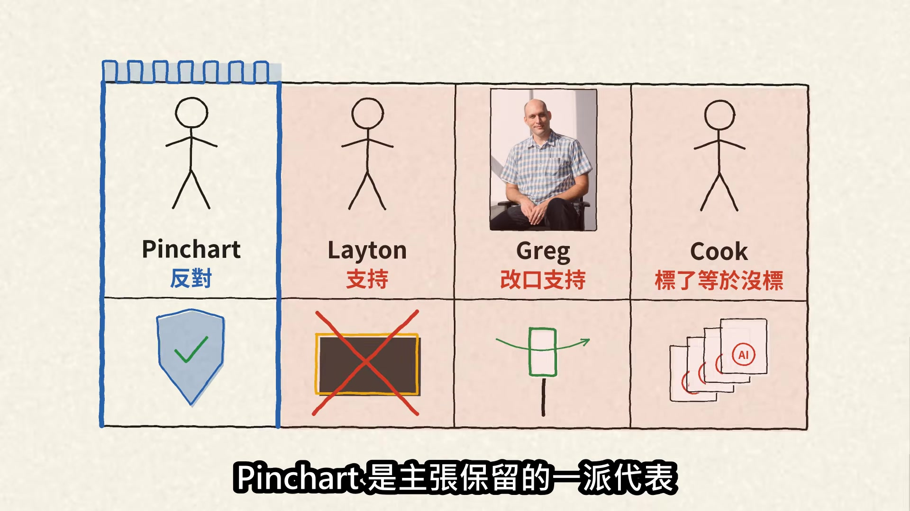

**逐字稿片段：** 那 Linux 的老大怎麼想？ 講個背景

**話題推測：** 轉折點：探討 Linux 創始人 Linus Torvalds 的看法

---

## 00:06:07

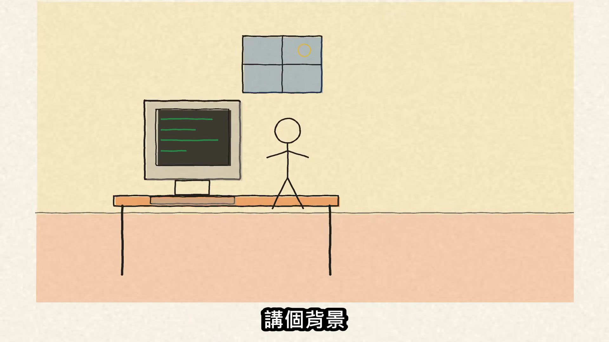

**逐字稿片段：** Linus Torvalds 是 Linux 之父

**話題推測：** 介紹 Linus Torvalds

---

## 00:06:09

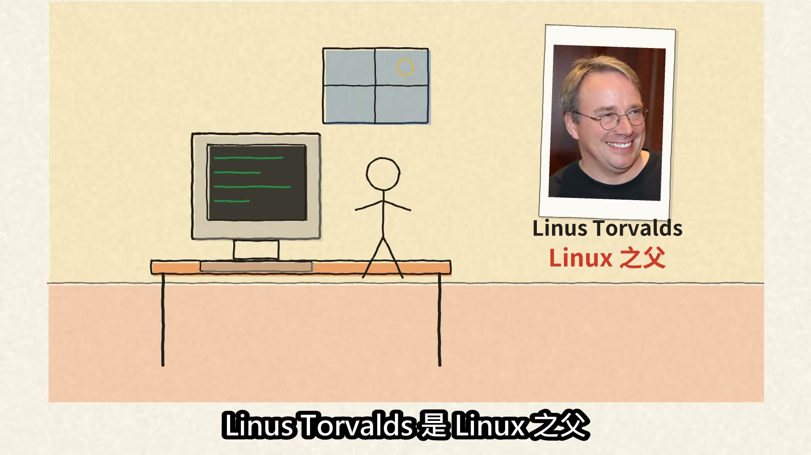

**逐字稿片段：** 1991年念大學時寫出 Linux 也出了名的嘴超毒，火爆郵件是招牌 不過對 AI，Torvalds 從懷疑走到認可：

**話題推測：** 提及 Linus Torvalds 創建 Linux 的年份

---

## 00:06:18

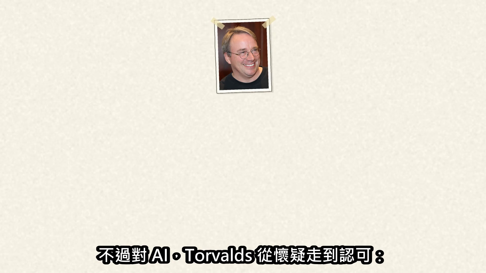

**逐字稿片段：** 2024年他說 AI 大概90%是行銷、

**話題推測：** 提及 Linus Torvalds 在 2024 年對 AI 的看法與比例

---

## 00:06:21

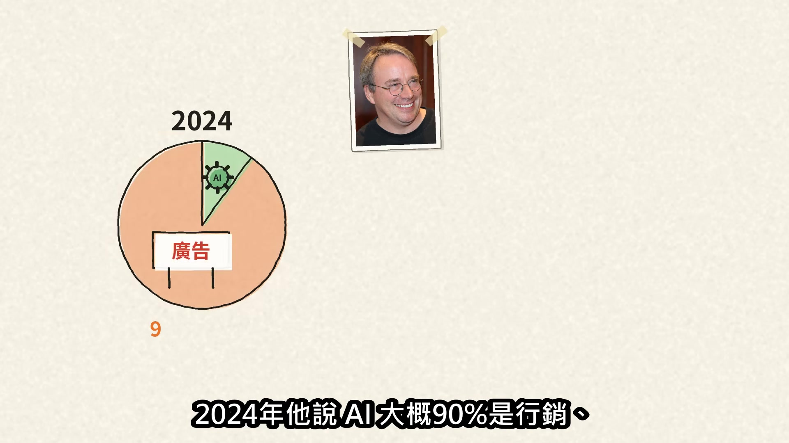

**逐字稿片段：** 10%是現實；今年7月卻明講 Linux 不是反 AI 專案，AI 只是工具 而且顯然有用

**話題推測：** 提及 Linus Torvalds 在今年7月對 AI 的新看法

---

## 00:06:29

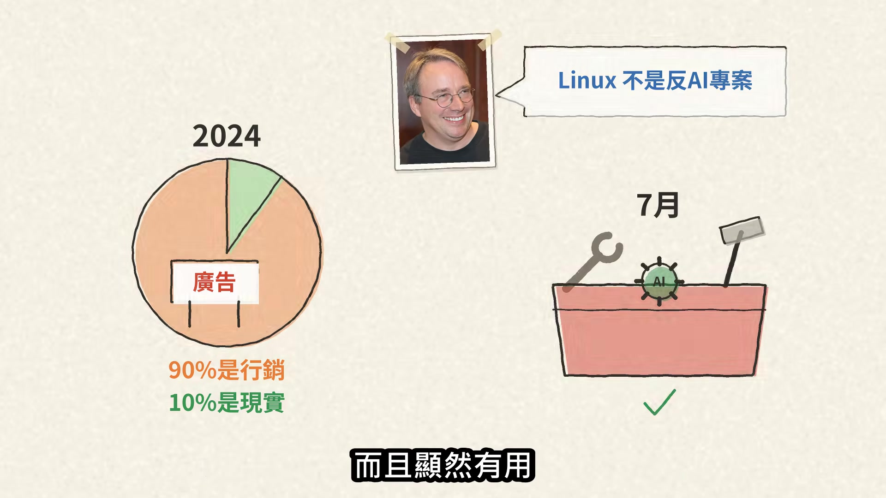

**逐字稿片段：** 到了10月13日，毒舌又上線： Torvalds 嘲諷禁用 AI 很蠢 那是不是也要禁編譯器、禁文字編輯器？ 他看的不是工具 而是你懂不懂自己的程式碼 照這個標準 刪掉的只是固定標籤這張貼紙 工具用途仍建議寫在 cover letter 也就是整組 patch 的說明信；審查、 測試、簽名的責任全都還在

**話題推測：** 提及 Linus Torvalds 在10月13日的最新言論

---

## 00:06:55

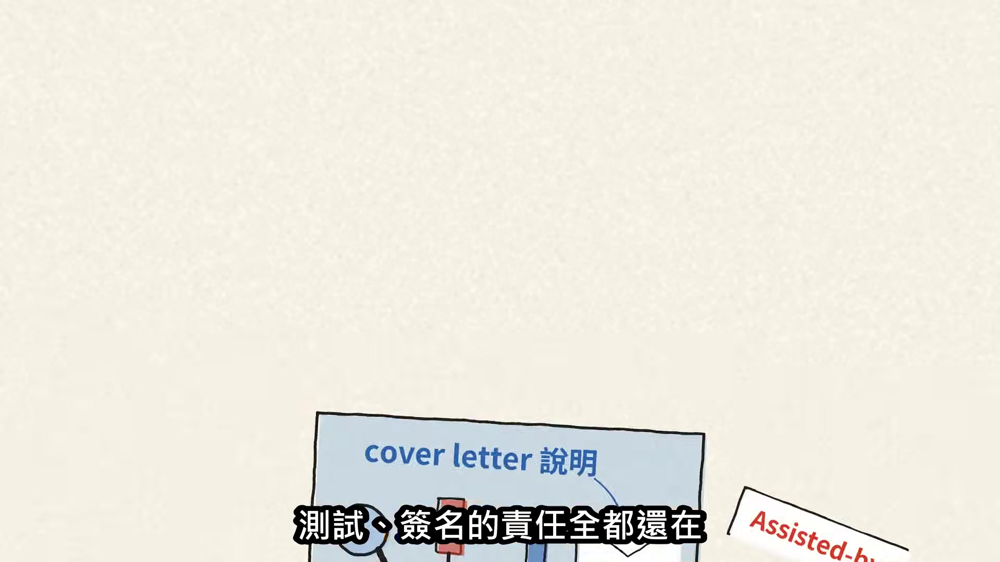

**逐字稿片段：** 話說回來，AI 本來就又幫忙又添亂

**話題推測：** 轉折點：探討 AI 帶來幫助與混亂的雙面性

---

## 00:06:58

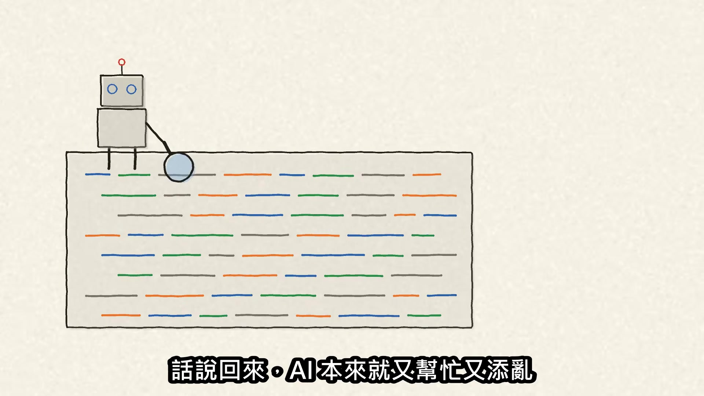

**逐字稿片段：** 幫忙的像 Sashiko 是 Google 工程師等人做的 AI 程式碼審查系統；專案說 在最近1,000個帶 Fixes 標籤的上游提交測試中 它找出53.6%原本漏過人工審查的 bug，超過一半 而且這不只是展示：

**話題推測：** 介紹 AI 輔助系統 Sashiko

---

## 00:07:12

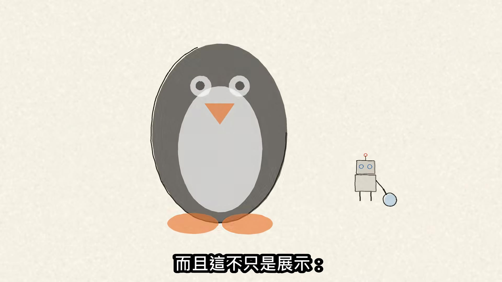

**逐字稿片段：** Linux 7.2-rc7 罕見收進大約400筆修正 很多問題是 AI 抓到的 AI 審查已經進到真正的維護流程 但反過來，AI 也能灌爆信箱：

**話題推測：** 提及 Linux 7.2-rc7 中 AI 發現的修正數量

---

## 00:07:23

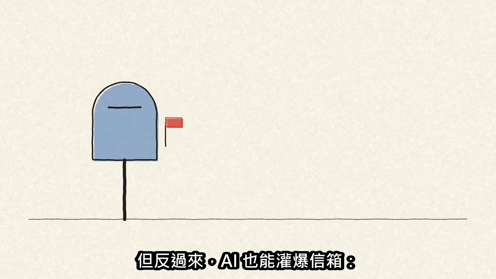

**逐字稿片段：** Linux 安全郵件列表原本每週2到3件回報 2026年3月一度變成每天5到10件 很多還重複，吃掉的都是人的時間 所以接下來要看的 不只是那88行何時刪掉 而是標籤沒了之後，誰懂這段程式、誰來負責 每份進到核心的程式碼 都還是要有人懂、有人扛

**話題推測：** 提供安全郵件列表原始回報數量

---
