# ai-note-101_uvS03bjLYGI — 關鍵畫面索引

- 來源逐字稿：[ai-note-101_uvS03bjLYGI_GT.srt](ai-note-101_uvS03bjLYGI_GT.srt)
- 影片：https://www.youtube.com/watch?v=uvS03bjLYGI
- 截圖數：43

## 00:00:14

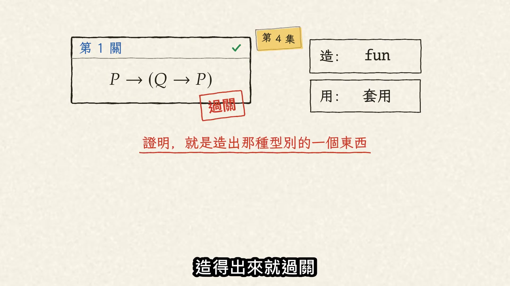

**逐字稿片段：** 複習一下三欄表 左邊是邏輯：P 推出 Q 中間是型別：從 P 到 Q 最右邊是值 要造出一個「從 P 到 Q」型別的東西 寫 fun x 箭頭 b 要使用一個「從 P 到 Q」型別的東西 寫 f、空格、a 第二欄，講的是「造出新型別的規則」： 有兩個標籤 P 和 Q 就可以造出「從 P 到 Q」這樣一個型別 這是 Lean 內建的 所以隨便兩個標籤 都可以這樣造出一個新標籤 但第三欄 並不是隨便給兩個東西 x 和 b 都可以造出這個 fun x 箭頭 b 具體來說，這個 b 就是寫程式時候的函數身體

**話題推測：** 畫面切換到「三欄表」的視覺內容，複習邏輯、型別與值。

---

## 00:00:58

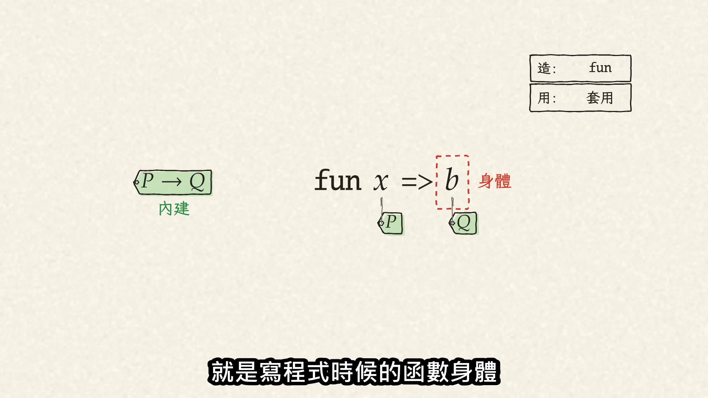

**逐字稿片段：** 假設前面有一份清單 Gamma 當你寫下 fun x 箭頭 的時候 後面接的東西，只能用前面出現過的： Gamma 裡的、x 或是 Lean 已經定義好的名字 不能突然冒出一個從沒出現過的符號 例如 w 或是 z 有點像寫程式的時候，用到的變數名稱 前面都要先定義過 不然會跳 undefined error 「從 P 到 Q」 是我們認識的第一個造出新型別的方法

**話題推測：** 畫面可能出現一個帶有清單 Gamma 的程式碼範例，說明變數範圍。

---

## 00:01:23

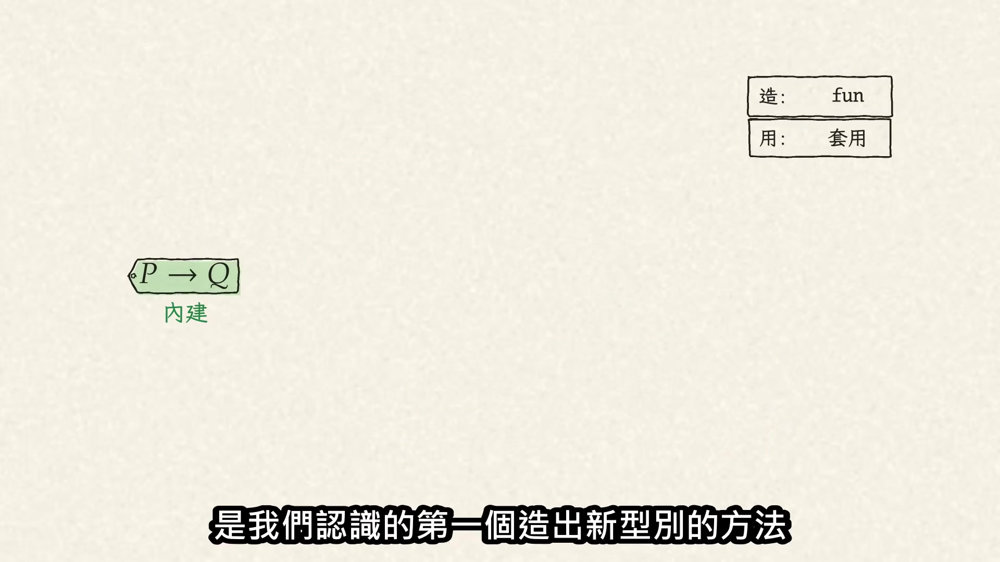

**逐字稿片段：** 這一集，要再認識四種：且、或、假、非 它們都是連接詞，也就是把命題接起來、 組成新命題的那些詞

**話題推測：** 畫面顯示本集將介紹的四種連接詞列表：且、或、假、非。

---

## 00:01:33

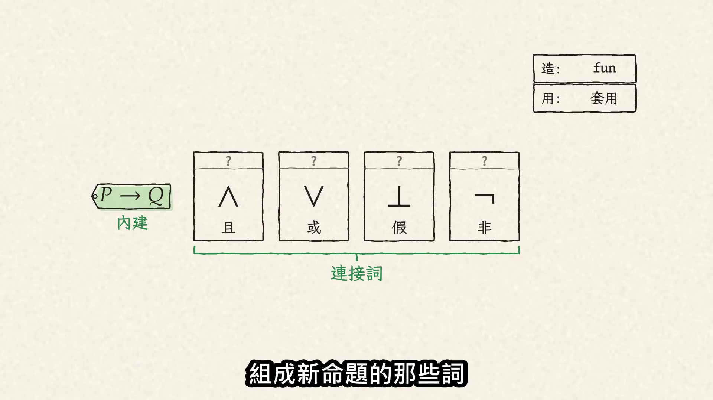

**逐字稿片段：** 每一個，我們都問同樣的三個問題： 它在型別這邊是什麼？ 怎麼造出它的證明？ 手上有它的證明，又要怎麼用？ 而且每一個，也都寫成 Python 開始之前，先講一件會讓人意外的事 推出，是 kernel 內建的；可是且、或、 假、非，kernel 一個都不認識 它們是寫在 Lean 的標準函式庫裡的 標準函式庫，就是 Lean 一安裝就附上的那一大批現成定義 寫法也很普通，就是宣告 宣告 就是在 Lean 裡寫下「有這麼一個新型別」 你自己要宣告新型別 用的也是同一種寫法 而宣告一個型別，主要就是寫下一件事： 它有哪幾種造法 用遊戲來說 就是寫下這一關「怎麼造」的規則

**話題推測：** 畫面呈現針對每個連接詞會問的三個問題（型別、造出證明、如何使用）。

---

## 00:02:22

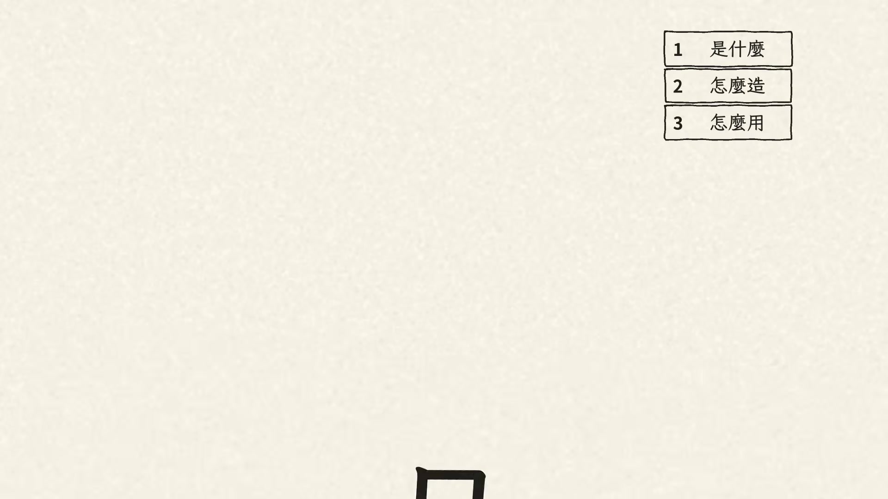

**逐字稿片段：** 第一個是且，英文是 and 符號像一個倒過來的 V 什麼是 P 且 Q 的證明呢？ 想想看 你要證「n 是偶數且 n 大於 2」 就得交出兩樣東西： 一個「n 是偶數」的證明 和一個「n 大於 2」的證明

**話題推測：** 畫面顯示第一個連接詞「且 (and)」的介紹，可能包含其符號。

---

## 00:02:39

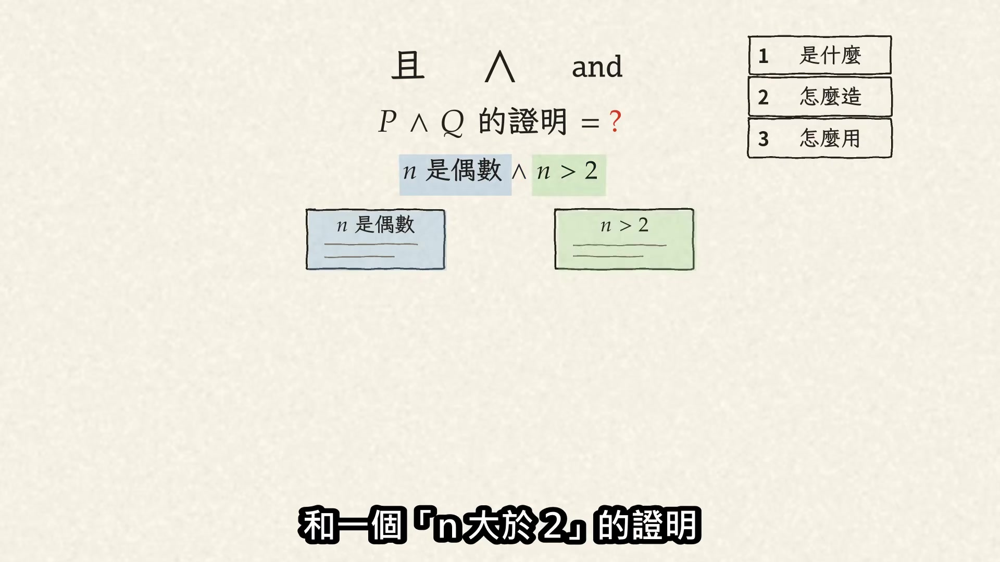

**逐字稿片段：** 所以，且的證明，就是這樣一對： 一個兩格的盒子，左格放 P 的證明 右格放 Q 的證明 在 Lean 裡，且的宣告只寫了一種造法 叫 And 點 intro intro 是英文 introduction 的縮寫 也就是引入 它吃一個 P 的證明 再吃一個 Q 的證明 給你一個 P 且 Q 的證明

**話題推測：** 畫面顯示一個兩格的盒子圖示，解釋「且」的證明結構。

---

## 00:03:02

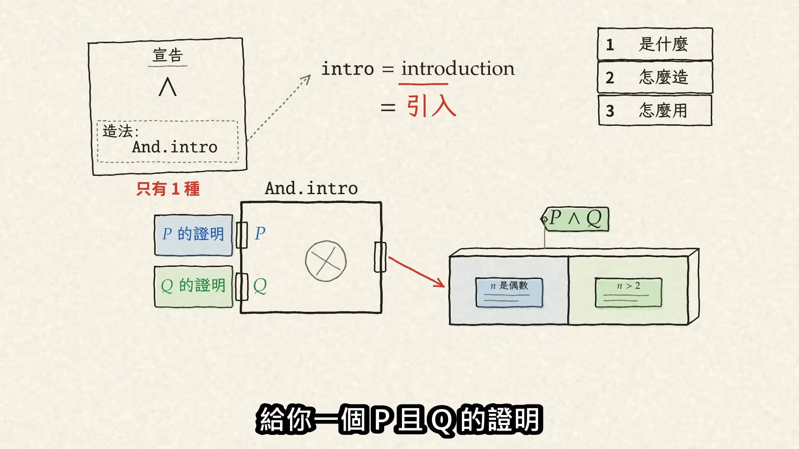

**逐字稿片段：** 把它放上規則卡，一樣兩邊並排 這就是且的引入規則 左邊是邏輯：Gamma 推得 P Gamma 推得 Q，所以 Gamma 推得 P 且 Q 右邊是型別：a 的型別是 P b 的型別是 Q 那麼 And 點 intro a b 的型別 就是 P 且 Q 所以，And 點 intro 也是一種函數 它的型別是：P 推出，Q 推出 「P 且 Q」

**話題推測：** 畫面出現「且」的引入規則卡片，左右並排呈現邏輯與型別的對應關係。

---

## 00:03:31

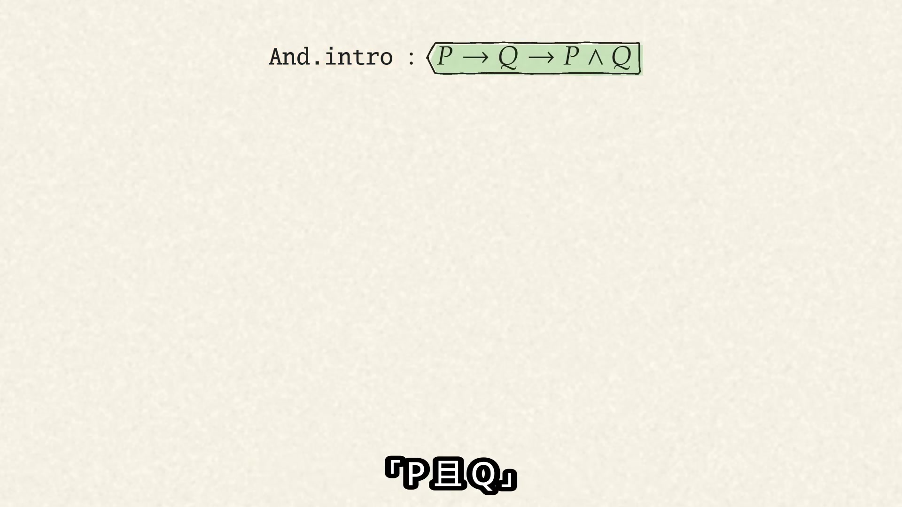

**逐字稿片段：** 寫成 Python，就是一行： def and intro，括號裡 a 冒號 P、 b 冒號 Q，箭頭 tuple、P、Q 也就是一組 P 和 Q；本體只有三個點 上一集的三個點，意思是裡面怎麼做 我們不知道；這裡的三個點更徹底： 裡面根本沒有東西 其實，如果硬要類比，最接近的寫法 是 return 一個 tuple 但這只是在這個例子裡 剛好跟 tuple 效果一樣 是有點不精確的類比；正確的理解是： 這就是一個沒有身體的函數，寫不出來

**話題推測：** 畫面顯示「And intro」的 Python 程式碼範例，對應「且」的引入。

---

## 00:04:05

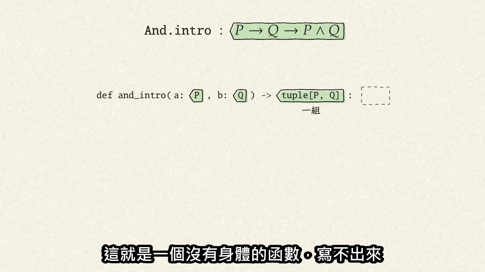

**逐字稿片段：** 另外，Lean 給 And 點 intro a b 一個簡寫： 把 tuple 的圓括號，改成角括號 不過它只是簡寫 Lean 會把它換回 And 點 intro a b 兩種寫法完全一樣

**話題推測：** 畫面顯示 Lean 中「And intro」的簡寫符號（角括號）。

---

## 00:04:19

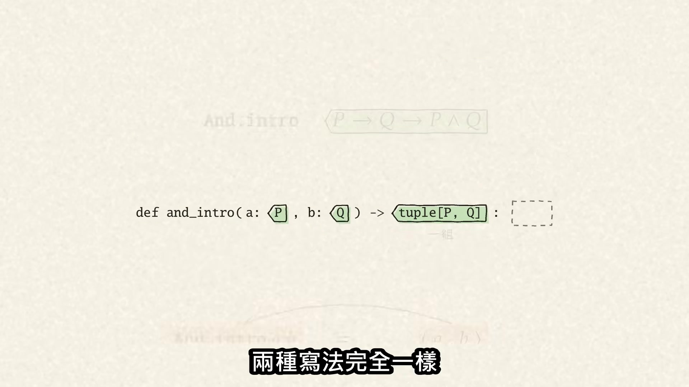

**逐字稿片段：** 跟上一集開頭那個加 1 比一下： 加 1 有身體，就是 return n 加 1 餵它 3，照著身體可以算出 4 And 點 intro 則沒有 它是宣告且的時候，自動生出來的造法 kernel 對它知道的，只有型別 所以 And 點 intro a b 不會再算成別的東西 它本身，就是那個裝好的盒子 那一個沒有內容的函數

**話題推測：** 畫面比較「And intro」與上一集的「加 1」函數，說明函數是否有「身體」。

---

## 00:04:44

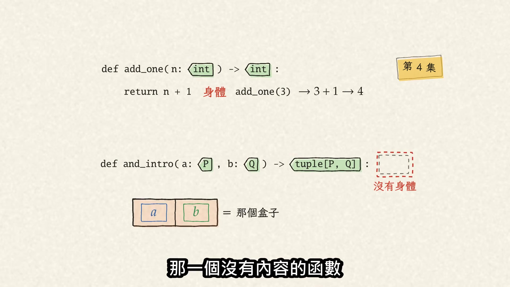

**逐字稿片段：** kernel 要怎麼算？ 上一集，kernel 用了三條規則

**話題推測：** 畫面引導討論 Lean 內核如何處理無內容函數，暗示新的規則將被介紹。

---

## 00:04:49

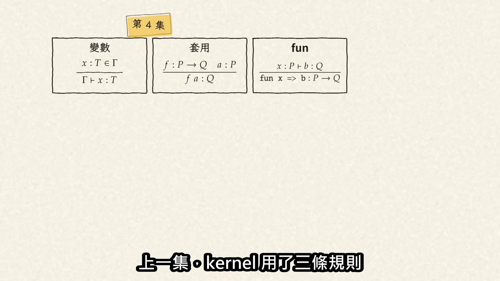

**逐字稿片段：** 這裡要再認識一條新的，叫常數規則 常數規則是說：已經宣告過的名字 型別就照宣告寫的算 它跟變數規則很像，只是查的不是清單 而是已經宣告過的東西 所以 kernel 檢查 And 點 intro a b 先用常數規則查出它的型別，再把 a、 b 餵進去，用的是上一集的套用規則 換句話說，且的引入 並不是 kernel 的新規則 只是常數規則加上套用

**話題推測：** 畫面介紹一條新的「常數規則」，說明已宣告名字的型別計算方式。

---

## 00:05:16

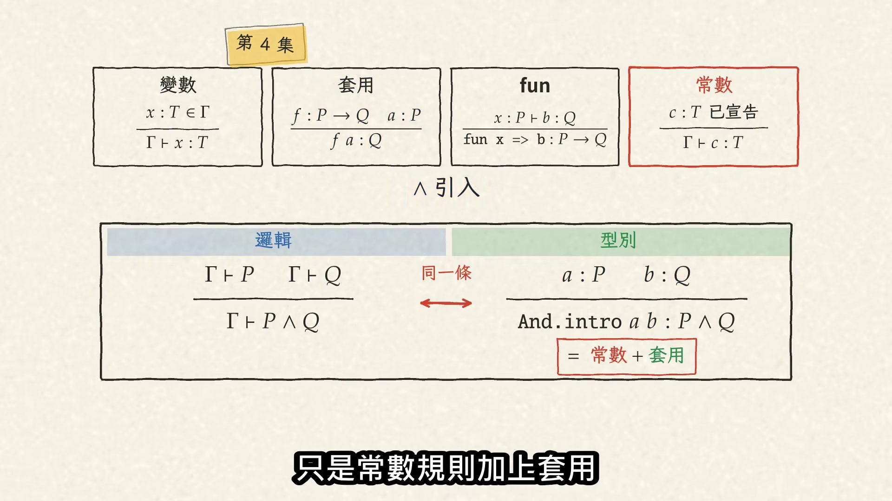

**逐字稿片段：** 順帶一提：Lean 裡的套用 寫法就是把兩個東西擺在一起 中間一個空格，不加括號 套用是最基本的動作 所以給它最省的寫法 而且 And 點 intro a b 其實是先把 a 餵給 And 點 intro 得到一台還在等 b 的機器 再把 b 餵進去；每一次，都只吃一個 所以 And 點 intro a 停在這裡 本身也是一個東西

**話題推測：** 畫面顯示 Lean 中函數套用的特殊寫法（中間一個空格）。

---

## 00:05:44

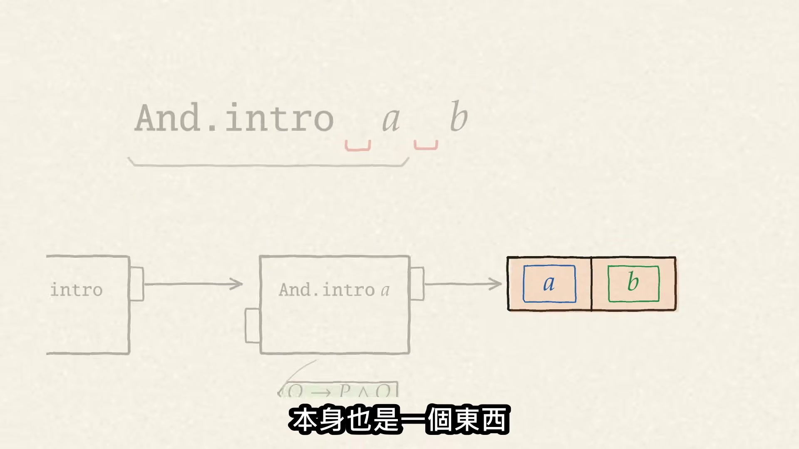

**逐字稿片段：** 一個沒有身體的函數，怎麼用？ 先拿剛才那個不精確的 Python 類比： 拿 tuple 的左格，寫 h 中括號 0 拿右格，寫 h 中括號 1 Python 從 0 開始數 Lean 也差不多：左格寫 h 點 1 右格寫 h 點 2，從 1 開始數

**話題推測：** 畫面引導討論如何「使用」一個沒有身體的函數（即「且」的證明）。

---

## 00:06:02

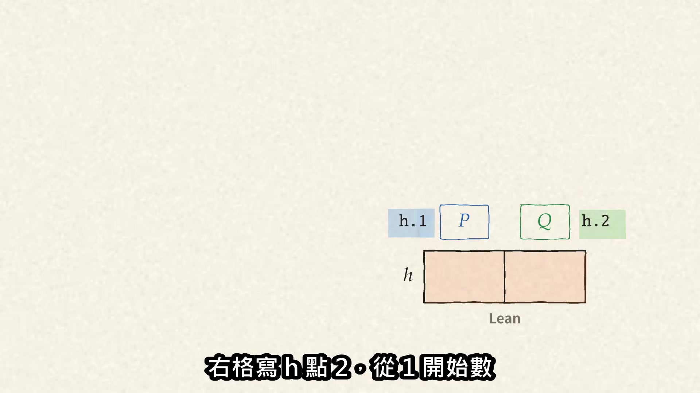

**逐字稿片段：** 這就是且的消去規則，有兩條 左邊是邏輯：Gamma 推得 P 且 Q 所以 Gamma 推得 P；另一條是 所以 Gamma 推得 Q 寫在紙上的邏輯，就是：已知 P 且 Q 所以 P 成立，Q 也成立 右邊是型別：h 的型別是 P 且 Q 那麼 h 點 1 的型別是 P h 點 2 的型別是 Q 所以說，且的引入規則 是一個常數規則，定義了一個只有型別、 但沒有身體的函數；且的消去規則 再另外定義該怎麼用

**話題推測：** 畫面出現「且」的消去規則卡片，包含兩條從「且」證明中提取P或Q的規則。

---

## 00:06:39

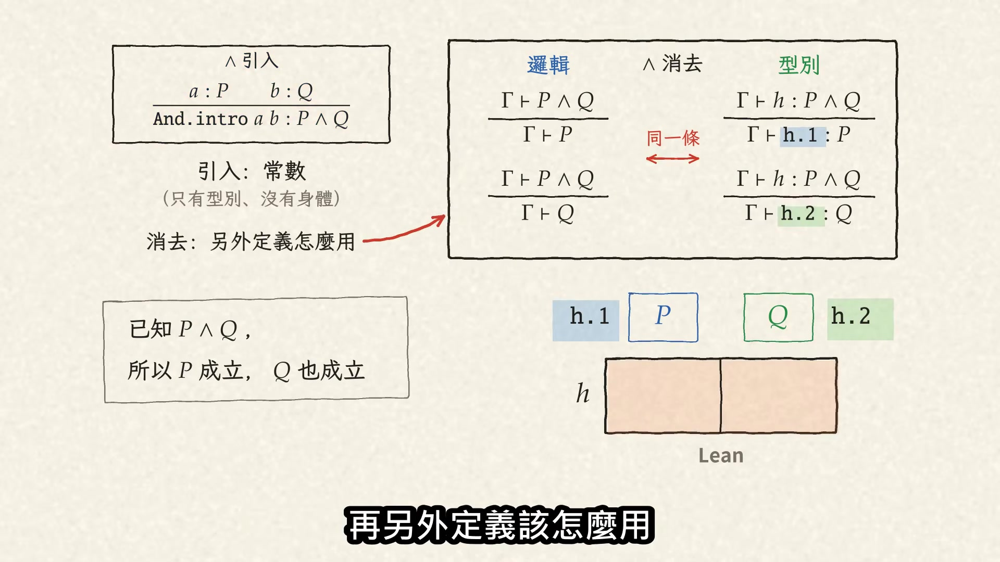

**逐字稿片段：** 好，換你來解一題：P 且 Q，推出 Q 且 P 要造的，是一台機器： 吃一個 P 且 Q 的盒子 h 吐出一個 Q 且 P 的盒子 也就是左格放 Q 的證明、 右格放 P 的證明 你可以先想一想，怎麼造 答案是：先從 h 拿出右格 得到 Q 的證明；再拿出左格 得到 P 的證明；最後照 Q、P 的順序 裝進新的盒子

**話題推測：** 畫面顯示一道證明題：「P 且 Q 推出 Q 且 P」，作為練習。

---

## 00:07:10

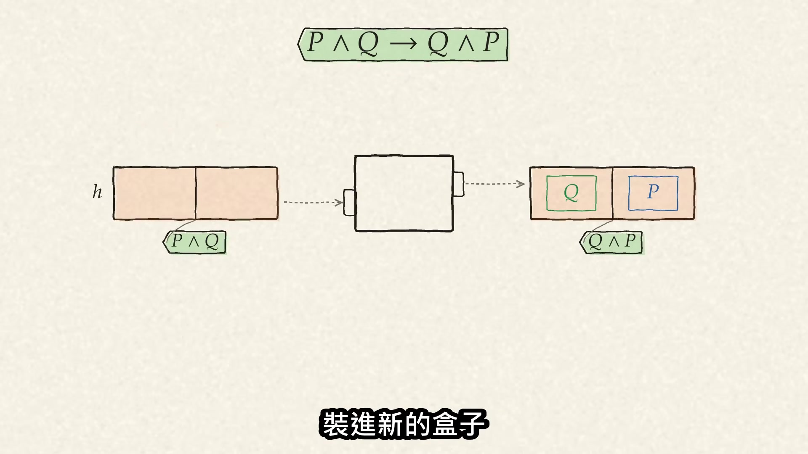

**逐字稿片段：** 寫成 Python：def swap 括號裡 h 冒號 tuple、P、Q 箭頭 tuple、Q、P 本體一行：return 一個 tuple h 1 在前、h 0 在後 寫成 Lean，就是 fun h 箭頭 角括號裡，h 點 2 在前、h 點 1 在後 兩種寫法，看起來幾乎一樣 剛剛這一題，造和用都用上了：用 是打開盒子拿出來；造 是把兩個證明裝進盒子 方向剛好相反，而且兩個都少不了： 只會造，盒子打不開；只會拆 根本沒有盒子可以拆 在邏輯那邊 這是同一個符號底下的兩條規則 到了 Lean，卻是兩個不同的東西： 造用 And 點 intro，拆用 h 點 1、h 點 2

**話題推測：** 畫面顯示證明題的 Python 程式碼解法（使用 tuple 進行交換）。

---

## 00:08:03

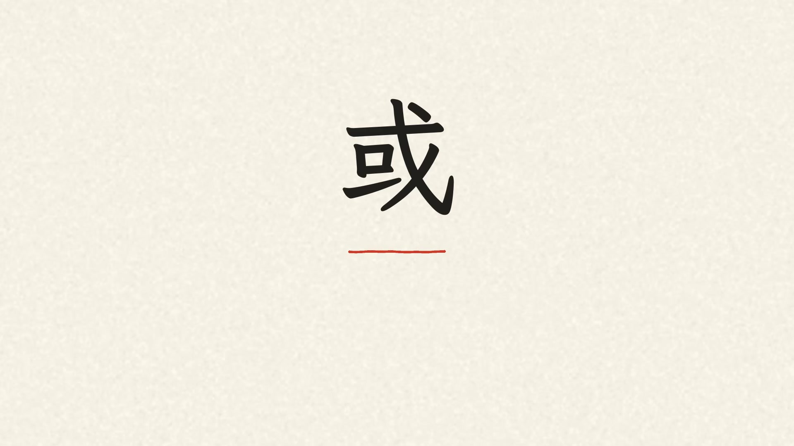

**逐字稿片段：** 第二個連接詞是或，英文是 or 符號像一個 V

**話題推測：** 畫面顯示第二個連接詞「或 (or)」的介紹，可能包含其符號。

---

## 00:08:09

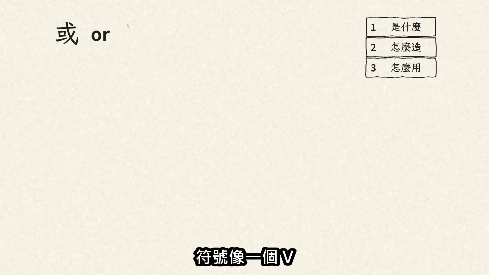

**逐字稿片段：** 你要證「n 是偶數或 n 是奇數」 只要交出其中一邊的證明就好 不過你得說清楚，交的是哪一邊

**話題推測：** 畫面顯示數學命題「n 是偶數或 n 是奇數」作為「或」的證明例子。

---

## 00:08:17

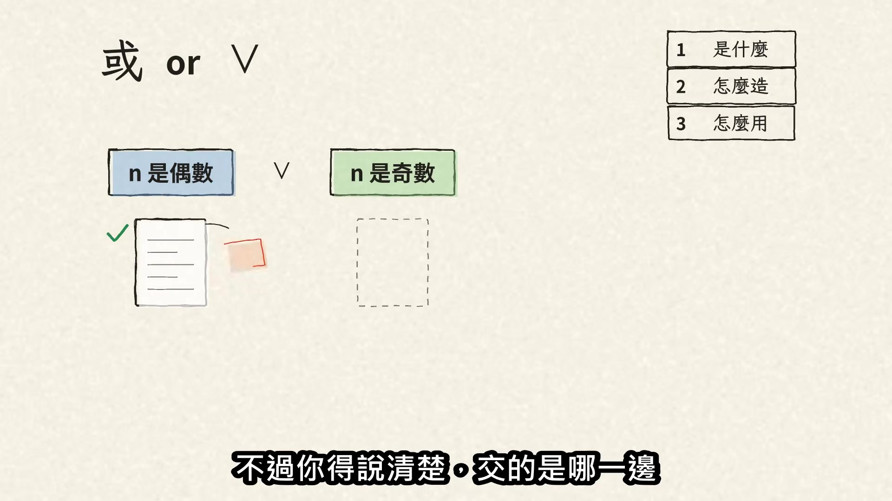

**逐字稿片段：** 所以，或的證明不是兩格的盒子 而是一格的盒子，外加一張牌子 寫著「左」或「右」 在 Lean 裡，或的宣告寫了兩種造法： 一種叫 Or 點 inl，放左邊 另一種叫 Or 點 inr，放右邊 名字裡的 l 和 r 就是英文的 left 和 right 而那張牌子，就是造法的名字 要造出 P 或 Q 的證明，只有這兩條路 一定得選定一邊 所以你造不出一個「沒說是哪一邊」的或

**話題推測：** 畫面顯示一個一格盒子外加牌子的圖示，解釋「或」的證明結構。

---

## 00:08:45

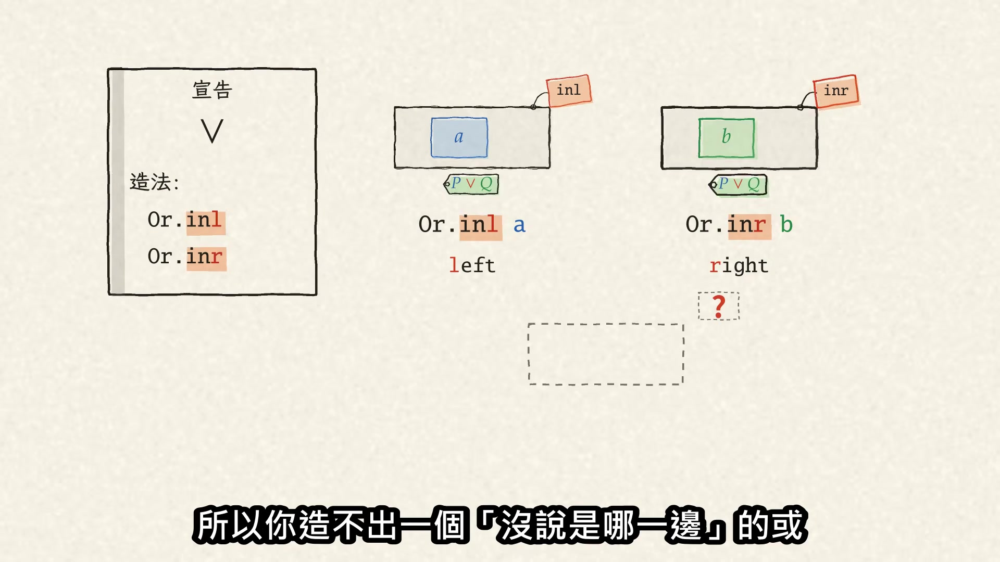

**逐字稿片段：** 寫成 Python，可以宣告兩個類別 類別，英文是 class 是 Python 自己宣告新型別的寫法 一個叫 Inl，裡面裝一個 P 的證明 另一個叫 Inr，裡面裝一個 Q 的證明 P 或 Q，就寫成 Inl、直線、Inr 這條直線，在 Python 的型別裡 就是「或」 而類別的名字，就是那張牌子： Python 寫 Inl 括號 a 就是 Lean 的 Or 點 inl a

**話題推測：** 畫面顯示「或」的 Python 類別宣告程式碼範例（Inl/Inr）。

---

## 00:09:16

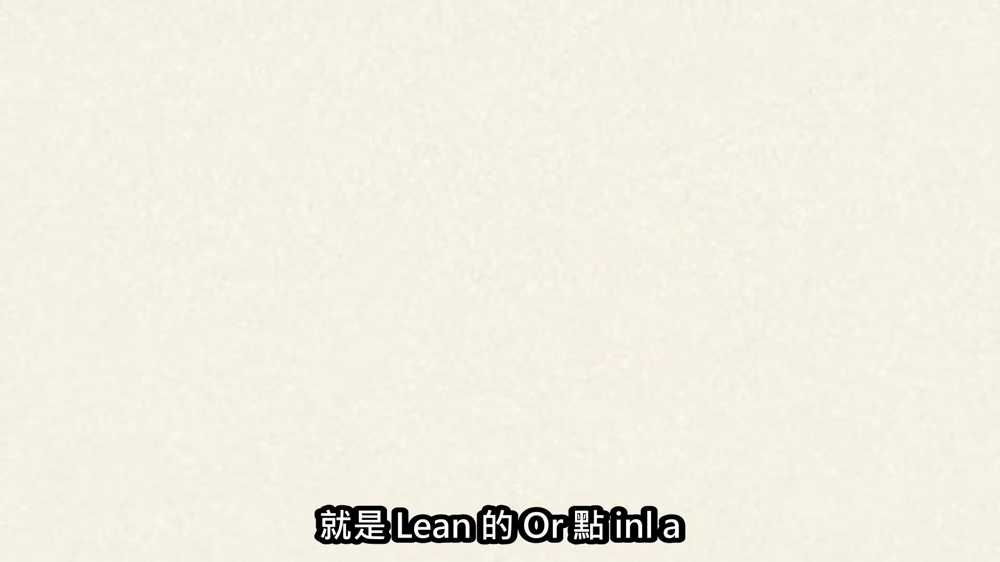

**逐字稿片段：** 所以，或的引入規則有兩條 左邊是邏輯：Gamma 推得 P 所以 Gamma 推得 P 或 Q；另一條是 Gamma 推得 Q，所以 Gamma 推得 P 或 Q 右邊是型別：a 的型別是 P Or 點 inl a 的型別就是 P 或 Q b 的型別是 Q Or 點 inr b 的型別也是 P 或 Q 跟且一樣 這兩條也只是常數規則加上套用

**話題推測：** 畫面出現「或」的引入規則卡片，包含兩條規則（Or.inl 和 Or.inr）。

---

## 00:09:46

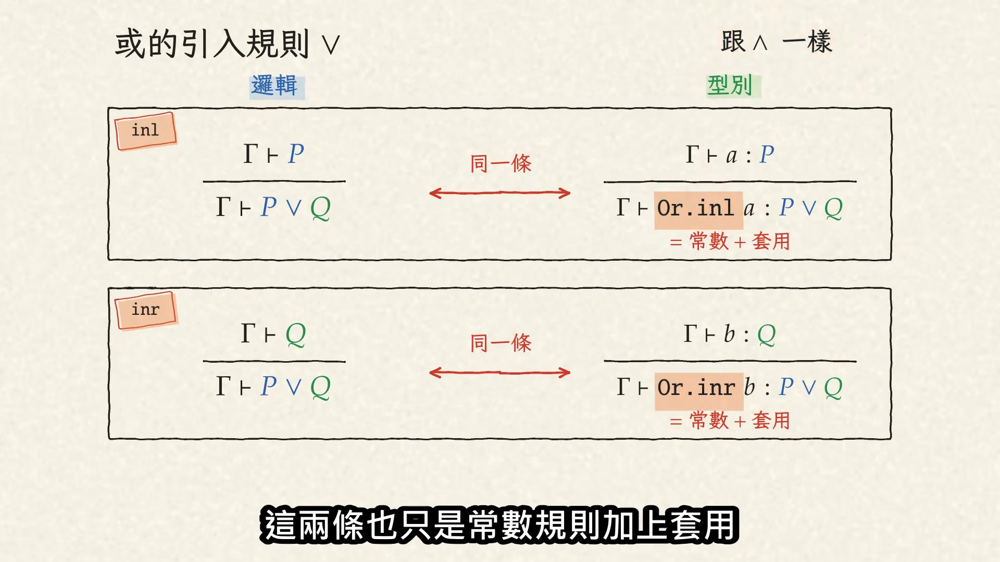

**逐字稿片段：** 這裡有一個新東西 之後在 Lean 裡會一直遇到 寫 Or 點 inl a 的時候，我們只給了 a 可是結果的型別 P 或 Q 裡，還有一個 Q 這個 Q 是從哪來的？ 答案是，Or 點 inl 其實還有兩個參數 就是 P 和 Q；只是它們寫在大括號裡 平常不用寫，叫做隱藏參數 英文是 implicit argument 大括號裡寫的是：P Q 冒號 Prop Prop 第 2 集見過，就是命題 意思是 P 和 Q 都是命題 它們由 Lean 從前後文自動補上 其實 And 點 intro 也有隱藏參數 只是 P 和 Q 從 a 和 b 都看得出來 所以我們沒有注意到

**話題推測：** 畫面引入「隱藏參數 (implicit argument)」的新概念及其在 Lean 中的運作方式。

---

## 00:10:31

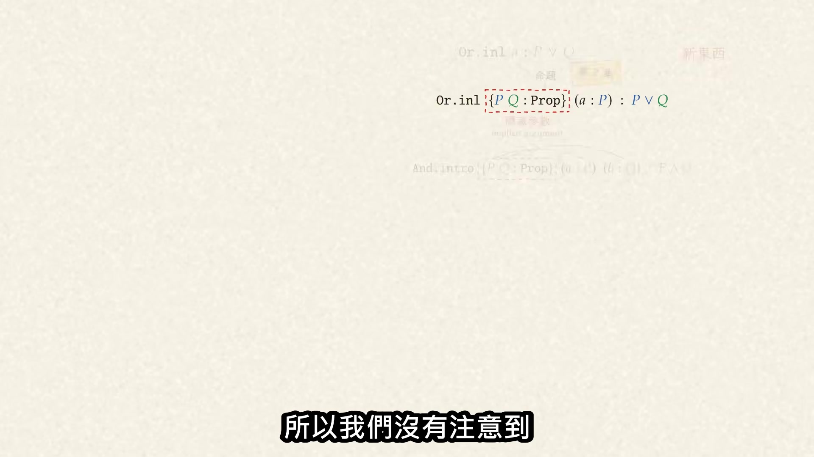

**逐字稿片段：** 它是不是像 Python 沒寫型別？ 像，但不一樣 Python 沒寫型別，就是沒檢查： 要等跑到那一行，才看那個值本身是什麼 放錯了，也不一定會發現 隱藏參數剛好相反，是沒寫，但有檢查 Lean 在執行之前 就從前後文推出 Q 是什麼；補好之後 交給 kernel 的，是每一格都填滿、 都檢查過的完整寫法

**話題推測：** 畫面比較隱藏參數與 Python 不寫型別的差異，強調 Lean 的檢查機制。

---

## 00:10:53

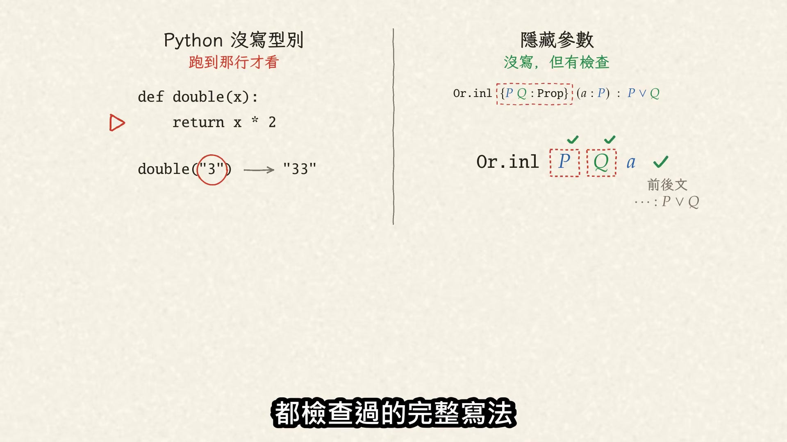

**逐字稿片段：** 真正像的，是 Python 的型別推論： 寫 x 等於 3，不標型別 mypy 這類工具一樣會在執行前推出 x 是 int，照樣檢查 差別是，在 Python 裡這是外掛的工具 可用可不用；在 Lean 裡，這是內建的，一定會做

**話題推測：** 畫面進一步比較隱藏參數與 Python 的型別推論功能，找到更精確的類比。

---

## 00:11:09

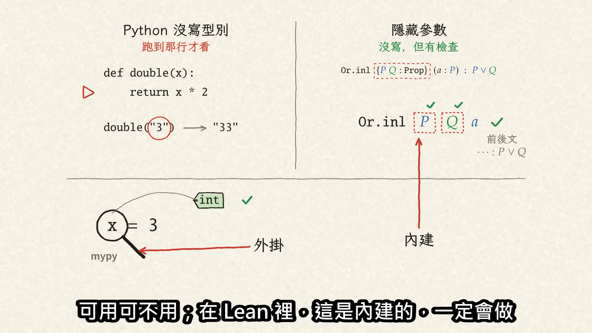

**逐字稿片段：** 再來是或的消去 這是這一集最重要的一條 因為它就是分情況討論 舉一個你一定證過的例子： n 乘以 n 加 1，一定是偶數 在紙上，你會這樣寫：n 是偶數 或 n 是奇數 情況一，設 n 是偶數 那麼 n 乘 n 加 1 是偶數 情況二，設 n 是奇數 那麼 n 加 1 是偶數，所以乘起來還是偶數 既然不管哪一種情況，結論都成立 那結論就成立 請注意，這裡出現了兩次「設」 而兩次都在證明結束時收回了 上一集說過，收回假設，就是 fun 所以每一種情況，其實都是一台機器： 情況一吃「n 是偶數」的證明 吐出結論的證明 情況二吃「n 是奇數」的證明 也吐出結論的證明

**話題推測：** 畫面切換到「或」的消去規則介紹，強調其「分情況討論」的特性。

---

## 00:12:01

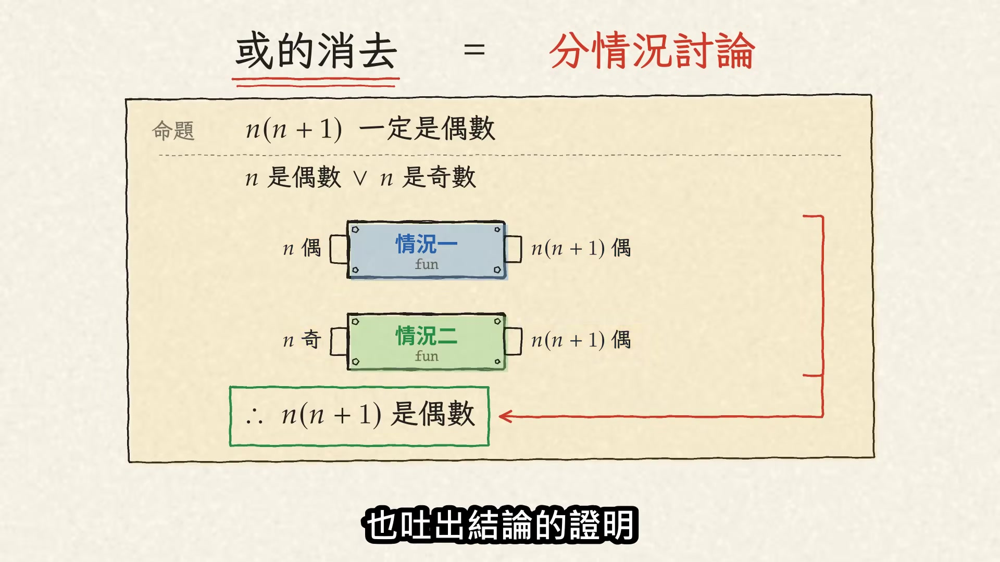

**逐字稿片段：** 兩邊並排起來，是這樣 左邊是邏輯，有三個前提： Gamma 推得 P 或 Q；Gamma 加上 P 推得 R；Gamma 加上 Q，推得 R 結論是 Gamma 推得 R 右邊是型別，也有三個前提： h 的型別是 P 或 Q；f 的型別是 P 推出 R g 的型別是 Q 推出 R 結論是：Or 點 elim、h、f、g，型別是 R 左邊那兩個「加上一個假設」 到了右邊，就變成了兩台機器 f 和 g 那 Or 點 elim 裡面在做什麼？ 它跟 And 點 intro 不一樣： 它不是宣告時自動生出來的造法 而是函式庫裡另外寫好的一個證明 所以它有身體

**話題推測：** 畫面出現「或」的消去規則卡片，左右並排呈現其三個前提和結論。

---

## 00:12:48

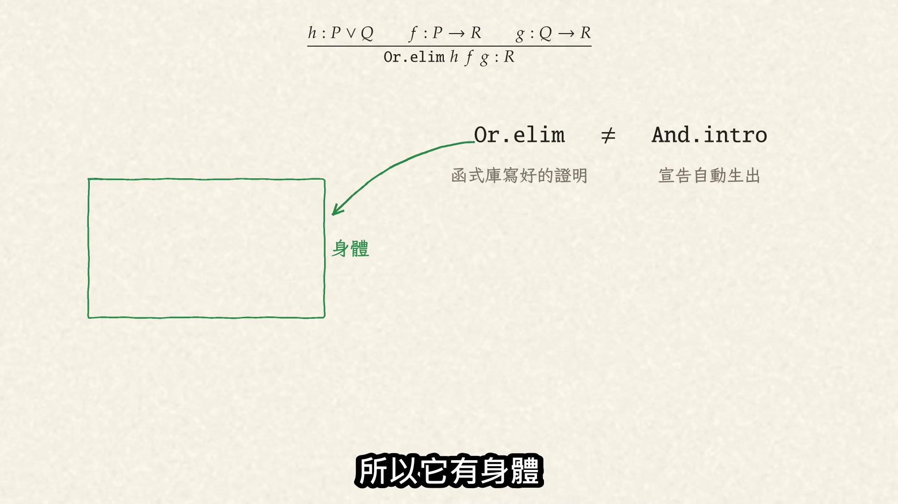

**逐字稿片段：** 這個身體，先用 Python 來看 Python 從 3.10 版開始 有一種寫法叫 match，意思是比對： 把 h 可能的造法一種一種列出來 每一種給一個處理方式 def or elim，括號裡三個參數 h、f、g，箭頭 R 本體：match h；case Inl x，return f x case Inr y，return g y 也就是：h 如果是 Inl 造的 就把裡面的證明交給 f；是 Inr 造的，就交給 g f 和 g 都吐出 R，所以不管是哪一種 最後都拿得到 R

**話題推測：** 畫面顯示「Or elim」的 Python 程式碼範例，使用 match 語句來處理不同情況。

---

## 00:13:24

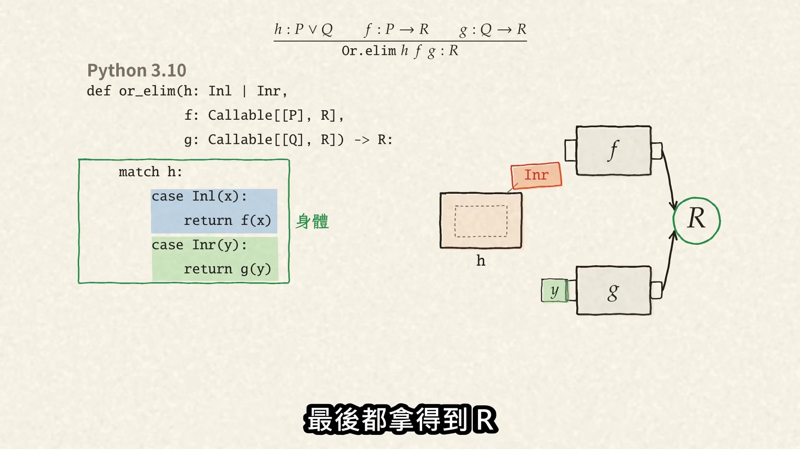

**逐字稿片段：** Lean 的 Or 點 elim 身體也是一個 match，長得幾乎一樣

**話題推測：** 畫面顯示「Or elim」的 Lean 程式碼範例，同樣使用 match 語句。

---

## 00:13:31

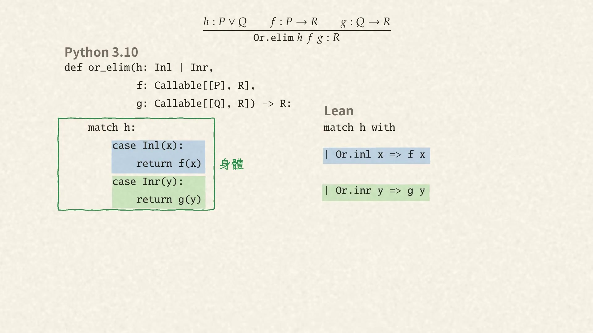

**逐字稿片段：** 這裡有一個不對稱 造或的時候 你一定要知道是哪一邊成立 才選得出 inl 或 inr；用或的時候 卻不需要知道 手上的 h 通常是清單裡的一個假設 你看不出它是哪一邊造的 所以兩種情況都得準備好 而且都要走到同一個 R 少寫一種情況，Lean 直接不收 Python 執行的時候不會擋 碰到沒寫的那種，就默默跳過 要等靜態型別檢查器來看，才會發現 回到剛剛的例子： h 是「n 是偶數或 n 是奇數」的證明 f 和 g 就是情況一、情況二那兩台機器 交給 Or 點 elim 就得到「n 乘 n 加 1 是偶數」的證明

**話題推測：** 畫面指出「或」在「造」（引入）與「用」（消去）之間的不對稱性。

---

## 00:14:16

**逐字稿片段：** 第三個連接詞是假，英文是 False 邏輯課本常把它寫成一個倒過來的 T

**話題推測：** 畫面顯示第三個連接詞「假 (False)」的介紹，可能包含其符號。

---

## 00:14:23

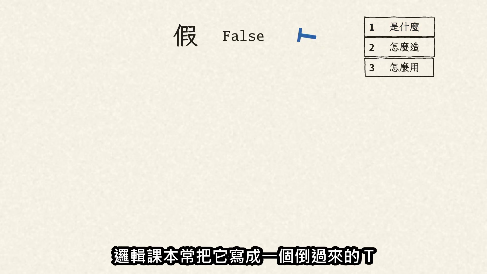

**逐字稿片段：** Python 裡，其實有一個很像的型別 叫 Never，意思是永遠不會有： 沒有任何一個值，型別是 Never 假也是這樣 它的宣告，寫了幾種造法？ 答案是零種 所以它的值，一個都造不出來 它是一個空型別 這很合理：要是隨便造得出假的證明 整個系統就沒有意義了 所以，假沒有引入規則

**話題推測：** 畫面顯示 Python 中類似「假」的 Never 型別，說明其「空型別」特性。

---

## 00:14:50

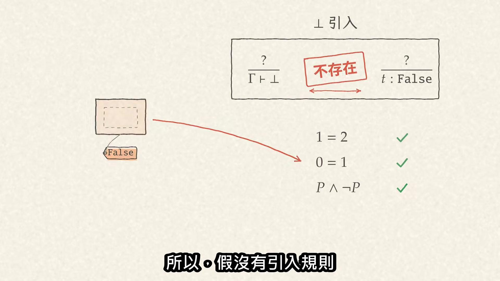

**逐字稿片段：** 不過，假的消去規則倒是有一條，而且很強 左邊是邏輯：Gamma 推得假 所以 Gamma 推得任何命題 C 這叫爆炸律：從矛盾可以推出一切 右邊是型別：h 的型別是 False 那麼就可以得到任何型別 C 的東西 這其實是分情況討論的特例： 或有兩種造法，要給兩台機器 假有零種造法，一台機器都不用給 就得到結論

**話題推測：** 畫面出現「假」的消去規則卡片，說明從「假」可以推出任何命題的「爆炸律」。

---

## 00:15:22

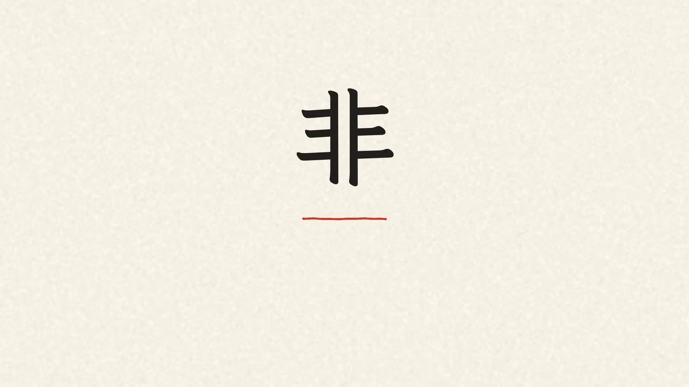

**逐字稿片段：** 最後一個是非，英文是 not 符號是一條橫線，右端往下勾 非 P 的定義只有一行：非 P 就是 P 推出假 所以它不是新的型別，只是一個縮寫 它的規則，全部借推出的

**話題推測：** 畫面顯示第四個連接詞「非 (not)」的介紹，可能包含其符號。

---

## 00:15:40

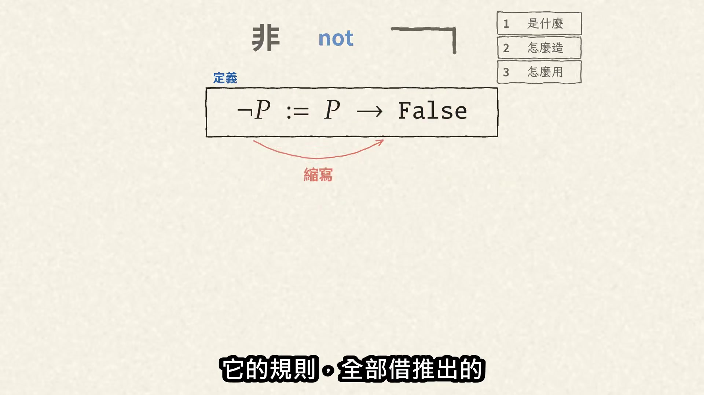

**逐字稿片段：** 非的引入是：假設 P，推出矛盾，所以非 P 這就是推出的引入：寫一個 fun 吃 P 的證明，吐出假的證明

**話題推測：** 畫面解釋「非」的引入規則邏輯（假設P推出矛盾則非P成立）。

---

## 00:15:50

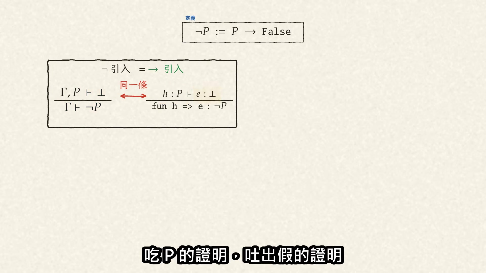

**逐字稿片段：** 非的消去是：已知非 P，又已知 P，所以矛盾 這就是推出的消去：非 P 的證明 是一台吃 P、吐假的機器 把 P 的證明餵給它，它就吐出假

**話題推測：** 畫面解釋「非」的消去規則邏輯（已知非P又已知P則矛盾）。

---

## 00:16:04

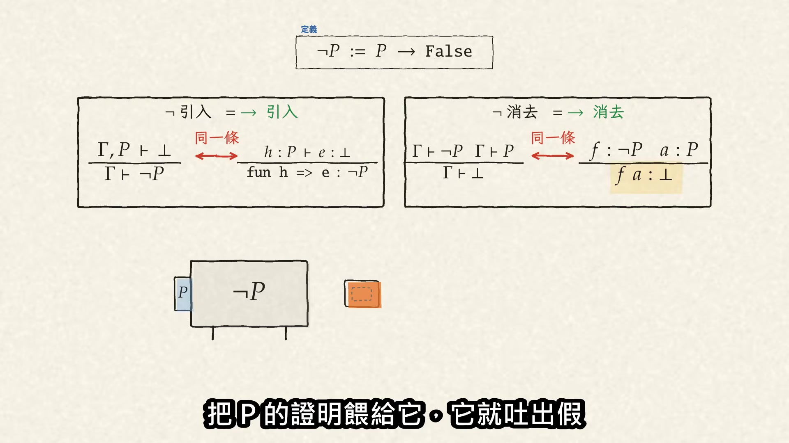

**逐字稿片段：** 寫成 Python，非 P 的型別 就是 Callable、P、Never：吃 P 吐出一個永遠不會有的東西 來解第二題 手上有兩樣東西：h p q 型別是 P 推出 Q；h n q，型別是非 Q 也就是 Q 推出假 要造的，是非 P，也就是 P 推出假： 一台吃 P 的證明、吐出假的機器 你可以先想一想 這一題，其實你已經解過了 一個 P 的證明餵進來，先給 h p q 得到 Q 的證明；再把它給 h n q，得到假 這就是上一集的 imp trans 只是把 R 換成了假

**話題推測：** 畫面顯示「非 P」的 Python 型別表示方式（Callable、P、Never）。

---

## 00:16:45

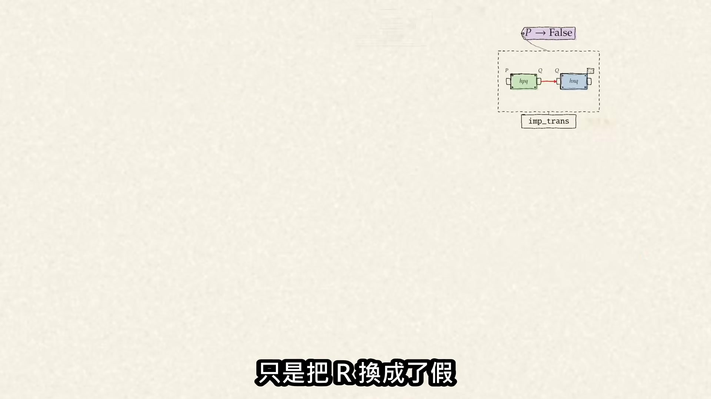

**逐字稿片段：** 寫成 Python 把上一集的 compose 照抄一份： 本體還是同一行 return lambda 只是 h q r 改叫 h n q；標籤裡的 R 換成 Never 所以：P 推出 Q，加上非 Q，就得到非 P 這就是你證明題常用的逆否論證 英文叫 contrapositive 它不用重新證明，上一集那台機器 原封不動就能用 至於「把 R 換成假」這個動作本身 在型別裡到底是什麼，是第 7 集的主題

**話題推測：** 畫面顯示第二道證明題的 Python 程式碼解法，利用上一集的 compose 函數。

---

## 00:17:20

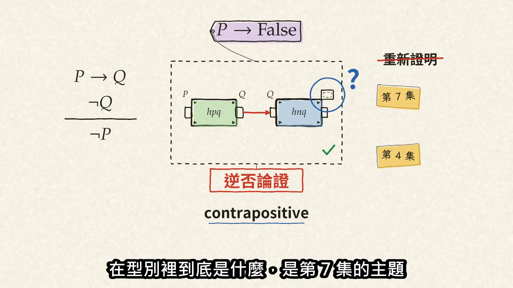

**逐字稿片段：** 不過等一下：非 Q 和「Q 推出假」 寫起來明明不一樣 kernel 為什麼當它們是同一個型別？ 因為 kernel 會把非 Q 照定義展開 展開之後，就是 Q 推出假 展開以後一樣，就算一樣 這個照定義展開的動作，是第 8 集的主角

**話題推測：** 畫面提出「非 Q」與「Q 推出假」型別等價的疑問，引導探討 kernel 的展開機制。

---

## 00:17:40

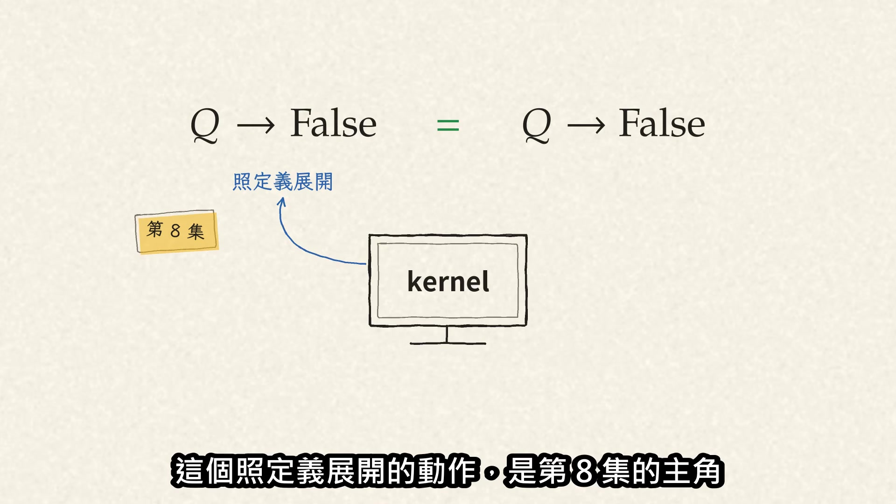

**逐字稿片段：** 這一集，四個連接詞 我們都問了同樣三個問題 整理一下： 且，是兩格的盒子，像 Python 的 tuple 造它，兩格都要填；用它 就拿左格或右格 或，是掛牌子的一格盒子 造它，選一邊填；用它，就分情況 每種情況給一台機器 假，是空型別，像 Python 的 Never 它造不出來；可是用它，什麼都推得出 至於非 P，就是 P 推出假 規則全部借推出的 你看，遊戲規則不一定是一條造、 一條用：且，造法一條、用法兩條；或 造法兩條；假，造法一條都沒有 而且這四個，都不是 kernel 的新規則： kernel 用的，還是查清單、查常數、 fun、套用這四條，再加上照定義展開

**話題推測：** 畫面顯示本集介紹的四個連接詞總結，回顧其特性和使用方法。

---

## 00:18:32

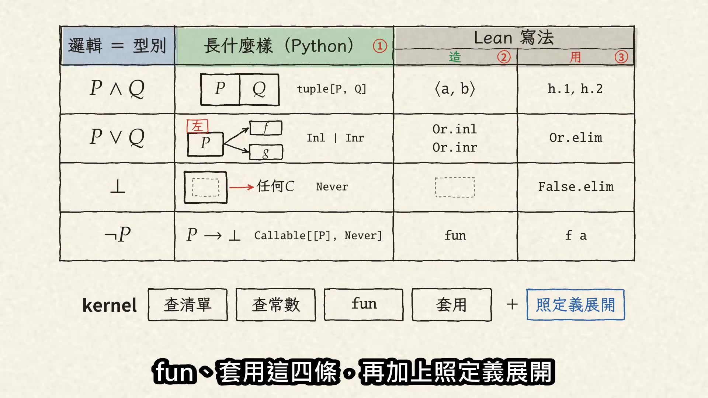

**逐字稿片段：** 所以三欄表這次，一口氣補四列

**話題推測：** 畫面更新三欄表，補上本集介紹的四個連接詞及其在邏輯、型別與值中的呈現。

---

## 00:18:36

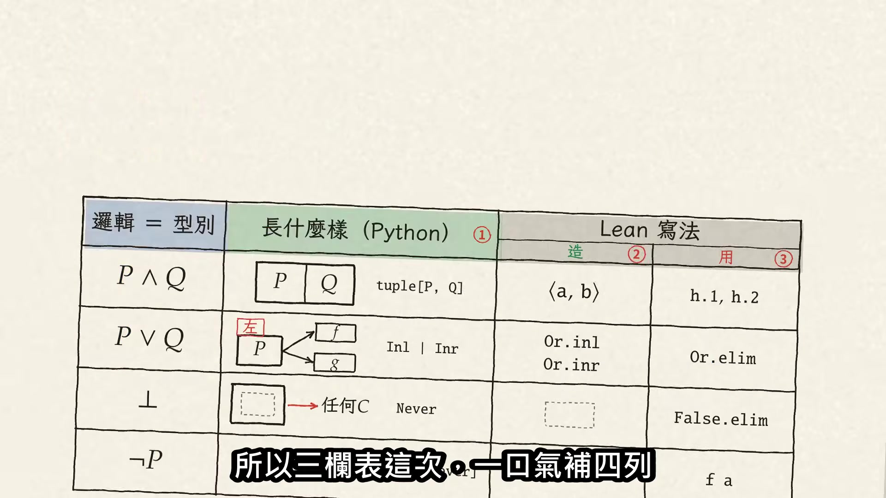

**逐字稿片段：** 說到這兩集一直在寫的 fun 這個寫法有一個祖先： 美國邏輯學家 Alonzo Church 在 1930 年代發明的符號系統 叫做 lambda 演算 它只做一件事：用一個希臘字母 lambda 寫下「吃一個 x 吐出某個東西」的函數 然後研究把參數代進去，會發生什麼事 上一集 Python 的 lambda 名字就是從這裡來的 後來到了 1940 年，他發表了一篇論文 叫〈簡單型別論的一種表述〉 把 Russell 的型別標籤 貼到 lambda 演算的每一個函數上 第 2 集那條「函數要 A，你給 A 結果是 B」的規則，就是從這裡長出來的

**話題推測：** 畫面引入關於 lambda 演算與 Alonzo Church 的歷史背景，追溯 fun 寫法的起源。

---

## 00:19:13

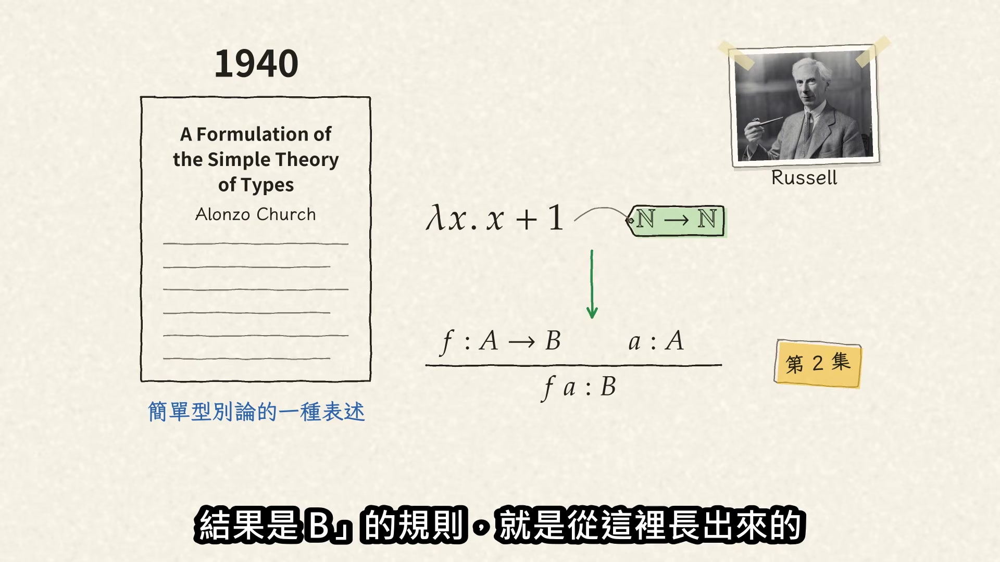

**逐字稿片段：** 另外，Church 一生指導了 31 個博士生 名單裡有後來的大邏輯學家 Kleene、Rosser，也有一個 1936 年從英國來到普林斯頓的年輕人 名字叫 Alan Turing Turing 後來被稱為電腦科學之父 電影《模仿遊戲》講的就是他的故事

**話題推測：** 畫面顯示 Church 的著名學生名單，尤其是 Alan Turing，介紹其對電腦科學的貢獻。

---
