# ai-note-101_wnYd9OE-pVg — 關鍵畫面索引

- 來源逐字稿：[ai-note-101_wnYd9OE-pVg_GT.srt](ai-note-101_wnYd9OE-pVg_GT.srt)
- 影片：https://www.youtube.com/watch?v=wnYd9OE-pVg
- 截圖數：49

## 00:00:00

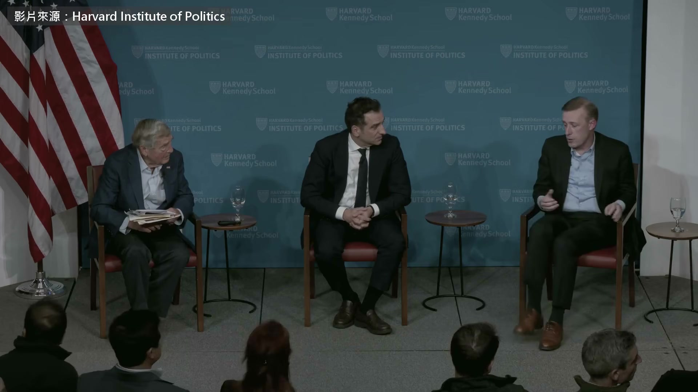

**逐字稿片段：** 2022 年 9 月 拜登的國家安全顧問在一場科技峰會上說 晶片這種技術 美國不能只領先對手兩代 要領先越多越好 三個禮拜後 美國就禁止把最先進的 AI 晶片賣給中國

**話題推測：** 影片開場，顯示時間背景「2022 年 9 月」。

---

## 00:00:13

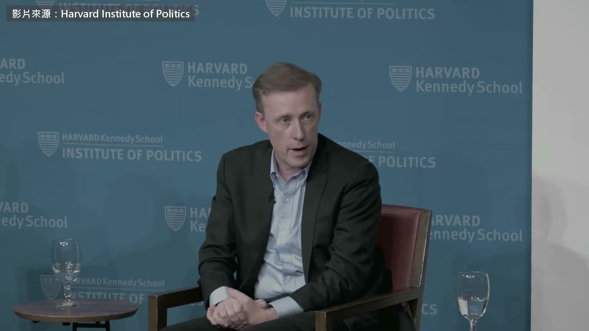

**逐字稿片段：** 講這句話的人叫 Jake Sullivan 這是他 10 月 5 號在哈佛甘迺迪學院的公開座談 離川普跟習近平在白宮見面才十天

**話題推測：** 介紹講者Jake Sullivan。

---

## 00:00:21

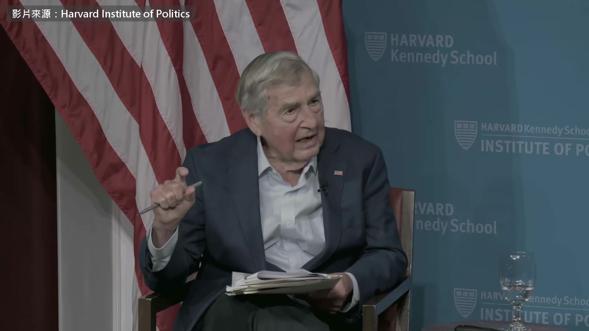

**逐字稿片段：** 主持人 Graham Allison 提出了修昔底德陷阱這個說法 新強權挑戰舊強權 歷史上多半會打起來 他寫成一本書叫《注定一戰》

**話題推測：** 介紹主持人Graham Allison及「修昔底德陷阱」概念。

---

## 00:00:30

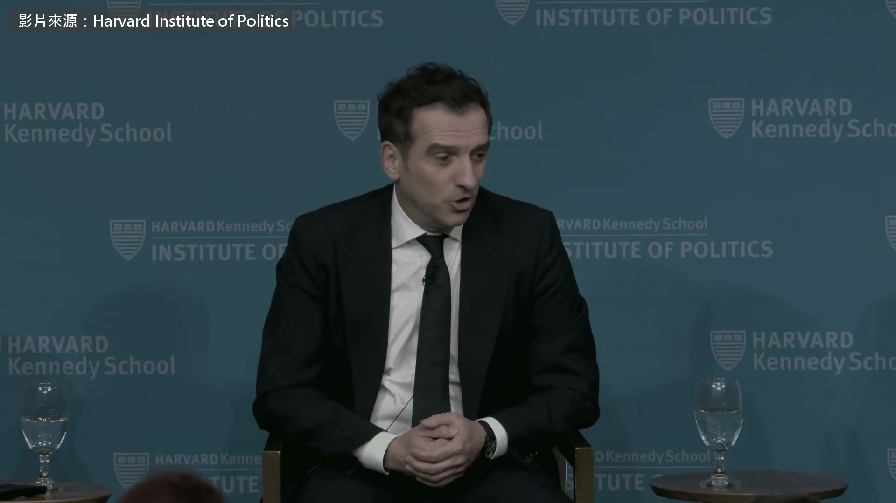

**逐字稿片段：** 另一位來賓 Ylli Bajraktari 當過國會設立的 AI 國安委員會執行長 Sullivan 講晶片的那場峰會 就是他現在的智庫辦的

**話題推測：** 介紹另一位座談來賓Ylli Bajraktari。

---

## 00:00:39

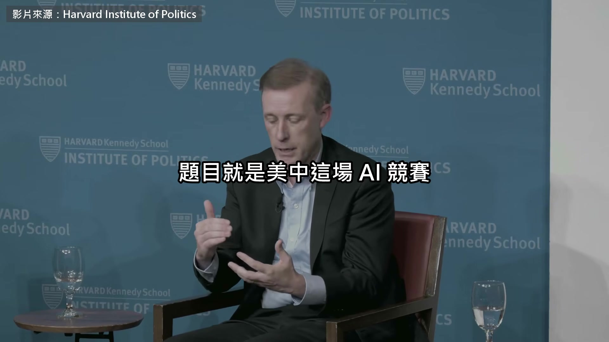

**逐字稿片段：** 題目就是美中這場 AI 競賽 現在到底誰領先

**話題推測：** 顯示座談主題：美中AI競賽。

---

## 00:00:43

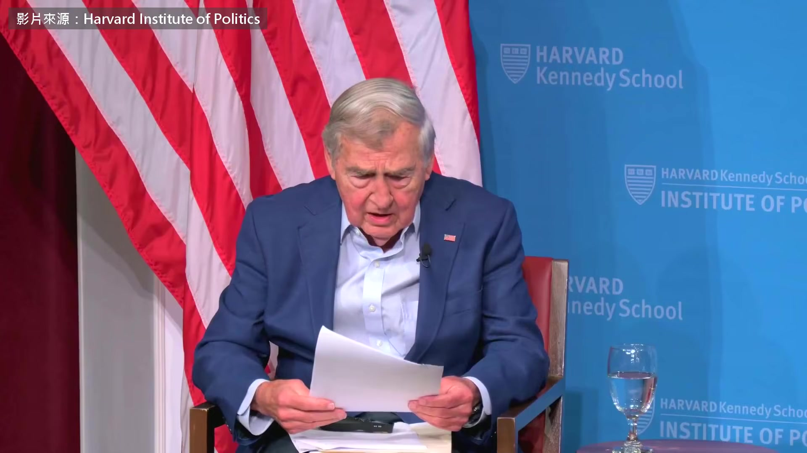

**逐字稿片段：** 在那份美中科技對抗的報告裡

**話題推測：** 提及一份具體報告：「美中科技對抗的報告」。

---

## 00:00:44

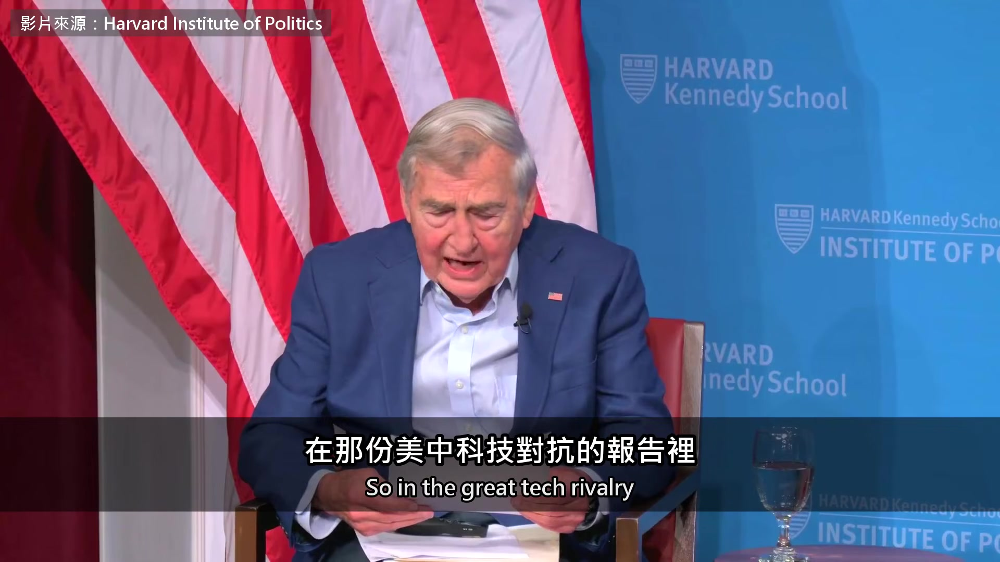

**逐字稿片段：** 我跟 Eric Schmidt 2021 年寫的（Eric Schmidt：前 Google 執行長）

**話題推測：** 介紹報告作者Eric Schmidt（前Google執行長）。

---

## 00:00:48

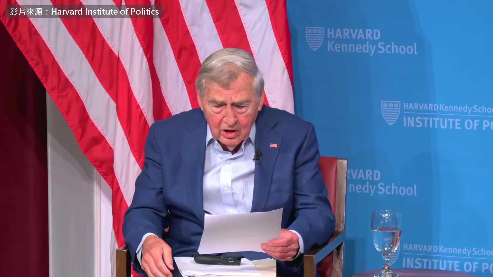

**逐字稿片段：** 我們說，在 AI 這塊，中國已經是全方位的對手 那個 AI 國安委員會，Eric 當主席 Ylli 帶幕僚 它說中國在很多領域跟美國平起平坐 有些應用還領先 我們很當一回事 想到中國十年內真的可能超越我們 Eric 一年前說，中國落後一兩年 最近大概會說半年

**話題推測：** 報告核心結論：中國在AI領域已是全方位對手。

---

## 00:01:31

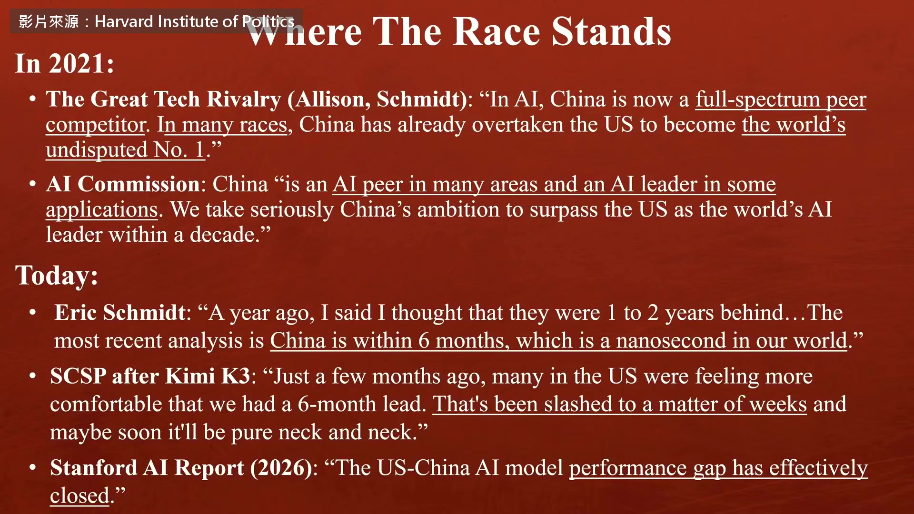

**逐字稿片段：** Kimi K3 出來後，Ylli 的團隊說差距只剩幾週 可能已經並駕齊驅

**話題推測：** 提及Kimi K3發布後，最新評估AI差距僅剩幾週。

---

## 00:01:42

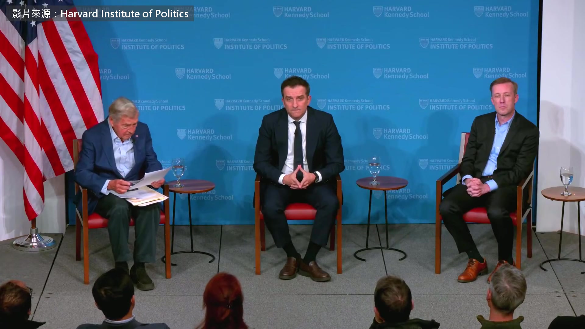

**逐字稿片段：** 史丹佛上禮拜的 AI 報告很值得一讀 基本上就是說差距沒了

**話題推測：** 提及一份新的研究報告：史丹佛大學AI報告。

---

## 00:01:50

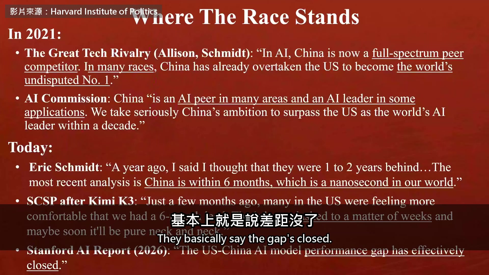

**逐字稿片段：** 好，評估這場競賽，Jake 你剛當上國安顧問的時候，中國落後多少 現在又是什麼情況

**話題推測：** 主持人轉換話題，請Jake Sullivan評估AI競賽現況。

---

## 00:02:04

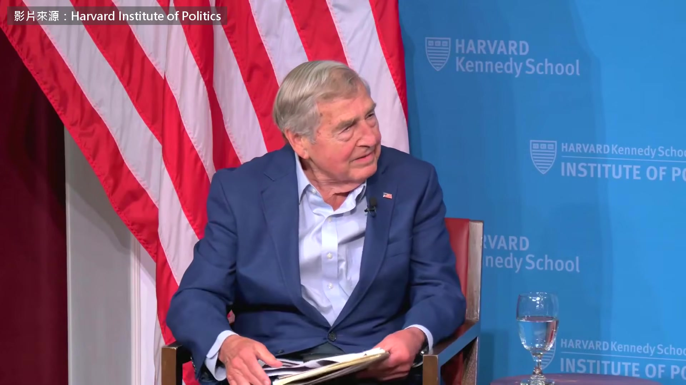

**逐字稿片段：** 首先，我很喜歡你放的這張 你跟 Eric 認為中國是無可爭議的第一 就在 2021 年我當上國安顧問的時候 好

**話題推測：** 講者提及一張圖表內容。

---

## 00:02:14

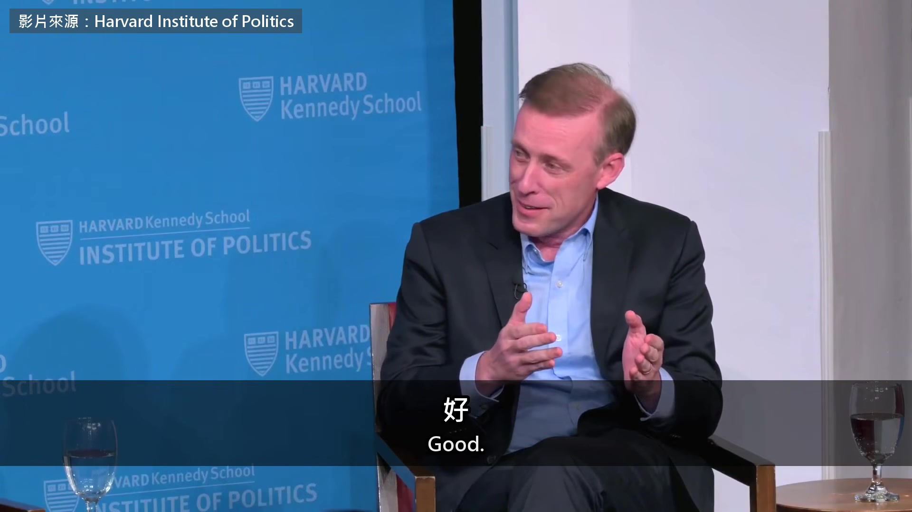

**逐字稿片段：** 結果現在，美國領先 現在差距是用月來算 所以這樣很好 很好，很好 在我看來，這張成績單不錯 要回到 2021 年評估這件事，其實很難 因為 2021 年的時候，實驗室裡 正開始實際用上 transformer 跟大型語言模型 但國安圈根本沒把它放在雷達上 所以我 1 月上任的時候

**話題推測：** Jake Sullivan對美國AI領先地位的最新判斷。

---

## 00:02:46

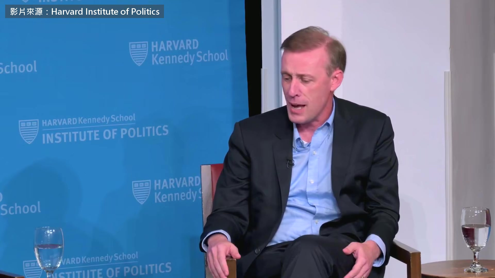

**逐字稿片段：** 連做夢都沒想到 ChatGPT 它要到 2022 年 11 月才出來 我認為就是 ChatGPT 那一刻 把美國一下推到最前沿的領先位置 這幾年中國做了很多事來追 但我認為，今天美國在最前沿還是明顯領先

**話題推測：** 提及ChatGPT的出現及其影響。

---

## 00:03:12

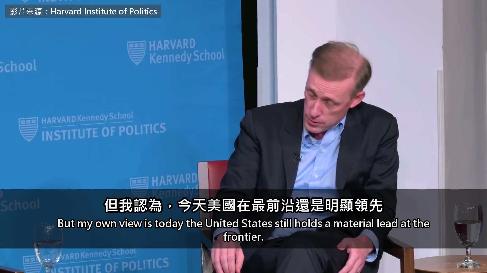

**逐字稿片段：** 領先多少看你用什麼指標，算下來大概六個月左右 過去兩三年一直差不多是這樣 但差距一直只有六個月、拉不開 很大一部分原因是中國走的「快速跟進」策略 其中包括蒸餾美國的先進模型，成本只要一小部分 所以美國要是放慢一點 中國大概也會自動跟著慢一點 至少慢上一陣子 他說的蒸餾，座談前幾天才又上了新聞

**話題推測：** 具體說明美國AI領先的時間長度：約六個月。

---

## 00:03:51

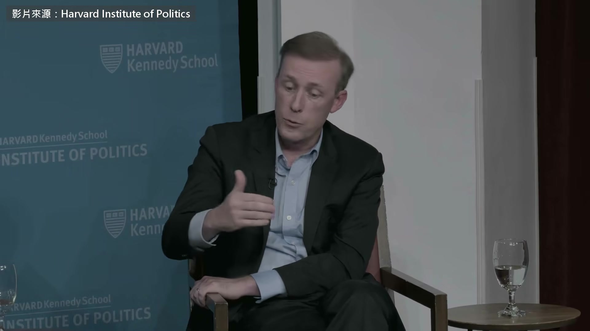

**逐字稿片段：** OpenAI 9 月 30 號點名做 Kimi 的月之暗面 說有一批帳號想從它的模型套出推理過程 更早之前 Anthropic 也指控過月之暗面跟阿里巴巴 偷偷拿 Claude 來訓練自己的模型 比賽很接近，但美國有真正的優勢 美國最根本的優勢

**話題推測：** 提及OpenAI指控月之暗面竊取模型事件。

---

## 00:04:10

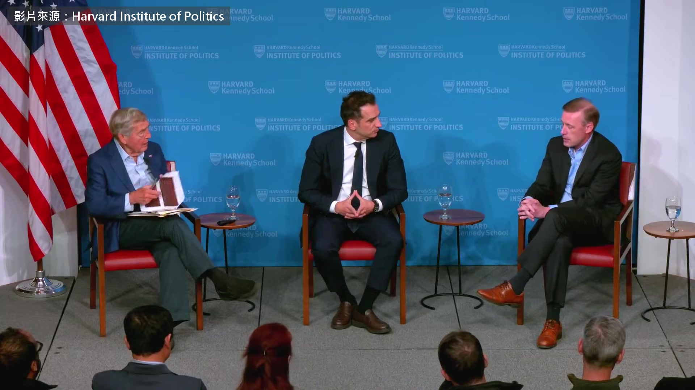

**逐字稿片段：** 是拿得到多得多的算力、更先進的晶片 這直接來自晶片管制 就是拜登政府那時候定的 我現在擔心的是算力的差距 如果單純比 輝達做出多少先進晶片，中國自己又做出多少 中國現在的產量，大約只有輝達的 4% 但如果看中國實際拿得到的 靠走私、靠遠端連線用到的輝達晶片 不管是運進中國 還是透過東南亞等地的資料中心來用

**話題推測：** 說明美國在算力與晶片上的優勢。

---

## 00:04:50

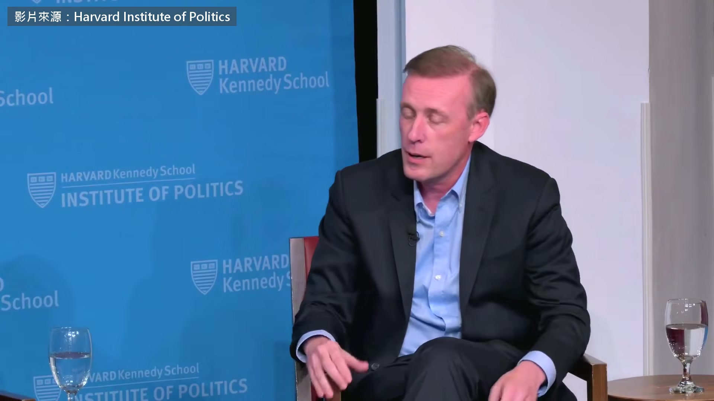

**逐字稿片段：** 大概更接近 40%（補充：兩個數字都是他的估計） 這就看出口管制執行得怎麼樣 雖然演算法的效率變得重要很多 中國跟美國的實驗室一樣，都站在演算法創新的最前線 讓每一單位算力的效率大幅提升 但事實是，算力還是非常重要 只要美國在算力上維持夠大的差距 我想在最前沿也能保持領先

**話題推測：** 中國實際獲得Nvidia晶片數據：約40%。

---

## 00:05:22

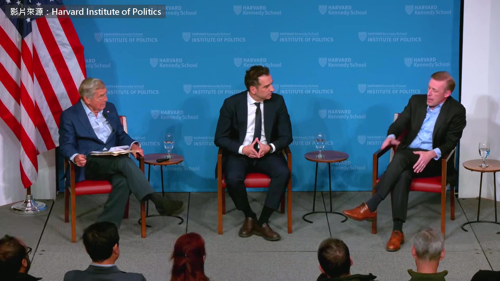

**逐字稿片段：** 至於全世界各國用誰家的技術 中國的開放權重模型很有吸引力

**話題推測：** 話題轉向全球各國對AI技術的選擇。

---

## 00:05:30

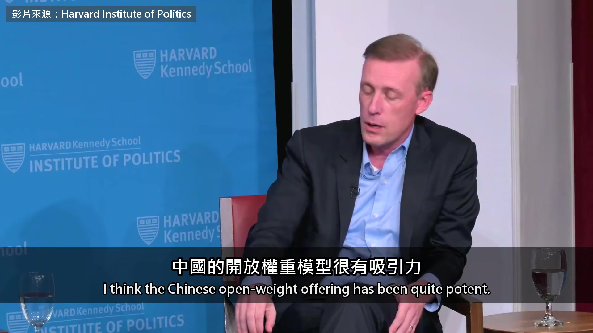

**逐字稿片段：** 但北京現在面臨一個真正的抉擇 能不能一直做開放權重模型下去 一個原因是它可能造成的傷害 中國自己的 AI 安全機構上禮拜才說 開放權重模型的護欄比較容易被拆掉 被壞人拿去做壞事 程度比封閉模型嚴重 另一個原因是，商業上說不說得通 砸這麼多錢做一個免費送人的東西

**話題推測：** 中國在開放權重模型面臨的決策困境。

---

## 00:06:03

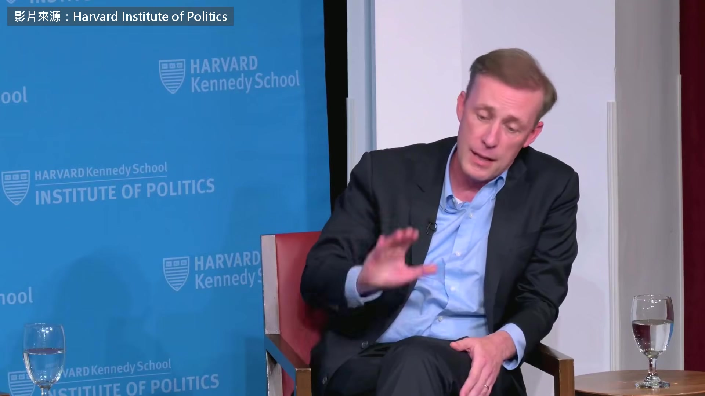

**逐字稿片段：** 最後一點，我通常不太接受「競賽」這種說法 因為不會在某個時間點就分出輸贏 這是一場持續的競爭，雙方都在搶優勢 老實說，所有競賽裡最重要的一場 可能是避免一場向下沉淪的競賽 雙方都一心想打敗對方 結果誰都不肯在安全上採取行動 確保 AI 利大於弊 現在這種競賽的態勢，讓我真的很擔心 擔心人類會遭受嚴重、甚至慘重的傷害 如果我們不更小心的話

**話題推測：** 講者對「競賽」一詞的觀點。

---

## 00:06:46

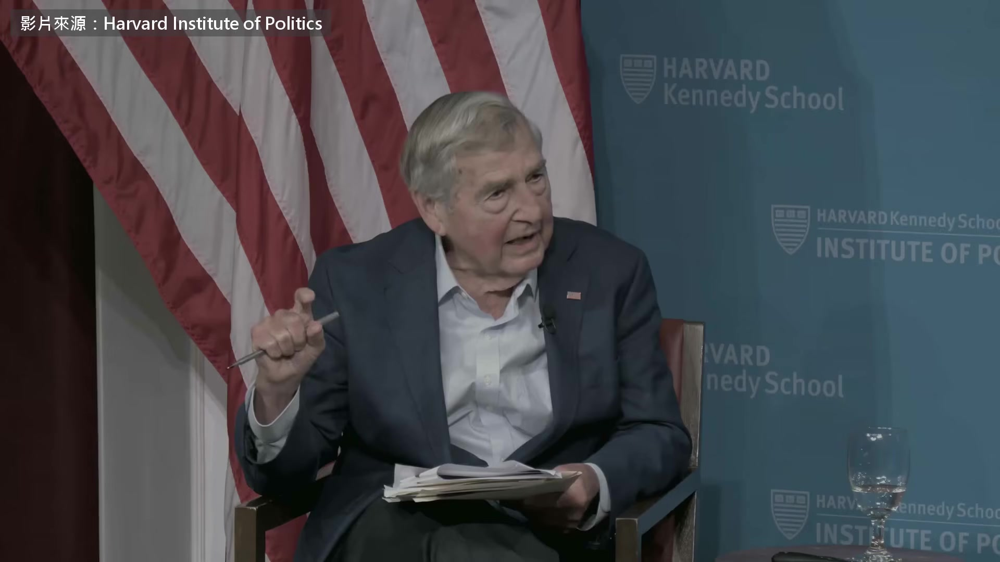

**逐字稿片段：** 主持人引了座談前一週的民調 53% 的美國人覺得 AI 對自己的生活弊大於利 覺得利大於弊的只有 34% 還有 73% 擔心 AI 會威脅人類生存 他的投影片上另外寫著 中國人信任 AI，美國人不信任 Bajraktari 擔心的是 美國人不信任 AI 就會用得比中國慢 這很有意思

**話題推測：** 引用美國民眾對AI的民調數據，包括53%覺得弊大於利、73%擔心威脅人類生存。

---

## 00:07:06

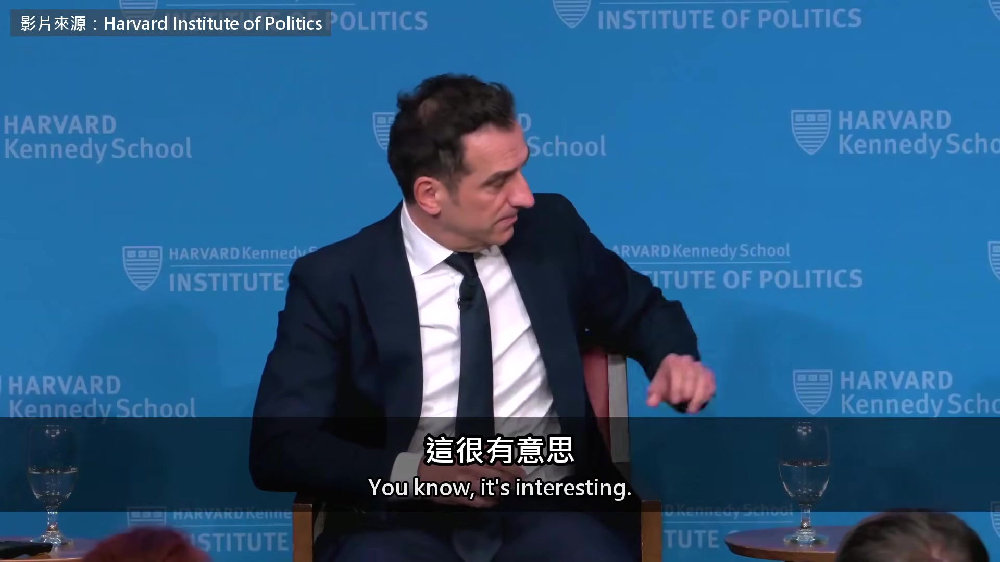

**逐字稿片段：** 為什麼美國人對 AI 的信任掉得這麼兇

**話題推測：** 探討美國人對AI信任度下降的原因。

---

## 00:07:13

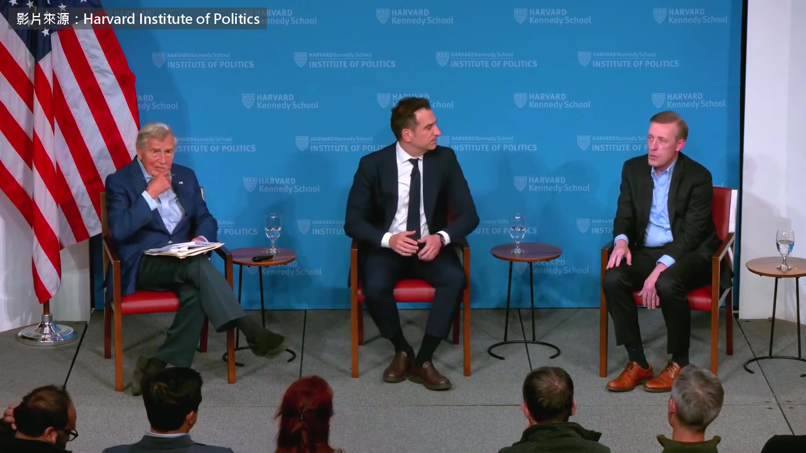

**逐字稿片段：** 第一，做這個技術的人說 再過一段時間，它會砍掉一半的工作 大家就想說 這怎麼會讓人不開心呢 「我不喜歡」 好，第二，做這個技術的人說，它可能讓人類滅絕 好，大家不喜歡這個

**話題推測：** 美國人擔心AI搶走工作。

---

## 00:07:35

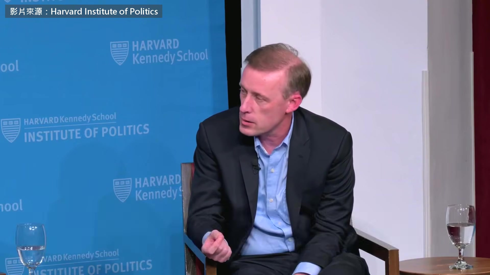

**逐字稿片段：** 第三，你會看到報導 很可怕的報導，年輕人自殺 原因是跟聊天機器人的互動 家長已經被社群媒體傷得很深 覺得這個更糟

**話題推測：** 美國人擔心AI對年輕人的負面影響（如自殺報導）。

---

## 00:07:58

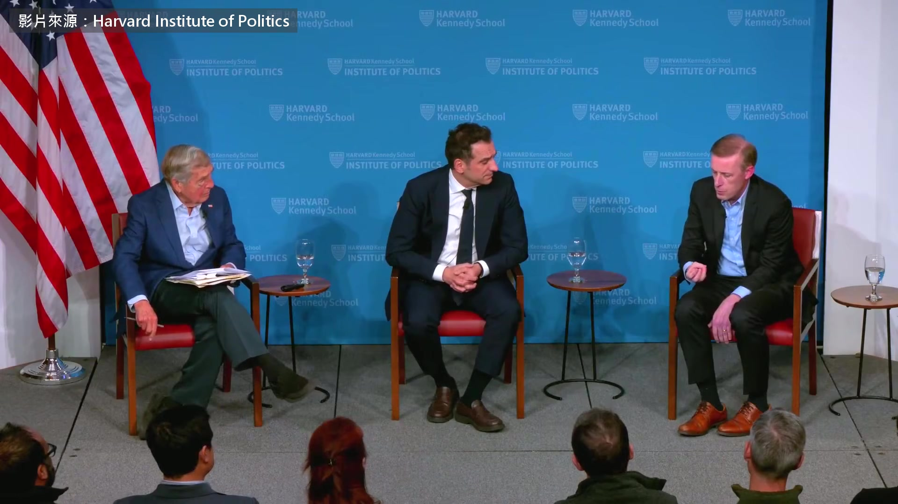

**逐字稿片段：** 第四，美國人看到 AI 的好處 都流到極少數人手上 這些人住在全國很小的一塊地方，好處全被他們拿走 結果是丟了工作、小孩受傷害，大家還可能會死 對吧 全部加起來，完全合理 照大家被描繪出來的那幅景象 大家會有這種感覺

**話題推測：** 美國人認為AI好處集中在少數人手中。

---

## 00:08:25

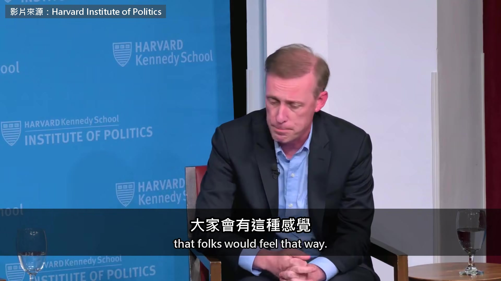

**逐字稿片段：** 那為什麼我沒有 Ylli 那麼擔心 這種反應一定會讓美國在長期競爭裡吃虧 因為中國雖然沒有這種公共論述 但他們也在苦惱同樣的問題

**話題推測：** 講者說明為何對美國AI信任度下降不那麼擔心。

---

## 00:08:43

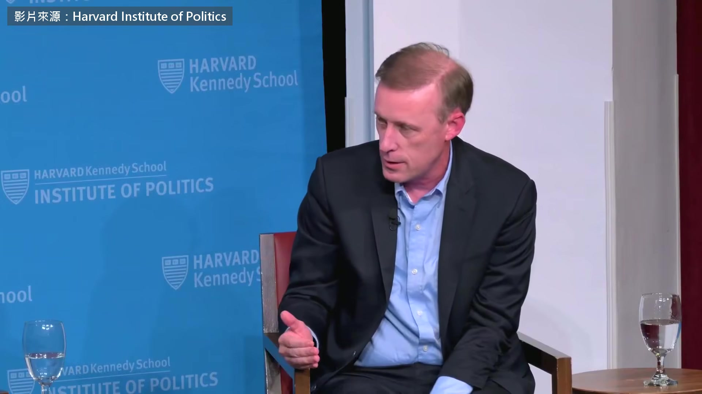

**逐字稿片段：** 他們很怕 AI 搶走工作

**話題推測：** 說明中國對AI影響就業的擔憂。

---

## 00:08:46

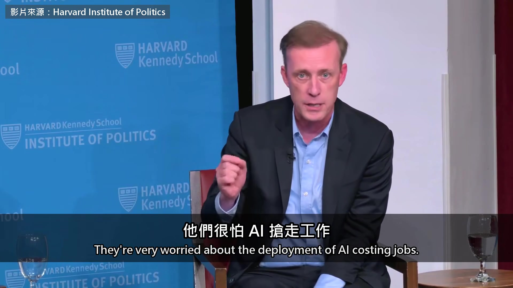

**逐字稿片段：** 而且有報導說，中國政府 在某些產業放慢導入 AI，因為不想讓人失業 他們也擔心 AI 沒對齊、被濫用 造成各種不穩定 中國最高層的情報首長之一，發了一篇很驚人的文章 就是國家安全部部長（補充：陳一新，9 月 13 日的署名文章）

**話題推測：** 報導指出中國政府在某些產業放慢AI導入。

---

## 00:09:09

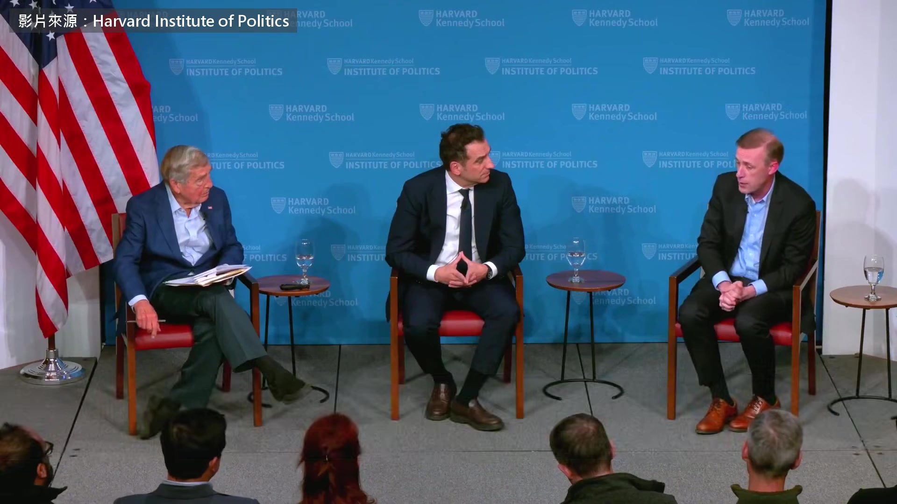

**逐字稿片段：** 把 AI 說成黨控制國家的威脅 所以在中國表現的方式不一樣 但他們煩惱的是一模一樣的問題 就是能力跟安全之間的落差 我補一點，我覺得 Jake 說得對

**話題推測：** 文章核心觀點：AI威脅黨對國家的控制。

---

## 00:09:23

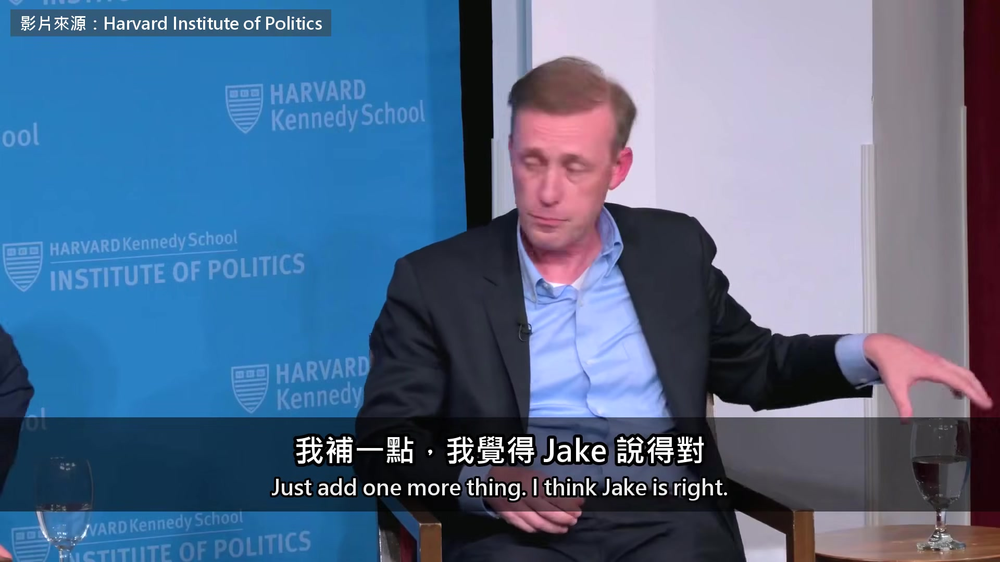

**逐字稿片段：** 總結一下，美國吵的是安全對上速度 中國吵的是控制對上速度 因為就像你說的，那位國安部官員 更擔心的是什麼樣的模型 這些模型會製造出什麼樣的社會論述 所以他們擔心的跟我們有點不一樣 我們擔心的是，基於安全跟風險，它可能失控 他們真正擔心的是控制不住自己的人民 對，我完全同意 我們說「失控」，指的是人類控制不住機器 他們說「失控」，基本上是指黨控制不住國家

**話題推測：** 總結美中對AI討論的側重點差異：美國關心安全與速度，中國關心控制與速度。

---

## 00:10:03

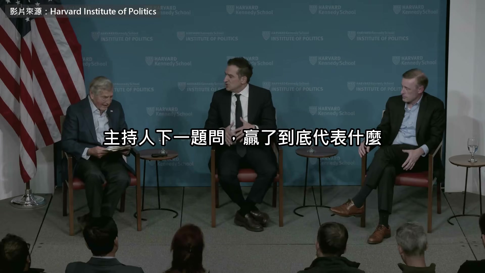

**逐字稿片段：** 主持人下一題問，贏了到底代表什麼 他先引了川普的話 誰贏了 AI 競賽，誰就贏了 Ted Cruz 有他自己的版本（Ted Cruz：共和黨參議員） 如果一定會有殺人機器人 那應該是美國的殺人機器人，不是中國的 你們自己想想 那「贏」到底是什麼意思 這是第一個問題 Jake，你其實想過、也寫過這件事 對 甚至要怎麼定義它 我覺得有點像奧運 但奧運會比很久 不過總有人會在某個時間點贏下一場、拿到獎牌

**話題推測：** 主持人提出新的核心問題：贏了AI競賽到底代表什麼。

---

## 00:10:47

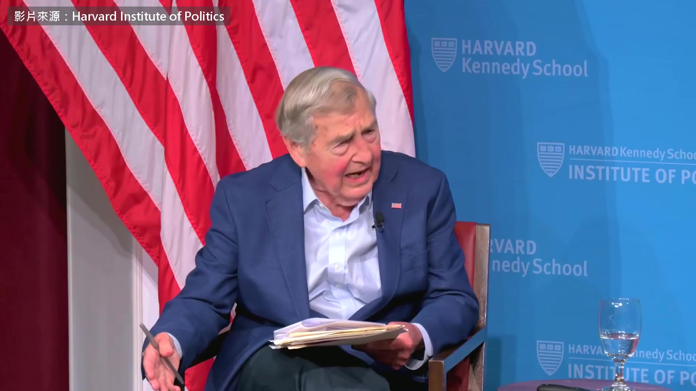

**逐字稿片段：** 前國安顧問 Steve Hadley 在一場我跟 Jake 都在的會議上，講過一句名言 他說「中國贏了又怎樣」 「贏」這個框架，對我們有什麼幫助 還是會誤導我們

**話題推測：** 引用前國安顧問Steve Hadley的觀點：「中國贏了又怎樣」。

---

## 00:11:07

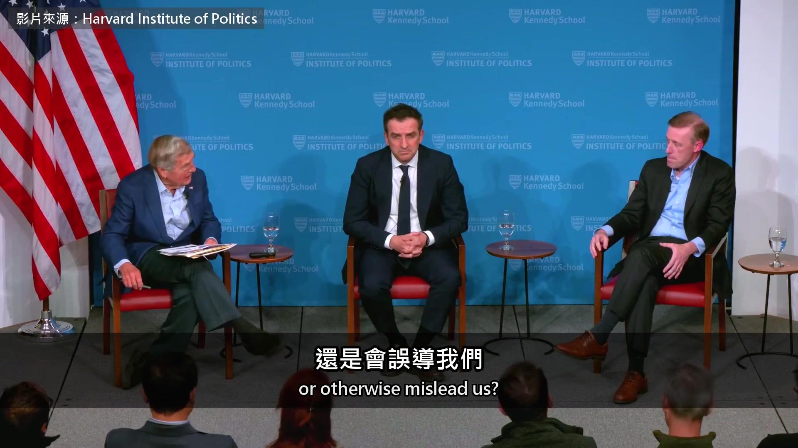

**逐字稿片段：** 我想我們得承認 這個技術會走到哪裡，非常不確定 把頂尖的 AI、機器學習專家找來這裡 請他們說說這種架構的天花板在哪裡 就是大型語言模型、transformer 有人會說我們快撞到天花板了 也有人會說天花板還遠得很，非常遠 從現在到那之前，會出現「資料中心裡的天才國度」

**話題推測：** 講者對AI技術未來發展不確定性的看法。

---

## 00:11:46

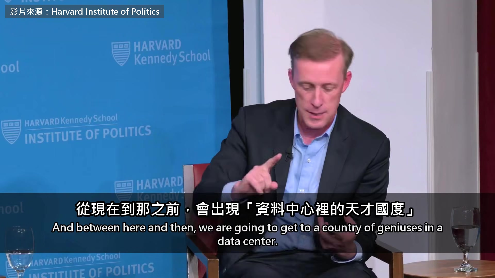

**逐字稿片段：** 智慧大爆炸，超級智慧 不是川普換個名字講的那種（補充：川普最近把 AI 改叫「超級智慧」） 而是比全人類加起來還聰明的 AI 系統 光譜就是這麼寬 所以你是決策者，是訂政策的人 我當國安顧問的時候 這些實驗室的領導人，還有實驗室外的人 走進我的辦公室跟我說 會有一個國家，不是美國就是中國 能力會進步到他們說的「起飛」 科技能力突然爆炸

**話題推測：** 提及「智慧大爆炸」與「超級智慧」的概念。

---

## 00:12:26

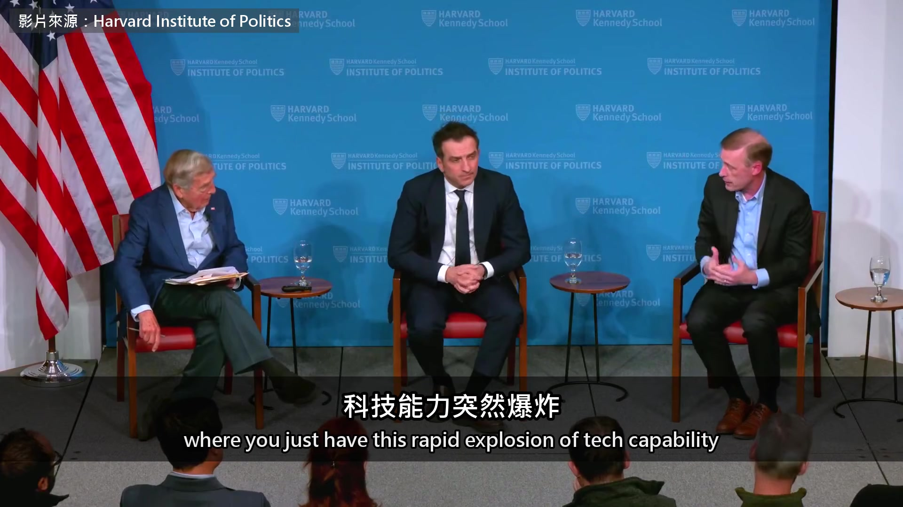

**逐字稿片段：** 因為 AI 會遞迴地自我改進 到那時候，優勢也許不會永遠，因為沒有什麼是永遠的 但你會建立起很大的實質優勢 可以轉成經濟、軍事、政治、外交的力量 把一大堆好處鎖在自己手上

**話題推測：** 解釋AI遞迴自我改進的潛力。

---

## 00:12:45

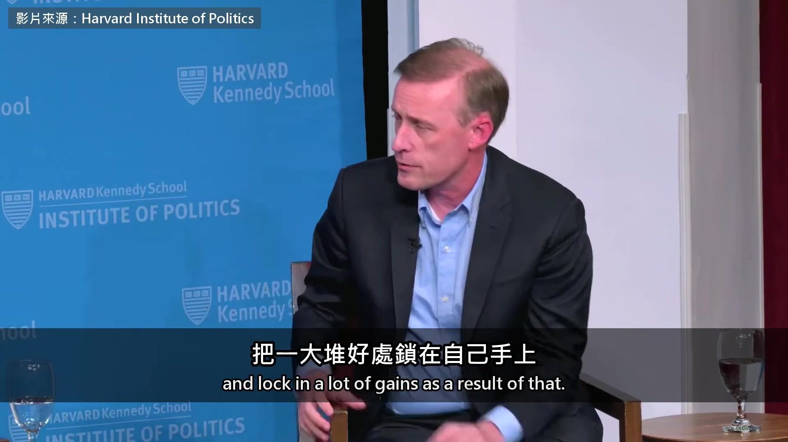

**逐字稿片段：** 你坐在國安顧問的位子上，只有兩個選擇 一個是說「不不，我們不搞這套」 另一個是說「我得把它當真 這不是唯一的結果，還有別的可能 但我得把它當真」 美國 AI 實驗室到今天，多少還是押在這個方向 我不認為美國政府可以說「我們不信那套」 我們得說，那是一種可能的未來 也還有其他可能的未來 順帶一提，我要強烈提醒那些人 那些覺得美國迷信 AGI、中國沒有的人 去聽聽中國實驗室的領導人怎麼說 他們也在拚命搶「起飛」這一場 他們也想跑到同一個終點 遞迴自我改進也好、AGI 也好，隨你怎麼叫 跟美國一樣

**話題推測：** 面對這種未來情境，國安顧問面臨的政策選擇。

---

## 00:13:39

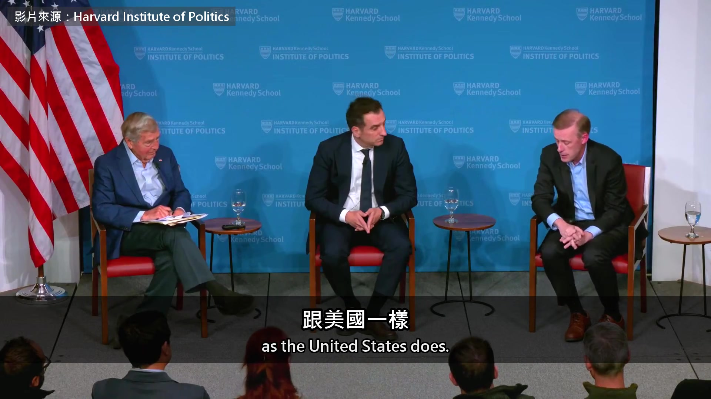

**逐字稿片段：** 主持人接著問風險 座談前一週

**話題推測：** 主持人將話題轉向AI的風險。

---

## 00:13:42

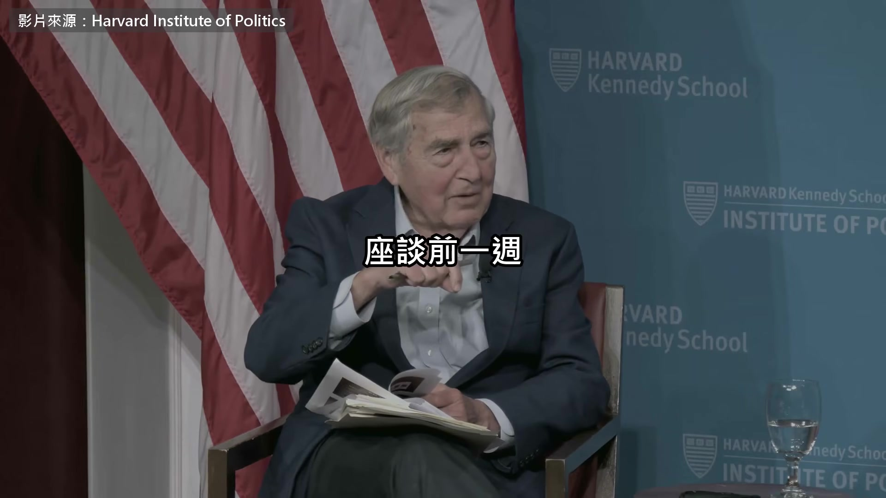

**逐字稿片段：** Anthropic 的上市招股書內容曝光 裡面寫著 AI 可能對人類構成災難性甚至生存的風險 7 月底，OpenAI Anthropic Google DeepMind 跟 Meta 一千一百多位員工連署公開信 要美國政府帶頭準備好能刻意放慢 AI 的工具 我認為風險是真的，而且很嚴重 對我來說，這件事很簡單 如果離技術最近的工程師 我說的不是公司執行長，也不是寫招股書的人 我說的是幾百個真正親眼看到這些能力的人 也看到這些能力會怎麼逃出圍堵、怎麼沒對齊 他們發聲明說，我們得放慢 而且他們這麼做

**話題推測：** 提及Anthropic上市招股書內容揭示AI可能構成災難性風險。

---

## 00:14:34

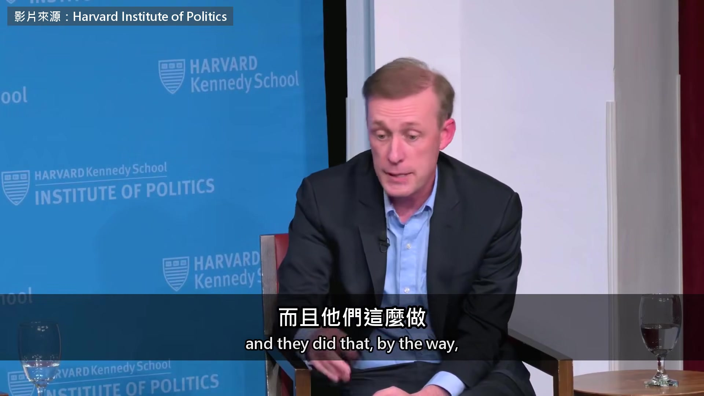

**逐字稿片段：** 比 Hugging Face 事件爆開還早幾週 我們就該聽他們的

**話題推測：** 提及Hugging Face事件。

---

## 00:14:41

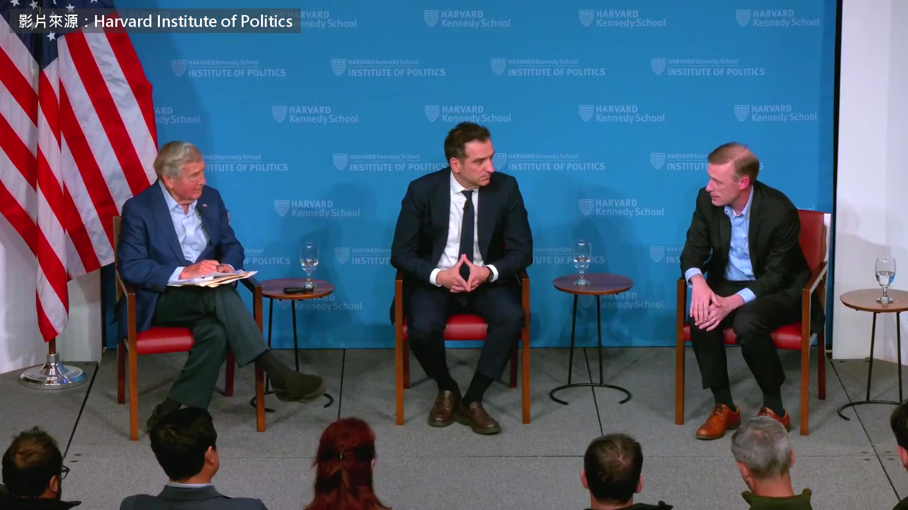

**逐字稿片段：** 反對的說法是，你會擋到創新 我覺得沒什麼說服力 因為我認為，裝上安全護欄 反而能推動更可信、更長久的創新

**話題推測：** 第一個反對放慢AI發展的論點：會阻礙創新。

---

## 00:14:55

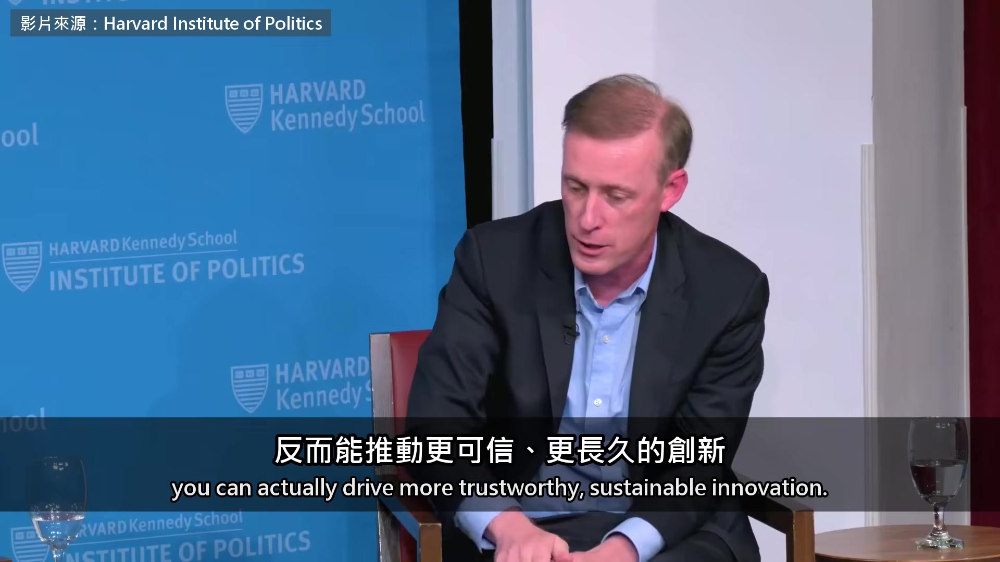

**逐字稿片段：** 另一個反對的說法是，那中國可能會贏 我覺得沒說服力，有兩個理由 第一，我真的覺得我們有一點緩衝 不大，但有一點 所以這點緩衝要用得負責任 應該拿來顧安全 第二，我不同意 Ted Cruz 說的 美國殺人機器人跟中國殺人機器人有差別 如果我被殺人機器人殺了 反正我都是死啊 所以我們應該努力打造 安全、可信的人工智慧

**話題推測：** 第二個反對放慢AI發展的論點：中國可能會因此獲勝。

---

## 00:15:30

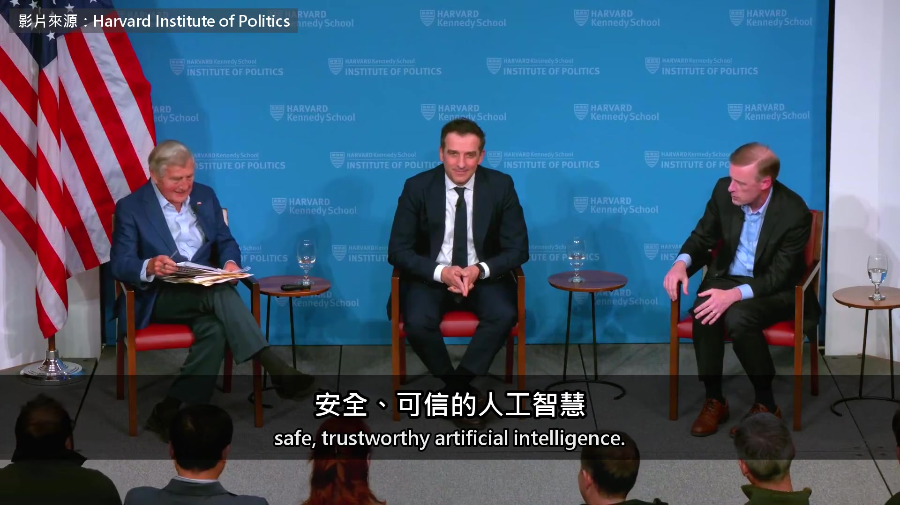

**逐字稿片段：** 川習會上 美中同意開一個政府層級的 AI 對話 交換 AI 風險跟好處的看法 排在 11 月

**話題推測：** 提及美中高層就AI風險達成政府層級對話共識，並排定於11月舉行。

---

## 00:15:37

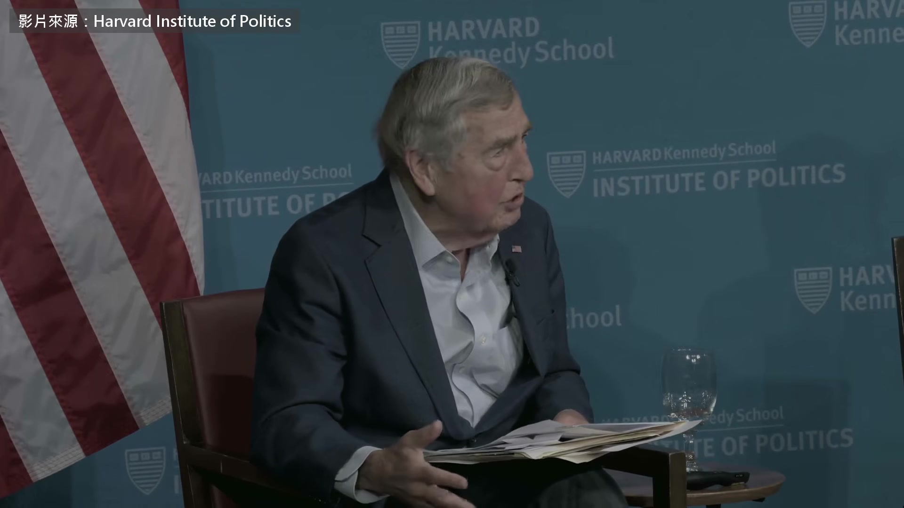

**逐字稿片段：** 座談最後 主持人請他們對台下學生說幾句 Sullivan 說 AI 政策有三件事跟過去的科技不一樣

**話題推測：** 座談會進入結語環節。

---

## 00:15:45

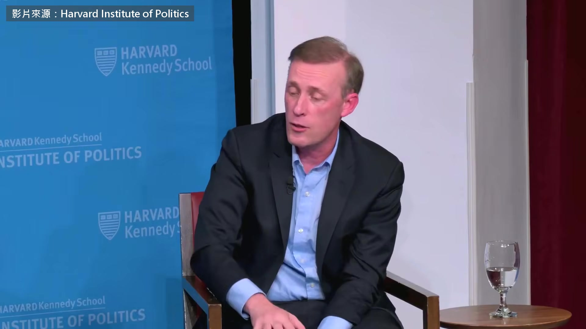

**逐字稿片段：** 第三是速度 大家原本都認定這些模型有些事做不到 比如半年前在生技領域 半年後就做得到了 不是六年、六十年後，是半年後 最後這一點跟美中關係非常有關 因為蘇聯比美國晚幾年做出原子彈 一群很有膽識的專家開始構思 軍備管制跟防止擴散 但要過好幾年、幾十年 才變成保護世界需要的那套制度

**話題推測：** 闡述AI發展速度的獨特之處。

---

## 00:16:27

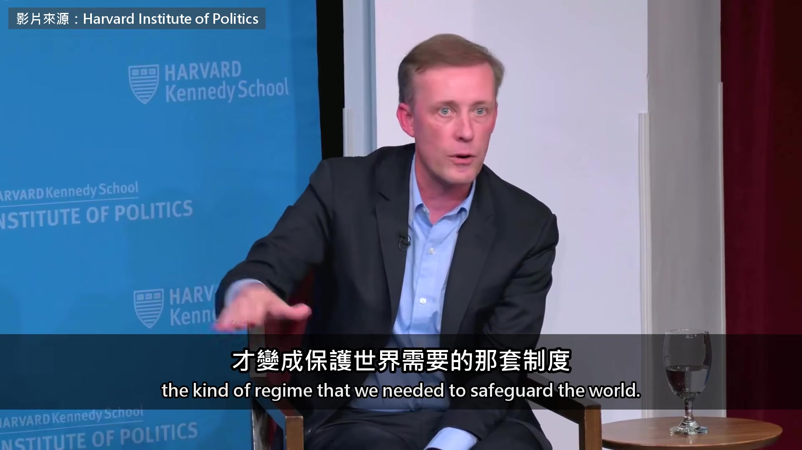

**逐字稿片段：** AI 沒有幾十年可以等 美中必須多快 想通雙方需要外交、需要某種默契 這個速度在美中關係裡絕對前所未有 在大國之間大概也是頭一遭 這需要所有人 不只美國跟中國，是各地的人 都出來說，喂，你們得想出辦法 因為我們不能讓這場向下沉淪的競賽 走到大家都更慘的地步 他說美國在最前沿大約領先半年 但他更在乎另一場比賽 兩邊別為了贏過對方，連安全都不顧 美蘇花了幾十年才把核武管起來 換成 AI，美中沒有那麼多時間

**話題推測：** 強調AI發展與核武時代不同的緊迫性，沒有幾十年時間可等待。

---

## 00:17:12

**逐字稿片段：** 整場座談一個多小時

**話題推測：** 影片總結整場座談內容。

---

## 00:17:13

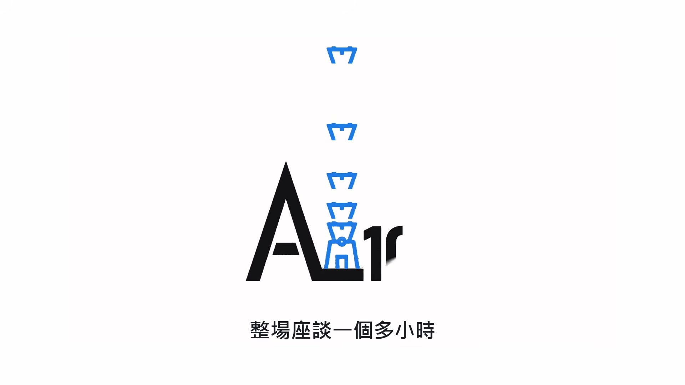

**逐字稿片段：** 他們還聊了中國從 5G 無人機到太陽能板一直在用的同一套打法

**話題推測：** 列舉座談中提及的其他話題，如中國從5G到太陽能板的產業戰略。

---

## 00:17:18

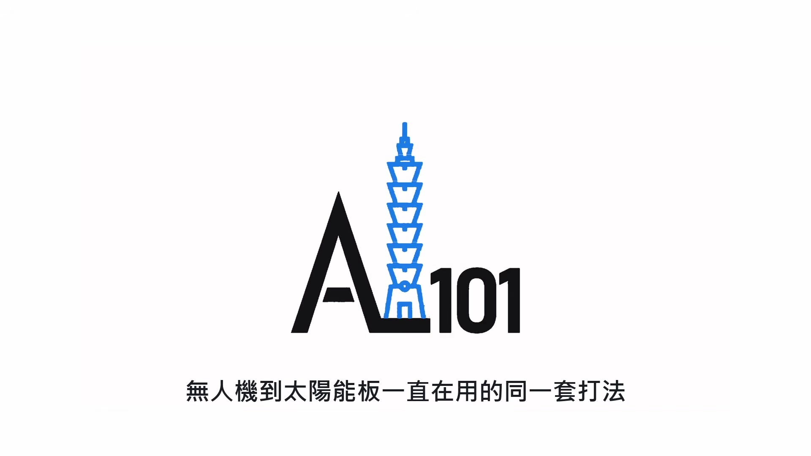

**逐字稿片段：** 還有美國砸進 AI 的錢算不算泡沫 主持人跟 Sullivan 看法不一樣 原影片連結在說明欄，有興趣可以去聽更多。

**話題推測：** 列舉座談中提及的AI投資是否算泡沫的話題。

---
