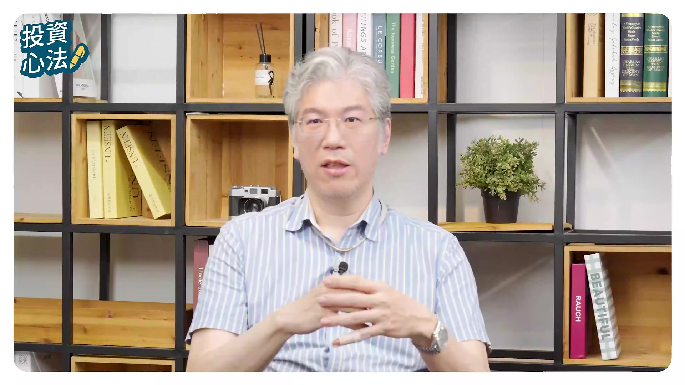
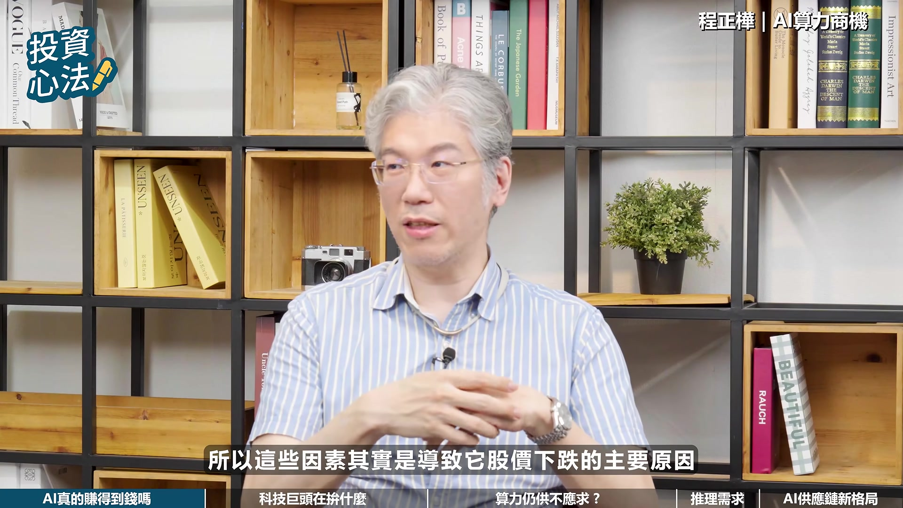
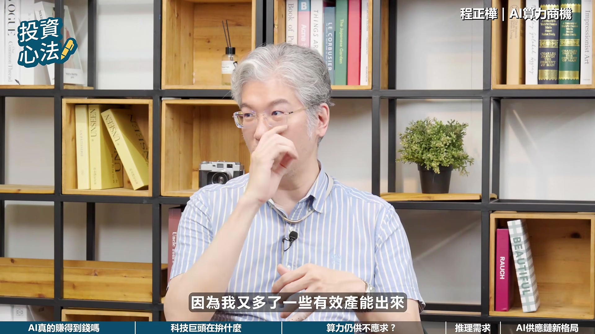
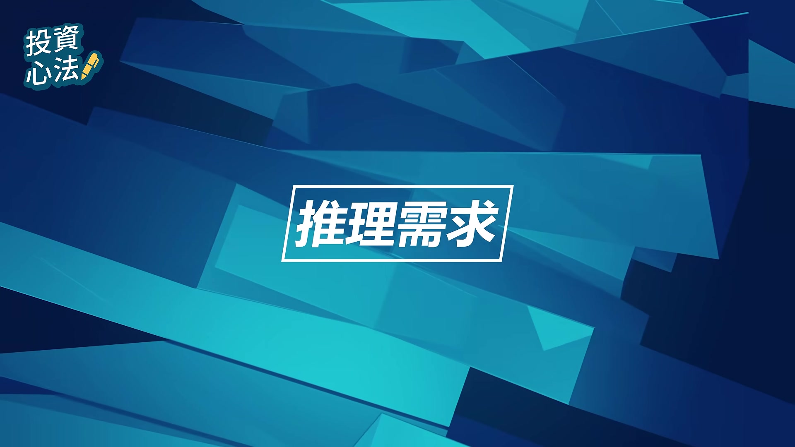

# fubonsec_4Gtn84ZIARE — 關鍵畫面索引

- 來源逐字稿：[fubonsec_4Gtn84ZIARE_FIN.srt](fubonsec_4Gtn84ZIARE_FIN.srt)
- 影片：https://www.youtube.com/watch?v=4Gtn84ZIARE
- 截圖數：20

## 00:00:00

**逐字稿片段：** CSP的Business Model很簡單, 就是建置算力然後出租給別人, 只要他的產能利用率維持在目前來講都是滿載啦, 八九成以上甚至更高, 那這個的回收速度很快。

**話題推測：** 介紹CSP商業模式。

---

## 00:00:10

**逐字稿片段：** 我們要擔心的是會不會資料中心建個兩三年,Oversupply,算力過剩,然後產能利用率忽然掉下來,那這時候當然他們就會賠錢。

**話題推測：** 提出對未來資料中心算力過剩的擔憂。

---

## 00:00:31

**逐字稿片段：** 心動不如行動 火速開戶做任務

**話題推測：** 廣告段落。

---

## 00:00:33

**逐字稿片段：** 歡迎收看富邦證券YouTube頻道 我是Sabrina

**話題推測：** 節目開場及主持人歡迎詞。

---

## 00:00:37

**逐字稿片段：** 過去這兩年 AI可以說是全球市場 最熱門的投資主題之一 從Chip GPT-1 是到各大科技巨頭 投入好幾千億美元 來建設資料中心 這場AI軍備競賽 在進入2026年後 市場開始出現了一些新的聲音 今天很高興 我們邀請到騰訊投資的 投資長陳正華 也是大家熟悉的建掌 來聊聊AI 軍備競賽之後 真正的考驗究竟是什麼 建掌好 哈嘍 瑟琳好 各位觀眾朋友大家好 首先我們先從近期公佈的 四大CSP科技巨頭的財報來談起 我們看到Alphabet Microsoft 等大型科技公司的第二季營收 和雲端業務表現蠻亮眼的 但市場反而更關心的是 AI資本支出以及未來的獲利能力 想請教建長 這是不是代表著市場評價 AI企業的方式已經開始改變了呢 其實沒有什麼太大變化

**話題推測：** 介紹AI為全球熱門投資主題。

---

## 00:01:40

**逐字稿片段：** 我覺得這一次跌主要一開始是Google跌 那Google跌之後 大家忽然就很擔心 什麼資本支出變成負的 然後怎麼樣怎麼樣之類的 但其實去年底你就可以算出來 它資本支出會是負的 因為它實際上它也不過就從 1800億的KPAC變1900億 它的資本支出才修正100億 影響不大 所以你在去年底就可以算得出來 它其實今年資本支出就會是平或是負的狀況 不只是Google 其實Amazon Meta都差不多 大家都是有多少錢就花多少錢 那為什麼會這個狀況 其實是因為AI真的很賺錢 所以其實我覺得市場在看的時候 有時候要分兩個地方

**話題推測：** 探討Google股價下跌的原因。

---

## 00:02:17

**逐字稿片段：** 一個是模型廠商賺不賺錢 就是OpenAI和Tropic 他們還在燒錢 他們沒有很賺 但是目前提供算力的 這些所謂的CSP的廠商 就是剛剛講的Amazon Google Microsoft 或是甚至一些我們叫New Cloud 像Coreweave或Nibius 其實這一段的生意現在是賺錢的 而且回收的很快 所以Google疊並不是因為說 資本支出變成負的 現金又變負的 而是因為他承認他的Gemini 3 目前是落後的 反而他去年大家在買Google的時候 是Gemini 3 其實忽然之間已經追上OpenAI 然後一度大家覺得 他是三大模型廠裡面表現比較快 比較好的一方 結果今年很明顯在前年模型 特別是這種寫程式的這些能力上面 Entropic是第一名 那當然OpenAI的Codex最近做的也不錯 那反而Google這方面是落後 而且他也承認落後 那他希望Gemini 4可以把它扳回一層 但沒有那麼快 所以他自己也承認Gemini 4的開發 是比預期下來的更久一點 所以這些因素其實是導致他股價下跌的主要原因

**話題推測：** 區分模型廠商（如OpenAI和Tropic）的獲利情況。

---

## 00:03:17

**逐字稿片段：** 所以市場現在關心的已經不是投入多少資源 而是這些投入究竟能不能創造實際的價值 我們也看到像是Gemini已經開始逐漸的 對雲端業務和AI服務帶來貢獻 微軟近期的財報也展現出 AI對於業務成長的正面效益 那相較於過去 現在似乎已經開始進入了 檢驗商業模式的階段

**話題推測：** 總結市場對AI投入能否創造實際價值的關注點。

---

## 00:03:43

**逐字稿片段：** 那您認為生成式AI 是不是已經開始的 正式走向了商業化落地呢 分成兩塊嘛 如果你是用CSP 他們的商業模式很明確 就是我買GPU 然後建Data Center 那我就把這GPU租給你 一個小時多少錢 就是這樣的一個商業模式 那目前看起來其實這個商業模式蠻賺錢的 那我剛剛有提到其實說

**話題推測：** 主持人提問生成式AI是否已走向商業化落地。

---

## 00:04:03

**逐字稿片段：** 像比如我們大概統計一下 你就假設Microsoft或Google 他們公佈的這個雲的服務 那他們去年花了多少錢 今年這部分可以新增多少營收 其實這個比例還蠻高的 就只是簡單抓一抓可能在四五十% 也就是大概你可以抓兩年就回本 大概是這種感覺 那另外一些其他的公司就會更明顯 因為剛剛講的Google Microsoft 他們資本支柱還有一些是Geno Server 做一些別的應用 那你如果是看Nibius或是Covid 這個比例可能就會來得更高一點 那像最近我們也知道XAI 就是現在SpaceX 他也開始提供出租算力的一個動作 因為其實他投了那麼多 但他自己用不到 那他還不如讓租給Entropic 租給Google 讓他們來使用他的這個Data Center 那他的回收就很快 那回收之後就有能力進一步做投資 所以CSP的Business Model很簡單 就是買算力 我建置算力 然後出租給別人 然後這個Return 只要他的產能利用率維持在 目前來講都是滿載啦 八九成以上甚至更高 那這個的回收速度很快 我們要擔心的是會不會 資料中心建個兩三年 over supply 算力過剩 然後產能利用率忽然掉下來 那這時候當然他們就會賠錢 回收不了 那可能就會賠錢 大概是這個狀況

**話題推測：** 提到Microsoft或Google雲端服務的投資報酬率數據。

---

## 00:05:14

**逐字稿片段：** 其他的 B-Smart 其實就是說 看 Tropic 或 OpenAI 他們的 B-Smart 是什麼 那目前來看其實最快的 目前驗證最快的就是寫程式 就是 2B 的這一段 然後幫忙企業去寫程式 然後做一些 特別是今年很多是Agentic AI的一個應用 那很多人現在像我們金融業開始有很多人就是 固定每天有什麼事情直接叫AI幫你整理好資料 然後自動幫你把東西跑出來 然後直接去看 那當然這些都會需要用到算力 那所以目前來講就是這種 代理型的AI 然後相關的就是寫程式這些相關的一些服務 那其實已經證明是賺到錢了 所以你可以看到像 Entropic或OpenAI 其實去年他們的

**話題推測：** 討論模型廠商（Tropic, OpenAI）的商業模式。

---

## 00:05:51

**逐字稿片段：** Entropic AR去年底大概只有四五十億美金 大概去年中去年底大概四五十億 OpenAI大概100多億 今年這兩家公司都是已經超過500億 Entropic可能到700億美金 大概這個規模 所以成長的速度其實非常快 不過在商業化加速的同時

**話題推測：** 展示Entropic和OpenAI的年度營收快速增長數據。

---

## 00:06:12

**逐字稿片段：** 市場也出現了另一種現象 就如您剛提到的 XAI開始對外儲足算力 那Meta也傳出類似的規劃 這跟過去大家印象中的 算力永遠供不應求 那似乎是有一些的落差 那您認為 Meta 最新策略透露出哪些的產業趨勢呢 就他們自己的模型沒人用 所以他建了一堆算力然後沒有人要用他的模型

**話題推測：** 主持人引入市場出現的新現象：XAI開始出租算力。

---

## 00:06:36

**逐字稿片段：** 甚至 Meta 本身就是 Entropic 的第一大客戶 Meta 自己用了一堆 Entropic 的模型 然後就是用 Entropic 的算力 但 Entropic 的算力當然是 build 在 Amazon 或 build 在 Google 裡面 並不在 Meta 所以 Meta 自己建了一堆算力根本用不到 那 XAS 一樣那怎麼辦只好做 CSP 的事情 就是把算力出租給別人

**話題推測：** 提及Meta是Entropic的第一大客戶。

---

## 00:06:58

**逐字稿片段：** 那我們需要擔心的是說他租不租得掉 如果你租得掉代表市場算力還是供不應求 所以XAI其實大概在五六月就宣佈他要出租算力 然後立刻就租掉了 直接跟Google都簽約 然後合約上面的價格還不錯 可能比市價還要高 所以代表他就是一個現有的產能 大家馬上就需要 那我立刻就出租掉 所以反而對市場沒有造成任何什麼供國於求的問題 算力的增長在過去兩三個月增加非常快 因為我又多了一些有效產能出來

**話題推測：** 提出對Meta/XAI出租算力能否成功租出的擔憂。

---

## 00:07:29

**逐字稿片段：** 那Meta現在其實還沒有說這句話 這次的法說大家也一直在問 佐伯克這些事情 那他其實並沒有說到 他要真的開始出租算力之類的 那其實對我們來講 就他如果願意出租 就是讓市場的有效產能增加 當然你會增加一些供過於求的抗勝 但如果他一下就租光了 那就代表市場需求依然是很強勁 所以我們會假設Meta真的要出租 我們就會去觀察到說 他到底到時候出租的價格 以及租的順不順利 但目前還沒有 那會不會還有更多的 就是也想要大家想要出租算力 模型是模型 CSP是CSP 那CSP廠商又想要跳過來做模型的 其實就Google當然是嘛 那Google是自己模型也很成功 所以它沒有什麼這個問題 那Amazon就是專門的CSP Microsoft也是CSP 它們都沒有模型 那其他我們剛剛講的 Neo Cloud 不管是什麼Core with Nibius 或是什麼Lambda這類型的公司 它們本來就沒有模型 它們就是專門提供算力給別人的 所以不管你是哪個模型要用都沒有差 就是會Meta加入之後 他可能會要看看他會不會造成功過於求 我們覺得機會不大 因為目前看起來算力是還蠻缺的 而且另外一個大家可能會常常擔心的是說 就是一樣 常常大家會講到中國的這些開源模型 然後價格很爛 然後就直接說AI無法賺錢 Again 這都是你要分層次講 模型是模型 CSP是CSP CSP不在乎你跑什麼模型 你跑Entropic也可以

**話題推測：** 闡明Meta尚未正式宣布出租算力的狀況。

---

## 00:08:50

**逐字稿片段：** 你跑OpenAI的GPT也可以 你可以 你要跑Kimi K3也可以 你要跑那個智普的那個GOM都可以 對他們來講 你只要需要算力 我就是GPU一個小時多少錢租給你 對我來講沒有差 你跑你的 但模型廠就有差了 Entropic的模型 如果沒有比這些開源模型好 大家不用 那Entropic可能不太賺錢 但是變成Kimi賺錢 換成另外一家公司賺錢 就類似這個樣子的狀況

**話題推測：** 列舉CSP可支援的多種AI模型，如GPT、Kimi K3、智普GOM。

---

## 00:09:18

**逐字稿片段：** 過去幾年市場關注的是模型訓練需求 但是這一年開始有越來越多人認為 為未來推理的需求 可能遠大於訓練需求 那您怎麼看這樣的轉變 已經發生了 我們剛有提到 今年的算力需求其實增加非常快 然後特別剛剛講一下

**話題推測：** 主持人提出市場焦點從模型訓練轉向推理需求。

---

## 00:09:35

**逐字稿片段：** Entropic的業績可以從去年 年初10億美金的 ARR 現在是七百多億美金 他們增加的這個都不是訓練 這沒什麼訓練需求 他們模型早就訓練好了 他們還在繼續訓練 他們是提供推論的這個服務給客人 然後收這個 Token 的使用費 他們的業績才會很明顯上來 所以今年這些所有的模型廠商 其實都很明顯的看到 他們的客人使用的量費增加非常快 所以他們才能因此 收很多的推論的費用 所以這件事情已經發生了 那也是今年AI的資本支出 會大家從年初開始就要把 剛剛講的能把所有錢全部花光的理由 就是因為看到這個需求成長得非常快 未來AI的供應鏈的發展重心 以及產業競爭格局 會出現哪些的變化呢 其實如果你要講到 這個AI供應鏈的部分 一般我們就分兩塊 一個是NVIDIA的供應鏈 一個是Google的供應鏈 以及其他 其他我們目前都姑且不論 因為其實競爭力差蠻多的 那輝達供應鏈跟Google供應鏈 當然就各走各的路 那輝達供應鏈就是一個 比較所有的 就是Neo Cloud 或是各家公司 都可以採用它的GPU的體系 那我們在看的 其實就是通常會看 輝達的Roadmap 它的技術藍圖 他要怎麼做產品的規劃 那他在跟臺積電的合作 或是跟風策廠的合作 或各個材料上面的應用 那以及他的整個板子設計系統的Rack 那以及後面的連線 整個Topology 就網路連線的這個架構怎麼走 那這些其實是我們一般在看 整個NVIDIA的供應鏈的一個主要的重點 那Google其實也是一樣 只是當然Google就比較單純 他自己想怎麼做就怎麼做 NVIDIA我們還要考慮到 他做出來客人買不買單 然後有多少人會使用 那然後比如說新的架構可能20%是這樣的架構 20%是另外一種客人的架構等等 那Google沒有他決定怎麼做就怎麼做 那所以我們研究Google相對單純 就看他決定怎麼做了 就是什麼樣的供應鏈 那就再去找相關的公司 所以大概一般是分這兩塊

**話題推測：** 再次引用Entropic的ARR數據說明推論服務的成長。

---

## 00:11:39

**逐字稿片段：** Amazon其實也是一樣 只是Amazon的當然技術能力比前兩家都來的略微遜色一點 所以相較之下就是關注的程度可能會少一些 當然Amazon也是一個還算是值得關注的一個潛在的公司 大概是這樣子

**話題推測：** 提及Amazon的供應鏈及其相對技術能力。

---
