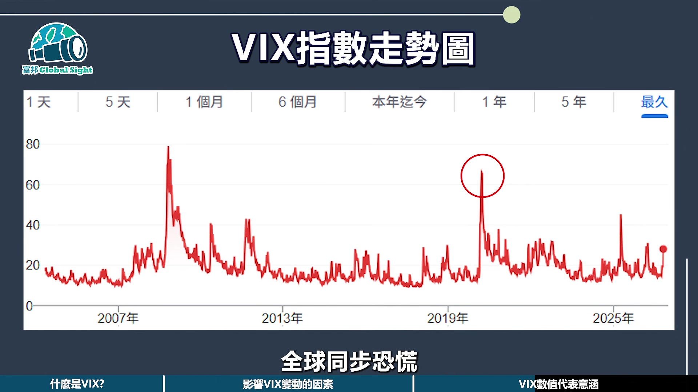

# fubonsec_Adc2r2EgXkM — 關鍵畫面索引

- 來源逐字稿：[fubonsec_Adc2r2EgXkM_FIN.srt](fubonsec_Adc2r2EgXkM_FIN.srt)
- 影片：https://www.youtube.com/watch?v=Adc2r2EgXkM
- 截圖數：7

## 00:00:00

**逐字稿片段：** 在市場震盪的時候,常常會看到新聞標題寫著 恐慌指數飆升,市場陷入恐慌等文字。 什麼是恐慌指數呢? 這個數值背後藏著一個可以量化市場情緒和波動風險的指標。 也就是說,投資人每天在市場中來回擺盪的緊張情緒, 有人把它量化了。 這就是今天要談的主題,FIX指數。 看完這集你會知道FIX指數是怎麼來的, 為什麼它被稱作恐慌指數, 投資上該怎麼透過這個指標來評估市場危機, 富邦Google site 美股小教室 帶您快速來了解 在開始之前記得按贊訂閱開啟小鈴鐺 才不會錯過更多精彩影片 物價交易最高送價值900元好禮 Mobi 超商商品卡 臺股手續費抵用金 富邦證券開戶禮三選一 選你的專屬禮 完成指定任務 再抽萬元信譽航空巴厘島商務艙機票 可額旅遊兌換券 讓你的投資旅程第一站就值得期待

**話題推測：** 介紹市場震盪與恐慌指數的常見新聞標題。

---

## 00:01:05

**逐字稿片段：** X的全名叫做Sable Volatility Index 芝加哥期權交易所波動率指數

**話題推測：** 回歸主題，介紹VIX指數的英文全名。

---

## 00:01:16

**逐字稿片段：** 它是由芝加哥期權交易所 根據S&P500指數 未來30天的預期波動去計算 而且每15秒更新一次 由於數據能夠迅速反映 市場對未來不確定性的預期 所以VIX指數也被稱為恐慌指數 VIX指數是根據S&P指數 選擇權價格所隱含的波動率計算而成 因為當市場越恐慌 越害怕未來可能會發生大風大浪 大家往往會透過購買選擇權來保護自己 需求上升價格會隨之提高 VIX指數也會上升 相反的如果市場情緒穩定 選擇權價格下跌 數值就會走低 那麼影響VIX變動的主要因素有哪些呢 這邊就來先做個小測驗 什麼原因會讓VIX異常飆升 A. 經濟數據與市場預期有落差 B. 戰爭、疫情等突發事件 C 大戶或演算法遭遇的影響 D 以上皆是 答案是D 全部都會影響 好 我們就來解析一下 從經濟的基本面來看 在重要經濟數據發佈期間 包含就業報告 CPI通膨數據 GDP成長率等關鍵指標 只要公佈結果跟市場預期差很大 就會影響FIX波動 另外 全球突發事件也容易引發恐慌 像是地緣政治衝突 自然災害 疫情 金融危機等等都會讓VIX急劇上升 而這類事件的影響程度 取決於它的發生規模 和對全球經濟的潛在衝擊 再來就是市場技術因素 大型機構的投資組合調整 演算法交易活動 還有期權到期日效應等技術因素 也都會影響VIX的短期變動 特別是在流動性比較低的時段 影響力會被放大 這些因素通常你看不見也管不著 但VIX會讓你知道 講了這麼多

**話題推測：** 解釋VIX指數的計算機構與依據（S&P500指數）。

---

## 00:03:21

**逐字稿片段：** 那到底VIX指數要怎麼看呢

**話題推測：** 提出問題，開始解釋如何判讀VIX指數數值。

---

## 00:03:24

**逐字稿片段：** 數值基本參考標準為10到20屬於正常狀態 代表市場相對平穩 投資人情緒偏向樂觀 20到30之間呢 則顯示市場開始出現不確定性或是擔憂情緒 如果高於30 通常意味著市場進入恐慌狀態 在金融危機或突發事件期間 很容易突破這個數字 我們來回顧一下 以下過去幾次歷史重大事件 VIX衝上高點的時刻 2008年全球金融危機 VIX一度飆升 而在COVID-19疫情大流行的時候 全球同步恐慌

**話題推測：** 說明VIX指數數值的參考標準與不同區間的市場情緒。

---

## 00:03:58

**逐字稿片段：** 其實VIX就像天氣預報 它提醒你可能會下雨 可能會暴風雨 但是不會告訴你 下一秒股票是漲還是跌 它最重要的功能 是判斷市場情緒是不是失控 是否要調整風險 注意恐慌時別被帶著跑 在情緒低迷時 可能會看到機會 不過最重要怎麼用 還是取決於你的策略

**話題推測：** 以天氣預報比喻VIX指數的功能與限制。

---

## 00:04:19

**逐字稿片段：** 你覺得VIX真的能提前預告危機嗎 歡迎留言告訴我你的想法 要如何踏出投資第一步 現在不必到林貴排隊 只要點擊資訊欄 完成三步驟即可快速申辦 凱利富邦證券賬戶 為您開啟投資新起點 我們下集見 拜拜

**話題推測：** 向觀眾提問互動，邀請留言分享對VIX指數的看法。

---
