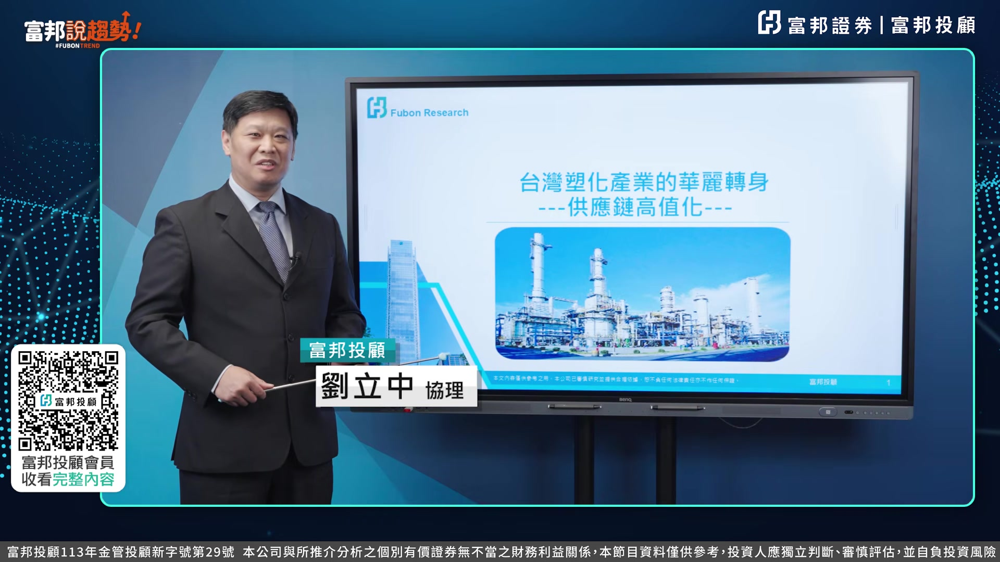
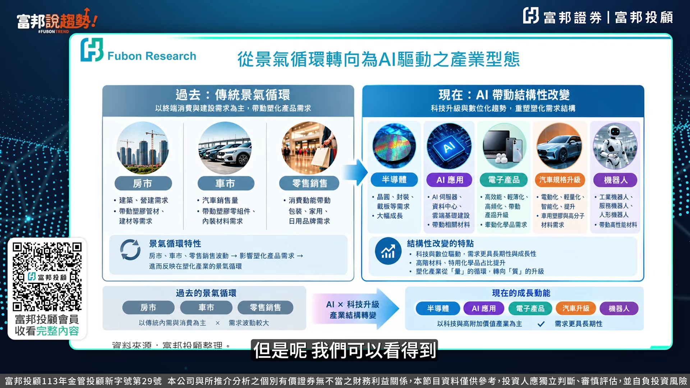
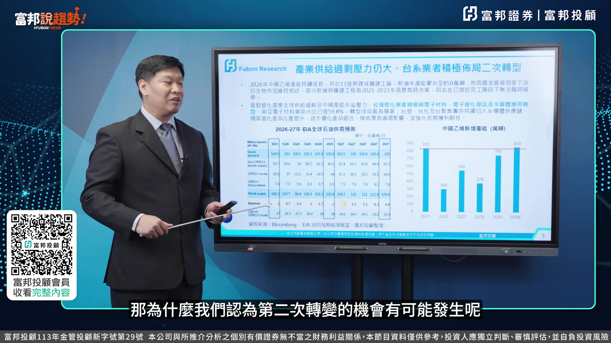
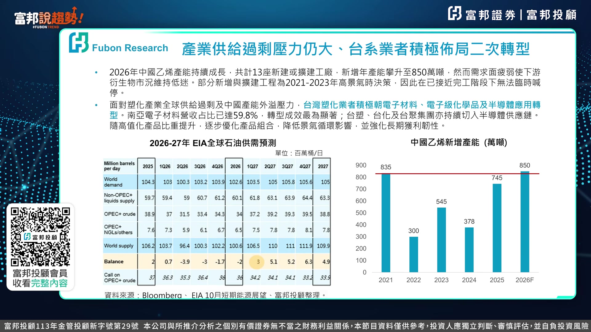
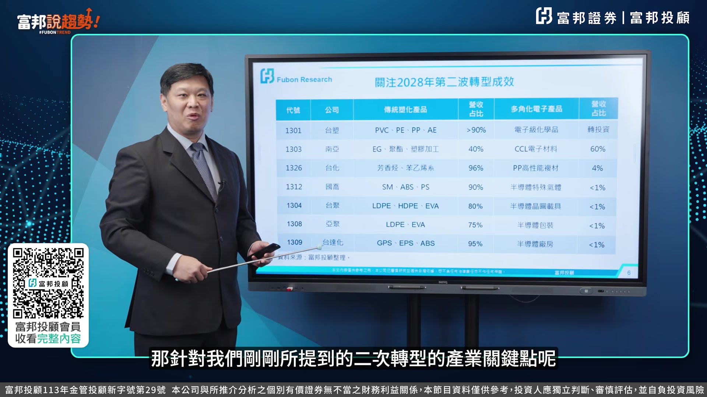
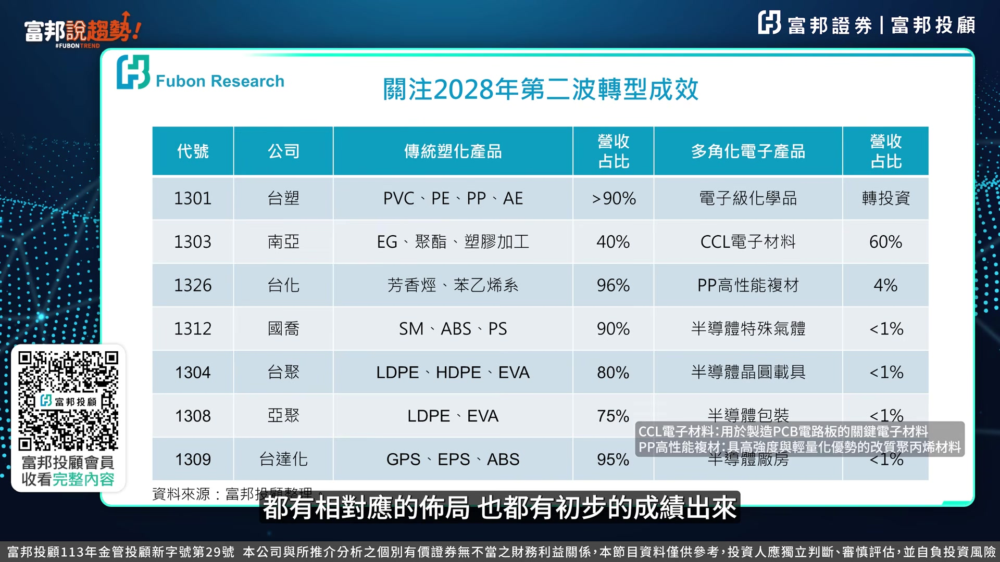

# fubonsec_ZMV46WNrj5s — 關鍵畫面索引

- 來源逐字稿：[fubonsec_ZMV46WNrj5s_FIN.srt](fubonsec_ZMV46WNrj5s_FIN.srt)
- 影片：https://www.youtube.com/watch?v=ZMV46WNrj5s
- 截圖數：6

## 00:00:08

**逐字稿片段：** 今天很高興來跟各位分享塑化產業華麗轉生這個議題。 我們也認為這樣子的一個議題不僅是值得高度的關注, 而且事實上它還正在進行當中。 我們接下來就來跟各位分享 為什麼我們認為這個議題仍然持續, 而且還有新的一個投資機會。 過去整個塑化產業是一個非常標準的緊急循環的特性, 不僅僅是具有明顯的淡旺季的效益, 而且對整個市場的供需的變化的聯動性 也非常的緊密 但是我們可以看得到

**話題推測：** 介紹影片主旨：塑化產業華麗轉生這個議題。

---

## 00:00:38

**逐字稿片段：** 整個塑化產業逐漸轉變為 以AI為驅動的產業形態 不僅僅對於整個供應鏈帶來的量的變化 更帶來值的變化 因此我們可以看得到 整個未來以AI為驅動的特性的效應 持續發酵之下 對於整個塑化產業來看的話 它的轉型的力道是持續 而且還有第二次的一個轉變的機會 那為什麼我們認為第二次轉變的機會即將來到呢

**話題推測：** 指出塑化產業逐漸轉變為AI驅動的產業形態。

---

## 00:01:04

**逐字稿片段：** 我們從大環境的這個因素來看 我們可以看得到即使到了2027年 整個全球的塑化產業的這個中上游 不管是在原油或者是大宗的塑化原物料 它的供需的一個情況來看的話 我們可以看得到仍然是具有非常大的一個供過於求的壓力

**話題推測：** 切入大環境因素分析。

---

## 00:01:21

**逐字稿片段：** 那如果從競爭者的角度來看 臺灣直接面對的是中國的塑化產業的一個競爭 在當地的這個政策 以及當地的這個內需的這個制止之下 我們看到中國不管在哪一項的 這個碩化產品上 它的產能仍然是持續的一個增加 那因此在內外夾攻的一個情況之下 我們可以看得到 臺灣因此必須去做一個轉型 而我們所看到的電子材料 電子化學品就提供了 我們第二次轉型的一個 主要的一個契機跟機會 那我們先回頭來看一下 第一次轉型為什麼這麼成功 也就是我們看到的過去這一年來 不管在股價 不管在財報上 那麼亮眼的原因就在於垂直整合這四個字 那我們以臺塑集團為例 因應AI所驅動的這個產業的特性 它不僅僅是在下游增加了一個出海口 甚至因為它具有垂直整合的這個優勢 上游的成本控制 跟上游的這個品質的穩定 跟料源的穩定 不管在市佔率或者是客戶的拓展上 帶來非常大的優勢 這是我們看到的第一次轉型的 這個成功的關鍵點 那接下來我們來看一下 二次轉型的關鍵點在哪裡 那我們認為會從剛剛所提到的量 逐漸轉變為值 而這個值呢 以臺積電為例 我們可以看到 在這些特殊的化學品上 它的在地化的採購的比例 將預計在2030年達到將近七成 而這樣子的替代效應 就提供了我們未來二次轉型 最重要的關鍵動能 那針對我們剛剛所提到的 二次轉型的這個產業關鍵點呢

**話題推測：** 轉向競爭者角度分析，特別是中國的塑化產業競爭。

---

## 00:02:53

**逐字稿片段：** 我們富邦投顧特別整理了 整個供應鏈在臺灣的部分 那我們可以看得到 不管是在電子材料 PP高性能的複合材料 以及相關的半導體的 特殊的這個載具跟氣體部分 都有相對應的這個佈局 那也都有初步的一個成績出來

**話題推測：** 介紹富邦投顧整理的臺灣二次轉型供應鏈佈局。

---

## 00:03:11

**逐字稿片段：** 那當然我們也從營收的比重 可以看得到後續 還有相當大的一個成長的空間 那這些標的呢 跟這些族群呢 也都值得我們投資者 持續的去做一個觀察跟關注 以上是我這次針對 對塑化產業的轉型 跟未來投資的一個方向的議題的分享 那如果各位喜歡我們這次的內容的話 富邦收區室的頻道 謝謝各位

**話題推測：** 提及營收比重與後續成長空間的財務數據討論。

---
