# fubonsec_di631vSTgaY — 關鍵畫面索引

- 來源逐字稿：[fubonsec_di631vSTgaY_FIN.srt](fubonsec_di631vSTgaY_FIN.srt)
- 影片：https://www.youtube.com/watch?v=di631vSTgaY
- 截圖數：16

## 00:00:15

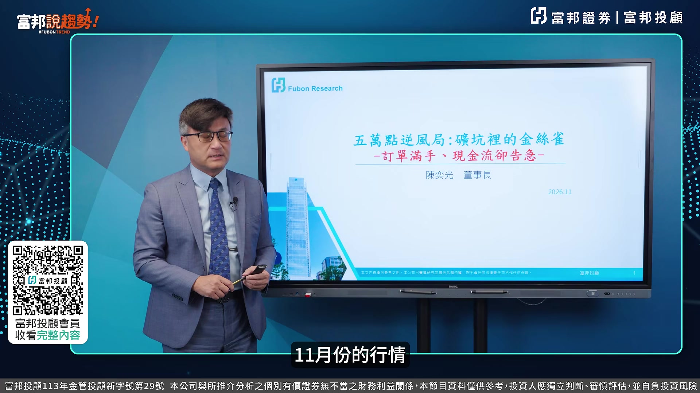

**逐字稿片段：** 我們今天的標題叫五萬點的逆風局, 礦坑裡的金絲雀, 訂單滿手, 現金流雀告急, 是目前臺股面臨的一個困境, 我們今天主要的主軸先從利率出發, 再從產業出發, 再回到臺股的部分, 我們先看10月28號FOMC會議利率裡面的一個狀況, 我想他維持利率不變是符合市場上的預期 那整體來看我們覺得目前可能會面臨所謂的資金斷裂的問題 因為利率維持在3.75跟4%的利率不變的情況之下 其實對整體的利率來講相對來講是比較高的 那這次的會議裡面主要重點我想10票贊成 兩票反對維持3.75跟4% 意思就是說有兩票他認為應該還要升息 但是他裡面有聲明裡面強調就是 就是經濟強勁擴張 通膨仍然高企 使得說它目前維持利率不變的第一個理由 第二個 挖許在9月升息一碼之後 金融環境有所緊縮 但還沒有到緊俏的程度 這是他所提到的 然後他有提到就是說

**話題推測：** 介紹本日主講標題「五萬點的逆風局」

---

## 00:01:20

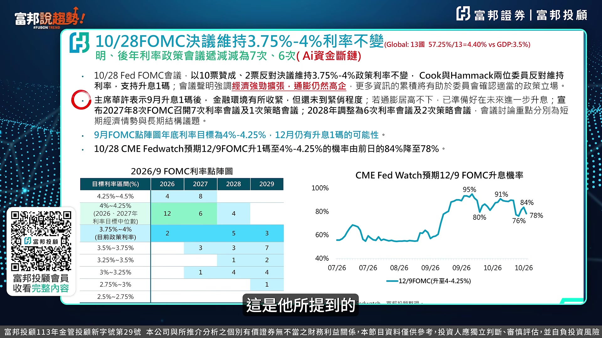

**逐字稿片段：** 2027年8次的FOMC會議裡面 有7次是利率會議 有1次是策略會議 這是跟過去不一樣的 28年6次利率會議 2次的策略會議 等於說未來的這種所謂的前瞻性的利率的這樣的一個會議裡面 它慢慢的減少 從27年減少一次到28年減少兩次 希望市場上的這個利率政策能夠由經濟這個方向來做決定 而不是說每次都看這個所謂聯總會的前瞻性的這部分的一個預測

**話題推測：** 探討FOMC會議次數與策略會議的變化

---

## 00:01:55

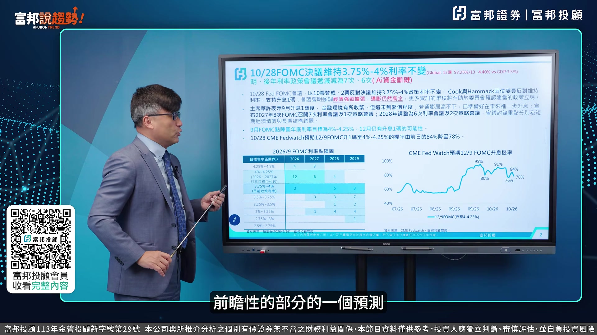

**逐字稿片段：** 所以從這個點證圖來看的話 2020年2027年你會發現說 等於說目前看起來12加2 14票對4票 等於說目前看起來維持在4到4.25到年底再升息一碼 目前看起來方向是一致的 然後到2027年也差不多 你看6加3加1 10票對8票 等於說2027年我們認為說比較有可能是維持利率不變 但市場上還是有說8票這個地方 還是要升息一碼到兩碼這樣的一個水準 但是目前看起來 以這個維持在4到4.25這樣的一個 委員是比較偏多的 這是在整體的FOMC會議裡面所提到的 那目前看起來全世界13個國家裡面 平均的利率在4.4% 因為目前看起來我把13個國家主要升息的利率 加起來57.25除以13 等於說目前的利率差不多在4.4% 全世界GDP在3.5 等於說目前的這樣子的一個AI資金鍛鍊 已經慢慢的在接下來2027年 可能會看到 因為現在的這個利率 相對的高檔 我們看第二個 他整個經濟 的這部分的一個聲明上來看 委員會的決策裡面12比0拿掉 10比2 調高0.25%到3.75%到4% 目前是維持3.75%到4%不變 所以左邊跟右邊部分劃掉部分是原先9月份的聲明 10月份聲明是黃色部分 再看經濟預測來看經濟活動正 穩步的擴張 這個地方變成是強勁的速度擴張 這個我覺得是目前看起來大家比較認為說 這個經濟上面來看比預期還強很多 然後在整個通膨的預期上來看 他把今天的政策行動將有助於更快實現委員會設定兩次目標 把它劃掉改成更多的資訊的累積 有助於聯絡委員定定這部分的一個政策的立場 所以我想在整個委員的決策 經濟描述跟通膨預測上來看 都有一些改變

**話題推測：** 分析FOMC點陣圖對未來利率的預期

---

## 00:03:56

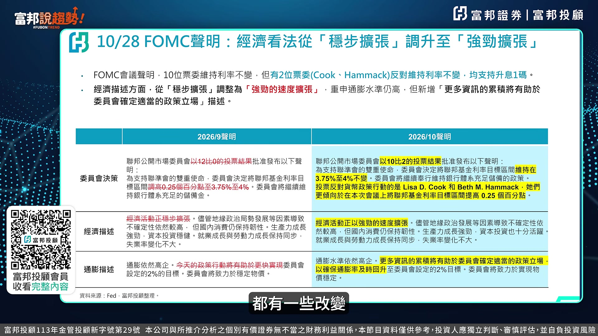

**逐字稿片段：** 那我們看看Q&A 這次六題的題目裡面我們看到 我的結論是 WASH它不打壓經濟 它不放水就是 它希望能夠貨幣驅動 轉成生產力跟企業投資來驅動 整個經濟成長 這是WASH在這次裡面 我覺得它想要表達的主要重點

**話題推測：** 分析FOMC會議Q&A環節的記者提問與聯準會回應

---

## 00:04:15

**逐字稿片段：** 我們看第一個記者問他問題 本次暫停升息是否代表升息循環已經結束了 他這邊講絕對不是 等於說目前看起來還是有在升息的這樣的一個契機 那目前看起來藍色這邊提到 若通膨居高不下的話 能源價格推升物價 聯總會以做好準備在未來進行進一步的升息 等於目前看起來12月份再升息買機會是相對來講比較高的

**話題推測：** 討論第一個記者問題：升息循環是否結束

---

## 00:04:43

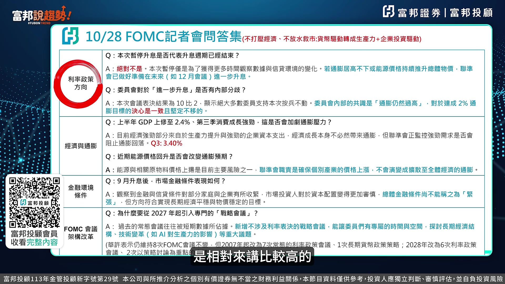

**逐字稿片段：** 然後第二個問題他問到說進一步升息是否有內部的分歧 他們有提到就是說 內部對於2%的這部分的一個通膨方向是不變的 第三個問題提到說上半年的GDP2.4 第三季強勁是否會加劇通膨壓力 第三季已經公佈出來的GDP是3.4 其實目前看起來就回應到剛剛所提到的 經濟擴張變成經濟強勁的這樣的一個復甦 那目前看起來近期的能源價格回升 是否會改變通膨的預期 聯儲會提到確保個別產業的價格上升 不會演變成全面性的經濟通膨 這個是聯儲會所表達的決心 然後金融環境上來看 他有提到 記者問到說 9月升息後 金融條件的表現如何 這邊有提到就是強勁的擴張 又回到剛剛所主張的聲明裡面 整個會議的架構上來看 就是我們剛剛提到 他多了這所謂的戰略會議 這個是希望市場上 是看著球打球 不要看著裁判打球的方向不變

**話題推測：** 討論第二個記者問題：升息是否有內部意見分歧

---

## 00:05:43

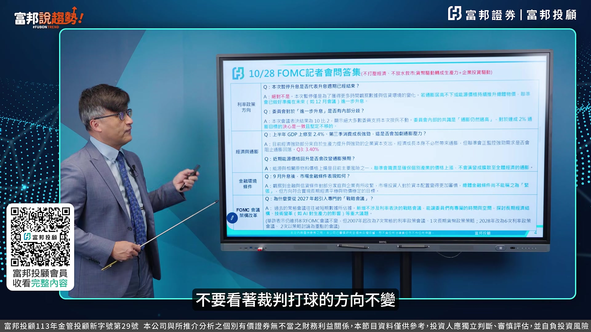

**逐字稿片段：** 那我們再來看一下產業的部分 產業部分 AI驅動雲端收入超乎預期 為部分的核心事業放緩 顯示了投資回收回報的時間很長 我想這一次的這個AI的這樣的一個敘事 已經開始在慢慢做改變 我們來先看一下它的基本面有沒有變差 從營收角度上來看 我們從它的這個AI Agent 需求強勁跟導入AI之後 整體的三大CCP場的營收收入 其實都呈現強勁的YY成長 Google Cloud由82%成長103 Azure從42%成長到48 AWS成7到39% 其實都呈現高位數的成長 營收成長

**話題推測：** 切入第二個主題：產業分析，以AI雲端收入為切入點

---

## 00:06:26

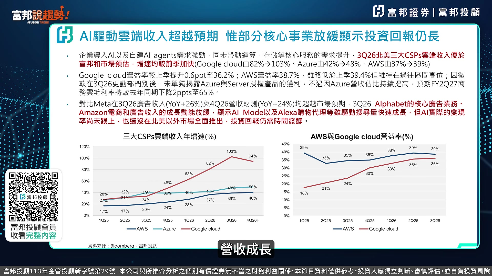

**逐字稿片段：** 然後在Netmargin的部分來看的話 Google Cloud增加0.6來到36.2 AWS38.7 Azure這邊的一個毛利率雖然有下降 但是也在65%左右 等於說Cloud這部分的國手Margin 跟Netmargin的部分的表現上來看 其實非常強勁 這個是從營收 跟這個Netmargin角度上來看

**話題推測：** 分析三大CCP廠的淨利率（Net Margin）表現

---

## 00:06:47

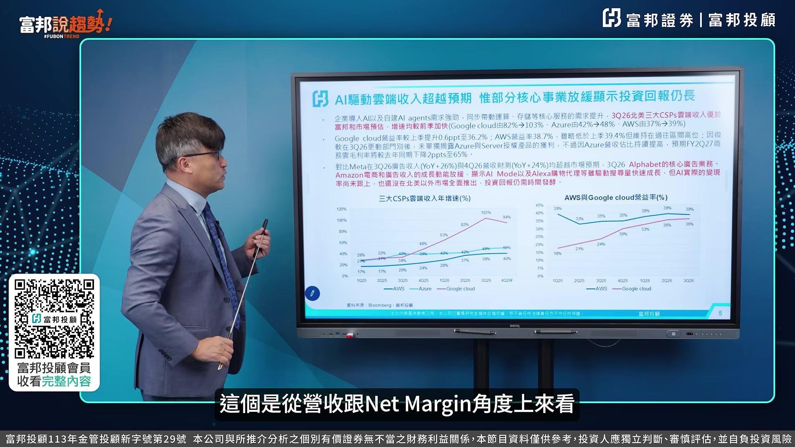

**逐字稿片段：** 對比Meta在3Q的廣告收入 跟它的第四季的裁撤的 這部分的一個收入上來看 都超乎預期 那只有說目前Alphabet 跟Amazon的廣告收入 其實是有出現Slowdown 其實跟AI的這部分的一個加入 逮錄掉它這部分的一個營收 收入的這部分 其實有很大的關係 所以目前看起來 從這一張的基本面來看 這個是三大CCP廠的營收的成長率 我們可以看到是103 94% 今年第四季 還是可以維持一個高度成長 然後AWS跟Google Cloud的Name Margin部分 39跟36也是呈現一個成長 所以這張表其實你沒有看到 所謂AI有出現這個營收放緩的這樣情況 那市場上擔心什麼東西 Free Cash Flow 擔心的是現金流 我們可以看到目前市場上預估三大雲端 Meta Oracle 在2026年跟2027年的資本支付計劃 分別到8000跟1.15兆 其實我覺得這是兩面刃 就是說我今天假設我的資本支付計劃放緩 市場上一定會說 這個成長可能出現問題 股價往下殺 今天我擴大資本支付計劃 我的現金流轉負 市場上會覺得說 你沒有辦法把你的這部分的一個投資變現 這個也產生了所謂的一個兩面論的問題 但是從目前看起來 買產值的這部分資本支付計劃 還是持續在上揚 這是第一點 好那第二點的部分 就Free Cash Margin的部分來看的話 就是我們講的 自有現金流的獲利率的這部分 就是把自有現金除以營收 每一塊錢營收 能夠產生出多少的現金流的部分 目前看起來除了Microsoft掙的以外 Alphabet Amazon Meta 呈現負的 最近在殺什麼 就在殺這一塊 所以軍備競賽的失控 賺錢的速度低於燒錢的速度 才會產生這一波的下跌 所以接下來我們要看的 不是你的模型 到底多好 而要看你的現金流 什麼時候轉正 這是目前看起來 我們可能必須要去持續追蹤 我們在之前就有提到 Free Cash Flow Margin的部分的 這樣的一個比重 必須要持續維持正的

**話題推測：** 對比Meta廣告收入與Alphabet、Amazon廣告收入的變化

---

## 00:09:05

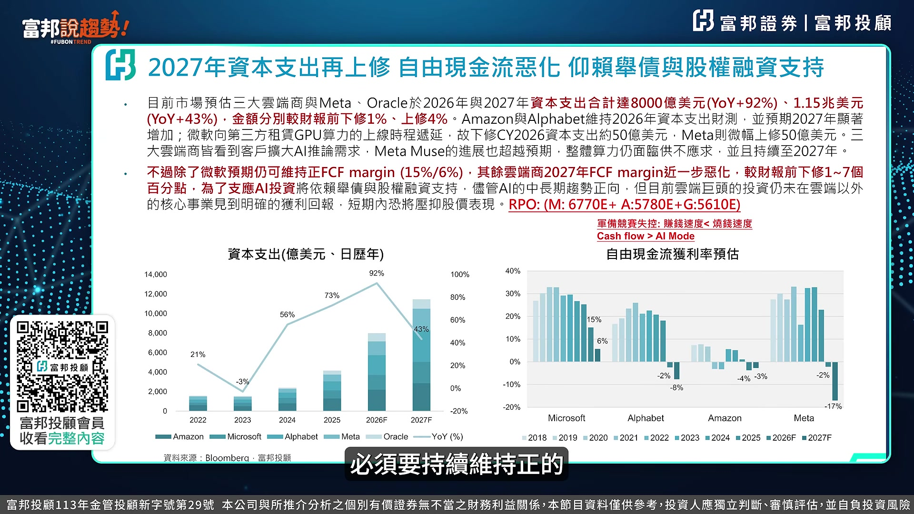

**逐字稿片段：** 然後目前RPO的部分 加起來應該超過1.8兆 6700CCE 5780E 5600ECE 包括Meta Amazon跟Google的部分 其實他們在手 未完成的訂單 還是非常非常高 所以從營收跟Name Margin 角度來看 沒有看出任何的敗相 但是現在目前最大的問題就是 你燒錢的速度可能來不及變現 這個是市場上給它股價之所以下跌的主要的一個理由 那接下來就要看說 那到底會不會產生所謂的D4的危機

**話題推測：** 討論主要AI廠商的未完成訂單（RPO）數據

---

## 00:09:39

**逐字稿片段：** 那我們從CodeWeave 甲骨文跟Blue Hour 這三家公司的信用OS的部分 你會發現有明顯的增加 先看左邊 左邊是美國AI公司債的殖利率 你會發現投資型等級的 這部分的一個債券殖利率 都在5%跟6%的上下 所以目前看起來 這種所謂的M7的這些公司 它的債券殖利率沒有太大變化 可是你看Covid Covid它的這個 在6月份發行的這部分票息是9.625 可是到10月份已經衝到14.9 跟我們正常非IG債的 這部分的利率8.41 其實多了400到500個BP 就是說市場上需要它更高的殖利率 才願意買它的債 好 這個是我們看到 比較需要留意的第一個CodeWeave 然後第二個OS的部分來看 CodeWeave的OS也是增加了159來到982 正常非IG的這部分的OS是332 也增加了五六百個BP 這個也是我們看到 在整體的AI的OS的信用利差的變動裡面 大幅增加的情況 然後投資級的部分 Blue Hour跟甲骨文 分別是208 262 也比IG級的債的84以來的增加 所以我們現在目前把這三家 當作是AI裡面的礦坑前面的金絲雀 這三檔假設未來 它的債券殖利率在呈現飆升 它的OAS在出現創新高的 這樣的一個角度上來看 可能就要留意它有違約的風險 這是我們把這張拿來當作 AI 的這部分的一個信用的提醒 那會不會有這個D4危機 我們把過去2000年跟2008年 Financial Tsunami所產生出來的投資債跟非投資債的信用利差 跟2000年.com那時候的這比較上來看 我們先看一下綠色這個虛線部分 是在 非美國非投資等級債券的利差 10.45 在2000年的時候 08年20.4 但你對標過來看 現在是3.14 所以並沒有比當時的2008跟2000年來得更高 若是從IG等級在的部分來看的話 是在這個比較實 實體的綠色線來上2.26 5.72 目前0.84 所以不管是IG或非IG等級在 目前看起來 他的這部分的OS的利差 並沒有高於當時08跟2000年當時的 這部分的一個 這個利差來得高 所以並沒有出現所謂的default的問題 那這個表就是把這個線圖部分用成文字的方式來表達 所以這張是讓富邦數據的好朋友 你可以放心說 現在AI的投資並沒有所謂的這種產生所謂的違約風險的這樣的一個問題 我們從下面這三張圖就可以看出來 這個是從這個OS這部分的一個例差來做說明 那接下來我們來看一下臺股的部分 我想從臺股的這部分的一個分析上來看 11月房價你怎麼走 這一波從4818跌到39384 從39384彈到49968 總共反彈了10584點 頭頭高底底高是一個多頭架構 目前看起來方向不變 那如果是用10584點 我們用黃金切割率去算的話 0.5回擋在44677 若是以底底高頭頭高的這樣角度上來看 你要再來破39384的機會不高 尤其是11月30號我們上次有提到 年限應該在11月30號就會來到40300點以上 所以目前看起來你要在 寄望他跌破39 384這個低點 除非有更大的利口 這個地方應該是一個相對的低點 那接下來就是11月3號選舉 從美國的選舉的這部分的兩個情境來看 因為目前看起來應該是兩個情境 共和黨在拿下完全執政 機會應該不高 所以我們用這兩個比較有可能的情境 第一個跛腳政府 第二個兩黨分治 那比較需要留意的應該是選舉當天 選舉當天它這個地方的一個變動是比較大的 等於說你要留意最大的跌幅 這個地方我們擔心就是說 它在跛腳政府跟兩黨分支的這個地方 會有些有利 會影響到未來的一個方向政策 等於選舉完之後 迴歸到基本面會是主要的一個主權率 然後在上漲的幾率上來看 但當然是分支的部分遠高於跛腳的部分 那就可能要提醒投資人 就是若是產生了所謂的跛腳政府裡面的 當天的這部分的一個最大跌幅會是比較需要留意的 但是後面基本上對於整個股市的方向上來看 都是比較偏向正面的

**話題推測：** 以CodeWeave、Oracle、Blue Hour三家公司為例，分析其信用違約交換（CDS）利差

---

## 00:14:35

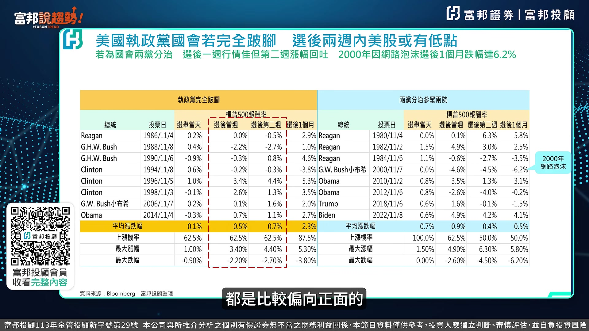

**逐字稿片段：** 最後我用觀光筆記來跟各位分享一下 我對於接下來11月份行情的看法 我這邊紅色字標的主要講說 說企業的獲利決定股價的方向 也是一直以來 我以基本面出發為主要的宗旨 全球資金決定短期股價走勢 估值決定兩者之間的落差 所以也因為這樣的關係 我們的企業獲利非常好 但是因為資金在這個地方 它有一定的這樣的一個配置 所以會產生所謂的估值這邊的落差 目前看起來6月份下跌 我們從48000多點跌到39384 市場上擔心的是利率更高估值 10月份現在市場擔心的是 資本租計劃跟現金流 11月份開始重新檢視AI投資 是否能夠變現 這個會是重點 那目前比較負面因素上來看的話 是融資 我們看融資預額到今天的 這部分的一個收盤來看的話 是6230億 YTT增加81.54 股市漲55% 但是融資增加了80% 其實籌碼是有點過於凌亂

**話題推測：** 總結對11月份臺股行情的看法與核心投資理念

---

## 00:15:43

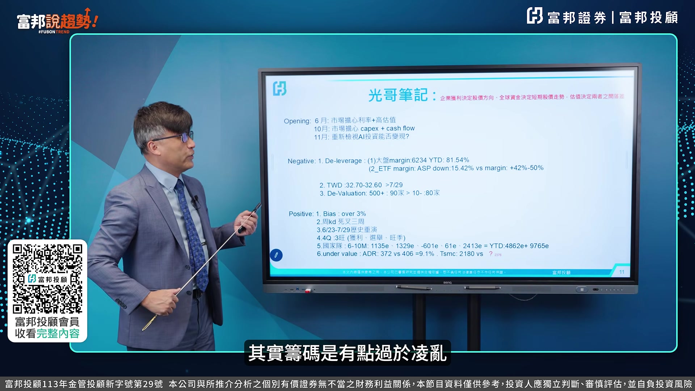

**逐字稿片段：** 再來看ETF 我們看到ETF這邊的margin 它的股價下跌差不多15%到14% 可是它ETF的融資增加了42%到50% 不管是主動式跟被動式你去看 尤其是掙額 它這部分的一個融資增加幅度太大 你不僅買掙額 你還開放融資去買掙額 這個是使得這一波的這部分的一個幅額 有出現deleverage的情況

**話題推測：** 分析臺股負面因素之二：ETF融資增加幅度過大

---

## 00:16:08

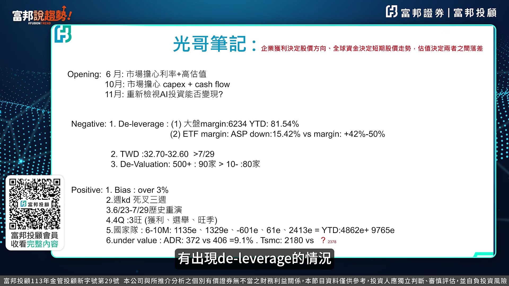

**逐字稿片段：** 第二個臺幣 臺幣這一波非常的弱勢 32.7 32.6比當時7月29號32.5要來的扁的更多 所以臺幣這個溫度計是使得臺股在這地方 沒有辦法馬上的做一個V型反轉的主要的第二個理由 溫度計 第三個是devaluation 目前500塊錢以上的加速90加 10塊錢以下的加速才80加 等於說高價股其實它的本益比是很高的 做所謂的估值上面修正這三個 目前這邊方向來看的話 我們現在跟周線的怪率超過3% 其實隨時都會反彈 第二個周KD死亡交叉進入第四周 一般來講周KD死叉只要四周 第五週開始 它就會呈現一個比較明顯的回升 目前已經上禮拜已經三週 這禮拜第四周應該是最後一週 第三個就是6月23號跟7月29號 那一波下跌到39384的地方 目前看起來應該是歷史重演

**話題推測：** 討論臺股負面因素之三：臺幣弱勢導致資金外流

---

## 00:17:09

**逐字稿片段：** 然後第四個部分就是4Q有三旺獲利旺 第四季應該是整個四季四個季度裡面獲利最好的 2.3兆選舉行情 我們從過去的選舉行情上來看的話 選後的20天40天60天 它股市又上漲了 還有旺季效應 因為即將進入2027年 它有所謂的做夢行情 然後第五國家隊 6到10月份國家隊分別買到1135億 一直買到2413億 YTC市場買了4862億 尤其是10月份 它買超創下單月的新高 2413億 其實這個部分就代表說 國家都在這地方有託底的效果

**話題推測：** 討論臺股正面因素之四：第四季獲利旺季效應與選舉行情、做夢行情

---

## 00:17:50

**逐字稿片段：** 第六點就是Under Value 我們從臺積電ADR 7月29號當時最低點372 對標現在的位置406 只有9.1% 那你看現在臺積電 我們現在臺積電臺灣是2180 當時7月29號 你對標過來 其實現在臺積電的價格已經超跌 所以從這幾個因素的角度上來看的話 我們認為說11月份的行情 應該開始迴歸基本面之後 臺股到年底之前回到5萬點的地方 應該沒有太大的懸念 這是目前我給各位11月份的一個方向 做一個參考 經過今天的利率政策的方向的看法 產業的這部分現金流的看法 以及我們對臺股這樣的一個分析 應該富邦說虛是好朋友 比較知道11月份的操作邏輯 那最後還是希望富邦搜訊室的好朋友 能夠介紹你的好朋友 加入我們富邦投顧的會員 掃下我們螢幕上的QR Code 並且長期關注我們富邦證券所推出的YT的節目 訂閱 按讚 加分享 謝謝各位的時間 謝謝

**話題推測：** 討論臺股正面因素之六：臺積電ADR與臺股超跌，顯示估值偏低

---
