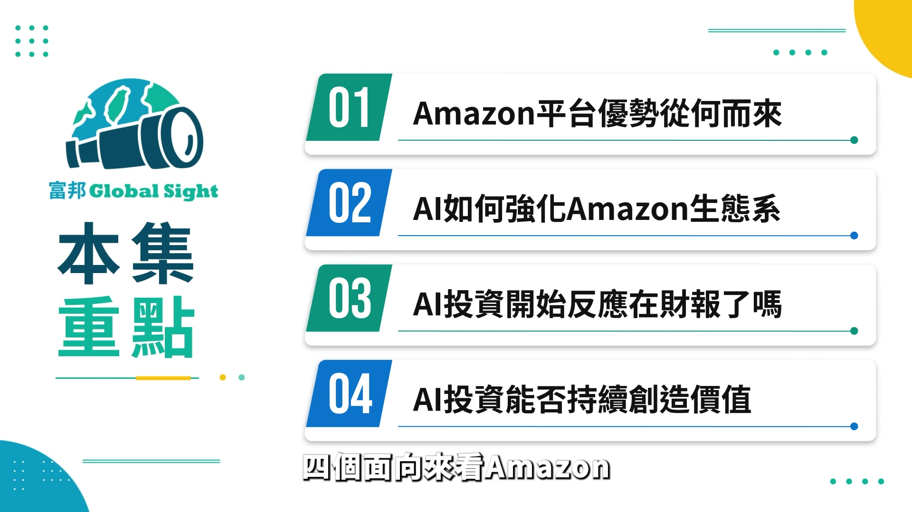
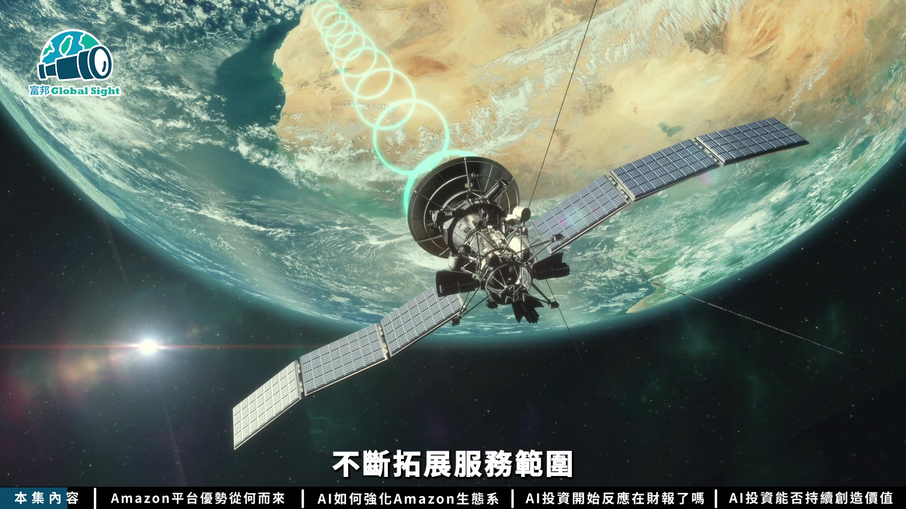
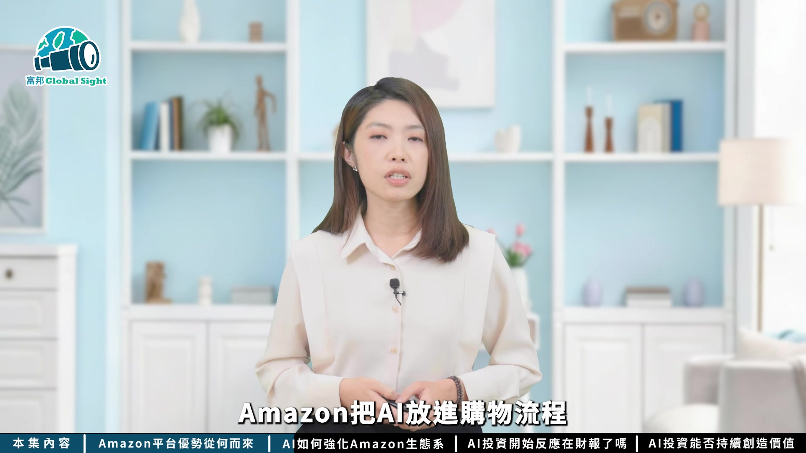
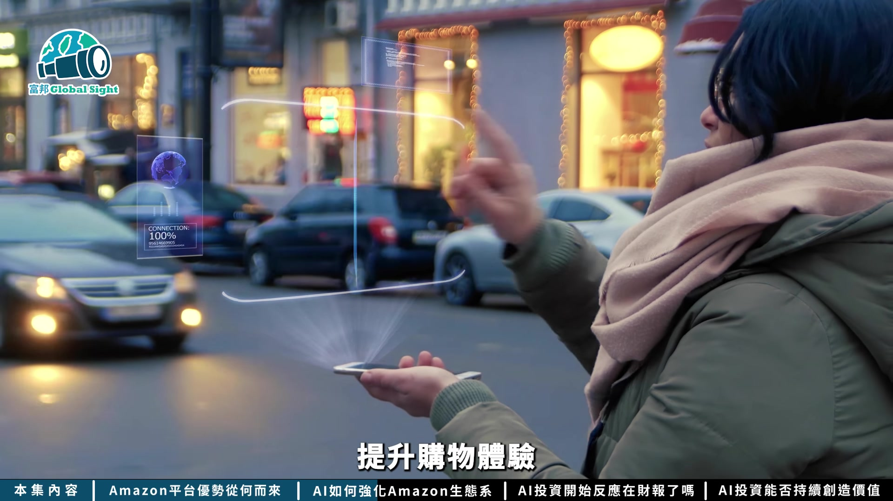
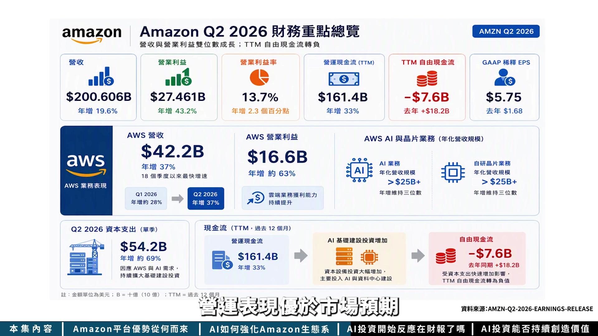
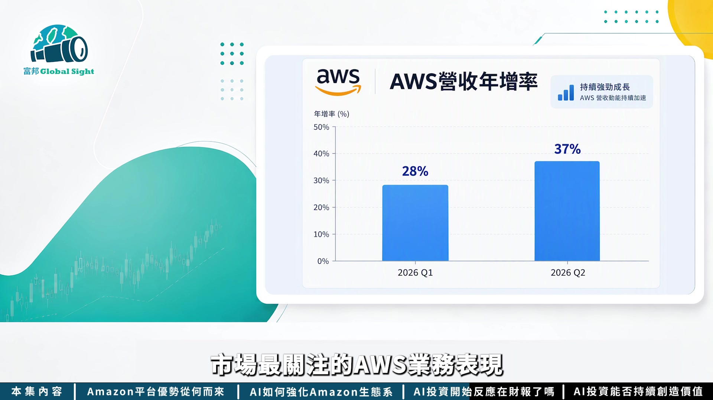

# fubonsec_omj7U-hJNPg — 關鍵畫面索引

- 來源逐字稿：[fubonsec_omj7U-hJNPg_FIN.srt](fubonsec_omj7U-hJNPg_FIN.srt)
- 影片：https://www.youtube.com/watch?v=omj7U-hJNPg
- 截圖數：21

## 00:00:00

**逐字稿片段：** 今年科技界最大的討論之一是投資人在人工智慧算力、資料中心以及伺服器等好幾千億美元的巨額投資究竟什麼時候才能開始賺錢, 其中Amazon正是最受關注的企業之一。 Amazon持續擴建資料中心、發展AI晶片並且大幅增加資本支出, 到底這些投入已經開始成為新的獲利引擎, 還是持續考驗公司的獲利能力和現金流表現? 這集影片我們就從Amazon的平臺生態系 AI佈局以及2026年第二季財報 一起來找答案 AI時代來臨 投資也能充滿智慧 富邦AI Pro專業分析資料 透視趨勢 輕鬆一點掌握全球市場脈動 有AI投資更Pro 現在就點擊知識欄 趕快去下載

**話題推測：** 介紹影片主軸：AI投資何時獲利？

---

## 00:00:55

**逐字稿片段：** 大家好我是Sabrina 這集影片我們從四個面向來看Amazon

**話題推測：** 主持人開場

---

## 00:01:00

**逐字稿片段：** 首先Amazon如何從電商平臺 一路延伸到雲端廣告和AI 借力龐大的平臺生態系 接著來看看AI如何進一步強化 這套生態系從購物體驗到雲端服務 帶來哪些新變化 第三Amazon大舉投入AI之後 這些投資是否已經開始反映 在最新的財報上 最後AI大規模投資之下 這場AI競賽究竟能不能 持續為Amazon創造價值 聽到Amazon你會想到什麼呢 全球最大的電商平臺 或是AWS雲端服務商 還是正在全力投入AI競賽的科技企業

**話題推測：** 探討Amazon業務從電商延伸到雲端、廣告和AI的演進圖

---

## 00:01:40

**逐字稿片段：** 那我們就先從他的背景來說起 Amazon從最早的網路書店起家 一路拓展到玩具、電子產品、服裝等電商業務 接著建立Prime會員、第三方Marketplace 全球物流體系 再延伸到AWS雲端運算和數位廣告 而近年來Amazon又持續把AI購物 自研AI晶片以及衛星通訊納入佈局 不斷拓展服務範圍

**話題推測：** 開始講解Amazon的發展背景

---

## 00:02:07

**逐字稿片段：** 這些業務看起來橫跨不同領域 但背後其實圍繞著同一個核心 就是不斷擴大平臺能力和生態系 也就是說現在的Amazon 不只是販售商品的平臺 更是一個串聯消費者 品牌 企業和科技服務的生態系

**話題推測：** 說明Amazon業務核心：擴大平台生態系，可能搭配生態系示意圖

---

## 00:02:25

**逐字稿片段：** 我們先從一個比較有代表性的 產業服裝市場來談起 根據市場統計 而且2024年美國將近13%的服裝銷售來自Amazon 銷售額超過沃爾瑪的兩倍 在線上服裝業務居領先地位 Amazon能在服裝市場取得成長 其中一個重要的因素 在於它將電子商務累積的規模優勢延伸到服裝市場 龐大的消費者流量 Prime會員物流配送能力 再加上廣告數據和商品推薦工具 讓Amazon不只提供一個銷售通路 還可以讓品牌接觸消費者 提高商品曝光 甚至進一步完成交易 因此從評價服飾到精品品牌 都開始把Amazon視為重要的銷售渠道

**話題推測：** 聚焦特定產業範例：服裝市場

---

## 00:03:16

**逐字稿片段：** 甚至過去曾經離開Amazon 希望發展自由通路的品牌 陸續重回平臺開設官方商店 對品牌而言討論重點 可能逐漸從是否進入Amazon平臺 轉向如何善用平臺資源 這也就說明了 Amazon已經建立相對成熟的平臺生態系 具備一定的市場競爭力 到了AI時代 原本就掌握龐大商品 消費者和品牌的Amazon 會不會進一步放大這個平臺優勢呢 過去到Amazon 消費者需要自己搜尋商品 比較價格 閱讀評論 再決定要買什麼

**話題推測：** 說明過去離開的品牌重回Amazon平台

---

## 00:03:58

**逐字稿片段：** 但是現在 Amazon把AI放進了購物流程

**話題推測：** 說明Amazon導入AI進入購物流程

---

## 00:04:01

**逐字稿片段：** 2026年Amazon推出 Alessa for Shopping 整合Lufus原有的購物助理能力 和Alessa Plus個人化情境理解 強調是更智慧 更個人化的AI購物助理 讓消費者能在語音 和觸控界面自用切換 提升購物體驗

**話題推測：** 介紹Amazon推出的AI購物助理Alessa for Shopping

---

## 00:04:20

**逐字稿片段：** 從AI Shopping到AI Agent AI不只是協助消費者 尋找商品 也能根據使用者 輸入的資訊和行為偏好 提供更個人化的建議

**話題推測：** 說明AI Agent提供的個人化購物建議

---

## 00:04:31

**逐字稿片段：** 而對Amazon來說 AI最大的價值或許不只是推出新的功能 而是在既有平臺生態系上 進一步放大競爭優勢 透過大量商品交易和消費者互動數據 Amazon就能更快將AI導入實際應用場景 並且持續優化使用者體驗

**話題推測：** 說明AI如何放大Amazon既有平台生態系的競爭優勢

---

## 00:04:52

**逐字稿片段：** 對Amazon而言 AI不只是新增以上業務 而是能夠同時強化購物體驗 提升廣告效率 優化物流營運 並帶動AWS雲端需求成長 進一步提升各項業務之間的連結效益 前面談了這麼多Amazon的佈局 最重要的是這些投資 到底有沒有開始反映在財務表現上

**話題推測：** 列出AI對Amazon購物、廣告、物流及AWS雲端等多方面業務的強化效益

---

## 00:05:17

**逐字稿片段：** 從Amazon近期公佈的 2026年第二季財報來看 營業表現優於市場預期

**話題推測：** 介紹Amazon 2026年第二季財報概況

---

## 00:05:23

**逐字稿片段：** 第二季營收來到2006億美元 年增近20% 高於原先預期 營業利益則達到275億美元 年增43.2% 再進一步看到淨利 第二季達到626億美元 年增超過兩倍 美股盈餘則從去年同期的1.68美元 大幅提升到5.75美元 不過這裡有一點要特別留意 這麼高的淨利 並不是完全來自Amazon的本業 Amazon獲利大幅成長的原因 是來自AI新創Entropic的投資 帶來約534億美元的稅前業外收益 所以如果要判斷Amazon本身的營運表現 不能只看EPS

**話題推測：** 展示Amazon 2026年第二季的營收、營業利益、淨利及每股盈餘數據圖表

---

## 00:06:09

**逐字稿片段：** 我們再進一步來看市場最關注的AWS業務表現

**話題推測：** 轉向分析AWS業務表現

---

## 00:06:14

**逐字稿片段：** 第二季AWS營收來到422億美元 年增37% 不僅高於市場預期 更創下18個季度以來最快的成長速度 相較第一季的28%的年增率 確實也看到AWS成長動能呈現回升趨勢 Amazon執行長Andy Jassy表示 目前AWS的AI業務年化營收規模 已經突破250億美元 而且仍維持三位數的年增率 同時Amazon自研晶片業務的年化營收規模 也突破250億美元 顯示Amazon對AI的投入 已經逐步反映在AWS相關業務的成長上

**話題推測：** 展示AWS第二季營收及年增率數據圖表

---

## 00:06:57

**逐字稿片段：** 而且第二季AWS的營業利益 達到166億美元 年增約63% 顯示AI需求增加的同時 雲端業務的獲利能力也在提升 不過為了因應AWS和AI的需求 Amazon第二季的資本支出 達到542億美元 比去年同期增加了69% 龐大的AI基礎建設投資 也開始反映在現金流上 即便Amazon過去12個月 營運現金流達到1614億美元 持續產生大量現金 但受到資本支出快速增加的影響 過去12個月自由現金流 卻從去年同期的182億美元 轉為負76億美元 Amazon產生現金流的速度 能不能跟得上AI基礎建設投資的速度 也正是現在整個科技產業在面對的問題

**話題推測：** 展示AWS第二季營業利益數據圖表

---

## 00:07:53

**逐字稿片段：** 值得注意的是Amazon的佈局 並不只侷限在AI與雲端服務 近年也持續關注衛星通訊等新興領域 這些佈局背後共同的目標 其實都是希望擴大生態系的涵蓋範圍 讓Amazon能觸及更多使用情境和商業機會

**話題推測：** 提及Amazon除了AI與雲端，還布局衛星通訊等新興領域

---

## 00:08:15

**逐字稿片段：** 從而Amazon 2026年第二季財報來看 目前數據反映出AWS成長重新加速 AI業務的年化營收規模持續擴大 廣告業務也維持高速成長 但同時AI基礎建設投資快速增加 也讓自由現金流承受壓力 接下來要觀察的是 AWS的AI成長能不能持續 以及AI資本支出 什麼時候能夠轉化成更高的現金流和獲利

**話題推測：** 總結Amazon 2026年第二季財報重點（AWS成長、AI營收、現金流壓力）

---

## 00:08:45

**逐字稿片段：** 再來是Amazon能不能利用AI Shopping AI Agent廣告和AWS進一步提升平臺生態系的動效 並且維持長期競爭優勢 究竟AI會成為Amazon下一個成長引擎 還是持續考驗它的資金運用效率 值得持續觀察 那你又是怎麼看的呢 歡迎在留言區告訴我你的看法

**話題推測：** 探討Amazon利用AI提升平台生態系及長期競爭優勢

---

## 00:09:09

**逐字稿片段：** 想知道更多投資知識 也可以到富邦證券的富頭學院 掃描畫面上的QR Code 馬上學到更多實用投資技巧 幫你建立金融知識和理財觀念 也別忘了按讚訂閱開啟小鈴鐺 鎖定我們的最新內容 我們下次見 拜拜

**話題推測：** 片尾宣傳富邦證券及頻道訂閱

---
