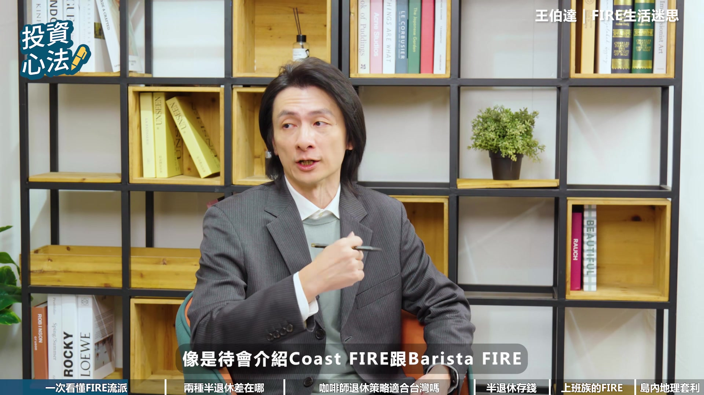

# fubonsec_tLBs-WjfLXQ — 關鍵畫面索引

- 來源逐字稿：[fubonsec_tLBs-WjfLXQ_FIN.srt](fubonsec_tLBs-WjfLXQ_FIN.srt)
- 影片：https://www.youtube.com/watch?v=tLBs-WjfLXQ
- 截圖數：28

## 00:00:00

**逐字稿片段：** 什麼是報酬序列風險? 就是像我這個運氣比較不好的狀況。 假設我在退休的第一年就遇到股災。 其實只要前三年你遇到熊市, 然後你繼續用百分之四去提領這個錢, 那你就會在15年到18年之間破產。

**話題推測：** 影片開場，提出「報酬序列風險」問題。

---

## 00:00:16

**逐字稿片段：** AI時代來臨,投資也能充滿智慧。 不幫AI Pro專業分析資料,透視趨勢。 輕鬆一點,掌握全球市場脈動。 有AI,投資更Pro。 現在就點擊知識欄,趕快去下載。

**話題推測：** 廣告時間，畫面應切換至廣告內容。

---

## 00:00:27

**逐字稿片段：** 各位觀眾朋友大家好 我是阿雅

**話題推測：** 節目開場，主持人介紹。

---

## 00:00:30

**逐字稿片段：** 你有想過退休不一定要等到65歲嗎 很多人以為退休就必須存到上千萬 但其實在 Fire 的世界裡 不一定要完全離開職場 也不一定要存到天文數字 就可以提早退休 今天我們邀請到王博達觀點的王博達先生

**話題推測：** 引入影片核心主題：提早退休的迷思。

---

## 00:00:45

**逐字稿片段：** 帶大家認識不同的 Fire 流派 看看一般上班族有沒有可能透過 半退休的方式 更早拿回人生的選擇權 博達您好 博達先生好 各位觀眾朋友們大家好 一聽到提早退休 我們第一個反應是要存很多錢 不過呢提早退休這個詞在國外說寫的是fire 有很多不同的定義與流派 那麼請博達簡單幫我們介紹 目前的fire有哪些種類呢 fire其實是過去就是十幾年興起的一個理財運動

**話題推測：** 介紹不同FIRE流派，預期畫面會列出或說明各流派。

---

## 00:01:14

**逐字稿片段：** 那它的意思就是financial independence 財務獨立然後retire early提早退休 那在這十幾年的演進的過程中 其實有很多人在社群裡面分享他們的實施的經驗 有的人可能過了五六年的經驗 然後甚至更長 那所以在這分享經驗的過程中 大家開始慢慢的跟過去有一些不一樣的想法 那也就是因為這樣子衍生了一些不同的流派 那我們先講最基本的

**話題推測：** 說明「FIRE」的定義：「財務獨立 (Financial Independence)」。

---

## 00:01:41

**逐字稿片段：** 就是這個Regular Fire 就是基本的這個Fire的一個形式 我們想要提早退休 一個很重要一點就是我們要先去計算 我們要存到多少的退休金

**話題推測：** 介紹第一種FIRE流派：「基本FIRE (Regular Fire)」。

---

## 00:01:51

**逐字稿片段：** 那有個財務顧問叫做這個威廉班根 他提供我們一個方向 他說他提出一個4%的提領法則 意思就是說我們存到一筆退休金之後 每年提領4%出來當作我們的一個支出 舉例來說我們有1000萬的退休金 然後每年就是提領4% 就是40萬出來當作我們這一年的支出 那在這樣的狀況之下呢 這個投資組合有很高的幾率 在我們退休的這30年內都不會用完 所以這就是我們一個存退休金的一個目標的一個方向 那有了這個公式之後呢 我們再回調我們的Regular Fire 我們就會比較瞭解說 我們現在要做的就是 計算我們一年到底要多少的支出 比如說剛剛那個例子 一年是40萬的支出 那我們就是存到25倍 1000萬就可以了 那大家也可以試算一下 你的一年支出是多少 然後乘以25倍 那就是你需要的 這個退休金的一個金額 那在這樣的狀況之下 我們有個目標之後 越快的達到這個目標 我們就可以越快的達到 這個Regular Fire 就是達成我們的目標 其他還有兩種變形 也是這裡面的一個方式

**話題推測：** 介紹「威廉班根」與其提出的法則。

---

## 00:03:02

**逐字稿片段：** 比如說像是Lean Fire 它就是一個比較精實的 一個退休的方式 它的概念就是支出縮減一點 比如說從40萬縮減到30萬 那我們的目標就下降了 我們就可以更快達到 我們這個退休的目標 那另外一種相反的

**話題推測：** 介紹第二種FIRE流派：「精實FIRE (Lean Fire)」。

---

## 00:03:18

**逐字稿片段：** 就是叫Fed Fire 就是我們想要過一個 很好的一個 很富裕的一個退休生活 那當然你的目標金額 就相對要再高一點 所以這三種的一個FIRE的形式 基本上就是在一個生活品質 跟退休時間之間做一個取捨 那經過了這一個十幾年的 這一個演進之後 大家慢慢開始有一個想法 財務獨立可能是需要的 但是退休可能就不一定 工作可能是可以留著的 所以又衍生了其他的 幾個不同的流派 像是我們待會可能會介紹到的 Costfire跟Berucia Fire這樣子

**話題推測：** 介紹第三種FIRE流派：「豐盛FIRE (Fat Fire)」。

---

## 00:03:53

**逐字稿片段：** 那為什麼社群化會覺得不一定要提早退休呢 第一個退休之後 我們可能會看到我們的前同事 然後可能升官啦 有更好的工作機會啦 這時候我們就會有點羨慕他們 可能不是因為錢的關係 可能是因為你插不上話題 會有一種社交的孤立感 那或者是那種成就感的一種沒落的感覺 所以就有一些想法開始會覺得說 工作是不是還是可以保留下來 我們其實不是想要放棄工作 我們想要擺脫的是一個 我們沒有辦法控制 沒有控制權的工作 比如說一個工作時間不穩定 然後工作內容壓力很大 然後還是很難相處的老闆等等 那在這樣的狀況之下 我們其實就會想說 那財務獨立是很重要的 因為它可以讓我們 更彈性的去選擇工作 但是完全放棄工作呢 則是可能是可以不用的 那博達Costfire跟Baristafire 聽起來都是還在工作 做半退休的狀態 那很多人可能會把這兩個搞混 那麼請能幫我們理清一下 這兩者在對待退休金的狀態 或是生活模式上面的差異有哪些呢 這兩個就是Fire體系裡面 就是沒有提早退休的那兩個 那以CostFire來看 它的對於退休金的一個概念是 我先存下一個退休金的種子 然後透過複利的方式 讓它慢慢的長大

**話題推測：** 轉向探討為何部分人選擇不完全退休。

---

## 00:05:20

**逐字稿片段：** 而Restock Fire呢 是它的退休金已經長到夠大了 可以開始收割了 但是因為它要補足一些 缺不足的部分 所以他繼續保留這個工作 那我們剛剛講到退休金這件事情 其實前面的幾個fire都是我們要存到一個 完整的退休金 儘快的退休 但是close fire他用 另外一個角度來看待這件事情 他把 退休之後的退休金

**話題推測：** 詳細解釋「咖啡師FIRE (Barista Fire)」的概念。

---

## 00:05:43

**逐字稿片段：** 跟我們現在要用的生活費來分開來 退休之後的退休金因為是很長一段時間之後才會需要使用的 所以他就想說那我們就存一個 種子資金 然後把它投資到一個有報酬率的投資組合裡面 慢慢的讓它長大 到我們退休的那個時候 它就可以累積到我們一個目標的金額 那這帶來的影響是非常大的 比如說我們剛剛講這個Regular Fire 假設目標是1000萬好了 那我們可能在30歲40歲要存到這個1000萬 可能會壓力有點大 不是那麼的容易 但如果今天是用Cost Buy的目標 我們可能只要存到一個種子資金 假設這個種子資金可以投資在一個8% 8%報酬率的投資組合來講的話

**話題推測：** 說明Coast Fire將退休金與生活費分開的策略，預期有圖示說明。

---

## 00:06:25

**逐字稿片段：** 那我們在30歲這個宗旨資金只要69萬 在40歲的時候只要140幾萬就可以了 那相對於剛剛Regular Fire 你要在三四十歲存到1000萬 那是一個非常非常一個大的一個差距 那這個就是Coastwide的一個概念 那實際上這會帶來什麼樣行為的改變 比如說我們今天如果是要同時支付 我們的日常生活費跟退休金 我們可能賺100塊裡面有50塊是要給現在的消費 然後50塊是給退休金 但今天如果我們的退休金已經讓這個總值資金給負擔掉了 我們其實只要賺50塊就好 就是滿足我們現在的日常生活的費用其實就夠了 那因為少了這個一半的這個存錢的壓力 然後少了退休的一個焦慮 其實我們在選擇工作方面就會變得更有彈性 那相對來說Burista它的部分就是 我已經存到一個退休金 然後它也可以開始用了 那只是說我要補足一些需求 在美國會有這樣的一個狀況 就是你在存到退休金之後還要繼續工作 是因為在美國它的醫療保險相當的高 你如果退休之後沒有這個公司的醫療保險 你自己要付很大的金額去做這件事情 所以它才會叫做Burista Fire 因為很多人就想說 那我乾脆去星巴克找一份打工的工作 就可以了 所以叫做咖啡室的一個退休 那就是這兩個fire 它比較不一樣的地方 那博達Barista Fire 就跟您剛剛說的一樣 在美國起源是去星巴克打工 換取昂貴醫療保險

**話題推測：** 舉例說明Coast Fire所需種子資金遠低於Regular Fire。

---

## 00:08:10

**逐字稿片段：** 但在我們臺灣有全民健保 那離開正職的話 也不會失去醫療保障 您覺得在臺灣這種咖啡室 退休的策略還適用嗎 或者是說我們能賦予它 什麼樣的新定義呢 美國的Barista Fire 最主要就是要拿到這個醫療保險 但是在臺灣 因為我們有健保 所以這個條件其實就不存在了 但是我覺得Birds of Fire

**話題推測：** 比較台灣與美國健保制度，探討Barista Fire在台灣的適用性。

---

## 00:08:31

**逐字稿片段：** 它其實還是有其他的理由 讓它在臺灣是有一個實行的意義的 我覺得大概主要理由有幾個 第一個就是它可以幫我們避開一個 報酬序列的風險 那第二個呢 它可以讓我們在工作跟正式退休之間 有一個緩衝的一個期間 那第三個就是 它可以讓我們持續的累積 我們的老保跟老退的年資 那我們先從第一個開始講 就是什麼是報酬序列風險 就是我們在退休的時候 比如說我們會把退休金設定一個投資報酬率 那可能我們剛剛講的例子像8% 那在這樣的狀況之下呢

**話題推測：** 說明Barista Fire在台灣仍有意義的其他理由。

---

## 00:09:08

**逐字稿片段：** 假設我們兩比兩個人好了 年化報酬率都是8% 但是這個每一年的報酬率是不會一樣的 它是會波動的 那這個順序不同 其實會帶來很不一樣的結果 那這就是報酬序列風險 我們舉一個例子好了 假設我們同樣都是1000萬的退休金 那年化報酬率都是8% 那主持人他就是運氣很好 然後這個年化報酬率8% 他確實每年都拿到8%的報酬率 那這1000萬的退休金 每年提應4%之後 再經過30年的退休期 大家可以猜一下 最後的金額是剩下多少 那最後會剩下5000萬 也就是說你一開始的1000萬 不但花不完 你最後也變成5000萬 像我這個運氣比較不好的狀況 假設我在退休的第一年就遇到股災 第一年跌20% 第二年又跌15% 第三年又跌10% 連續跌了三年 一直到第四年才稍微穩定下來 然後第五年也比較平穩一點 那一直撐到了第六年之後 這個才從谷底回升 那雖然後面25年的報酬率 假設年化報酬率有百分之十幾 那整個30年來看還是年化報酬8% 但是經過前三年的大跌之後 大家去想想看 我這個一開始的1000萬 到了30年之後會變成多少錢

**話題推測：** 透過兩個不同報酬順序的案例來比較說明。

---

## 00:10:35

**逐字稿片段：** 我在第15年到第18年之間就會破產 其實只要前三年你遇到熊市 然後你繼續用4%去提領這個錢 那你就會在15年到18年之間破產 為什麼會有這樣的差別 是因為我們在前面提領的時候 我們跌了20% 我們還是提零4% 在這樣的狀況之下 我們就被迫要在低點賣掉我們的股票 然後去支應我們的日常生活 而且是連續三年都這樣子 所以在經過這三年之後 我們的部位其實已經被我們砍到非常非常低了 就算後面的報酬率拉上去 但是其實我們享受不到整個資產增值的一個效果 這個就是一個報酬序列風險 為什麼Barista File會對我們這個東西有幫助 因為一份兼職的工作 在我們遇到這個股災的時候 它是可以幫助我們 不用在低點砍掉股票 然後這個兼職的收入呢 就可以支援我們的日常生活所需 所以從這個方向來看 Burista它在我們財務上面 確實是有幫助的 它可以幫助我們 降低報酬序列的一個風險 那第二點就是一個心理上的支持 我們剛剛講的就是 它可以幫助我們在工作期間 跟正式退休中間 做一個過渡期 因為我們在退休的時候呢 其實會面臨一個狀況 就我們在一夕之間 我們的身份 我們的社交圈 甚至是我們的薪水收入都不見了 那其實這是一個非常大的一個心理壓力 因為你在退休之後 你會失去你的身份 失去你的社交圈 失去你的薪水來源 那所以今天如果有一個兼職的一個工作的話 它不僅可以帶來我們一個新的身份 然後也有一個我們自己的社交圈 另外一個可能我們不是那麼需要的薪水 但是至少一個薪水的流入 都可以降低我們在這個過程中的一個心理壓力 這就是Birds Stop Fire它第二個好處 那第三個好處呢 就是它可以幫助我們再繼續去累積一個勞退跟勞保的一個年資 所以雖然說我們有全民健保 然後Birds Stop Fire它原本的意義已經不存在了 但是其實對於臺灣的退休族群來講 我覺得這是一個更好的事情 因為我們更有彈性 我們不需要為了一份醫療保險 去選擇一份我們可能也不是那麼喜歡的一個兼職工作 那反過來說呢 Berry Sapphire它可以幫我們度過報酬序列風險 然後提供一些心理上的一個支持 然後持續累積我們的勞保跟健保的年資 所以我覺得Berry Sapphire在臺灣來講 還是有它實行的價值 那博拉聽起來啊 Berry Sapphire就是蠻符合臺灣人的需求 那本質就是一邊提領本金 一邊靠兼職補貼

**話題推測：** 案例二的結果：破產，預期有資產變化圖。

---

## 00:13:12

**逐字稿片段：** 那這個本金的目標要怎麼抓 是不是很難像一般的FIRE那樣 去估出一個明確達標可以達標的數字 比如說我們剛剛講的Regular Fire 就是我們年支出的25倍 那Cost Fire的總值資金 就是把這個目標 然後折現回來 你現在幾歲 然後你可能要存一個總值資金 這些都是可以很精算出來的 但是Bruce Fire它的變數就是 你的兼職工作 會有多少收入 然後你要做多久 這些都是一個不確定的 所以它其實很難去估算出一個明確的金額 說你要存到多少 但是還是有一個基本的方向可以參考

**話題推測：** 探討Barista Fire的退休金目標該如何計算。

---

## 00:13:49

**逐字稿片段：** 就叫做一個缺口的一個計算方法 比如說Precify它要滿足的一個目標 就是我們的基本生活消費 食衣住行 這些東西是要讓我們的退休金 可以去涵蓋的 那剩下的部分 才是用兼職的方式去補足 比如說我們剛剛講的 假設一年你的支出是40萬 那裡面可能有6萬 也就是一個月5000塊 可能是我們的娛樂啊旅遊的這樣的一個消費 那我們就是這34萬呢 基本的消費支出 可能是要我們的自己的退休金去滿足的 那剩下的呢 這一年這6萬 這個旅遊跟這個消費的部分 可能就是可以用兼職來補足的 那這樣的設計的目的是什麼呢 就是說假設我們今天 可能沒有辦法繼續做這個兼職的工作了 那至少我們不會影響到我們的生存能力 我們改變的只是我們一個生活品質而已 所以在Bird Spot Fire裡面 其實它可能不是一個退休金的目標的一個點

**話題推測：** 介紹Barista Fire的「缺口計算方法」。

---

## 00:14:51

**逐字稿片段：** 它比較像是一個區間 就是我們在基本的生活的一個退休金 跟我們一個Regular Fire退休金的一個區間 那這是我們也可以嘗試去努力的一個目標這樣子 那我們前面聊了那麼多Fire流派

**話題推測：** 總結Barista Fire的目標是一個彈性區間。

---

## 00:15:09

**逐字稿片段：** 那我們回到臺灣的物價跟薪資結構 還有全世界羨慕的全民健保 那就你的觀察當中 我們Fire流派當中 哪一種是適合臺灣上班族去實踐的呢 如果要我選的話,我會選Coast Fires 是因為它是裡面最不極端的那一個

**話題推測：** 探討哪種FIRE流派最適合台灣上班族。

---

## 00:15:24

**逐字稿片段：** 自負心態的作者Morgan Houser他講過一句話 他說一個極端計劃的效益是會逐漸消退的 但是一個極端計劃的缺點 就會造成我們的一個終身的遺憾 比如說我們剛剛講的那幾個Fire Lean Fire應該是裡面最極端的嘛 因為它把我們的消費 我們的生活稅金壓到最低 它帶來的效益是很立即的 比如說我們可以很早很早就退休 但是經過了5年10年甚至20年之後 我們周邊的朋友也開始退休了 那這個時候其實大家就不會覺得說 你當年很早退休這件事情是很重要的一件事情 反而這個時候這個極端計劃的缺點開始顯現 因為我們在那個時候可能會改變我們的想法 覺得這個極簡的生活可能不是那麼的適合我們 但是在零fire的狀況之下 我們這個極簡的生活是要過一輩子 這是退休生活之後也是要一直過下去的 那這個東西到時候我們可能就會 不是那麼想要這樣的一個做法 所以這就是一個極端做法帶來一個影響 所以我會選一個比較不是那麼極端的一個Costfire 那為什麼Costfire它不是那麼的極端 因為它其實對我們的要求就只是 你要儘早開始存一箇中子資金就可以了 那它要求的中子資金也不是非常的多 像我們剛剛算的Regular Fire在三四十歲要存到一千萬 但是Costfire只要六十幾萬 這個中子資金就夠了 所以它其實是一個相對有彈性的 而且如果說我們今天想要更早一點退休 那我們就多存一點 把這個終止基金再補上去 那如果說我們今天想要去改變我們的目標 其實都是可以的 所以Crossfire其實是在這裡面 一個最具有彈性的一個方式 過得很好的人 他們早就自己知道自己要什麼樣的生活 他們只是缺一個財務獨立的門檻 去滿足這個條件而已 如果你現在還沒有想到 你要過什麼樣的生活的話 拜託你就選擇一個不是那麼極端 比較有彈性的coast fire 可能會是更適合的 那最後我們想要延伸問一下博達 那我們臺灣面積不大 但是南北跟城鄉居住成本 依然有明顯的差異 那目前遠端工作也是很普及的

**話題推測：** 引用Morgan Housel的觀點。

---

## 00:17:33

**逐字稿片段：** 你認為在臺灣執行島內套利 領取北部的薪資 那定居在中南部的效益大嗎 金錢效益是真的而且還蠻大的

**話題推測：** 討論台灣的「島內套利」策略。

---

## 00:17:41

**逐字稿片段：** 比如說在臺北工作 我們的薪資的中位數大概是 是73.5萬,是全臺灣第二高的 但是就儲蓄率來講大概只有43% 是全臺灣倒數第四低的 就是因為臺北的生活成本實在太高了 臺北是最會花錢的一個城市

**話題推測：** 舉台北薪資與儲蓄率為例。

---

## 00:18:02

**逐字稿片段：** 那如果我們在臺北上班,然後住在桃園 其實我們就可以把我們的儲蓄率從43%拉到56% 那這個效益是非常大的

**話題推測：** 舉例說明台北工作、桃園居住的套利效果。

---

## 00:18:12

**逐字稿片段：** 那另外一個效益很大的一個路線就是 就是住在苗栗,然後在新竹工作 新竹是臺灣中位屬薪資最高的一個縣市 苗栗則是一個消費水準倒數第二低的一個縣市 所以在這樣的狀況之下 如果你住在苗栗,然後在新竹上班 儲蓄率可以拉高到70% 是非常非常高的一個水準 所以金錢的效益確實是存在的 但是要注意一點就是 就是這個套利的效益其實是會逐漸消失的 這就跟我們在金融市場的套利一樣 這個套利機會 大家要看到的機會就是做這件事情 然後讓這個套利的缺口慢慢消失嘛 所以如果大家要去實行這個地理套利的話 可能要自己先去體驗一下 實際上去觀察一下 這個套利的空間是不是還存在 非常謝謝柏拉今天的分享 相信大家會發現 退休其實不一定是要存到多少錢 而是一種生活方式的選擇

**話題推測：** 舉例說明新竹工作、苗栗居住的套利效果。

---

## 00:19:09

**逐字稿片段：** 下一集我們要帶大家瞭解自己的財富水準 以及往上爬的重要關鍵是什麼 喜歡我們的影片也不要忘記訂閱按贊開啟小鈴鐺 我們下集再見 拜拜

**話題推測：** 影片結尾，預告下一集主題。

---
