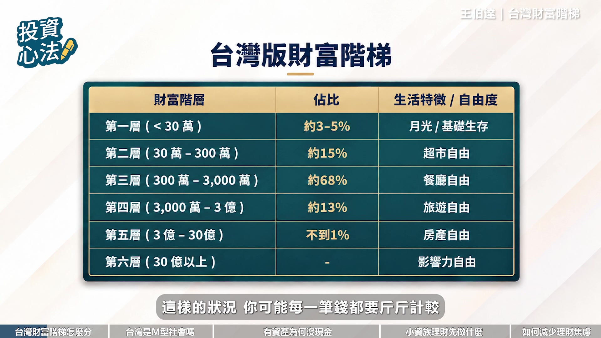
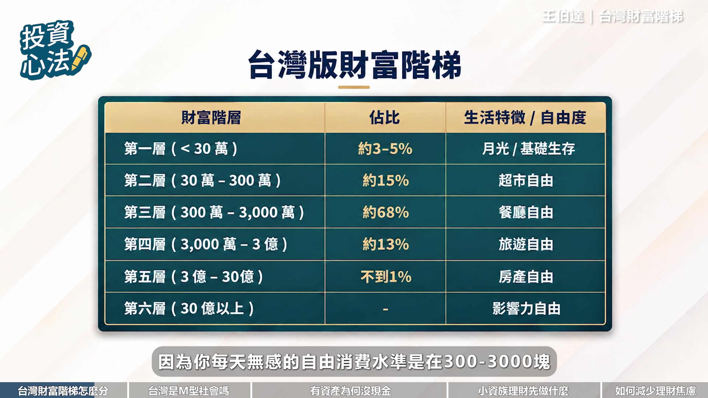

# fubonsec_ylJej6ixfCg — 關鍵畫面索引

- 來源逐字稿：[fubonsec_ylJej6ixfCg_FIN.srt](fubonsec_ylJej6ixfCg_FIN.srt)
- 影片：https://www.youtube.com/watch?v=ylJej6ixfCg
- 截圖數：35

## 00:00:21

**逐字稿片段：** AI時代來臨,投資也能充滿智慧,富邦AI Pro專業分析資料,透視趨勢,輕鬆一點掌握全球市場脈動。 有AI 投資更Pro 現在就點擊知識欄 趕快去下載

**話題推測：** 富邦AI Pro廣告畫面

---

## 00:00:32

**逐字稿片段：** 各位觀眾朋友大家好 我是Aya 你對於臺灣人的普遍財富水準有概念嗎

**話題推測：** 主持人開場，歡迎觀眾

---

## 00:00:38

**逐字稿片段：** 今天我們再次邀請到王伯達先生 帶大家一起檢視臺灣版的財富階梯 而你又在階梯的哪一層呢 讓我們歡迎伯達來為我們解惑 伯達您好 主持人好 各位觀眾朋友們大家好

**話題推測：** 介紹來賓王伯達先生

---

## 00:00:50

**逐字稿片段：** 那不啦 財富階梯這本書 是用美國資產級距來定義不同層級的自由度

**話題推測：** 講者開始討論《財富階梯》這本書

---

## 00:01:00

**逐字稿片段：** 那有沒有符合我們臺灣國情的臺灣版財富階梯呢 那分佈的比例又是呈現什麼樣的狀態 財富階梯它的概念是說 真正可以讓我們的生活產生一個直變的 不是我們那個幾千塊的加薪 或是幾萬塊的股票投資的一個所得 而是一個階梯的一個概念 我們要跨越那個階梯 才有辦法達到生活的一個直變

**話題推測：** 提出核心問題：有沒有臺灣版的財富階梯，分佈狀況如何

---

## 00:01:23

**逐字稿片段：** 那作者在這本書裡面把這個階梯分成六層 那每一層的極具呢都是十倍 他認為只有這樣一個夠大的集聚才會讓我們的生活產生一個質變 那我把這個這本書它裡面的一個美金直接用匯率換算成臺幣 然後去看看說這個分配的比例跟美國是不是一樣 然後再看看說分層出來臺灣的消費水準 跟它裡面描述的是不是一樣 然後看看是不是適用在臺灣這個地方

**話題推測：** 說明財富階梯分成六層，每層級距十倍

---

## 00:01:51

**逐字稿片段：** 第一層就是我們的淨資產在30萬以下 那這個部分其實是沒有什麼自由度可言的啦 就是你可能每一筆錢都要斤斤計較 在這樣的狀況

**話題推測：** 說明財富階梯第一層：淨資產30萬以下

---

## 00:02:02

**逐字稿片段：** 第二層是30萬到300萬這個階層 那作者提到了一個概念就是 你在這個階梯裡面 你每天有萬分之一的一個 自由消費的額度 你如果每天消費你的淨資產的萬分之一 這個對於你的淨資產的累積 不會有影響 所以他認為這是在每一個階層裡面 你可以自由消費的一個額度 那在剛剛第二層這裡面 是30萬臺幣到300萬臺幣 那如果他的萬分之一呢 就是在30塊到300塊 那作者在美國的那部分

**話題推測：** 說明財富階梯第二層：淨資產30萬到300萬

---

## 00:02:38

**逐字稿片段：** 他認為這部分是可以達到一個超市自由 也就是你在超級市場裡面 你可能買一個吃的東西啦 買一個水果裡面 你可以比較不用擔心會影響到你的財富 那換算臺灣來講其實也蠻貼近的 那第三層呢就是在這個300萬到3000萬 這個部分就會變成是餐廳自由 因為你每天的一個五感的一個自由消費水準是在300塊到3000塊

**話題推測：** 介紹第二層的「超市自由」概念

---

## 00:03:05

**逐字稿片段：** 那第四階層呢就是到了這個旅遊自由 那第五層是這個房地產自由 那到了第六層是在這個31到300億 可能只有極少數人可以達到這個部分 他講這個是影響力自由 你可以用你的財富去影響別人的想法 影響別人的生活 那他就分成這個六層 那臺灣的分配呈現什麼樣子呢 根據足記處的一個統計 臺灣的一個家庭財富的中位數

**話題推測：** 說明財富階梯第四層：達到「旅遊自由」

---

## 00:03:32

**逐字稿片段：** 大概是894萬臺幣 也就是說我們的所有的資產扣掉我們的負債 這樣的淨資產只要超過這個數字的話 我們大概就贏臺灣一半以上的人 這個894萬就落在我們剛剛講的財富階梯裡面的第三層 從整個臺灣的統計來看的話 臺灣大概有68%是集中在這個第三層裡面 是一個呈現一個非常集中的一個狀態

**話題推測：** 提到臺灣家庭財富中位數是894萬臺幣

---

## 00:03:56

**逐字稿片段：** 博達也就是說全臺有大約七成的人呢 是居在第三層 那這跟大眾印象中的M型化社會 似乎是很不一樣的 並且去比對美國的數據啊 也會發現他們落在第一層跟第二層的比例 是比臺灣還要高的 那麼支持我們臺灣基層家庭

**話題推測：** 主持人提問：臺灣財富集中在第三層與M型化社會印象不同

---

## 00:04:16

**逐字稿片段：** 穩居第三層的核心資產是什麼呢 臺灣其實一直以來都不是一個M型社會 主技術其實對這個事情有做過澄清 他有發佈一個問答集 題目就叫做我的家庭所得分配是否呈現M型化 他的結論就寫得很清楚了 說我們的中所得的一個階層其實還是佔大部分 所以其實我們的一個家庭所得分配 並沒有一個M型化的一個分佈

**話題推測：** 主持人提問：臺灣基層家庭穩居第三層的核心資產是什麼

---

## 00:04:42

**逐字稿片段：** 而是呈現一個右偏的一個分佈 這跟我們剛剛講的一個臺灣的財富階梯 它的分佈是一樣 大部分人集中是在第三層那個部分 68% 那右偏是什麼意思呢 右偏的意思就是說 我們的平均數大於我們的中位數非常非常多 那臺灣的中位數的家庭的一個進資產

**話題推測：** 說明臺灣財富分配呈現「右偏分佈」

---

## 00:05:02

**逐字稿片段：** 平均值是1600多萬 中位數的部分是894萬 所以我們可以發現 平均值被比中位數高的非常多 那這個平均值是被第四層 第五層跟第六層 那些真的非常有錢的人給拉上去的 所以平均值會變得非常的高 但其實大部分的中產階級呢 還是處在這個第三層的部分 那就變成臺灣家庭的一個資產分配 去呈現一個右偏的一個分配 也就是大家集中在中間那座山 但是出現一個非常長的長尾 那就是比較有錢的第四層 第五層跟第六層的一個部分

**話題推測：** 說明臺灣家庭淨資產的平均值（1600多萬）與中位數（894萬）差異

---

## 00:05:38

**逐字稿片段：** 那我很好奇想問一下博大 為什麼過往我們大家今年會覺得 臺灣是一個M型化的社會呢 全世界大部分的財富分配跟所得分配 都不是一個M型的一個形態 那為什麼大家會有這樣的一個想法 就是M型社會 這是因為這本書其實是大前研一 他在2006年出了一本暢銷書 他當時提到了日本的中產階級正在消失 然後大部分會變成一箇中下階層 然後帶來一個生活形態的一個改變 他就認為我們的一個生活形態會從一個道U型變成一個M型 所以他其實講的是一個生活形態的改變 他不是說我們的一個財富分配或所得分配會變成一個M型 而是消費形態會變成一個M型 為什麼消費形態會變成是一個M型呢 以我們臺灣這個右偏的一個分佈來看的話 如果今天是一個廠商 他要做一個商品 要瞄準一個目標客群 他可能第一個會想說 那我就瞄準那一座山 人數最多的 那這個部分呢 要滿足第一層第二層第三層 那可能就會定價稍微低一點 就是比較中低價格的這一個消費水準 那另外一個呢 他就會鎖定第四層第五層第六層 比較長尾的那一端 那可能就是比較客製化 精緻化比較高價的 所以當它鎖定了這兩層 一個是低價的 一個是高價的

**話題推測：** 主持人提問：為何大眾對臺灣M型化社會有誤解

---

## 00:07:02

**逐字稿片段：** 這個消費形態就變成是一個M型的一個形態 就算我們的淨資產的一個分配 其實不是那樣子 但是它呈現出來的一個消費形態 反而是會呈現是一個M型的 那博大我們有觀察到說 穩居第三層的七層家庭當中 其實他們平常生活也會覺得手頭很緊 那這種紙上富貴現金吃點體感貧窮是這群人的痛點 那如果希望能擺脫這樣的焦慮感的話 甚至邁向下一層的話

**話題推測：** 總結M型化的消費形態如何形成

---

## 00:07:33

**逐字稿片段：** 你會建議他們在資產配置上做什麼樣的調整呢 一般家庭的資產配置通常會分成三桶金 第一桶就是在口袋裡面的 那第二桶是要鎖到60歲 第三桶是卡在牆壁水泥裡面的 卡在牆壁水泥裡面就是房地產 臺灣有68%的人是分在第三層財富階梯 在這裡面他們的一個淨資產

**話題推測：** 說明體感貧窮的成因，並提出資產配置的調整建議

---

## 00:07:58

**逐字稿片段：** 有37%將近四成是放在房地產裡面的 另外一部分鎖到60歲的就是保險或是退休金 這個部分在第三層階梯這個部分 大概是每個家庭大概有三四百萬是鎖在這裡面 所以光是房地產跟鎖到60歲的退休金跟保險 大概就佔了我們的第三層淨資產的大概60%到70% 所以這部分都是沒有流動性 在這個第三層裡面 真正在口袋裡面你立刻拿得出來的 我去看這個足跡處的一個統計 大概在中間這個20%的這個家庭 它大概只有24%是有流動性的一個資產 比如說股票啦,現金等等 但是在最有錢的那個20%的家庭

**話題推測：** 指出第三層家庭約37%的資產在房地產中

---

## 00:08:40

**逐字稿片段：** 它有58%是這個高流動性資產 今天變成是一個有錢的家庭 他的財富越能夠拿出來的話 那如果今天月中間的或是會下層的 他的錢大部分都是卡在這個房地產 或是退休金或是保險裡面 他就會感到這個體感的一個貧窮 那就是我現在第三層以下的家庭 可能會面臨的一個問題 就是你的淨資產看起來很高 但是其實你的體感來講會覺得 你的流動性並不是那麼的好

**話題推測：** 比較最富有20%家庭與中間20%家庭的高流動性資產比例

---

## 00:09:09

**逐字稿片段：** 那他們在資產分配上面呢 如果假如說他想要讓手頭現金多一點 那他們要怎麼去做調整 我覺得就要看你是在

**話題推測：** 主持人提問：如何調整資產配置以增加手頭現金

---

## 00:09:18

**逐字稿片段：** 還是不是在上班 或是你準備要退休了 會有不一樣的一個做法 比如說你今天如果說 還在工作還在上班 其實你還是有流動性流入 因為你每個月還是會有薪水流入 所以這個時候 其實你要做的 不是把你的房地產這些東西 拿去變現變成流動性 你要做的是 不要再把你的流動性 給塞到更大的房子 更大的車子裡面去了 因為這會影響你接下來的一個財富分配 跟你的一個消費的狀況 財富階梯這本書裡面 其實有提到一個狀況 就是第三層的這個財富階梯的人 之所以會回調到這個第二層 的最主要原因就是他支出沒有控制 那裡面最主要的一個原因就是 他們花了太多錢去買了更大的房子 買了更好的車子 所以在這樣的一個支出不受控制的狀況之下 他就很容易從第三層調回去第二層 所以這就是如果說你今天還有流動性收入 你還在工作的話 你有這個流動性焦慮的話 你要做的事情就是 不要再把你的流動性給投資到 這些沒有流動性的資產裡面

**話題推測：** 說明資產調整建議因工作或退休階段而異

---

## 00:10:25

**逐字稿片段：** 那如果你今天是快要退休的一個族群 其實你就可以考慮說在你退休之前 先把你的房子換成一個更小的 或是更適合你的一個房子 這個會有兩個好處 第一個就是你可以去換一個 在退休之後更適合你的一個房子 比如說有一些無障礙空間啦 有退休有這個電梯啦 或是有一些公園綠地 有一些社交空間的一個房子等等 那另外一個好處呢 就是你可以在這個換屋的過程中 把一些流動性給套出來 比如說你大屋換小屋 你就會有一部分的流動性 是可以放到你的退休金裡面的 對於這個流動性所在資產裡面 然後怎麼樣拿出來 我覺得有沒有工作 跟你現在是不是要退休 我覺得是要分兩塊來看 會有不一樣的一個處理的方式

**話題推測：** 給予將退休者的建議：考慮「大屋換小屋」以增加流動性

---

## 00:11:10

**逐字稿片段：** 那如果我們不要以大換小 我們拿房子來養老是可以考慮的嗎

**話題推測：** 主持人提問：是否可以考慮「以房養老」

---

## 00:11:15

**逐字稿片段：** 乙房養老這個政策 其實從2015年開辦到現在 到今年第一季

**話題推測：** 討論「以房養老」政策的實施情況與限制

---

## 00:11:20

**逐字稿片段：** 大概有10600多件的案件 以我們的一個高齡化社會來講 大概有四五百萬長者的一個族群 其實相對來講 它的比例大概只有千分之一 千分之二左右實施這個東西 最主要原因就是因為 乙房養老的條件其實蠻嚴格的 他會去看你的屋齡 看你的年齡 看你的房地產位置的地方 然後甚至是會因為這樣子去改變你的貸款乘數 而且他的給每個月給你的金額 其實是會逐漸降低的 所以在這樣的狀況之下呢 其實他的條件是非常嚴格的 而且就算我們在透過這個以防養老 真的拿到一筆現金 我們還是要去解決一個剛剛講的 你在退休之後 什麼樣的房子更適合你 那以防養老其實只是拿這個錢去換的流動性 解決流動性的問題 但是這個房子到底適不適合你呢 比如說他如果還是沒有電梯 還是沒有無障礙空間 他可能還是不適合你 所以我覺得大家可能不是優先要去考慮 以防養老這個方式 而是優先在我們還有能力去看房子 換房子的時候 考慮去做一個換屋的決定 目前還在第一層第二層打拼的年輕人跟小資族 那面對高房價還有通膨 也會覺得往上到第三層是遙遙無期 那你認為他們在現階段最關鍵的理財重心 應該要擺在哪裡呢

**話題推測：** 提到「以房養老」政策目前的案件數為10600多件

---

## 00:12:45

**逐字稿片段：** 我覺得如果是第一層跟第二層 他的理財重心就是

**話題推測：** 給予第一、二層年輕人的理財建議

---

## 00:12:48

**逐字稿片段：** 第一個要了解說你的節儉是有極限的 但是你的收入是沒有上限的 那另外一個重點就是 在你本金還很小的時候 報酬率其實是不是那麼重要的 第一層的這個財務階梯 就是在淨資產30萬以下的這一群 那其實在這一群呢 其實我覺得你不要有負債 就已經是值得拍拍手 因為在這一層裡面 其實你大部分的收入 大概都是會拿去花掉的 比如說在美國 你收入最低的20%的人群 他光是食衣住行 然後加上醫療的費用 大概就已經超過他們收入的全部 所以他們很容易陷入負債的一個狀況 所以在第一層

**話題推測：** 強調「節儉有極限，收入無上限」的理財觀念

---

## 00:13:33

**逐字稿片段：** 我覺得應該要怎麼做呢 就是找一份工作 然後把這一份工作好好的做好 然後建立一個比較穩定的一個生活形態 我覺得是第一層最重要的一個重心 那第二層就是在30萬到300萬這個區間 假設你是30萬 你投資股票報酬率假設10%還不錯 那大概就是賺到3萬塊 那你如果在這個區間上限300萬 你其實只要報酬率2% 大概就走6萬 就是剛剛那個的兩倍 所以在這個階段下你會發現說 在本金相對小的狀況之下 你的報酬率其實拉再高 對於我們去跨越這個財富階梯 其實幫助都不大 所以在第二層裡面最重要的就是

**話題推測：** 建議第一層年輕人的理財重心是建立穩定工作與生活

---

## 00:14:17

**逐字稿片段：** 我們要怎麼樣去提高我們的收入 那有一個很好的方法就是 在這個階層 其實投資股票的報酬率不是最高的 投資報酬率最高的是投資我們自己 因為根據主計處它的統計

**話題推測：** 建議第二層年輕人的理財重心是提高收入

---

## 00:14:30

**逐字稿片段：** 在不同的學歷 它的薪資中位數的分佈 大概是什麼樣的一個狀況 以最新的2024年的一個統計 研究所學歷 他的薪資中位數大概是109萬 那如果是大學生 大學畢業的話 他的薪資中位數是58萬 所以你會發現 你只要投資研究所的 這兩年的一個時間跟金錢 你就可以在接下來很長一段時間 都比大學學歷的人 多了百分之八十幾的一個收入 那這是一個很重要的一個投資 而且在第二層 我們的時間跟空間跟金錢 有更多的餘裕 讓我們花這兩年去投資這個研究所的一個學歷 所以在這個東西呢 在這個部分呢 我會覺得說在第二層 我們應該去考慮說提升我們的收入 第一個就是透過學歷 第二個呢就是去思考說 有沒有更好的一個收入的一個工作 其實在這一層裡面 其實有時候選擇比努力是更重要的 因為在臺灣前三大的一個薪資的中位數 大概都在一百萬以上 像是石油業 或是像我們所在的金融業 或是像一些電力行業 其實都是排名在前三名 薪資中位數都在100萬以上 這些都是大家可以去考慮的行業 當然科技業也是薪資很高的一個部分 但是很有趣的是它的中位數並沒有排在前三名 這就是因為很多公司都叫做科技業 但它其實薪資並沒有那麼的高 就算在科技業裡面也是一樣 大家要去慎選說哪一個科技業 才是真的能夠賺到比較多錢的 這代表投資不重要嗎 其實也不是 而是說投資也很重要 但是那是你有行有餘力 有儲蓄的部分才去做的 你其實應該做的就是

**話題推測：** 比較不同學歷的薪資中位數（研究所109萬 vs 大學58萬）

---

## 00:16:15

**逐字稿片段：** 設定一個定期定額 然後買一個指數型基金 然後就不要去管它了 把時間花在提升你的學歷 提升你的能力 找到更好收入的工作 那我覺得這才是 第二層最重要的一個東西 把時間花在最有效益的地方 那博達你曾說過 跨越財富階梯制 下一層需要數十年的時間 但現在社群媒體充斥了許多少年鼓聲 讓網友都很嚮往 那甚至引發盲禁跟all in 您會如何建議投資人重建健康的觀念呢 我想先提一個數字讓大家比較不會那麼的焦慮 就是我之前有算過臺灣大概存多少錢可以退休 大概就是落在財富階梯的第三層 也就是300萬到3000萬這個區間 其實大概就可以退休了 那根據財富階梯這本書裡面 他去統計在第三層 他的年齡中位數是54歲 到了第四層是62歲 也就是說你要達到退休這個年齡 在中位數就是大部分人的狀況 本來就是已經是中年之後的事情

**話題推測：** 建議第二層年輕人在投資上採取定期定額、指數型基金策略

---

## 00:17:21

**逐字稿片段：** 他另外提出了一個數據 就是說在10年裡面 其實有63%的家庭 他的GAT是沒有任何的變化的 那你如果說真的要跨越這個GAT的話 能往上爬一層的話 大概也只有21%的人 可以在10年內爬上一層 那你如果要爬兩層的話 在20年內一面 也只有5%的人可以做得到 當我們看到這個數字以後 我們就可以發現說 爬財富階梯這件事情 本來就是以10年 20年來作為單位來計算的 我們不需要去 為了少年股神這些 這個賽季量戰而感到一個憂慮 我們並沒有落後 而是我們本來就在一個 非常長的一個馬拉松的一個賽跑上面 這個統計其實只是在統計上的一個數字讓我們有一個感受 但是焦慮是比較出來的 我們要怎麼樣去降低這個焦慮的情緒 我覺得可能對大家來講可能是更重要的 我覺得應該是把跟別人比較報酬率這件事情拿掉 而是跟我們自己做比較 比如說我們一直在講說我們的退休計劃 在我們的一個退休金要存到多少的目標 什麼時候要退休等等 那這個東西就是跟我們自己來比 這東西很容易計算 你回去做一個公式 你就可以知道說 我們現在距離我們的退休金的目標 還差多久 還差多少錢 立刻算就知道了 但是呢 如果我們要去算說 跟別人比報酬率 其實你算一整天也算不完

**話題推測：** 提供跨越財富階梯所需時間的數據（10年內爬一層21%，20年內爬兩層5%）

---

## 00:18:47

**逐字稿片段：** 我們要記住這件事情 就是跟自己比就好了 財富階梯這個東西 其實是一個跑馬拉松的比賽 但是少年股神 他們跑的是100公尺的接力賽 他們會一批換一批 我們不要用 別人跑100公尺接力賽的速度 來要求我們跑完整個馬拉松這個比賽 我覺得那是一個 對自己太嚴格的一個要求 那我們非常感謝博拉今天的分享 財富階梯並不是拿來比較高低 而是幫我們找到自己的位置 而每一層的挑戰也都不同 需要的策略也不同

**話題推測：** 總結建議：與自己比較，而非與少年股神比較

---

## 00:19:17

**逐字稿片段：** 下一集呢我們要來聊聊 那些經常影響我們投資決策的心理陷阱 那來到最後 喜歡我們的影片也不要忘記訂閱按贊 開啟小鈴鐺 我們下期再見 拜拜

**話題推測：** 預告下一集主題：影響投資決策的心理陷阱

---
