# jimainotebook_-9M7lYjHVFw — 關鍵畫面索引

- 來源逐字稿：[jimainotebook_-9M7lYjHVFw_FIN.srt](jimainotebook_-9M7lYjHVFw_FIN.srt)
- 影片：https://www.youtube.com/watch?v=-9M7lYjHVFw
- 截圖數：68

## 00:00:10

**逐字稿片段：** 這一集我們看AI新創公司的第一波洗牌。 我想回答一個問題,AI一年比一年聰明,也一年比一年便宜,為什麼做AI的新創公司反而一家接一家撐不住? 先看一家公司。

**話題推測：** 影片主題介紹「AI新創公司的第一波洗牌」，可能為標題頁。

---

## 00:00:22

**逐字稿片段：** Character.ai是一個可以跟虛擬角色聊天的App。 2024年,Google為了把他的兩位創辦人請回去,據報導付了大約27億美元。 兩年後,2026年10月12日,Character.ai在美國德拉瓦州的法院申請破產。

**話題推測：** 介紹個案公司Character.ai，可能顯示其Logo與介紹。

---

## 00:00:36

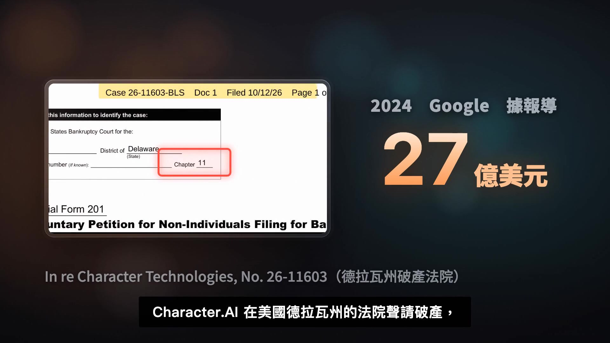

**逐字稿片段：** Disney開價2000萬美元當第一個出價的買家 從27億到2000萬 很容易被講成燒錢燒光的故事 可是公司在文件裡 把原因歸給法律、監管和營運上的逆風 其中最重的是好幾件指控平臺傷害青少年的訴訟 所以這不只是一個成本的故事 標題寫的是倒閉潮 我先把話說清楚 這一波洗牌結局大概有三種 一種是法院文件上看得到的破產 一種是公司被大公司收走 或是人被整批挖走 還有一種是還沒發生的預測 到目前為止 最常見的是被收走 這一集我會一路把這三種分開講 標題裡還有兩個詞先講清楚

**話題推測：** 提及Disney出價收購（2000萬美元），可能顯示相關財經資訊。

---

## 00:01:14

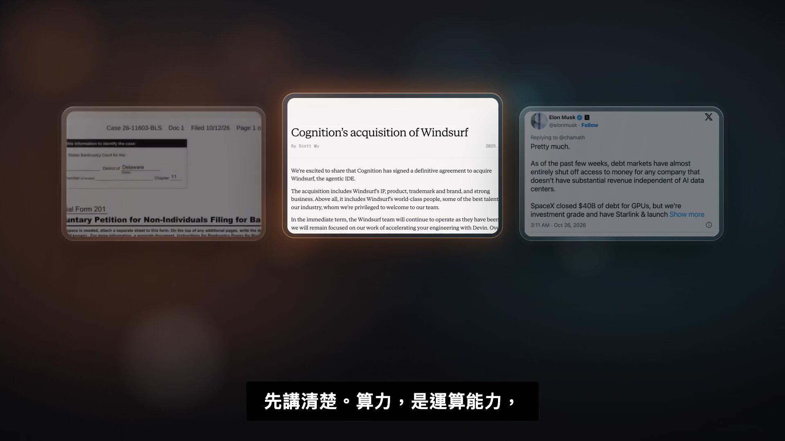

**逐字稿片段：** 算力是運算能力 說的是AI背後那一大排晶片 能做多少計算 你每問AI一句話 都要用掉一點算力 而算力要花錢買

**話題推測：** 定義新詞彙「算力」，可能為解釋性文字畫面。

---

## 00:01:23

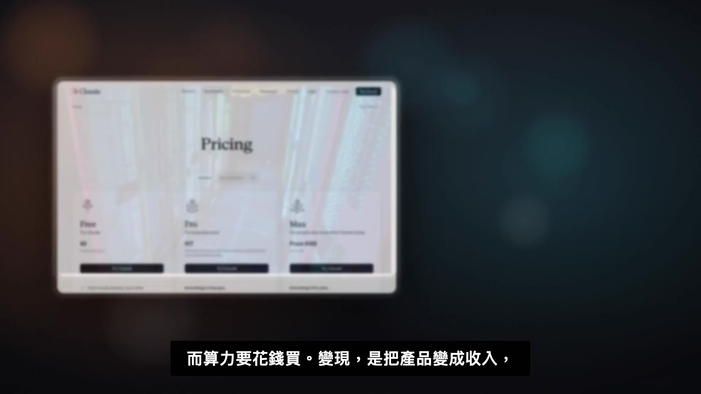

**逐字稿片段：** 變現是把產品變成收入 也就是用的人很多之後 有沒有人付錢 付的錢夠不夠蓋過成本 這一集會提到幾家上市公司的股價 那些只是事情發生的記錄 不是投資建議 我們分三步走 先看錢為什麼湧進來 再看做AI產品的新創為什麼撐不住 最後跟著錢走到賣算力的那一端 先從錢開始 把錢投給還沒上市的新公司 換一部分股份

**話題推測：** 定義新詞彙「變現」，可能為解釋性文字畫面。

---

## 00:01:47

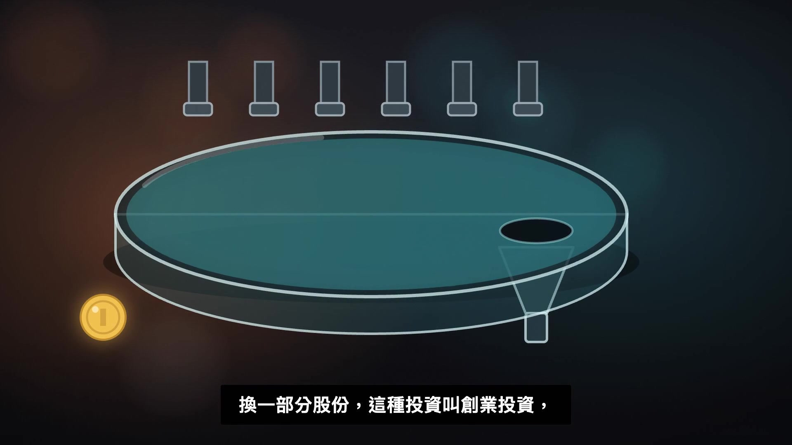

**逐字稿片段：** 這種投資叫創業投資 英文是Venture Capital 新公司長大了 股份變值錢 投資人就賺 新公司倒了 錢就沒了 這幾年 創業投資的錢 大部分往同一個方向流 資料公司Crunchbase統計

**話題推測：** 定義「創業投資」（Venture Capital），可能為解釋性文字畫面。

---

## 00:02:01

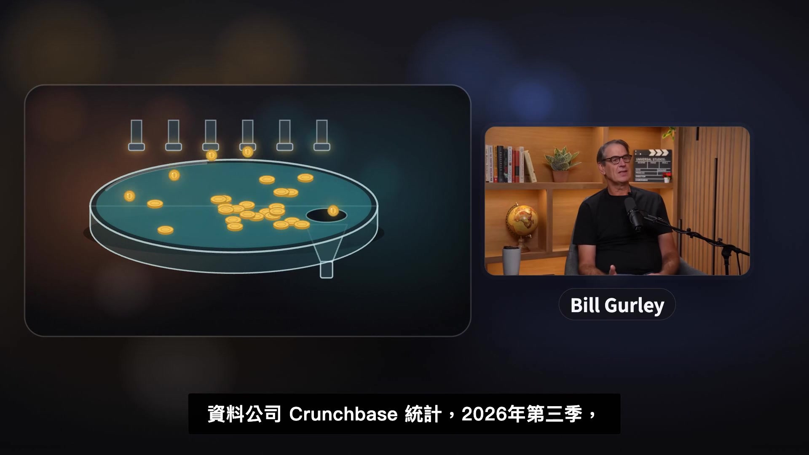

**逐字稿片段：** 2026年第三季 全球的創業投資裡 AI新創拿走了64% 一輪就募到10億美元以上的大案子 也在這一季創了記錄 錢還是很多 不過也開始變少 這一季的總額比上一季少了大約四分之一 是今年最少的一季

**話題推測：** 具體數據說明AI新創吸金情況（拿走64%），可能為圖表重點標示。

---

## 00:02:16

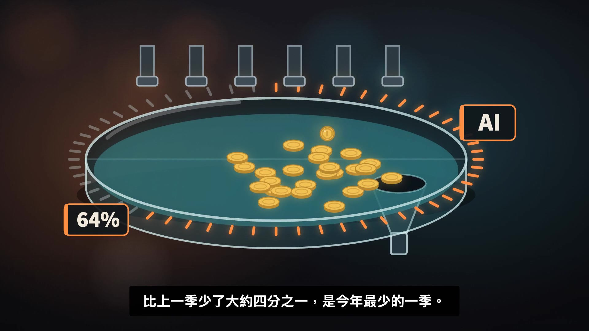

**逐字稿片段：** 這麼多錢湧進來 是不是泡沫 有一位很有名的投資人叫Bill Gurley 他是創業投資公司Benchmark的合夥人 他在2025年底的一段訪談裡說 大家喜歡把這件事炒成兩邊 你是相信AI還是覺得它是泡沫

**話題推測：** 提出新問題「這麼多錢湧進來是不是泡沫」，可能為提問式標題畫面。

---

## 00:02:29

**逐字稿片段：** 他引用的Perez是經濟學家Carlota Perez 他研究過鐵路、電力這些大技術浪潮 聽他自己說 他說浪潮和泡沫常常一起出現

**話題推測：** 介紹引用的經濟學家「Carlota Perez」，可能顯示其照片與頭銜。

---

## 00:03:03

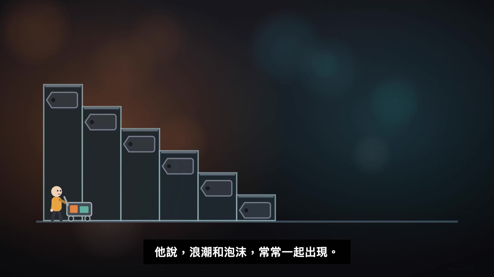

**逐字稿片段：** 那錢為什麼這麼願意進來? 因為AI的價格掉得非常快 研究機構Epoch AI算過

**話題推測：** 重新回到資金流向原因的討論「錢為什麼這麼願意進來?」，可能為分節標題或提問。

---

## 00:03:09

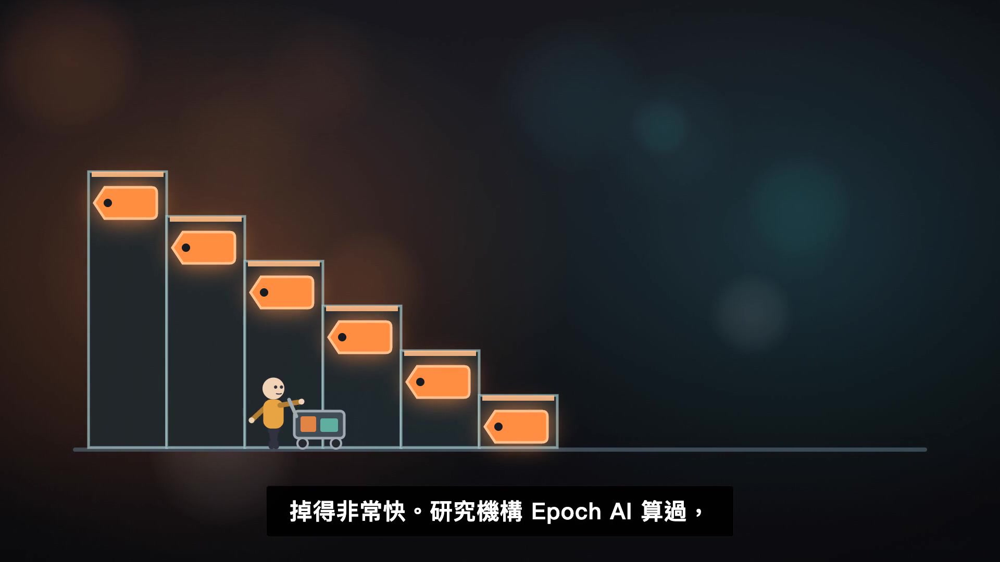

**逐字稿片段：** 要達到同樣的表現 AI的價格每年可以便宜好幾十倍 他們也提醒 最快的那種下降不一定會一直持續 這件事改變了做公司的方式 以前要做一個能寫文章 能寫程式的產品 要一大群工程師 現在 一個小團隊接上大公司的模型 幾個月就能推出產品 有些公司漲得非常快

**話題推測：** 呈現AI價格下降的具體數據（便宜好幾十倍），可能為趨勢圖。

---

## 00:03:29

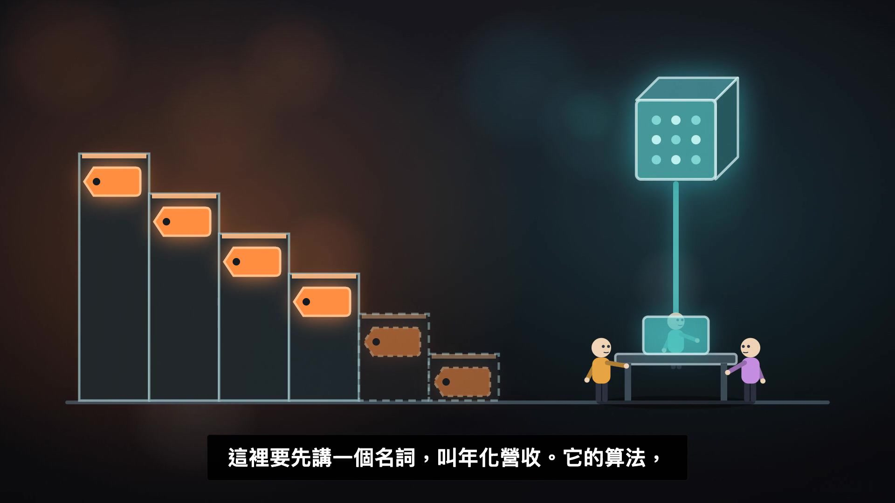

**逐字稿片段：** 這裡要先講一個名詞 叫年化營收 他的算法是拿最近一個月的收入乘以12 用來估一整年 寫程式的工具Cursor 據TechCrunch報道 今年二月的年化營收已經到20億美元左右

**話題推測：** 定義新詞彙「年化營收」，可能為解釋性文字畫面。

---

## 00:03:40

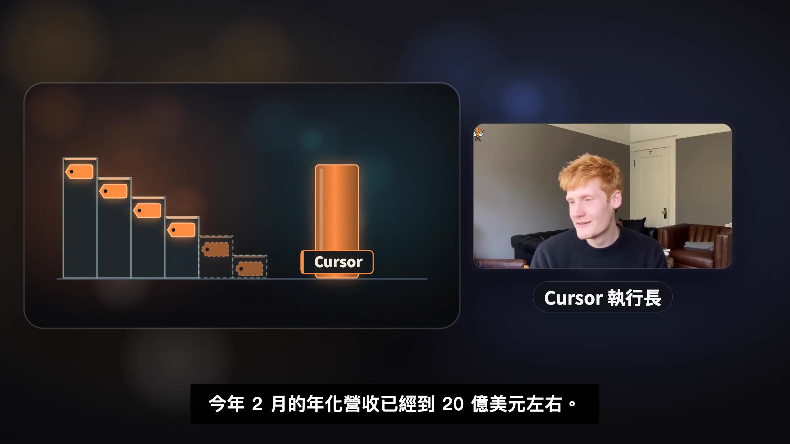

**逐字稿片段：** 幫你用說話做出網站的Loveable 成長也差不多快 這些數字大多是公司自己說的 沒有經過集合 不過這種成長速度在軟體業裡很少見 所以說這一切都是泡沫也不公平 錢湧進來是因為真的有東西在漲

**話題推測：** 介紹另一家公司「Loveable」，可能顯示其Logo或產品畫面。

---

## 00:03:55

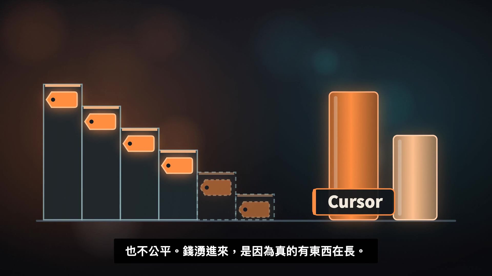

**逐字稿片段：** 錢進來以後留到哪裡去? 我們跟著一塊錢走一趟 你每個月付訂閱費給一家AI新創 這是頭一站 新創自己通常沒有大模型 他要把你的每一個問題 送到OpenAI或Anthropic

**話題推測：** 提出新問題「錢進來以後留到哪裡去?」，可能為流程圖或分節標題。

---

## 00:04:07

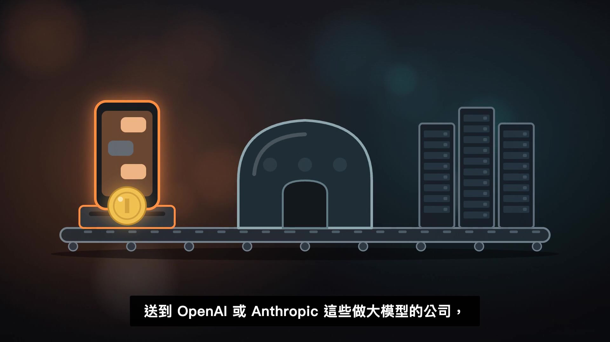

**逐字稿片段：** 這些做大模型的公司 按用量付錢 這是下一站

**話題推測：** 解釋資金流的第二站（模型層，如OpenAI或Anthropic），可能顯示相關Logo。

---

## 00:04:10

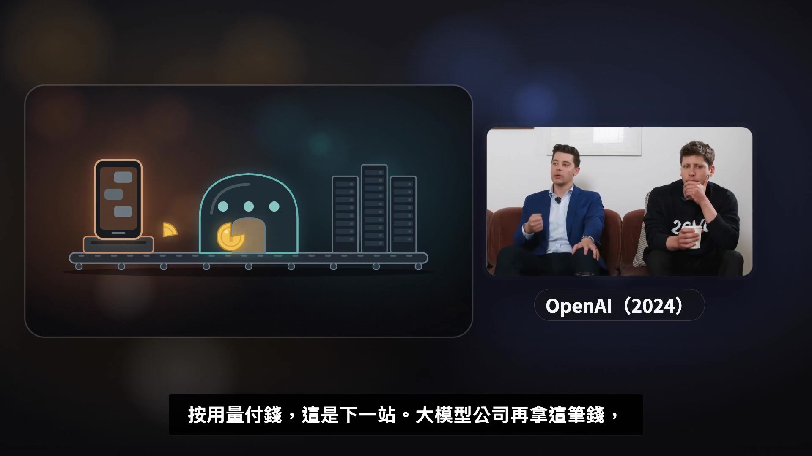

**逐字稿片段：** 大模型公司再拿這筆錢 去租或去買一大排晶片 也就是算力 這是最後一站

**話題推測：** 解釋資金流的第三站（算力層），可能顯示GPU或資料中心畫面。

---

## 00:04:16

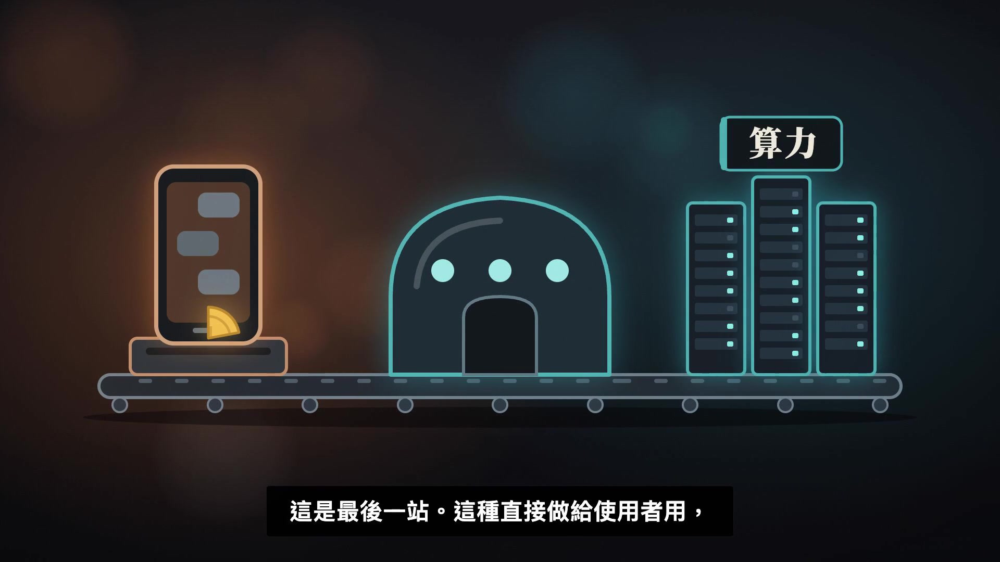

**逐字稿片段：** 這種直接做給使用者用 底下接別人模型的產品 叫應用層 做大模型的那一層 叫模型層 企業也真的在付錢 創業投資公司Manlo Ventures調查 美國企業2025年 花在生成式AI的錢 大約一半落在應用層 Melo本身投資了Anthropic 看這份調查要記得這一點 第一部分的答案是這樣 錢湧進來是真的 成長也是真的 可是新創賺到的每一塊錢 有一大塊要先付給上游的模型和算力 所以下一個問題是 付完上游 新創自己還剩多少 要回答剩多少 得先認識兩個名詞

**話題推測：** 定義「應用層」，可能為資金流示意圖中的標示。

---

## 00:04:50

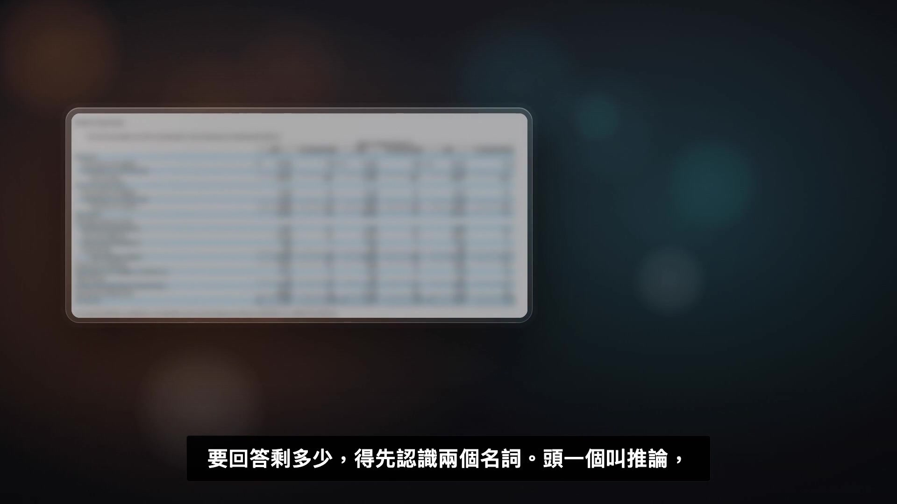

**逐字稿片段：** 頭一個叫推論 英文是Inference 你問AI一個問題 模型把答案算出來 這個過程就叫推論 每做一次推論都要用掉算力 也就是要花錢 另一個叫毛利 毛利是賣東西的收入扣掉直接成本以後剩下的比例 一家賣軟體的公司 多賣一份成本幾乎不會增加 所以傳統軟體公司的毛利常見七八成 AI新創就不一樣了 每多一個人用就多做一次推論 就多付一次錢 創業投資公司Besmer在2025年的報告裡說

**話題推測：** 定義新詞彙「推論」（Inference），可能為解釋性文字畫面。

---

## 00:05:19

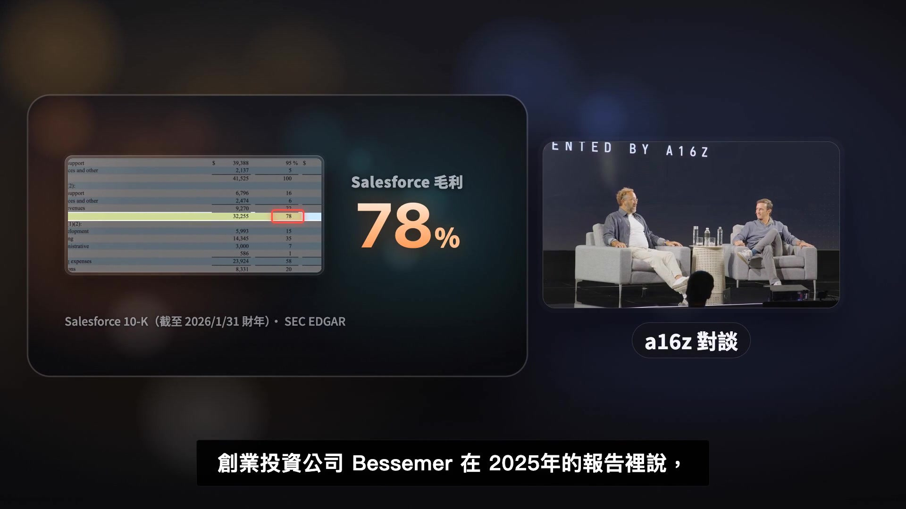

**逐字稿片段：** 成長最快的那群AI新創 平均毛利只有大約25% 而且常常是負的 負的意思是每多賣一份就多虧一點 這份報告的樣本大約10家 不算多 可是方向很清楚 AI讀寫文字

**話題推測：** 具體數據說明AI新創的低毛利問題（平均25%），可能為圖表重點標示。

---

## 00:05:33

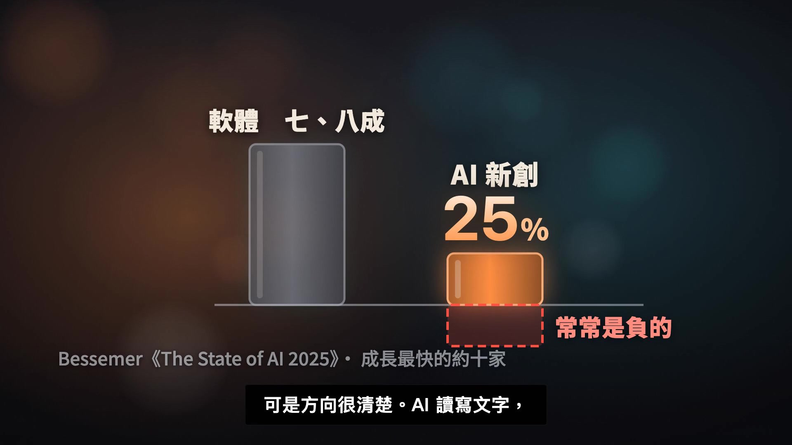

**逐字稿片段：** 是用一種單位來計費的 這個單位叫Token 中文常翻成詞源

**話題推測：** 介紹AI計費單位「Token」，可能為解釋性文字畫面。

---

## 00:05:37

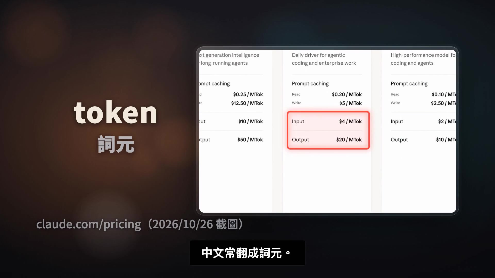

**逐字稿片段：** 紐約大學的榮譽教授 Gary Marcus 是有名的AI懷疑派 他今年在一個節目裡 用了一個很好懂的比喻 聽他自己說 than you're paying them to use it

**話題推測：** 介紹受訪專家「Gary Marcus」，可能顯示其照片與頭銜。

---

## 00:06:09

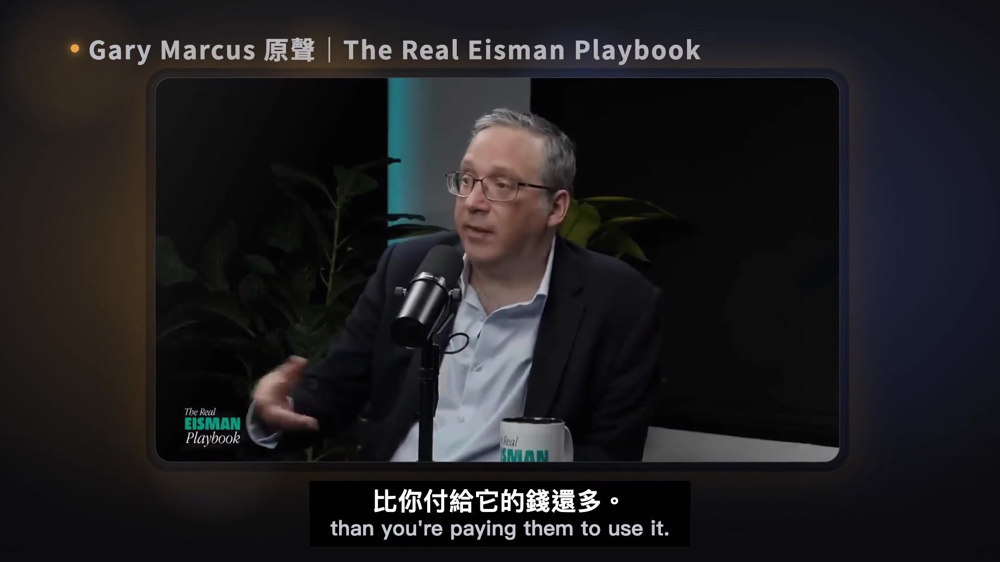

**逐字稿片段：** 吃到飽餐廳 他用的比喻剛好說中了AI訂閱制的問題 吃到飽的帳是這樣算的 客人付固定的錢吃多少都可以 AI新創的訂閱制也一樣 你每個月付固定的月費用多少都算在裡面 麻煩在於食材一盤比一盤便宜 可是客人一次吃的盤數暴增 現在的AI會自己找資料 自己寫 自己檢查 做一件事用掉的Token 比以前多出很多倍

**話題推測：** 引入「吃到飽餐廳」的比喻，可能為相關情境圖。

---

## 00:06:34

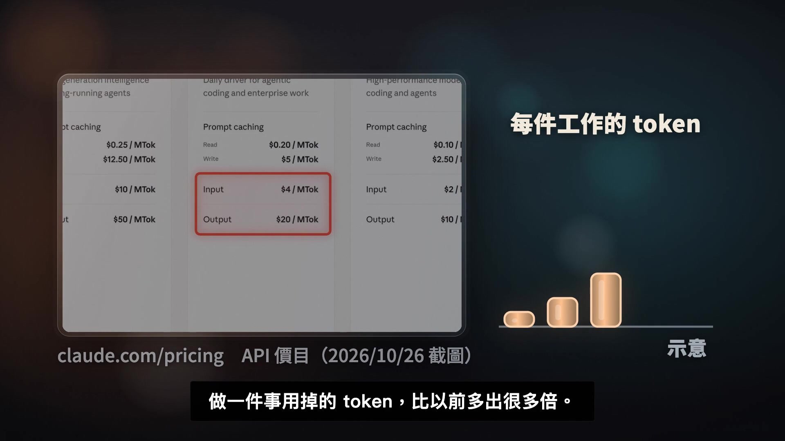

**逐字稿片段：** 分析師Evan Ding 在2025年就寫過這件事 每個Token變便宜 每件工作卻越來越貴 連成長最快的Cursor 也碰到這個問題 據TechCrunch報道 Cursor一直到最近都是負毛利 後來他自己做了模型 把一部分工作 交給比較便宜的模型 大企業方案 才轉成小小的正毛利 個人訂閱還是虧錢 不過低毛利 也有另一種解讀 創業投資公司A16Z的 成長投資合夥人David George說 他們現在看到低毛利 反而覺得放心 聽他怎麼說 他說的有道理 毛利低 代表真的有人在用 可是有人在用不代表站得穩

**話題推測：** 引用分析師「Evan Ding」的觀點，可能顯示其姓名或文章截圖。

---

## 00:07:29

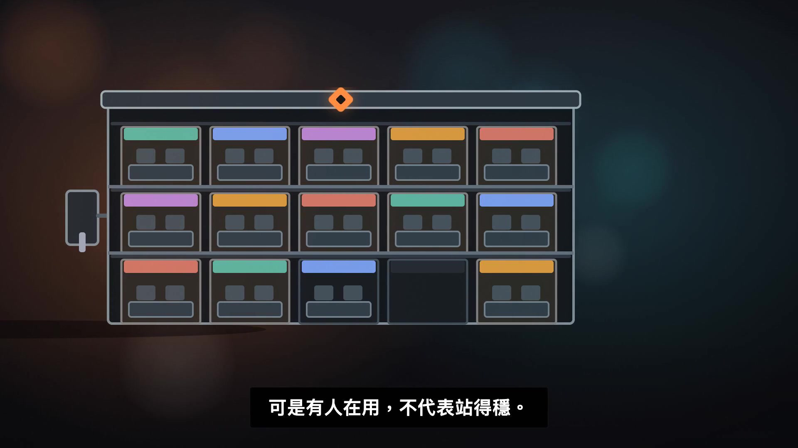

**逐字稿片段：** 應用層還有一個更大的壓力 來自房東 只接別人的模型 在外面包一層好用介面的新創 有一個名字叫包裝型新創 英文是Wrapper

**話題推測：** 提出應用層新壓力「來自房東」，可能為概念示意圖。

---

## 00:07:39

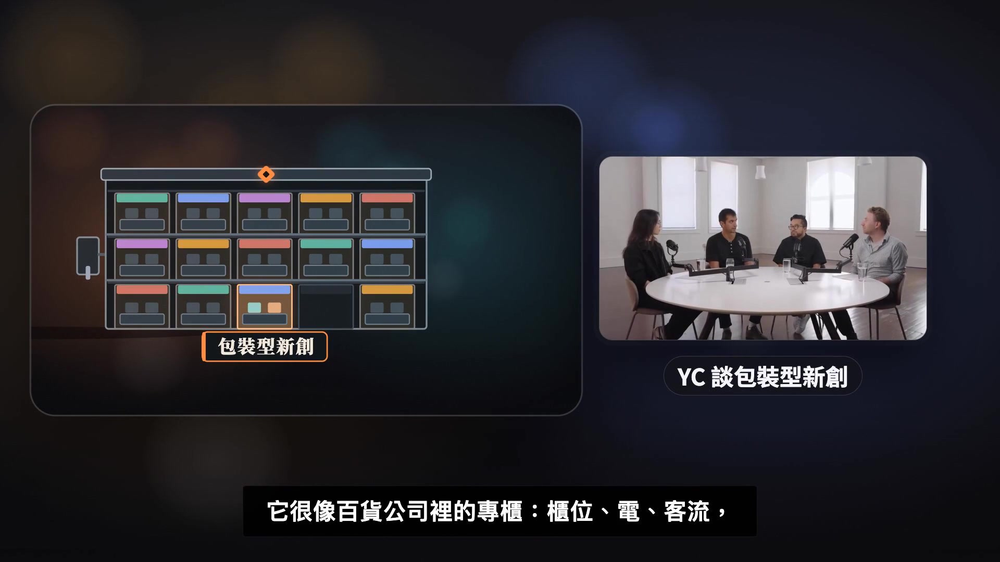

**逐字稿片段：** 它很像百貨公司裡的專櫃 櫃位、店、客流全都是百貨公司的 這裡的百貨公司就是做大模型的公司 哪一個專櫃賣得好 百貨公司看得一清二楚 隨時可以自己開一櫃 這件事發生過好幾次

**話題推測：** 視覺化百貨公司與專櫃的比喻，可能為相關情境圖。

---

## 00:07:52

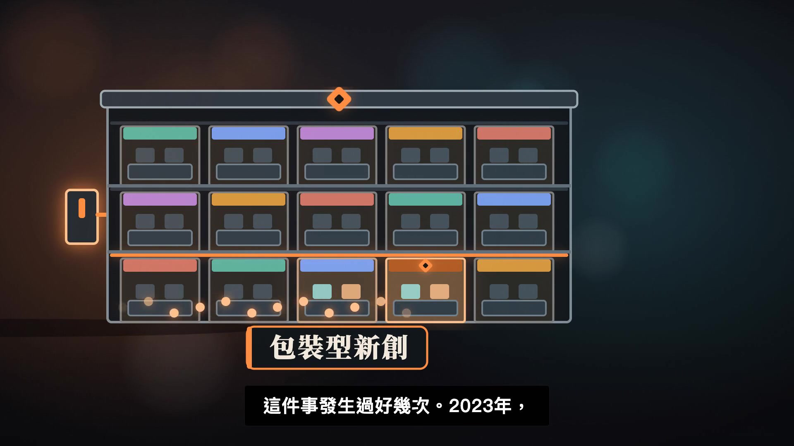

**逐字稿片段：** 2023年 幫人寫行銷文案的Jasper 在ChatGPT推出之後 內部估值被往下修整 還換了執行長 2026年1月底 Anthropic為Claude Cowork推出法律用的外掛 可以審閱合約 幾天後 提供法律資料的上市公司Thomson Reuters 股價單日大跌 它不是新創 可是市場的反應說明了 功能很容易被大公司做進自己的產品 今年也有小公司直接結束營運

**話題推測：** 舉例說明被模型層競爭的應用層公司「Jasper」，可能顯示其Logo。

---

## 00:08:16

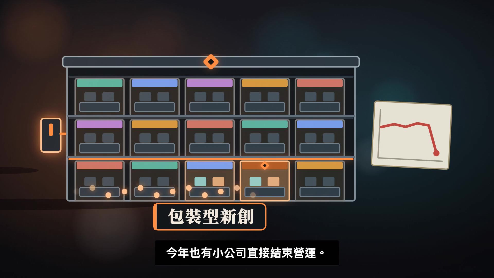

**逐字稿片段：** 前Notebook LM工程師做的語音App Hux 在5月關閉 做工作流程自動化的Relay在8月關閉 理由都提到大平臺推出了類似的功能 這幾家是真正結束營運的例子 規模都不大 OpenAI的執行長Sam Altman 在2024年的一個節目裡 講過一段很直接的話 聽他自己說 比GPT-5更好 後來發生的事更像另一種情況 百貨公司不只自己開櫃 還把隔壁專櫃的店長請走

**話題推測：** 舉例說明結束營運的公司「Hux」，可能顯示其Logo。

---

## 00:09:05

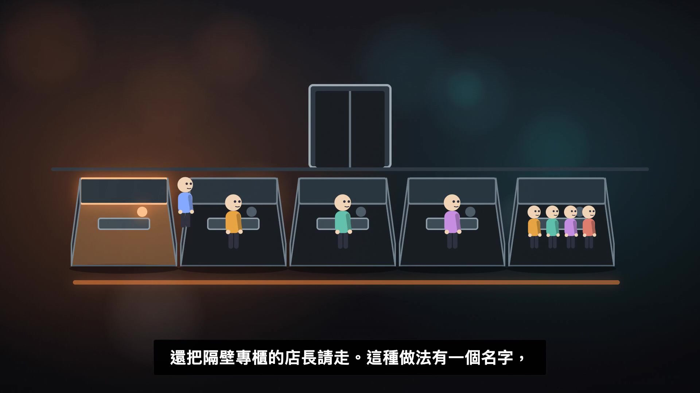

**逐字稿片段：** 這種做法有一個名字 叫授權加挖角 英文是Reverse Acquahire 他的做法是 大公司不買下整家公司 而是付一大筆技術授權費 再把創辦人和核心團隊請過來 公司本身留下來繼續營運 2024年 Microsoft用這種方式 帶走了Infliction的創辦人和大部分員工 同一年 Google對Character AI

**話題推測：** 定義新概念「授權加挖角」（Reverse Acquihire），可能為解釋性文字畫面。

---

## 00:09:25

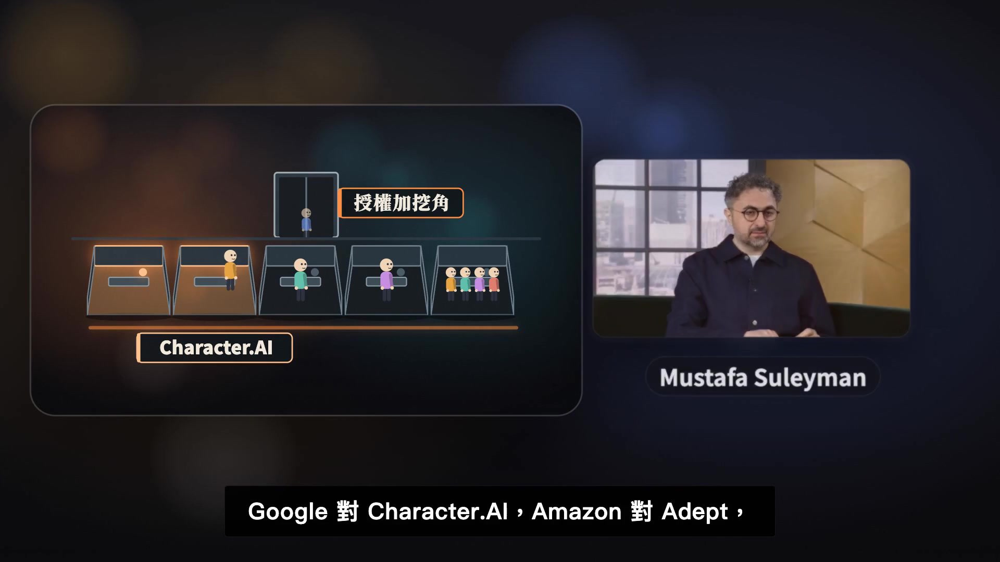

**逐字稿片段：** Amazon對Adept 也都是類似的安排

**話題推測：** 舉例說明「授權加挖角」案例「Adept」，可能顯示其Logo與Amazon Logo。

---

## 00:09:28

**逐字稿片段：** 2025年 Meta據報道買下Scale AI將近一半的股份 執行長Alexander Wong加入Meta

**話題推測：** 舉例說明「授權加挖角」案例「Scale AI」（Meta入股），可能顯示其Logo與Meta Logo。

---

## 00:09:34

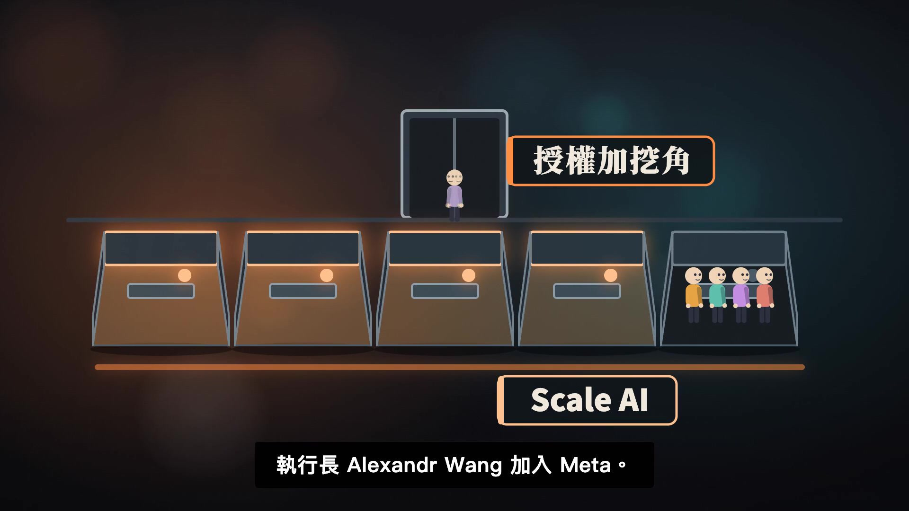

**逐字稿片段：** 最曲折的是寫程式工具Windsurf 2025年夏天 OpenAI傳出要收購它 那段時間 Anthropic在不到五天的通知下 大幅減少它直接使用Cloud模型的管道 原料握在別人手上 就是這個意思 後來OpenAI的收購破局 Google據報道付了大約24億美元的授權費 帶走執行長Varun Mohan和一部分研發團隊

**話題推測：** 舉例說明更複雜的「授權加挖角」案例「Windsurf」，可能顯示其Logo。

---

## 00:09:55

**逐字稿片段：** 幾天後 之後,另一家新創Cognition收購了留下來的Windsurf 接手的Cognition執行長Scott Wu被問到這種交易會不會變成常態 他的回答很坦白,聽他說 聽他說 創辦人要跟船一起沉,這個默契正在改變 那留下來的船呢?我們回到開場的Character AI 2024年,Google帶走創辦人以後,公司繼續營運 接著又碰上官司 今年10月他申請的叫破產保護 也就是在法院監督下整理債務出售資產 平臺在出售期間照常運作 找不到買家才會關閉 他先被挖角 最後才走到法院

**話題推測：** 提及Windsurf的最終去向與新公司「Cognition」，可能顯示Cognition Logo。

---

## 00:10:47

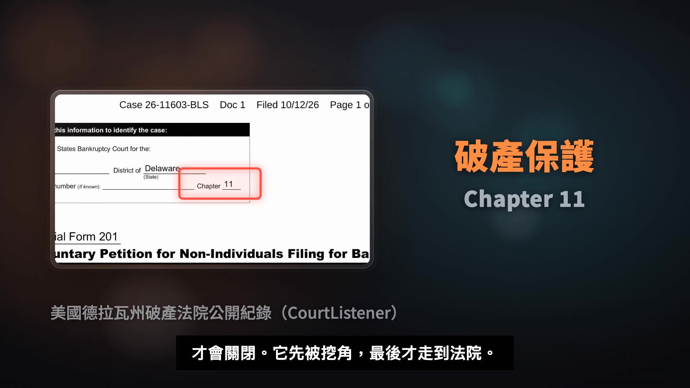

**逐字稿片段：** 另一個有法院文件的例子是Builder AI 一家說可以用AI幫你做APP的公司 估值曾經到15億美元左右 集合之後

**話題推測：** 舉例說明另一家破產公司「Builder AI」，可能顯示其Logo。

---

## 00:10:55

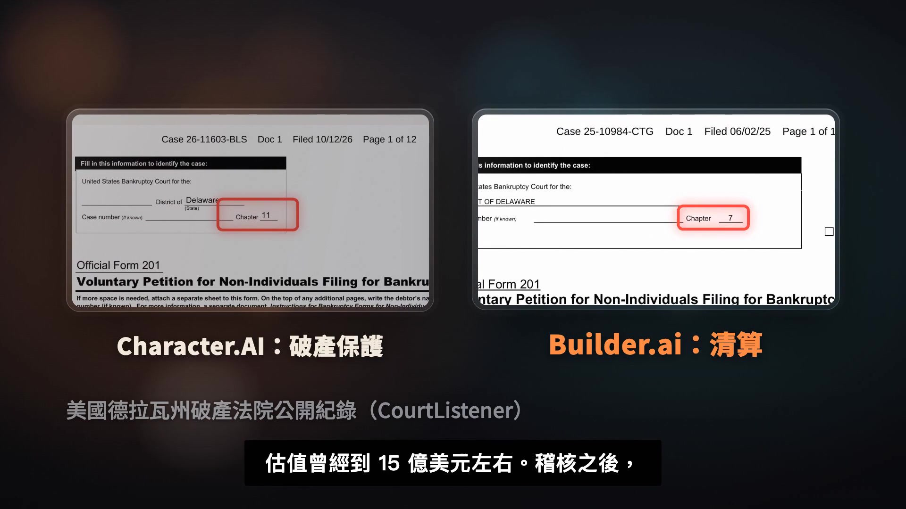

**逐字稿片段：** 他2024年的營收 被往下修正到原本估計的四分之一左右

**話題推測：** 提及Builder AI的具體財務數據（營收修正），可能為財務圖表。

---

## 00:10:59

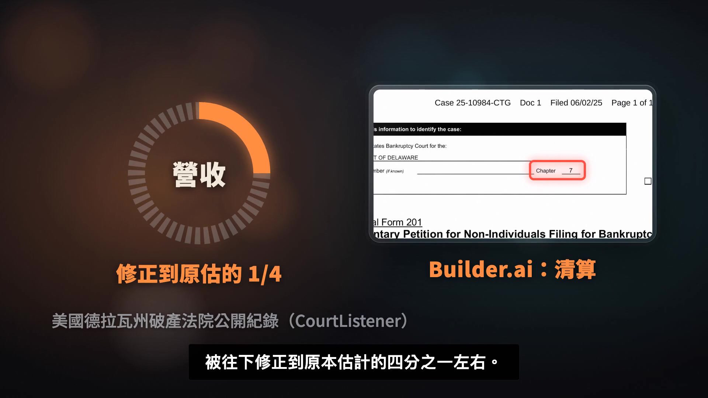

**逐字稿片段：** 2025年6月 他在美國申請清算 也就是公司結束 把剩下的資產分給債主 紐約的聯邦檢察官也要求他提供財務資料 目前沒有任何判決 至於整體到了多少家 網路上有很多AI新創倒閉加速的說法 我們找不到一手的統計 這一集不引用 第二部分的答案是這樣 應用層新創有三個壓力 用的越多付給上游的越多 房東隨時可以自己開櫃 人可能被整批買走 第一波洗牌最常見的樣子是被收走 不是倒閉 而這三個壓力都指向同一個地方 錢最後付給了算力

**話題推測：** 提及Builder AI的法律狀態（申請清算），可能顯示新聞畫面。

---

## 00:11:33

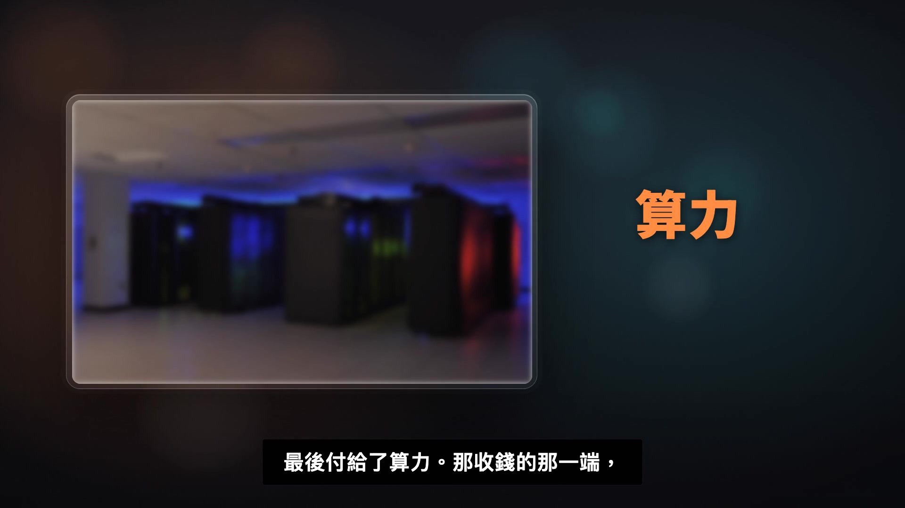

**逐字稿片段：** 那收錢的那一端是不是就安全了 紅杉資本的合夥人David Kahn 長期在算AI要賺多少錢 才付得起這些投資

**話題推測：** 提出新問題「收錢的那一端是不是就安全了」，進入分析的第三部分。

---

## 00:11:40

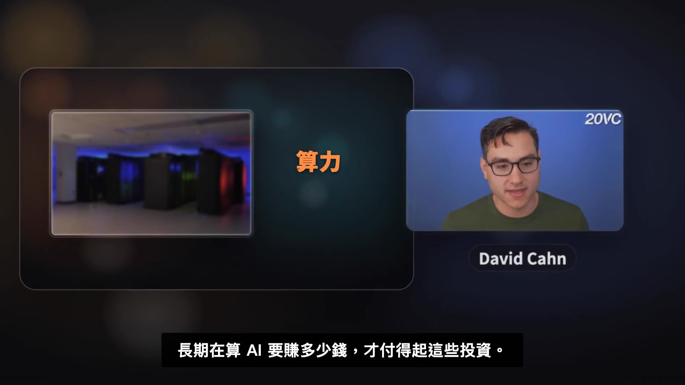

**逐字稿片段：** 他把用算力的人和生產算力的人 分開來看 聽他說 他的意思是 算力如果蓋太多 價格會掉 用算力的人成本跟著降 可是生產算力的那一方 賣的是大家都在賣的東西

**話題推測：** 說明分析框架（用算力與生產算力），可能為二分圖或象限圖。

---

## 00:12:22

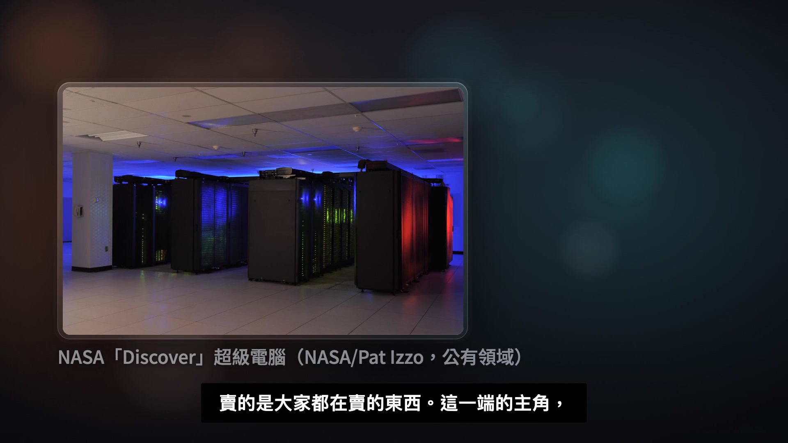

**逐字稿片段：** 這一端的主角有一個名字 叫Neo Cloud 中文可以叫新興AI雲端公司

**話題推測：** 定義新詞彙「新興AI雲端公司」（Neo Cloud），可能為解釋性文字畫面。

---

## 00:12:27

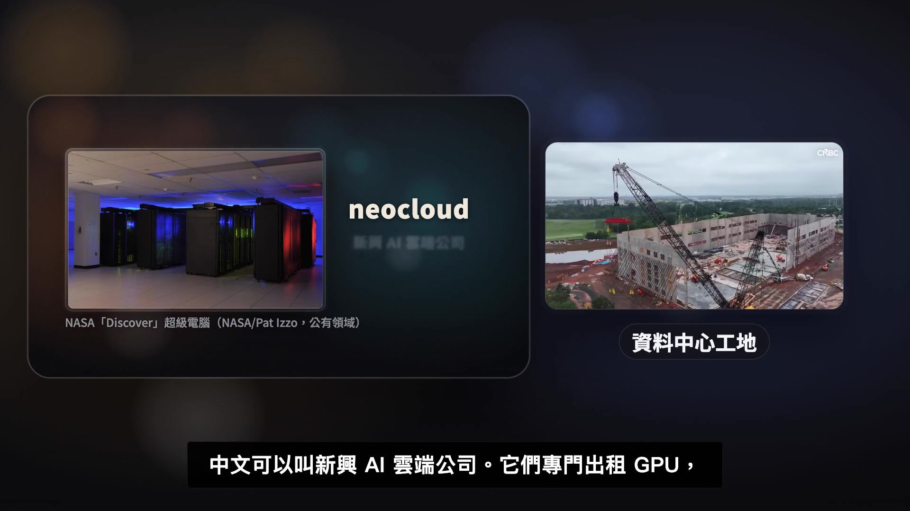

**逐字稿片段：** 他們專門出租GPU GPU是訓練和執行AI最常用的晶片

**話題推測：** 解釋Neo Cloud業務（出租GPU），可能顯示GPU或伺服器機櫃。

---

## 00:12:32

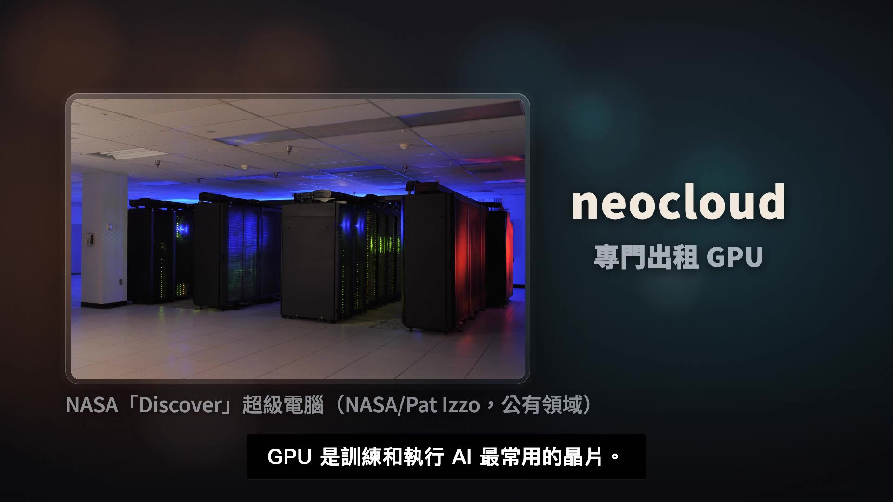

**逐字稿片段：** 代表的公司有Coreweave、Nibius、Lambda、Cruzo 他們跟Amazon、Microsoft、Google這些大雲端公司不同 大多沒有別的生意 買晶片的錢很多是借來的

**話題推測：** 列舉Neo Cloud代表公司「Coreweave、Nibius、Lambda、Cruzo」，可能顯示其Logo。

---

## 00:12:43

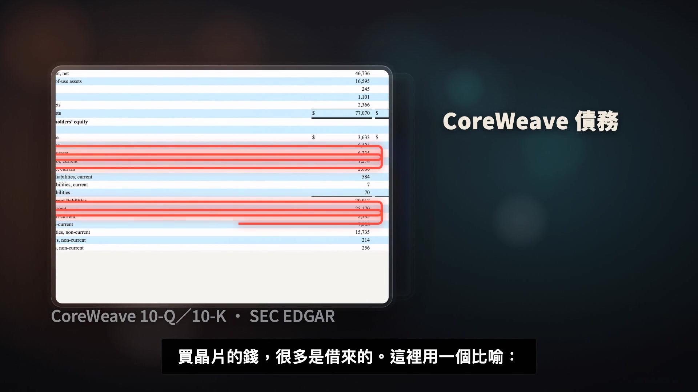

**逐字稿片段：** 這裡用一個比喻 貸款買計程車的車行 車行跟銀行借錢買車 把車租給司機 用租金繳貸款 可是車廠每年出新款 舊車的租金會往下掉 貸款卻每個月罩腳

**話題推測：** 引入「貸款買計程車的車行」比喻，可能為相關情境圖。

---

## 00:12:54

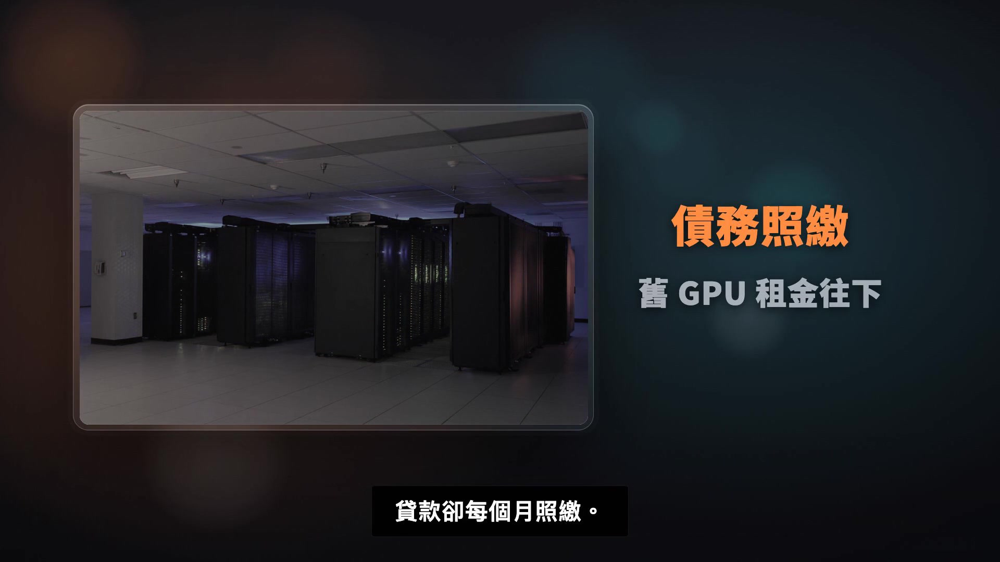

**逐字稿片段：** Cruzo的共同創辦人兼執行長Chase Lockmiller 在2026年10月初的訪談節目Earth VC裡 談了很多這門生意的賬 先說清楚 他自己就在出租GPU NVIDIA也是Crucial的投資人 他的話有立場 他先講了這門生意最怕什麼 聽他說 閒著就是燒錢 所以GPU要一直租出去

**話題推測：** 介紹受訪專家「Chase Lockmiller」（Cruzo執行長），可能顯示其照片與頭銜。

---

## 00:13:28

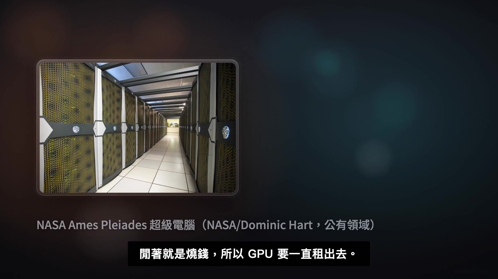

**逐字稿片段：** 可是他能租多少年 這要講到一個會計名詞叫折舊 折舊 是把買設備的錢 攤到他預計能用的年數里 一臺100萬的機器 算他能用5年 每年就計20萬的成本 年數算得越長 每年計的成本越少 賬面上的獲利就越好看 可是現金 在買的那一天就已經付出去了

**話題推測：** 定義新會計名詞「折舊」（Depreciation），可能為解釋性文字畫面。

---

## 00:13:48

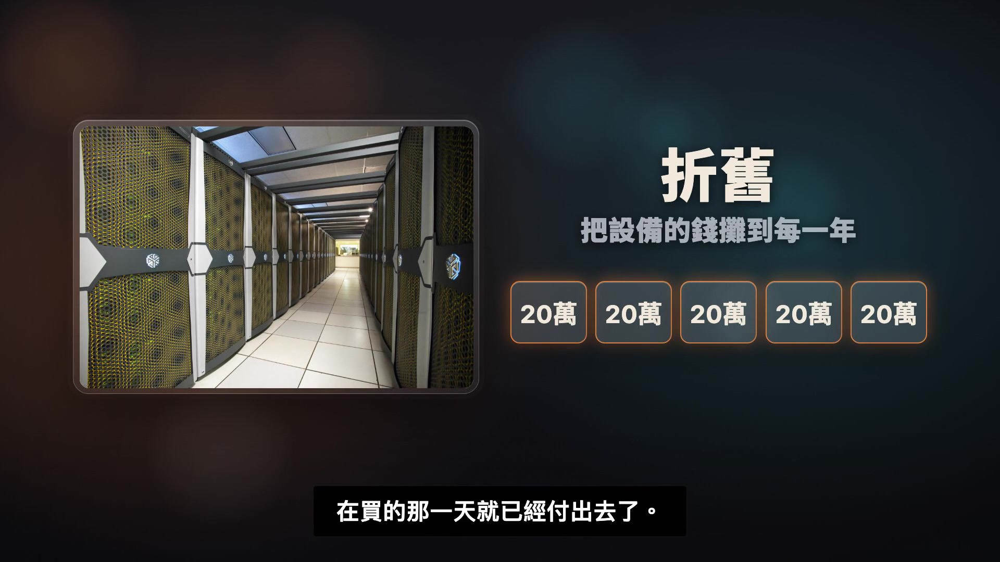

**逐字稿片段：** Lockmiller在同一段訪談裡說 Cruzo用6年來折舊 他說這算是業界標準 Coreweave也從2023年起 把年限從5年改成6年 可是Amazon在2025年 反而把一部分伺服器 從6年縮回5年 理由是AI技術進步變快了 NVIDIA從2024年起 大約一年推出一代新晶片 就像車廠每年出新款 舊車還能開 可是租金會怎麼走 沒有人說得準

**話題推測：** 提及Cruzo的具體會計實務（6年折舊），可能為公司財務數據截圖。

---

## 00:14:14

**逐字稿片段：** 有一種投資人 專門押注股價下跌 這種做法叫放空 放空投資人Michael Burry 在2025年底估計 大公司未來幾年 少算了一大筆折舊 他自己有押注股價下跌的部位 這點也要說清楚 Lockmiller的看法剛好相反 聽他說 他說的是租約的價格 這要分兩種看

**話題推測：** 定義新概念「放空」（Short Selling），可能為解釋性文字畫面。

---

## 00:14:59

**逐字稿片段：** 根據研究機構Semi Analysis的資料 一年期合約的價格 從去年秋天到今年春天回升了不少

**話題推測：** 引用數據來源「Semi Analysis」的資料，可能顯示其Logo或報告圖表。

---

## 00:15:05

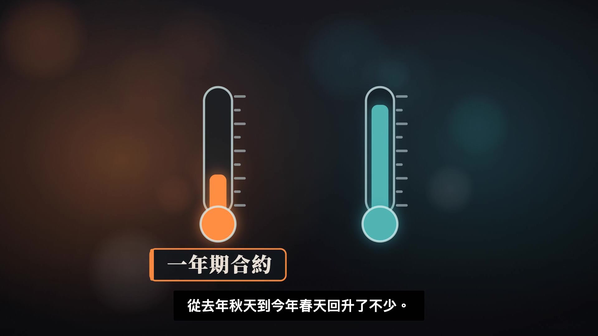

**逐字稿片段：** 可是隨用隨租 也就是按小時租 不籤長約的價格 H100這款晶片 從2024年初每小時7美元以上 掉到這一兩年大約2到3美元 兩邊都是真的 看你拿哪一種價格來算 那車行怎麼保護自己 靠長約 Lockmiller說 GPU的租約 通常是一種叫

**話題推測：** 呈現GPU隨用隨租（按小時）價格趨勢圖，顯示其下跌情況。

---

## 00:15:23

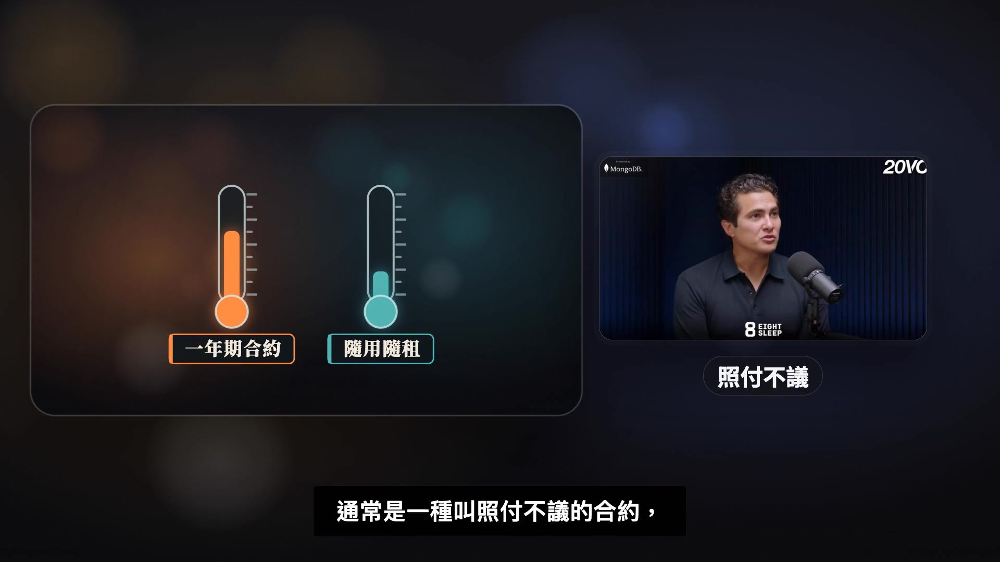

**逐字稿片段：** 照付不易的合約 英文是take or pay 意思是客戶簽了多少容量 不管用不用都要付錢 這樣一來 價格下跌的風險就轉到了客戶身上 可是風險轉過去 前提是客戶付得出來 而且客戶不能太集中

**話題推測：** 定義新概念「照付不易的合約」（Take or Pay），可能為解釋性文字畫面。

---

## 00:15:37

**逐字稿片段：** 根據CoreWeave上市時的文件

**話題推測：** 提出客戶集中度風險，可能為示意圖。

---

## 00:15:40

**逐字稿片段：** 它2024年的營收 有6成多來自Microsoft一家公司 CoreWeave的共同創辦人 兼執行長Mike Intrader 今年4月在CNBC被問到債務 他是這樣回答的 聽他說 長約撐住債務 這是看多那一方的說法 我們看Coreweave自己公佈的數字

**話題推測：** 具體數據說明CoreWeave的客戶集中度（6成來自Microsoft），可能為圓餅圖。

---

## 00:16:16

**逐字稿片段：** 2026年第二季 Coreweave的營收是去年同期的兩倍多

**話題推測：** 具體數據說明CoreWeave的營收成長（兩倍多），可能為財報圖表。

---

## 00:16:21

**逐字稿片段：** 生意是真的在長 可是同一季他付的淨利息是6億4千萬美元 比他整季的淨虧損還多 換句話說 光是利息 就比這一季虧掉的錢還要多 他揹著幾百億美元的債

**話題推測：** 具體數據說明CoreWeave的利息支出（6億4千萬美元），可能為財報圖表。

---

## 00:16:33

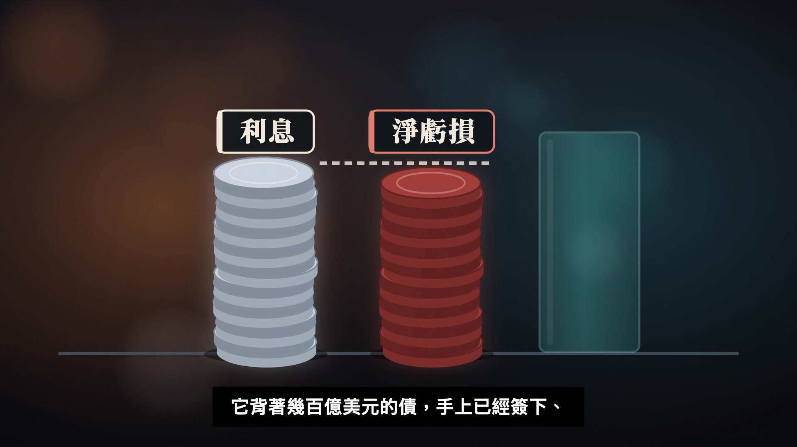

**逐字稿片段：** 手上已經簽下 還沒認列的合約 也有1000億美元以上 看多的人看後面那個數字 看空的人看前面那個 這就是車行的處境 車子都租得出去 可是貸款的利息很重

**話題推測：** 具體數據說明CoreWeave的未認列合約（1000億美元以上），可能為財報圖表。

---

## 00:16:45

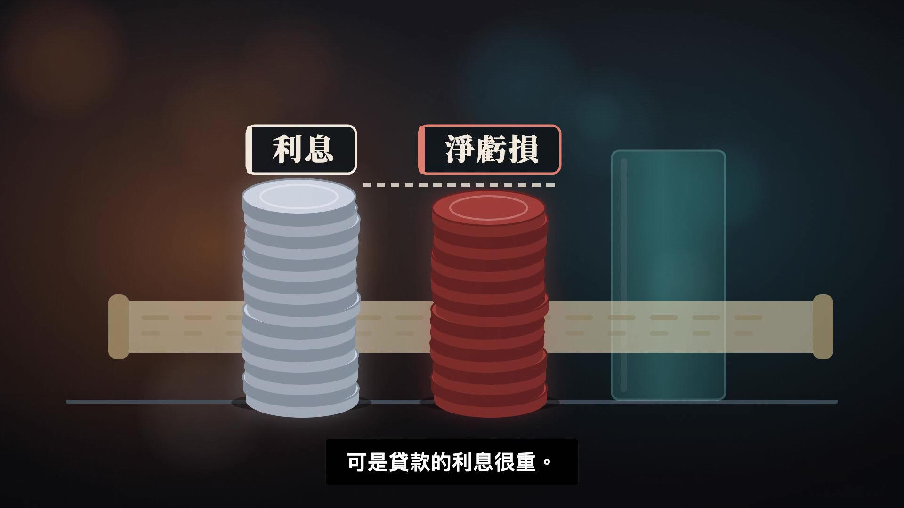

**逐字稿片段：** Jim Chanos也是放空投資人 是懷疑的那一方 他因為很早看出 安龍公司的問題而出名 放空投資人會從股價下跌裡獲利 所以他的話也有立場 他怎麼看這種公司 聽他說 房東不是科技公司 房東最怕的是借不到錢

**話題推測：** 介紹另一位放空投資人「Jim Chanos」，可能顯示其照片與頭銜。

---

## 00:17:23

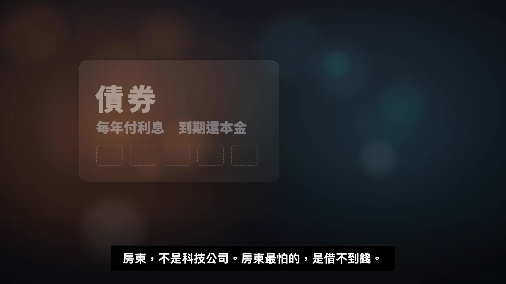

**逐字稿片段：** 這就要講到一個名詞 叫殖利率 公司跟大家借錢 有一種方式是發債券 你借他錢 他答應每年付利息 到期還本金 債券也可以在市場上買賣 如果大家擔心他還不出錢 就會低價把債券賣掉 價格越低 新買家拿到的報酬率就越高 這個報酬率就是債券的殖利率 所以殖利率越高 代表市場要越多的補償 才肯借錢給他 一般大公司的債券 殖利率大約是幾個百分點

**話題推測：** 定義新詞彙「殖利率」（Yield），可能為解釋性文字畫面。

---

## 00:17:50

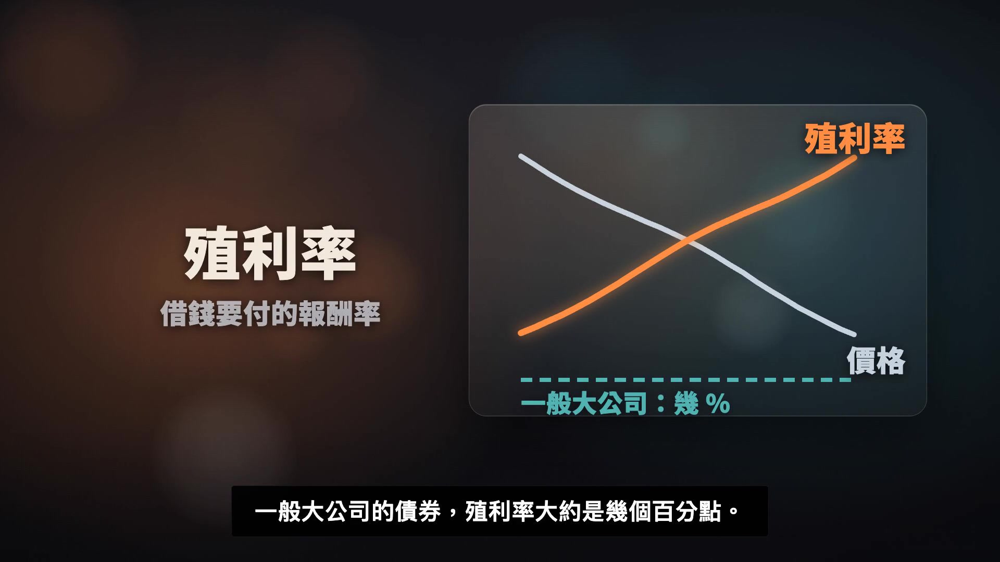

**逐字稿片段：** 2026年10月14日 投資人Chemath Palihapitiya 在Ex上貼出一張圖 CoreWeave一筆2032年到期的債券 殖利率一度超過15%

**話題推測：** 提及社群媒體事件與發布者「Chemath Palihapitiya」，可能顯示貼文截圖。

---

## 00:17:59

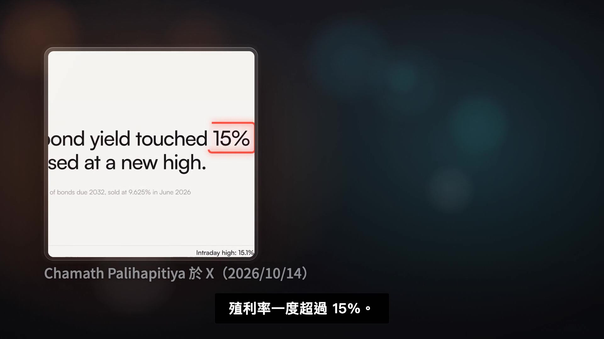

**逐字稿片段：** Elon Musk在底下只回了一個英文字 Yikes 大概是 哎呀 不太妙的意思 當天 CoreWeave的股價跌了1成5左右 Oracle和幾家同類公司也跟著跌 同一天 據Bloomberg報道 CoreWeave的執行長在內部信裡說 市場會誤解 會不理性 公司對合約有信心 足以支應所有債務 也是同一天

**話題推測：** 提及Elon Musk的反應「Yikes」，可能顯示社群媒體互動截圖。

---

## 00:18:19

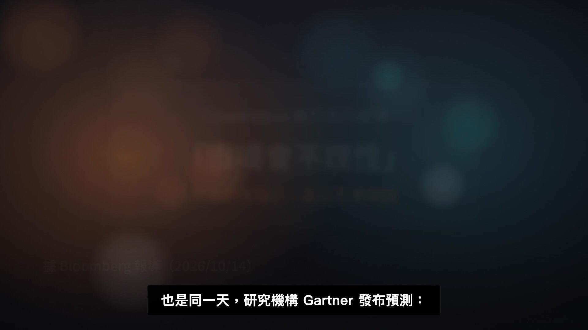

**逐字稿片段：** 研究機構Gartner發佈預測

**話題推測：** 引用研究機構「Gartner」的預測，可能顯示其Logo或報告圖表。

---

## 00:18:20

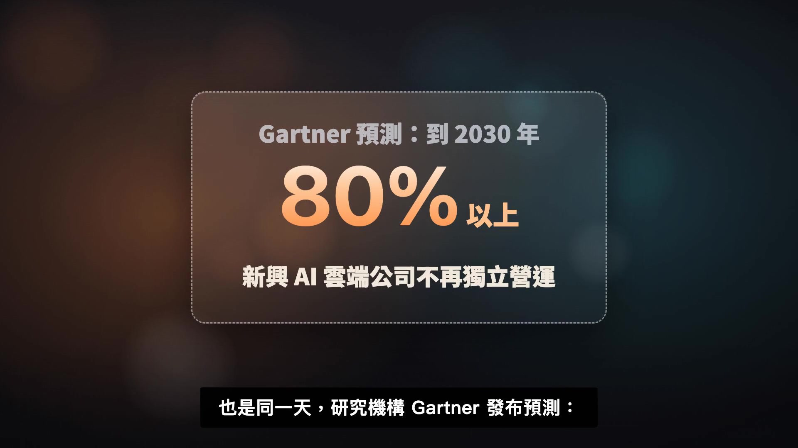

**逐字稿片段：** 到2030年 8成以上的新興AI雲端公司 將不再獨立營運 包括被收購 跟別人合作 或是倒閉 這是預測 不是已經發生的事 幾天後 Mosk自己也談到這件事 而且前後說了兩次 順序很重要 頭一次是10月20日

**話題推測：** 具體預測數據（8成以上新興AI雲端公司不再獨立營運），可能為預測圖表或文字重點。

---

## 00:18:36

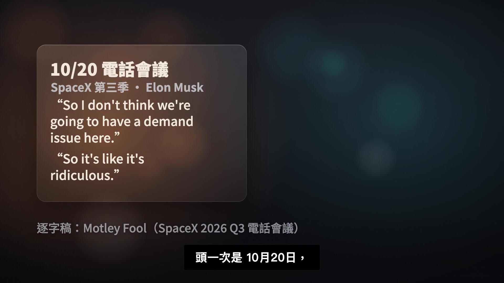

**逐字稿片段：** SpaceX說明 第三季財務成績的電話會議 Mosk說 他不認為這裡會有需求的問題 他還說 明年出現六個月就回本的算力 不是不可能 不過他先加了一句 我不是說這會發生 他也用了Ridiculous 這個英文字 意思是離譜 講的是算力短缺的離譜 再一次是10月25日

**話題推測：** 提及Musk發言場合與公司「SpaceX」，可能顯示其Logo。

---

## 00:18:55

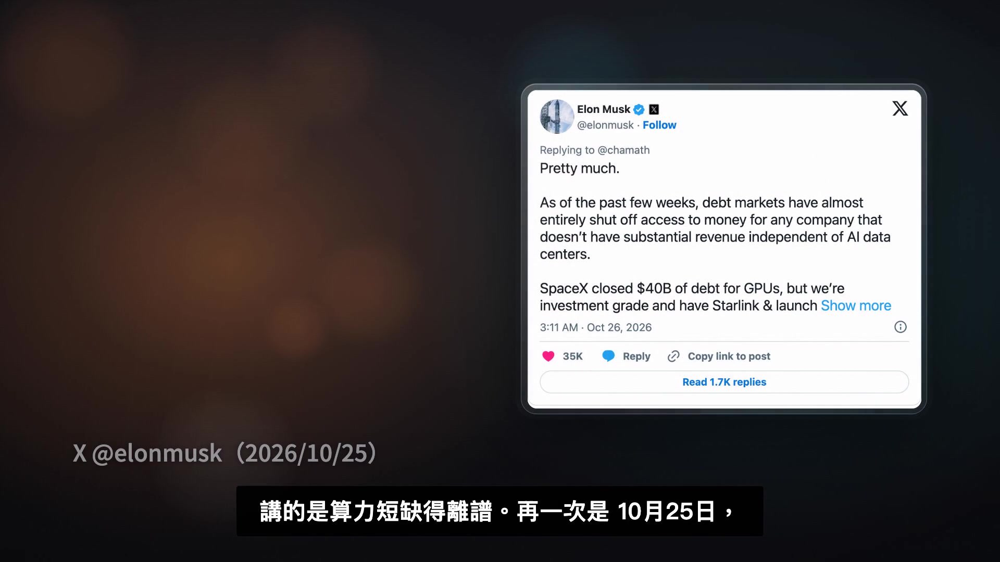

**逐字稿片段：** 他在X上發文說 200多家新興AI雲端公司 會像孔雀魚那樣大量死亡和整病 能撐過去的不多 他說 過去幾個星期 債券市場對那些沒有大量非AI生意的公司 幾乎完全關上了門 他也說 SpaceX能為GPU借到錢 是因為它有投資等級的信用 有Starlink和發射火箭的收入 這兩段話不矛盾 他的意思是 客人不缺 缺的是借錢的管道 也要記得 SpaceX自己就在賣算力 說需求很強 說同業會大量消失 兩句話都對他有利 而且200多家裡大多數會消失 是他的預測 不是已經發生的事 我們把三部分接起來 錢湧進AI是因為成長是真的 應用層新創賺到的錢 有一大塊付給了上游 上游的錢又流到借錢買晶片的 新興AI雲端公司 那最後誰負賬 算力蓋太多 價格下跌 先受傷的是借錢買晶片的公司 和借錢給他們的債主 反過來算力不夠用 價格居高不下 壓力就落在用得越多付得越多的應用層新創身上 這一波到目前為止的結局 我們再分一次

**話題推測：** 提及Musk在X上發文說，可能顯示貼文截圖。

---

## 00:19:59

**逐字稿片段：** 法院文件上的破產 有character.ai和builder.ai

**話題推測：** 具體列舉破產案例「character.ai和builder.ai」，可能顯示公司Logo。

---

## 00:20:03

**逐字稿片段：** 被收走或被挖角的 從inflection到windsurf數量最多 至於200多家雲端公司大量消失 八成不再獨立 都還是預測 那要怎麼判斷一家公司撐不撐得過去

**話題推測：** 具體列舉被收購/挖角案例「inflection到windsurf」，可能顯示公司Logo。

---

## 00:20:14

**逐字稿片段：** 天使投資人Elad Gill 早期投資過不少AI公司 他在2026年5月的一段訪談裡 提了一個判斷的角度 聽他說 他問的是 模型變強的時候 你的產品會不會跟著大幅變好

**話題推測：** 介紹天使投資人「Elad Gill」，可能顯示其照片與頭銜。

---

## 00:20:41

**逐字稿片段：** 我把這一集的內容 收成三個問題 你可以拿來看任何一家AI公司 頭一個問題 用的人變多的時候 他的毛利是變好還是變差 如果像吃到飽餐廳那樣 客人越多越虧 那就危險 另一個問題 大模型公司明天推出一個新功能 它還在不在 如果它只是百貨公司裡的一個專櫃 賣的東西百貨公司自己也能做 就要小心 最後一個問題 它的錢是自己賺的還是借來的 如果是借來的 買的是不是一年就出新款的東西 貸款買計程車的車行 要算清楚 車子變舊之前 能不能把貸款繳完

**話題推測：** 總結並提出三個關鍵問題，可能為列表式畫面。

---

## 00:21:15

**逐字稿片段：** 回到開場的問題 AI一年比一年聰明 也一年比一年便宜 為什麼做AI的新創公司 反而一家接一家撐不住 答案是智慧變便宜 不代表賣智慧的人會賺錢

**話題推測：** 回顧影片開頭提出的核心問題，可能顯示該問題。

---

## 00:21:26

**逐字稿片段：** 撐得住的公司 多半做的是大模型做不到 或是不想做的那一段 而且賬算得過來

**話題推測：** 總結出能存活公司的特徵，可能為關鍵點列表。

---

## 00:21:32

**逐字稿片段：** 這一集我們跟著錢走了一趟 從投資人到做AI產品的新創 到做大模型的公司 最後到借錢買晶片的雲端公司 第一波洗牌 最常見的樣子是被收走 上了法院的破產還不多 更大的一波目前還是預測 再說一次 這一集提到的公司和股價 都只是事情的記錄 不是投資建議 最後問你一個問題 你現在每天用的AI工具裡 哪一個你覺得明年還會在 留言告訴我 喜歡的話訂閱AI Notebook 開啟通知 我們下次見

**話題推測：** 總結影片的分析路徑，可能為流程圖。

---
