# jimainotebook_25RLYNdqvjs — 關鍵畫面索引

- 來源逐字稿：[jimainotebook_25RLYNdqvjs_FIN.srt](jimainotebook_25RLYNdqvjs_FIN.srt)
- 影片：https://www.youtube.com/watch?v=25RLYNdqvjs
- 截圖數：103

## 00:00:09

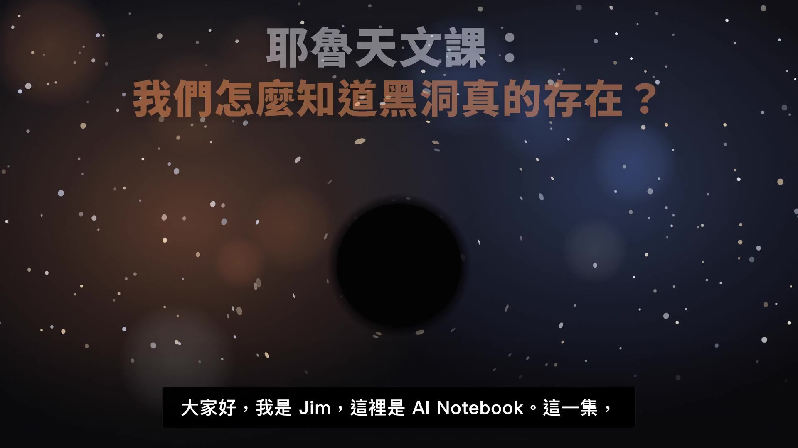

**逐字稿片段：** 這一集,帶你上耶魯大學天文課ASTR160的第八到第十五堂,

**話題推測：** 介紹耶魯大學天文課ASTR160，可能顯示課程名稱與封面。

---

## 00:00:14

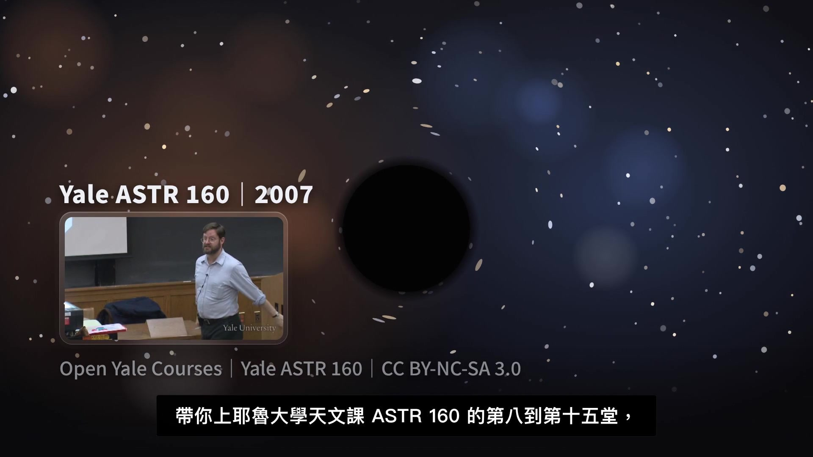

**逐字稿片段：** 主題是黑洞和愛因斯坦的相對論。 老師一樣是Charles Balin,錄影時間是2007年春天。 這八堂課,在回答同一個問題, 我們怎麼知道黑洞真的存在? 黑洞不發光,照定義就看不到。

**話題推測：** 講述主題「黑洞和愛因斯坦的相對論」，可能顯示主題文字或相關圖像。

---

## 00:00:27

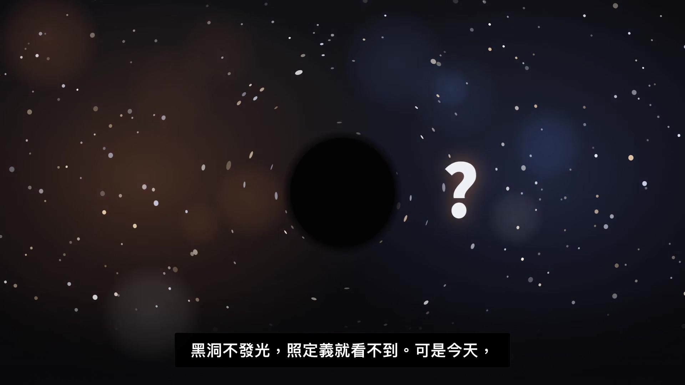

**逐字稿片段：** 可是今天,天文學家說得出銀河系中心那一顆有多重, 還拍到了他的照片。

**話題推測：** 提到天文學家測量出銀河系中心黑洞的質量，可能顯示數字或銀河系中心圖像。

---

## 00:00:32

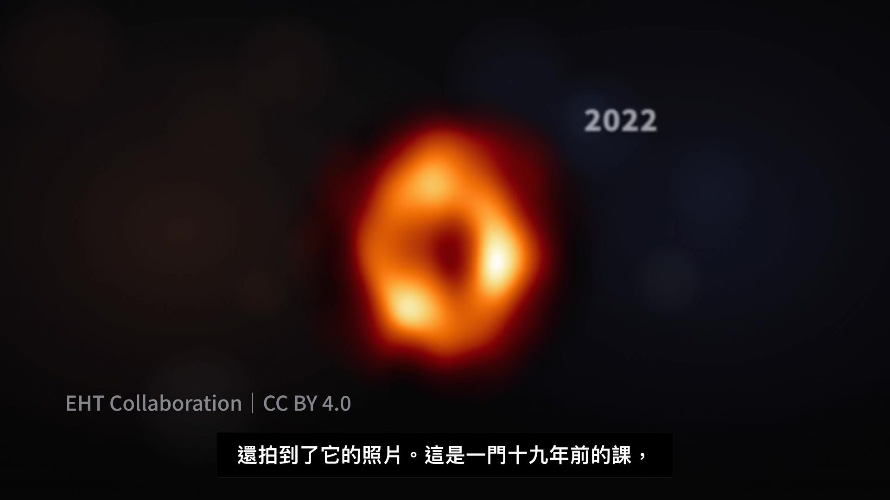

**逐字稿片段：** 這是一門19年前的課,為什麼還值得聽? 因為貝林教的是一套推理 看不見的東西 就從他怎麼影響看得見的東西 把它推出來 這套推理沒有過時 過時的是數字和預言 我們一條一條替他對答案 先聽一段

**話題推測：** 轉折點：解釋為何19年前的課仍值得聽，可能顯示新的章節標題。

---

## 00:00:47

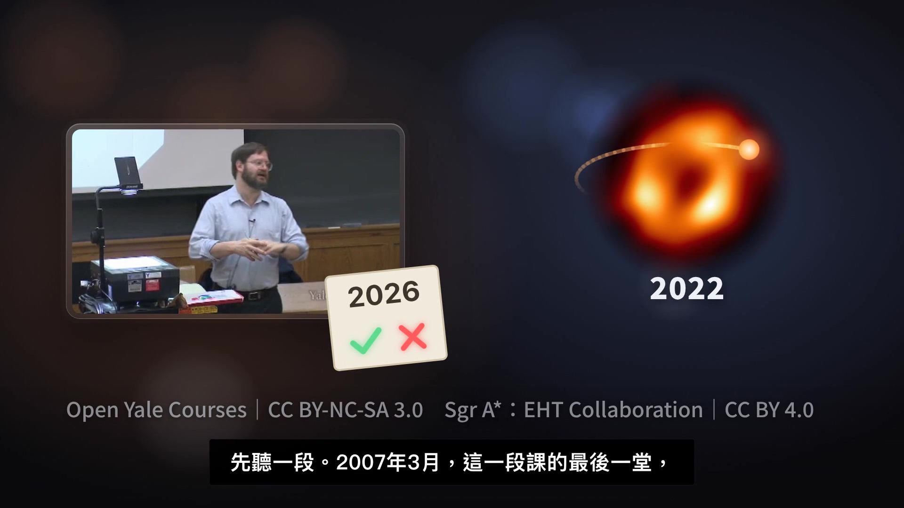

**逐字稿片段：** 2007年3月 這一段課的最後一堂 貝林講到一種黑洞會留下的訊號 那時候全世界還沒有人收到過 聽他自己說

**話題推測：** 引述2007年Charles Balin關於未曾收到的黑洞訊號，可能顯示時間軸或相關人物。

---

## 00:01:24

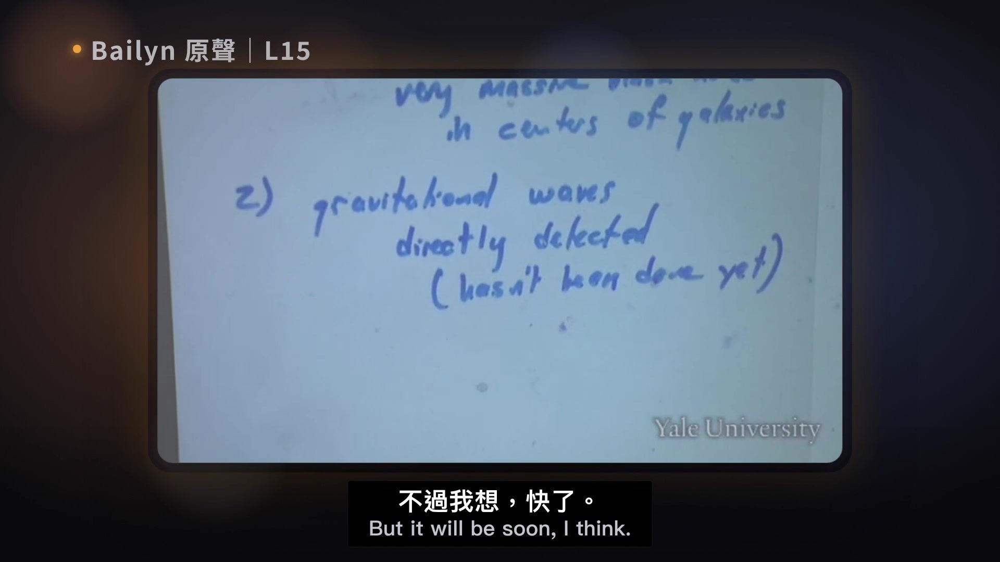

**逐字稿片段：** 他說的這種訊號叫重力波 它是什麼,這一集中段會講 他說快了,實際上等了八年半

**話題推測：** 說明該訊號為「重力波」，可能顯示重力波的定義或示意圖。

---

## 00:01:31

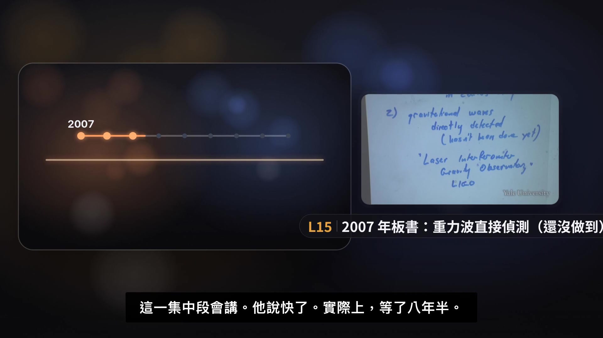

**逐字稿片段：** 2015年9月14日,美國兩臺偵測器 一臺在華盛頓州,一臺在路易斯安那州 前後相差大約7毫秒,收到同一個訊號

**話題推測：** 提到2015年9月14日重力波首次被偵測到，可能顯示新聞標題、時間與地點（美國華盛頓州與路易斯安那州的地圖）。

---

## 00:01:40

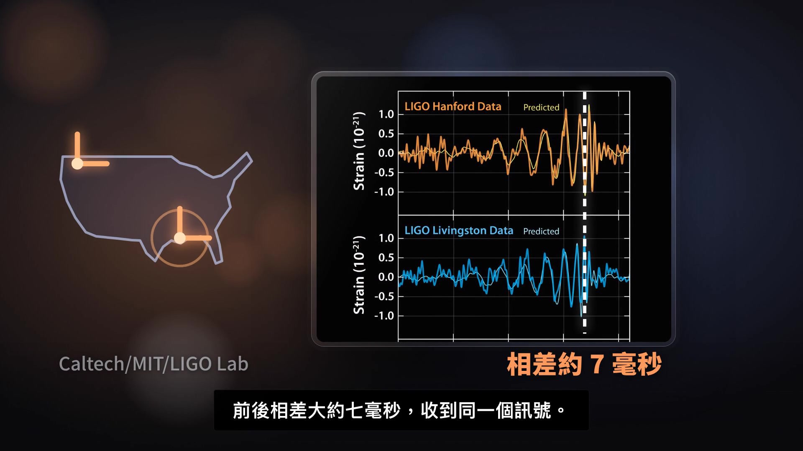

**逐字稿片段：** 訊號來自兩個黑洞撞在一起

**話題推測：** 說明訊號來自兩個黑洞碰撞，可能顯示黑洞合併的模擬動畫。

---

## 00:01:42

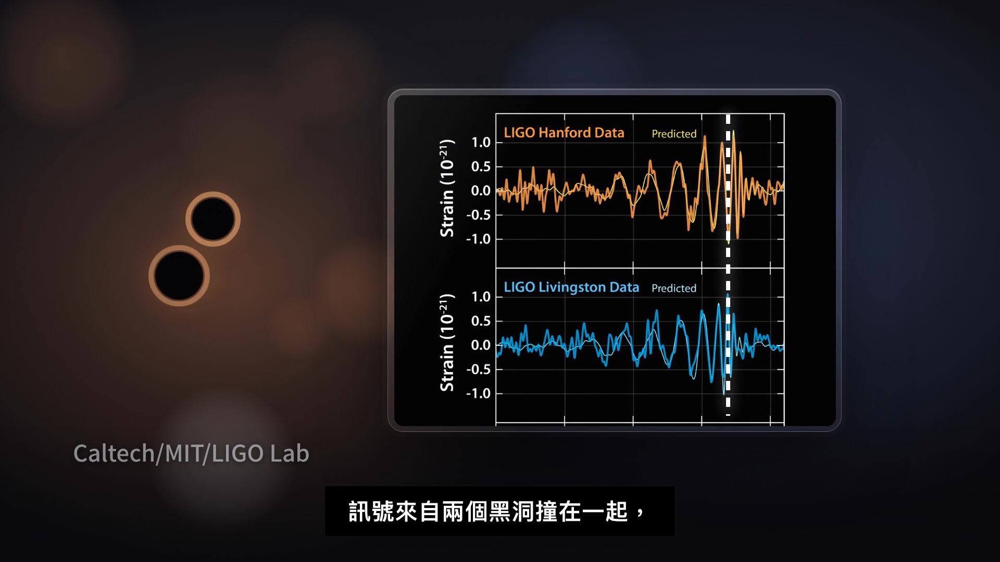

**逐字稿片段：** 一個大約36倍太陽質量 一個大約29倍 截至2026年5月 這種訊號累計收到了390次 2007年 貝領能拿出來證明黑洞存在的方法 只有一種 今天至少有三種

**話題推測：** 列出合併黑洞的質量（36倍與29倍太陽質量），可能顯示數字比較。

---

## 00:01:55

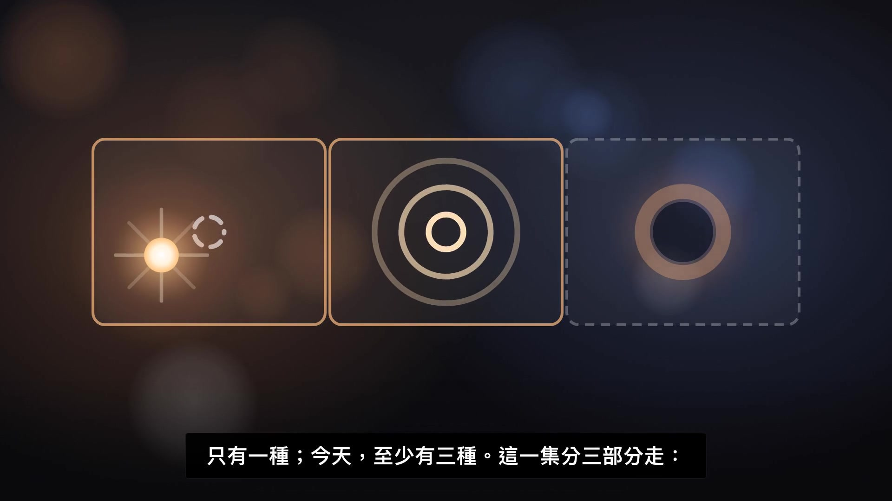

**逐字稿片段：** 這一集分三部分走 先看為什麼很重的恆星 最後一定會塌成黑洞 再看愛因斯坦怎麼改寫重力 說清楚黑洞為什麼是黑的 最後看天文學家 怎麼真的把它找出來 從貝領自己在智力找到的那一顆 到今天聽得到也拍得到的黑洞 這一段課的第一堂 他一開口就把這一集的問題講出來了 聽他講

**話題推測：** 介紹本集內容分為三部分，可能顯示各部分標題作為導覽頁。

---

## 00:02:42

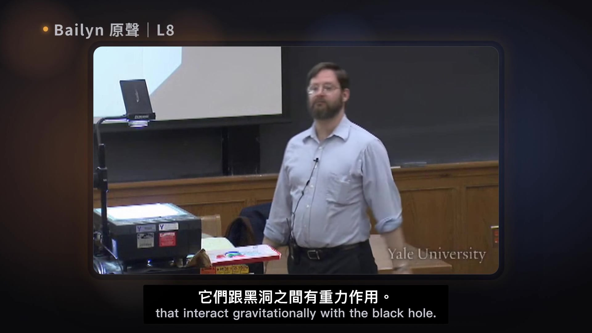

**逐字稿片段：** 看繞著它轉的東西怎麼動 這一招上集用過 找系外行星就是這樣找的 不過在找之前得先說清楚

**話題推測：** 提出尋找黑洞的方法：觀察繞著它轉動的物體，可能顯示行星或恆星繞行中心的動畫。

---

## 00:02:49

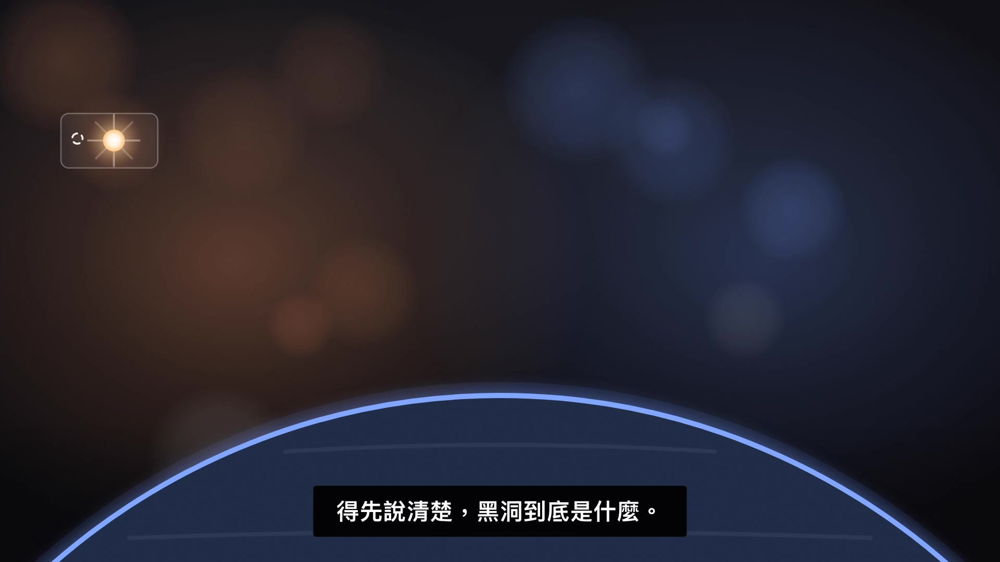

**逐字稿片段：** 黑洞到底是什麼 貝林從一個高中物理的概念開始 叫逃逸速度 從一個星球表面往上丟東西 要丟多快它才不會掉回來

**話題推測：** 轉換話題：定義黑洞是什麼，可能顯示新的章節標題或問句。

---

## 00:02:57

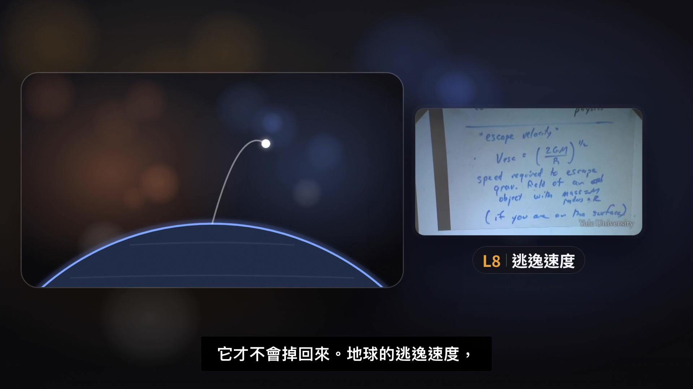

**逐字稿片段：** 地球的逃逸速度大約每秒11.2公里 貝林在課堂上算出來 大約每秒10公里 他習慣只抓大小,不算小數 星球越重或是被壓得越小 逃逸速度就越大 他接著算了一個好笑的例子

**話題推測：** 提供地球的逃逸速度為每秒11.2公里，可能顯示數字與地球圖片。

---

## 00:03:10

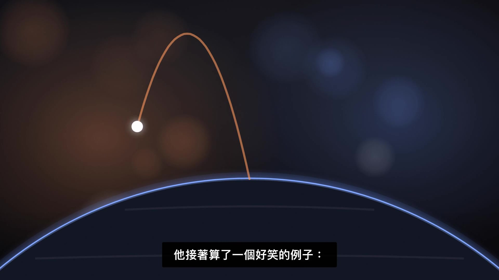

**逐字稿片段：** 把一個人當成一顆100公斤半徑1公尺的球 這個人的逃逸速度每小時不到一公尺 這代表什麼?聽他說 人跟人之間的重力太小 所以我們不會互相繞著轉 接著他用一句話給黑洞下定義

**話題推測：** 舉例計算一個100公斤、半徑1公尺的人的逃逸速度，可能顯示計算過程或示意圖。

---

## 00:03:50

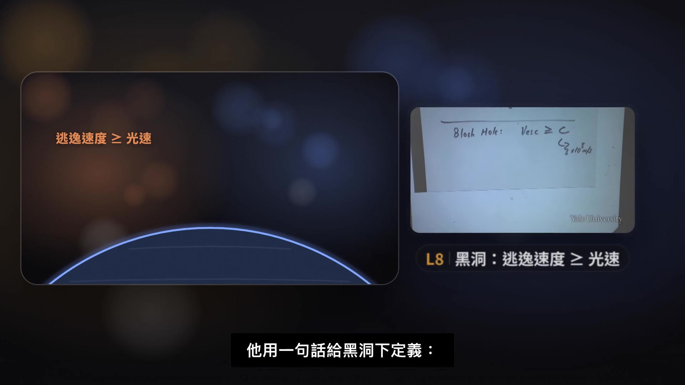

**逐字稿片段：** 逃逸速度大於或等於光速的東西就是黑洞 連光都逃不出來 自然就看不見 要變成黑洞 就得把東西壓得非常小 壓到剛好讓逃逸速度等於光速的那個大小

**話題推測：** 給出黑洞的定義：逃逸速度大於或等於光速的物體，可能顯示定義文字。

---

## 00:04:01

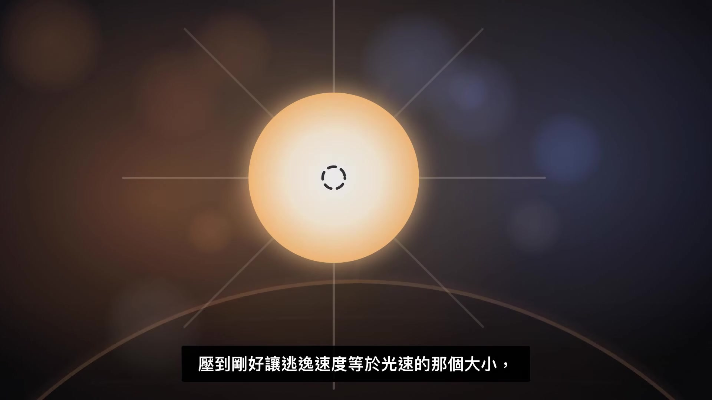

**逐字稿片段：** 叫10瓦西半徑

**話題推測：** 介紹「史瓦西半徑」概念，可能顯示定義與公式。

---

## 00:04:03

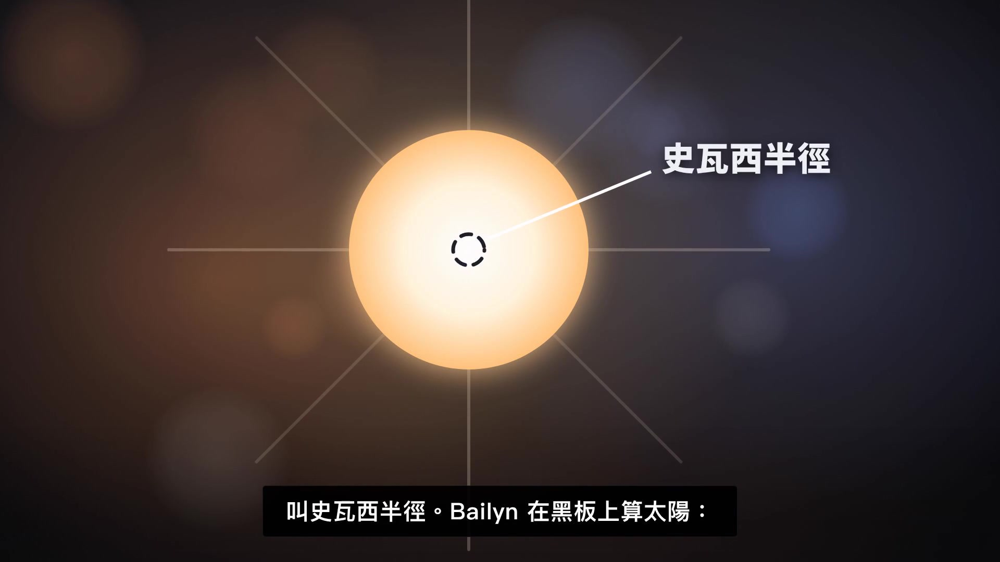

**逐字稿片段：** Belling在黑板上算太陽 太陽的10瓦西半徑大約3公里 也就是說 把整顆太陽壓成半徑3公里的球 它才會變成黑洞 這種東西18世紀就有人想過

**話題推測：** 計算太陽的史瓦西半徑約3公里，可能顯示數字與太陽壓縮示意圖。

---

## 00:04:14

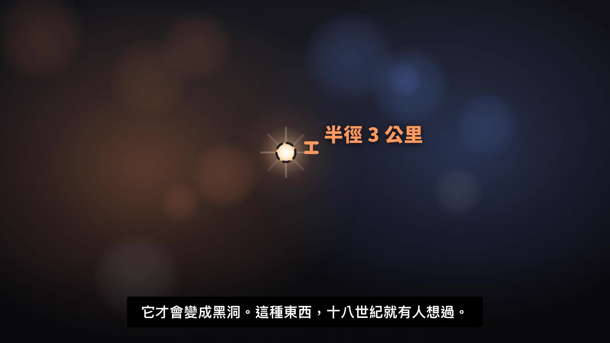

**逐字稿片段：** 1783年,英國牧師John Nischel算出 一顆星如果夠重又夠小 光就出不來,看起來是暗的 貝林的評語是 沒錯,但誰在乎 這個想法沉睡了一百多年

**話題推測：** 提及1783年英國牧師John Nischel的預想，可能顯示人物照片或時間軸。

---

## 00:04:25

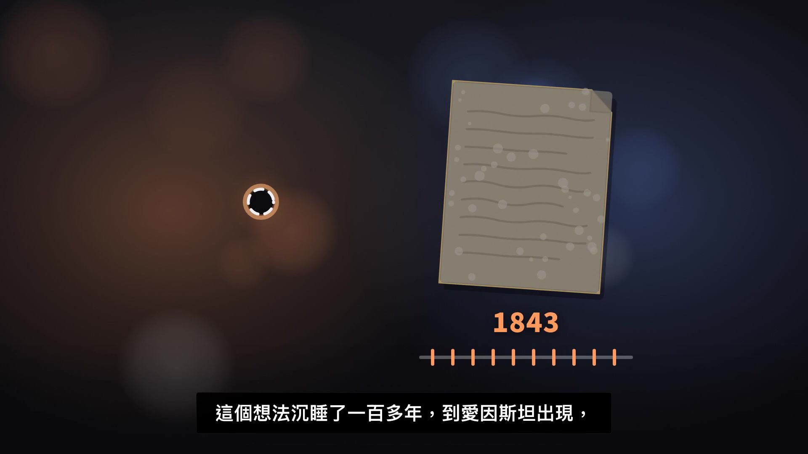

**逐字稿片段：** 到愛因斯坦出現才變成大事 貝林把它寫成預言 預議是,一個結果重不重要 要看當時的脈絡 可是,太陽要壓成三公里 聽起來根本不可能 為什麼天文學家很早就相信 黑洞應該存在

**話題推測：** 轉向愛因斯坦，可能顯示愛因斯坦的肖像。

---

## 00:04:38

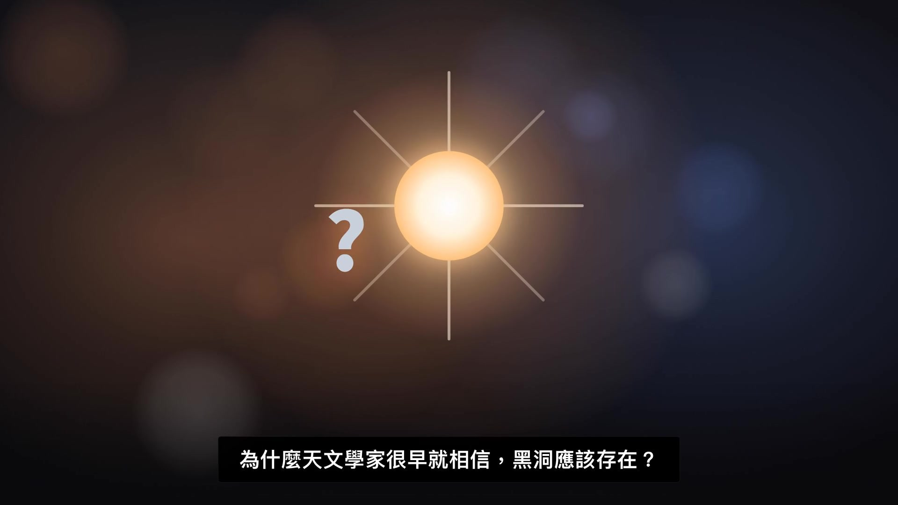

**逐字稿片段：** 答案在恆星的一生裡 一顆恆星的一生是一場拔河 一邊是重力把整顆星往中心拉 另一邊是氣體的壓力往外推 太陽現在兩邊打平 所以大小不變 可是要撐住 中心就得比外面熱得多 太陽中心大約1000萬度 表面只有大約6000度 熱會往外流 從表面散到太空 就是我們看到的陽光 熱一直流失 中心就得一直補 靠的是核融合 把氫融合成氦 燃料總有用完的一天 用完之後 壓力這邊沒力了 整顆星往內塌 塌到很小的時候 換一個更強的選手上場

**話題推測：** 闡述天文學家相信黑洞存在的原因：恆星的生命週期，可能顯示恆星演化圖。

---

## 00:05:12

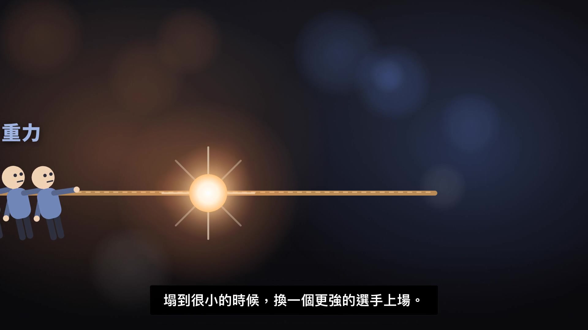

**逐字稿片段：** 這股力量叫減並壓 電子被擠到不能再擠 會產生一股反推的力量 太陽最後就會停在這裡

**話題推測：** 介紹支撐恆星的力量「簡併壓」，可能顯示原子結構或粒子受壓示意圖。

---

## 00:05:18

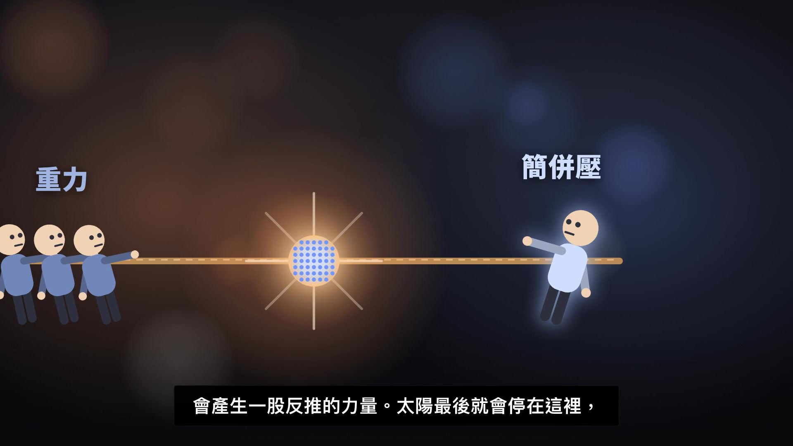

**逐字稿片段：** 變成一顆白矮星 大小跟地球差不多 上級那顆天狼星旁邊的半星 就是一顆白矮星 貝林算過 白矮星的物質 一頂針那麼一點點 就重大約一噸 那如果恆星更重呢 1930年代 一位從印度到英國唸書的年輕人 叫錢卓塞卡 算出了答案 電子的減並壓有上限

**話題推測：** 介紹白矮星，可能顯示白矮星的想像圖或與地球大小比較圖。

---

## 00:05:37

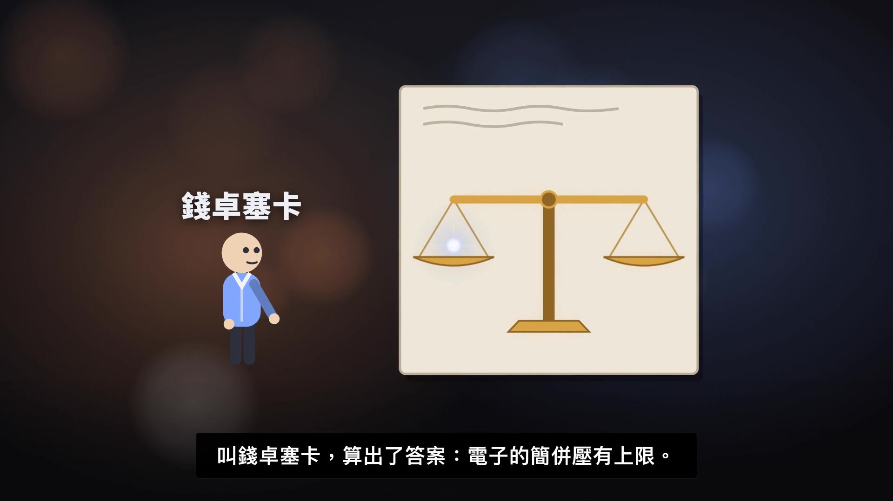

**逐字稿片段：** 白矮星只要超過大約1.4倍太陽質量 這條線後來叫前卓塞卡級線 1935年1月 他在倫敦的皇家天文學會 報告這個結果 臺下坐著當時 最有名的天文學家之一 艾丁頓 算是他在劍橋的老師輩 接下來發生的事 聽貝林說 愛丁頓錯了 可是他的份量太重 很多人就沒有接著研究 錢卓塞卡後來到美國芝加哥大學

**話題推測：** 提出白矮星質量上限約1.4倍太陽質量，即「錢卓塞卡極限」，可能顯示該數字與極限圖表。

---

## 00:06:22

**逐字稿片段：** 1983年拿到諾貝爾物理獎 離那場報告將近50年 Belling給這段預言的寓意是 相信你的學生 不要相信你的直覺 不過愛丁頓也說對了一半 電子撐不住以後 會被壓進直子變成中子 整顆星幾乎都變成中子 像一顆巨大的原子核

**話題推測：** 說明錢卓塞卡於1983年獲得諾貝爾物理獎，可能顯示諾貝爾獎章或證書圖片。

---

## 00:06:40

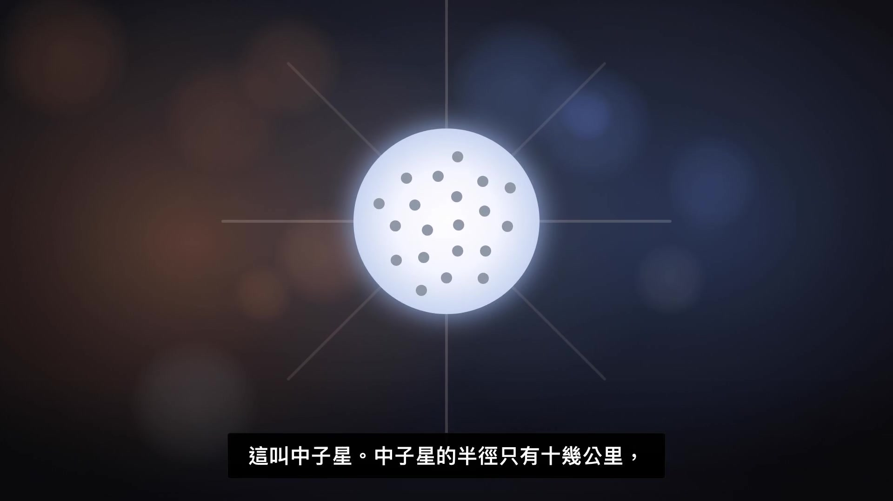

**逐字稿片段：** 這叫中子星 中子星的半徑只有十幾公里 一頂針那麼一點點 就中好幾億噸 撐住它的 換成了中子的減病壓 可是中子也有極限 貝林在課堂上說

**話題推測：** 介紹中子星，可能顯示中子星的想像圖或與地球大小比較圖。

---

## 00:06:51

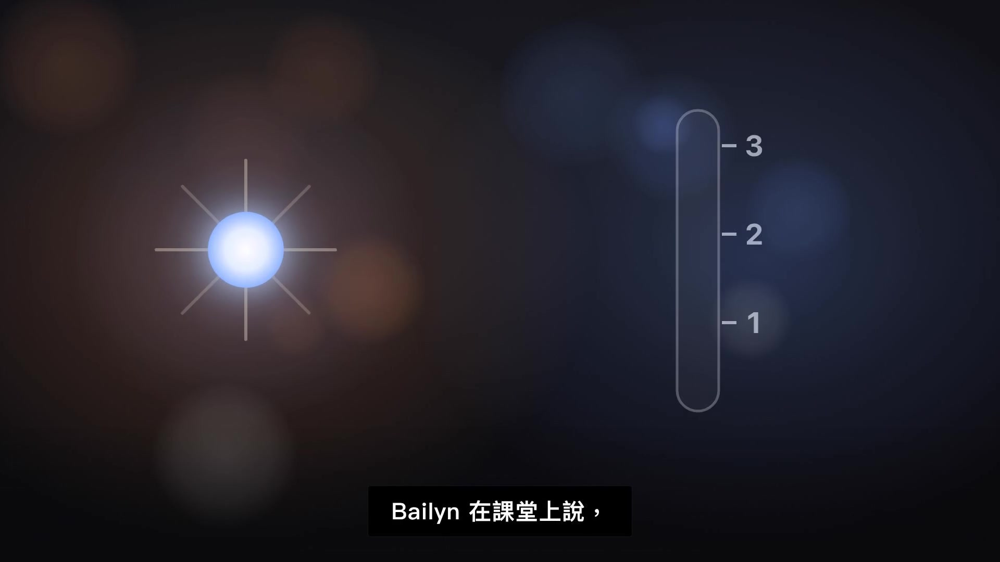

**逐字稿片段：** 中子星最多大約三倍太陽質量 再重 它就比自己的10瓦西半徑還小 沒有東西擋得住 直接塌成黑洞 這條線現在測量得更準了 目前測量到最重的中子星 大約2.3倍太陽質量 所以真正的上限 比它說的低一點 這條線第三部分會用到

**話題推測：** 指出中子星質量上限約3倍太陽質量，可能顯示該數字。

---

## 00:07:08

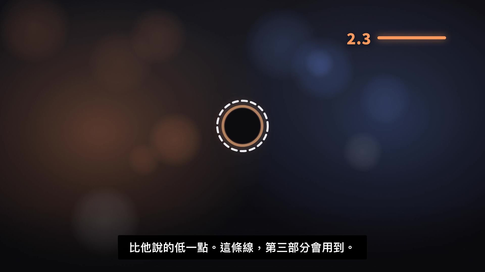

**逐字稿片段：** 整理一下第一部分 很重的恆星 燒完燃料以後 電子撐不住 中子也撐不住 最後會塌成黑洞 所以黑洞不是想象出來的 是恆星的結局 天上很重的恆星多的是 照理說 銀河系裡應該有很多黑洞

**話題推測：** 總結第一部分內容，可能顯示總結文字或重點摘要。

---

## 00:07:23

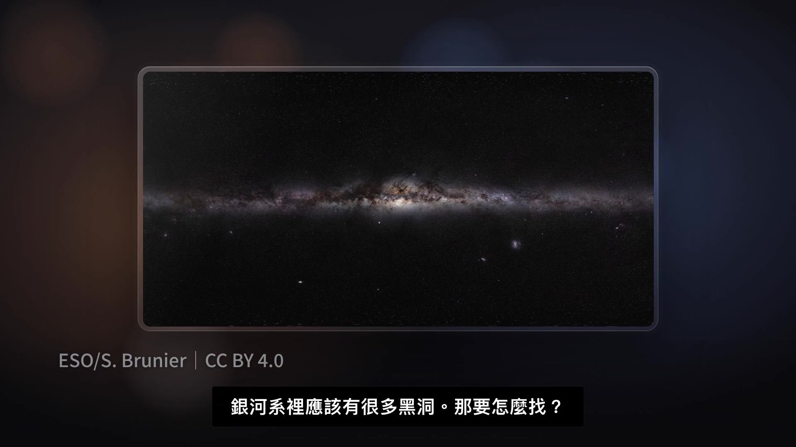

**逐字稿片段：** 那要怎麼找 大家對黑洞的印象 是一臺什麼都吸進去的吸塵器 如果真是這樣 它應該很好找 有學生問貝林 如果太陽現在變成一個一樣重的黑洞 地球會怎樣 聽他怎麼回答 地球會照樣繞 只是沒有陽光 會凍成冰 黑洞不是吸塵器 離它夠遠 它就跟一般的重物一樣 東西照樣繞著它轉 那會不會有黑洞路過 把地球吞掉 蓓琳在課堂上也被問過 她的回答是 不用擔心 如果有一個像恆星那麼重的黑洞靠近太陽系 它的重力會先把最外面那些冰值小天體的軌道攪亂 冥王星會最先出狀況 我們看不到黑洞 卻會很早就知道它來了 她還講了一段經歷

**話題推測：** 提出新問題：黑洞如何尋找？可能顯示問號或章節標題。

---

## 00:08:28

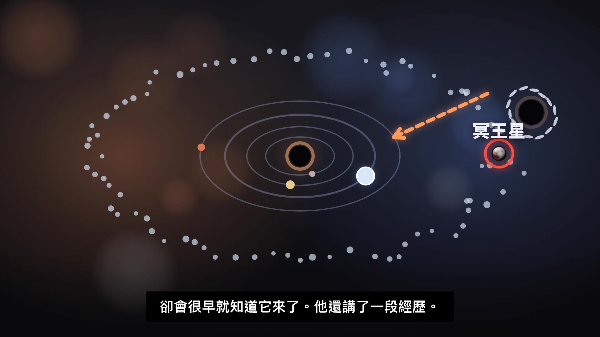

**逐字稿片段：** 2006年夏天 美國ABC新聞做了一個兩小時的特別節目 講地球可能被毀滅的各種方式 請她去談黑洞 她在節目上一直說 這不會發生 不用擔心 該擔心的是小行星和全球暖化 結果他沒拿到多少鏡頭 說實話常常不夠聳動 可是看不見的東西 一樣會在看得見的東西上留下痕跡 這一點正好也是找黑洞的方法 這正好給了我們找他的方法 找一個看不見 卻比中子星的上限還重的東西 看旁邊的星怎麼繞著他轉 不過第一部分的說法有一個漏洞 我們說光逃不出來 是把光當成一顆往上丟的球 飛到一半慢下來再掉回去 可是光不會慢下來 它永遠用光速前進 那他到底是怎麼被困住的 要回答這個問題 得換一套重力理論

**話題推測：** 貝林分享她於2006年夏天參加ABC新聞節目的經驗，可能顯示節目名稱或年份。

---

## 00:09:14

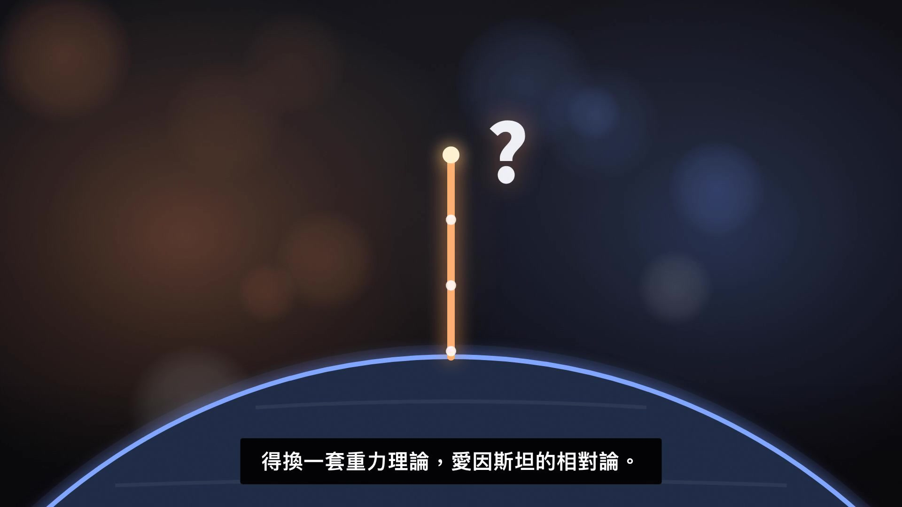

**逐字稿片段：** 愛因斯坦的相對論 貝林自己也說 從這裡開始 事情很快就會變得很怪 愛因斯坦的起點 是一個很怪的實驗結果

**話題推測：** 轉入愛因斯坦的相對論，可能顯示「愛因斯坦相對論」的章節標題。

---

## 00:09:23

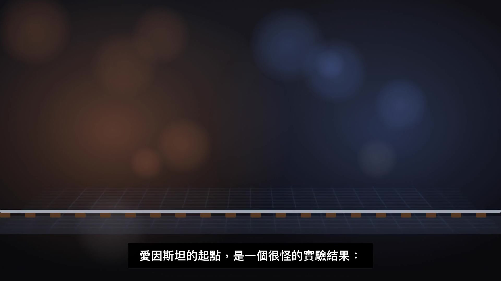

**逐字稿片段：** 光速對每個人都一樣 貝林用棒球講 投手站在火車上 用時速100英里投球 火車本身也開時速100英里 站在鐵軌旁邊的你 測量到的球速 是兩個加起來200英里 可是投手手上換成手電筒 你測量到的光速 不會是光速加上火車的速度 還是光速 19世紀末 一連串實驗

**話題推測：** 引導至愛因斯坦理論的起點：光速對每個人都一樣，可能顯示相關實驗圖示。

---

## 00:09:43

**逐字稿片段：** 最有名的是麥克森和莫雷的實驗 都得到同樣的結果 愛因斯坦厲害的地方 是把這件事當真 速度是距離除以時間 光速永遠不變 那會變的 就只能是距離和時間 其中一個結果

**話題推測：** 提及「麥克森和莫雷的實驗」，可能顯示實驗裝置圖。

---

## 00:09:56

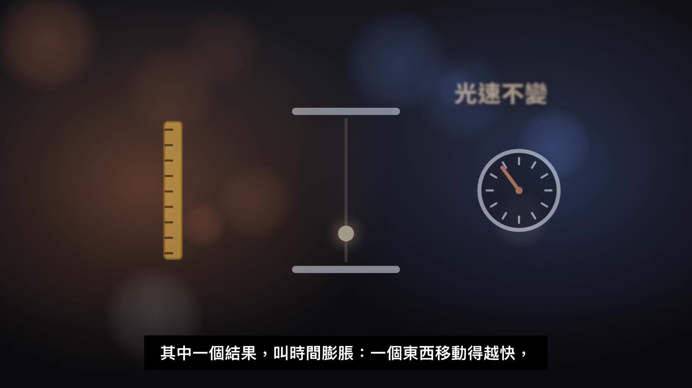

**逐字稿片段：** 叫時間膨脹 一個東西移動得越快 它身上的時鐘走得越慢 這不是科幻

**話題推測：** 介紹相對論的結果之一：「時間膨脹」，可能顯示定義或示意圖。

---

## 00:10:01

**逐字稿片段：** 宇宙射線打在大氣層頂端 會產生一種很不穩定的粒子 叫苗子 壽命非常短 照理說還沒飛到地面就甩變光了 可是地面上偵測得到他 因為他飛得接近光速 他的時鐘變慢了 這麼怪的理論 是不是表示牛頓錯了 聽他說 新理論要把舊理論包進來 才算革命 速度跟光速比起來很小的時候 相對論的算式就變回牛頓的算式 地球繞太陽每秒30公里 差別只有一億分之一左右 這也是為什麼上級用牛頓就夠用了 貝林說 他常收到陌生人寄來的信 宣稱愛因斯坦錯了 所有的科學都錯了 他判斷的方法很簡單 一個新理論如果說以前的一切都是錯的 那它幾乎一定是錯的 行星不會因為有人想出新點子 就不照原本的軌道走 那愛因斯坦是怎麼想到的 常見的說法是

**話題推測：** 舉例說明宇宙射線產生的「渺子」如何證明時間膨脹，可能顯示渺子在地球上的偵測示意圖。

---

## 00:11:10

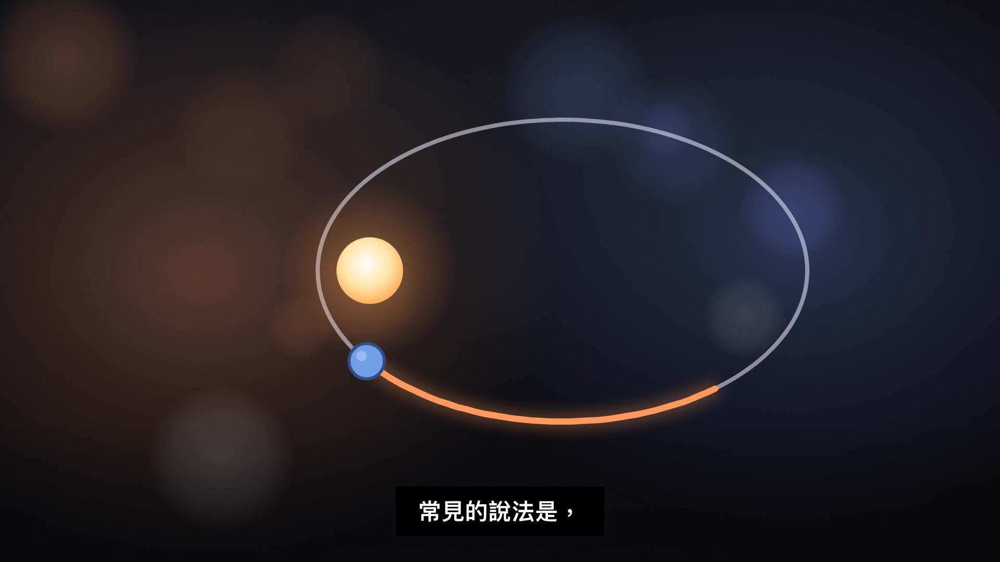

**逐字稿片段：** 他是瑞士專利局裡沒人注意的小職員 1905年一口氣發表了三篇改變物理的論文 貝林轉述了另一個說法

**話題推測：** 提及愛因斯坦1905年發表改變物理的三篇論文，可能顯示論文封面或時間線。

---

## 00:11:18

**逐字稿片段：** 歷史學家Peter Galison指出 那幾年送到專利局審查的發明裡 有不少是用電報訊號 替不同城市的火車校準時鐘 愛因斯坦每天在想的 正是時鐘和用光速船的訊號 貝林還說 就算沒有愛因斯坦 狹義相對論也會有人做出來 Lawrence和Poincare這些人已經很接近了 可是廣義相對論不一樣 當時沒有實驗在逼 他猜可能要等到1960年代 而廣義相對論講的是重力 那才是黑洞的關鍵 1915年 愛因斯坦提出廣義相對論 一套新的重力理論 貝林說 它的核心是一句話

**話題推測：** 引入歷史學家Peter Galison的觀點，可能顯示其肖像或專利局文件。

---

## 00:11:52

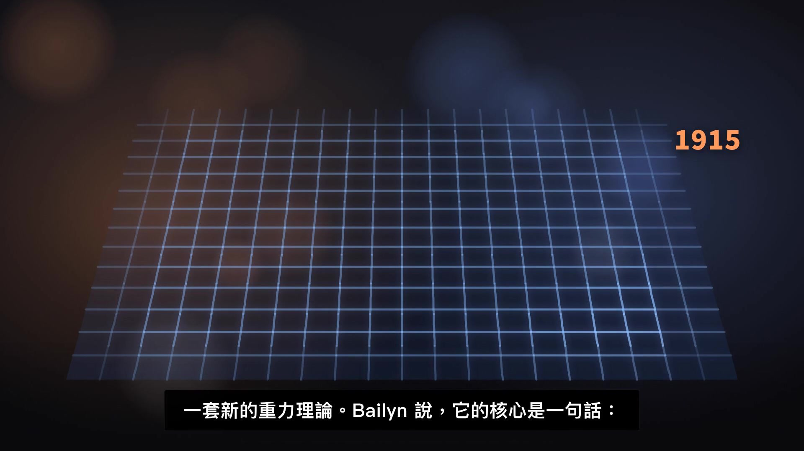

**逐字稿片段：** 重力不是一種力 沒有力的時候 東西走直線 那行星為什麼繞圈 因為質量會讓周圍的時空彎曲 東西在彎曲的時空裡 走的還是最短的路 只是在我們看起來 變成了彎的 貝林用飛機航線解釋 從紐約飛北京 兩個城市的緯度差不多 在平面地圖上 好像應該一路往東飛 可是飛機會往北繞 飛到一半 往下看是北極 因為地球是圓的 那條往北繞的線 才是最短的路 課堂上

**話題推測：** 闡述廣義相對論的核心觀點：重力不是一種力，可能顯示時空彎曲的示意圖。

---

## 00:12:19

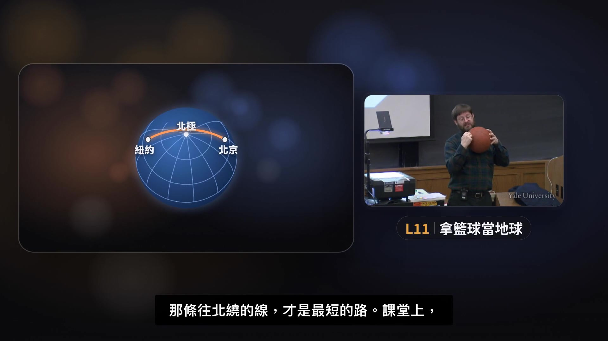

**逐字稿片段：** 他用一張床單 比喻時空 我們換成更重的東西 床單上放一顆保齡球 床單就凹下去 旁邊滾過的小球 會沿著凹線 繞著它轉 小球沒有被拉 它只是沿著 床單的形狀走 你往上跳 又落回地面 在愛因斯坦的眼裡 你走的也是一條直線 只是那條直線 畫在被地球壓彎的時空裡 貝林也提醒 床單隻有兩個方向 真正的時空有四個 所以這只是比喻 彎曲的不只是空間

**話題推測：** 用床單比喻時空彎曲，可能顯示床單上保齡球與小球的實驗模型。

---

## 00:12:46

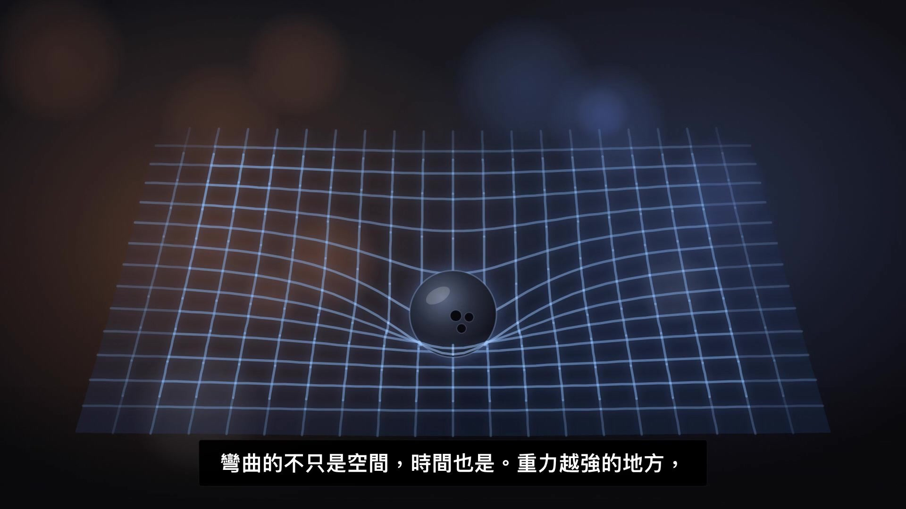

**逐字稿片段：** 時間也是 重力越強的地方 時鐘走得越慢 你手機裡的定位 每天都在用這件事 GPS衛星飛得很快 時鐘會慢一點 可是它們離地面很高 重力比較弱 時鐘又會快一點 兩個加起來 衛星上的時鐘

**話題推測：** 指出不只是空間，時間也會彎曲，重力越強時間越慢，可能顯示時間彎曲的示意圖。

---

## 00:13:00

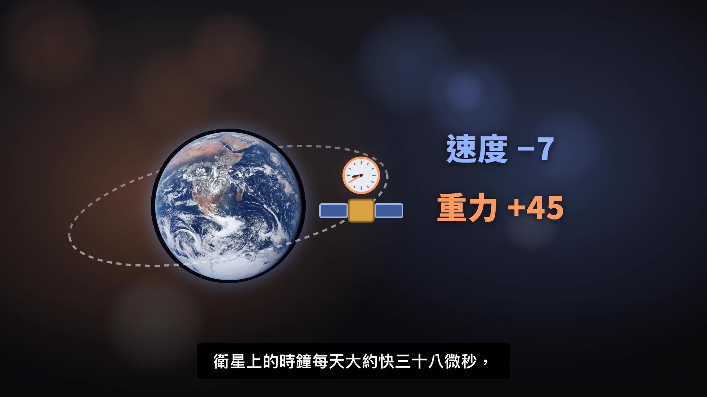

**逐字稿片段：** 每天大約快38微秒 發射前就得先調慢 到了黑洞旁邊 這個效應強到很誇張 黑洞外面有一圈看不見的界線 一旦進到裡面 任何東西 任何訊號都出不來

**話題推測：** 給出GPS衛星時鐘每天快38微秒的具體數字。

---

## 00:13:11

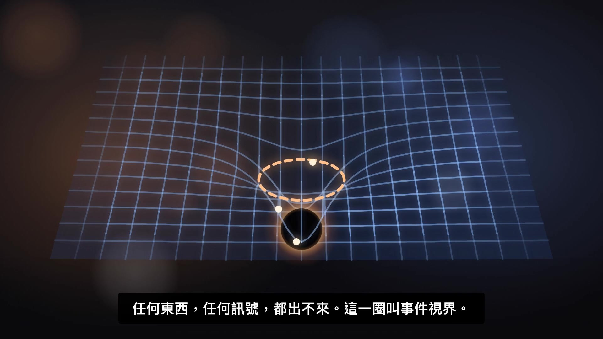

**逐字稿片段：** 這一圈叫視見世界 貝林說 從某個角度看 視見世界就是宇宙的邊緣 裡面發生什麼 外面永遠不會知道 宇宙像一塊瑞士乳酪 到處是這種洞 他也提醒學生 書上講黑洞裡面的事 都是假設外面的方程式 在裡面照樣成立 這個假設原理上沒辦法檢驗 所以那些說法看起來像物理 其實不一定是 我們能回答的只有黑洞外面 貝林在課堂上講了一個畫面 你待在地球上看著朋友掉進黑洞 聽他說 從外面看 但朋友越來越慢 永遠停在世間世界的邊上 可是對他自己來說 一下就掉進去了 同一件事 兩個人測量到的時間不一樣 其實你也不會一直看到他 這要講另一個效應

**話題推測：** 介紹黑洞周圍的「事件視界」，可能顯示黑洞結構圖或定義。

---

## 00:14:15

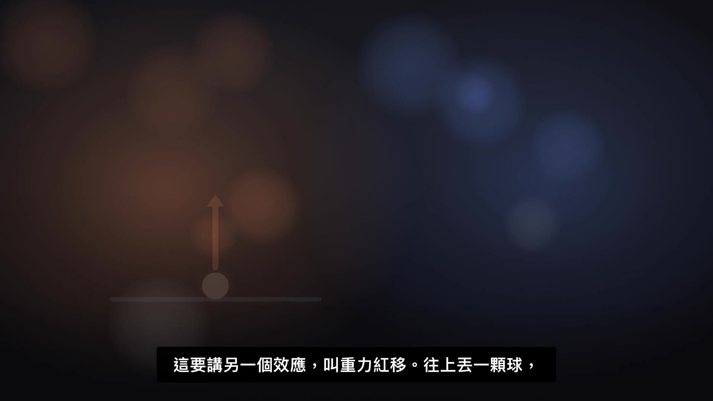

**逐字稿片段：** 叫重力紅移 往上丟一顆球 球會越飛越慢 因為它在對抗重力 一路失去能量 光也要對抗重力 也會失去能量 可是光不能變慢 它失去能量的方式 是把波長拉長 顏色往紅色那邊偏 這就叫重力紅移 離黑洞越近,紅移越嚴重 到了事件世界上,波長被拉到無限長,能量變成零 所以光不是飛上去再掉下來 貝林說,它是用另一種方式消失的 聽他說 Light always goes at the speed of light So what happens instead is 這就是黑洞為什麼是黑的真正的答案 第一部分那個漏洞補起來了 可是這一切都建立在愛因斯坦是對的 怎麼知道它對

**話題推測：** 介紹「重力紅移」效應，可能顯示光譜偏移示意圖。

---

## 00:15:17

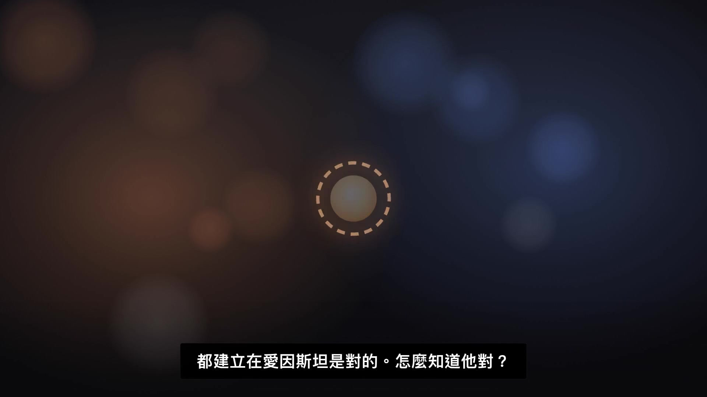

**逐字稿片段：** 第一個證據是水星 水星最靠近太陽的那一點 位置每一圈都會往前挪一點 其中有一小部分 牛頓的重力算不出來

**話題推測：** 第一個證據：水星軌道進動異常，可能顯示水星軌道圖。

---

## 00:15:25

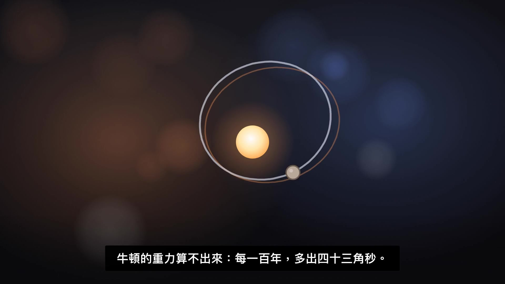

**逐字稿片段：** 每100年多出43角秒 19世紀的天文學家 才裡面還有一顆看不見的行星在拉他

**話題推測：** 提出水星每100年多出43角秒的進動無法用牛頓理論解釋。

---

## 00:15:31

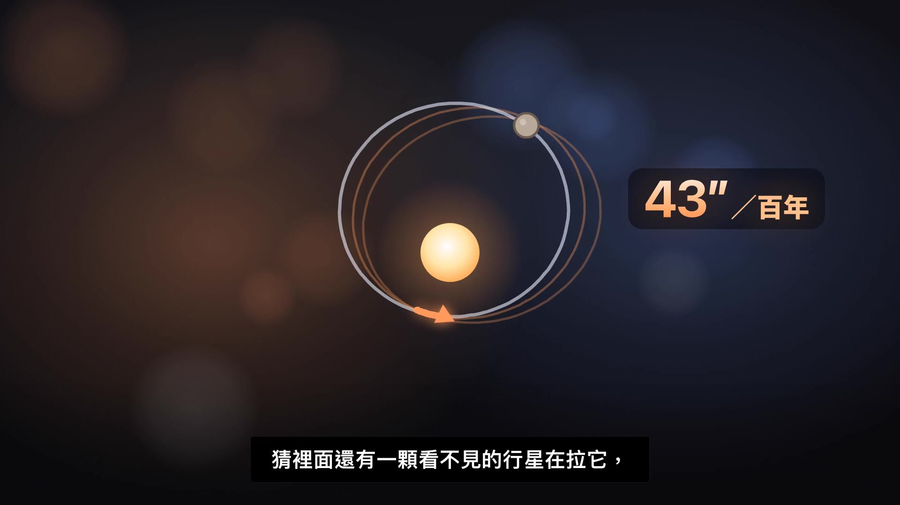

**逐字稿片段：** 還取了名字叫Vulcan 這一招在海王星身上成功過 上集講過 可是這一次 好幾個人宣稱找到了 每次找到的位置都不一樣 貝倫說 結果是大家都在騙自己 1915年11月 愛因斯坦用新的理論一算 不用多一顆行星 剛好就是43角秒 貝倫說 這是科學史上很少見的情況 愛因斯坦想出廣義相對論 不是為了解釋哪一筆資料 是覺得理論應該長那樣 結果資料自己對上了

**話題推測：** 提及19世紀天文學家曾假設存在一顆未見行星「Vulcan」來解釋。

---

## 00:15:57

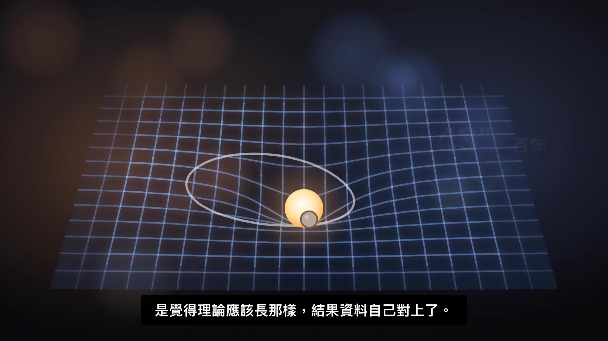

**逐字稿片段：** 另一個證據是 光經過眾物旁邊會轉彎 1919年日全時 英國派了兩隊去拍太陽旁邊的星星 一隊在巴西 愛丁頓那一隊在非洲外海的普林西比島 星星的位置真的被太陽的重力偏開了 愛因斯坦一戲成名 不過貝林也提醒 這次觀測沒有看起來那麼漂亮 當年器材的精度很勉強 愛丁頓出發前就說一定會成功 他給的寓意是 科學照著廣告上說的那樣運作 也許沒有 好在後來很多次日時都得到一樣的結果 1979年 有人用現代儀器 重新測量巴西那一堆的底片 結果還是支持愛因斯坦 上集最後留了一個問題 重力為什麼會讓光轉彎 答案就是這張床單 光沿著被壓彎的時空走 經過重物旁邊 路線就彎了 彎得夠厲害 一個重物就像一片透鏡 菲林在課堂上 放了一張哈勃的照片 叫愛因斯坦十字 中間是一個星系 旁邊四個亮點 其實是後面同一個 很遠又很亮的天體 光從四個方向繞過來 上集講的微重力透鏡找行星 用的就是同一件事 重力讓時鐘變慢 後來在實驗室裡也測量到了

**話題推測：** 第二個證據：光經過重物旁邊會彎曲，可能顯示光線彎曲示意圖。

---

## 00:17:02

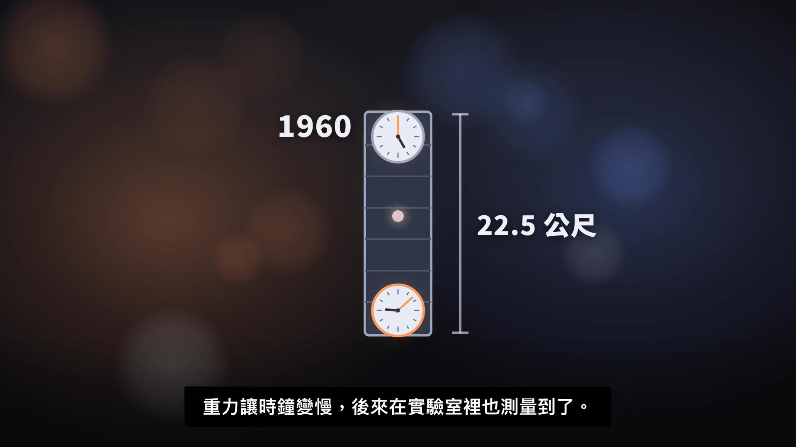

**逐字稿片段：** 1960年 哈佛大學用一座22.5公尺高的塔 第一次測量到重力紅移

**話題推測：** 提及1960年哈佛大學首次測量到重力紅移，可能顯示實驗塔照片。

---

## 00:17:07

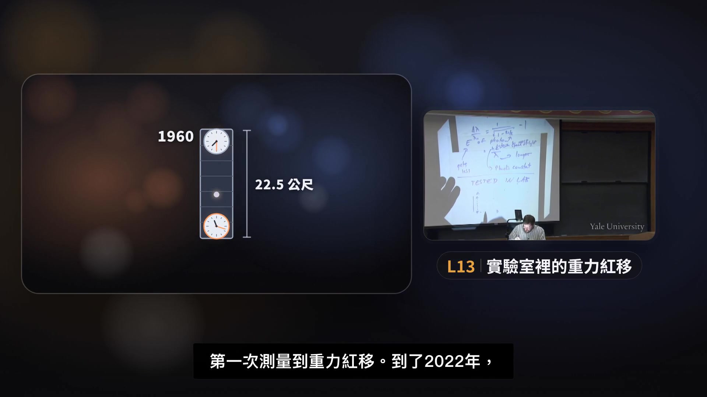

**逐字稿片段：** 到了2022年 一團大約1毫米大的原子雲 上面跟下面的時鐘快慢 都測量得出來 愛因斯坦的理論

**話題推測：** 更新至2022年，原子雲實驗證明時間快慢可測量，可能顯示實驗裝置圖。

---

## 00:17:14

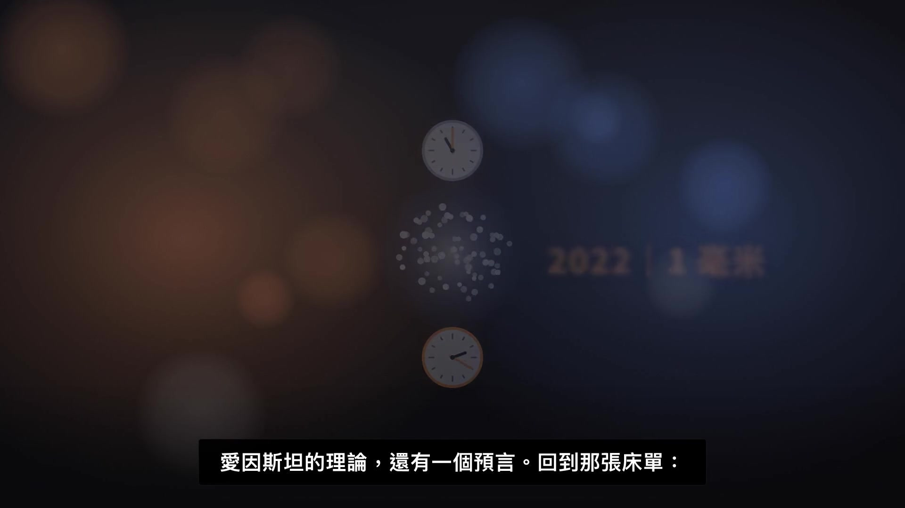

**逐字稿片段：** 還有一個預言 回到那張床單 保齡球如果不是靜靜放著 而是跟另一顆球互相繞著轉 床單就會起漣漪 一圈一圈往外傳 這種時空的漣漪 叫重力波 用光速往外傳 所以兩個互相繞著轉的東西會越繞越近 軌道慢慢縮小 可是這個效應非常小 太陽系的行星繞了四十幾億年 完全看不出來 整個太陽系的重力都太溫和了 對這一路的檢驗 貝林下的結論很保守 聽他說 全部通過,可是不夠強 因為太陽系裡的重力都很弱 弱到牛頓跟愛因斯坦算出來的答案 只差在小數點後面很多位 理論家可以寫出很多種理論 在重力弱的地方跟愛因斯坦一模一樣 到了重力很強的地方才分道揚鑣 貝林給了一把尺

**話題推測：** 介紹愛因斯坦的另一個預言：時空中的漣漪，即「重力波」，可能顯示重力波傳播動畫。

---

## 00:18:17

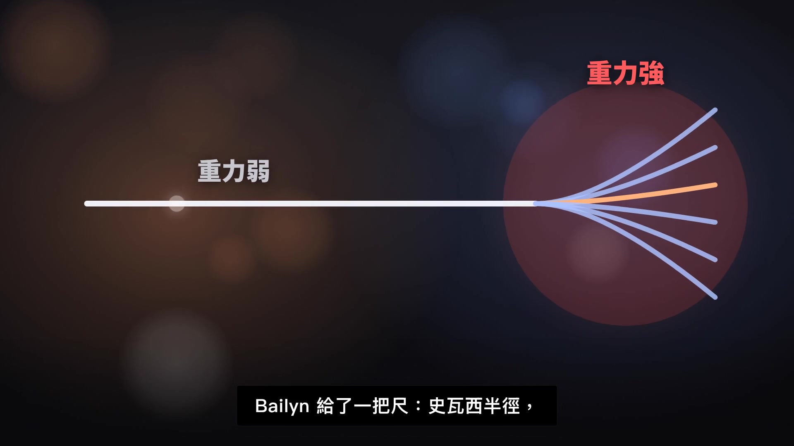

**逐字稿片段：** 10瓦西半徑,除以你離那個重物的距離 這個比值越接近1 愛因斯坦跟牛頓差得越多 在地球的軌道上 它只有大約1億分之2 在中子星表面大約是3分之1 到了事件世界上剛好是1

**話題推測：** 說明區分牛頓與愛因斯坦理論的「史瓦西半徑/距離」比值，可能顯示公式。

---

## 00:18:31

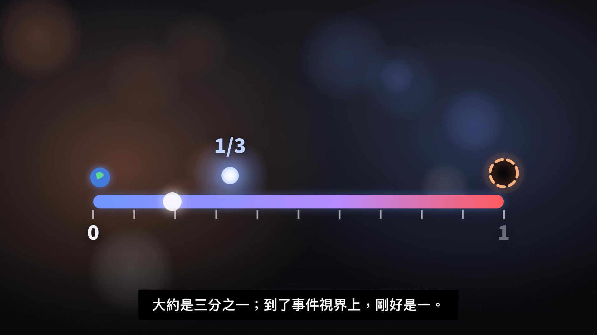

**逐字稿片段：** 整理一下這一部分 愛因斯坦把重力換成時空的彎曲 解釋了黑洞為什麼是黑的 光在事件世界上被紅移到消失 他的理論也留下兩個可以去測量的預言 靠近重物時鐘會變慢 互相繞著轉的重物會發出重力波 軌道越縮越小 要看清楚這兩件事 太陽系不夠用 我們需要一個天然的極端實驗室 答案在第一部分已經出現過

**話題推測：** 總結第二部分內容，可能顯示總結文字或重點摘要。

---

## 00:18:55

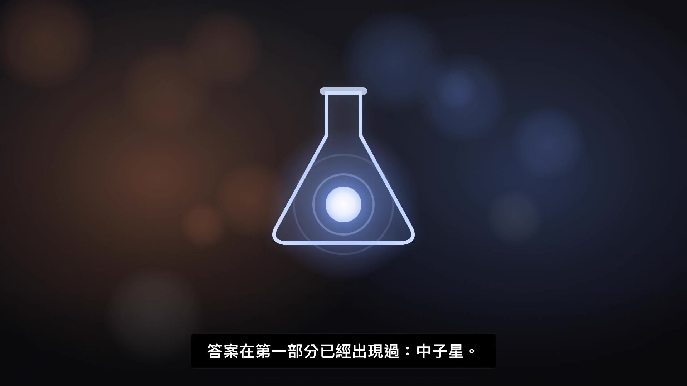

**逐字稿片段：** 中子星 1967年

**話題推測：** 引出「中子星」作為天然極端實驗室，可能顯示中子星的想像圖。

---

## 00:18:57

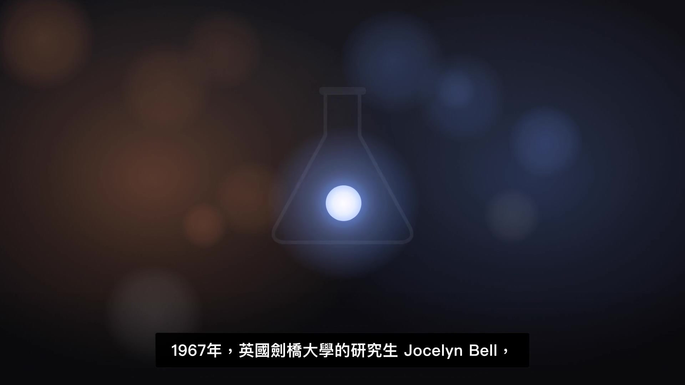

**逐字稿片段：** 英國劍橋大學的研究生Jocelyn Bell 在一整片田地上架起電波望遠鏡 發現天上有東西 很規律地發出電波脈衝 準時的不得了 規律到不像自然現象 所以第一個訊號被取了綽號 叫LGM1 意思是小綠人 外星人 答案沒有那麼浪漫

**話題推測：** 提及1967年研究生Jocelyn Bell發現脈衝星，可能顯示人物照片與電波望遠鏡。

---

## 00:19:16

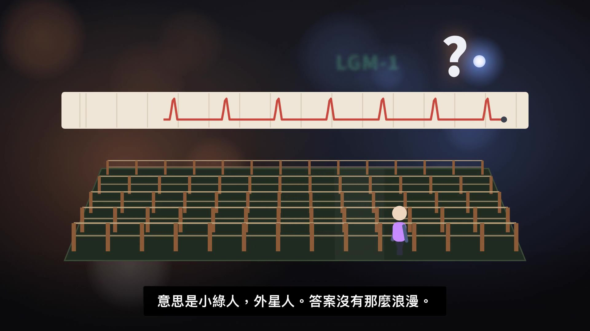

**逐字稿片段：** 這種天體叫脈衝星 是一顆會自轉又帶著強磁場的中子星 它的磁極會射出一道電波光束 星體一轉 光束就掃過來一次 像燈塔一樣 光束掃到地球 就收到一下 這是鍾子星 真的存在的 第一個直接證據 第一部分講的 恆星結局 在天上找到了 這個發現

**話題推測：** 介紹「脈衝星」的定義與運作方式，可能顯示脈衝星的旋轉示意圖。

---

## 00:19:34

**逐字稿片段：** 在1974年 得到諾貝爾物理獎 可是得獎名單上 沒有Bell 獎頒給了 他的指導教授 Anthony Hewish 和另一位 電波天文學家 Martin Ryle Baylen在課堂上這樣說 聽他說

**話題推測：** 指出1974年諾貝爾物理獎頒給Bell的指導教授Hewish與Ryle，可能顯示人物照片。

---

## 00:20:13

**逐字稿片段：** 2018年,他獲得300萬美元的基礎物理突破獎,他把獎金全部捐出來,設立獎學金,幫助物理領域裡少數群體的研究生。 脈衝心對相對論最有用的地方,是它很準,它的脈衝是宇宙裡最準的時鐘之一。

**話題推測：** 更新2018年Jocelyn Bell獲得300萬美元突破獎的消息，可能顯示獎項或其照片。

---

## 00:20:27

**逐字稿片段：** 1974年 Russell Hulse和Joseph Taylor 找到一顆脈衝星 旁邊還繞著另一顆中子星 大約8小時繞一圈 這叫脈衝雙星 愛因斯坦的預言 在他身上一次全部看得到 他的軌道最靠近對方的那一點

**話題推測：** 提及1974年Hulse和Taylor發現「脈衝雙星」，可能顯示人物照片與脈衝雙星示意圖。

---

## 00:20:40

**逐字稿片段：** 每年往前轉4度 水星同樣的效應 是每100年43角秒 他的重力紅移也測量得到 貝林說 關鍵在這裡 一開始有三個位置數 兩顆星各自的質量 和軌道傾斜的角度 軌道速度 軌道的轉動 重力紅移 三個測量剛好把他們全部解出來 到這一步 軌道會縮得多快 已經沒有任何可以調整的空間 是一個純粹的預測 最重要的是

**話題推測：** 說明脈衝雙星軌道每年往前轉4度，水星是每100年43角秒，可能顯示比較數據。

---

## 00:21:03

**逐字稿片段：** 它的軌道週期越來越短 兩顆星越繞越近 縮短的速度 跟重力波帶走能量的預測 剛好吻合

**話題推測：** 重點說明脈衝雙星軌道週期縮短，與重力波帶走能量的預測吻合。

---

## 00:21:10

**逐字稿片段：** 1993年 Holtz和Taylor得到諾貝爾物理獎 這一次 當年的研究生也在名單上 到了2016年 觀測跟預測已經吻合到千分之二以內 重力波真的存在 只是還沒有人直接收到過 麥衝星還回答了 第一部分留下的一個問題 中子星 真的是恆星死後留下來的嗎

**話題推測：** 指出1993年Hulse和Taylor獲得諾貝爾物理獎。

---

## 00:21:28

**逐字稿片段：** 1054年 宋朝的天文學家記錄 金牛座附近出現一顆剋星 亮到白天都看得見 持續了20多天 今天在那個位置 有一團正在往外擴散的氣體

**話題推測：** 提及1054年宋朝天文學家記錄的「客星」爆炸，可能顯示歷史文獻或超新星圖像。

---

## 00:21:39

**逐字稿片段：** 叫蟹狀星雲 就是那次超新星爆炸 炸出去的外層 1968年

**話題推測：** 展示蟹狀星雲的影像，說明其來自超新星爆炸。

---

## 00:21:43

**逐字稿片段：** 天文學家在蟹狀星雲的正中央 找到一顆脈衝星 每秒轉大約30圈 一顆白矮星轉這麼快 會被自己甩碎 只有半徑十幾公里的中子星撐得住 麥衝星燒完燃料 外層炸開 核心塌成中子星 第一部分講的那條路 在天上留下了現場 麥衝星這條路

**話題推測：** 說明1968年在蟹狀星雲中央發現脈衝星。

---

## 00:22:01

**逐字稿片段：** 2007年之後走得更遠 2007年2月 這門課開課的時候 澳洲的麥衝星總表 列了1772顆 截至2026年10月 是4503顆

**話題推測：** 更新2007年後脈衝星發現數量：從1772顆增至2026年的4503顆，可能顯示數量增長圖。

---

## 00:22:13

**逐字稿片段：** 中國的天眼電波望遠鏡 一臺就找到1000多顆

**話題推測：** 提及中國「天眼」電波望遠鏡找到1000多顆脈衝星，可能顯示望遠鏡照片。

---

## 00:22:16

**逐字稿片段：** 2003年 天文學家找到一對 兩顆都是麥衝星的雙星 等於兩個時鐘 互相繞著轉 貝林在課堂上只把這當成假設 說如果兩顆都看得到 就能知道各自的質量 這一對星後來被測量了16年 2021年的結果 重力波帶走能量的預測 驗證到萬分之1.3以內

**話題推測：** 提到2003年發現一對雙脈衝星。

---

## 00:22:35

**逐字稿片段：** 2023年 美國的Nanograph團隊 把銀河系裡67顆脈衝星 當成一整組時鐘 探到一片很低頻的重力波背景的跡象 可能來自宇宙各處互相繞著轉的 超大質量黑洞 目前算是證據 還不是確定的發現 不過這些都還在重力比較弱的範圍 貝林說 要測試最強的重力 得先在天上指出一顆黑洞 貝林在課堂上自嘲 我是觀測天文學家 黑洞最大的特點就是看不到 我憑什麼講黑洞 可是找黑洞正是他的本行 找黑洞的線索來自X光 大氣層會擋住X光 所以要把偵測器送上衛星

**話題推測：** 提及2023年美國Nanograph團隊探測到低頻重力波背景，可能來自超大質量黑洞。

---

## 00:23:11

**逐字稿片段：** 1960年代 天文學家發現天上有一些很強的X光源 要發出這麼多X光 物質得熱到上百萬度 它的亮度又會在1%秒裡變化 代表發光的地方很小 比地球還小 很小、很熱、能量很大 指向中子星或是黑洞 後來搞清楚 這是一種雙星 一顆普通的恆星 被旁邊看不見的半星拉成類低形 氣體被吸過去 繞著它轉成一個盤 叫吸積盤 越靠內轉得越快 氣體互相摩擦 加熱到上百萬度 就發出X光 要知道看不見的那一顆是什麼 就稱它的重量 方法跟上級找行星一樣 測量那顆普通恆星晃動的週期和速度 從這兩個數字可以算出一個數字

**話題推測：** 提及1960年代天文學家發現強烈X光源，可能是中子星或黑洞。

---

## 00:23:51

**逐字稿片段：** 叫質量函數 它有一個很好用的性質 看不見的那一顆 真正的質量一定比質量函數還大 所以只要質量函數超過三倍太陽質量 也就是超過中子星的上限

**話題推測：** 介紹計算黑洞質量的「質量函數」概念，可能顯示公式。

---

## 00:24:02

**逐字稿片段：** 它就只能是黑洞 這條線用的就是第一部分的答案 麻煩的是吸積盤太亮 把恆星蓋住了 好在這種系統的X光 常常會自己熄掉幾個月 盤按下來就能測量恆星 貝林說 他就是靠這一套流程 拿到終生值的 用這一套方法

**話題推測：** 闡釋質量函數超過中子星上限時，即證明是黑洞。

---

## 00:24:18

**逐字稿片段：** 最早被指認出來的黑洞候選者 是天鵝座X1 一個很亮的X光源 1970年代初 天文學家找到他的半星 一顆很大的藍色恆星 從半星晃動的週期和速度 算出看不見的那一顆 遠遠超過中子星的上限

**話題推測：** 介紹最早被指認為黑洞候選者的「天鵝座X1」，可能顯示星圖標示。

---

## 00:24:33

**逐字稿片段：** 就連霍金也不放心 1974年 他跟Kip Thorne打賭 賭天鵝座X1不是黑洞 霍金說 這是替自己買保險 如果他研究了一輩子的黑洞 根本不存在 至少還能贏一場賭局 後來的觀測越來越咫尺黑洞

**話題推測：** 提及霍金與Kip Thorne在1974年打賭天鵝座X1是否為黑洞，可能顯示人物照片。

---

## 00:24:47

**逐字稿片段：** 1990年霍金認輸 這也說明了為什麼要很多顆 一顆可能是特例 可是一顆接一顆測量出來 都比中子星重 又都看不見 這就很難用別的東西解釋了

**話題推測：** 說明1990年霍金認輸。

---

## 00:24:58

**逐字稿片段：** 他自己的那一顆 是這樣找到的 1991年 南天的蒼蠅座 突然出現一個很亮的X光源 貝林說 蒼蠅座只有一顆像樣的星 難怪叫蒼蠅 可是現在 這是他最喜歡的星座 他用耶魯放在智利的一米望遠鏡去看 發現它每10.5小時亮一點又暗一點 這可能就是軌道週期 他發了一封天文電報 課堂上還指著上面的名字說 這是我 可是耶魯的望遠鏡太小 他找了兩位同行 一起申請智利Sero Tololo天文臺的 四米大望遠鏡 拿到三個晚上 第一晚下雨 隔天晚上下冰雹

**話題推測：** 貝林分享自己如何在1991年智利發現一顆黑洞（蒼蠅座X-1），可能顯示星圖標示。

---

## 00:25:32

**逐字稿片段：** 第三晚 1992年4月3日 終於放晴 那顆恆星一開始 用每秒250公里朝我們衝過來 兩個小時後轉成離我們而去 到了半夜,他們覺得穩了 開了一小瓶當地的烈酒慶祝 結果遇上一場小地震 下一個資料點就歪了 天快亮的時候就差最後一個點 可是那顆星已經快落到地平線 望遠鏡斜得很厲害 聽他說後來怎麼了 我們等了一陣子,他們正在把電池關上 然後我們說,好,我們明白,鏡頭安全是非常重要的 但在討論中,我們多了一個點 吃早餐的時候,他們把資料劃成曲線,算出質量函數

**話題推測：** 描述1992年4月3日成功觀測到恆星晃動數據。

---

## 00:26:28

**逐字稿片段：** 3.1倍太陽質量,超過3倍 看不見的那一顆,比任何中子星都重,只能是黑洞 他們想把論文標題寫成,在蒼蠅座找到黑洞 聽他說同行怎麼回應 動力學確認的黑洞候選者 因為黑洞的定義靠的是愛因斯坦 愛因斯坦在最強的重力下 對不對 還沒被證明 這就是為什麼 這一集要先講相對論 他當年估計 這顆黑洞大約7倍太陽質量

**話題推測：** 顯示計算出的質量函數為3.1倍太陽質量。

---

## 00:27:20

**逐字稿片段：** 2016年 更精確的測量結果 是大約11倍 他當年的質量函數3.1 後來測量到3.02 非常接近 中子星的上限也降低了 現在大約2.3倍 2023年 重力波還抓到一個質量 在2.5到4.5倍之間的天體 中子星和黑洞的界線 其實是一段模糊地帶 不過,3.1還是在線的外面 最後一步是確認它沒有表面 天文學家拿一群中子星跟一群黑洞來比 氣體掉到中子星上會撞上表面 把能量放出來,變得很亮 掉進黑洞直接穿過事件世界 能量跟著不見 結果,同樣多的氣體 黑洞按了大約100倍 貝林說,中間的空隙大到可以開一臺卡車過去 黑洞沒有表面 這是事件世界存在的第一步證據 這一段課,貝林用一句話收尾 聽他說

**話題推測：** 更新2016年蒼蠅座X-1的精確質量為11倍太陽質量，質量函數3.02。

---

## 00:28:27

**逐字稿片段：** 2007年之後,故事快轉 先說碑嶺那一招,看半星怎麼動,這19年一直在用 2024年

**話題推測：** 回顧2007年後天文學的快速進展，可能顯示「快轉」或「最新發現」的標題。

---

## 00:28:34

**逐字稿片段：** 歐洲的Gaia衛星 只靠一顆恆星在天上的微小晃動 就找到一個大約33倍太陽質量的黑洞 旁邊連X光都沒有 這跟上級找行星的天體測量是同一招 再回到開場那句 重力波 還沒做到 但我想快了

**話題推測：** 提及2024年歐洲Gaia衛星發現一顆33倍太陽質量的黑洞，可能顯示衛星圖像。

---

## 00:28:48

**逐字稿片段：** 偵測重力波的設備叫LIGO 兩條各4公里長的管子 排成L型 用鐳射測量兩端鏡子的距離 重力波經過時 距離會變長又變短 可是變化比一顆直子還小非常多 貝林說 10英里外公路上開過的卡車 影響都比重力波大 所以要蓋兩臺 一臺在華盛頓州

**話題推測：** 介紹偵測重力波的設備「LIGO」，可能顯示LIGO偵測器照片。

---

## 00:29:06

**逐字稿片段：** 一臺在路易斯安那州 兩臺同時收到才算數

**話題推測：** 說明LIGO位於美國華盛頓州和路易斯安那州，可能顯示地圖標示。

---

## 00:29:10

**逐字稿片段：** 2015年收到的 是兩個黑洞繞著彼此越轉越快 最後撞在一起的訊號 這正是床單上的漣漪 而且來自重力最強的地方 訊號的形狀跟愛因斯坦的預測吻合

**話題推測：** 強調2015年首次收到的重力波訊號來自黑洞合併，可能顯示合併模擬動畫。

---

## 00:29:21

**逐字稿片段：** 2017年 第一次收到兩顆中子星合併 大約1.7秒後 加碼射線也到了 證明重力波的速度跟光速幾乎一樣 貝林當年還說 只有兩種 10倍太陽質量左右的 和星系中心超大質量的

**話題推測：** 提及2017年首次收到中子星合併的重力波，同時偵測到伽馬射線，可能顯示中子星合併動畫。

---

## 00:29:35

**逐字稿片段：** 2020年 眾力波看到一次合併 留下一個大約142倍太陽質量的黑洞 正好落在兩種中間 2025年 一個特別清楚的訊號 驗證了霍金的一個預測 兩個黑洞合併以後 事件世界的總面積只會變大

**話題推測：** 說明2020年重力波偵測到一個142倍太陽質量的黑洞，填補了黑洞質量分類的空白。

---

## 00:29:50

**逐字稿片段：** 2017年的諾貝爾物理獎 頒給了LIGO的三位關鍵人物 Rayner Weiss Barry Barish 和Kip Thorne Balin當年預言 如果成功 大概5年後 你會在報上讀到有人得諾貝爾獎 實際上 偵測在八年半後 諾貝爾獎在十年後 Kip Thorne這個名字 貝林在課堂上其實提過 是在一個完全不一樣的故事裡

**話題推測：** 指出2017年諾貝爾物理獎頒給LIGO的三位關鍵人物，可能顯示人物照片。

---

## 00:30:10

**逐字稿片段：** 天文學家Carl Sagan寫小說 《接觸未來》的時候 劇情需要讓主角一下子穿越宇宙 Sagan不是相對論專家 就打電話問朋友Thorne 給我一點說得通的科學 Thorne想了想 提出用蟲洞 一條把宇宙兩個遠方接起來的時空通道 後來他認真研究這個想法 1988年和學生髮表論文 討論相對論容不容許蟲洞存在 接著又引出一連串研究 貝倫說 這是藝術推動科學 很少見 不過到今天 蟲洞還沒有任何觀測證據

**話題推測：** 提及Carl Sagan寫小說《接觸未來》時諮詢Kip Thorne，引出「蟲洞」概念，可能顯示書本或蟲洞示意圖。

---

## 00:30:38

**逐字稿片段：** Thorne後來也擔任電影《星際效應》的科學顧問 真正讓他拿到諾貝爾獎的是另一件事 他是LIGO的創始人之一 花了幾十年 跟同事一起計算黑洞合併會發出什麼樣的重力波 好讓偵測器知道要找什麼 另一個要對的答案

**話題推測：** 提及Thorne擔任電影《星際效應》科學顧問，可能顯示電影海報。

---

## 00:30:53

**逐字稿片段：** 在銀河系的中心 有學生問貝勒,超大質量黑洞有沒有被直接觀測過,他這樣回答,聽他說

**話題推測：** 轉向銀河系中心黑洞的觀測，可能顯示銀河系中心圖像。

---

## 00:31:25

**逐字稿片段：** 答案是大約430萬倍太陽質量 方法跟他說的一樣

**話題推測：** 揭示銀河中心黑洞質量約430萬倍太陽質量。

---

## 00:31:30

**逐字稿片段：** 看最靠近中心的恆星怎麼繞 其中一顆叫S2 大約16年繞一圈 2018年它最靠近中心的時候 天文學家還測量到 它的光被重力紅移 跟愛因斯坦的預測一致

**話題推測：** 說明觀測方法：看恆星（如S2星）如何繞行，可能顯示S2星軌道動畫。

---

## 00:31:42

**逐字稿片段：** 2020年 諾貝爾物理獎的一半 頒給Reinhard Genzel和Andrea Ghez 表彰的就是銀河中心 這個看不見的重物

**話題推測：** 指出2020年諾貝爾物理獎一半頒給Reinhard Genzel和Andrea Ghez，表彰銀河中心的研究，可能顯示人物照片。

---

## 00:31:48

**逐字稿片段：** 另一半頒給Roger Penrose 他證明了黑洞會形成 是廣義相對論穩當的預測 貝林在同一堂課還說 銀河中心那一顆 旁邊沒有襲擊盤 我們完全看不到它 這句話說得太滿了 2007年以前 它在電波和X光 就有很微弱的訊號 貝林沒想到的是

**話題推測：** 另一半頒給Roger Penrose，表彰其證明黑洞形成，可能顯示人物照片。

---

## 00:32:05

**逐字稿片段：** 後來連它的影子都拍到了 標題裡說的第一張黑洞照片 是這樣拍出來的 黑洞的影子非常小

**話題推測：** 提及黑洞「影子」的拍攝，可能顯示「第一張黑洞照片」的標題。

---

## 00:32:12

**逐字稿片段：** M87星系中心那一顆 大約65億倍太陽質量 可是離我們太遠 在天上看起來小到 任何一臺望遠鏡 單獨都分辨不出來 要看清楚越小的東西 望遠鏡就得越大

**話題推測：** 提及M87星系中心黑洞（65億倍太陽質量）與其距離，可能顯示M87星系圖像。

---

## 00:32:24

**逐字稿片段：** 試見世界望遠鏡的做法 是讓分散在世界各地的電波望遠鏡 在同一個時間對準同一個目標 再把資料合起來 等於一臺跟地球差不多大的望遠鏡

**話題推測：** 介紹「事件視界望遠鏡（EHT）」的運作方式，可能顯示全球電波望遠鏡網路圖。

---

## 00:32:33

**逐字稿片段：** 2019年4月 他們公佈了M87中心那顆的照片 人類第一張黑洞照片

**話題推測：** 提及2019年4月公佈M87中心黑洞照片，可能顯示實際黑洞影像。

---

## 00:32:39

**逐字稿片段：** 2022年5月 同一個團隊公佈了銀河中心那一顆 它比M87那顆小得多 周圍的氣體幾分鐘就變一個樣子 所以公佈的影像 是很多張重建影像平均出來的

**話題推測：** 提及2022年5月公佈銀河中心黑洞照片，可能顯示實際黑洞影像。

---

## 00:32:50

**逐字稿片段：** 照片上是一圈亮光 圍著中間一塊暗區 亮的是被重力彎過來的光 暗的那一塊 是光逃不出來的那一區頭下的影子 兩個黑洞的質量差了一千多倍 影子的大小也跟著質量變 跟愛因斯坦的預測對得上 2007年 貝林說銀河中心那一顆 我們完全看不到 15年後 我們看到了他的影

**話題推測：** 解釋黑洞照片上的亮光與暗區，可能在影像上標註說明。

---

## 00:33:11

**逐字稿片段：** 回到這一集的問題 我們怎麼知道黑洞真的存在

**話題推測：** 總結本集的核心問題「我們怎麼知道黑洞真的存在？」，可能顯示問號或總結頁。

---

## 00:33:14

**逐字稿片段：** 2007年 貝林的答案是 看他旁邊的恆星怎麼動 稱出一個比中子星還重 卻看不見的東西 再確認它沒有表面

**話題推測：** 回顧2007年的答案（觀測恆星運動），可能顯示重點文字。

---

## 00:33:23

**逐字稿片段：** 19年後答案多了兩種 2015年起 我們聽得到黑洞合併時時空的漣漪 2019年起 我們拍得到黑洞的影子 三種方法靠的都是愛因斯坦的重力 到目前為止 每一次檢驗 愛因斯坦都對

**話題推測：** 提出19年後新增的兩種答案：重力波與黑洞照片，可能顯示三種方法的圖示。

---

## 00:33:37

**逐字稿片段：** 下一集 同一招拿去稱整個宇宙 結果稱出來的重量 跟看得到的東西對不上

**話題推測：** 預告下一集內容：用相同方法測量宇宙總質量，可能顯示預告畫面。

---

## 00:33:43

**逐字稿片段：** 最後問你一個問題 如果有一天 重力波或黑洞的照片 跟愛因斯坦的預測對不上 你覺得是理論錯了 還是我們測量錯了 留言告訴我 喜歡的話訂閱AI Notebook 開啟通知 我們下次見

**話題推測：** 提出一個觀眾互動問題，可能顯示問題文字。

---
