# jimainotebook_2fnAlL99ayg — 關鍵畫面索引

- 來源逐字稿：[jimainotebook_2fnAlL99ayg_FIN.srt](jimainotebook_2fnAlL99ayg_FIN.srt)
- 影片：https://www.youtube.com/watch?v=2fnAlL99ayg
- 截圖數：33

## 00:00:09

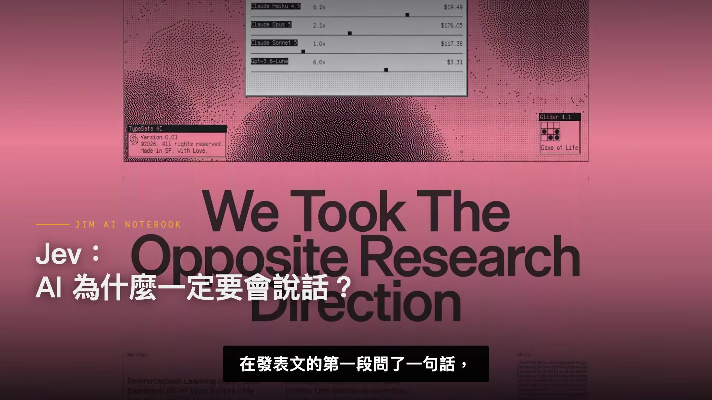

**逐字稿片段：** 模型在聊天這件事上已經超越人類好幾年了, 那自動化在哪裡?這句話問得很準, 你手邊的模型已經會寫程式, 會寫報告, 會跟你來回討論, 可是你公司裡那些每天要做好幾千次的小判斷, 到今天還是仍在做。 今天這一集 我們就順著這個問題走一次

**話題推測：** 介紹影片核心問題或標題文字，關於模型超越人類但自動化不足。

---

## 00:00:25

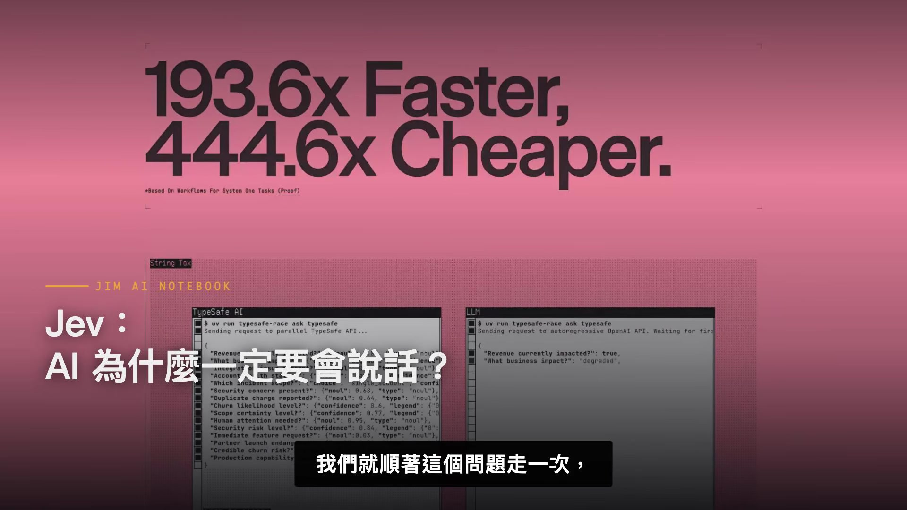

**逐字稿片段：** 看9月15號才發表的這個新模型 他叫Jeff 做他的公司叫TypeSafe AI 他最特別的地方是 他不會說話 我先把答案放在前面 真正卡住自動化的 不是模型答得不夠對 是他答完之後 你不知道這一題他到底有沒有把握 所以整支影片只回答一件事 難得不是答對 只知道自己什麼時候會錯 我們先從一段畫面開始 畫面上這個東西 正在幫人查一張蘇黎世飛倫敦的機票 他不是人 是一個會自己點按鈕的程式 英文叫瀏覽器代理 就是替你操作網頁的那種AI 它從打開網站到把扳機選定

**話題推測：** 介紹影片主角：新模型Jeff及其開發公司TypeSafe AI。

---

## 00:00:56

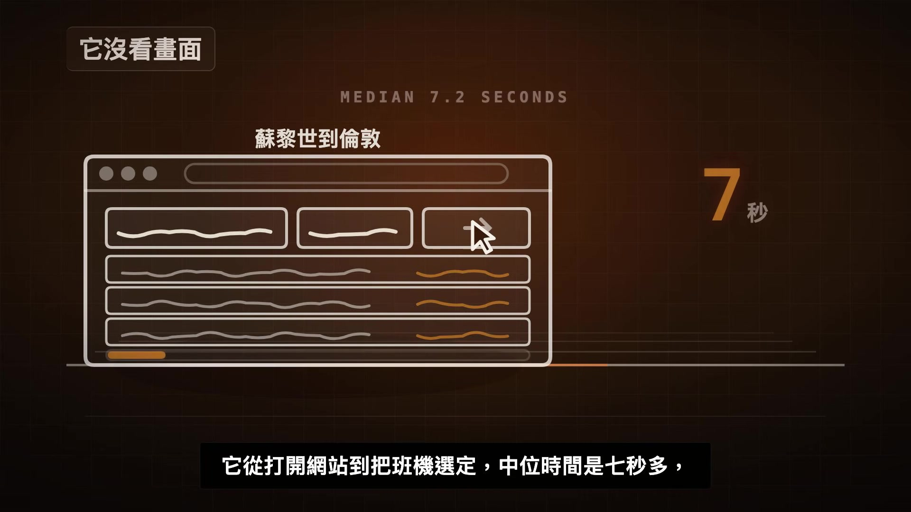

**逐字稿片段：** 中位時間是7秒多 比原本那一套做法快了四分之一 你看它動的樣子 大家會以為它在看畫面 像我們一樣用眼睛找那個搜尋鍵 它沒有 做這件事的模型根本看不懂圖片 一張截圖對它來說什麼都不是 所以寫這個專案的人只好換一條路

**話題推測：** 介紹機票查詢流程的速度數據，可能顯示與舊方法的比較圖表。

---

## 00:01:10

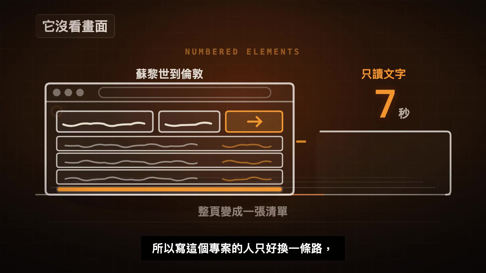

**逐字稿片段：** 把整頁網頁先變成一份有編號的元素表 1號是出發地欄位 2號是日期 3號是搜尋鍵 然後問模型一句話 這一步你要動哪一號 結果很有意思 這條被限制逼出來的設計 反而比看畫面還快 這一集要講的就是這個模型 還有一個更奇怪的問題 為什麼一個連話都不會說的東西 有人願意把判斷交給他 一個連畫面都不看的模型 為什麼會有人做出來 要回答這個 得先聽做他的人問的那句話

**話題推測：** 解釋模型如何識別網頁元素（轉換為編號元素表）的示意圖。

---

## 00:01:34

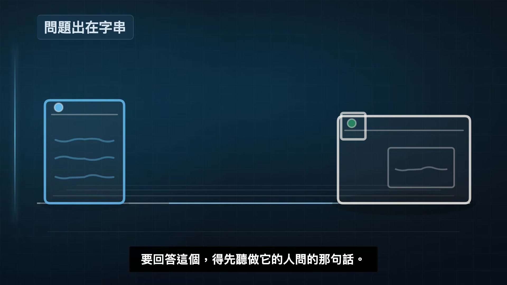

**逐字稿片段：** Type Save 這家公司在發表文的開頭寫 模型在聊天這件事上 已經超越人類好幾年了 那自動化在哪裡 這句話我看了很久 你想想看 你已經可以叫模型 幫你寫一封信 改一段程式 整理一份會議記錄 可是你公司裡 那個每天要做八百次的小判斷 這張單子該轉給誰 這則留言該不該擋 到今天還是人在做 那些聰明沒有變成自動 他們自己的診斷是 問題出在模型交出來的東西上 模型交出來的是一串字 而一串字什麼都可以是 可以是給你的回覆 可以是一段程式 也可以是他掰出來的內容 甚至是一句我不能回答 你自己在看的時候 這種彈性是好事 你會替他判斷 可是在一條 沒有人盯著要自己跑遠的流程裡 彈性就是負債 既然彈性是負債 那就做一個交不出彈性的東西 這就是Jeff 他9月15號發表 公司叫TypeSafe AI

**話題推測：** 再次強調TypeSafe AI提出的核心問題，可能以文字呈現。

---

## 00:02:21

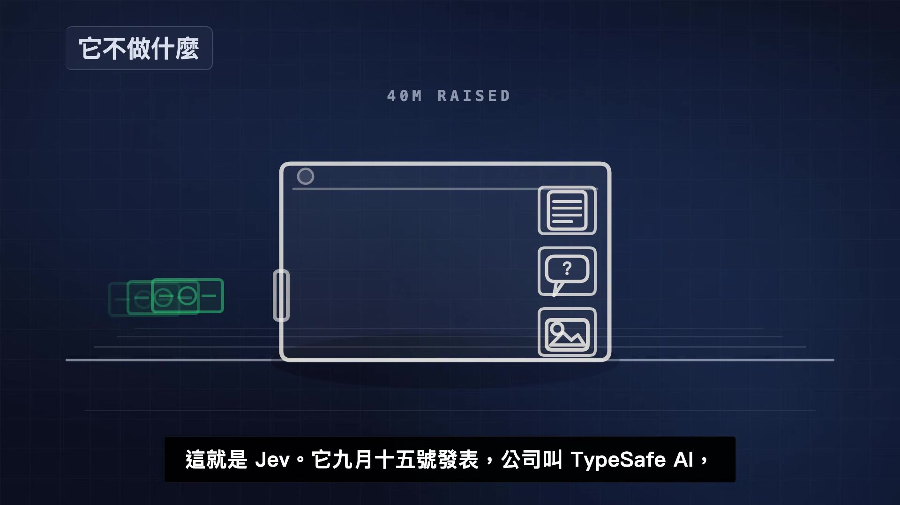

**逐字稿片段：** 發表前已經募到4000萬美元 他有三件事不做 第一 他不生成文字 不能寫文章 也不能寫程式 第二 他不會解釋自己的理由 你問他為什麼這樣打 他沒話給你 第三 他不能看圖片 輸入只詞文字 而有文字組成的格式 這三件不做 不是還沒練好 是一開始就這樣設計的

**話題推測：** 提及TypeSafe AI已募資4000萬美元的數字或新聞畫面。

---

## 00:02:38

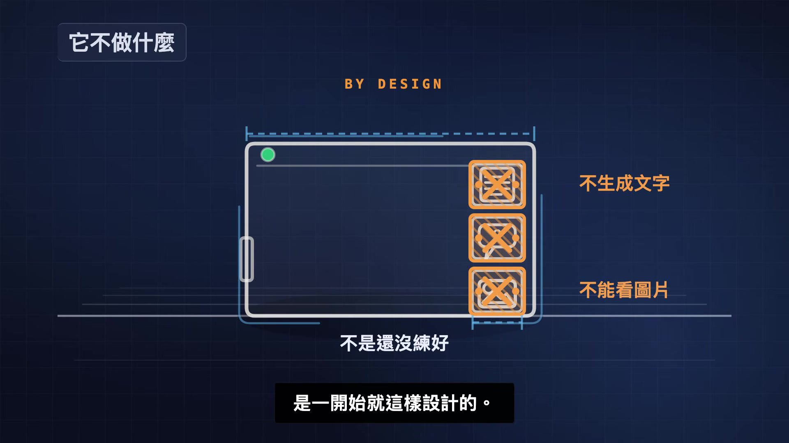

**逐字稿片段：** 他們把這一類東西 叫System 1 Model 中文是系統一模型 名字借自康拉曼那本書 系統一講的是 你看到紅燈就踩剎車的那種快反應 這裡要說清楚 這個類別名稱是廠商自己取的包裝 不是學界既有的講法

**話題推測：** 介紹「System 1 Model」概念，可能搭配圖示或康拉曼的書籍封面。

---

## 00:02:50

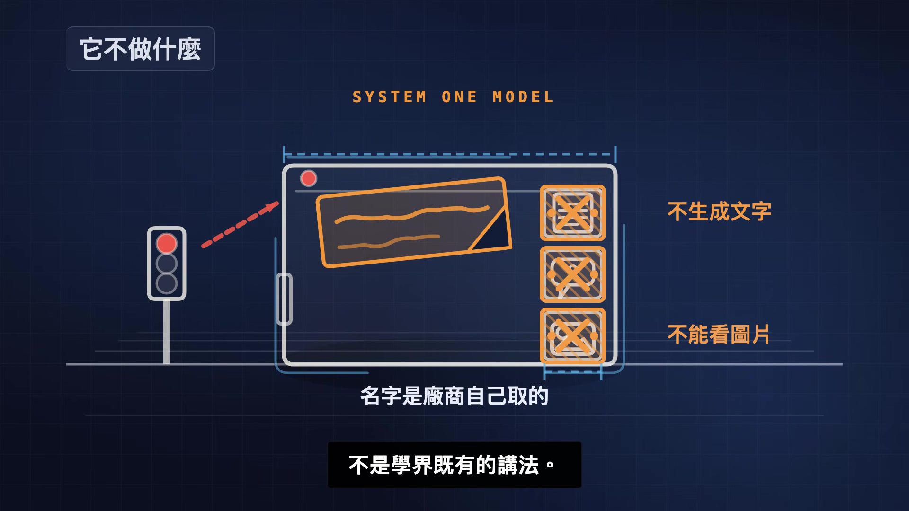

**逐字稿片段：** 創辦人Diogo Almeida 是前OpenAI研究員 參與過ChatGPT的指令遵循方法 外面幫他加了更大的頭銜 我就不跟著寫了 不給你一串字 那他到底怎麼動 先講你熟的那一種

**話題推測：** 介紹創辦人Diogo Almeida的頭像與背景資訊。

---

## 00:03:01

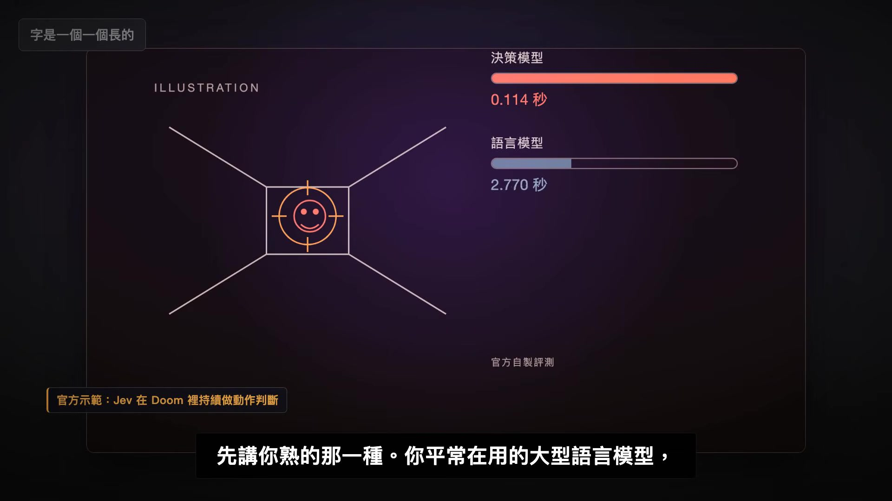

**逐字稿片段：** 你平常在用的大型語言模型 寫字的方式叫字迴歸 簡單講就是一次只決定下一個字 決定員再回頭看一遍 再決定下一個 這件事很像在寫深論題 一個字一個字往下漲 寫得越長花的時間就越多

**話題推測：** 說明傳統大型語言模型「字迴歸」的運作原理示意圖。

---

## 00:03:13

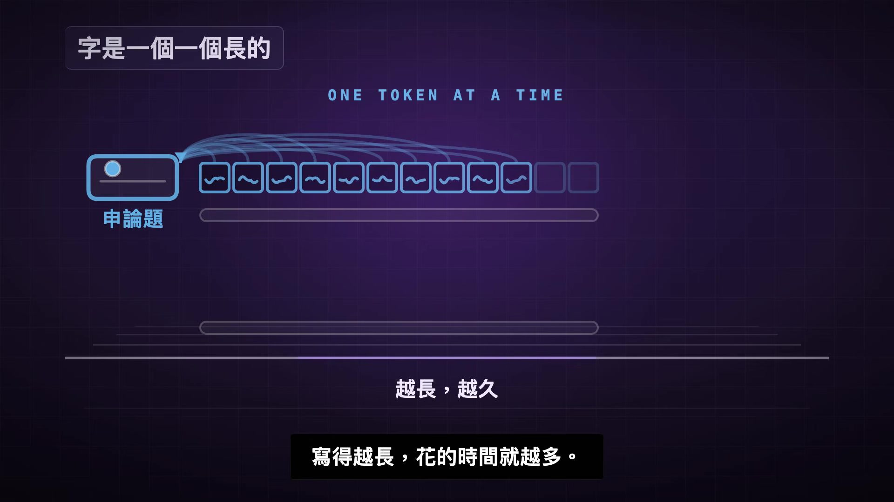

**逐字稿片段：** Jeffery做的是另外一件事 題目跟選項都是你先寫好的 他要做的只是在你給的選項裡面圈一個 所以他不用一個字一個字長 一次前項傳遞就算完 差別有多大 官方放了一段Doom的示範 就是那個很老的第一人稱射擊遊戲 畫面裡的重點不是他打得多好 是他做一次決定要多久

**話題推測：** 介紹Jeff模型一次性選擇預設選項的運作方式圖示。

---

## 00:03:29

**逐字稿片段：** Jeffery是0.114秒 同一件事換一個會說話的模型來做 是8.566秒 這個評測是他們自己做的你要記得 價格也跟著這個形狀走 輸入很便宜 輸出直接不收錢 因為根本沒幾個字可以收 官方也在旁邊補了一句 這個價格可能有補貼 一次算元聽起來很厲害 那它裡面到底長什麼樣子 答案有點掃興

**話題推測：** 展示Jeff模型與其他模型在Doom示範中反應速度的比較數字或圖表。

---

## 00:03:48

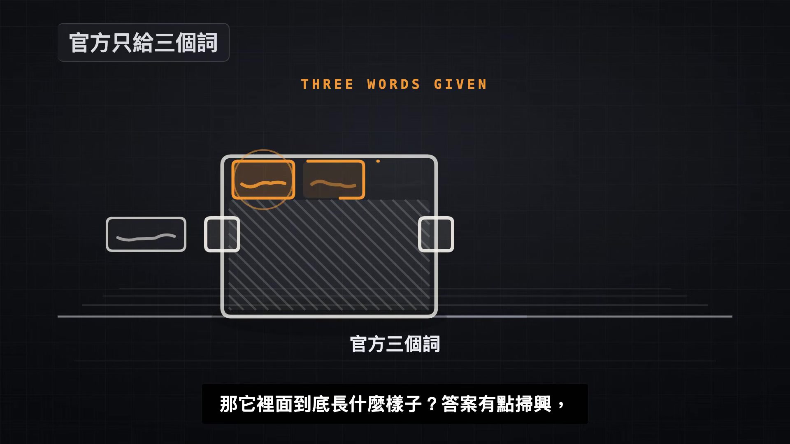

**逐字稿片段：** 官方只給了三個詞 新的架構平行取樣器 還有一套叫RLCD的訓練方法 骨幹是什麼幾層多少參數 一個都沒有講 也沒有論文 我先幫你排除一個常見的猜法 有人以為它是擴散式語言模型 就是先給一團雜訊 再一輪一輪修乾淨的那種做法 但那一類要跑10到50輪才收得回來 而它是一次跑完 行為上比較接近好幾個平行的分類統 直接把讀源的理解映射到你事先定義好的格子上

**話題推測：** 列出Jeff模型內部架構的關鍵詞彙（新架構、平行取樣器、RLCD）。

---

## 00:04:12

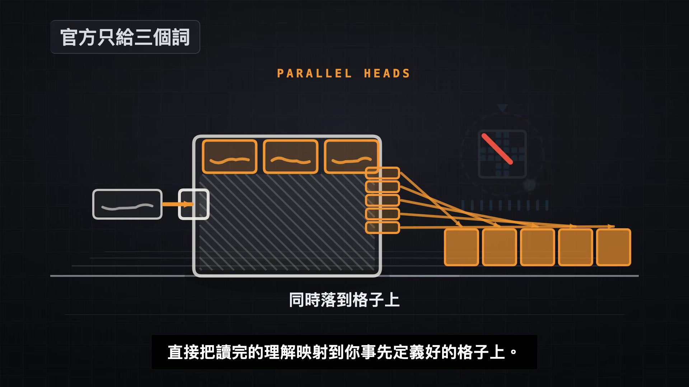

**逐字稿片段：** 外面也有人做逆向推論 說它可能是常見的骨幹 加上一段共用的狀態前綴 每一題各自分支 再從速度回推 大概100億個啟動參數 我要強調 這一段是推測 不是官方說法 整理起來就是這樣 它的界面講得很清楚 什麼未回什麼 文件寫得明明白白 內部沒有 宣告了一件事 跟公開了一件事 是兩回事 內部看不到 就看它怎麼用

**話題推測：** 說明外界對Jeff模型架構的逆向推論，可能附帶示意圖。

---

## 00:04:33

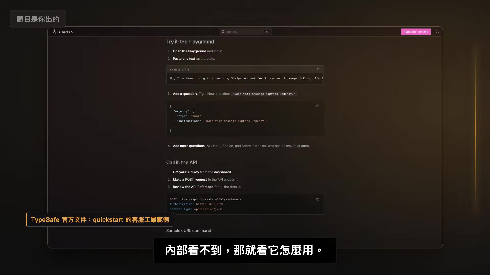

**逐字稿片段：** 官方快速上手那頁的例子 是一張客服供單 你先給他一段客訴原文 官方把這個欄位叫State 就是程式手上現在的狀態 接著才是關鍵 你要出題 一題 這張單字該轉去哪個部門 你給三個選項 賬目 技術 業務 每個選項還要附一句說明 一題 這個客人有多不高興 等級不是固定的一到五分 每一級長什麼樣子 是你自己用文字寫的 三題 這件事算不算緊急 回你一個零到一的數字 三題一起送出去 互相隔離地算圓 一起回來

**話題推測：** 展示客服工單的應用範例，包含輸入客訴與多個判斷題的選項設定。

---

## 00:05:01

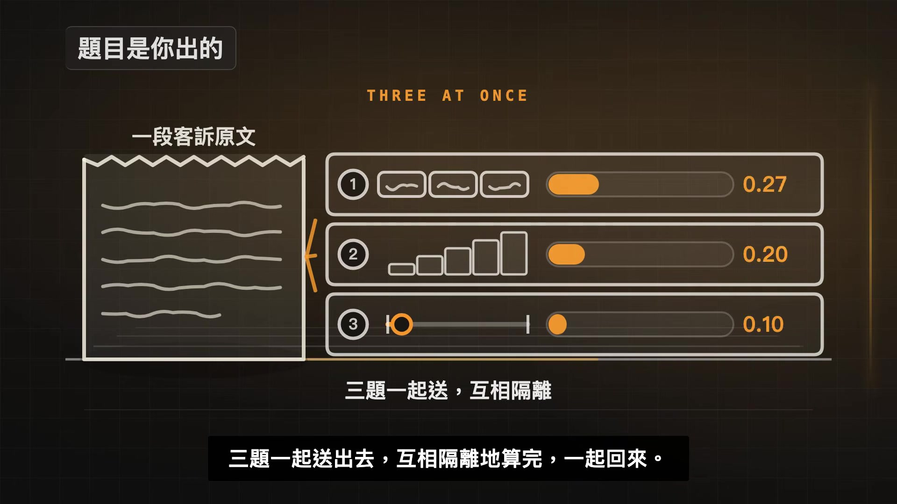

**逐字稿片段：** 回來的東西不是一段話 是一份結構 哪個選項被選中 每個選項的機率 還有一個叫信心值的欄位 你注意到沒有 這一整套界面裡 沒有一種提醒 叫請你寫一段話 還有一件事 這把尺是你自己寫的 你的選項寫的含糊 他就在含糊裡面挑一個 不會提醒你漏了什麼 好處是 錯了你查得到是哪一格寫壞了 題目是你出的 這件事比聽起來重要 同一句話你換一個問法 他要理解的東西就完全不一樣

**話題推測：** 顯示Jeff模型回傳的結構化結果，包括選中選項、機率與信心值。

---

## 00:05:25

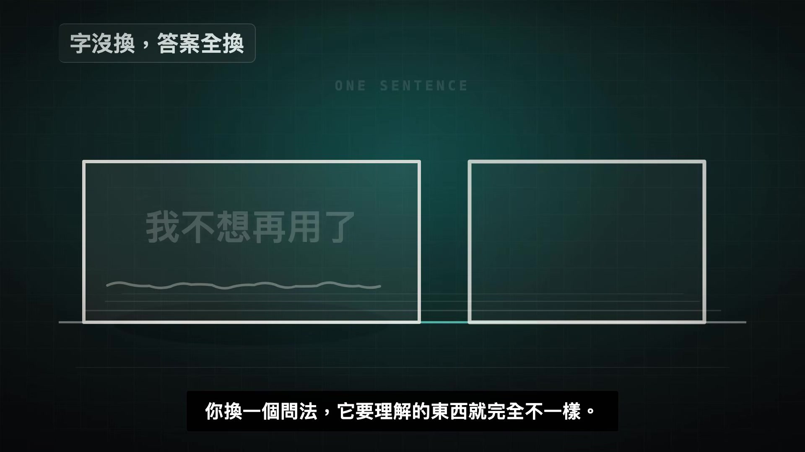

**逐字稿片段：** 就拿這一句 這個產品我不想再用了 你問他這個人有多不高興 他在讀情緒 你問他該不該轉去客訴處理 他在做分流 你問他這句話 有沒有提到具體的產品問題 他在找事實 你問他要不要現在就退費 他在幫你做決定 一個字都沒有換 同一段文字 四種理解方式 所以他不是一個退貨分類器 也不是一個情緒分類器 他是一個等著你出題的判斷器 你出什麼題 他就變成什麼 官方文件自己列了十種任務形狀 分類 偵測 評分 分流 搜尋 檢索 排序 驗證 還有兩種是幫機器學習抽特徵 把一段散文抽成欄位 我唸這一串不是要你記住 是要讓你感覺到一件事 它能做的事情不是固定那幾樣 而是你能不能把手上的問題 寫成一道已經有選項的題目 它的用法看完了 那它跟你每天在用的模型差在哪裡

**話題推測：** 透過「這個產品我不想再用了」這句話，展示不同問法下模型會進行不同理解的範例清單。

---

## 00:06:11

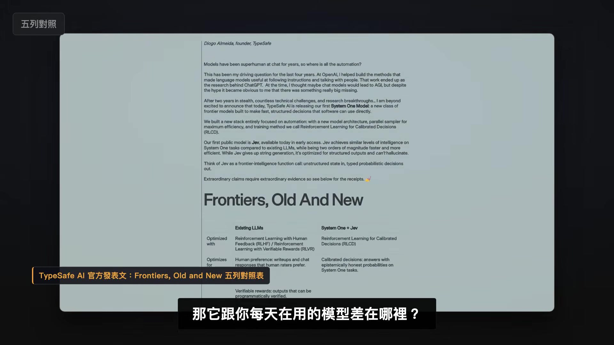

**逐字稿片段：** 這一題不用我編 官方發表文裡就有一張對照表 五列 我分成三塊講 第一塊是為什麼練成這樣 一般大型語言模型靠人類回饋 找一群人來拼 哪個回答比較討喜 追的是人類偏好 JF走的是他們命名的RLCD 全名是為了 校準決策而做的強化學習 追的是在這類任務上 誠實的幾率 第二塊是進出的東西 一般模型讀的是 一段一段連續的訊息 突出來的是自串 他讀的是 程式手上那份結構化的狀態 突出來的是 形別安全的 形狀 你事先定義好 他連形別都不會錯 第三塊是怎麼取樣 一邊是一個字一個字接著生 每個都看著前一個 一邊是一次查詢 全部算圓 這張表有個地方要講準 官方在表裡就沉澱 自串也可以是結構化的子大模型 一樣做得到 差別不在做不做得到 在於這邊的結構是被保證的 不是被抽樣出來 一次全部算圓 代價也在這裡

**話題推測：** 引入官方發表文件中Jeff模型與其他模型功能的對照表。

---

## 00:07:00

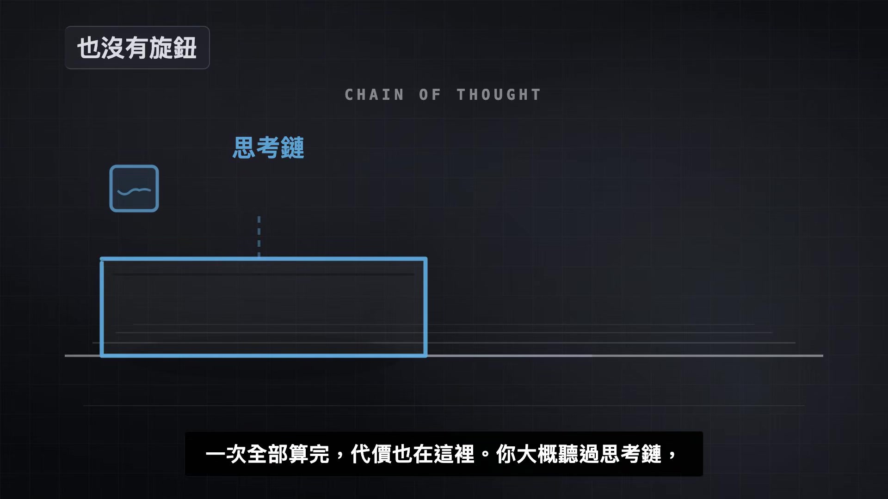

**逐字稿片段：** 你大概聽過思考鏈 就是讓模型先把想的過程 一句一句寫出來 寫得越長 難題答得越準 現在很多模型還開了一個旋鈕給你 讓你自己決定這一題 要想久一點還是快一點 Jeff兩樣都沒有 他沒有推理軌跡 沒有中間步驟 你也沒辦法跟他說 這題比較難 麻煩你多想一下 他把想這件事整個放棄掉 換來的就是剛剛那個零點幾秒 還有那個價錢 所以這裡出現了一條很清楚的界線 凡事要一步一步推下去 才有答案的問題 他不是慢 是根本不做 而那些你已經知道答案 會落在哪幾個格子裡的問題 他一次就給你 你可以這樣記 他只回答已經寫好的題目 沒寫好的題目不歸他管 這條界線等一下還會再出現一次 因為他決定了這個模型 該站在整條流程的什麼位置 既然他只答寫好的題目 那整件事情是誰在管

**話題推測：** 討論Jeff模型缺乏「思考鏈」功能的圖示或比較表。

---

## 00:07:42

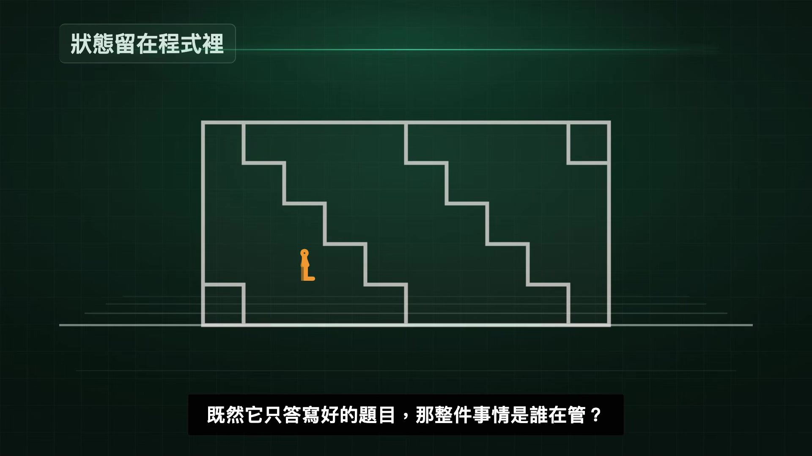

**逐字稿片段：** 你想像一直在迷宮裡走的機器人 你不會讓他先看到整座迷宮 再規劃路線 你只問他一句 你現在站了這一格 前後左右哪幾邊走得過去 撞過的牆不要再撞第二次 走過的路要記得 這些全部是城市在記 不是模型在記 回到開頭那個查機票的例子 也是一樣 這一頁該點第幾號是模型打的 可是點完之後 要去哪一頁 失敗了要退回哪一步 都寫在城市裡 這種做法有個名字

**話題推測：** 以迷宮中的機器人比喻Jeff模型在流程控制中的角色，可能搭配迷宮圖。

---

## 00:08:05

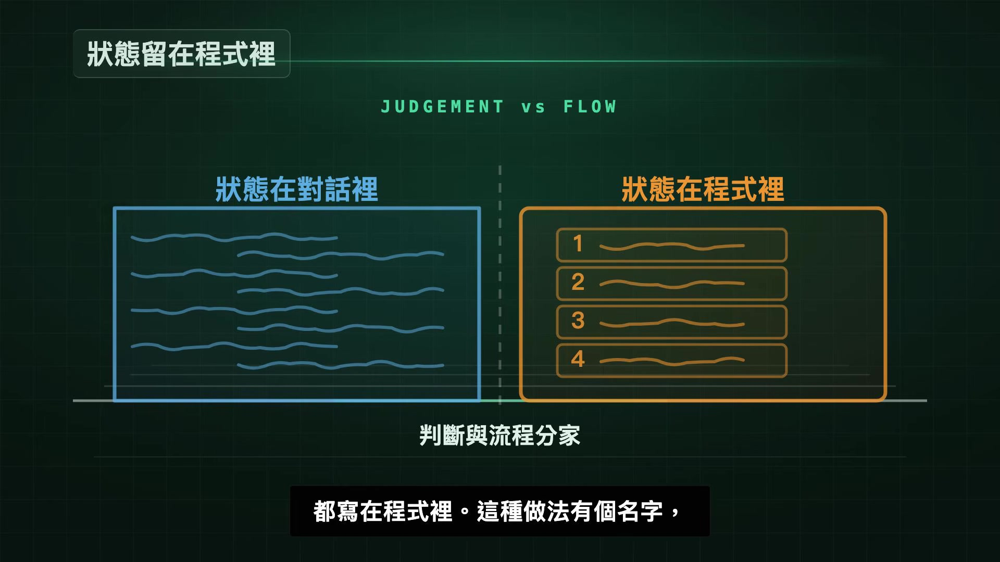

**逐字稿片段：** 判斷與流程分家 模型只負責回答 被切出來的那一體 狀態 記憶 步驟怎麼接 全部留在你寫的程式裡 這不是我自己歸納的 官方文件寫這一段的時候 用的知識程式擁有控制流 跟過去那種把整段任務丟給模型 讓他自己決定下一步的做法比起來 差別很實際 出錯的時候 你查到是哪一步歪掉的 查得到你才敢讓他自己跑 不知道他站在哪一格之後 下一個很實際的問題是

**話題推測：** 介紹「判斷與流程分家」的概念與其定義。

---

## 00:08:29

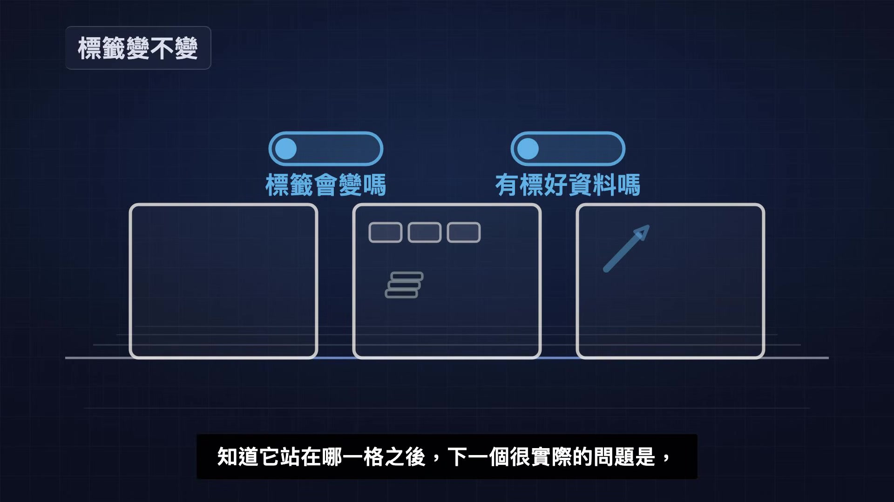

**逐字稿片段：** 什麼時候該用它 我給你一個三選一的判斷法 先看你的類別 第一種情況 你的類別很固定 手上又有標好的資料 像退貨原因就那七種 而且你已經標了三年 那就別用它 每一條一個小模型更划算 跑在自己的機器上 又快又可控 第二種情況 你的類別一直在變 而且沒有標好的資料 像今天新穿出來的一種詐騙畫素 你想今天下午就上線一個判斷 這時候它的好處才出來 你用文字把新類別寫清楚 它馬上就能開始判 不用先標一萬筆 第三種情況 這件事需要寫字 或者需要一步一步推導 那還是得找大型語言模型 這裡我要講準一點 用一句文字就定義一個新類別 這件事不是他發明的 零樣本分類找就有了 很多人也直接拿大模型在做 他推的是把這一類判斷做得更快 更便宜 而且給你一個 城市比較好接的幾率界面 我一直講完了

**話題推測：** 提出何時該使用Jeff模型的三選一判斷法示意圖。

---

## 00:09:13

**逐字稿片段：** 接下來是全片最關鍵的一段 你要把判斷交給他 你憑什麼相信這一次他是對的

**話題推測：** 轉折至影片關鍵部分：如何信任模型的判斷。

---

## 00:09:18

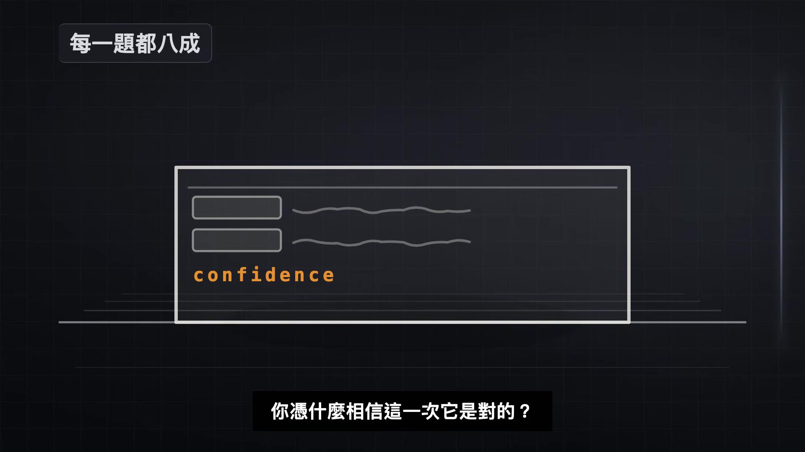

**逐字稿片段：** 他每次回你的東西里 有一個欄位叫confidence 中文就是信心值 他把整組幾率有多集中 壓成一個0到1之間的數字 方便你直接拿去設門檻 但官方文件自己在旁邊寫了一句警語 集中本身不構成這一次值得相信的證據 這句話有點繞 我用一個人來講 假設你身邊有個朋友 你問他什麼 他都說我有八成把握 你拿一百個案例去測他 結果他剛好答對八十題 你算一下會發現 他報的數字跟實際完全對得上 八成把握 八成答對 這在統計上有個名字叫效準 它是完美效準的 可是它對你一點幫助都沒有 因為裡面有些題目 一看就知道答案 有些題目連專家都會吵起來 它一律回你八成 你沒辦法從他嘴裡分出 哪幾題可以直接放行 哪幾題要拿去給人看 那個永遠說八成的朋友 讓我們看見一件事

**話題推測：** 介紹模型回傳的「信心值」欄位與其計算方式。

---

## 00:10:00

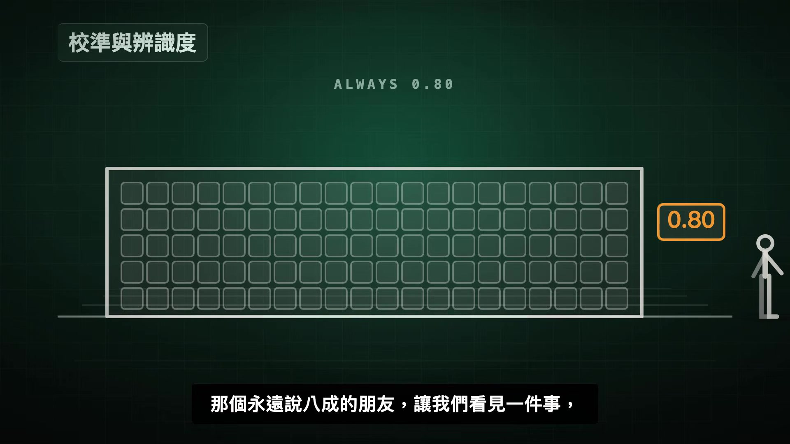

**逐字稿片段：** 可靠這兩個字裡面 其實裝了兩種不同的能力 一種叫效準 講的是他報出來的數字 長不長期佔得主 他說0.8的那一批案子 最後應該真的有八成左右是對的 你要注意這是一個統計性質 累計幾百次幾千次才量得出來 看單獨一體 永遠看不出效準好不好 另一種叫辨識度 講的是他分不分得出難跟簡單 同樣一批案子 做得好的模型 會把明顯的那些推到0.99 把模糊的那些壓到0.55 讓你一眼就看得出來 哪些可以自己跑 哪些要叫人 剛剛那個朋友 效準滿分 辨識度是0 這兩件事可以各自成立 也可以各自壞掉 一個模型可以很準 但是很自大 也可以幾率報得很老實 但是每一題都報一樣 你真正要的是兩個一起 而這正好解釋了下一個問題 為什麼這種模型 非得另外設計一套訓練不可 為什麼不能拿現成的訓練方式 改一改就好 這裡有一個很漂亮的道理 我第一次看到也愣了一下

**話題推測：** 區分「可靠」的兩種能力：「效準」與「辨識度」的定義與圖示。

---

## 00:10:50

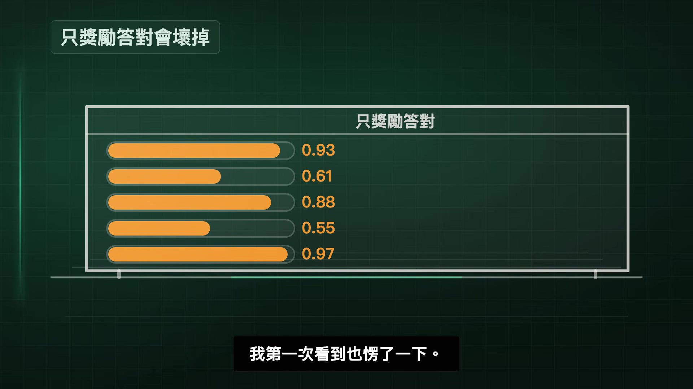

**逐字稿片段：** 假設你要訓練一個模型 做法很直覺 答對加一分 答錯不給分 你猜模型會學到什麼 他會學到把最高的那個機率 一路往上推 反正只有對不對 算分 那他每一題都喊滿分最划算 結果就是準確率可能上去了 可是那個機率變成廢話 得到一個很有自信 你答錯的模型 要讓機率誠實 獎勵就不能只看答對 必須連他報出來的那個數字一起計分 報0.9 答錯的要罰得比報0.6答錯的重

**話題推測：** 解釋模型訓練中「答對加分、答錯不給分」的計分方式及其導致的問題圖示。

---

## 00:11:15

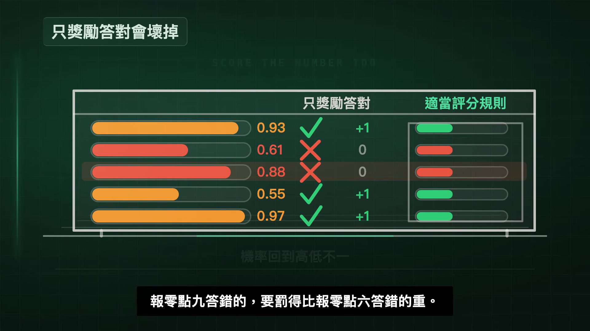

**逐字稿片段：** 這種計分方式叫嚴格適當評分規則 我要先講 這是教科書常識 不是他們的說法 他們那套RLCD的配方 獎勵怎麼設計 流程怎麼跑 到現在沒有公開 可是他們自己寫的這句話 我覺得很準 人類偏好跟機器可信耐度 是兩個不同的優化目標 討你喜歡 跟值得你放手 本來就不是同一件事 知道要練什麼之後 你就會開始問對問題 大部分人挑模型的時候 問的是它多準 它多快 可是你要是如果是自動化 該問的是另外一句 在我能接受的錯誤率之下 它能讓多少比例的案子 自己跑完 舉個例子 你規定送出去的東西 錯誤率不能超過1% 那你就把門檻往上調 調到高於門檻的案子 剛好壓在這條線以內 剩下的送人工 有一個模型能自動處理三層 另一個能到八層 兩個模型的整體正確率 可能只差一點點 可是你的人力長 完全不一樣 官方文件裡有個例子 讓這件事很具體

**話題推測：** 介紹「嚴格適當評分規則」的數學公式或解釋圖示。

---

## 00:12:04

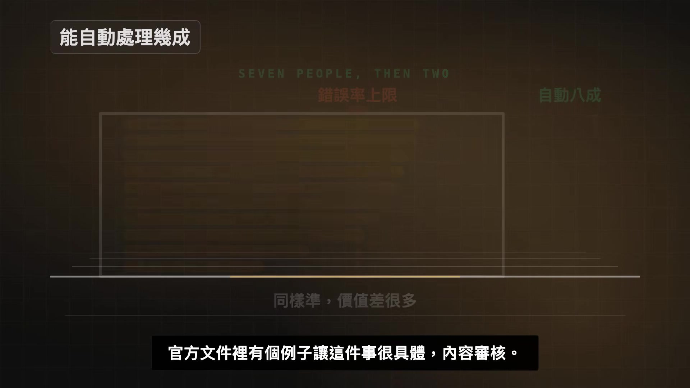

**逐字稿片段：** 內容審核 他們把嚴重程度跟信心值 兩個數字合起來看 分成四格 直接放行 先給警告送人工複審 擋掉 還有一件事要提醒你 門檻不是設一次就永遠有效 它跟著你的流量跑 下個月進來案子換的樣子 同一條線就可能已經漏了一堆過去 所以真正要養成的是 定期重新量一次的習慣 要看哪個數字 剩下最後一個問題

**話題推測：** 內容審核案例，結合嚴重程度與信心值將結果分為四個處理類別的圖表。

---

## 00:12:24

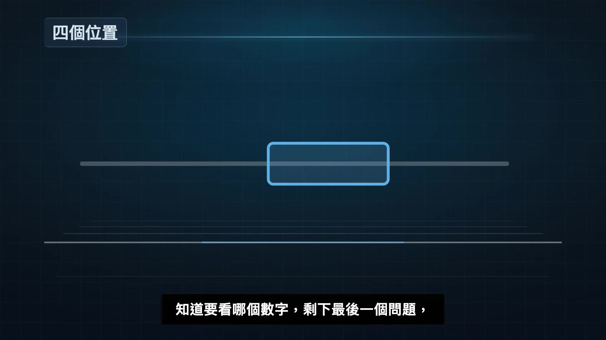

**逐字稿片段：** 它站在流程的哪裡 發表才幾天 社群做了一大堆專案

**話題推測：** 討論Jeff模型在整體流程中的定位。

---

## 00:12:29

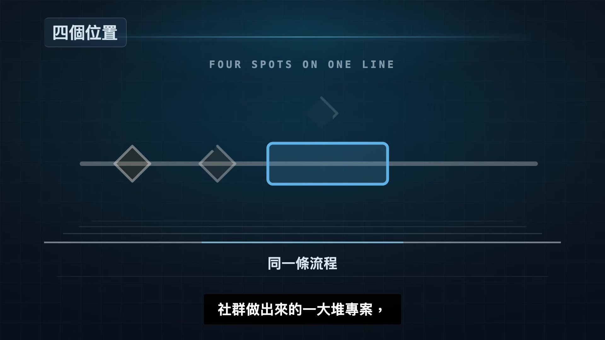

**逐字稿片段：** 幾乎都落在同一條流程的四個點上 進門前 大模型決定要做一件事 動手前先問他一句 這個指令危不危險 危險就擋掉 Longchain的官方教學 就這樣用 分岔口先判斷這題有多難 再挑一個做得動 又最便宜的模型去解 要不要升級也是他決定 產出當中 最乾淨的例子是 開頭的那個瀏覽器 每一步做什麼動作 點哪一個元素都是他決定 只有真的要打字才叫語言模型寫 出門之後 有人拿他驗證一句話 有沒有被引用的論文支持 最後還是人拍板 官方自己舉的保險禮賠 也是同一個形狀 先判斷案子復不復雜 有沒有缺件 再決定直接跑員還是送專員 所以一句話講完這個分工 大模型負責產出 他負責決定 界限不是難的給誰 簡單的給誰 是有沒有人士先把選項寫出來 講了這麼多好話

**話題推測：** 說明Jeff模型在流程中四個主要整合點的示意圖。

---

## 00:13:12

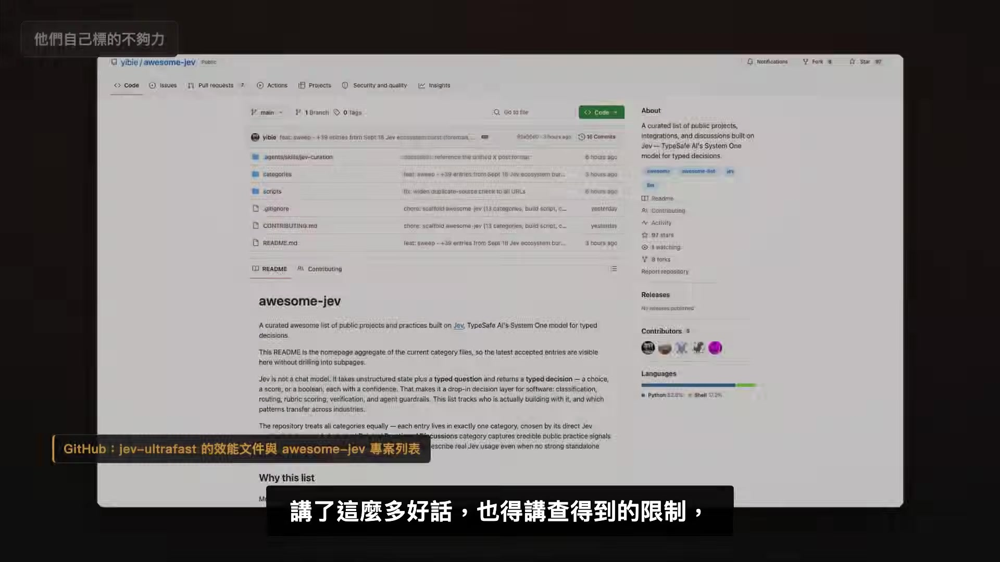

**逐字稿片段：** 也得講查得到的限制 而這一段其實是我最喜歡的 開頭那個快了四分之一的 機票測試是怎麼測的 一道題目 前後交替跑六次 配三組來比 他們自己算了符號檢定P值0.25 然後在文件裡寫 這樣的樣本不足以構成槍組章 這句話不是我挖的 是寫那個專案的人自己打上去的 同一份文件裡還有一個好看的數字

**話題推測：** 轉向討論Jeff模型限制與不足之處。

---

## 00:13:31

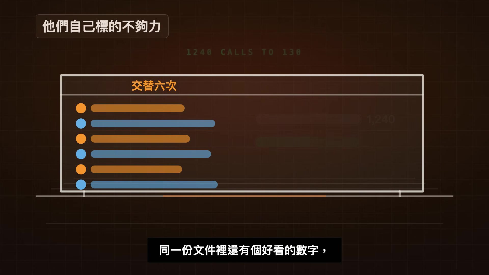

**逐字稿片段：** 跟瀏覽器溝通的呼叫次數 從一千多次掉到一百出頭 他們也說明了 那是改了溝通方式的功勞 跟換哪一個模型沒有關係 還有結果更該講

**話題推測：** 說明瀏覽器溝通呼叫次數下降的數據與真實原因。

---

## 00:13:39

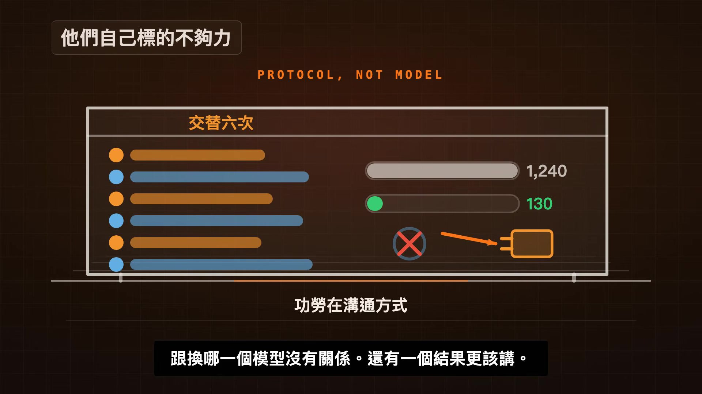

**逐字稿片段：** 有人拿它做重排序 就是把搜尋結果重新排一次 讓最相關的頂上來 結果沒有贏過原本的向量檢索 而搜尋跟檢索正好列在官方主打的場景裡 官方也在首頁那兩個很大的倍數旁邊印了小字 工作流是自家設計的 參考答案偏向某幾家的模型 倍數是真實收益的高端 一個新東西願意把沒贏的結果公開 這最讓我放心 把這些放在一起 我們回到開頭那7秒 那一趟機票查得那麼快 靠的不是他比誰聰明 他不會多想一下 他只是在每一步都被問了一道已經寫好的選擇題 然後很快的圈了一個 順手告訴程式他有多確定 這件事講到最後其實跟他們自己寫的一句話是同一件事

**話題推測：** 提及Jeff模型在搜尋結果重排序任務中未勝過向量檢索的測試結果。

---

## 00:14:16

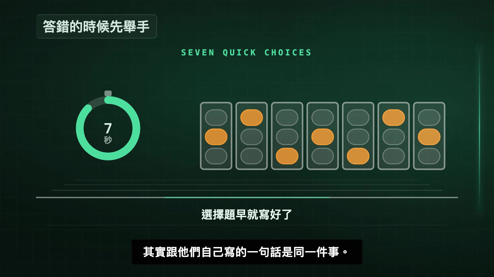

**逐字稿片段：** TypeSafe在發表文裡寫 如果一個模型有9乘5的時候做得到一件事 卻不會告訴你什麼時候落在那5% 他就沒辦法自動化那件事 我很喜歡這句話 因為他把標準從聰明換成了誠實 你要把一件事交給機器自己跑 你其實不需要他每次都對 你需要的是他在會錯的那幾次 先舉個手 他舉著手你才畫得出那條線 線以下自己跑 線以上叫人來看 所以這個不會說話的模型 最值得看的地方從來不是快 也不是便宜 難的不是答對 是知道自己什麼時候會錯 這集我們看的是一個不會說話的模型 他不能寫文章 不能寫程式 不能告訴你他為什麼這樣答 而這三件事都是他自己選的 他只會在你出的題目裡圈一個 然後附上一個幾率 他很快也很便宜 可是他最有意思的地方 不是這兩件事 是他願意在拿不準的時候講出來 我也很喜歡圍在他旁邊的那群人 測源六次會自己標上不夠力 總排序沒有贏 也照樣整份公開 官方自己印出評測偏向哪一邊 一個新東西 如果連不確定的地方都攤在檯面上 那它就是一個值得你自己跑一次的方向 最後問你一個問題 如果你手柄有一件 每天都要做很多次的判斷 你會設一個什麼樣的門檻 讓機器自己跑 超過門檻才叫人來看 留言告訴我 喜歡這種把新東西講清楚的內容 也可以訂閱AI Notebook 我是Jim 我們下次見

**話題推測：** 總結TypeSafe發表文的關鍵引言，強調模型需要知道何時會錯才能自動化。

---
