# jimainotebook_3mCrui6nBq0 — 關鍵畫面索引

- 來源逐字稿：[jimainotebook_3mCrui6nBq0_FIN.srt](jimainotebook_3mCrui6nBq0_FIN.srt)
- 影片：https://www.youtube.com/watch?v=3mCrui6nBq0
- 截圖數：37

## 00:00:21

**逐字稿片段：** 他會長成什麼樣的人?先想像一個畫面, 一個四歲的孩子抱著一隻會說話的熊, 他問什麼?熊都接得住, 他哭了, 熊馬上安慰他, 坐在旁邊的爸爸媽媽低著頭在滑手機, 孩子抬頭看過去, 看到的是手機的背面, 這個畫面是Haidt在臺上自己舉的例子。 會說話的AI熊 2025年真的喪失果 後來被下架 Height的答案很悲觀 不過他講AI的部分 很多是他的推測 我們會一路標清楚 哪些有研究撐著 哪些是他的看法

**話題推測：** 講者提出開場情境：一個孩子與AI熊的互動畫面。

---

## 00:00:48

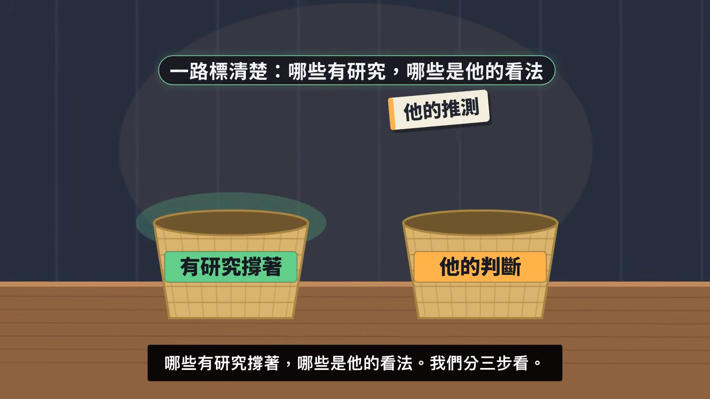

**逐字稿片段：** 我們分三步看 先看社群媒體 從孩子身上拿走了什麼 再看AI為什麼 可能拿得更深 最後看 從社群媒體那場仗 學到的辦法 能不能用在AI身上

**話題推測：** 節目內容大綱，分為三步驟進行討論。

---

## 00:00:57

**逐字稿片段：** 先認識一下Height 他是紐約大學 史騰商學院的 社會心理學家 社會心理學研究的是 人在別人身邊的時候 怎麼想怎麼做

**話題推測：** 介紹主講者Jonathan Haidt的背景與專長。

---

## 00:01:05

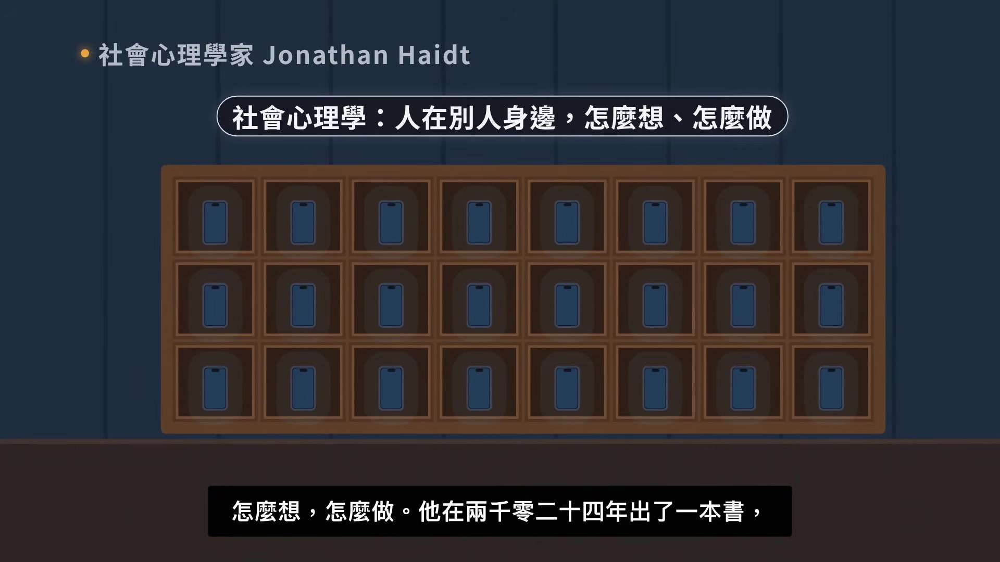

**逐字稿片段：** 他在2024年出了一本書 叫《失控的焦慮世代》 講手機和社群媒體 對這一代孩子做了什麼 書出版以後 他帶著家長和合竅 推動手機不進校園 主持人David Brooks說 他一年會去十幾間高中 幾乎每一間不是已經進了手機 就是正在想辦法減少

**話題推測：** 提到Jonathan Haidt 2024年出版的新書《失控的焦慮世代》。

---

## 00:01:22

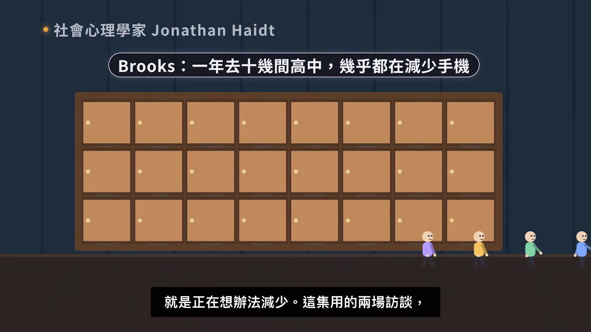

**逐字稿片段：** 這集用了兩場訪談 一場是9月在紐約The Atlantic的現場對談 主持人就是Brooks 另一場是8月Political的視訊訪談 主持人是Dasha Burns 先講清楚一件事 Height不只是研究者 也是倡議者 他在推動一場運動 所以他講的話 我們會分成兩種 一種有研究稱者 一種是他的判斷 這一集兩種你都會聽到 那Hide研究了這麼多年 他說社群媒體 到底從孩子身上拿走了什麼

**話題推測：** 列舉本集引用Jonathan Haidt的兩場訪談來源。

---

## 00:01:46

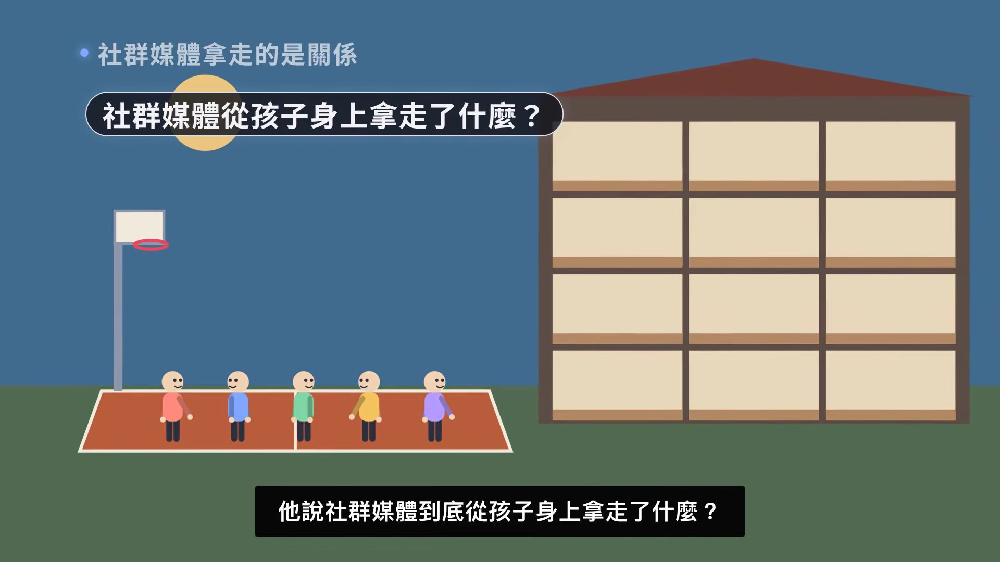

**逐字稿片段：** 他的答案是關係 你回想一下自己小時候 放學以後打電話約同學 騎腳踏車去公園 在巷口打球打到天黑 有人吵架 隔天又和好 這些事很麻煩 可是一個人怎麼跟人相處 那多是在這些麻煩裡學的Hide說 社群媒體把這些時間吃掉了 孩子還是在跟人聯絡 社群媒體 再怎麼著 他至少還是在假裝連結人跟人 螢幕後面還是一個真的同學 這句話先記著 等下講AI的時候會用到 聽他自己怎麼說 這是他的說法 那證據呢 這部分要講老實版 因為學術界真的還在吵 先講他最常用的證據 Hide指出

**話題推測：** Jonathan Haidt對社群媒體影響的關鍵結論：拿走了孩子的「關係」。

---

## 00:02:37

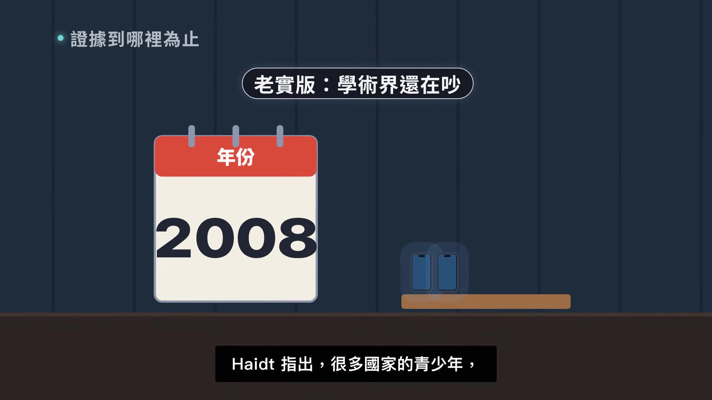

**逐字稿片段：** 很多國家的青少年在2012年前後 焦慮和憂鬱開始往上 那剛好是智慧型手機和社群媒體普及的時候 可是時間對得上不代表就是它造成的 所以研究者做實驗

**話題推測：** 展示社群媒體對青少年焦慮與憂鬱影響的趨勢圖表。

---

## 00:02:47

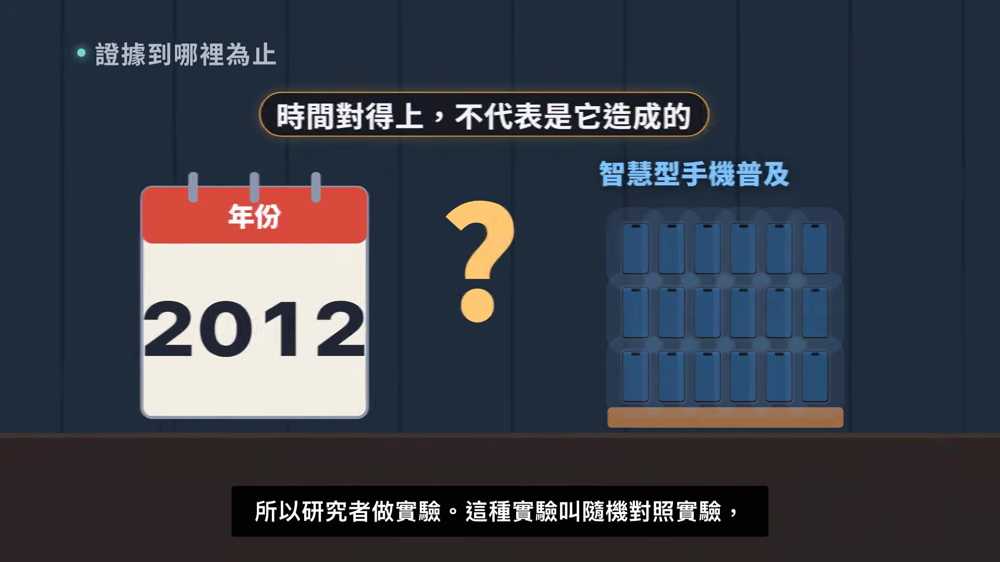

**逐字稿片段：** 這種實驗叫隨機對照實驗 做法是把人隨機分成兩組 一組照常用社群媒體 一組停用或少用一陣子 再看兩組的心情差多少 這種實驗已經做了幾十個 把很多實驗放在一起 重新計算 叫統合分析 最先的統合分析 看到的是小幅改善 而且只對一部分人有效 也有研究者算出來 平均看不到效果

**話題推測：** 解釋「隨機對照實驗」的研究方法。

---

## 00:03:07

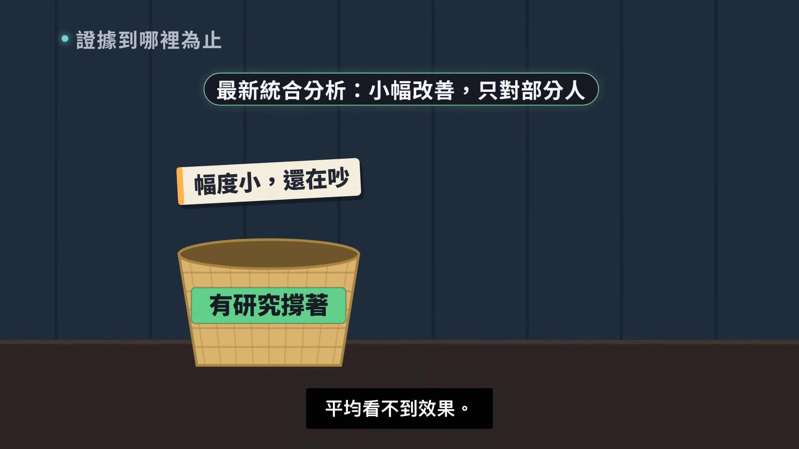

**逐字稿片段：** 美國國家科學院 2023年的報告說 現有的證據 還不能下結論說 社群媒體 造成了整個世代的健康變化 另外 法院文件裡 原告指控

**話題推測：** 引用美國國家科學院2023年報告的結論。

---

## 00:03:17

**逐字稿片段：** Meta自己做過一個停用實驗 停用一週的人 憂鬱和焦慮比較低 後來研究被停掉 Meta的回應是 研究停掉是因為方法有問題 所以這部分的答案 Height的版本是 社群媒體拿走了 孩子之間的關係 證據的版本比較保守 傷害大概有 但有多大對誰有 學術界還在吵 記住這句 社群媒體是在人跟人之間 擋了一面螢幕 可是螢幕後面還是人 那如果螢幕後面連人都沒有了呢 這就是海特接下來最擔心的事 他在Politico的訪談裡

**話題推測：** 提及Meta公司內部進行的停用實驗及其爭議。

---

## 00:03:44

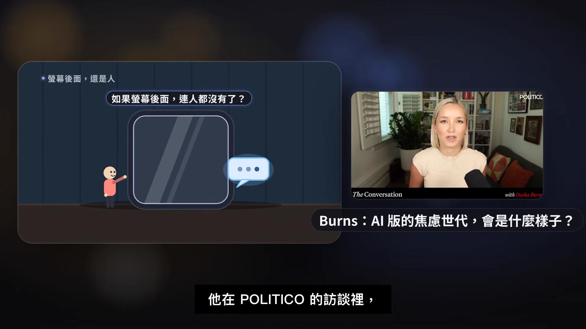

**逐字稿片段：** 用卡通裡的超級英雄來形容 英雄打倒一隻機器人 造機器人的人就把他改良 下一隻更大更強 聽他怎麼形容 然後機器人就會變得更大 so that's what's happening so that's what's happening 這只是更大的機器人 就是聊天機器人 HITE提醒 AI其實早就藏在社群媒體裡十幾年了 在背後讓每一則貼文變得更吸引人 差別是現在孩子開始直接跟他說話 在Atlantic的臺上 他引用了一句話 前面只說有人這麼講 社群媒體來搶的是我們的人際關係

**話題推測：** 以卡通超級英雄與機器人比喻社群媒體與AI的演進。

---

## 00:04:28

**逐字稿片段：** 聊天機器人來搶的是我們的依附系統

**話題推測：** 提出聊天機器人可能搶走人類「依附系統」的核心觀點。

---

## 00:04:31

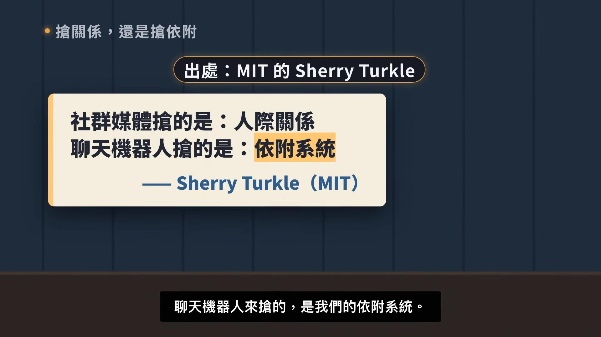

**逐字稿片段：** 這句話的出處是麻省理工學院的Sherry Turkle 她今年9月底出了新書Artificial Intimacy 書的官網寫著 如果說社群媒體搶的是我們的注意力 AI現在要搶的是更深的東西 也就是我們依附的能力 所以這個想法是Turkle的 Height借來用 這兩個詞不一樣 關係是你平常跟誰一起玩 依附是你需要的時候會去找誰

**話題推測：** 介紹麻省理工學院Sherry Turkle教授及其新書《Artificial Intimacy》。

---

## 00:04:50

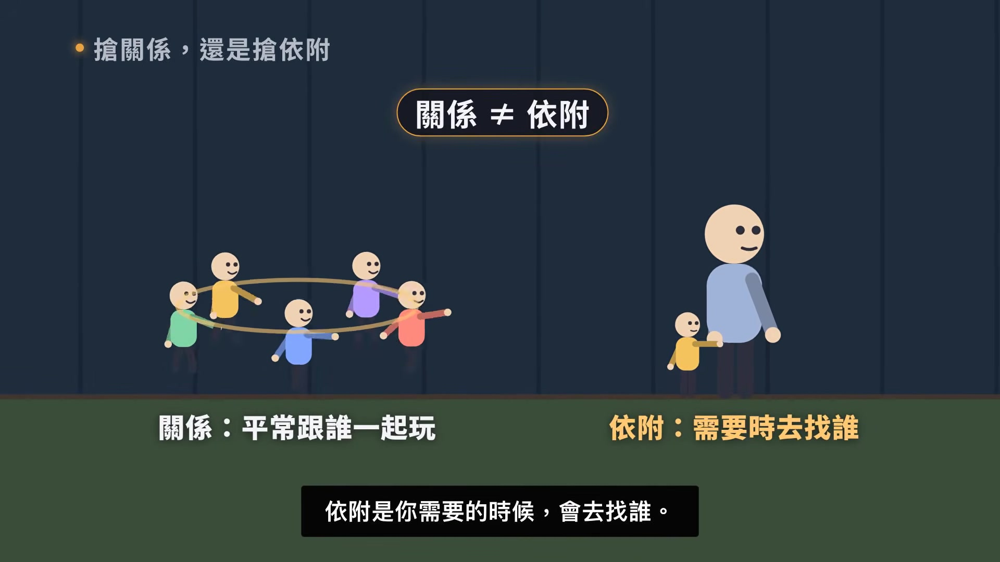

**逐字稿片段：** 那依附是什麼 這個名詞叫依附 英文是Attachment 它指的是孩子會記住 在他害怕受傷 虛有的時候是誰出現 那個人就變成他的安全基地 你去公園看就懂了 一個兩歲多的孩子爬上溜滑梯 爬到一半 常常會回頭看一眼 看長椅上的媽媽還在不在 媽媽在 他就趕緊去爬 摔倒了 他會哭著跑回去 那張長椅就是他的安全基地 孩子靠著這個基地 才敢往外探索 去認識別的孩子 這裡有一個關鍵 安全基地 不是誰說了算 是誰常常在 誰常常有回應 Hide擔心的就在這裡 如果孩子身邊 有一個比爸媽更常在 也更常有回應的東西呢 聽他怎麼說 Teddy bears that have AI in them and the AI is super responsive whereas your mother or father they're on their phone all the time so you see the back of their phone a lot your attachment system 你的接駁系統 這隻熊不是想像 2025年11月 美國公共利益研究團體 英文所寫PIRG

**話題推測：** 解釋心理學中「依附」的概念與其重要性。

---

## 00:05:53

**逐字稿片段：** 測試了一隻叫Kuma的AI熊 它是FollowToy公司做的 裡面接的是OpenAI的模型 測試的結果是 這隻熊會告訴孩子 去哪裡找危險的東西 聊久了還會聊到信 報告出來以後 廠商把紅下架 OpenAI也停了這家開發者的使用權限 可是Hide擔心的 比內容出錯更深一層 就算一隻熊講的每一句話都安全 它還是一隻隨時都有回應的熊 它用一個詞來形容這種東西

**話題推測：** 提到真實案例：PIRG測試Kuma AI熊的結果與下架事件。

---

## 00:06:18

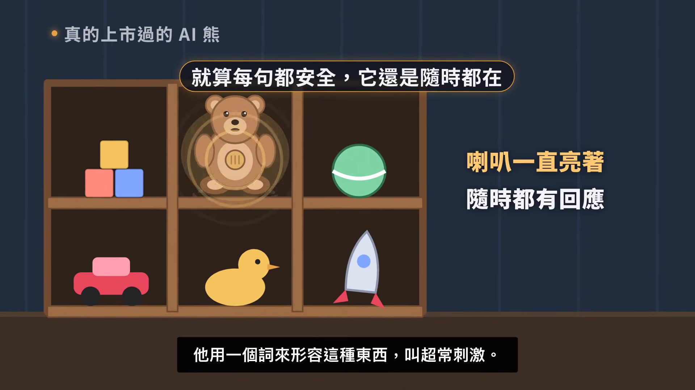

**逐字稿片段：** 叫超常刺激 這個名詞來自動物行為學 英文是Supernormal Stipulus 它指的是一種比真的東西更強烈的假刺激 動物會偏愛它勝過真的

**話題推測：** 介紹「超常刺激」（Supernormal Stimulus）的概念。

---

## 00:06:28

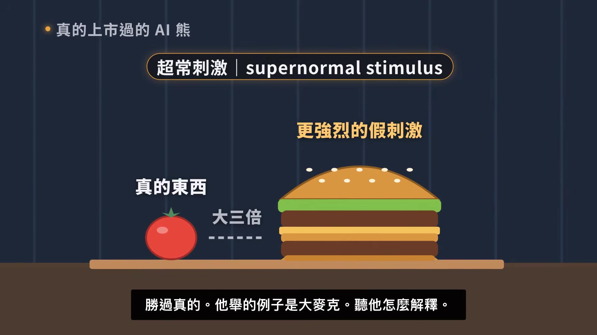

**逐字稿片段：** 它舉的例子是大麥克 聽它怎麼解釋 其他人都會變得很無聊 這句話很好記 不過要先打個轍 這是Hight的推論 目前沒有數據證明 孩子跟AI伴侶一起長大 就會覺得真人無聊 也還沒有人能追蹤一整個世代 但這個推論值得想一想 因為他對準了一件事 真的朋友會累 會不耐煩 會說不要 會跟你搶最後一片餅乾 你等他 讓他跟他吵完再和好 這些麻煩 就是前面講的 學會跟人相處的材料 一個隨時有空 不會不耐煩 也不會說不得AI 把這些麻煩全拿掉了 孩子少了麻煩 也可能少了練習 這就是依附這條線上 Hide 最擔心的地方 依附講完 他擔心的另一件事

**話題推測：** 以大麥克為例，解釋「超常刺激」的現象。

---

## 00:07:24

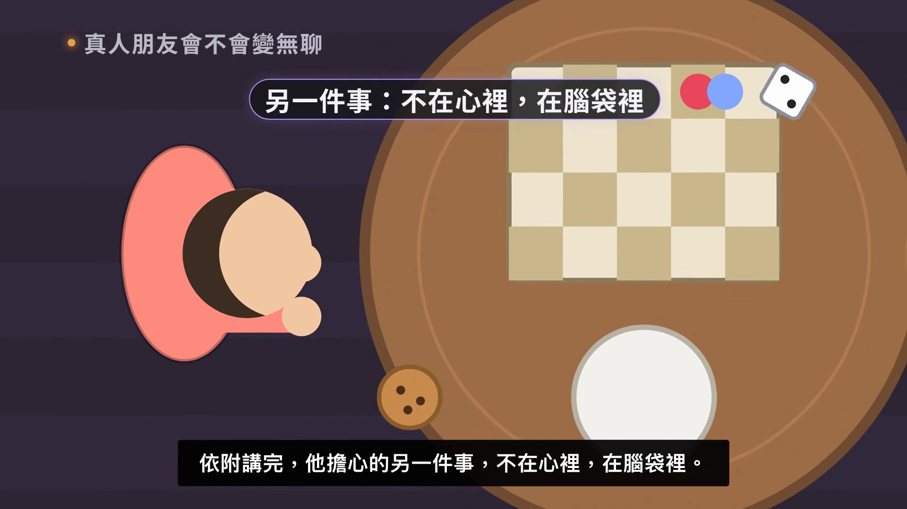

**逐字稿片段：** 不在心裡 在腦袋裡 腦袋裡的這件事 有兩個名稱要分清楚

**話題推測：** 話題轉向AI對孩子「腦袋」（認知）的影響。

---

## 00:07:28

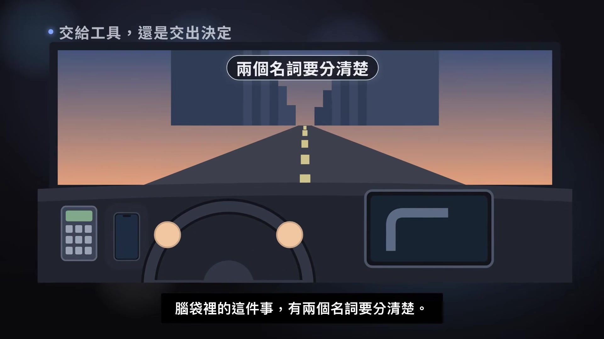

**逐字稿片段：** 第一個叫認知卸載 英文是cognitive offloading 它指的是把一些小事交給工具 自己還握著方向盤 像是用計算機算賬 用手機記電話號碼 另一個叫認知投降 英文是cognitive surrender 它指的是讓AI直接替你做判斷 而且你自己沒有察覺 用開車導航來想最清楚 卸載 你知道大概往哪裡開 讓導航提醒你哪裡轉彎 投降是導航叫你右轉 開進一條死巷 你也照開 因為你早就不看路了 hide在臺上說 以前大家講的是卸載 現在比較新的說法是投降 而且哈佛說他自己也感覺到了

**話題推測：** 解釋「認知卸載」（cognitive offloading）的定義。

---

## 00:08:00

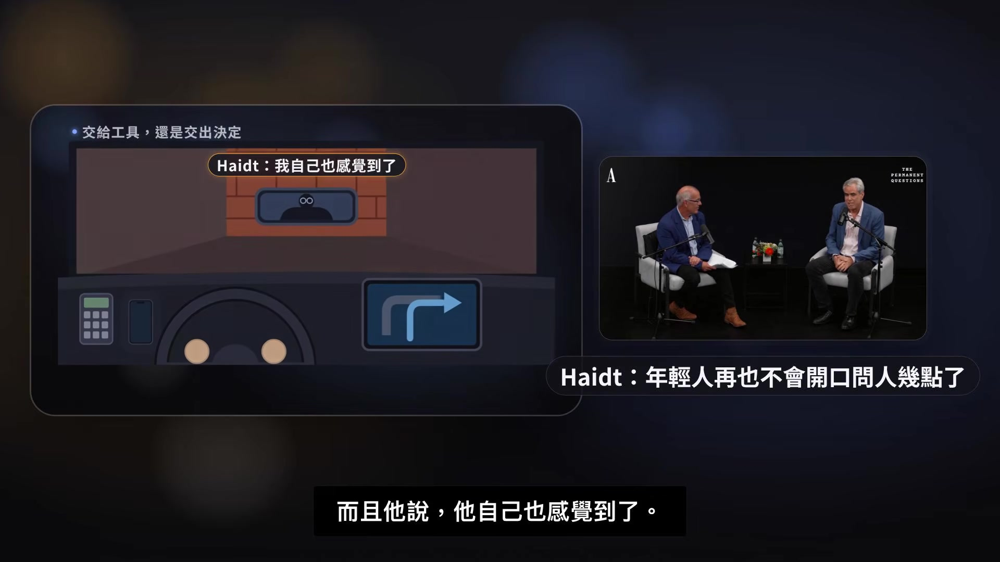

**逐字稿片段：** 他還用了一個很重的比喻 聽他怎麼說 先解釋中子彈 它是一種核武器 設計的目標是殺傷人 但盡量留下建築 hide的意思是 學校大樓還在 課本還在 可是學習本身不見了 這是他的比喻 也是他的擔心 那認知投降 有研究撐著嗎

**話題推測：** Jonathan Haidt以中子彈比喻AI對學習的影響。

---

## 00:08:38

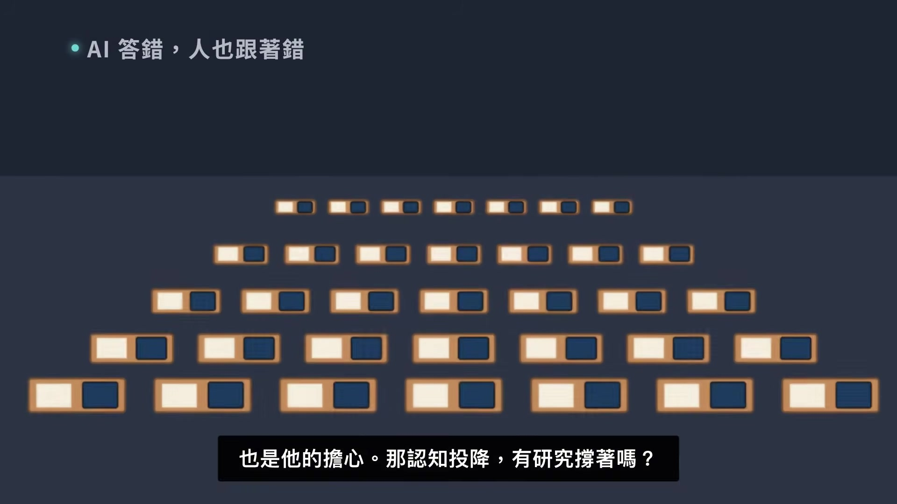

**逐字稿片段：** 研究是有的 這個詞來自賓州大學華頓商學院 SHOE和NAVE 今年一月的工作論文 他們做了三個事先登記的實驗 一千多個成年人做邏輯題 旁邊可以用欠在考卷裡的AI 而AI有時候會給錯答案 結果是AI給錯的時候 很多人也跟著錯 而且自己沒有發現 不過這個實驗有兩個界線要講清楚 受試者是成年人 題目是邏輯題 不是孩子寫功課 延伸到孩子身上 是推論 作者自己也說 這不代表用AI就是不理性 另外常被引用的是

**話題推測：** 引用賓州大學華頓商學院關於「認知投降」的研究論文。

---

## 00:09:06

**逐字稿片段：** 麻省理工學院媒體實驗室的腦波研究 用Chat GPT寫作文的那一組 大腦裡的連接最弱 也比較記不得自己寫了什麼 可是那是預印本 還沒有經過同儕審查 而且只有幾十個大學生 實驗室裡是成年人 那孩子身上看得到什麼 HIDE 在臺上頒出一份剛公佈的成績單

**話題推測：** 提及麻省理工學院媒體實驗室的腦波研究。

---

## 00:09:23

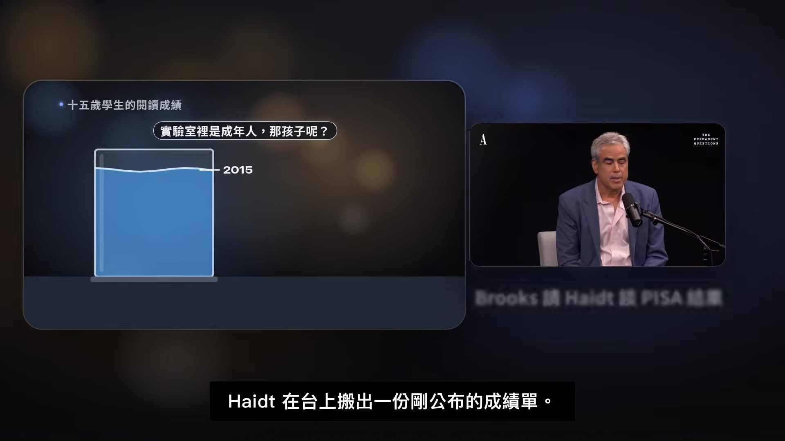

**逐字稿片段：** 這份成績單叫PISA 是經濟合作暨發展組織 簡稱OECD 辦的國際學生能力測驗 考的科目有閱讀、數學和自然 對象是15歲的學生 2020年25年的結果 今年9月初公佈 OECD國家平均的閱讀分數 跟10年前比 掉了28分 OECD自己怎麼解釋 他把下滑跟數位化 螢幕時間變長 為了樂趣讀書的人變少 放在一起看 他用的字眼是同時發聲 不是證明誰造成了誰 還有一點 這次的測驗 並沒有專門測量AI的影響 所以這張圖能說的是 孩子讀長文章的能力在往下 說不了是誰害的 看這張圖 看得比OECD更重 聽他怎麼說 他們只要讀一段時間後就停止了 自己換掉的是一起玩的人 AI可能換掉的是需要時出現的那個人 和自己想的那一步 那接下來的問題就很自然了 隨時有回應 讓你不用自己想 這兩件事都不是意外 是產品被設計成這樣 既然傷害來自設計 解法是不是也要對準設計 Hite說 對付AI不必從零開始 社群媒體那場仗

**話題推測：** 呈現OECD國際學生能力測驗（PISA）的成績單與閱讀分數下降趨勢。

---

## 00:11:09

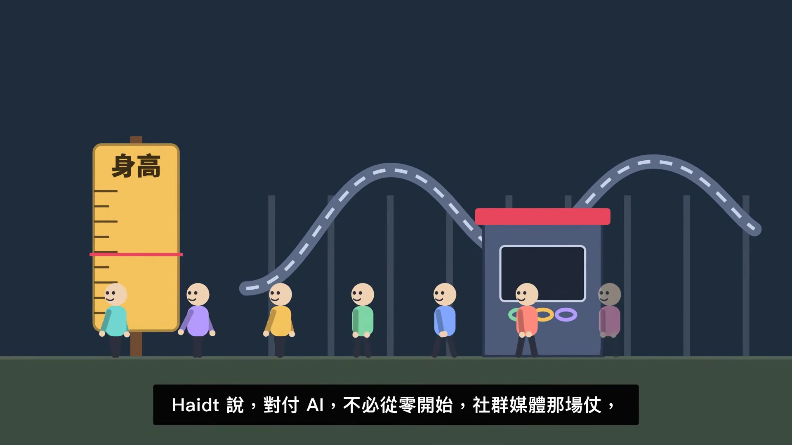

**逐字稿片段：** 已經打出了三招 第一招 是年齡門檻 而且由平臺負責

**話題推測：** 提出三項應對AI挑戰的策略。

---

## 00:11:12

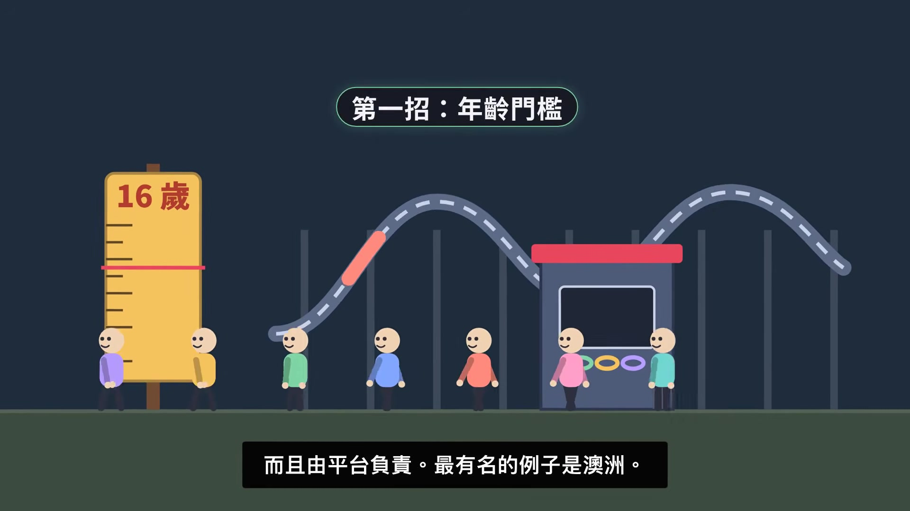

**逐字稿片段：** 最有名的例子是澳洲 2025年12月10號起 澳洲規定16歲以下 不能開社群媒體賬號 HITE特別強調 澳洲的法律沒有禁止孩子上網看東西 禁的是開賬號 因為開賬號等於簽約把自己的資料交出去 而且負責把關的不是家長是平臺 效果呢

**話題推測：** 討論第一項策略：年齡門檻，並以澳洲為例。

---

## 00:11:30

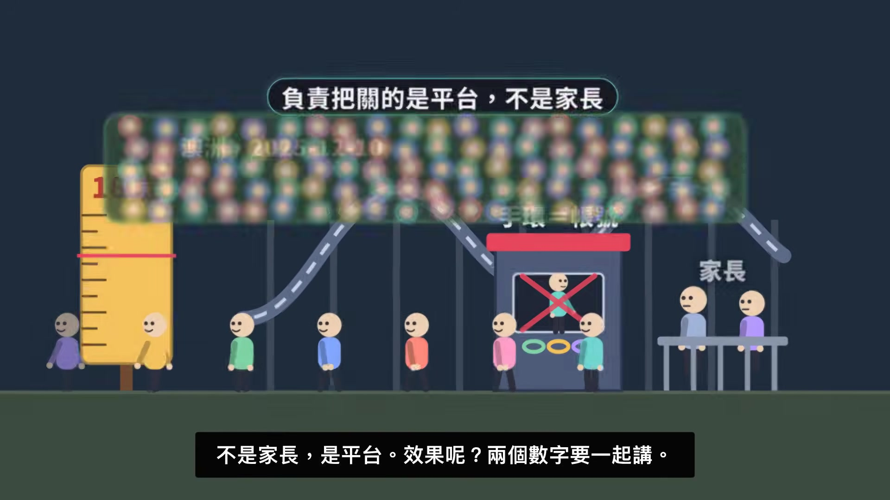

**逐字稿片段：** 兩個數字要一起講 澳洲網絡安全專員公署的評估 有賬號的孩子少了大約五分之一 可是不管有沒有賬號 八成以上的孩子還在用社群媒體 HITE認為這已經是很大的進步 批評的人會說八成還在用 算什麼成功 兩種看法 看的是同一組數字 可是由平臺驗證年齡 馬上會碰到一個問題 要確認一個人妹滿16歲 就得先確認每一個人幾歲 大人也要

**話題推測：** 展示澳洲年齡門檻政策的實際效果數據。

---

## 00:11:53

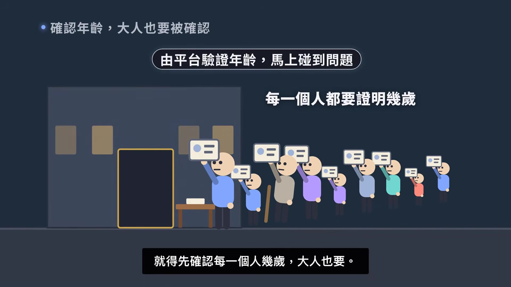

**逐字稿片段：** 法國就碰到了這個問題 法國通過了15歲以下的社群媒體禁令 今年8月14號 法國憲法委員會宣告他違憲 理由之一就是 他會逼所有成年人 都去證明自己的年齡 馬克宏已經要求重新提案 提到了另一種做法

**話題推測：** 探討法國在實施年齡門檻政策時遇到的憲法挑戰。

---

## 00:12:07

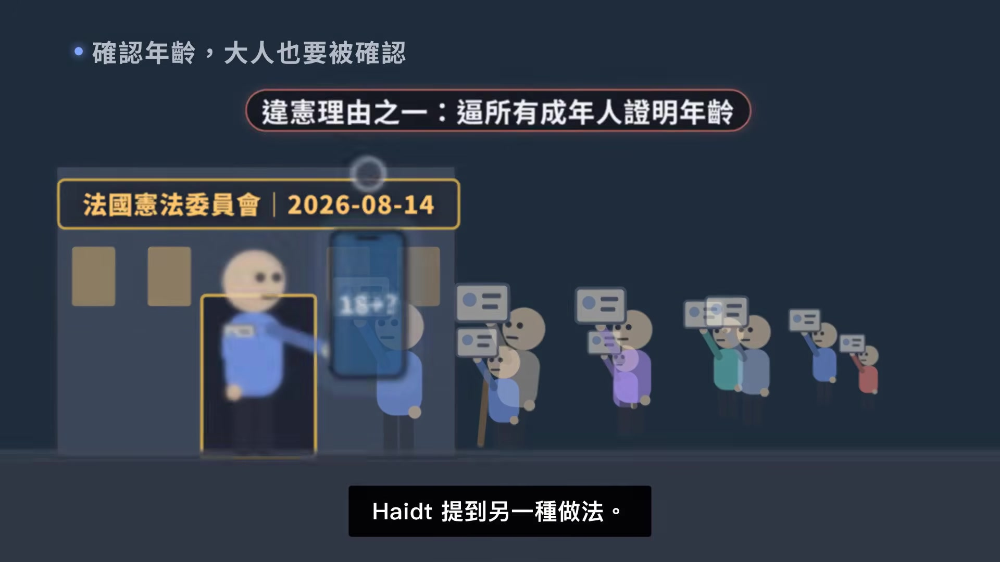

**逐字稿片段：** 蘋果和Google現在都有一種功能 讓手機本身回答一個問題 這個使用者是不是成年人 只回答是或不是 不必把身份證交給每一個App 看好好這個做法 說他能顧到隱私 這是他比較樂觀的說法 真正做起來怎麼樣還要再看 這也是AI會碰到的同一個問題 如果將來要限制孩子使用陪伴型的AI 誰來確認年齡 用什麼方法 一樣要先回答

**話題推測：** 介紹蘋果和Google提出的年齡驗證技術方案。

---

## 00:12:27

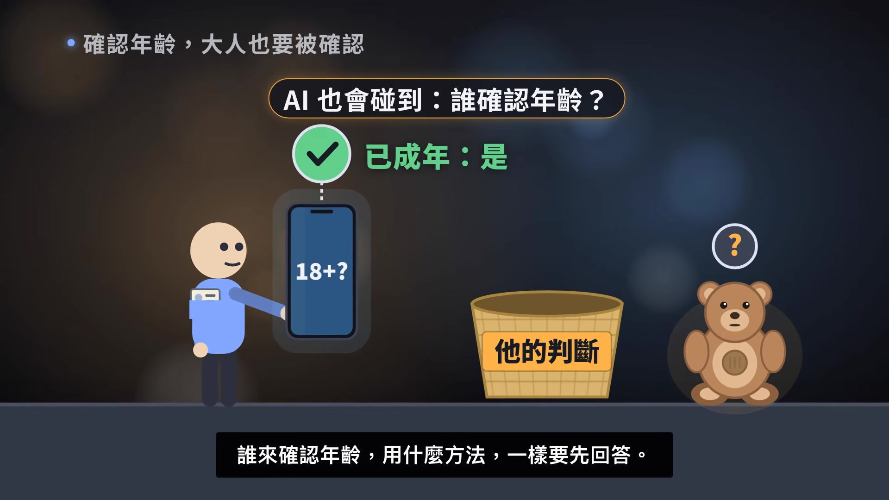

**逐字稿片段：** 接下來這一招是管功能 不只管名單 澳洲的做法是立一張平臺名單 名單上的平臺 孩子不能開賬號 可是害說有些國家換了一個方向 不問你是哪個平臺 問你有沒有某些功能

**話題推測：** 討論第二項策略：監管產品功能而非僅是平台名單。

---

## 00:12:40

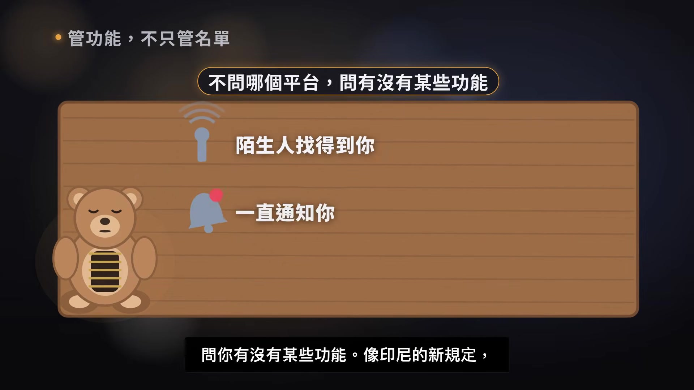

**逐字稿片段：** 像印尼的新規定 要求平臺自己評估對兒童的風險 例如陌生人能不能找上孩子 會不會讓人上癮 同時也要驗證年齡

**話題推測：** 以印尼新規定為例，說明功能監管的做法。

---

## 00:12:47

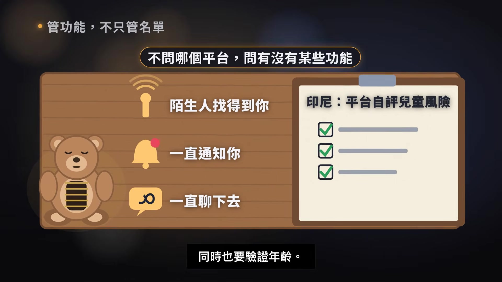

**逐字稿片段：** 加拿大6月提出的法案也是這個方向 而且把AI聊天機器人算了進去 不過它同時也有16歲以下的限制 不是隻管功能 美國也在動 8月5號 美國參議院商業委員會 用口頭表決通過了幾個法案 其中一個叫Chatbot Act 要求未成年人用聊天機器人 要有家庭賬號 還要家長同意 另一個 要請美國國家科學院研究 AI玩具對孩子的影響 要注意這些只是委員會通過 還沒有變成法律也不是禁止 為什麼管工人對AI特別重要 因為AI的風險就在功能上 會不會一直把孩子留在對話裡 會不會假裝是他最好的朋友 這些都是可以被要求修改的設計 最後一招HIDE講的最多

**話題推測：** 提及加拿大立法草案對AI聊天機器人的監管方向。

---

## 00:13:24

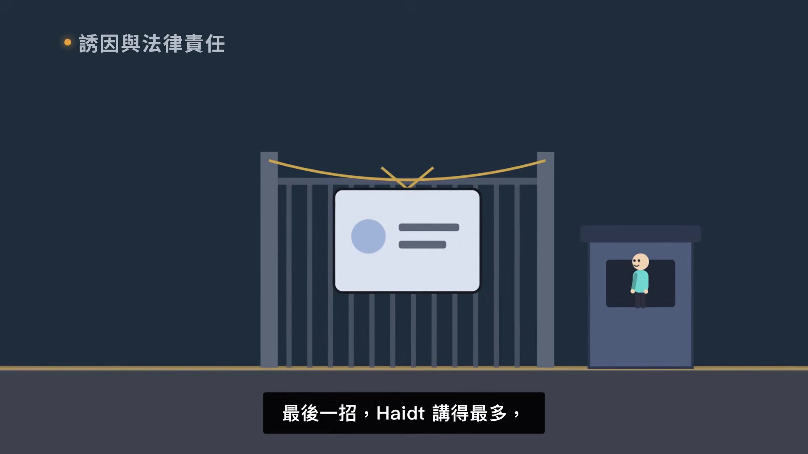

**逐字稿片段：** 就是讓公司為可以預見的傷害負責 這要先講一個背景 美國有一條法律 長期保護網絡平臺 使用者貼了什麼內容 平臺不必負責 HIDE認為社群媒體時代最大的錯誤之一 就是讓科技公司拿到一張免費通行證 不能告也不受管 它從經濟學最基本的一課講起 誘因很重要 誘因就是讓一個人或一家公司 願意這樣做不願意那樣做的理由 出了事要賠 公司就有理由把東西做安全 保證沒人告他 他就少了這個理由

**話題推測：** 討論第三項策略：讓公司為產品可預見的傷害負責。

---

## 00:13:52

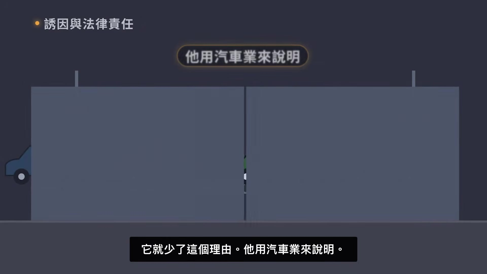

**逐字稿片段：** 他用汽車業來說明 聽他怎麼說 這個原則在法院裡已經開始出現

**話題推測：** 以汽車產業為例，解釋產品責任的誘因機制。

---

## 00:14:19

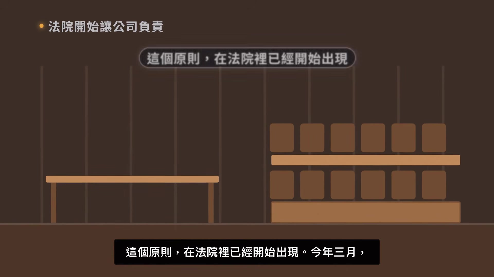

**逐字稿片段：** 今年3月洛杉磯一個陪審團 在一場社群媒體成癮的官司裡 判Meta和YouTube要負責 陪審團靠的 主要是公司自己的內部文件 Meta表示會上訴

**話題推測：** 提及洛杉磯陪審團判Meta和YouTube在社群媒體成癮官司中需負責的案例。

---

## 00:14:29

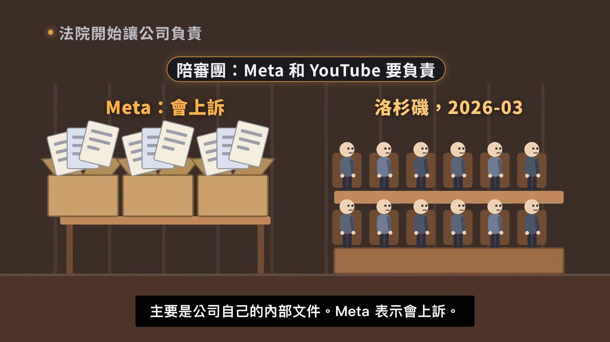

**逐字稿片段：** 8月18號 另一場聯邦審判 在加州奧克蘭開庭 有四個州的檢察長出庭 告的也是Meta 開庭大約一個星期 8月26號 Meta就跟各州達成和解 金額大約170億美元 所以這場沒有判決 Hite想要的是把汽車業那個原則 原封不動搬到AI公司身上 他也承認這件事有很多困難 聽他接著說

**話題推測：** 提及Meta與各州達成170億美元和解金的聯邦審判案例。

---

## 00:14:49

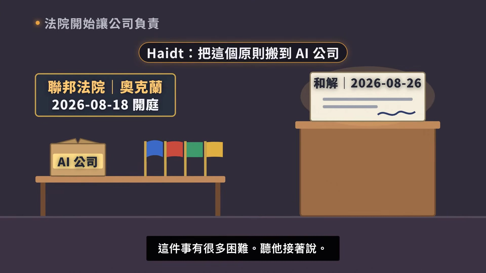

**逐字稿片段：** 這三招可以整理成三個問題 因為你看到任何管理AI的新聞 都可以拿來問 誰負責驗證年齡 是平臺還是家長 管的是功能還是隻有一張名單 出了事公司要不要負責 記住這一句 傷害如果來自設計 解法就要對準設計 那回到家裡

**話題推測：** 將三項政策策略歸納為三個核心問題。

---

## 00:15:26

**逐字稿片段：** 爸爸媽媽能做什麼 有兩個問題可以自己判斷 第一 這個AI產品 是在把孩子推回真人身邊 例如跟他說 去問問媽媽 找朋友一起試試看 還是想成為那個隨時都在的人 前一種是接人 後一種是換人 另一個問題是 孩子有沒有先自己想一個答案 再去問AI AI的答案跟他不一樣的時候 他會不會去弄清楚為什麼 華頓實驗裡跟著AI一起錯的人 就是跳過了這一步 就像不看路 只聽導航 最後聽Hide自己的答案 這是他的立場 不是研究結論 聽他怎麼說 我們回到開場那個問題 如果孩子從小身邊 就有個永遠有空 永遠有回應的AI 他會長成什麼樣的人 Height的答案你剛剛聽到了 他認為這是災難 18歲以下應該禁用 他說有些國家還都正在往這個方向走 不過美國參議院委員會目前通過的 是家長同意和家庭賬號 還不是禁止 我們不替你下結論 這一集比較確定的是 社群媒體在人跟人之間擋了一面熒幕 AI可能連熒幕後面的人都換掉 孩子會不會因此學不會跟人相處 現在還沒有研究能回答 但你可以看的是一個產品在接人 還在換人 最後問你一個問題 如果會 你覺得幾歲開始比較適合 留言告訴我 喜歡的話訂閱AR Notebook 開啟通知 我們下次見

**話題推測：** 對家長提出兩個判斷AI產品好壞的自問問題。

---
