# jimainotebook_5t2UDIcumvM — 關鍵畫面索引

- 來源逐字稿：[jimainotebook_5t2UDIcumvM_FIN.srt](jimainotebook_5t2UDIcumvM_FIN.srt)
- 影片：https://www.youtube.com/watch?v=5t2UDIcumvM
- 截圖數：134

## 00:00:09

**逐字稿片段：** 這一集我們要回答一個問題,經濟為什麼會有景氣循環? 為什麼每隔幾年就要衰退一次? 景氣好的時候大家都在賺錢,為什麼擴張不會一直持續,過幾年又變成衰退? 這個問題經濟學家吵了一百多年,到現在還沒有吵完。

**話題推測：** 提出影片的核心問題：經濟為何有景氣循環？預計會出現主題標題頁。

---

## 00:00:25

**逐字稿片段：** 今天我們把幾種最重要的說法一個一個講清楚,整理成一張地圖,再用它來分析現在的世界,最後討論臺灣。

**話題推測：** 講解影片的內容規劃與架構。預計會出現影片目錄或大綱頁。

---

## 00:00:32

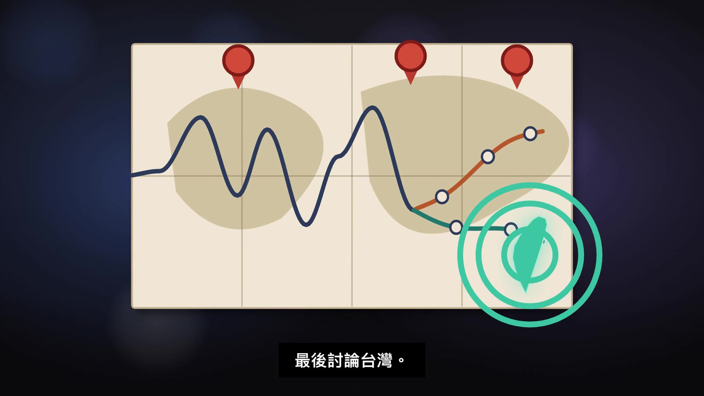

**逐字稿片段：** 先看一段真實的歷史。

**話題推測：** 轉向一段真實的歷史案例。預計會出現歷史事件的標題畫面。

---

## 00:00:34

**逐字稿片段：** 2003年 諾貝爾經濟學獎得主盧卡斯 在美國經濟學會的會長演說裡說 防止經濟大蕭條這個核心問題 實際上已經解決了 意思是 經濟學已經知道怎麼避免最嚴重的衰退

**話題推測：** 提及特定年份與諾貝爾經濟學獎得主盧卡斯。預計會出現盧卡斯照片及年份標示。

---

## 00:00:47

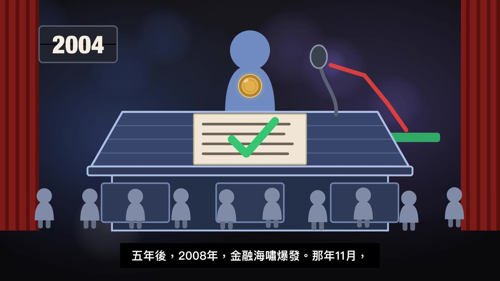

**逐字稿片段：** 5年後 2008年 金融海嘯爆發 那年11月

**話題推測：** 時間轉移到2008年金融海嘯。預計會出現金融海嘯相關新聞畫面或年份標示。

---

## 00:00:50

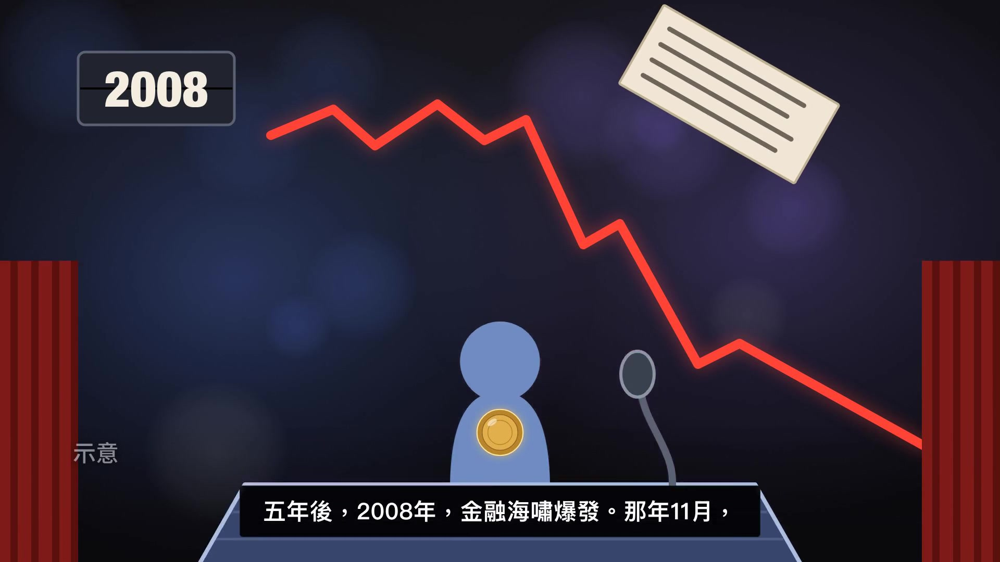

**逐字稿片段：** 英國女王到倫敦政治經濟學院 替新大樓揭幕 學者向她說明這場危機 女王問了一個很簡單的問題 大意是 這麼大的危機 怎麼沒有人看到她要來

**話題推測：** 提及英國女王與倫敦政治經濟學院。預計會出現女王的照片或相關事件圖片。

---

## 00:01:00

**逐字稿片段：** 隔年 英國國家學術院找來學者 銀行界 監管機構和政府官員討論 寫了一封三頁的信回覆女王 信裡的結論是 每個人都很聰明 可是沒有人看清楚整個體系的風險 這主要是集體缺乏想象力

**話題推測：** 時間轉移到隔年，英國國家學術院的回覆。預計會出現信件內容或機構標誌。

---

## 00:01:14

**逐字稿片段：** 所以問題就來了 衰退為什麼一再回來 又為什麼這麼難事先看到 要回答這個問題 我們先把兩件事弄清楚 景氣循環到底是什麼 還有衰退是誰在認定

**話題推測：** 重新提出問題，預告進入解答環節。預計會出現新的問題標題頁。

---

## 00:01:25

**逐字稿片段：** 先講名字 經濟學家把這種一陣熱一陣冷的起伏 叫景氣循環 它有四個階段 擴張到高峰 然後收縮 也就是衰退 掉到谷底 再重新擴張 循環這兩個字 很容易讓人誤會 以為它像時鐘一樣準時 其實不是

**話題推測：** 開始解釋景氣循環的名稱與階段。預計會出現景氣循環圖示。

---

## 00:01:43

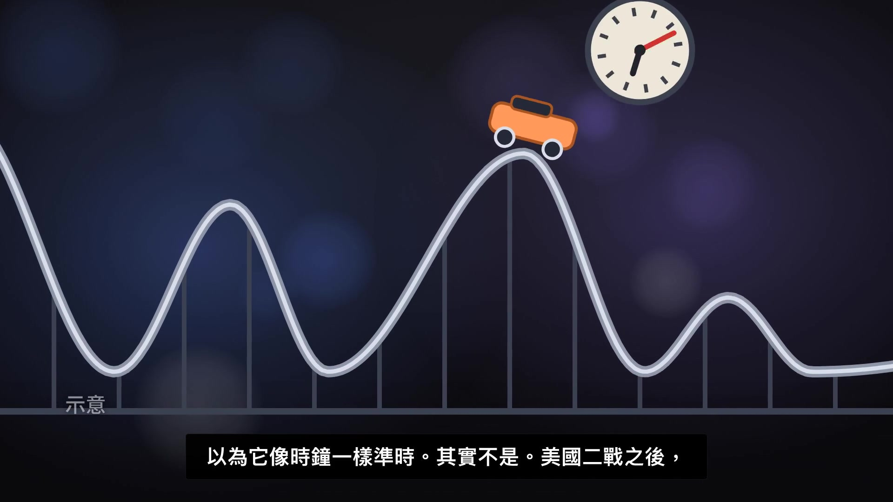

**逐字稿片段：** 美國二戰之後 最短的一次擴張 只持續了12個月 最長的一次 從2009年6月 一路走到2020年2月 128個月 超過10年 衰退也一樣 短的兩個月 長的一年半 所以問每隔幾年 其實已經把問題 想得太整齊了 長度每次都不一樣 可是它一再回來 這才是奇怪的地方

**話題推測：** 提供美國二戰後擴張與衰退的具體時間數字。預計會出現時間軸或統計圖表。

---

## 00:02:03

**逐字稿片段：** 在問為什麼之前,先看一件事 衰退開始的那一天,到底是誰說了算?

**話題推測：** 轉向討論衰退的認定標準。預計會出現新的主題標題頁。

---

## 00:02:09

**逐字稿片段：** 在美國,負責宣佈的是一群學者 這群學者,屬於美國國家經濟研究局 英文簡稱NBER 是一個民間的研究機構,不是政府單位 他們組成的委員會,叫景氣循環認定委員會 美國經濟哪個月到高峰,哪個月到谷底 大家都依照他們的說法

**話題推測：** 介紹美國國家經濟研究局（NBER）。預計會出現NBER的標誌或名稱。

---

## 00:02:25

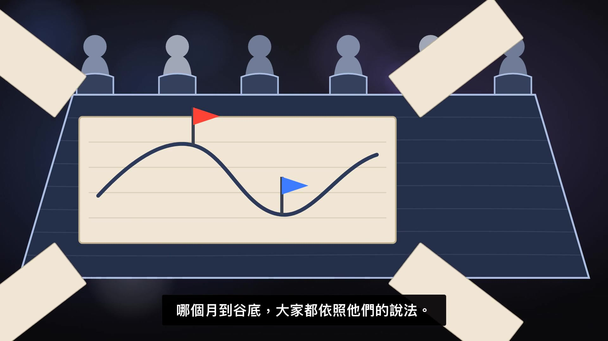

**逐字稿片段：** 很多人聽過一個說法 GDP連續兩季負成長,就叫衰退 委員會不是這樣看的

**話題推測：** 提及常見的GDP連續兩季負成長說法。預計會出現該說法的文字框。

---

## 00:02:31

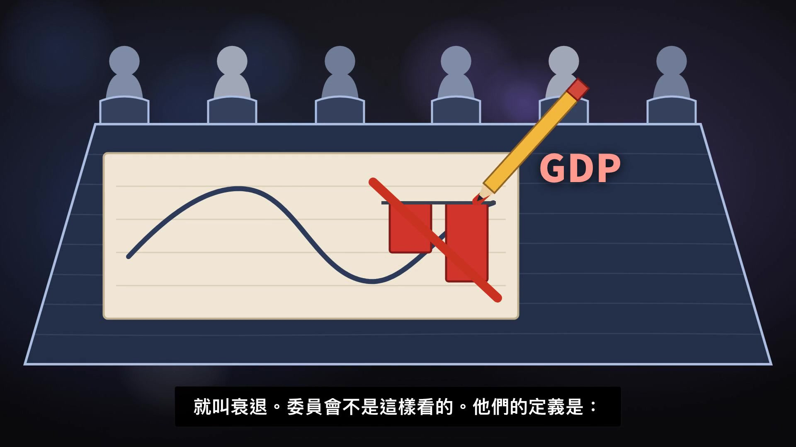

**逐字稿片段：** 他們的定義是 經濟活動明顯下滑 擴散到整個經濟 而且持續好幾個月以上 委員會檢查三件事 下滑的多深 擴散的多廣 持續多久 所以他們檢查的不止GDP 還有就業、收入、消費、工廠產出 一個月一個月對照

**話題推測：** 說明NBER對衰退的定義與檢查標準。預計會出現定義的文字說明或檢查項目列表。

---

## 00:02:48

**逐字稿片段：** 後來的美國中央銀行主席伯南克 在進政府之前 也是這個委員會的成員

**話題推測：** 提及美國中央銀行主席伯南克曾是NBER成員。預計會出現伯南克的照片。

---

## 00:02:52

**逐字稿片段：** 聽他自己說 我曾經成為這個委員會的一名 他們決定這個逆轉 and ended in June of 2009 so it was a long recession when they say the recession ended 但這不代表事情回到正常 而是說逆轉停止了 衰退結束不代表日子變好 只代表不再往下掉 而委員會宣佈的時間常常晚得驚人

**話題推測：** 播放伯南克的講話片段。預計會出現影片播放介面或伯南克的演講畫面。

---

## 00:03:29

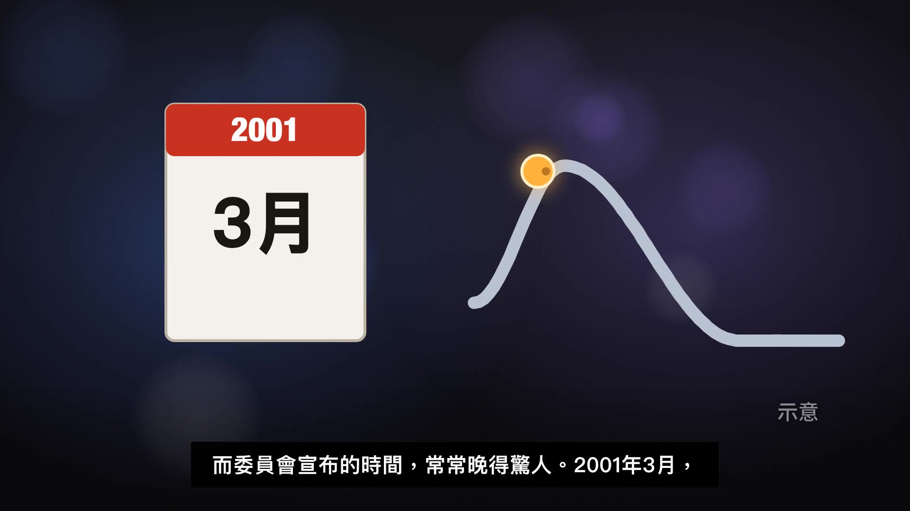

**逐字稿片段：** 2001年3月美國經濟到了高峰 接著開始衰退 委員會宣佈這件事 是2001年11月26日 那次衰退 正好在11月就結束了 也就是說 官方宣佈衰退的那個月 衰退已經走到尾聲

**話題推測：** 以2001年衰退為例，說明宣布時間的滯後。預計會出現2001年衰退的時間軸與公告日期。

---

## 00:03:43

**逐字稿片段：** 2008年更明顯 委員會在2008年12月1日才宣佈 美國從2007年12月就開始衰退 晚了將近一年 那時雷曼兄弟已經倒閉了 這不是委員會偷懶 資料要好幾個月才能收集完整 收集完整之後還會一再修正 判斷景氣 就像看著後照鏡開車 你看得清楚剛剛經過的彎道 卻看不到前面那一個 中央銀行決定利率 靠的也是這面後照鏡

**話題推測：** 以2008年衰退為例，再次說明滯後。預計會出現2008年衰退的時間軸與公告日期，可能伴隨雷曼兄弟倒閉的新聞圖。

---

## 00:04:07

**逐字稿片段：** 主持這個委員會最久的人 是史丹佛大學的經濟學家 Robert Hall 委員會在1978年 用現在的形式成立 他一路主持到2024年 46年 美國這半世紀 每一次衰退的起期日期 幾乎都經過他的手

**話題推測：** 提及NBER委員會最久的主持人Robert Hall。預計會出現Robert Hall的照片。

---

## 00:04:22

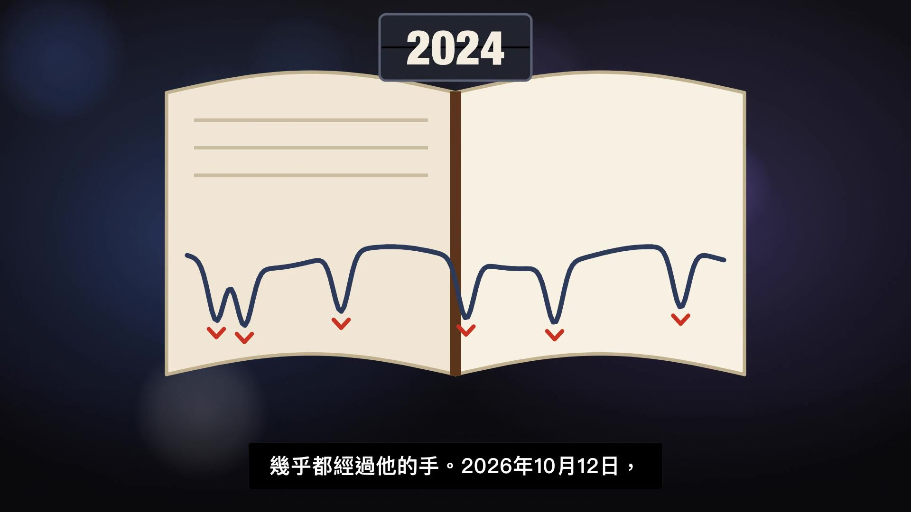

**逐字稿片段：** 2026年10月12日 Hall跟哥倫比亞大學的 Michael Woodford 一起得到諾貝爾經濟學獎 他們得獎的研究 後面會再回來看 這一部分的答案是 景氣循環沒有固定週期 衰退要事後才能確認 可是它一再回來 一再回來就代表背後有原因

**話題推測：** 提及Hall與Woodford因相關研究在2026年獲得諾貝爾經濟學獎。預計會出現諾貝爾獎得主照片和頒獎年份資訊。

---

## 00:04:39

**逐字稿片段：** 而這個原因大致有兩個方向 一個方向是經濟本來好好的 是外面來的衝擊打斷了它 另一個方向是不需要外部衝擊 景氣擴張本身就會帶來衰退 一百多年來的爭論 差不多就是這兩邊的拉扯 我們從很早的兩個人說起 他們活在同一個時代 一個抬頭看天上 一個低頭看賬冊 先看天上

**話題推測：** 提出景氣循環原因的兩大方向。預計會出現分叉圖或兩大類別列表。

---

## 00:05:01

**逐字稿片段：** 1870年代 英國經濟學家Javins 提出一個今天聽起來很奇怪的說法 衰退跟太陽黑子有關 太陽黑子的數量 大約十年多起落一次 他發現英國的商業危機 也差不多十年多來一次 他的推理是這樣 太陽影響氣候 氣候影響收成 收成影響貿易 後來的資料證明 這兩個週期其實對不上 這個理論也被放棄了 可是別急著笑他 Javins留下一個重要的想法 衰退的原因可能在經濟外面 是外面來的東西 一下一下推著經濟走 這個想法 一百年後會換一個樣子回來

**話題推測：** 介紹英國經濟學家Jevons及其太陽黑子理論。預計會出現Jevons的照片與理論簡圖。

---

## 00:05:34

**逐字稿片段：** 再看賬冊 法國有一位醫生出身的經濟學家 Clemont Jougela 1862年他出了一本書 書名直接寫著 商業危機 以及他在法國、英國和美國的週期性迴歸 他翻遍三個國家幾十年的物價、利率和銀行資料 看到一個反覆出現的順序 先是借錢很容易 價格一路往上 大家都很樂觀 然後某一天資金變緊 銀行收手 價格往下掉

**話題推測：** 介紹法國經濟學家Jouglar及其商業危機週期理論。預計會出現Jouglar的照片與其書名。

---

## 00:05:58

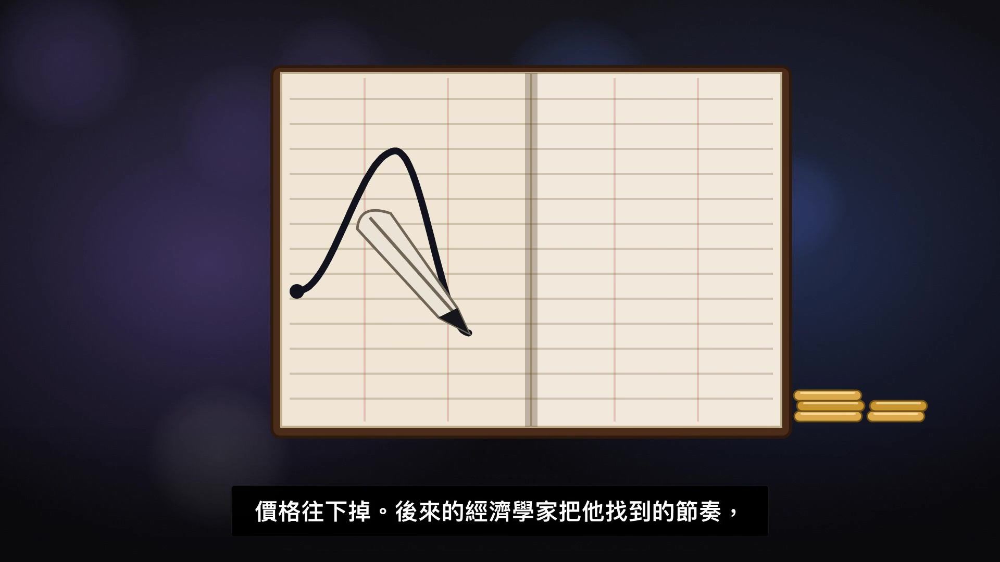

**逐字稿片段：** 後來的經濟學家把他找到的節奏 整理成大約7到11年一輪 這集標題問的每隔幾年 很重要的一個源頭就在這裡 後來有人把他的看法濃縮成一句話 蕭條唯一的原因就是繁榮 你看這跟太陽黑子完全相反 問題不在外面 在繁榮本身

**話題推測：** 說明Jouglar找到的7到11年週期。預計會出現週期圖表或數字標示。

---

## 00:06:16

**逐字稿片段：** 一段真實的歷史可以看出他在講什麼 1873年 美國正在瘋狂蓋鐵路 很多是借錢蓋的 那年9月

**話題推測：** 以1873年美國鐵路泡沫為例說明Jouglar理論。預計會出現鐵路建設照片或1873年恐慌新聞。

---

## 00:06:24

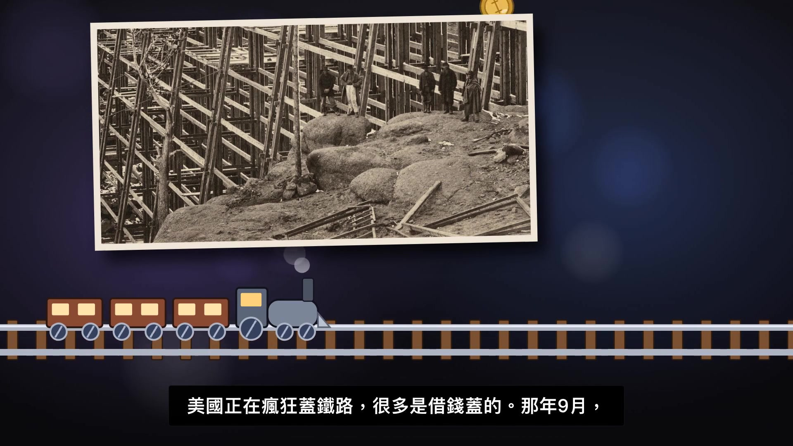

**逐字稿片段：** 替鐵路賣債券的大銀行J.Cook公司倒閉 紐約證券交易所因為恐慌關門 一關就是十天

**話題推測：** 提及J.Cook公司倒閉和紐約證券交易所關門。預計會出現相關公司標誌或交易所圖片。

---

## 00:06:30

**逐字稿片段：** NBER的記錄裡 這次衰退從1873年10月 一路到1879年3月 65個月 是美國有記錄以來最長的一次 這個故事 諸葛拉解釋得很順 借錢堆出熱潮 熱潮破掉 可是他的說法留下一個空白 那些鐵路是真的蓋起來了 後來也真的有火車在上面走 這一切只是一場錯誤嗎 下一個人的答案是 不是

**話題推測：** 提及NBER對1873年衰退的記錄。預計會出現該次衰退的持續時間數字。

---

## 00:06:52

**逐字稿片段：** 這個人叫熊彼得 奧地利出身 後來在哈佛大學教書 他說 景氣循環的主要動力 是創新 他的理論重點 叫創新集群 他說的是 一項重要的新技術成功之後 不會只有一家公司跟進 會有一大群人一起衝進來

**話題推測：** 介紹經濟學家熊彼得及其創新集群理論。預計會出現熊彼得的照片及理論關鍵詞。

---

## 00:07:07

**逐字稿片段：** 鐵路是這樣 後來的電力 汽車也是這樣 這一群人借錢蓋工廠 買設備 經濟就熱起來 等新東西蓋得差不多 供給變多 利潤變薄 舊的行業被擠掉 經濟就冷下來 這個過程 他後來取了一個很有名的名字 叫創造性破壞 照他的看法 衰退不只是意外 也是經濟在消化新東西 這個說法很迷人 可是也有麻煩 它1939年內部兩大冊的景氣循環 當時分量最重的一篇書評

**話題推測：** 舉例鐵路、電力、汽車等創新。預計會出現這些技術的歷史圖片。

---

## 00:07:34

**逐字稿片段：** 來自Kuznets 批評它的統計稱不起理論 也有人問 創新為什麼一定要成群出現

**話題推測：** 提及Kuznets對熊彼得理論的批評。預計會出現Kuznets的姓名或照片。

---

## 00:07:39

**逐字稿片段：** 而十年前開始的大蕭條 光用消化兩個字 很難說得過去 1920年代的美國非常繁榮 收銀機走進家家戶戶 汽車越來越普及 股價一路往上 很多人借錢買股票

**話題推測：** 轉向討論1929年大蕭條。預計會出現大蕭條相關的歷史圖片或新聞標題。

---

## 00:07:51

**逐字稿片段：** 1929年10月 紐約股市崩盤 股價一路跌到1932年 實體經濟跟著往下掉

**話題推測：** 提及1929年10月紐約股市崩盤。預計會出現股市崩盤的圖表。

---

## 00:07:57

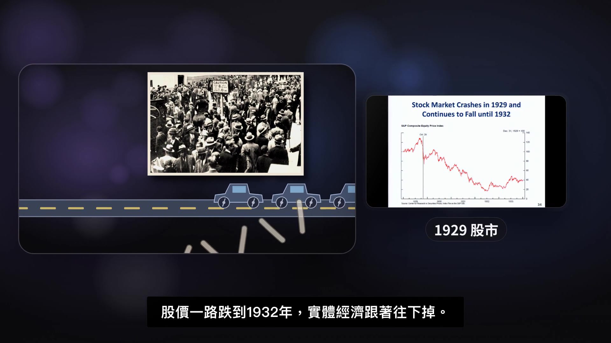

**逐字稿片段：** 從1929年到1933年 美國的實質GDP少了大約四分之一 到了1933年 差不多四個工人就有一個找不到工作

**話題推測：** 提供1929-1933年美國GDP和失業率數據。預計會出現GDP與失業率的統計圖表。

---

## 00:08:06

**逐字稿片段：** 當時很流行一種想法 叫清算論 他的意思是 1920年代太好了 借太多、蓋太多、股價太高 就該讓他痛一次 把多餘的東西擠掉

**話題推測：** 介紹當時流行的「清算論」。預計會出現「清算論」的文字說明。

---

## 00:08:15

**逐字稿片段：** 當時的財政部長Andrew Mellon 依胡佛總統回憶錄的說法 主張把勞工、股票、農民、房地產 通通清算掉 可是如果清算論是對的 經濟痛完就該自己好起來 幾年過去 他沒有

**話題推測：** 提及財政部長Andrew Mellon的主張。預計會出現Andrew Mellon的照片或相關引述。

---

## 00:08:28

**逐字稿片段：** 一位英國經濟學家 開始問一個當時很不尋常的問題 如果經濟就是不會自己好呢? 他叫凱因斯

**話題推測：** 介紹英國經濟學家凱因斯。預計會出現凱因斯照片。

---

## 00:08:35

**逐字稿片段：** 1936年他出版了 《就業、利息和貨幣的一般理論》

**話題推測：** 提及凱因斯1936年出版的《就業、利息和貨幣的一般理論》。預計會出現該書的封面。

---

## 00:08:39

**逐字稿片段：** 他的想法是 一個社會有能力生產多少 跟大家願意買多少 不會自動相等 你少花一塊錢 就有人少賺一塊錢 他少賺又少花一點 這個一圈一圈放大的效果 叫成數 每個人為了保護自己 都開始省錢 加起來 大家反而更窮 於是經濟可以就停在谷底 工廠空著 工人閒著 沒有人有理由先行動 這就是清算論看不到的東西 那景氣好的時候 為什麼會突然開始衰退?

**話題推測：** 說明凱因斯的需求理論與成數效應。預計會出現成數效應的示意圖或文字說明。

---

## 00:09:05

**逐字稿片段：** 凱因斯的答案 跟人的心理有關 叫動物本能 他說的是 投資這件事 未來太不確定 算不出來 很多決定靠的是 一股想動起來的衝動 樂觀過頭 碰上壞消息 信心可以一下子崩掉 他也解釋了崩疊 繁榮後期 大家對未來獲利的預期 過度樂觀 一旦失望 預期就會突然往下掉 他留下的空白是 預期什麼時候 為什麼會轉 很難事先說清楚

**話題推測：** 說明凱因斯的「動物本能」概念。預計會出現「動物本能」的文字說明。

---

## 00:09:29

**逐字稿片段：** 另一條路是看訂單 叫加速原理 他說的是 買機器的訂單 看的不是生意好不好 而是生意還有沒有在變好 把他接上陳述的想法 當時已經有人在討論

**話題推測：** 轉向討論「加速原理」。預計會出現「加速原理」的文字標題。

---

## 00:09:40

**逐字稿片段：** 英國的Harrod 在1936年就寫過 1939年 在哈佛大學 還沒拿到博士學位的Samuelson 發表一篇很短的論文 把兩者接起來

**話題推測：** 提及英國經濟學家Harrod。預計會出現Harrod的姓名。

---

## 00:09:49

**逐字稿片段：** 算給大家看 我們用一間咖啡店來看 假設一臺機器一天做100杯 你每天賣1000杯 店裡10臺機器 明年變成1200杯 你多買兩臺 再下一年變成1400杯 再買兩臺 接下來變成1500杯 生意還在變好 可是你只要買一臺 再下一年還是1500杯 生意一點都沒有變差 你一臺也不用買 你的咖啡賣得很好 賣機器的工廠 訂單卻沒了 工廠一裁員 工人就少喝咖啡 咖啡店的生意才真的開始掉 陳述從這裡接手 Samuelson算出來 這兩件事接在一起 不需要任何外部衝擊 經濟就可能上下襬動

**話題推測：** 以咖啡店的例子解釋加速原理。預計會出現咖啡店的圖示或數字變化表。

---

## 00:10:24

**逐字稿片段：** 這是整集很重要的一句話 就算沒有外部衝擊 只要成長不再加速 擴張就可能變成衰退 這不只是紙上的咖啡店

**話題推測：** 強調「成長不再加速，擴張就可能變成衰退」這一核心觀點。預計會出現重點文字框。

---

## 00:10:33

**逐字稿片段：** 1990年代末 電信公司拼命鋪光纖 買網絡設備 當時流傳一個說法 網絡流量每100天就翻一倍

**話題推測：** 以1990年代末電信公司鋪設光纖為例說明加速原理。預計會出現光纖網路建設的圖片。

---

## 00:10:40

**逐字稿片段：** 研究網絡流量的數學家 Otlisco發現 真實的數字大約是一年翻一倍 流量確實一直在漲 可是鋪設的速度遠遠超過它 等大家發現鋪太多 訂單就沒了 2001年春天

**話題推測：** 提及數學家Otlisco對網絡流量增長的發現。預計會出現Otlisco的姓名或相關圖表。

---

## 00:10:52

**逐字稿片段：** 賣網絡設備的Cisco 一次認列22億5000萬美元的庫存損失 財報寫的原因是需求突然大幅下降 網絡上傳的資料還在變多 做設備的公司訂單卻先崩了 加速原理解釋了擴張為什麼可能自己結束 可是它也有麻煩 Samuelson的數學裡 這個擺動要麼越來越小慢慢停掉 要麼越來越大 只有某些特定的數字才會一直擺下去 真實世界的循環為什麼可以一直延續下去 這個問題先放著 等一下會回來 到這裡 大家講的都是企業和消費者

**話題推測：** 提及2001年Cisco庫存損失事件。預計會出現Cisco的標誌或相關新聞報導。

---

## 00:11:22

**逐字稿片段：** 1963年 一本很厚的書 把眼光轉向另一個地方 作者是傅立曼和Anna Schwartz 書名叫《美國貨幣史》 他們這一派 後來叫貨幣主義 他的看法是 景氣的大起大落 很大一部分要從錢來解釋

**話題推測：** 介紹傅立曼和Anna Schwartz的《美國貨幣史》與貨幣主義。預計會出現傅立曼與Schwartz的照片或書本封面。

---

## 00:11:36

**逐字稿片段：** 他們回頭看1929年到1933年 問一個直接的問題 這段時間 市面上的錢到底怎麼了 答案是 少了大約三分之一 錢不是被人燒掉的 他是跟著倒閉的銀行一起消失的 銀行為什麼會一家一家倒

**話題推測：** 以1929-1933年大蕭條期間的貨幣供給變化為例。預計會出現貨幣供給量下降的圖表。

---

## 00:11:51

**逐字稿片段：** 伯南克在課堂上 是用一部老電影開頭的 聽他自己說 假設你是存戶 鎮上傳出謠言 說銀行放款出了問題 你不知道是真是假 可是你知道 如果大家都去領錢 排在最後面的人 可能一毛都拿不到 所以最安全的做法 就是自己先去領錢 每個人都這樣想 銀行門口就排滿了人 這叫擠兌 銀行不會把存款 全部放在金庫裡 大部分都借出去了 一時收不回來 最後真的倒了 伯南克說 擠兌是一個 會自己實現的預言 一家倒了 隔壁銀行的存戶 也開始擔心 而這種時候 本來有人該出手 1914年開張的 美國中央銀行 就是為了對付 這種恐慌成立的 15年後 他碰上了大蕭條 聽他自己說 不只沒有出手

**話題推測：** 播放伯南克在課堂上解釋擠兌的影片。預計會出現伯南克講課畫面或銀行擠兌的歷史照片。

---

## 00:13:20

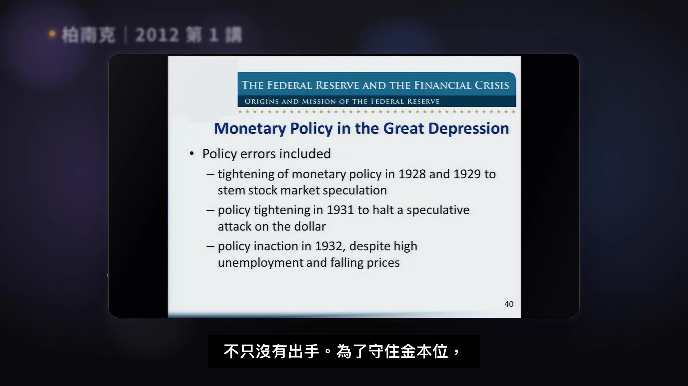

**逐字稿片段：** 為了守住金本位 也就是美元跟黃金掛鉤 美國中央銀行在1931年反過來提高利率 一直到1933年

**話題推測：** 提及為守住金本位，美國中央銀行提高利率。預計會出現金本位的說明或利率圖表。

---

## 00:13:28

**逐字稿片段：** 羅斯福讓美國離開金本位 經濟才開始強力回升

**話題推測：** 提及羅斯福總統讓美國脫離金本位。預計會出現羅斯福總統的照片。

---

## 00:13:31

**逐字稿片段：** 1934年又有了存款保險 存戶不用再搶著領錢

**話題推測：** 提及1934年存款保險的設立。預計會出現存款保險的標誌或相關文字說明。

---

## 00:13:35

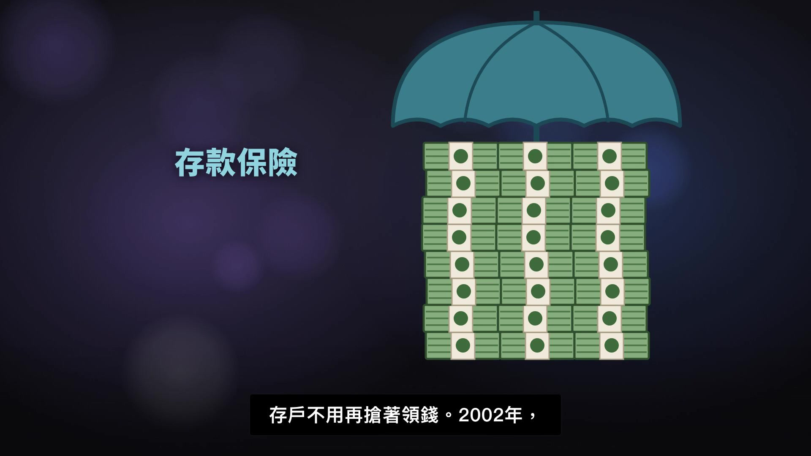

**逐字稿片段：** 2002年 在一場替90歲的傅立曼注售的會議上 當時是美國中央銀行理事的博南克 對著傅立曼和Schwartz說 關於大蕭條 你說得對 是我們做的 非常抱歉 多虧了你 我們不會再翻 可是這不是定論

**話題推測：** 提及伯南克在傅立曼會議上的道歉。預計會出現傅立曼、Schwartz、伯南克三人的合照。

---

## 00:13:50

**逐字稿片段：** 麻省理工學院的Tamman認為 是經濟先往下掉 錢才跟著變少 因果可能倒過來 伯南克自己站在傅立曼這邊 可是他在同一場演講裡也說 光看兩者一起下跌 還分不清誰先誰後 不過這場爭論

**話題推測：** 提及麻省理工學院Tamman的因果倒置觀點。預計會出現Tamman的姓名。

---

## 00:14:04

**逐字稿片段：** 留下一個很多人接受的結論 中央銀行不是旁觀者 他的決定本身就會影響衰退

**話題推測：** 總結中央銀行會影響衰退的結論。預計會出現本節結論的重點整理頁。

---

## 00:14:09

**逐字稿片段：** 傅立曼在1960年代 還發出另一個警告 伯南克在課堂上 替他打了一個比方 聽他自己說 在短暫的期間,它會給你一點點的能量,但一段時間後,它會讓你變胖 因此,儲蓄政策是類似於這一點的 然後,法輝德曼議論,結果他發生了很嚴謹的事 他認為,以儲蓄政策來保持職位太低,我們會造成負擔

**話題推測：** 提及傅立曼關於貨幣政策的警告。預計會出現傅立曼的引言或相關示意圖。

---

## 00:14:39

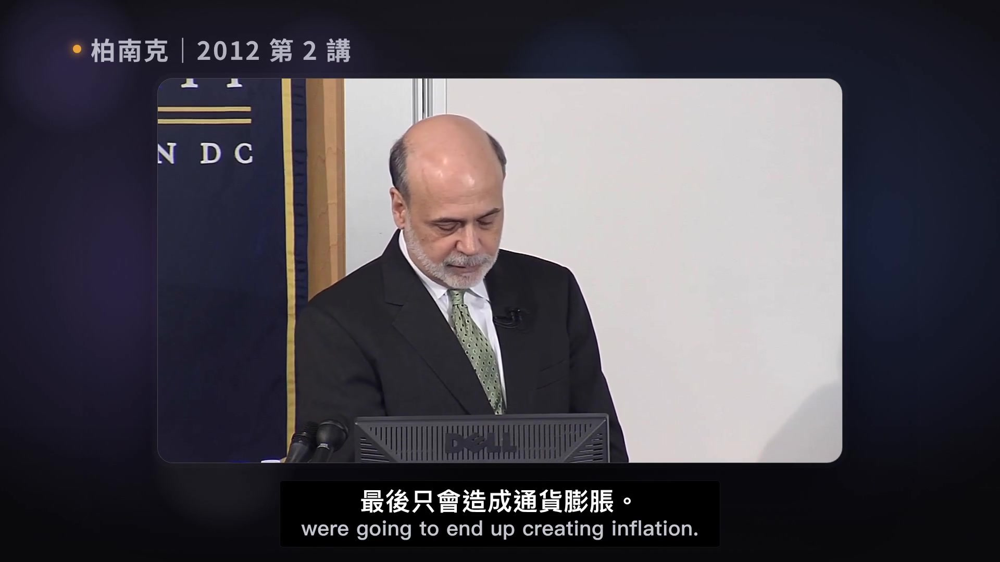

**逐字稿片段：** 糖吃多了會出事,1970年代就碰上了 這一戰的衝擊,跟前面的都不一樣

**話題推測：** 轉向討論1970年代的停滯性通貨膨脹。預計會出現1970年代的加油站排隊或高通膨圖片。

---

## 00:14:44

**逐字稿片段：** 1973年10月,中東戰爭開打 阿拉伯產油國為了報復支持以色列的國家 對美國實施石油禁運 接下來發生什麼

**話題推測：** 提及1973年10月的中東戰爭與石油禁運。預計會出現中東地圖、油價上漲圖或相關新聞圖片。

---

## 00:14:53

**逐字稿片段：** 伯南克講得很生動 聽他自己說 油價一漲 什麼都跟著漲 運貨需要石油 工廠需要石油 肥料也需要石油 可是東西變貴 大家就買得更少 工廠開始裁員

**話題推測：** 播放伯南克解釋油價上漲影響的影片。預計會出現伯南克講課畫面或油價與物價關聯圖。

---

## 00:15:24

**逐字稿片段：** 美國從1973年11月開始衰退 一路到1975年3月 16個月

**話題推測：** 提及美國1973年11月開始的衰退。預計會出現該次衰退的時間軸。

---

## 00:15:29

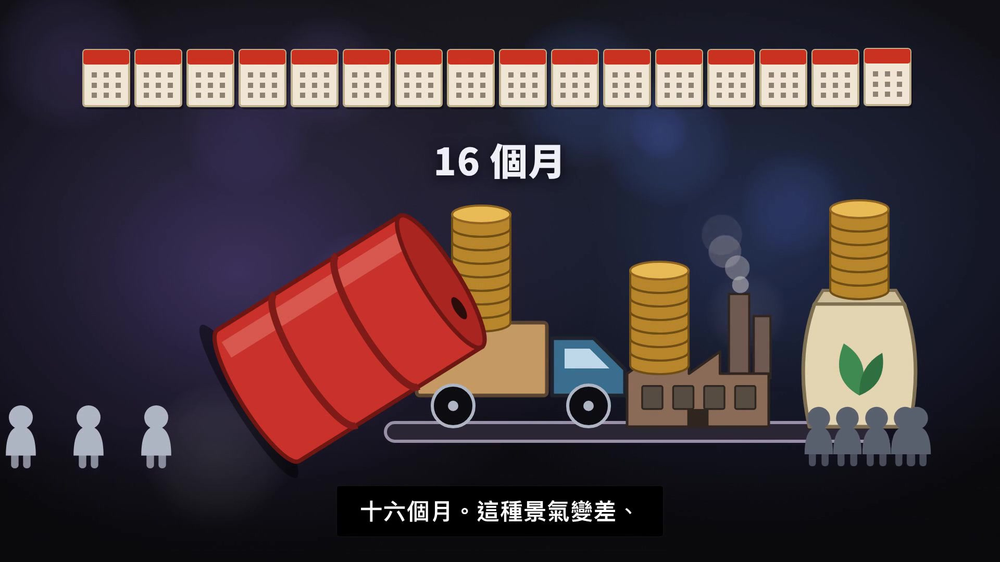

**逐字稿片段：** 這種景氣變差 物價卻一直往上漲的組合 叫停滯性通貨膨脹 原本的模型認為 失業高的時候 物價應該漲不起來 現在兩件壞事同時發生

**話題推測：** 介紹「停滯性通貨膨脹」概念。預計會出現「停滯性通貨膨脹」的文字標題。

---

## 00:15:39

**逐字稿片段：** 諾貝爾獎的官方說明寫得很直接 1970年代的石油危機 讓凱因斯派的模型看起來不再管用 很多人開始覺得 這些政策弊大於利 這時候 外面推著經濟走的那一邊

**話題推測：** 提及諾貝爾獎官方說明凱因斯模型失靈。預計會出現諾貝爾獎委員會標誌或相關文字。

---

## 00:15:51

**逐字稿片段：** 回來了 1982年 Kitland和Prescott發表一篇論文 提出一套理論 後來叫實質景氣循環 他說的是 景氣起伏主要來自真實的東西變了 技術進步忽快忽慢 能生產的東西就跟著變多變少 油價上漲這類事情 也可以用同樣的方式來想

**話題推測：** 介紹Kydland和Prescott的「實質景氣循環」理論。預計會出現Kydland與Prescott的照片和理論關鍵詞。

---

## 00:16:08

**逐字稿片段：** 2004年 他們因為這類研究得到諾貝爾經濟學獎 這個理論最讓人不舒服的地方 是他認為衰退不一定是病

**話題推測：** 提及兩人因研究在2004年獲得諾貝爾經濟學獎。預計會出現諾貝爾獎得主照片和頒獎年份資訊。

---

## 00:16:16

**逐字稿片段：** Prescott的看法是 景氣起伏是經濟對真實衝擊的合理反應 硬要避開反而可能更糟 還記得Samuelson留下的問題嗎 擺動為什麼能一直延續 答案其實更早就有了

**話題推測：** 說明Prescott認為衰退是經濟的合理反應。預計會出現Prescott的引述。

---

## 00:16:28

**逐字稿片段：** 1933年 挪威經濟學家Fresh

**話題推測：** 提及挪威經濟學家Fresh及其木頭搖馬比喻。預計會出現Fresh的照片和木馬比喻的插畫。

---

## 00:16:30

**逐字稿片段：** 用了瑞典經濟學家Wixel 先講過的一個比喻 你拿棍子打一批木頭搖馬 棍子的動作只有一下 木馬卻會前後搖好幾下 搖的節奏由木馬決定 搖的力氣由棍子給 經濟也一樣 衝擊一下一下打進來 經濟自己的結構 把它變成一波一波的起伏 這個理論很適合用來想油價這種衝擊

**話題推測：** 提及瑞典經濟學家Wicksell。預計會出現Wicksell的姓名。

---

## 00:16:49

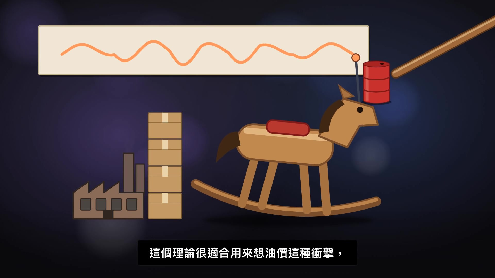

**逐字稿片段：** 也讓人想到2020年的病毒 可是反對的人很多 哈佛大學的Sommers在1986年就寫文章說 這類模型跟真實的景氣循環沒有關係

**話題推測：** 將理論應用於2020年的病毒衝擊。預計會出現新冠病毒的示意圖或口罩等圖片。

---

## 00:16:59

**逐字稿片段：** Mankiew的反駁更直接 如果衰退來自技術變化 那衰退期間就等於技術退步了 用1930年代來看 四個工人有一個失業 很難相信是大家忽然不會生產了 連油價這根棍子本身也有爭論

**話題推測：** 提及Mankiw的反駁。預計會出現Mankiw的姓名或照片。

---

## 00:17:13

**逐字稿片段：** 1983年一篇很有名的研究指出 到那時為止 二戰之後的美國衰退 除了一次之外 之前都出現過油價大漲 可是1997年

**話題推測：** 提及1983年關於油價大漲與衰退的研究。預計會出現油價與衰退相關的統計圖表。

---

## 00:17:22

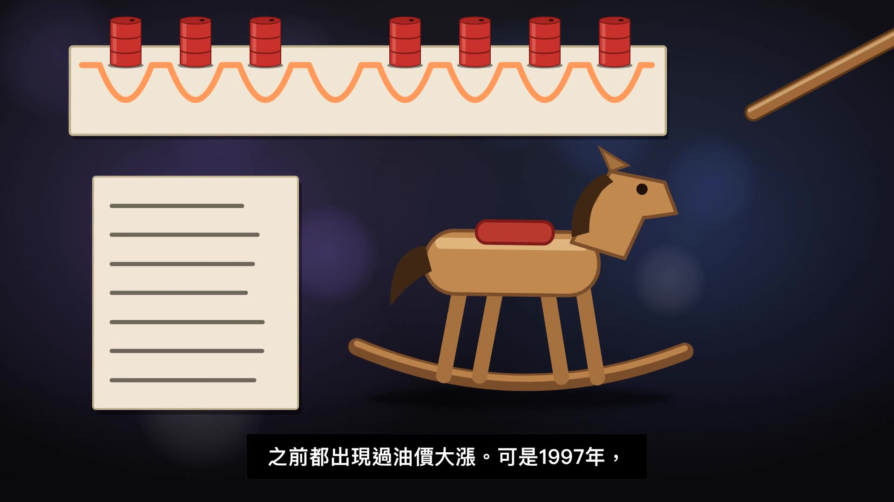

**逐字稿片段：** 伯南克和兩位學者提出另一種解讀 油價衝擊造成的傷害 有相當大一部分 來自中央銀行為了壓物價 把利率拉高 這個比例到現在還在炒 所以打木馬的棍子 有時候可能是中央銀行自己

**話題推測：** 提及伯南克對油價衝擊的另一種解讀。預計會出現伯南克及共同作者的姓名。

---

## 00:17:35

**逐字稿片段：** 接下來這一戰最清楚 停滯性通貨膨脹拖了將近十年 到1979年

**話題推測：** 轉向討論Volcker壓制通膨的行動。預計會出現Volcker的照片。

---

## 00:17:41

**逐字稿片段：** 美國的物價一年漲超過一成 卡特總統找來一位出了名強硬的人 當美國中央銀行的主席福克爾 他身高超過200公分 嘴上常叼著一根雪茄

**話題推測：** 提及1979年美國物價上漲超過一成。預計會出現美國通膨率的歷史圖表。

---

## 00:17:51

**逐字稿片段：** 福克爾上任才幾個月 就決定下重藥 讓利率大幅往上走 1981年 美國的基準利率衝到接近20% 借錢買房、買車、做生意 全都變得很貴 這鐵要有效 可是副作用很大

**話題推測：** 提及福克爾決定大幅提高利率。預計會出現聯邦基準利率飆升的圖表。

---

## 00:18:04

**逐字稿片段：** 伯南克講得很直接 聽他自己說

**話題推測：** 播放伯南克解釋Volcker升息副作用的影片。預計會出現伯南克講課畫面。

---

## 00:18:27

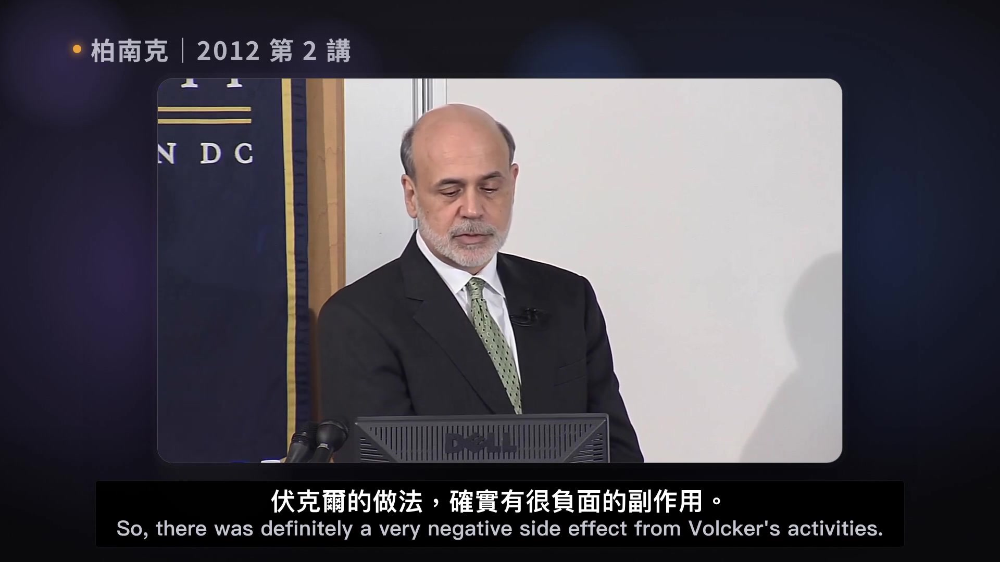

**逐字稿片段：** 1982年到1982年11月 美國衰退16個月 蓋房子的業者 把一節一節的木材寄到中央銀行 上面寫著 不要再殺死銀件業 可是福克爾沒有退讓 幾年之內 物價上漲率從一成多降回4%以下 這次衰退不是意外

**話題推測：** 提及1981年7月到1982年11月的衰退。預計會出現該次衰退的時間軸，可能伴隨房屋業者抗議的圖片。

---

## 00:18:45

**逐字稿片段：** 伯克萊大學的Romer夫婦 在1982年到1982年11月 在1989年翻遍美國中央銀行的會議記錄 找出戰後好幾次 它等於是決定製造一次衰退 來壓住物價 所以除了外部衝擊 除了擴張本身的問題 還有一種 中央銀行自己踩了剎車

**話題推測：** 提及Romer夫婦對聯準會製造衰退的研究。預計會出現Romer夫婦的照片。

---

## 00:18:59

**逐字稿片段：** 剎車踩完之後 美國迎來一段很長的穩定擴張 1980年代中期到2007年 20多年裡只有兩次衰退 而且都很短

**話題推測：** 轉向討論「大穩健時期」。預計會出現經濟穩定擴張的圖表。

---

## 00:19:08

**逐字稿片段：** 經濟學家Stark和Watson 替這段時期取了一個名字 叫大穩健

**話題推測：** 提及經濟學家Stock和Watson提出「大穩健」一詞。預計會出現Stock和Watson的姓名。

---

## 00:19:13

**逐字稿片段：** 2004年 伯南克自己還發表過一場演講 題目就叫大文件 他列了三種可能 中央銀行的政策做得比較好 經濟本身變了 像公司學會不囤太多庫存 還有一種就是運氣好 那些年的大沖擊比較少 開頭那位盧卡斯 就是在這段時間 說出那句已經解決了 這時候如果只看景氣本身 很多指標都很漂亮

**話題推測：** 提及伯南克2004年關於「大穩健」的演講。預計會出現演講標題或相關圖片。

---

## 00:19:34

**逐字稿片段：** 可是有一個人早就說過 真正該擔心的 正是這種瓶頸 這個人叫Hyman Minsky 美國經濟學家 生前的名氣遠不如前面幾位 他的理論叫金融不穩定假說 他說的是 經濟平靜得越久 金融就越脆弱

**話題推測：** 介紹Hyman Minsky及其「金融不穩定假說」。預計會出現Minsky的照片和理論關鍵詞。

---

## 00:19:49

**逐字稿片段：** Minsky把借錢的人分成三種 一種人賺的錢夠付利息 也夠還本金 另一種人賺的錢只夠付利息 本金要靠一直借新還舊 最後一種人 賺的錢連利息都不夠 只能靠手上的資產繼續漲 再賣掉或再借 他把這種叫龐氏融資 繁榮一久 大家看風險好像不見了 銀行敢放款 借錢的人敢借 整個經濟就從第一種 慢慢滑向後面兩種 這時候 如果中央銀行為了壓物價收緊貨幣 撐不住的人只好賣資產 資產價格就一路往下掉 他自己說 這套理論不需要外來的衝擊 這跟傑芬斯那邊完全是相反的方向 博南克講的是2008年 也沒有提到Minsky 可是他描述的很接近這件事 聽他自己說 比較平靜的經濟狀況 人們變得更有信心 更願意承擔更多的財富 景氣平靜的時候 風險也在一層一層累積

**話題推測：** 說明Minsky將借錢人分為三種：對沖融資、投機融資、龐氏融資。預計會出現三種融資類型的示意圖。

---

## 00:20:53

**逐字稿片段：** 房價一直漲 銀行就放更多房貸 連還款能力很差的人也借得到 再把這些房貸切碎 包裝成複雜的金融商品 賣到全世界

**話題推測：** 說明房價上漲、銀行房貸擴張、金融商品複雜化等導致的風險累積。預計會出現房價走勢圖、次級房貸示意圖或CDO結構圖。

---

## 00:21:02

**逐字稿片段：** 2006年 房價開始往下 美國中央銀行裡的人 一開始是怎麼想的 他們看到的是後照鏡裡的上一次

**話題推測：** 提及2006年房價開始下跌。預計會出現房價下跌的圖表。

---

## 00:21:09

**逐字稿片段：** 2000年前後的網路股大跌 蒸發的紙上財富跟房市差不多 那次衰退卻只有8個月

**話題推測：** 提及2000年網路股大跌。預計會出現網路股泡沫破裂的股價圖。

---

## 00:21:16

**逐字稿片段：** 伯南克在課堂上說得很坦白 聽他自己說 可是這一次跟2001年完全不一樣

**話題推測：** 播放伯南克坦白聯準會對2008年危機初期判斷的影片。預計會出現伯南克講課畫面。

---

## 00:21:45

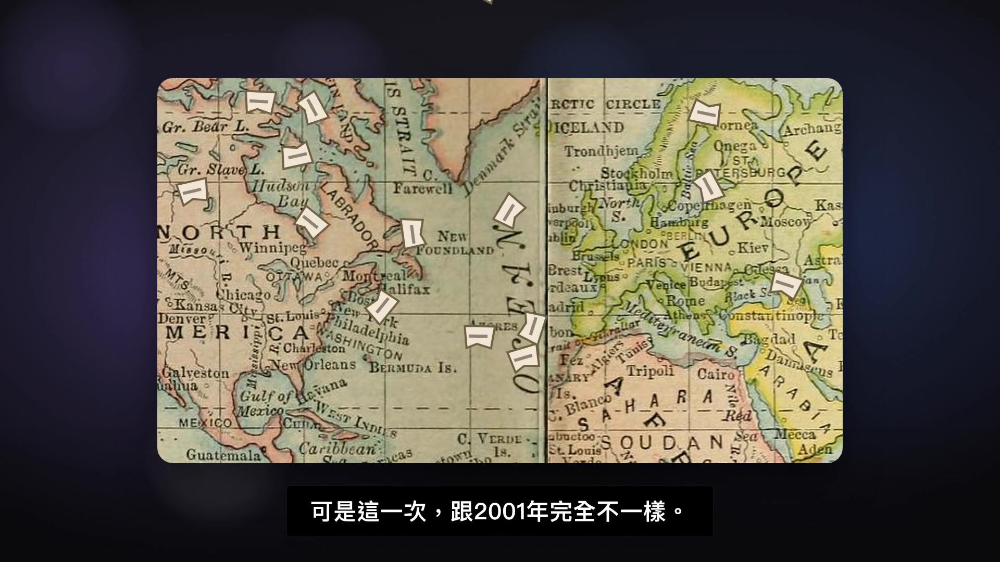

**逐字稿片段：** 伯南克給了一個很驚人的比較 如果把全美國的次級房貸加起來 假設全部變成廢紙 整個金融體系的損失 大概也只是股市一天大疊的規模 真正的問題是 這些房貸散在世界各地 沒有人知道虧損在誰手上 於是擠兌又來了 只是不在銀行門口 金融機構之間互相借的短期資金 一聽到誰可能有問題 就立刻抽走 2008年9月 雷曼兄弟倒閉 後來的人常把這一刻叫Minsky時刻

**話題推測：** 提及伯南克將次級房貸損失與股市大跌規模進行比較。預計會出現比較數據的圖表。

---

## 00:22:10

**逐字稿片段：** 這是Minsky最亮眼的一次 可是他的理論也有限制 他很難說瓶頸多久才算太久 也解釋不了石油禁運和病毒 同一個問題

**話題推測：** 提及「Minsky時刻」概念。預計會出現「Minsky時刻」的文字標題。

---

## 00:22:20

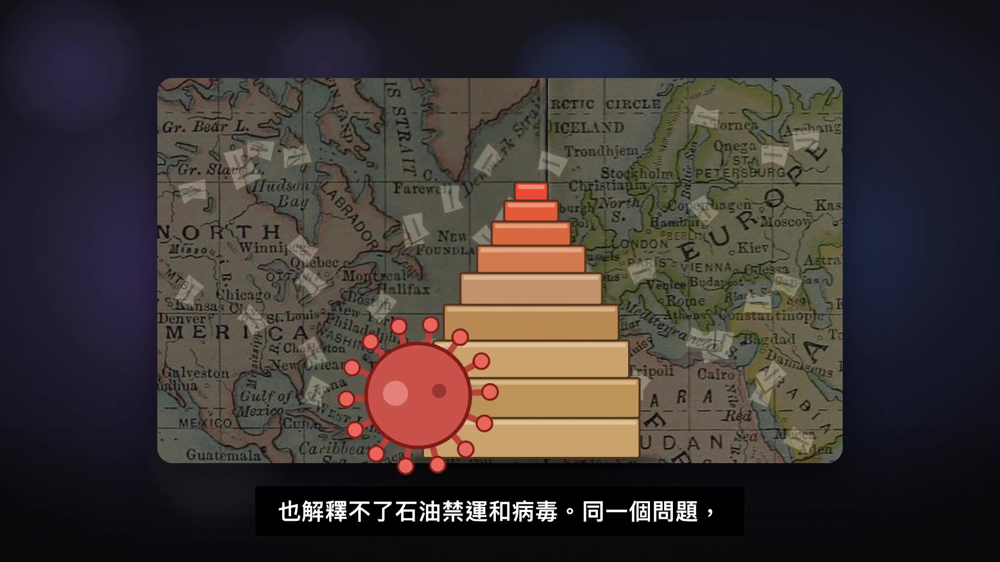

**逐字稿片段：** 伯南克在課堂上 有一個最容易記住的比喻 聽他自己說 房價下跌是一根火柴 可是要燒成大火 旁邊得先堆滿乾柴 這個比喻還少一個角色 消防隊 凱因斯和富利曼這兩派吵了很多年 可是他們都讓後來的人相信 火起來的時候不能袖手旁觀

**話題推測：** 播放伯南克用「火柴、乾柴、消防隊」比喻危機的影片。預計會出現伯南克講課畫面或比喻示意圖。

---

## 00:23:02

**逐字稿片段：** 2008年這一次 中央銀行記得1930年代犯過的錯 大量借錢給金融機構 把利率降到接近零

**話題推測：** 提及2008年中央銀行對金融機構提供大量貸款與降息至零。預計會出現中央銀行資產負債表擴張圖或利率走勢圖。

---

## 00:23:09

**逐字稿片段：** 2020年 病毒讓各國封城 消防隊來得更快 衰退只有兩個月

**話題推測：** 提及2020年新冠病毒危機下的應對。預計會出現新冠疫情相關的政府救助或封城圖片。

---

## 00:23:14

**逐字稿片段：** 是美國有記錄以來最短的一次 除了中央銀行,政府也會直接花錢 這是凱因斯那條路

**話題推測：** 提及2020年衰退是美國有記錄以來最短。預計會出現衰退持續時間的統計圖表。

---

## 00:23:20

**逐字稿片段：** 2009年美國通過大約8000億美元的振興方案 2020年的CARES法案超過2兆美元 這些錢到底帶動了多少經濟 估計差很多,到現在還有爭議 那消防隊到底有沒有用 美國二戰之後的衰退平均只有10個月左右 二戰之前平均要18到22個月

**話題推測：** 提及2009年美國的8000億美元振興方案與2020年CARES法案。預計會出現相關法案的名稱和金額。

---

## 00:23:38

**逐字稿片段：** 不過戰前的資料比較粗 經濟學家Christina Romer用一致的方法重新定日期 發現衰退並沒有明顯變短 這個差距有多少是消防隊的功勞 學界還在爭論 今天很多中央銀行常用的分析工具之一

**話題推測：** 提及經濟學家Christina Romer重新定義戰前衰退的研究。預計會出現Christina Romer的照片。

---

## 00:23:51

**逐字稿片段：** 叫辛凱因斯模型

**話題推測：** 介紹現代中央銀行常用的「新凱因斯模型」。預計會出現「新凱因斯模型」的文字標題。

---

## 00:23:52

**逐字稿片段：** Hall和Woodford今年得獎 就是因為替這套模型打下了基礎 他從每個家庭和公司怎麼做決定算起 把大家對未來的預期放進去 所以中央銀行光是把計劃講清楚 就能影響經濟 評審會主席說 他們的研究替各國中央銀行和政府 現在用的模型提供了穩固的理論基礎 不過也有人批評 這類模型在2008年之前 Stiglitz就是其中之一 消防隊有機會讓火小一點 可是他擋不住別人丟火柴 也很難阻止大家在景氣穩定的時候堆乾柴 那中央銀行決定利率根據哪一個理論 不止一個 平常美國國會交給他的目標叫雙重任務 就業儘量高

**話題推測：** 再次提及Hall和Woodford因模型基礎研究得獎。預計會出現兩人照片及模型相關文字。

---

## 00:24:31

**逐字稿片段：** 物價穩定 物價目標是一年上漲2%

**話題推測：** 提及2%的物價穩定目標。預計會出現2%通膨目標的文字或圖示。

---

## 00:24:34

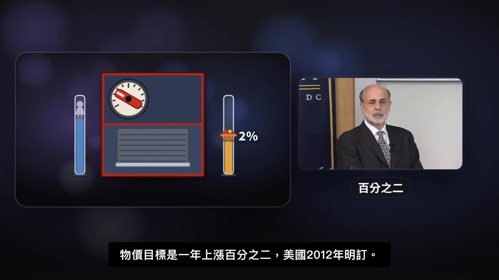

**逐字稿片段：** 美國2012年明定 這種做法叫通貨膨脹目標制

**話題推測：** 提及「通貨膨脹目標制」。預計會出現「通貨膨脹目標制」的文字標題。

---

## 00:24:38

**逐字稿片段：** 1990年紐西蘭最早開始 他在意預期來自富利曼和Felps 大家預期物價會漲 物價就比較容易真的漲 利率調整多少會參考泰勒規則 它是Taylor 1993年寫下的公式 危機時消防隊用的是另一套

**話題推測：** 提及傅立曼和Phelps關於預期的作用。預計會出現兩人的姓名或照片。

---

## 00:24:52

**逐字稿片段：** 叫最後貸款人

**話題推測：** 提及危機時的「最後貸款人」角色。預計會出現「最後貸款人」的文字標題。

---

## 00:24:53

**逐字稿片段：** 最有名的說法來自Batchot 1873年的書 恐慌的時候要大量放款 收好的抵押品利率要高 2008年博南克引用它

**話題推測：** 提及Bagehot在1873年提出的說法。預計會出現Bagehot的姓名及書名。

---

## 00:25:02

**逐字稿片段：** 再加上量化寬鬆 也就是大量買進債券 有人批評 這會讓金融機構下次更敢冒險 美國中央銀行也寫明 這些公式只是參考 多數中央銀行的預測 是很多模型加上判斷 這一部分的答案 可以畫成一張地圖 第一樣東西是火柴 從外面或者從中央銀行手上來 油價 病毒 福克爾的剎車 Jerens的太陽錯了 可是他問的方向留了下來 另一樣東西是乾柴 在景氣擴張的時候累積起來 諸葛拉的借貸 熊彼得的一窩蜂 Samuelson那張停掉的訂單 Minsky越疊越高的債 還有消防隊 影響火燒多大 凱因斯的需求 富利曼的錢 用這張地圖看 2020年是火柴很大,乾柴不多 2008年是火柴不大,乾柴很多 1981年是消防隊自己點的火 經濟學家真正吵的 常常不是誰完全對 而是這一次火柴和乾柴各佔多少 這是我們為了方便記憶做的整理 不是經濟學界的共識 實質景氣循環那一派 就不會同意乾柴有這麼重要 Minsky那一派 也不會同意火柴才是主角 可是有了它

**話題推測：** 提及「量化寬鬆」。預計會出現「量化寬鬆」的文字標題。

---

## 00:26:04

**逐字稿片段：** 我們可以拿來看現在 2026年的美國 表面上很好 第三季GDP年化成長3.4% NBER也沒有宣佈衰退 那地圖上的火柴呢?

**話題推測：** 轉向分析現在2026年的美國經濟。預計會出現「現在的世界」或「2026年美國經濟」的標題。

---

## 00:26:15

**逐字稿片段：** 先看外面 今年伊朗戰爭 荷莫茲海峽的運輸受阻 油價往上推

**話題推測：** 提及伊朗戰爭推升油價。預計會出現中東局勢地圖或油價走勢圖。

---

## 00:26:19

**逐字稿片段：** 美國9月的消費者物價 比一年前漲了3.7% 再看中央銀行 2026年9月16日 美國中央銀行提高利率0.25個百分點 理由是通貨膨脹仍然偏高

**話題推測：** 提及美國9月消費者物價指數。預計會出現美國CPI數據或圖表。

---

## 00:26:31

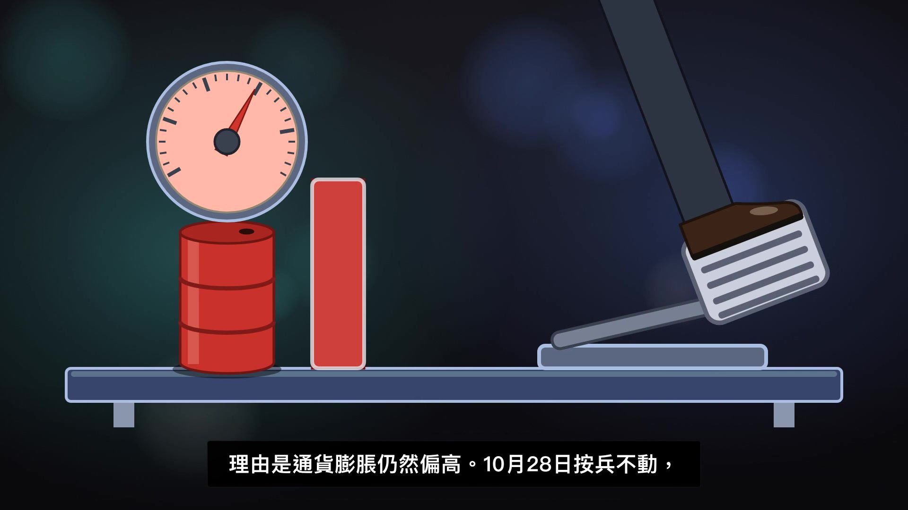

**逐字稿片段：** 10月28日按兵不動 可是有兩位委員投反對票 主張再提高0.25個百分點 這跟很多人的印象相反 大家以為景氣有隱憂 中央銀行就會降低利率 可是今年他在踩剎車 還記得1970年代的爭論嗎 油價是一根棍子 中央銀行的回應可能是另一根 如果火真的燒起來

**話題推測：** 提及10月28日聯準會按兵不動但有委員投反對票。預計會出現聯準會會議摘要或利率決議新聞。

---

## 00:26:50

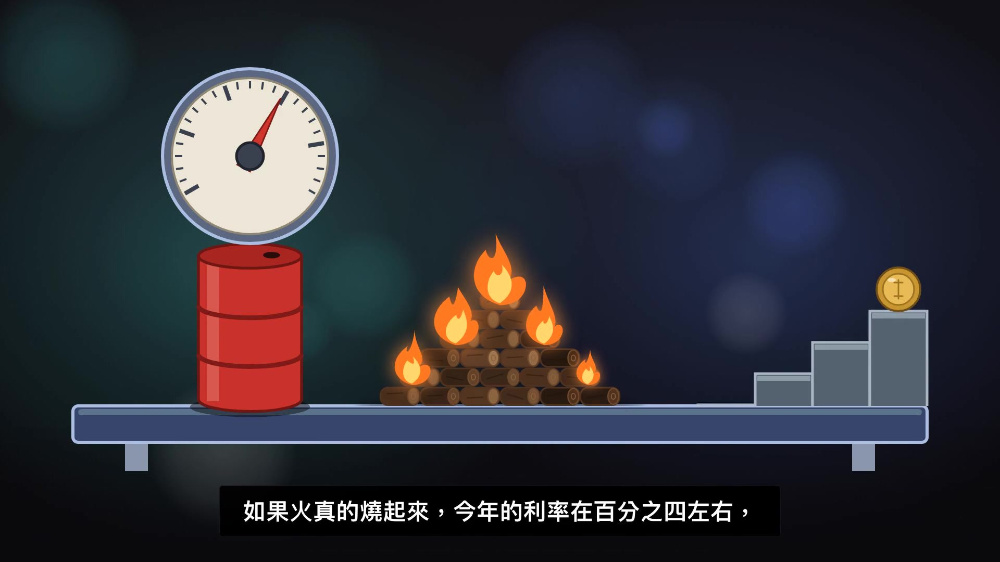

**逐字稿片段：** 今年的利率在4%左右 往下降的空間還有 可是有一個前提 物價要先穩下來 消防隊一邊要救火 一邊又怕火上加油 手腳就會被綁住 另一個數字沒那麼好看

**話題推測：** 提及今年利率在4%左右。預計會出現利率水平數字。

---

## 00:27:01

**逐字稿片段：** 9月美國只增加29000個工作 失業率4.2% 一邊是成長很快 一邊是工作增加得很慢

**話題推測：** 提及9月美國工作增加與失業率數字。預計會出現美國就業數據圖表。

---

## 00:27:09

**逐字稿片段：** 第三季 企業買設備的投資 是2020年以來成長最快的一季 尤其是電腦和資訊設備 有機構估計

**話題推測：** 提及第三季企業設備投資，特別是AI相關。預計會出現企業投資或AI投資的統計圖表。

---

## 00:27:16

**逐字稿片段：** 像荷蘭的ING集團 AI投資大約佔今年美國經濟成長的三分之一 要不要扣掉進口 算法不同 數字差很遠 可是方向很清楚 這一輪成長 很大一部分靠的是機器 聽到這裡 你可能已經想到前面那幾位了 乾柴這邊 爭論最大 橋水基金創辦人Ray Dalio在10月說 AI是一個接近破裂點的泡沫 他自己建的泡沫指標 跟1929年、2000年同一級

**話題推測：** 提及ING集團估計AI投資佔美國經濟成長比例。預計會出現ING集團的標誌或AI投資貢獻比例數字。

---

## 00:27:42

**逐字稿片段：** Citadel的Ken Griffin在10月20日說 AI幾乎可以肯定是在泡沫裡 可是泡沫過後留下的東西 常常會改變世界 這兩句話並沒有衝突 熊彼得會說 技術是真的 一窩蜂也是真的 鐵路當年就是這樣 那泡沫到底是什麼? 耶魯大學的席勒 2013年因為研究資產價格 得到諾貝爾經濟學獎 他在2011年課堂上 給了一個很樸素的定義 聽他自己說 價格衝得很高 最後總會破 可是破了會不會變成衰退

**話題推測：** 提及Citadel的Ken Griffin認為AI在泡沫中。預計會出現Ken Griffin的照片。

---

## 00:28:36

**逐字稿片段：** 我們可以拿前面的理論各問一個問題 問熊彼得 新東西蓋完之後 舊東西被擠掉的速度有多快 問Samuelson AI的需求不用變差 只要不再加速 買機器的訂單會怎麼樣 咖啡店的例子用在這裡剛好 問Minsky 這些錢有多少是借來的 借錢的人賺的錢夠不夠付利息

**話題推測：** 提出應用先前理論來分析AI泡沫的問題。預計會出現問題列表或理論模型圖。

---

## 00:28:55

**逐字稿片段：** 2000年的網絡泡沫 股市跌得很慘 美國卻只有一次8個月的輕微衰退 2008年的房市泡沫 卻燒成二戰後最長的衰退 很大的差別 在金融體系有沒有被拖下水 這三個問題現在都沒有答案 也有人認為 AI對成長的貢獻 扣掉從國外進口的晶片和電腦 可能小很多 所以我們不做預測 只知道該注意的不只是股價 而這些機器從哪裡來 答案就要回到我們一直沒有講的地方

**話題推測：** 比較2000年網路泡沫與2008年房市泡沫的後果。預計會出現兩次泡沫的簡要對比圖表。

---

## 00:29:23

**逐字稿片段：** 現在來看臺灣 在臺灣負責的是國家發展委員會

**話題推測：** 轉向分析臺灣的景氣循環。預計會出現臺灣地圖或國旗，以及「分析臺灣」的標題。

---

## 00:29:27

**逐字稿片段：** 他手上有兩樣東西 名字很像 常常被混在一起 一樣是景氣循環的認定 跟美國那個委員會做的是同一件事 事後回頭看 畫出每一次高峰和谷底的日期

**話題推測：** 說明國發會的兩項工具：景氣循環認定與景氣對策信號。預計會出現兩工具的列表或對比圖。

---

## 00:29:37

**逐字稿片段：** 從1954年算起 臺灣一共認定了15次循環 這15次平均起來 擴張大約40個月 收縮大約15個月 另一樣是景氣對策信號 也就是大家常聽到的景氣燈號 它每個月公佈一次

**話題推測：** 提及臺灣自1954年以來的15次景氣循環。預計會出現臺灣景氣循環的時間軸或統計數字。

---

## 00:29:51

**逐字稿片段：** 把出口、股價、工業生產 這類9項指標各給1到5分 加起來9到45分 38分以上亮紅燈代表熱絡 16分以下亮藍燈代表低迷 兩樣東西的差別在哪裡 燈號像體溫計 告訴你現在多熱 循環認定像病例 事後才寫上哪天開始生病 紅燈不等於安全 藍燈也不等於已經衰退

**話題推測：** 說明燈號的九項指標及評分機制。預計會出現九項指標的列表或計分說明。

---

## 00:30:13

**逐字稿片段：** 拿前面的地圖看臺灣的歷史 會看到很清楚的幾戰

**話題推測：** 應用景氣地圖看臺灣歷史上的幾個重要時刻。預計會出現景氣地圖結合臺灣歷史事件的圖示。

---

## 00:30:16

**逐字稿片段：** 1979年伊朗革命 油價又漲了一輪 臺灣第五次景氣循環的收縮期 從1980年1月 一路到1983年2月 37個月 是臺灣有記錄以來最長的收縮 這是火柴 從外面丟進來

**話題推測：** 提及1979年伊朗革命導致油價上漲對臺灣的影響。預計會出現伊朗革命或油價相關圖片，並標示臺灣的衰退期。

---

## 00:30:30

**逐字稿片段：** 再看2000年 網絡泡沫破掉 美國只輕輕衰退了8個月 可是國家發展委員會認定 臺灣那次收縮 從2000年9月 一路到2001年9月 12個月 比美國還長

**話題推測：** 提及2000年網路泡沫對臺灣的影響。預計會出現網路泡沫相關圖片，標示臺灣衰退期，並與美國對比。

---

## 00:30:43

**逐字稿片段：** 2001年 臺灣出口少了將近兩成 出現戰後第一次的全年負成長 原因你現在已經知道了 臺灣當時賣給世界的 正是網絡熱潮要用的電腦和零件 別人只是不再加速 臺灣就接到那張停掉的訂單 咖啡店老闆還在賣咖啡 賣機器的工廠先冷下來 臺灣佔的 常常是賣機器的那邊

**話題推測：** 提及2001年臺灣出口與全年負成長數據。預計會出現臺灣出口成長率圖表。

---

## 00:31:02

**逐字稿片段：** 2020年又不一樣 病毒的火柴打過來 國家發展委員會的循環表上 那一年根本沒有收縮

**話題推測：** 提及2020年新冠疫情對臺灣的影響。預計會出現新冠疫情相關圖片，並說明臺灣未進入衰退。

---

## 00:31:09

**逐字稿片段：** 上一輪擴張從2016年2月 一路走到2022年1月 71個月 同一根火柴丟到不同的地方 結果可以差這麼多 再靠近一點 這三年的事情幾乎可以當教材

**話題推測：** 提及臺灣2016-2022年長達71個月的擴張期。預計會出現臺灣擴張期的時間軸。

---

## 00:31:21

**逐字稿片段：** 2022年11月到2023年8月 景氣燈連續10個月亮藍燈

**話題推測：** 提及2022年11月至2023年8月連續10個月亮藍燈。預計會出現藍燈區間圖示。

---

## 00:31:26

**逐字稿片段：** 2023年2月的分數只有10分 離最低的9分只差1分 那半年,出口比前一年少了一成 工廠的生產也少了一成以上 2023年第一季,臺灣經濟負成長 官方當時的說明是 全球的需求被通貨膨脹和利率壓著 整條產業鏈還在消化庫存 可是國內的消費很好

**話題推測：** 提及2023年2月分數僅10分。預計會出現燈號分數的具體數字。

---

## 00:31:45

**逐字稿片段：** 官員形容這是外冷內溫 你聽,這就是加速原理的樣子 疫情那幾年,全世界搶著買電腦和零件 買得比用得多 等大家發現倉庫滿了,不用真的少用 只要先不買,訂單就掉下來 臺灣人照樣上餐廳,工廠卻先冷 接著分數一格一格往上爬 2025年12月到2026年9月 換成連續10個紅燈 是1984年改用現在這套算法以來最長的一次

**話題推測：** 提及官方「外冷內溫」的形容。預計會出現「外冷內溫」的文字說明。

---

## 00:32:11

**逐字稿片段：** 9月是41分 從最冷到最熱只花了3年 到2026年夏天

**話題推測：** 提及9月41分的高分。預計會出現燈號分數的具體數字。

---

## 00:32:16

**逐字稿片段：** 出口比前一年多了將近5成 工廠的生產多了2成多 到9月為止 臺灣前三季經濟成長14.22% 半世紀最高

**話題推測：** 提及2026年夏天出口、工廠生產增長。預計會出現臺灣出口與工業生產指數圖表。

---

## 00:32:25

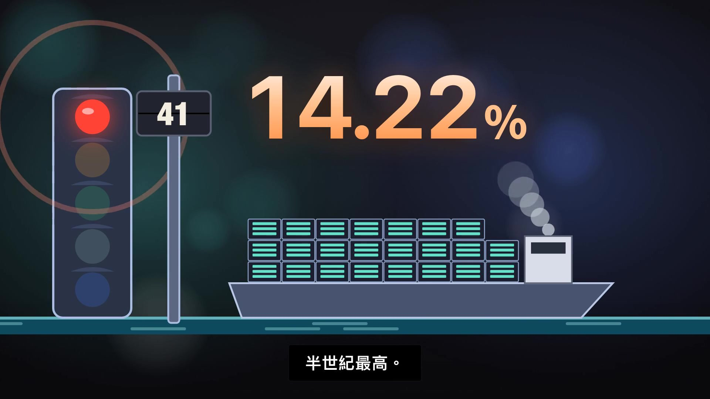

**逐字稿片段：** 這個數字是行政院主計總處10月底的概估

**話題推測：** 提及主計總處10月底的概估數字。預計會出現主計總處標誌。

---

## 00:32:28

**逐字稿片段：** 從2023年4月的谷底算起 到2026年10月 這一輪擴張大約42個月 已經超過歷史平均的40個月 看到這裡很多人會想 是不是衰退快來了 前面講過 景氣循環不是時鐘 臺灣最長的一次擴張 是1956年到1964年 96個月 平均值告訴你過去 不會告訴你下一次哪一天開始 這一輪的熱 主要是AI帶來的出口 所以前面三個問題 每一個都會寄到臺灣

**話題推測：** 提及臺灣這一輪擴張已超過歷史平均。預計會出現臺灣擴張期與平均值的比較圖。

---

## 00:32:54

**逐字稿片段：** 國家發展委員會估計 紅燈有機會亮到年底 也提醒明年第一季 會碰到高級期 今年的數字太高 明年要再比 成長率就很難好看 高基期本身不是衰退 可是它說明一件事 臺灣這次的成長 很集中在AI這件事上 用地圖看 物價的壓力有升高 臺灣第三季的消費者物價 比一年前漲了2.4%左右 9月是2.73% 是兩年半以來最高的漲幅 主計總數認為屬於溫和上漲 乾柴則可能不在臺灣自己手上 如果美國的AI投資 只是不再加速 並不需要泡沫破掉 訂單就可能先慢下來 就像2001年那樣 當然 這次的需求可能真的比當年更厚實 沒有人知道 所以那盞燈 在接下來幾個月 可能是臺灣人最容易看到的警報器 看的不是紅燈變黃紅燈 是分數一路往下掉的速度

**話題推測：** 提及國發會預計紅燈持續到年底，並提醒明年第一季的高基期效應。預計會出現國發會預測或高基期的文字說明。

---

## 00:33:43

**逐字稿片段：** 所以 回到我們的主問題 經濟為什麼會有景氣循環 為什麼每隔幾年就要衰退一次 這一部分的答案 也是整集的答案 沒有一個人把它完全說對 可是合起來 大致可以這樣講 景氣好的時候 大家的做法會改變 公司看著生意變好 就買機器 銀行看著景氣穩定就多放款 大家看著別人賺錢就一起投入 這些做法在當下都合理 加起來風險就越來越高 這就是我們說的幹財 然後只要成長不再加速 或者外面丟進來一根火柴 或者中央銀行為了壓物價踩下剎車 擴張就可能結束變成衰退 中央銀行有機會讓衰退變輕 可是有時候 它提高利率本身就是衰退的原因 所以衰退才會一再回來 長度卻每次都不一樣 每一次幹財堆了多少 火柴多大 消防隊來得多快 都不一樣 這也是為什麼 盧卡斯說已經解決了之後 五年就來了金融海嘯 也是為什麼女王那個問題 到今天還是問得出來

**話題推測：** 總結影片的核心問題與答案。預計會出現總結性的大標題。

---

## 00:34:38

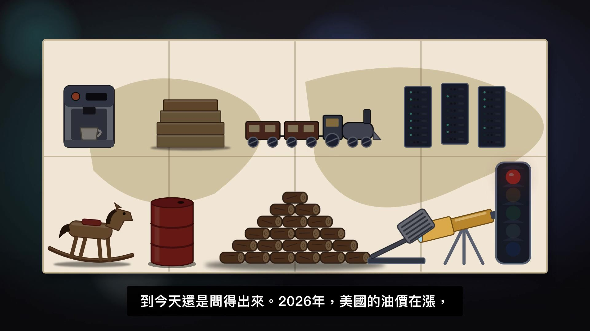

**逐字稿片段：** 2026年 美國的油價在漲 利率剛剛提高 AI被很多人叫泡沫 臺灣的燈還是紅的 我們算不出是哪一天 如果衰退真的來了 負責宣佈的 還是NBER那個委員會 照慣例 等他們宣佈的時候 衰退可能已經過了大半 所以這幾個地方 要自己觀察 景氣循環不是時鐘 可是衰退一再回來 因為景氣好的時候 公司、銀行和投資人的做法都會改變 這些做法累積下來 就是下一次衰退的條件 誰也算不出是哪一天 但你現在知道該注意哪裡 最後問你一個問題 你覺得下一次衰退 比較可能來自外部衝擊 還是景氣擴張時累積的問題 留言告訴我

**話題推測：** 提及2026年美國的經濟現況總結。預計會出現2026年美國與臺灣的總結性景氣圖示。

---

## 00:35:16

**逐字稿片段：** 喜歡的話訂閱AI Notebook 開啟通知 我們下次見

**話題推測：** 影片結尾，呼籲訂閱與開啟通知。預計會出現訂閱按鈕或社群媒體標誌。

---
