# jimainotebook_79aYa7r-qeI — 關鍵畫面索引

- 來源逐字稿：[jimainotebook_79aYa7r-qeI_FIN.srt](jimainotebook_79aYa7r-qeI_FIN.srt)
- 影片：https://www.youtube.com/watch?v=79aYa7r-qeI
- 截圖數：81

## 00:00:03

**逐字稿片段：** 大家好,我是Jim,這裡是AI Notebook。

**話題推測：** 影片開場與講者介紹

---

## 00:00:10

**逐字稿片段：** 這一集是耶魯大學天文課ASTR160的最後一集,第16到24堂,主題是整個宇宙。 老師一樣是Charles Balin,錄影時間是2007年春天。

**話題推測：** 介紹本集主題為耶魯大學天文課的「整個宇宙」

---

## 00:00:20

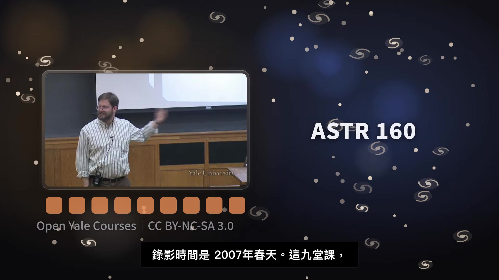

**逐字稿片段：** 這九堂課在回答一個問題,宇宙最後會怎麼結束?

**話題推測：** 提出本集核心問題：宇宙最後會如何結束？

---

## 00:00:24

**逐字稿片段：** 會一直膨脹下去,越來越冷?還是有一天停下來,塌回去? 這是一門19年前的課,為什麼還值得聽? 因為Balin教的是一套推理,看不見的東西就從他怎麼拉動看得見的東西把它推出來。 這套推理沒有過時 過時的是數字和預言 這一集的預言特別多 有些已經對到答案 有些到今天還沒有 我們一條一條替他對 第十六堂一開始 他就說了 這一招這門課已經用過兩次 聽他自己說

**話題推測：** 呈現宇宙結局的兩種可能性：膨脹或塌縮（冰或火）

---

## 00:01:20

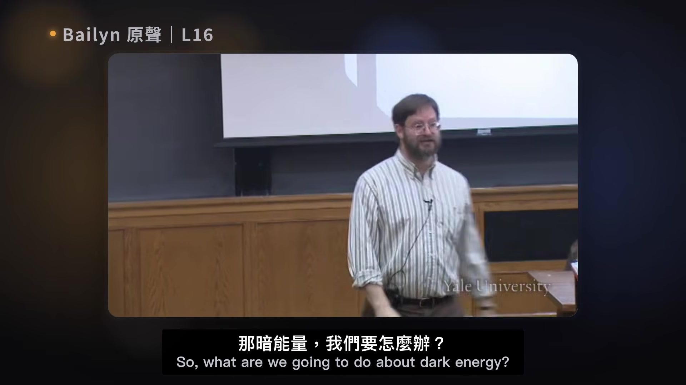

**逐字稿片段：** 上集,看不見的行星靠恆星被拉的晃來晃去找到 中集,看不見的黑洞靠旁邊的恆星繞著它轉找到 這一集,看的是整片天空的星系怎麼動

**話題推測：** 回顧前兩集尋找「看不見的東西」的方法：行星與黑洞

---

## 00:01:31

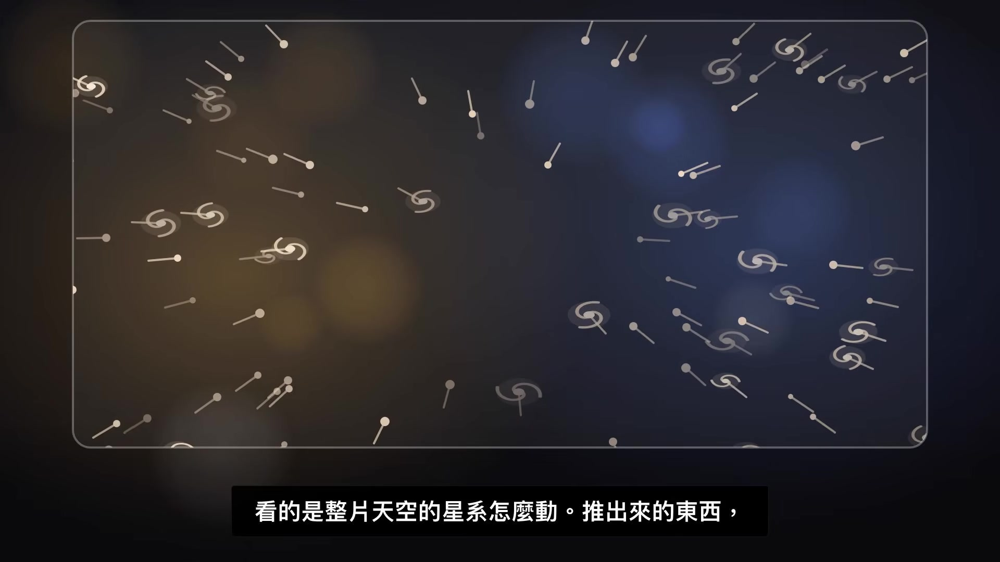

**逐字稿片段：** 推出來的東西佔了宇宙大約95% 我們看得到摸得到的一切只佔大約二十分之一 那是後面的事 先回到這一集的問題 宇宙最後會怎樣 貝林在第十七堂把它說成兩個選項 聽他自己說

**話題推測：** 揭示宇宙中約95%的「看不見的東西」

---

## 00:02:17

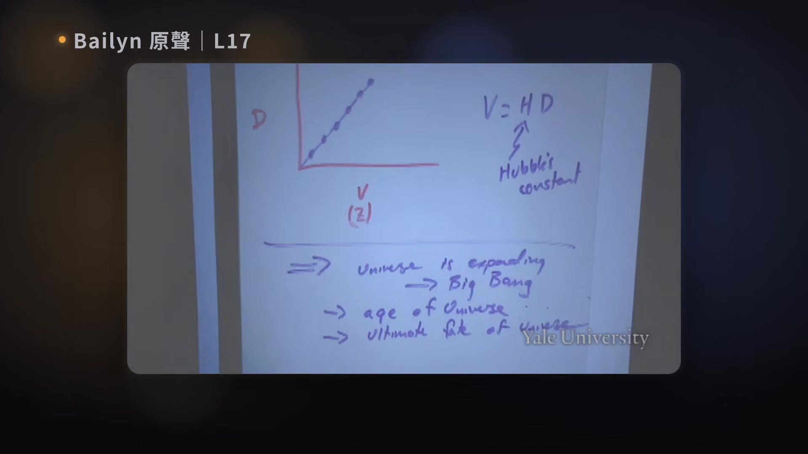

**逐字稿片段：** 火還是冰 要回答這個問題 得先知道宇宙在膨脹 而這件事被發現還不到一百年

**話題推測：** 本集探討宇宙結局的子標題：火還是冰

---

## 00:02:23

**逐字稿片段：** 1920年 天文學界最大的爭議 是天上那些螺旋狀的小云 它們是銀河系裡的一團團氣體 還是遠在銀河系外 另一個跟銀河系一樣大的星系 那年4月

**話題推測：** 進入歷史背景，討論1920年代天文學界關於星系的爭議

---

## 00:02:34

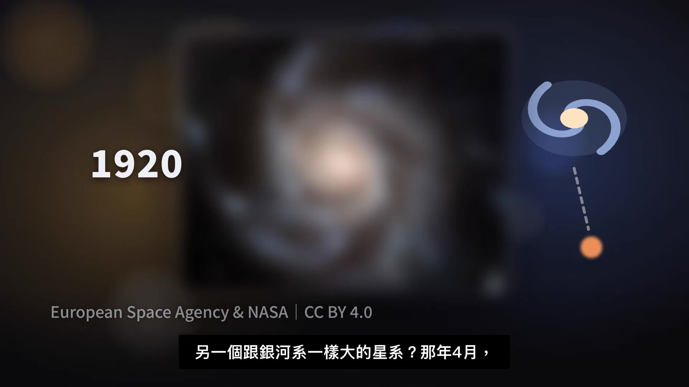

**逐字稿片段：** 兩位天文學家在美國國家科學院公開辯論 主張就在銀河系裡的Harlow Shapley 論據多,說服力強 結果是錯的 主張是別的星系的Haber Curtis 證據少,卻是對的 這是終極那場日食遠征的隔年 報紙很愛這種新聞 Balin把它寫成預言 寓意是論據全對,還是可能錯 幾年後,答案出來了

**話題推測：** 提及Shapley與Curtis兩位天文學家的公開辯論

---

## 00:02:56

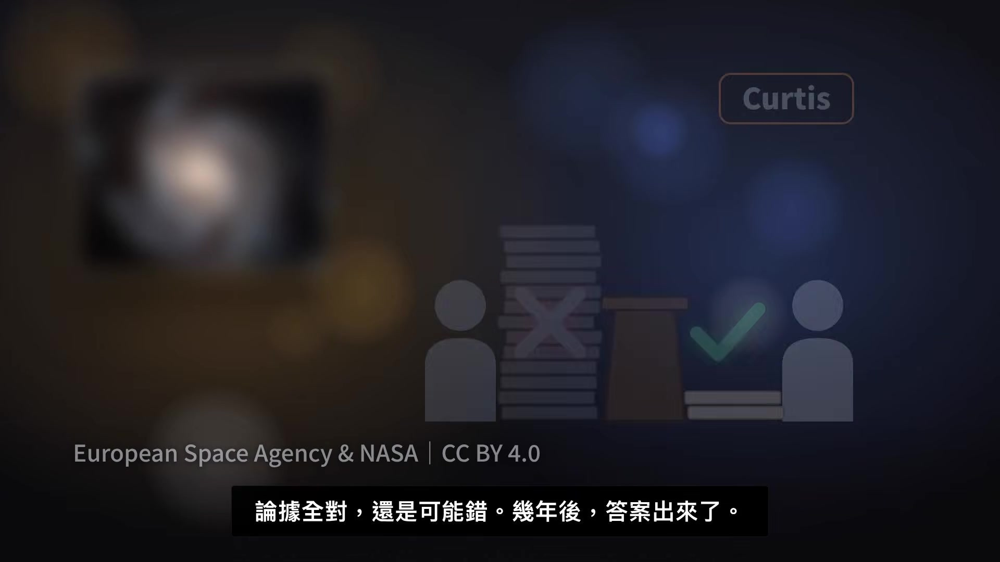

**逐字稿片段：** Edwin Hubble用洛杉磯附近 威爾遜山上一座鏡面兩公尺半的望遠鏡 把最近的幾團螺旋雲分解成一顆一顆的恆星 那些恆星非常暗 所以非常遠 螺旋雲就是別的星系 宇宙一下子變得大得多 接著 Hubble測量這些星系的光 這裡要用到一個詞

**話題推測：** 介紹Edwin Hubble的重大發現及其觀測儀器

---

## 00:03:14

**逐字稿片段：** 叫紅移 一個東西離我們而去 它發出的光 波長會被拉長 顏色往紅的那一邊偏 偏得越多 離開得越快 結果很奇怪 幾乎每一個星系都在離我們而去 而且越遠的 離開得越快

**話題推測：** 解釋「紅移」這個關鍵概念

---

## 00:03:28

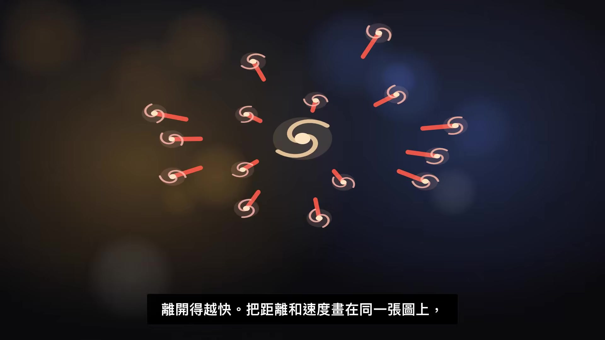

**逐字稿片段：** 把距離和速度畫在同一張圖上 點排成一條直線 這叫哈勃定律 1929年發表 那條直線有多斜

**話題推測：** 引入「哈勃定律」的距離與速度關係圖

---

## 00:03:35

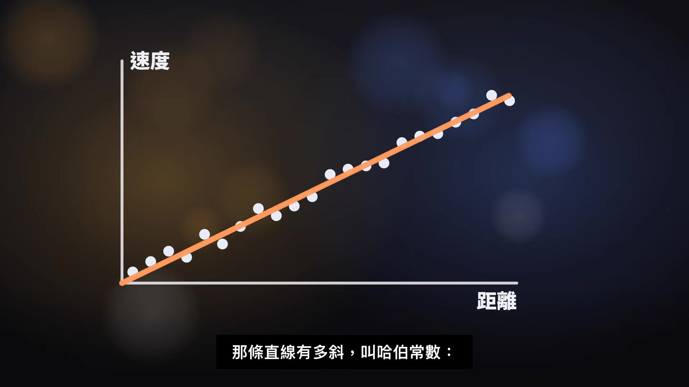

**逐字稿片段：** 叫哈勃常數 大約每遠300多萬光年 離開的速度 就快每秒70公里左右 這個數字決定宇宙膨脹的多快 後面每一部分都會用到 哈勃自己算出來 大約是500 差了大約7倍

**話題推測：** 說明「哈勃常數」及其數值（約每秒70公里）

---

## 00:03:47

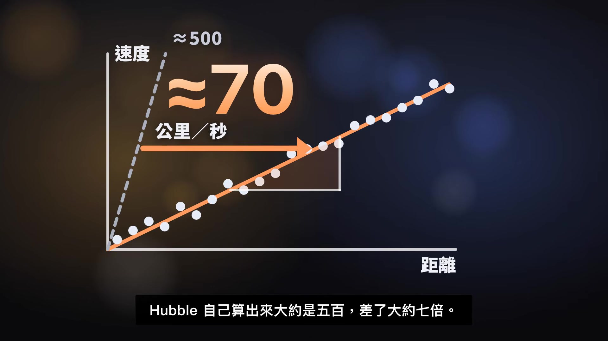

**逐字稿片段：** 哈勃太空望遠鏡的 重要任務之一 就是把這個數字測量準 2007年 貝林對學生這樣說 聽他自己說 And this was a big success We now know what the Hubble constant is It's measured in somewhat weird units

**話題推測：** 提及哈勃太空望遠鏡測量哈勃常數的任務

---

## 00:04:10

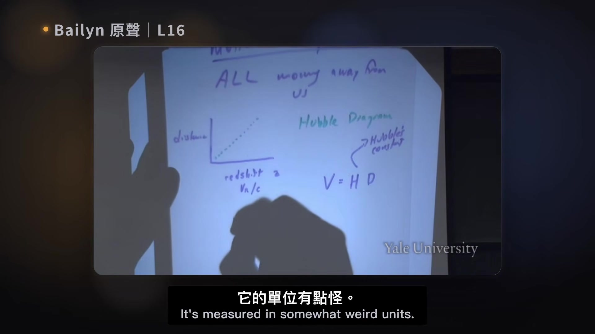

**逐字稿片段：** 它是70多公里每秒次 大約70已經解決 這句話第一部分最後會回來 先看一個更基本的問題 圖上的速度看紅移就知道

**話題推測：** 確認當時測得的哈勃常數約為70

---

## 00:04:25

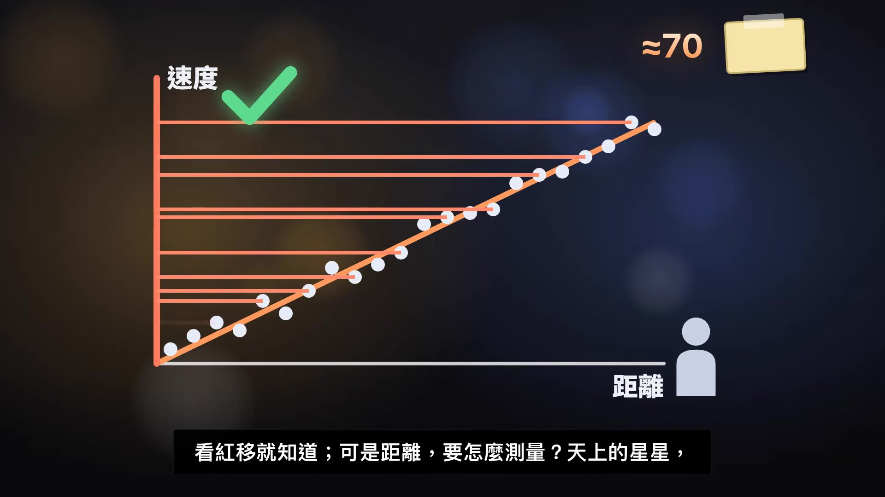

**逐字稿片段：** 可是距離要怎麼測量 天上的星星看起來都貼在同一片天幕上 分不出遠近

**話題推測：** 引出新的問題：如何測量宇宙中的距離？

---

## 00:04:30

**逐字稿片段：** 天文學家的辦法叫標準燭光 先知道一個東西真正有多亮 再看它在天上看起來多暗 就算得出它有多遠 貝林說

**話題推測：** 介紹「標準燭光」測量距離的方法

---

## 00:04:39

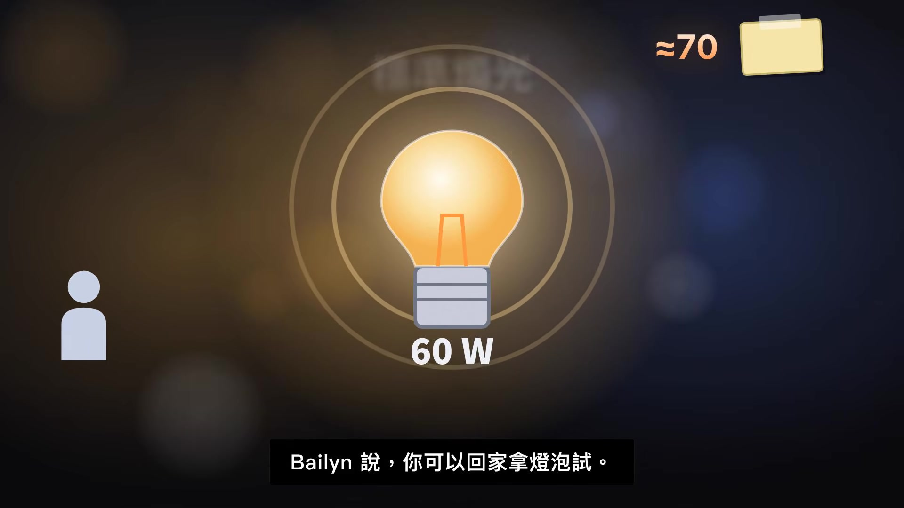

**逐字稿片段：** 你可以回家拿燈泡試 一顆已知瓦數的燈泡放到兩倍遠 看起來只剩四分之一亮 放到三倍遠剩九分之一 知道瓦數 看它多暗就知道多遠 麻煩在第一步 你怎麼知道它真正多亮 通常靠假設 假設這一類東西亮度都一樣 Hubble當年就錯在這裡 他以為知道某一種星有多亮 結果錯了 所有星系的距離都錯了同一個倍數 貝林說 1925年以來 整部宇宙學史都壓在假設這兩個字上 距離怎麼一層一層往外推 最近的星用最直接的幾何方法

**話題推測：** 以燈泡的亮度變化類比標準燭光

---

## 00:05:11

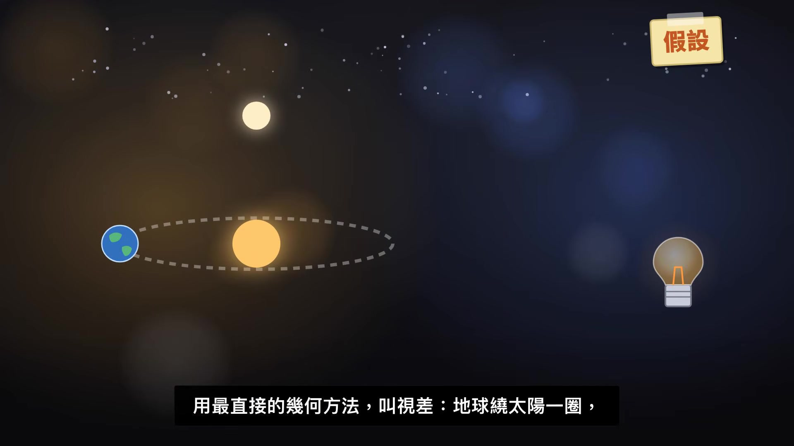

**逐字稿片段：** 叫視差 地球繞太陽一圈 近的星在遠方的星空前面 會左右挪一點點 挪多少就算得出多遠 2007年 貝林說 這個方法只能測量到幾百秒差距 大約一千光年上下

**話題推測：** 介紹最直接的測量距離方法：視差

---

## 00:05:23

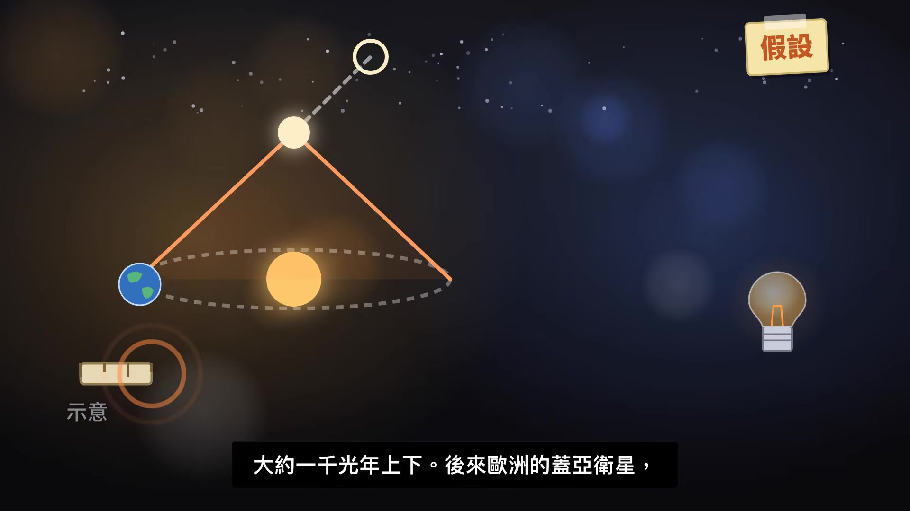

**逐字稿片段：** 後來歐洲的蓋亞衛星 測量了大約15億顆星的視差 可靠的範圍推到好幾千秒差距 再遠就得靠標準燭光 先用視差找出附近某一類星的真正亮度 再拿同一類星去測量更遠的星系

**話題推測：** 提及歐洲蓋亞衛星對視差測量的貢獻

---

## 00:05:37

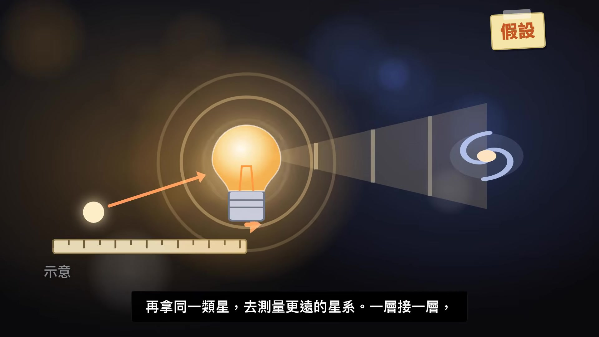

**逐字稿片段：** 一層接一層叫距離階梯 每多一層就多一個假設 這座梯子的第一階如果歪了 上面每一階都跟著歪 現在回到那條直線 每一個星系都在遠離我們 聽起來好像我們站在宇宙的正中心 其實不是

**話題推測：** 解釋「距離階梯」的概念圖

---

## 00:05:52

**逐字稿片段：** 想象一顆正在吹大的氣球 表面畫滿小點 不管你站在哪一個點上 都會看到別的點在遠離你 而且越遠的 離開的越快 每一個點 都會覺得自己是中心 所以宇宙膨脹 沒有中心 貝林也提醒 別問氣球外面是什麼 那是比喻自己造出來的問題 宇宙不是往什麼地方脹出去 是所有的距離同時變大 同樣的道理

**話題推測：** 用吹大的氣球比喻宇宙膨脹「沒有中心」

---

## 00:06:14

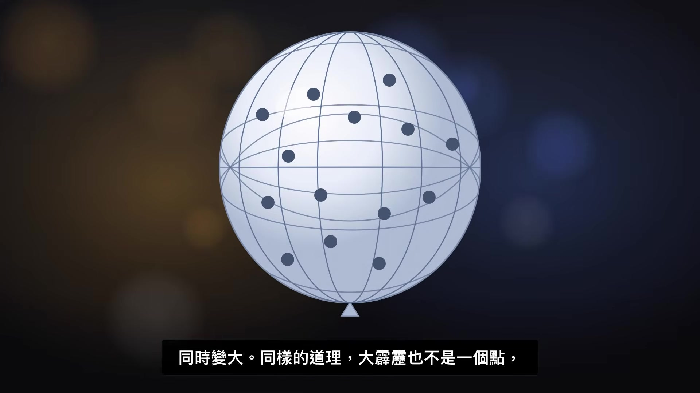

**逐字稿片段：** 大霹靂也不是一個點 往空蕩蕩的空間裡炸開 照他的說法 所有的空間 本來就都在那一點裡 那麼 地球 太陽 你和我 有沒有跟著一起變大 有學生問了這個問題,聽他自己說 氣球上的普丁不會變大 因為補丁自己粘得很牢 我們的身體靠化學力綁著 地球、太陽、整個銀河系靠重力綁著 會被拉開的是星系和星系之間的距離 既然星系都在互相遠離 把時間倒轉回去 它們就會越來越近 最後擠在一起 宇宙從一個又熱又密的狀態開始膨脹 這個想法叫大霹靂 那是多久以前?

**話題推測：** 澄清大霹靂並非空間中的爆炸點

---

## 00:07:16

**逐字稿片段：** 貝林用開車來算 你離家100英里 時速50英里 就知道開了兩小時 宇宙也一樣 距離處於速度 而照哈勃定律 這剛好就是哈勃常數倒過來 用70去算

**話題推測：** 以開車類比計算宇宙年齡

---

## 00:07:27

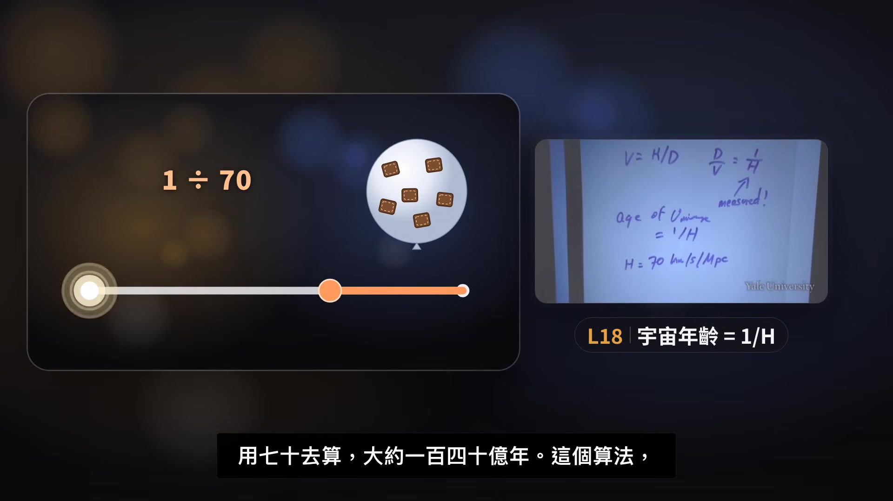

**逐字稿片段：** 大約140億年 這個算法在Hubble那個年代出過大事 用它的500去算 宇宙只有大約20億歲 今天知道地球大約45億歲 照它的數字 地球比宇宙還老 這也是大霹靂一開始被懷疑的原因之一 今天最準的數字

**話題推測：** 公布宇宙當前估計的年齡：約140億年

---

## 00:07:43

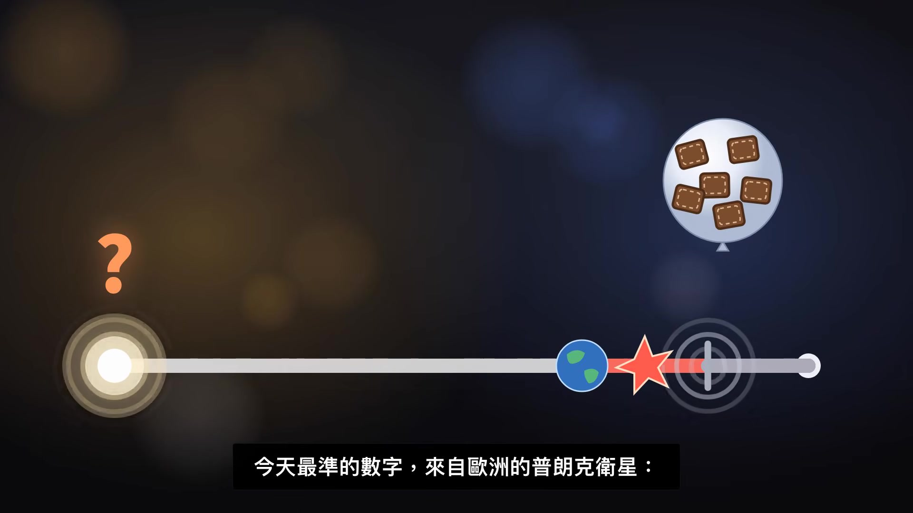

**逐字稿片段：** 來自歐洲的普朗克衛星 宇宙大約138億歲 誤差只有2000萬年 不過在1950年代 膨脹並不等於大霹靂

**話題推測：** 提及歐洲普朗克衛星更精準地測量宇宙年齡（138億歲）

---

## 00:07:51

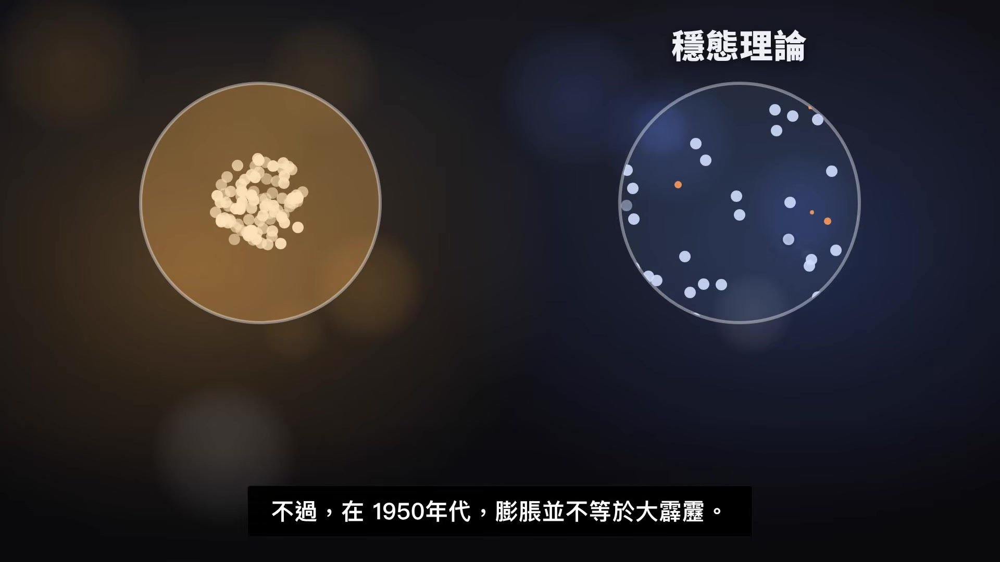

**逐字稿片段：** 另一派人提出穩態理論 宇宙在膨脹 可是空出來的地方 會一直生出新的物質填進去 所以每一個角落永遠長得一樣 宇宙沒有開始 也沒有結束 這套想法在當時很有吸引力 而且它也能解釋哈勃定律 星系一樣在互相遠離 只是舊的走了 新的又冒出來 大霹靂這個名字 是反對它的人取的 一般認為出自 穩態理論的代表人物

**話題推測：** 引入大霹靂理論的競爭者：「穩態理論」

---

## 00:08:15

**逐字稿片段：** Fred Hoyle 1949年在英國的廣播節目上 貝林說 這個名字讓人以為 是一個點炸開 很容易誤會 雜誌辦過好幾次活動 想幫他改名都沒有成功 兩派都能解釋膨脹 那要怎麼分勝負 靠一件事 光走得再快也要花時間 我們看太陽 看到的是八分鐘前的太陽 看離我們最近的恆星 看到的是四年前的它 看一個三千萬光年外的星系 看到的是它三千萬年前的樣子 幾百萬年在宇宙裡不算什麼 可是看到幾十億光年外 看到的就是宇宙歷史的一大段

**話題推測：** 提及穩態理論的代表人物Fred Hoyle

---

## 00:08:48

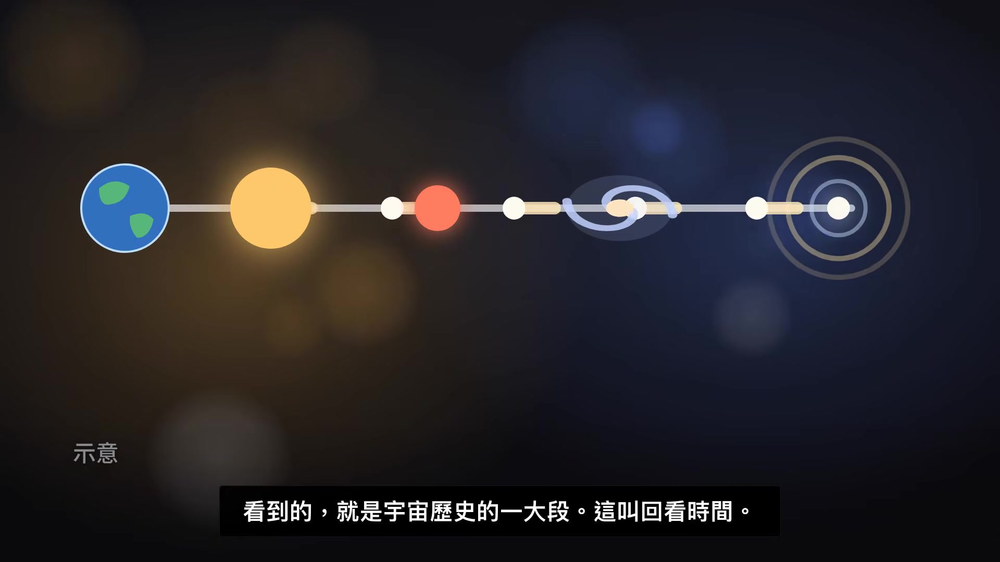

**逐字稿片段：** 這叫回看時間 如果穩態理論對 遠方和近處應該長得一樣 如果大霹靂對 遠方的宇宙應該更密、更熱 也不一樣 1960年代 答案陸續出來

**話題推測：** 解釋「回看時間」概念，作為分辨兩理論的依據

---

## 00:09:00

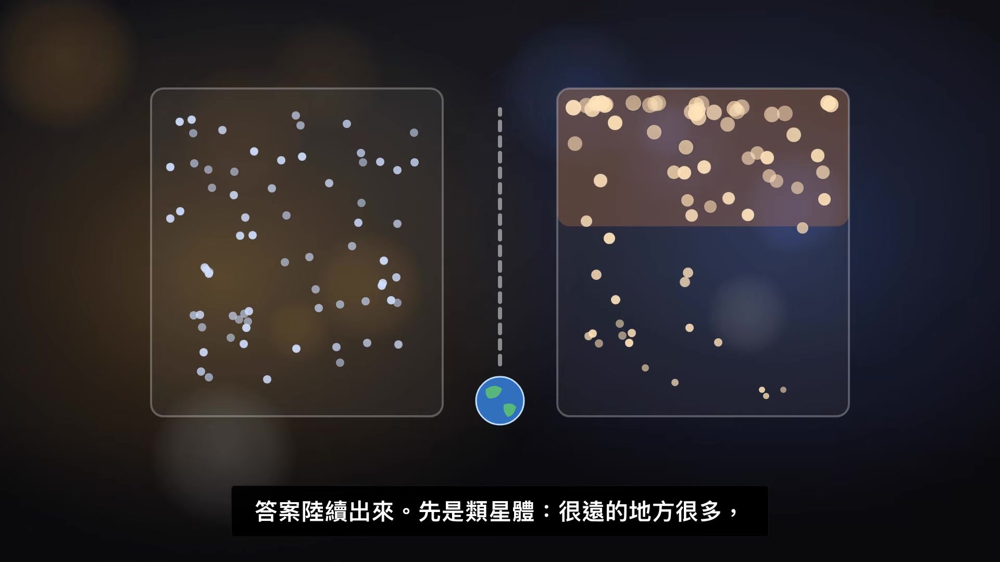

**逐字稿片段：** 先是類星體 很遠的地方很多 附近幾乎沒有 代表宇宙以前跟現在不一樣 今天知道 類星體就是終極講過的 正在吞東西的超大質量黑洞 1965年

**話題推測：** 提出類星體作為大霹靂理論的證據

---

## 00:09:11

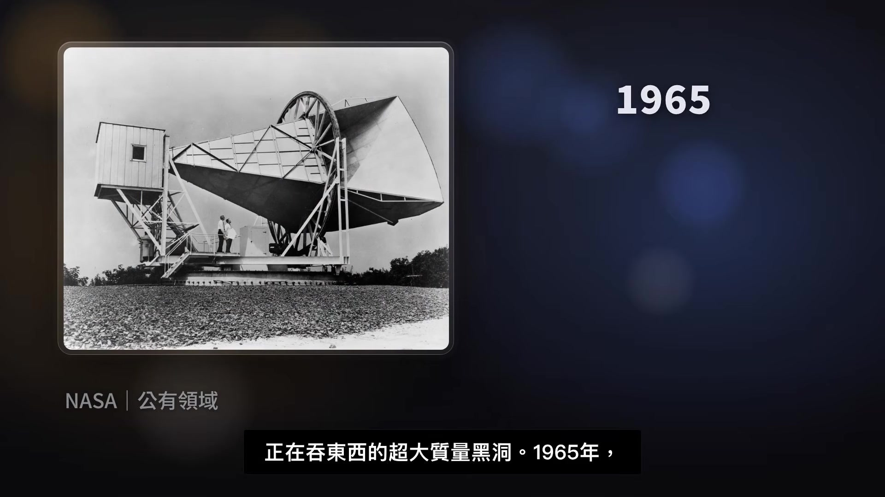

**逐字稿片段：** 美國貝爾實驗室的兩位研究員 用一具天線收到一種 從四面八方來的微弱訊號 後來證實是大霹靂留下的光 第三部分會再講 他們拿到1978年的諾貝爾物理獎 再加上宇宙裡大約四分之三是氫 四分之一是氦 正好是大霹靂最初幾分鐘的合融合 算得出來的比例 穩態理論就這樣輸了 回到那個大約70 2007年 貝林說他已經解決 在當時是合理的 哈勃太空望遠鏡的大型計劃 測量出大約72

**話題推測：** 介紹宇宙微波背景的發現過程與貝爾實驗室的天線

---

## 00:09:39

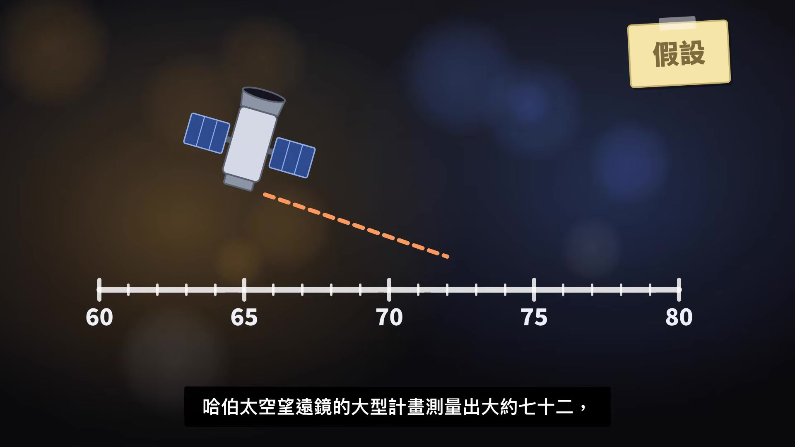

**逐字稿片段：** WMAP衛星推算出大約73 兩邊對得上 後來兩邊都越測量越準 反而對不上了 一邊從大霹靂留下的光往後推算 普朗克衛星得到67.4 另一邊直接測量附近星系的距離和速度 得到大約73 兩邊的誤差都只有1%左右 差距卻大過誤差好幾倍

**話題推測：** 提及WMAP衛星測得的哈勃常數（約73）

---

## 00:09:58

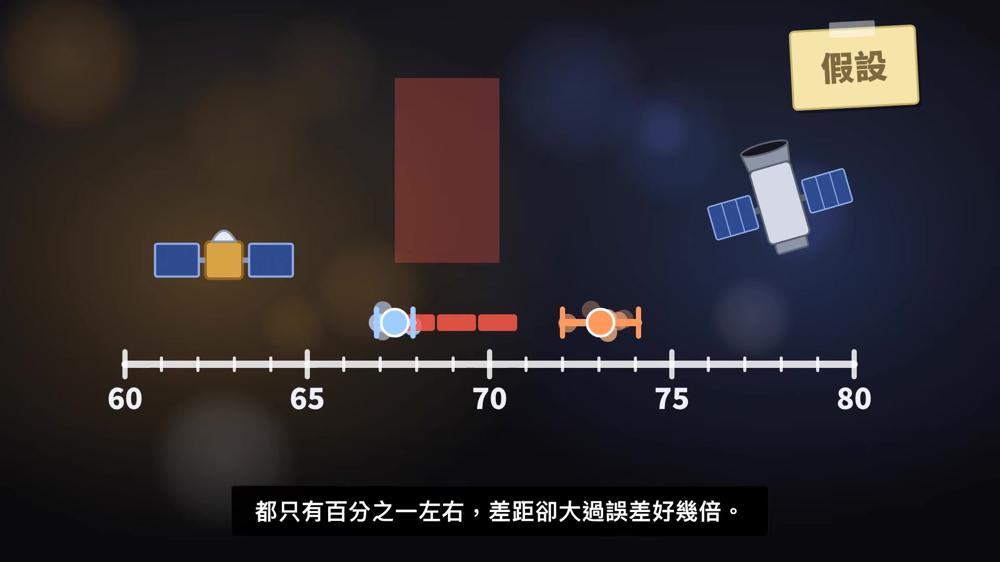

**逐字稿片段：** 這叫哈勃張力 爭議落在哪 正是貝林說的那兩個字 假設 近處的測量要靠一層一層的標準燭光往外推 每一層的燈泡瓦數怎麼校準 不同團隊得到的答案不一樣 有一組人用另一種星重新校準 得到大約70 說不需要新的物理 截至2026年10月還沒有定論 2007年說已經解決的數字又被打開了 整理一下第一部分 星系都在互相遠離 越遠越快 代表宇宙在膨脹 倒轉回去 大約 138億年前 宇宙又小又熱又密 既然宇宙在變大 就能問 它最後會怎樣 答案取決於一件事

**話題推測：** 介紹「哈勃張力」這個科學新爭議

---

## 00:10:36

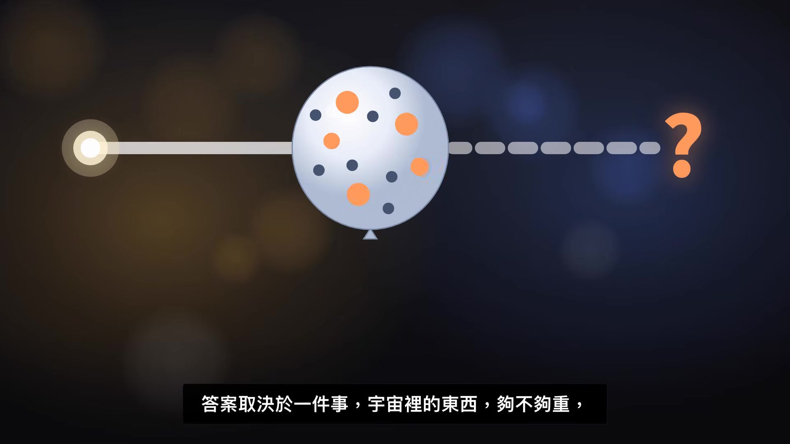

**逐字稿片段：** 宇宙裡的東西夠不夠重 能不能把膨脹拉回來 貝林用一個熟悉的動作來算

**話題推測：** 引導至新議題：宇宙的質量是否足以拉回膨脹？

---

## 00:10:41

**逐字稿片段：** 往上丟一支筆 丟得慢 它停下來掉回手裡 丟得夠快 它就飛走不回來 這就是終極講過的逃逸速度 宇宙也一樣 星系往外飛 所有東西的重力 再把它們往回拉 它在黑板上算 結果很漂亮 不管挑哪一個星系 距離都會消掉 只剩一個門檻

**話題推測：** 以向上丟筆的動作類比逃逸速度

---

## 00:10:59

**逐字稿片段：** 這個門檻叫臨界密度 宇宙的平均密度 剛好等於它 膨脹就剛好被拉住 算出來 它小得驚人 用今天的數字 大約是每立方公尺

**話題推測：** 介紹決定宇宙命運的門檻：「臨界密度」

---

## 00:11:08

**逐字稿片段：** 五顆氫原子的重量 教室裡的空氣 比它密二十幾個數量級 比臨界密度重 宇宙終究會停下來 塌回去 那是火 比它輕 就永遠膨脹下去

**話題推測：** 具體化臨界密度的極小數值（每立方公尺5顆氫原子重）

---

## 00:11:20

**逐字稿片段：** 主題變成把宇宙稱一稱 稱法有兩種 一種是看光 數一數星系有多亮 假設每一份光背後有多少質量 又是假設 另一種是這門課第三次用同一招 看軌道 星系外圍的恆星繞著中心轉 轉多快就看中心有多重 上級用它找行星 中級用它找黑洞 貝林在課堂上算了一個典型的星系 外圍的恆星每秒大約200公里 用軌道算出來的質量

**話題推測：** 轉向如何「稱重」宇宙物質的方法

---

## 00:11:46

**逐字稿片段：** 比看光估計的多了大約20倍 到了1980年代, 天文學家發現, 星系、星系團都一樣, 加上看得到的氣體和塵埃還是差了10倍左右,

**話題推測：** 揭示「看軌道」測量到的質量遠超「看光」估計（約20倍）

---

## 00:11:56

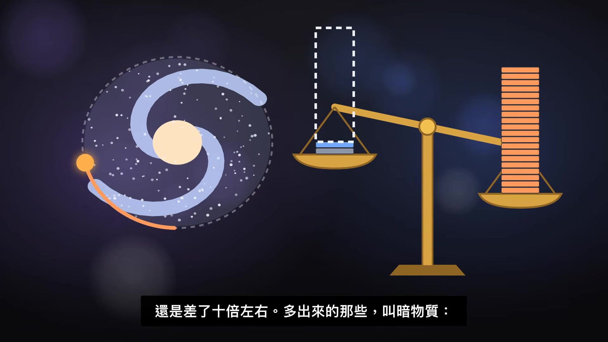

**逐字稿片段：** 多出來的那些叫暗物質。 它有重量,會產生重力,可是不發光也不擋光。 貝林說這是1985年的前言,聽他自己說。 這是一個我們還沒有解決的問題 所以我不懂答案 一半年來 人們都在努力去解決 但仍然沒有答案 四分之一世紀 沒有好答案 不過 暗物質存在的證據 在2007年已經不止他課堂上那一個 1970年代

**話題推測：** 介紹「暗物質」這一核心概念

---

## 00:12:41

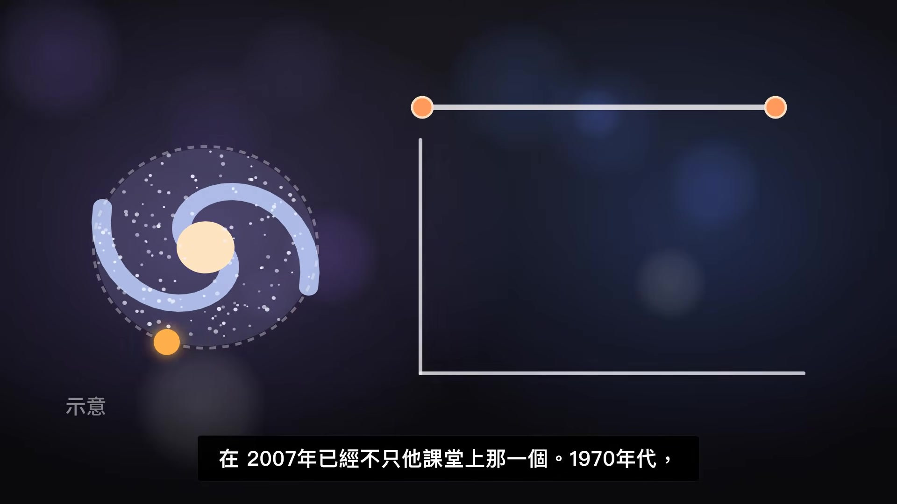

**逐字稿片段：** 美國天文學家Vera Rubin 測量了許多星系的轉速 發現外圍的恆星 轉得跟靠內的差不多快 照看得到的質量 他們早該被甩出去 這是暗物質最關鍵的證據之一 這個名字第三部分還會出現 陸克前大約半年 2006年8月還有一張更直接的照片 兩團星系團迎面相撞

**話題推測：** 介紹天文學家Vera Rubin及其對暗物質的關鍵測量

---

## 00:13:01

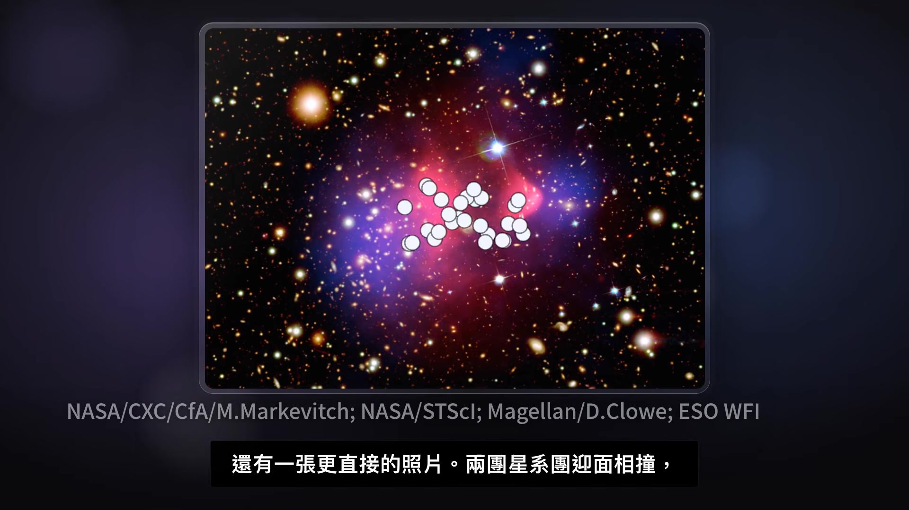

**逐字稿片段：** 叫子彈星系團 X光衛星拍到 熱氣體在碰撞中被拖慢 留在中間 可是用重力透鏡測量質量 大部分的質量卻跟著星系穿過去 到了看不見氣體的地方 看不見的東西在那裡拉彎了光 那暗物質是什麼? 2007年有兩派猜法

**話題推測：** 以「子彈星系團」的碰撞照片作為暗物質的直接證據

---

## 00:13:18

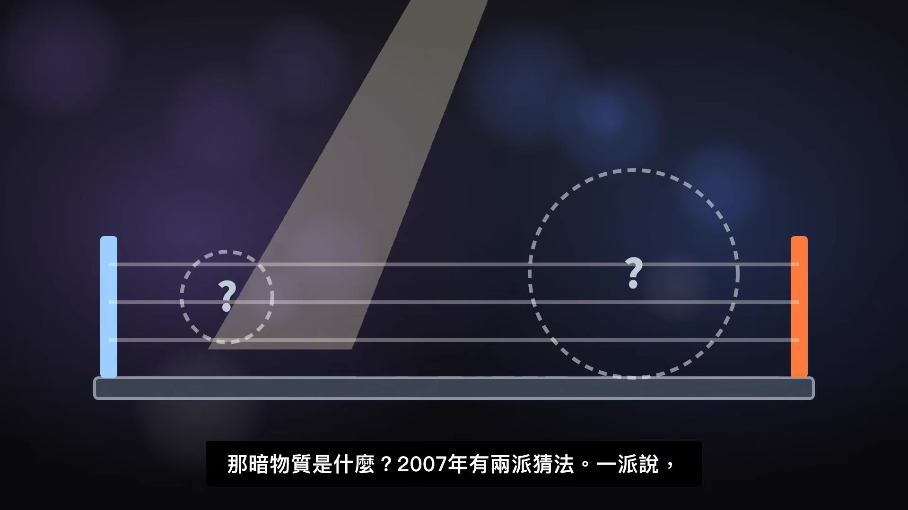

**逐字稿片段：** 一派說是一種還沒發現的粒子 有質量,可是幾乎不跟光,也不跟一般物質起作用 英文叫WIMP,意思是弱交互作用的大質量粒子 這個字在英文裡,剛好也是弱肌的意思

**話題推測：** 介紹暗物質粒子假說：「WIMP」

---

## 00:13:31

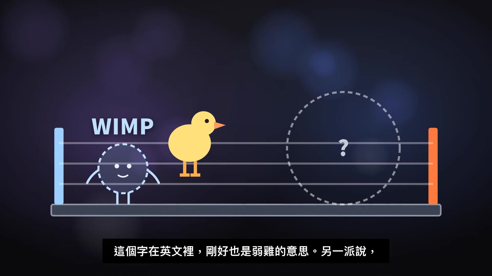

**逐字稿片段：** 另一派說,是暗暗的普通物質 像不發光的星體,散在星系外圍 英文叫Macho,猛男 這是天文學家故意開的玩笑 猛男這一派,可以用重力透鏡找 一團看不見的東西,剛好經過一顆星前面 那顆星會亮起來幾個星期 真的找到了,可是太少,遠遠不夠 到了2007年 多數人壓的是粒子那一派 只是一樣還沒有直接證據 粒子要怎麼抓

**話題推測：** 介紹暗物質由普通物質組成的假說：「MACHO」

---

## 00:13:55

**逐字稿片段：** 前例是微中子 它幾乎不跟任何東西起作用 貝林說 每一秒都有好幾兆顆穿過那間教室 1960年代 有人在美國南達科他州的礦坑裡 裝滿清潔劑 等微中子偶爾撞上一顆綠原子 變成亞原子 再一顆一顆數 大約一天才一顆 主持這個實驗的Ray Davis 2002年拿到諾貝爾物理獎 結果只抓到預期的三分之一 吵了很多年 最後發現問題不在太陽 是微中子在路上會變身 換成偵測器看不到的種類 這個發現 在2015年也拿到諾貝爾物理獎 找暗物質粒子 用的是同一種精神 在地底下放一大桶東西 等它被撞一下 貝林說 到目前為止都失敗了 誰先抓到 諾貝爾獎就是他的 19年後呢 還沒有人抓到 目前最靈敏的偵測器之一

**話題推測：** 以微中子探測的經驗類比如何尋找暗物質粒子

---

## 00:14:41

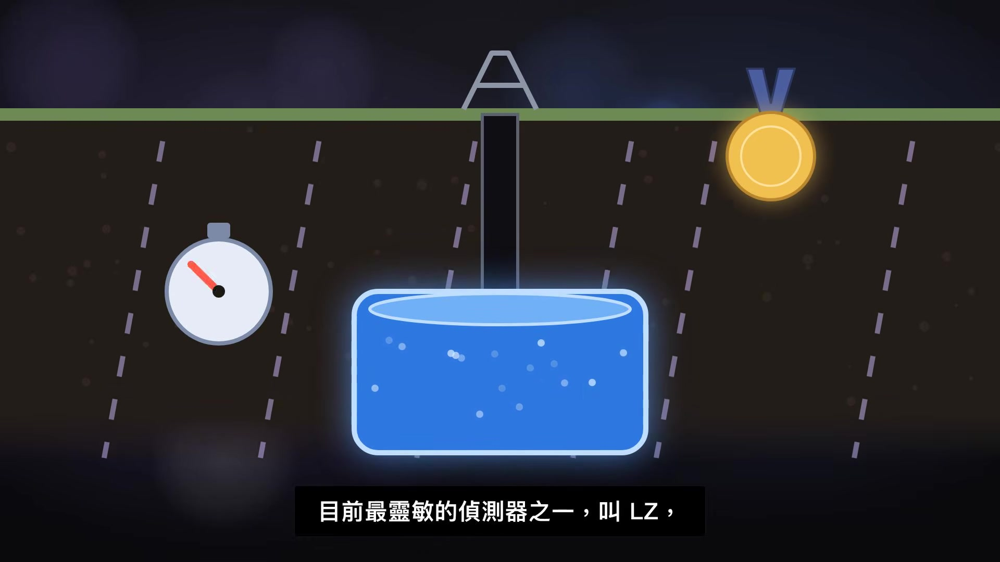

**逐字稿片段：** 叫LZ 就放在南達科他州的地下實驗室 跟當年抓微中子的 是同一座礦坑 裡面是好幾頓的液態纖 2025年12月 他們公佈了417天的資料 還是沒有看到暗物質 倒是先看到了從太陽來的微中子 2026年9月 又報告了一個很難用已知背景解釋的事件 可是團隊明白說 這離宣佈發現還很遠 這19年 暗物質的分量倒是測量得更準了

**話題推測：** 介紹當前最靈敏的暗物質偵測器之一「LZ」實驗

---

## 00:15:06

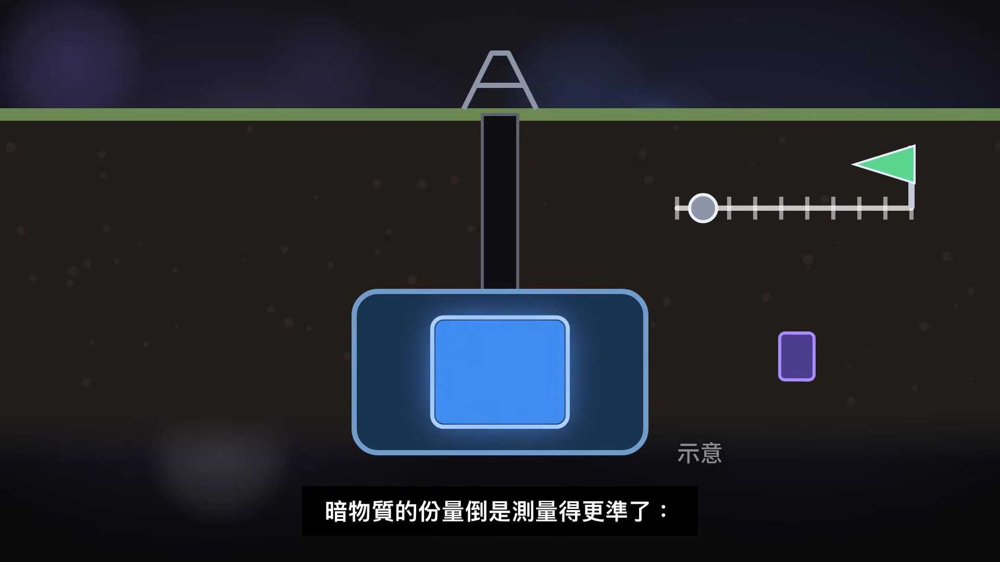

**逐字稿片段：** 大約是一般物質的5倍多 宇宙所有的物質裡 8成以上是暗物質 把暗物質算進去 宇宙到底多重 貝林在課堂上 拿那個典型的星系接著算下去 要稱宇宙範圍的夠大 大到把星系之間空蕩蕩的地方也算進去 他用軌道稱出來的那個星系 大約是兩千億個太陽重 假設差不多每六百多萬光年 就有一個這樣的星系 把質量除以體積得到的平均密度

**話題推測：** 更新暗物質佔一般物質約5倍多的數據

---

## 00:15:31

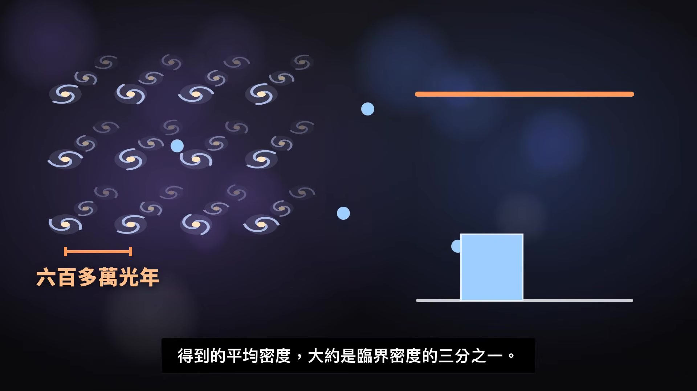

**逐字稿片段：** 大約是臨界密度的三分之一 可是他也提醒 我們加的只是星系 如果星系和星系之間還藏著更多暗物質 這個數字就可能更大 甚至接近一 直接稱到這裡就走不下去了 得換一個方法 整理一下這一部分 把星系、星系團 連同暗物質全部加起來 宇宙的物質只有臨界密度的三成左右 後來其他方法也確認了這個數字 拉不回來 所以宇宙不會塌回去 結局是冰 一直膨脹下去 不過重力一直在拉 膨脹應該越來越慢 就像那隻往上丟的筆 雖然飛走了 速度還是一路變慢 1990年代 天文學家準備做的 就是測量它到底慢了多少 要知道膨脹有沒有變慢

**話題推測：** 指出所有物質加起來僅達臨界密度的三分之一

---

## 00:16:12

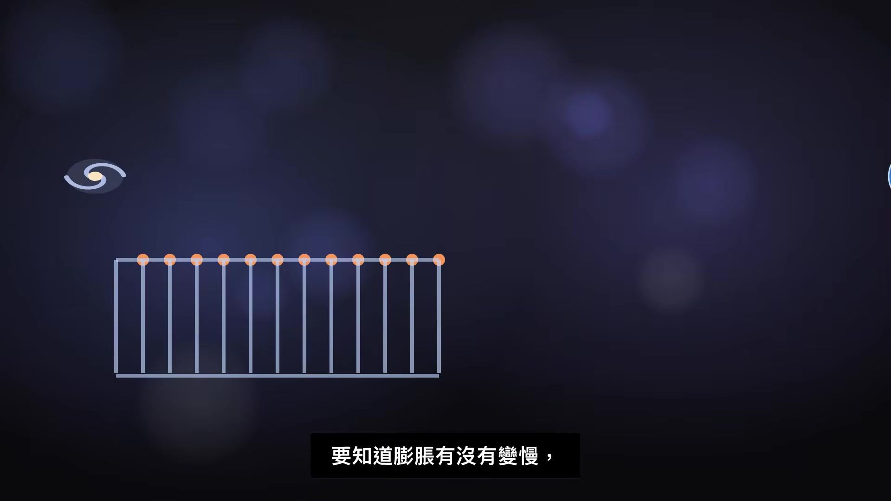

**逐字稿片段：** 貝林換了一個角度看紅儀 第一部分說 紅儀代表星系在離開 另一種看法更直接 光在路上走的時候 宇宙一直在變大 光的波長也跟著被拉長 我們的身體和星系 有力量綁著 不會跟著漲 光沒有 所以光被拉長了多少 宇宙就變大了多少 紅儀等於一的光 波長被拉長成兩倍 代表它出發的時候 宇宙只有現在一半大 所以只要同時知道 一個東西多遠 和它的紅儀 就知道光出發那時候 宇宙有多大 把很多這樣的點連起來 就是宇宙的大小 隨時間怎麼變 要畫出這條線 得看得夠遠 至少看到紅一等於一 也就是宇宙一半大的時候 那是好幾十億年前 這麼遠的地方 普通的星星根本看不到 第一部分那顆已知瓦數的燈泡 得換成最亮的一種 答案是

**話題推測：** 從「光波長被拉長」的角度重新解釋紅移

---

## 00:17:00

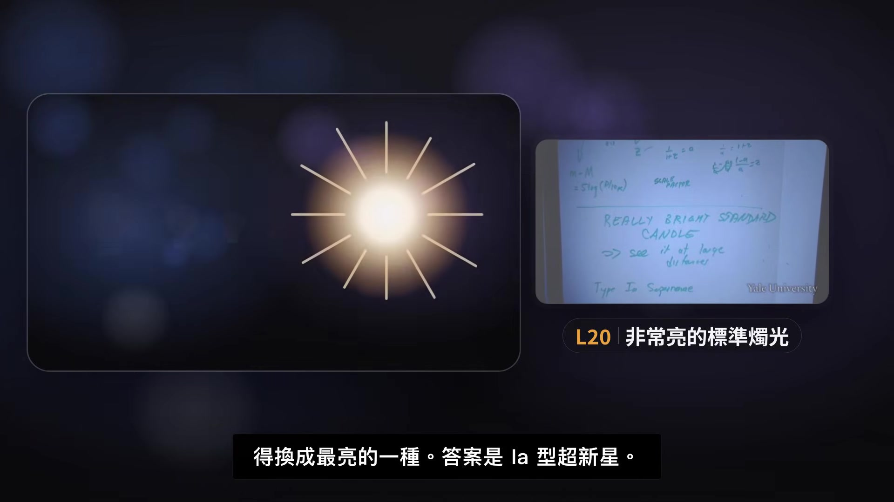

**逐字稿片段：** 1A型超新星 它是這樣來的 一顆白矮星 跟一顆普通恆星 互相繞著轉 白矮星不斷把對方的物質吸過來 這個畫面 終極獎X光雙星時見過 白矮星越來越重 重到終極那條線 前左塞卡極限 大約1.4倍太陽質量 就撐不住整顆燒掉 爆炸那一刻 它可以比整個星系還亮 而且每一次的燃料都差不多一樣多 聽他自己說

**話題推測：** 介紹關鍵的宇宙測量工具「1A型超新星」

---

## 00:17:47

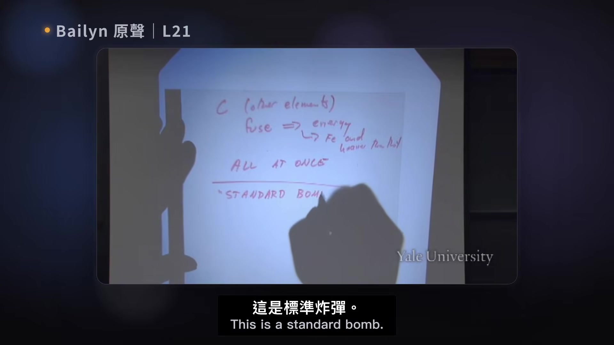

**逐字稿片段：** 標準炸彈 問題是它很少 一個星系大概100年才有一顆 銀河系上一次看到是1604年 天文學家的辦法是不挑地方 哈勃太空望遠鏡曾經對著一小片看似什麼都沒有的天空拍了很久

**話題推測：** 引用講者說法，將1A型超新星稱為「標準炸彈」

---

## 00:18:01

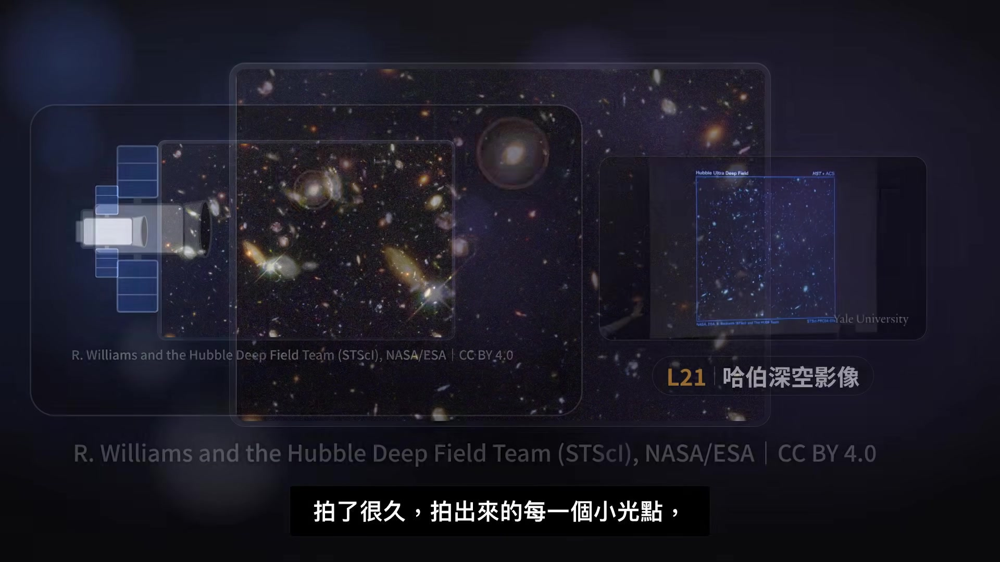

**逐字稿片段：** 拍出來的每一個小光點幾乎都是一個星系 好幾千個 星系這麼多 貝林估計任何時候那一小片天空裡都有十幾顆超新星正在爆炸 所以只要拍一大片天空 隔三個星期再拍一次 兩張相剪 多出來的光點 就是新的超新星 還有一個麻煩 標準炸彈其實沒那麼標準 亮度會差一點 1990年代 天文學家發現 可以靠它變暗的速度和顏色來修正 比較亮的變暗的比較慢 修正完 附近那些超新星排得非常整齊 1990年代 兩組人同時在做這件事

**話題推測：** 提及哈勃太空望遠鏡的深場照片，顯示大量星系

---

## 00:18:35

**逐字稿片段：** 一組以Sol Promoter為首 很多成員原本做粒子物理 組織像一個大團隊

**話題推測：** 介紹Sol Perlmutter領導的第一個超新星研究團隊

---

## 00:18:40

**逐字稿片段：** 另一組由Brian Schmidt和Adam Rees帶頭 是研究超新星的老手 鬆散的合作 兩組互相競爭 他們把遠方的超新星

**話題推測：** 介紹Brian Schmidt和Adam Riess領導的第二個超新星研究團隊

---

## 00:18:48

**逐字稿片段：** 放到那張距離和速度的圖上 跟理論的線比較 如果宇宙照上一部分的預期減速 這些點應該落在線的兩邊 有上有下 結果點全部落在同一邊 比預期的更暗 也就是比預期的更遠 這有多不可能 聽他自己說 那是一百萬的可能性 另一個團隊做了同樣的實驗 他們測試了同樣的數字 得到同樣的結果 那是一百萬的可能性 那是一千萬的可能性 兆分之一 更暗 代表那些超新星比預期的遠 更遠 代表宇宙這些年膨脹的比預期多 膨脹沒有變慢

**話題推測：** 展示遠方超新星在距離-速度圖上的分佈與理論的偏差

---

## 00:19:37

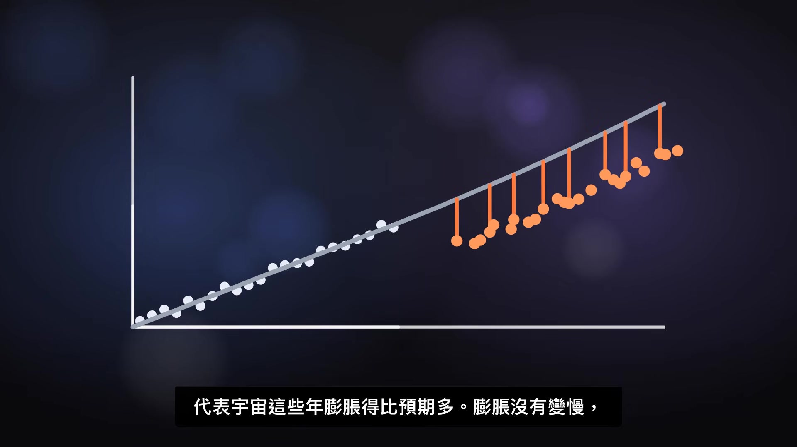

**逐字稿片段：** 反而在變快 兩組人一開始都不相信 各自花了大約一年 以為是自己哪裡算錯 後來互相打聽 才發現對方也遇到一模一樣的問題 而且兩邊處理資料的方法完全不同 1998年 兩組人各自發表了這個結果 2011年 Permoder拿到一半的諾貝爾物理獎 Schmidt和Reese和拿另一半 Balin給這段預言的寓意是 重要的結果 要被另一組人獨立做出來 大家才會真的相信 把宇宙往外推的這個東西

**話題推測：** 宣布驚人發現：宇宙膨脹正在加速

---

## 00:20:05

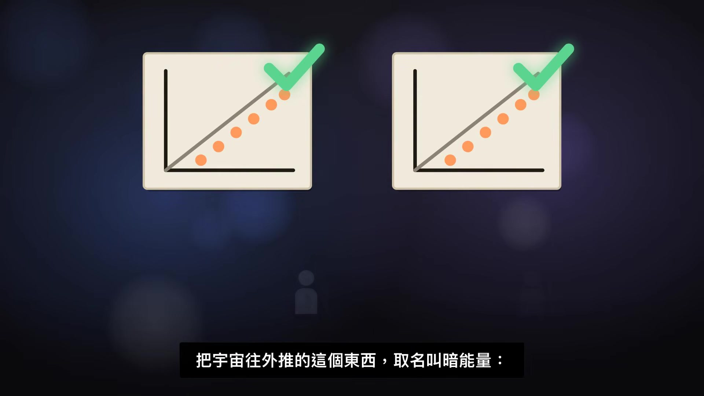

**逐字稿片段：** 取名叫暗能量 一種讓宇宙越脹越快的東西 我們只知道它造成的效果 不知道它是什麼 不知道是什麼 怎麼能說發現了 他的同事有一句話 聽他自己說 大勝利 可是這個結果可信嗎 Belling給了兩個理由 理論上 每一顆1A型超新星 燒掉的燃料差不多一樣多 觀測上 附近那些超新星修正之後 亮度差不到5% 要推翻暗能量 就得說遠方的超新星 顏色和變暗速度 都跟附近的一樣 卻剛好系統性的暗一點 他自己也懷疑過 結果剛公佈那陣子 他在研討會上 會把研究超新星的人拉到角落 請啤酒 灌到第四杯 再問 你真的相信暗能量嗎 對方就開始嘟弄 超新星有多少怪毛病 大家把這些怪毛病 一個一個檢查過 沒有一個解釋得了資料 其實這種東西 在愛因斯坦的方程式裡 早就有一個位置 1917年 愛因斯坦以為宇宙是靜止的 可是隻有重力的話 宇宙會自己塌下來 所以他在方程式裡

**話題推測：** 介紹導致宇宙加速膨脹的神秘力量：「暗能量」

---

## 00:21:34

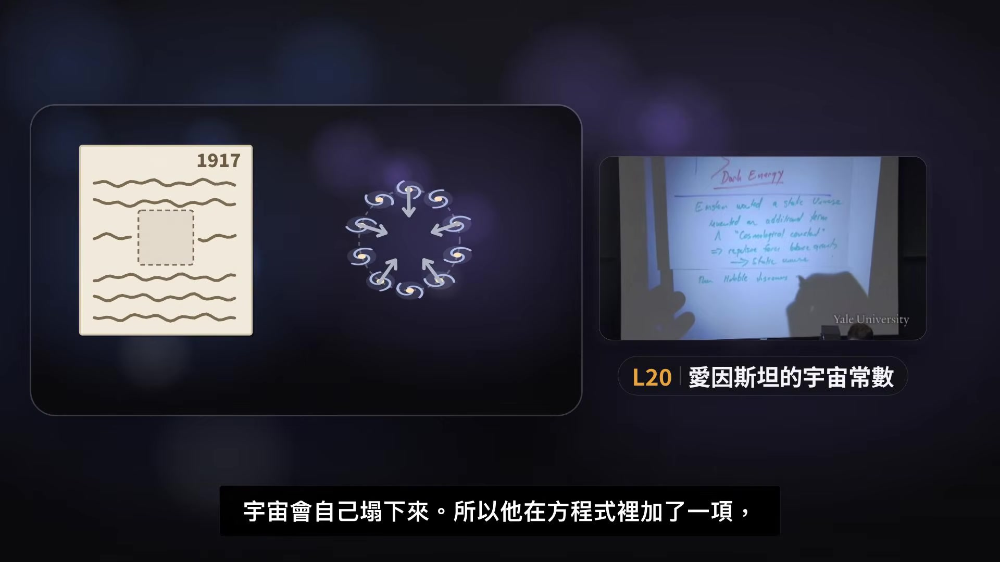

**逐字稿片段：** 加了一項叫宇宙常數 提供一股往外推的力量 讓宇宙剛好停住 十幾年後 Hubble發現宇宙在膨脹 這一項就不需要了 據說愛因斯坦後來說 這是他一生最大的錯誤 結果大約70年後 它回來了 暗能量最簡單的解釋 就是這個宇宙常數 貝林的寓意是 有意思的點子 會在別的地方再冒出來 而且比你想的更重要 可是它到底是什麼 物理學家試過一個答案 真空本身帶著能量 算出來的數字 比觀測到的大了

**話題推測：** 回溯愛因斯坦的「宇宙常數」與暗能量的關係

---

## 00:22:03

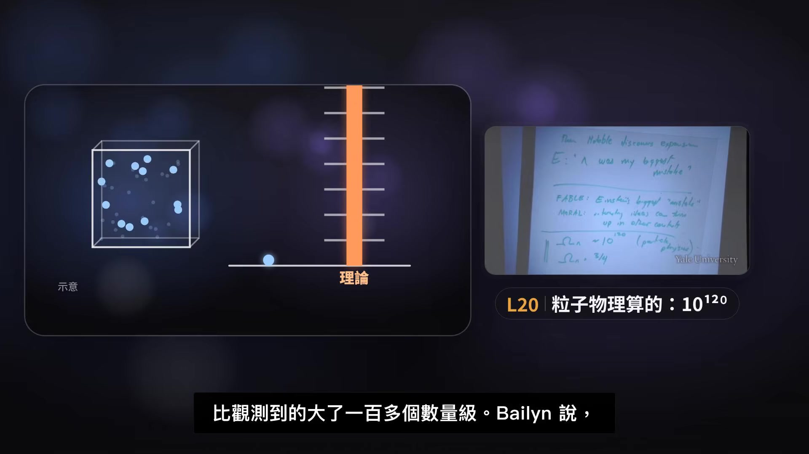

**逐字稿片段：** 100多個數量級 貝林說 這是科學史上 最錯的一次計算 錯得這麼離譜 反而引出一個問題 暗能量為什麼剛好這麼小 貝林在最後一堂課 算給學生看 暗能量如果比現在大大約100倍 宇宙一開始就漲得太快 物質來不及聚成星系 也就沒有恆星 沒有行星 沒有人 所以有一種想法說 我們存在本身就是一條線索 宇宙的這些數字 必須落在讓我們能存在的範圍裡 否則根本沒有人在這裡發問 那為什麼剛好落在這個範圍 有人說是巧合

**話題推測：** 提及真空能量計算與觀測到的暗能量存在100多個數量級的巨大差異

---

## 00:22:35

**逐字稿片段：** 有人說也許有非常多個宇宙 各自的數字都不一樣 我們只是剛好住在能住人的那一個 這到底算不算科學 有人說不算 因為其他宇宙沒辦法觀測 貝林自己也認為不算 可是他說 不是科學的問題 不代表不值得想 光靠超新星還不夠 他告訴你暗能量比物質多 可是兩個各有多少 得再找別的方法 另一條線 來自第一部分提過的那道光

**話題推測：** 提出「多重宇宙」的概念，解釋暗能量數值為何如此精確

---

## 00:22:59

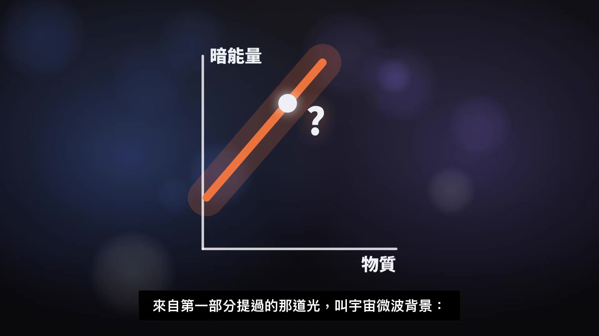

**逐字稿片段：** 叫宇宙微波背景 大霹靂之後大約38萬年 宇宙冷卻到大約3000度 光終於能自由穿過去 這道光走了130多億年 被拉長成微波 今天從天空的每一個方向照過來 它非常平滑 可是今天的宇宙有星系 也有大片的空洞 當年一定有一點起伏 1992年

**話題推測：** 再次提及宇宙微波背景輻射（CMB）作為測量暗能量的線索

---

## 00:23:19

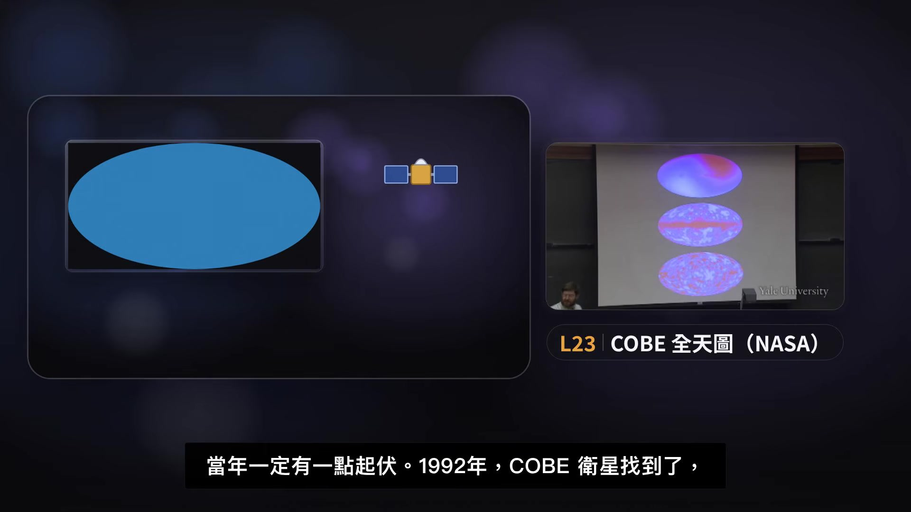

**逐字稿片段：** COBE衛星找到了 起伏只有十萬分之一 這個發現 在2006年拿到諾貝爾物理獎 接著2003年

**話題推測：** 介紹COBE衛星發現CMB微小起伏的貢獻

---

## 00:23:27

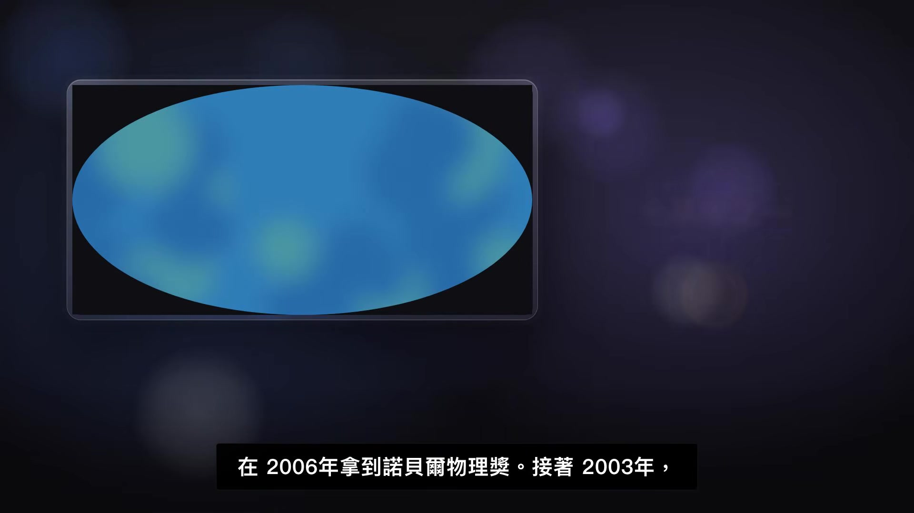

**逐字稿片段：** WMAP衛星畫出更精細的地圖 連起伏的大小都測量得出來 貝林說他現在還在運作 他在2010年退休 由歐洲的普朗克衛星接手 起伏的大小 告訴你物質加暗能量的總量 剛好等於靈界密度 第三條線 來自星系怎麼分佈 宇宙微波背景那時候 密度只差十萬分之一 今天 一杯水和星系之間的空間 密度差了十的三十次方倍 這中間是重力的功勞 稍微密一點的地方 重力稍微大一點 就把旁邊的物質吸過來 越吸越多 天文學家測量了大量星系的距離 畫出立體地圖 發現星系排成一面面的牆 和一條條的絲 中間是大片的空洞 再用電腦 從那十萬分之一的起伏開始 照重力一步一步算到今天 要長出這樣的網 需要多少暗物質 又給出一條線 兩個未知數 三條線 貝林說 平面上隨便畫三條線 通常不會剛好交在一點 如果交在一點 理論就通過了一次檢驗 他們交在一點 那個交點

**話題推測：** 介紹WMAP衛星繪製出更精細的CMB地圖

---

## 00:24:26

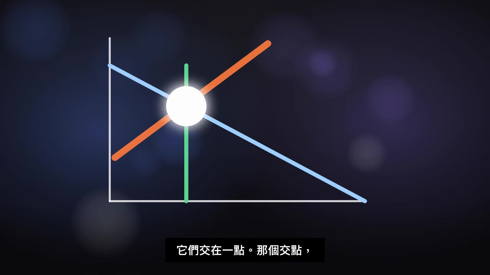

**逐字稿片段：** 就是貝林在課堂上畫的那張圓餅圖 照普朗克衛星2018年的最終結果 一般物質 也就是所有星星 行星 你和我 大約5% 暗物質 大約27% 暗能量 大約68% 這是2007年的前沿與爭議 也還是2026年的 整張圖有9乘5是我們不知道是什麼的東西 這張圖還說得出另一件事

**話題推測：** 展示宇宙組成的圓餅圖（一般物質、暗物質、暗能量比例）

---

## 00:24:49

**逐字稿片段：** 宇宙是從什麼時候開始加速的 物質會被膨脹稀釋 越往過去越密 暗能量的密度如果真是宇宙常數就一直不變 所以很久以前物質佔上風 膨脹在變慢 後來物質越來越稀 暗能量追上來 照現在的數字推算

**話題推測：** 探討宇宙何時從減速轉為加速膨脹的時間點

---

## 00:25:05

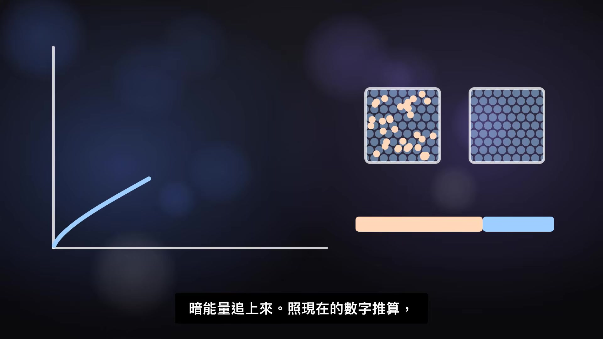

**逐字稿片段：** 大約60億年前 宇宙從減速轉成了加速 2004年 Rees用哈勃太空望遠鏡 找到幾顆特別遠的超新星 第一次看到這個轉折的跡象 貝林在課堂上 用他的大拇指法則檢查 任何一個點都用大拇指蓋住 看結論還在不在 蓋掉最後那兩點 轉折就不太明顯 今天 這樣的超新星已經累積到上千顆

**話題推測：** 指出宇宙約在60億年前開始加速膨脹

---

## 00:25:26

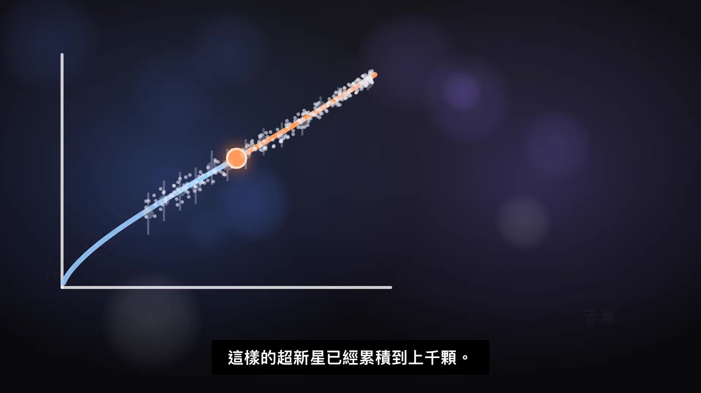

**逐字稿片段：** 韋伯太空望遠鏡還找到一顆 在宇宙只有二十幾億歲時爆炸 回到主問題 如果暗能量真的不變 宇宙會一直加速膨脹下去 遠方的星系 離開的速度會超過光速 它們的光再也到不了我們這裡 一個一個從天空消失 這不違反相對論 因為不是星系在空間裡移動 是空間本身在變大 很久很久以後 從我們的星系往外看 會是一片空空的黑 星星燒完 越來越冷 這是冰的版本

**話題推測：** 提及韋伯太空望遠鏡對極遠超新星的觀測

---

## 00:25:54

**逐字稿片段：** 有人叫它大凍結 如果暗能量會越來越強 結局更戲劇化

**話題推測：** 介紹宇宙加速膨脹的結局之一：「大凍結」

---

## 00:25:59

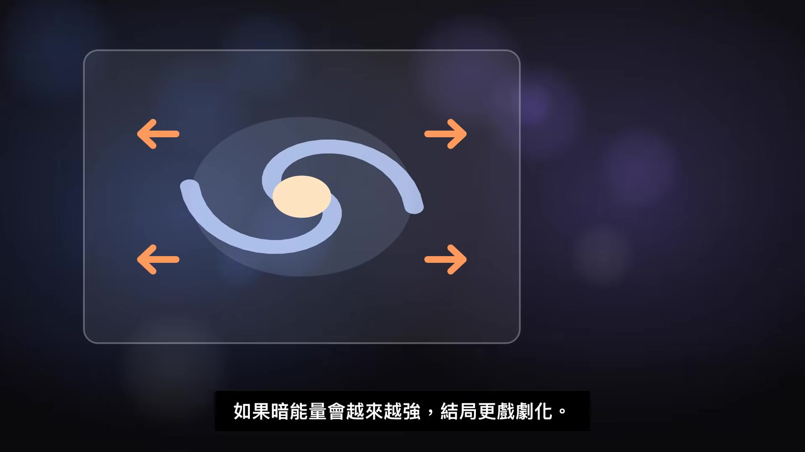

**逐字稿片段：** 貝林講了一個叫大撕裂的假說 暗能量先把星系撕開 再撕開恆星 再撕開人 他說人大約一立方公尺 一百公斤 最後連原子都撕開 他說沒什麼特別的理由相信它 但也還沒被排除 可以拿來逗學生開心 到底是哪一種 要知道暗能量會不會隨時間改變 得把那條轉折的線畫得更細 2007年 Balin介紹了兩個準備要做的計劃

**話題推測：** 介紹另一種更戲劇化的結局：「大撕裂」假說

---

## 00:26:23

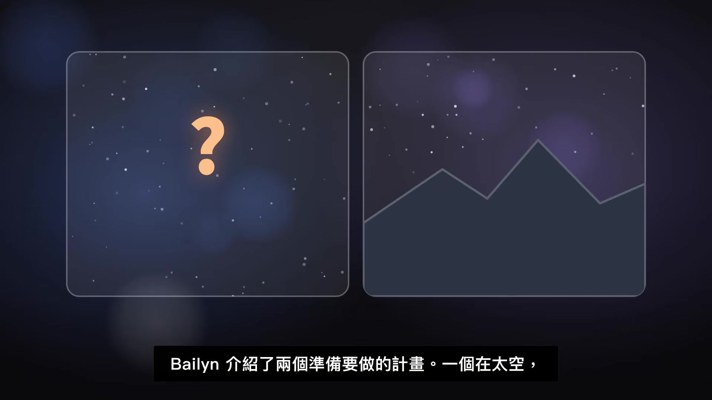

**逐字稿片段：** 一個在太空叫JDEM 由NASA和美國能源部合作 他開玩笑說 把這東西取名叫暗能量的人 應該得個獎 因為現在可以跟能源部要錢了 他介紹的其中一個提案 視野比哈勃太空望遠鏡大100倍以上 專門看紅外線 目標是找到大量紅移超過1的超新星 把轉折那一段畫清楚 那他什麼時候上天? 聽他自己說 到時候就知道了 實際上,這個計畫換了兩次名字 先叫WFIRST

**話題推測：** 介紹美國NASA與能源部合作的未來太空計畫JDEM（後來的羅曼太空望遠鏡）

---

## 00:27:04

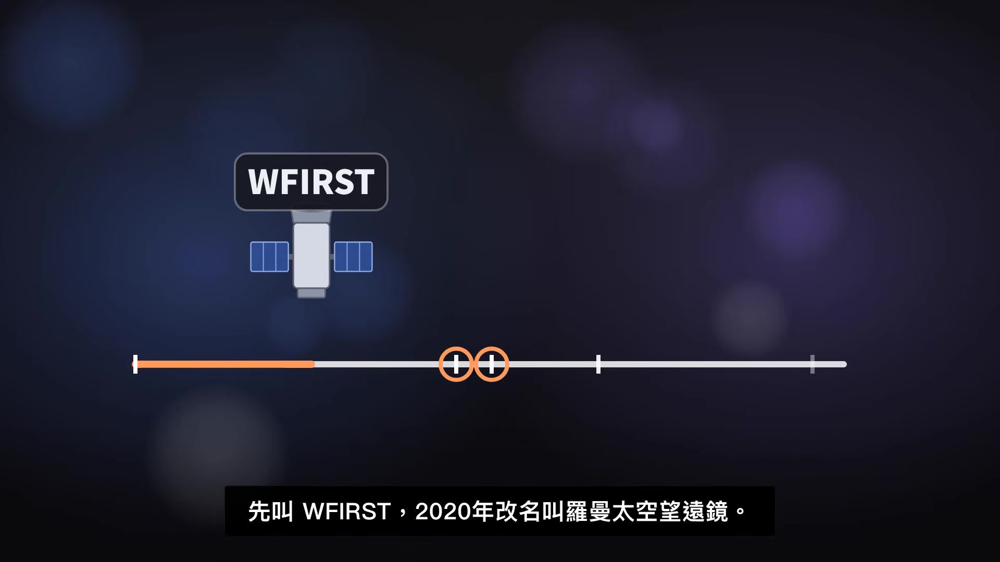

**逐字稿片段：** 2020年改名叫羅曼太空望遠鏡 2026年8月30日 他才終於升空 比他說的比較可能晚了9年 截至2026年10月還在調教階段 還沒開始正式觀測

**話題推測：** 確認JDEM計畫最終命名為「羅曼太空望遠鏡」

---

## 00:27:16

**逐字稿片段：** 另一個計劃在地上叫LSST 一座每隔幾個晚上 就把整片南方天空掃一遍的望遠鏡 一年可以找到上萬顆超新星 他最大的難題不在望遠鏡本身 聽他自己說 而最近LSST的新消息是

**話題推測：** 介紹地面大型掃描計畫LSST（後來的維拉魯賓天文臺）

---

## 00:27:43

**逐字稿片段：** Google已經加入了這個項目 所以我們正在為這個項目帶來大男孩 我覺得這是一個Google的宇宙 Google在2007年1月加入

**話題推測：** 提及Google加入LSST計畫，提供算力支援

---

## 00:27:58

**逐字稿片段：** 這座望遠鏡後來改名叫維拉魯賓天文臺 紀念前面那位測量星系轉速的Vera Rubin 是第一座以女性天文學家命名的美國國家天文臺 她在2025年6月公佈第一批影像 2026年6月底 10年的群天正式開始 不過最新的線索 來自另一個計劃

**話題推測：** 確認LSST計畫最終命名為「維拉魯賓天文臺」

---

## 00:28:15

**逐字稿片段：** 叫DESI 它不用超新星 而是畫出將近1500萬個星系 和類星體的立體地圖 從星系分佈裡 一樣看得到宇宙在加速 2025年3月 DESI公佈 把它的地圖跟超新星 宇宙微波背景放在一起看

**話題推測：** 介紹另一項利用星系分佈測量暗能量的計畫DESI

---

## 00:28:30

**逐字稿片段：** 暗能量可能正在變弱 可是這只是跡象 還沒達到宣佈發現的標準 之後也有分析認為 這個跡象沒有那麼強 完整的5年結果 預計2027年公佈 如果暗能量真的在變弱 大撕裂反而不太可能 宇宙的結局 又變成一個開放的問題 整理一下第三部分 也回答這一集的問題 照現在最好的數據 宇宙大概會一直膨脹下去 越來越冷 越來越空 結局是冰 只是這個答案 壓在一個 我們不知道是什麼的東西上 這門課的最後一堂 貝領回頭看那張 三條線交在一點的圖 換了一個角度 聽他自己說

**話題推測：** 根據DESI的新線索，暗示暗能量可能正在變弱

---

## 00:29:36

**逐字稿片段：** 本輪是這門課第一堂講過的故事 古人相信地球是宇宙中心 行星的軌道對不上 就在圓上再加一個小圓 觀測越準 小圓越加越多 直到有人換掉地球是中心這個前提 一切才變簡單 暗物質和暗能量 會不會也是本輪 貝林沒有下結論 他說壓標準物理通常比較穩 可是也留了另一種可能 聽他自己說 to bet on standard physics rather than revolutionary new ideas but if you keep at it for a quarter of a century and keep finding nothing you gotta start to wonder 他說三年後 到現在十九年了 暗物質還沒抓到 暗能量多了一條線索 可是還說不出是什麼 也有人走另一條路

**話題推測：** 回顧古天文學「本輪」概念，引導思考暗物質與暗能量的本質

---

## 00:30:33

**逐字稿片段：** 修改重力理論本身 到今天仍是少數派 回頭看這三集

**話題推測：** 提出修改重力理論，作為解釋暗物質與暗能量的另一種可能

---

## 00:30:37

**逐字稿片段：** 上集牛頓的重力就夠用 靠恆星晃動找到行星 終極,換成愛因斯坦 靠半星、重力波、影子找到黑洞 每一次檢驗,愛因斯坦都對 這一集,同一套重力 推出了宇宙的九成五看不見 下一步,是找到那些看不見的東西 還是再換一次重力理論 沒有人知道 這門課最後幾分鐘 貝倫把這三件事串在一起 那天早上 他剛跟學生講完一顆新發現的系外行星 聽他自己說 but not in the scientific journals 40 years ago the idea that you would have black holes to actually look at that you could pour gas into them and see what happens was equally unscientific 100 years ago the idea that you could say the idea that you could say was completely preposterous that was part of philosophy not part of science

**話題推測：** 總結上集牛頓重力理論的應用

---

## 00:31:31

**逐字稿片段：** 行星 黑洞 整個宇宙 就是這三集 他說完這段話之後的19年 重力波被收到 黑洞被拍到影子 韋伯太空望遠鏡上了天 魯賓天文臺開始掃描整片天空 羅曼太空望遠鏡剛剛升空 全課最後一段 聽他自己說 回到這一集的問題 宇宙最後會怎麼結束 照現在的數據 大概是冰 一直膨脹 越來越冷 越來越空 可是推動它的暗能量 我們還不知道是什麼 DESI的新線索 甚至暗示 它可能正在改變 三集 24堂課 同一個方法 看不見的東西 就從它怎麼拉動 看得見的東西 把它推出來 行星和黑洞 後來都被看見了 這一次 看不見的是 宇宙的九成物

**話題推測：** 將行星、黑洞與整個宇宙三個主題串聯，總結課程的核心思想

---

## 00:32:36

**逐字稿片段：** 最後問你一個問題 如果暗物質 一直找不到 你比較相信 宇宙裡真的有一種看不見的東西 還是我們的重力理論要再換一次 留言告訴我 耶魯天文課三集到這裡結束 喜歡的話訂閱AI Notebook 開啟通知 我們下次見

**話題推測：** 向觀眾提出一個關於暗物質與重力理論選擇的思考題

---
